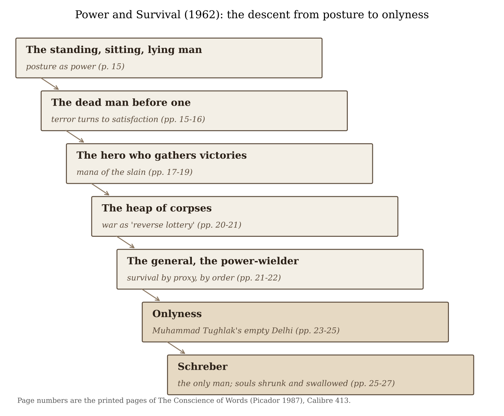
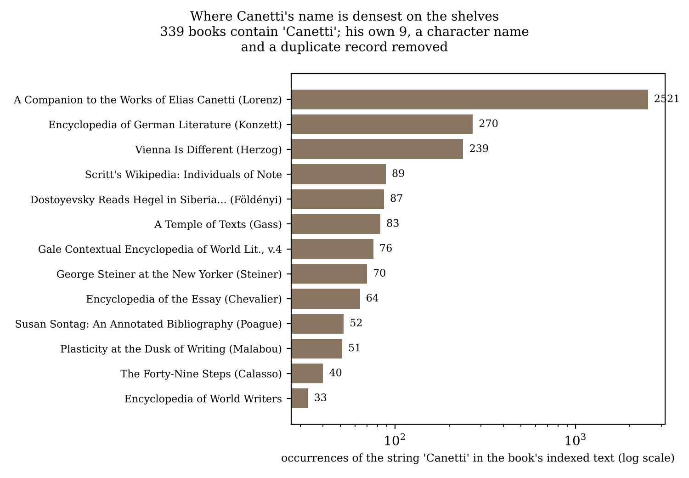

*[[shadows/weeks/elias-canetti|Elias Canetti (Author & Shadow)]] · Day 1 of 7 · 2026-10-26 · Difficulty 3 · Genealogy/influence, Conflict, Shared form or method*

## Books in this reading

- [[books/413-the-conscience-of-words-with-earwitness|The Conscience of Words (with Earwitness)]], [[people/elias-canetti|Elias Canetti]], [[people/joachim-neugroschel|Joachim Neugroschel]] (translator); 1976 (German); tr. Neugroschel; Picador ed. 1987. *Day 1 primary: the author's own work, standing in for Crowds and Power (not yet in the catalogue).*
- [[books/13883-the-travels-of-ibn-battuta-in-the-near-east-asia-a|The Travels of Ibn Battuta: In the Near East, Asia and Africa, 1325-1354]], [[people/ibn-battuta|Ibn Battuta]], [[people/samuel-lee|Samuel Lee]] (translator); 1829 (Lee translation). *Source check: Canetti's named source for the Delhi story; chapter XVI read and set against Canetti's retelling.*

## The shadow so far

| Citing Book | Relation | Target | Location |
|---|---|---|---|
| [[books/413-the-conscience-of-words-with-earwitness|The Conscience of Words]] (Elias Canetti) | **Quotes** | Elias Canetti | pp. 24 (‘Power and Survival’) |
| [[books/413-the-conscience-of-words-with-earwitness|The Conscience of Words]] (Elias Canetti) | **Argues with** | Elias Canetti | p. 25 (‘Power and Survival’) |

---

## Library resurfacing · An author and their shadow · Monday 26 October 2026

## 1. Where the week stands

This is the first day of the first shadow week. The author is Elias Canetti (1905–1994). Nothing has been found yet. Today’s job is to read Canetti in his own words and to set down the phrases the next five days will hunt for. One change of plan: *Crowds and Power* and *Auto-da-Fé* are not in the catalogue yet (the last book added before this run went in on 25 October at 13:02 UTC), so day 1 reads *The Conscience of Words* instead. Canetti himself names the essay that carries the big book: “Power and Survival”, he writes, “recapitulates one of the main thoughts in Crowds and Power, though somewhat differently and more pointedly” (Prefatory Remark).

## 2. The day’s finding

*The Conscience of Words* is the shortest way into *Crowds and Power* that the shelves hold, and Canetti meant it to work that way: “It has repeatedly been shown that this essay, in this concentrated form, is an apt introduction for the larger book” (Prefatory Remark). Its argument fits in one sentence of his: “The situation of survival is the central situation of power” (p. 16). Its rhetoric consists of telling a story and then naming it with a coinage. The coinages (*onlyness*, *reverse lottery*, *crowd-crystals*, *slow crowd*, *keeper of metamorphoses*) are the fingerprints the rest of the week will look for in other men’s books.

A second finding came from checking his sources against the library. Canetti’s central story, the Sultan of Delhi emptying his own capital and looking out over it from the roof, rests on Ibn Battuta, and Canetti stresses that the key sentence “is not a later invention or embroidery” (p. 24). The library’s Ibn Battuta (Samuel Lee’s abridged translation of 1829, Calibre 13883) does tell the story. It does not have the roof, the empty night, or the sentence Canetti builds the essay around. It also gives the blind man’s journey as ten days, not forty. Lee abridged the text, so this proves nothing against Canetti. It does show that the shelves here cannot confirm his best line.

Relations named today: **Quotes** (Canetti →Ibn Battuta, via a fuller translation than the one on the shelves) and **Argues with** (Canetti →Freud’s 1911 Schreber essay, which is not in the library).

The scope of the shadow: the full text shows **339 books containing “Canetti”**, **248 of them containing “Elias Canetti”** as an exact string, with 9 of his own works among them (a tenth, *Kafka’s Other Trial*, 3246, has no record in the full-text index). Every one is now a row in Mentions.

## 3. The book

***The Conscience of Words* (with *Earwitness*****) — Elias Canetti, essays and speeches 1936 and 1962 on (German 1976; tr. Joachim Neugroschel; Picador joint edition 1987). PDF (Internet Archive scan, OCR text layer), Calibre 413.**

**Selection logic.** The week’s plan wanted *Crowds and Power* for day 1, because it is the book most likely to have been used without credit. It is not on the shelves yet. *The Conscience of Words* is the next best thing on Canetti’s own authority. “Power and Survival” (1962) con-denses the book’s thesis, and “Hitler, According to Speer” (1971), in his words, “applies the insights of Crowds and Power to a specific figure” (Prefatory Remark). The volume also holds the essays on Kraus that day 4 needs, and the speech “The Writer’s Profession”, which gives the week its counter-figure. No Canetti title carries the Gestext flag yet (custom column 11 is empty for all ten records), so the flag could not break the tie.

**Overview.** The volume prints fourteen essays and speeches (one from 1936, the rest from 1962 on) in order of writing, after two prefaces. Canetti defends the mix in his Prefatory Remark: Confucius next to Hitler, Hiroshima next to a note on keeping diaries. “The public and the private can no longer be separated”, he writes. The book is *made* the way his notebooks are made, by adjacency. A memorial speech for Broch sits beside a theory of the survivor. Two essays on Kraus bracket the Speer essay. The book closes on a speech about what a writer is for. Then come fifty “characters” (*Earwitness*), small satirical types such as the Name-Licker and the Fame-Tester, built on the same trick as the coinages: a hyphenated noun and a page.

“Power and Survival” is the core, and it moves like a descent (Figure 1). It starts from posture: the standing man, the sitting man, the lying man. Then comes the dead man, whose sight turns terror into a satisfaction no one admits to. From there it goes to the hero who “gathers” his victories (the Polynesian *mana* of the slain, quoted from Handy), to war as a heap of corpses that each soldier expects to outlive, and to the general who survives by giving orders. It ends in two extremes. One is the Sultan Muhammad Tughlak emptying Delhi. The other is Schreber, the paranoid judge who believed he was the last man alive, with the souls of the dead raining onto him from the stars, shrinking and being swallowed.

**What it does to its sources.** Canetti retells and does not footnote. He quotes Handy once at length and names Ibn Battuta and Schreber. Everything else he compresses into anecdote and lifts onto a single noun. He disposes of Freud’s Schreber essay in a paragraph: “rarely has he come up with such an utter misinterpretation” (p. 25). Then he gives Freud an excuse that is really a theory of history: Freud wrote “before our century really commenced” (p. 25). The sources are used the way his sultan uses Delhi. They are emptied of their own context so that one figure can stand in them alone. Whether that is a fault or a method is the week’s first question.

**What a reader of the whole week should hold on to.** The survivor; onlyness; the heap; the sting and the command (promised here, p. 22: “for the moment, we cannot undertake a vastly important investigation of the phenomenon of orders”); crowd-crystals; open, closed and slow crowds; the crowd of the dead; the keeper of metamorphoses. And one habit: Canetti treats madness as evidence about power (“real power, in the extreme forms that we know, is no less a madness”, p. 27).

**Element 1 — Excerpt (opening of “Power and Survival”, p. 14; 204 words)**

> Among the most sinister phenomena in intellectual history is the avoidance of the concrete. People have had a conspicuous tendency to go first after the most remote things, ignoring everything that they stumble over close by. The elan of outgoing gestures, the boldness and adventure of expeditions to faraway places camouflage their motives. The not infrequent goal is to avoid what lies near because we are not

*Figure 1: The argument of “Power and Survival” as a descent.*

> up to it. We sense danger and prefer other and unknown perils. Even when these are found —and they are always found —they still have the glow of the sudden and the unique. One would have to be very narrow-minded to condemn this adventurousness of the mind, even though it sometimes comes from obvious weakness. It has led to an expansion of our horizon, of which we are proud. […]
>
> *(Shortened for the public edition.)*

(The scan’s OCR prints “elan” without its accent; it is kept as found.)

**Element 2 — Verified quotations (printed pages of the Picador edition)** All of these are checked by substring against the extracted text, with whitespace normalised and one line-end hyphen joined where noted.

- “Today I wish to speak about survival, by which I naturally mean the survival of others.” (p. 14)

- “The situation of survival is the central situation of power.” (p. 16)

- “The living man has used the other as a dummy, so to speak.” (p. 16)

- “reverse lottery, won only by the numbers that do not come out.” (p. 21)

- “For the true goal of the real power-wielder is as grotesque as it is incredible: he wants to be the only one.” (p. 22)

- “He wants to survive them all so that no one will survive him.” (p. 22)

- “ ‘Now my heart is tranquil and my wrath appeased.’ ” (p. 24, Canetti’s rendering of the sultan)

- “But the crucial moment is the moment of the sultan’s onlyness” (p. 24)

- “Whole constellations dissolved” (p. 26, Schreber’s stars)

- “He attracts and collects them, he reduces and devours them.” (p. 27)

- “a far more significant portion of any investigation of such power ought to deal with the question of why we obey it.” (p. 27)

- “flags, music, marching units, which operate as crowd-crystals” (“Hitler, According to Speer”, p. 68)

- “A different form of crowd, which I have called the slow crowd,” (p. 68)

- “The feeling for the crowd of the dead is decisive in Hitler. It is his real crowd.” (p. 74)

- “I have called the Dichter the keeper of metamorphoses” (“The Writer’s Profession”, p. 163)

- “for reasons I cannot now discuss, I prefer the more demanding word ‘metamorphosis’.” (p. 164)

**Element 3 — Concordance: Canetti’s Delhi against the library’s Ibn Battuta** Canetti says he has the sultan’s words “from a good source” (the scan reads “froma”): “the famous Arab traveller Ibn Batuta, who spent seven years at the sultan’s court and knew him very thoroughly.” (p. 24) Here is what the library’s copy says. *The Travels of Ibn Battuta*, tr. Samuel Lee (1829), Chapter XVI, Calibre 13883, read from its EPUB.

Detail in Canetti (pp. 24–25) Lee, ch. XVI

Letters thrown over the walls of the One letter “consisting of several pages”, audience hall thrown “over the gate of the palace” The sultan buys every house at full price Absent Herald: no one in the city after three days A proclamation; no number of days The cripple shot from a catapult The bed-ridden man “projected from a”

> ballista (OCR: “obalista”)

Detail in Canetti (pp. 24–25) Lee, ch. XVI

> “which is at the distance of ten days” The blind man dragged “a voyage of forty

days” “all that arrived in Daulatabad was a leg” “only one of his legs was brought to the

> place intended”

Not a cat, not a dog left; the sultan on the Absent roof at night “ ‘Now my heart is tranquil and my wrath Absent. Instead: “When I entered Dehli it appeased.’ ” was almost a desert.”

Lee worked from abridged Arabic manuscripts, and the fuller text was published later (De-frémery and Sanguinetti’s French edition; Gibb’s English). So the gaps are Lee’s, not proof that Canetti invented anything. Still, the sentence that makes the essay, the ruler’s peace in an empty world, cannot be checked against these shelves. The one line Lee has that Canetti did not use is perhaps the better epitaph: “the greatest city in the world had the fewest inhabitants.”

**Element 4 — A derived glossary: the week’s search terms** The right-hand column comes from a substring pass over the library’s whole indexed text (12,526 text records). It counts books containing each term with and without “Canetti” anywhere in them. These are leads for day 5, not findings.

Term (Canetti’s) Where he puts it Books with “Canetti” Books without

onlyness p. 24, the sultan 1 4 (incl. *The*

> *Weirdness of Being*, 27×; Witkiewicz, *Insatiability*)

reverse lottery p. 21, war 1 0 crowd crystal(s) p. 68; *Crowds and* 7 0

> *Power*

slow crowd p. 68 2 7 (mostly literal

> uses)

double crowd *Crowds and Power* 4 1 (Girard, *Job: The*

> *Victim of His People*)

invisible crowd *Crowds and Power* 4 19 (many literal) baiting crowd / *Crowds and Power* 3 / 2 0 / 0 lamenting pack power-wielder p. 22 (translator’s 2 3

> word)

keeper of p. 163 1 0 metamorphoses “Crowds and Power” — 82 3 (to be checked: (title) OCR may have split

> the name)

sting of command *Crowds and Power* 1 4: **false positives**,

> the string sits inside “consisting of commands”

*Figure 2: Where the name is densest.*

**Element 5 — A misreading worth attempting** Read Schreber’s stars as a picture of the commonplace book. Souls fall on the collector from every constellation, shrink to “a few millimetres”, and vanish into his body, “Everything they once were now benefits his own body” (p. 27). That is also what quotation does: other men’s sentences are gathered, reduced, and made to serve. Canetti’s remedy, in the same volume, is the “keeper of metamorphoses”, who does not swallow people but turns into them. The week’s own method sits awkwardly between the two. It collects 339 books that name one man and then draws them into a map with him at the centre. Day 7 should ask which of the two figures the map resembles.

## 4. The shadow so far

From Relation To Location

Canetti, *The* Quotes (via a fuller Ibn Battuta, *Travels*, p. 24 *Conscience of Words* translation) tr. Lee (13883), (413) ch. XVI Canetti, *The* Argues with Freud, p. 25 *Conscience of Words* “Psychoanalytical (413) Remarks on an

> Autobiographically Described Case of Paranoia” (1911; not in the library)

Day 1’s edges run outward from the author. From day 2 on they run inward, toward him.

## 5. Where this sends you

**Notebook**

1. Canetti says the dead man is “a confrontation with one’s own death; less than this, since one does not really die of it, more than this since someone else is always there” (p. 15). Write a page on the “more than this”: what does the presence of another body add to knowledge of death?

2. Take a sentence you own that you cannot verify, the way Canetti could not have expected his readers to verify the sultan’s. What would it cost you to cut it? What would it cost to keep it?

3. *Earwitness* turns types into hyphenated nouns (the Name-Licker, the Fame-Tester). Coin three for the people in your own library: the Footnote-Hoarder, perhaps. Give each one a paragraph in Canetti’s present tense.

**Rabbit holes**

- Ibn Battuta, Lee’s translation online, the Delhi chapter (the same text as your copy): https://franpritchett.com/00generallinks/ibnbatuta/05delhi.html

| • Freud, | Psychoanalytische | Bemerkungen | über | einen | autobiographisch | beschriebe- |
|---|---|---|---|---|---|---|
| *nen Fall von Paranoia*, the essay Canetti tells you to ignore (Projekt Gutenberg): |  |  |  |  |  |  |
| https://www.projekt-gutenberg.org/freud/paranoia/index.html |  |  |  |  |  |  |
| • *Crowds and Power* (*Masse und Macht*, 1960), overview and reception: https://en.wikipedia.org/wiki/Crowds_and_Power |  |  |  |  |  |  |
| edia.org/wiki/Crowds_and_Power |  |  |  |  |  |  |
| • Nobel Prize 1981, “for writings marked by a broad outlook, a wealth of ideas and artistic |  |  |  |  |  |  |
| power”: https://www.nobelprize.org/prizes/literature/1981/canetti/facts/ |  |  |  |  |  |  |
| • Sontag’s “Mind as Passion” (1980), her essay on Canetti, collected in *Under the Sign of* |  |  |  |  |  |  |
| *Saturn*: https://en.wikipedia.org/wiki/Under_the_Sign_of_Saturn |  |  |  |  |  |  |

**Also in your library**

- Eric L. Santner, *My Own Private Germany: Daniel Paul Schreber’s Secret History of Modernity* (Calibre 13456). It credits Canetti’s reading of Schreber as “broad and idiosyncratic” (index snippet, unverified), which makes it a day-3 candidate.

- *The Travels of Ibn Battuta*, tr. Samuel Lee (Calibre 13883). Chapter XVI is the source above.

- Dagmar C. G. Lorenz (ed.), *A Companion to the Works of Elias Canetti* (Calibre 3312). With 2,521 occurrences of the name, it is the densest node in the shadow.

## 6. From the Lexicon: Constellations

**Received vs. your sense.** Received, in the Lexicon: “A method of arranging visual data and motifs in a non-linear layout to reveal transfers of knowledge.” Your own definition is still empty.

**Etymology.** Late Latin *constellatio* (set of stars), from *con-* “together” and *stella* “star”. The astrological sense, the stars’ combined influence at a birth, came before the general “arrangement”.

**WordNet.** Two senses. (1) *configuration, constellation*: “an arrangement of parts or elements” (noun.cognition; hypernym: design). Example: “the outcome depends on the configuration of influences at the time.” (2) “a configuration of stars as seen from the earth” (noun.object).

**Relations / lineage.** Lineages in the Lexicon: Aby Warburg; Post-structuralism. It shares lineage with Graphesis, Visual Knowledge Production, Rhizomatic Mapping, Bilderatlas Mnemosyne, Capta, Warburg-style grid, Episteme, Subject.

**Portable axiom.** None recorded.

**Why today.** In Canetti’s Schreber, the constellations are where the dead live, and power is what makes them come apart. At the end of this week the shelves will be drawn as a constellation with Canetti at its centre.

**Verified occurrence.** “Whole constellations dissolved” (Canetti, *The Conscience of Words*, p. 26, Calibre 413). Substring-checked. Nothing in the Lexicon’s Attestations field is presented here as verified.

**New in the Lexicon** (added 24–25 October): Samekh, portmanteau, dandiprat, emphyteusis, Cognates, bibliomancy, tephromancy.

## 7. To carry

> “The situation of survival is the central situation of power.” — Elias Canetti, “Power and Survival” (1962), in *The Conscience of Words*, tr. Joachim Neugroschel, p. 16.

*Method note.* The calibre plugin’s full-text search timed out on every call this morning, though its library_info answered. Rather than fall back to the catalogue, this run read calibre’s own index database (full-text-search.db, opened read-only and immutable) directly and ran a substring pass over all 12,526 indexed text records. The pass is case-sensitive for the name and does not stem. Because it is a substring test rather than an FTS match, its count (248 books with “Elias Canetti”) is not directly comparable with the 230 the index reported on 25 October. Scribrarium was mounted on the Mac and not modified.

## Themes

[[themes/crowd|crowd]] · [[themes/metamorphosis|metamorphosis]] · [[themes/onlyness|onlyness]] · [[themes/paranoia-schreber|paranoia (Schreber)]] · [[themes/power|power]] · [[themes/sources-and-their-verification|sources and their verification]] · [[themes/survival|survival]] · [[themes/the-coinage-as-method|the coinage as method]]

---

Previous: [[triads/2026-10-25-the-pattern-determines-the-parts|The Pattern Determines the Parts]]  
Next: [[shadows/2026-10-27-shadow-elias-canetti-day-2-the-quotation-survives|Shadow — Elias Canetti, day 2: The Quotation Survives]]
