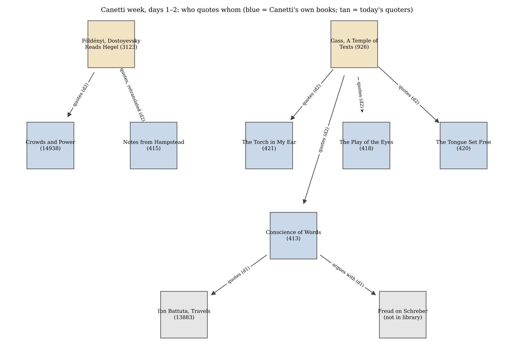

*[[shadows/weeks/elias-canetti|Elias Canetti (Author & Shadow)]] · Day 2 of 7 · 2026-10-27 · Difficulty 3 · Genealogy/influence, Conflict*

## Books in this reading

- [[books/3123-dostoyevsky-reads-hegel-in-siberia-and-bursts-into|Dostoyevsky Reads Hegel in Siberia and Bursts Into Tears]], [[people/laszlo-f-foldenyi|László F. Földényi]], [[people/ottilie-mulzet|Ottilie Mulzet]] (translator); Hungarian essays 1990–2015; English 2020 (Yale UP). *Day 2 primary (quotes): 'A Capacity for Amazement: Canetti's Crowds and Power Fifty Years Later' and 'Mass and Spirit'.*
- [[books/926-a-temple-of-texts|A Temple of Texts]], [[people/william-h-gass|William H. Gass]]; 2006 (essays; 'The Road to the True Book' first in The New Republic, Nov. 1982, revised). *Day 2 primary (quotes): 'The Road to the True Book' (on the memoirs) and 'Influence' (Palace of Justice, Büchner, Brand/Kant/Kien).*
- [[books/14938-crowds-and-power|Crowds and Power]], [[people/elias-canetti|Elias Canetti]], [[people/carol-stewart|Carol Stewart]] (translator); 1960 (German); English 1962. *Source check for Földényi's quotations and his first-person claim (not read as a primary).*
- [[books/421-the-torch-in-my-ear|The Torch in My Ear]], [[people/elias-canetti|Elias Canetti]]; 1980 (German); English 1982. *Source check for Gass's block quotations.*
- [[books/418-the-play-of-the-eyes|The Play of the Eyes]], [[people/elias-canetti|Elias Canetti]], [[people/ralph-manheim|Ralph Manheim]] (translator); 1985 (German); English 1986. *Source check for Gass's 'Influence' (Büchner night).*
- [[books/420-the-tongue-set-free|The Tongue Set Free]], [[people/elias-canetti|Elias Canetti]]; 1977 (German); English 1979. *Source check for Gass (the knife and the tongue).*
- [[books/415-notes-from-hampstead-the-writer-s-notes-19541971|Notes From Hampstead: The Writer's Notes: 1954–1971]], [[people/elias-canetti|Elias Canetti]], [[people/john-hargraves|John Hargraves]] (translator); 1994 (German); English 1998. *Source check: published English of the note Földényi retranslates from German.*

## The shadow so far

| Citing Book | Relation | Target | Location |
|---|---|---|---|
| [[books/413-the-conscience-of-words-with-earwitness|The Conscience of Words]] (Elias Canetti) | **Quotes** | Elias Canetti | pp. 24 (‘Power and Survival’) |
| [[books/413-the-conscience-of-words-with-earwitness|The Conscience of Words]] (Elias Canetti) | **Argues with** | Elias Canetti | p. 25 (‘Power and Survival’) |
| [[books/3123-dostoyevsky-reads-hegel-in-siberia-and-bursts-into|Dostoyevsky Reads Hegel in Siberia and Bursts Into Tears]] (László F. Földényi) | **Quotes** | Elias Canetti | 'A Capacity for Amazement', n. 3 (Stewart p. 411) |
| [[books/3123-dostoyevsky-reads-hegel-in-siberia-and-bursts-into|Dostoyevsky Reads Hegel in Siberia and Bursts Into Tears]] (László F. Földényi) | **Quotes** | Elias Canetti | 'A Capacity for Amazement', n. 1 (Nachträge aus Hampstead, p. 32) |
| [[books/926-a-temple-of-texts|A Temple of Texts]] (William H. Gass) | **Quotes** | Elias Canetti | 'The Road to the True Book' |
| [[books/926-a-temple-of-texts|A Temple of Texts]] (William H. Gass) | **Quotes** | Elias Canetti | 'The Road to the True Book' |
| [[books/926-a-temple-of-texts|A Temple of Texts]] (William H. Gass) | **Quotes** | Elias Canetti | 'Influence' |
| [[books/926-a-temple-of-texts|A Temple of Texts]] (William H. Gass) | **Quotes** | Elias Canetti | 'Influence'; also 'The Road to the True Book' (‘the last common property’; Confucius) |

---

## Tuesday 27 October 2026

## 1. Where the week stands

The author is Elias Canetti, and this is day 2 of 7. On day 1, Crowds and Power was not yet in the catalogue, so the day read *The Conscience of Words* (413) instead. It recorded the thesis “The situation of survival is the central situation of power” and a set of coinages to search for on day 5. It also found that the library’s Ibn Battuta cannot confirm Canetti’s key line about the sultan. *Crowds and Power* (14938) and *Auto-da-Fé* (14962) were added on 26 October, so today the quotations of *Crowds and Power* can be checked against the book itself.

## 2. The day’s finding

**Relation: Quotes.** Two writers quote Canetti at length: László F. Földényi on *Crowds and Power*, and William H. Gass on the memoirs. I checked their quotations of Canetti against his own books in the library: every quotation in Földényi’s “A Capacity for Amazement” whose source is on the shelves (two notes cite German secondary volumes that are not), and the block and inline quotations in Gass’s two Canetti essays. The quotations come through almost intact: six from *Crowds and Power* are verbatim to Carol Stewart’s translation, and Gass’s block quotations have only two small slips. The prose *around* the quotations is where things move. Földényi says Canetti “never employs the first-person singular”, and the book contradicts him. He also gives a Canetti notebook entry in a fresh English version that differs from the published one. Gass shortens the history of the hero’s name from Brand →Kant →Kien to Kant →Kien, and glosses *Kien* as “kindling” where Canetti gives “Pinewood”. So the quoted words survive and their surroundings drift. That ties back to day 1, where Canetti’s own quotation of Ibn Battuta could not be confirmed from the library’s edition.

## 3. The books

## 3a. Dostoyevsky Reads Hegel in Siberia and Bursts into Tears — László F. Földényi (Hungarian essays 1990–2015; English trans. Ottilie Mulzet, Yale UP, 2020; EPUB; Calibre 3123, Gestext)

**Why this book.** I scanned the 330 non-own books in the week’s Mentions list for occurrences of “Canetti” and “Crowds and Power”. This book came second only to the *Companion* (3312), with 87 and 32. Unlike the Companion and the encyclopedias, it is an essayist quoting another essayist. The collection opens with “Mass and Spirit”, dedicated “In memory of Elias Canetti on the ninetieth anniversary of his birth”, and closes with “A Capacity for Amazement: Canetti’s Crowds and Power Fifty Years Later” (Hungarian original 2010).

*Figure 1: Edges so far (days 1–2)*

**Overview.** Földényi does not read *Crowds and Power* as anthropology or political science. He reads it as a vision of power, comparable to Nietzsche at Sils Maria, and sets it against Hegel’s Africa lectures. Where Hegel turns away from African kingship (“an unhistorical continent”), Canetti returns to it chapter after chapter. Földényi also openly concedes the book’s academic weaknesses: “His citation apparatus, for example, is, to put it mildly, unusual.” His own conclusion is that he “would not compare his work with that of Hannah Arendt, but with Kafka’s.”

**Element 1 — Concordance of his quotations against the Stewart translation (Calibre 14938, EPUB)**

> Quoted words Found in *Crowds and*

Földényi’s note (opening) *Power* (section) Result

n. 2 and n. 8 “He thought much, The Survivor: verbatim (Stewart p. 277) but his thoughts Immortality

> were never cold.” (Stendhal)

n. 3 (p. 411) “his despots may use Rulers and verbatim; capital *H*

| more effective | Paranoiacs: African | lowered; preceding |
|---|---|---|
| means…” | Kings | sentence paraphrased |

n. 10 (p. 15) “As soon as a man The Crowd: The Fear verbatim (cut at

| has surrendered | of being Touched | “there”) |
|---|---|---|
| himself to the |  |  |
| crowd…” | The Entrails of | verbatim |

n. 12 (p. 210) “Nothing has been

> Power so much part of one…” / “Something alien is seized…” The Command verbatim, with n. 13 (p. 306) “Those most beset by ellipsis commands are children…” verbatim; “[the The Command: n. 14 (p. 333) “We must have the

| courage to stand | Commands and | command]” replaces |
|---|---|---|
|  | Irresponsibility | “it” |
| against [the |  |  |
| command]…” |  |  |

The one passage he paraphrases rather than quotes is the one with the moral turn in it. Canetti: “It is not for a European of the 20th century to regard himself as above savagery. His despots may use more effective means, but their ends often differ in nothing from those of these African Kings.” (Rulers and Paranoiacs: African Kings). Földényi: “As Canetti puts it in the book: the European bourgeois of the twentieth century thinks that he stands above the African king, yet ‘his despots may use more effective means, but their ends often differ in nothing from those of these African Kings.’ ” (“A Capacity for Amazement”). Canetti’s “European of the 20th century” has become “the European bourgeois”. That is a class Canetti does not name in this passage.

**Element 2 — Two claims tested against the text**

1. *“Canetti never employs the first-person singular, and yet his book is deeply personal.”* (“A Capacity for Amazement”). This is false of the English text. Canetti’s own prose, outside the passages he quotes, has “I have discussed open and closed crowds and explained that these terms refer to” (The Crowd); “I am here deliberately opposing all the usual concepts of tribe, sib, clan” (The Pack); and “I use the same word ‘pack’ for the three other basic formations I have mentioned.” (The Pack). A crude pattern count (“I have / I shall / I am…”) finds 166 matches in the EPUB. Many of these belong to quoted travellers, so the number is only an upper bound. What Földényi probably means is that there is no *autobiographical* I. The *I* that is there is the lecturer’s: it announces, classifies and defers (“I shall show later”).

2. *“I have often thought that this is the most important book I know.”* Földényi cites the German *Nachträge aus Hampstead* (p. 32) about Bleek and Lloyd’s *Specimens of Bushman Folklore*. The library’s English *Notes from Hampstead* (415, entry for 1960, after a note on Pavese’s journal) reads: “I have often considered it the most important book I know.” So the same sentence exists in two Englishes, one per translator. Both are accurate. Only one is the published text.

**A lead for day 3.** Földényi quotes the critic Edward Rothstein (*New Republic*, January 1990): “Under Canetti’s gaze, the crowd becomes an organism, a beast that crouches under the phenomena of world history. The result is a sort of mystical primitivism.” That is an argument, not a mention, and it should be followed up tomorrow.

## 3b. A Temple of Texts — William H. Gass (Knopf, 2006; EPUB; Calibre 926, Gestext)

**Why this book.** It has 83 occurrences of “Canetti” and two essays that use him: “The Road to the True Book” and the earlier essay “Influence”. According to the book’s own acknowl-edgements, “The Road to the True Book” first appeared as “a review of Elias Canetti’s autobiography, The New Republic, November 1982”. The text as printed mentions *The Play of the Eyes* and opens its last section with “A deceased Nobel laureate, Elias Canetti has now achieved such fame as to be unknown all over the world.” Canetti was alive in 1982, so the essay has been revised since then, and the revision is not marked.

**Overview.** Gass begins with his own non-meeting with Canetti at a Berlin party with three bands playing, where nothing could be heard. He then turns the anecdote on himself: “Then the word I—that moist reedlike letter that makes the winds sing, that wonderful word for me—takes ten typical bows in our specimen paragraph”. His subject is autobiography and the honesty of memory (“Well … to remember is to give limbs to a new lie.”). He praises Canetti for keeping what the adult knows separate from what the child knew: “Canetti’s tact with time and knowledge is one of the artistic triumphs of these memoirs.” In “Influence”, Gass tells the night of Büchner from *The Play of the Eyes* and the burning of the Palace of Justice on 15 July 1927.

**Element 1 — His quotations, checked**

Gass quotes Source in the library Result

“I bow to memory, every *The Torch in My Ear* (421), verbatim except “beat person’s memory…” (block) ch. “Escape” alongn” (Gass) for “beat

> along” (Canetti)

“The threat with the knife *The Tongue Set Free* (420), verbatim; Gass inserts worked,” … “the child quite “My Earliest Memory” “Canetti writes” where the literally held his tongue for source has a comma ten years.” “a coward who refused to *Torch* (421), “The Pension verbatim look life in the face because Charlotte” of mere books…”

Gass quotes Source in the library Result

“I did not realize how much I *Torch* (421), “The Letters in verbatim learned in the laboratory…” the Tree” ending “each individual human being, bound in himself.” “the last common property” *Conscience of Words* (413), verbatim

> “Hermann Broch”, p. 13 (“Air is the last common property.”)

“… everything it contains *Conscience of Words* (413), verbatim (the OCR splits and indeed everything it “Confucius in His “every- thing” and reads the lacks is important.” Conversations”, p. 94 italic *lacks* as “/acks”) “I had lost my right to *The Play of the Eyes* (418), verbatim books”; “It was as if I had “Büchner in the Desert” been struck by lightning.”; “My novel that I’d been so proud of crumbled into dust and ashes.”

> one tense slip *Play of the Eyes* (418) reads Büchner block: “which had “which I **had** never touched.” long been on my shelf but

which I have never touched.”

**Element 2 — A derived list: the hero’s three names**

Gass: “Moreover, after at first naming the character Kant, he called him Kien, meaning ‘kindling,’ so what was possible for that person but ignition?” (“Influence”).

Canetti, “The First Book: Auto-da-Fé”, in *The Conscience of Words* (413):

1. **Brand** (“burning, fire”). After the fire of 15 July 1927, in the *Human Comedy of Mad-men* sketches, Canetti gave the bookworm B. the name Brand: “Nevertheless, the name Brand began hemming me in as I wrote the novel.” (p. 127)

2. **Kant**: “I redubbed him Kant, and he bore that name undisturbed for a long time.” (p. 127). The manuscript was titled *Kant Catches Fire*.

3. **Kien**, in 1935, at Broch’s urging: “The man was now called Kien (Pinewood), something of his combustibility got back into his name.” (p. 134)

So the first name was not Kant. It was already *fire*. Gass’s ignition joke works better than he knew. He reaches the point (the name carries the fire) through the wrong door (*kindling*), and the name he leaves out is the one that would have proved his point.

**A misreading worth attempting.** Gass writes that at the 1927 fire “ninety people were killed and many more injured”. (Wikipedia gives 89 protesters and five police dead; see Rabbit holes.) Read the Brand/Kant/Kien sequence as a crowd crystal in miniature: one name holding the event, one hiding it under philosophy, and a third bringing it back in a plainer form. Then ask whether Canetti’s memoirs, which Gass admires for “tact with time and knowledge”, do to the fire what the second name did.

## 4. The shadow so far

From Relation To Location

> pp. 24, “Power and Canetti, *The* Quotes Ibn Battuta, *Travels*

*Conscience of Words* (13883) Survival” (day 1) (413) Canetti, *The* Argues with Freud on Schreber p. 25 (day 1) *Conscience of Words* (not in library) (413) Földényi (3123) Quotes *Crowds and Power* “A Capacity for

> (14938) Amazement”, nn. 2–3, 8, 10, 12–14

Földényi (3123) Quotes *Notes from* “A Capacity for

| (retranslated) | Hampstead (415) | Amazement”, n. 1; |
|---|---|---|
|  |  | 415: 1960 |

Gass (926) Quotes *The Torch in My Ear* “The Road to the

> (421) True Book”

Gass (926) Quotes *The Play of the Eyes* “Influence”

> (418)

Gass (926) Quotes *The Tongue Set Free* “The Road to the

> (420) True Book” *The Conscience of* “Influence”; “The Gass (926) Quotes /

| misremembers | Words (413) | Road to the True |
|---|---|---|
|  |  | Book” |

## 5. Where this sends you

**Notebook**

1. Földényi says Canetti “never employs the first-person singular”, and the book’s lecturing *I* (“I shall show later”) says otherwise. Write a page of your own in which the *I* only organises, never confesses. Then ask whether that *I* is less personal or more.

2. Brand →Kant →Kien. Rename something of yours (a character, a project, a notebook) three times: once for what caused it, once to hide the cause, once to let it back in plainer.

3. Gass’s party, where “We shouted (I shouted), but we didn’t speak”, against Canetti’s “Air is the last common property.” Write about a meeting that failed because of the air: noise, distance, an intermediary passing words “like notes in bellowed code.”

**Rabbit holes** (each checked today)

- Hazel Antaramian Hofman, review of Földényi’s *Dostoyevsky Reads Hegel* (IDSVA, 2020): https://www.idsva.edu/articles/book-review-laszlo-f-foldenyi-dostoyevsky-reads-hegel-in-siberia-and-bursts-into-tears

- roughghosts, “There be monsters”, on the same book and its two Canetti essays: https://roughghosts.com/tag/laszlo-foldenyi/

- Bleek and Lloyd, *Specimens of Bushman Folklore* (1911), Internet Archive: https://archive.org/details/specimensofbushm00blee/page/2/mode/2up

- July Revolt of 1927 (the Palace of Justice fire; mentions Canetti): https://en.wikipedia.org/wiki/July_Revolt_of_1927

- Obelism (marginal critical signs, Aristarchus): https://en.wikipedia.org/wiki/Obelism

- Gass, *A Temple of Texts*, publisher’s page: https://penguinrandomhouse.com/books/58636/a-temple-of-texts-by-william-h-gass

**Also in your library**

- *Notes from Hampstead* (415): the 1960 entry on Pavese and the Bushman book, in the published English.

- Büchner, *Lenz* (884): the tale that made Canetti’s “novel that I’d been so proud of” crumble; its text contains “Canetti” 7 times.

- Iosi Havilio, *Paradises* (4766): 65 occurrences of “Canetti”, none of them Elias. In an early chapter, at the Buenos Aires zoo: “He introduces himself: Canetti, with a double t, head janitor.” This is the false positive the week was warned about, and the one worth keeping.

## 6. From the Lexicon — obelism

**Received.** The act or practice of obelizing: marking a passage in a manuscript with an obelus (a horizontal stroke, later ÷ or †) to flag it as spurious or doubtful. By extension, the whole system of marginal critical signs. Introduced by Zenodotus of Ephesus in his Alexandrian Homer and elaborated by Aristarchus; Origen used obelus and metobelus in the Hexapla. **Your sense:** not yet written.

**Etymology.** From Middle Greek *obelismos*, from Greek *obelizein* (“to mark with an obelus”), from *obelos* (“spit, skewer”) + *-ismos*.

**WordNet.* Obelism* and *obelus* are absent. The nearest synset is noun.communication, oewn- 06841579-n, *dagger, obelisk*: “a character used in printing to indicate a second cross reference or footnote when the asterisk has already been used”.

**Relations.** It shares a lineage in the Lexicon with *Eklogē*, *Marginalia*, *Redaction*, *Anagnō- sis*, *Hypomnēmatismos*, *Colophon* and *bibliomancy*. Boundary tension, from the entry: “An obelized line was kept in the text and flagged (athetesis), not deleted: the mark records doubt rather than excision.”

**Portable axiom.** None recorded.

**Why today.** Today’s method was obelism without the dagger. Every quotation was kept and checked, and the marks fell on the frame around the quotations: *never* the first person, *Kant* first, *kindling*. The Alexandrian rule (doubt the line, keep the line) is the right rule for a quoter’s paraphrase.

**Verified occurrence.** None sought today.

**New in the Lexicon** since the last run: *Onliness* and *onlyness* (both from day 1’s coinage), *sodalities*, *cyclorama*.

## 7. To carry

“I bow to memory, every person’s memory.” — Elias Canetti, *The Torch in My Ear*, ch. “Escape” (quoted by Gass, “The Road to the True Book”)

## Themes

[[themes/autobiography|autobiography]] · [[themes/brand-kant-kien|Brand/Kant/Kien]] · [[themes/bushman-folklore|Bushman folklore]] · [[themes/first-person|first person]] · [[themes/hegel-and-africa|Hegel and Africa]] · [[themes/memory|memory]] · [[themes/naming|naming]] · [[themes/obelism|obelism]] · [[themes/palace-of-justice-fire-1927|Palace of Justice fire 1927]] · [[themes/paraphrase|paraphrase]] · [[themes/quotation|quotation]] · [[themes/retranslation|retranslation]] · [[themes/translation|translation]]

---

Previous: [[shadows/2026-10-26-shadow-elias-canetti-day-1-the-only-man|Shadow — Elias Canetti, day 1: The Only Man]]  
Next: [[shadows/2026-10-28-shadow-elias-canetti-day-3-mob-or-organisation|Shadow — Elias Canetti, day 3: Mob or Organisation]]
