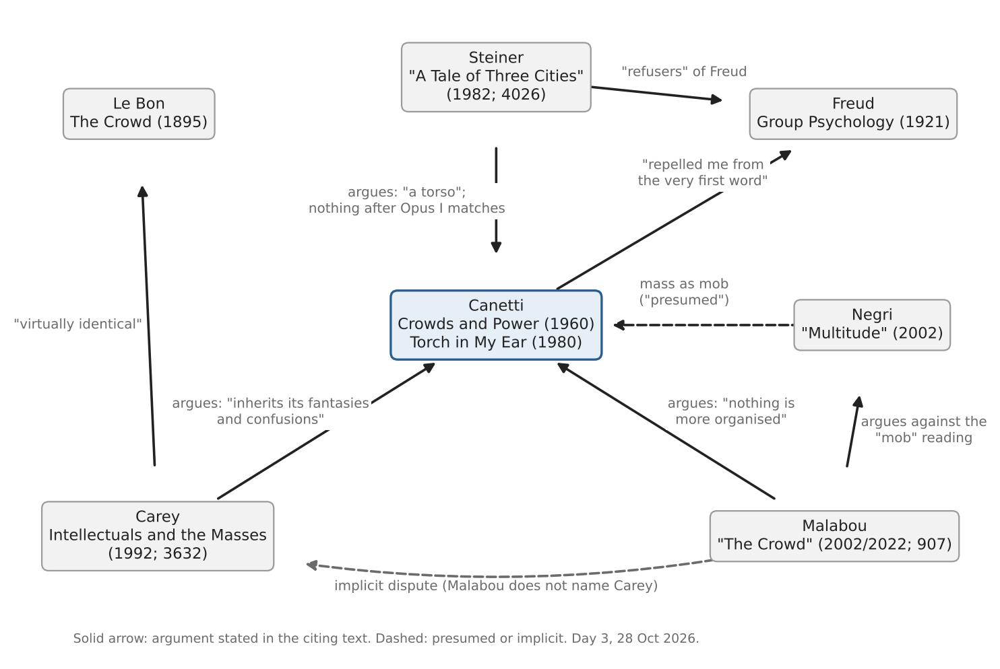

*[[shadows/weeks/elias-canetti|Elias Canetti (Author & Shadow)]] · Day 3 of 7 · 2026-10-28 · Difficulty 3 · Conflict, Genealogy/influence*

## Books in this reading

- [[books/3632-the-intellectuals-and-the-masses-pride-and-prejudi|The Intellectuals and the Masses: Pride and Prejudice Among the Literary Intelligentsia 1880-1939]], [[people/john-carey|John Carey]]; 1992. *Day 3 primary (argues with): ch. 1 'The Revolt of the Masses', the Canetti passage and n. 11.*
- [[books/907-plasticity-the-promise-of-explosion-catalogued-as|Plasticity: The Promise of Explosion (catalogued as 'Plasticity at the Dusk of Writing')]], [[people/catherine-malabou|Catherine Malabou]], [[people/tyler-m-williams|Tyler M. Williams]] (editor), [[people/dashiell-wasserman|Dashiell Wasserman]] (translator); 2022 (ch. 8 delivered Cerisy 2002; French 2004). *Day 3 primary (argues with): ch. 8 'The Crowd: Figuring the Democracy to Come', pp. 115–129.*
- [[books/4026-george-steiner-at-the-new-yorker|George Steiner at the New Yorker]], [[people/george-steiner|George Steiner]], [[people/robert-boyers|Robert Boyers]] (editor); 2009 ('A Tale of Three Cities', New Yorker, 22 Nov 1982). *Day 3 primary (argues with): 'A Tale of Three Cities', review of The Torch in My Ear (index pp. 260–69). Duplicate record 11442.*

## The shadow so far

| Citing Book | Relation | Target | Location |
|---|---|---|---|
| [[books/413-the-conscience-of-words-with-earwitness|The Conscience of Words]] (Elias Canetti) | **Quotes** | Elias Canetti | pp. 24 (‘Power and Survival’) |
| [[books/413-the-conscience-of-words-with-earwitness|The Conscience of Words]] (Elias Canetti) | **Argues with** | Elias Canetti | p. 25 (‘Power and Survival’) |
| [[books/3123-dostoyevsky-reads-hegel-in-siberia-and-bursts-into|Dostoyevsky Reads Hegel in Siberia and Bursts Into Tears]] (László F. Földényi) | **Quotes** | Elias Canetti | 'A Capacity for Amazement', n. 3 (Stewart p. 411) |
| [[books/3123-dostoyevsky-reads-hegel-in-siberia-and-bursts-into|Dostoyevsky Reads Hegel in Siberia and Bursts Into Tears]] (László F. Földényi) | **Quotes** | Elias Canetti | 'A Capacity for Amazement', n. 1 (Nachträge aus Hampstead, p. 32) |
| [[books/926-a-temple-of-texts|A Temple of Texts]] (William H. Gass) | **Quotes** | Elias Canetti | 'The Road to the True Book' |
| [[books/926-a-temple-of-texts|A Temple of Texts]] (William H. Gass) | **Quotes** | Elias Canetti | 'The Road to the True Book' |
| [[books/926-a-temple-of-texts|A Temple of Texts]] (William H. Gass) | **Quotes** | Elias Canetti | 'Influence' |
| [[books/926-a-temple-of-texts|A Temple of Texts]] (William H. Gass) | **Quotes** | Elias Canetti | 'Influence'; also 'The Road to the True Book' (‘the last common property’; Confucius) |
| [[books/3632-the-intellectuals-and-the-masses-pride-and-prejudi|The Intellectuals and the Masses]] (John Carey) | **Argues with** | Elias Canetti | ch. 1, 'The Revolt of the Masses' (n. 11) |
| [[books/3632-the-intellectuals-and-the-masses-pride-and-prejudi|The Intellectuals and the Masses]] (John Carey) | **Quotes** | Elias Canetti | ch. 1, 'The Revolt of the Masses' (n. 11: Stewart, Gollancz 1962) |
| [[books/907-plasticity-the-promise-of-explosion-catalogued-as|Plasticity: The Promise of Explosion (catalogued as Plasticity at the Dusk of Writing)]] (Catherine Malabou) | **Argues with** | Elias Canetti | ch. 8, 'The Crowd: Figuring the Democracy to Come', p. 117 |
| [[books/907-plasticity-the-promise-of-explosion-catalogued-as|Plasticity: The Promise of Explosion (catalogued as Plasticity at the Dusk of Writing)]] (Catherine Malabou) | **Quotes** | Elias Canetti | ch. 8, pp. 115–118, n. 9 p. 129 (tr. Dashiell Wasserman) |
| [[books/4026-george-steiner-at-the-new-yorker|George Steiner at the New Yorker]] (George Steiner) | **Argues with** | Elias Canetti | 'A Tale of Three Cities' (New Yorker, 22 Nov 1982; book pp. 260–69) |
| [[books/4026-george-steiner-at-the-new-yorker|George Steiner at the New Yorker]] (George Steiner) | **Quotes** | Elias Canetti | 'A Tale of Three Cities' |

---

## Daily library resurfacing for Johnny · Wednesday 28 October 2026 · Scribrarium

## 1. Where the week stands

Week of Elias Canetti, day 3 of 7: *who argues with him*. Day 1 read *The Conscience of Words* (413) and took survival and “onlyness” as the core of *Crowds and Power*. Day 2 found that the quotations survive (Földényi and Gass quote Canetti nearly verbatim) while the frames around them drift. Today the question changes from *how* he is quoted to *who says he is wrong*, and about what.

## 2. The day’s finding

The library holds three arguments with Canetti, and two of them argue with each other.

- **John Carey** (*The Intellectuals and the Masses*, 1992; 3632) places Canetti at the end of crowd science from Le Bon to Freud, a tradition whose “fantasies and confusions” he “inherits”: his crowd is at once “a subhuman monster” and “the salvation of mankind”, and that ambivalence “disturbs its intellectual coherence”. Worse, Canetti shows the intellectual’s contempt for the newspaper-reading mass that he condemns in despots. **Relation: argues with** (coherence, class superiority).

- **Catherine Malabou** (“The Crowd: Figuring the Democracy to Come”, 2002; in *Plasticity: The Promise of Explosion*, 2022; 907) argues the opposite of Carey without naming him. Readers, she says, see in Canetti’s mass “a formless swarming … a ‘mob’ ”; on the contrary, “nothing is more organised than the mass that Canetti describes”. Her target is Negri’s reading of the mass as mob. She also argues with Canetti himself, admitting she is “making it say more than it would on its own”. **Relations: argues with** (against the mob reading); **quotes** (through a translation chain that alters the words).

- **George Steiner** (“A Tale of Three Cities”, *New Yorker*, 22 Nov 1982; 4026) argues with Canetti’s rank, not his theory. He calls *Crowds and Power* “a torso of a work”, finds nothing after *Auto-da-Fé* “to match the powers of Opus I”, and places Canetti below Kafka and Broch. He also argues with Canetti the man: Canetti rounded on the English “not altogether fairly”. **Relations: argues with** (rank, conduct); **quotes** (the Neugroschel memoir, nearly verbatim).

The dispute that matters is Carey against Malabou: **is Canetti’s crowd a mob or an organisation?** The text gives each side something. Canetti’s crowd wants “to experience for itself the strongest possible feeling of its own animal force and passion” (Carey’s side). Its “crowd crystals”, meanwhile, are “small, rigid groups of men, strictly delimited and of great constancy” (Malabou’s side). One detail complicates Malabou’s side: when her chapter quotes that definition, the word *rigid* is missing.

*Figure 1: Day 3 argument map: who argues with Canetti, and with whom else. Book IDs in*

brackets.

## 3. The books

## 3.1 The Intellectuals and the Masses: Pride and Prejudice Among the Literary Intelligentsia 1880–1939 — John Carey, 1992 (EPUB; Calibre 3632)

**Selection logic.** It was a day-2 lead (14 occurrences of “Canetti”, all in one passage of ch. 1, “The Revolt of the Masses”, plus note 11). The passage is short, but it makes an argument rather than a passing mention: a thesis about Canetti, set out in steps.

**Overview.** Carey’s book is a polemic against the modernists (Eliot, Lawrence, Woolf, Wells, Gissing) and their contempt for the newly literate mass. Canetti enters as the last term of a “scientific” tradition: Le Bon, then Trotter, then Freud, then Canetti. Carey explains the double view of the crowd by biography. Canetti joined a crowd in Vienna on 15 July 1927, and as a Jewish refugee he also knew the crowd as a persecuting agent.

**Element 1 — the argument in four steps (verbatim).**

1. “Elias Canetti, generally cited as the most profound modern commentator on the mass, stands at the end of the ‘scientific’ tradition stretching from Le Bon to Freud, and inherits its fantasies and confusions.”

2. “It is presumably this dual awareness that accounts for the ambivalence that runs through Canetti’s Masse und Macht, and disturbs its intellectual coherence.”

3. “In these respects Canetti’s crowd is virtually identical with Le Bon’s. Yet Canetti also envisages the crowd as the salvation of mankind.”

4. “Canetti’s superiority, as an intellectual, to the mass – to ‘everyone’ gloating over newsprint – is apparent in this passage. Yet it is precisely that sense of superiority, in great generals, kings and despots, that he identifies as the curse and doom of mankind.”

(Ch. 1, “The Revolt of the Masses”; note 11 cites Stewart’s translation, Gollancz 1962, pp. 15– 22, 48–52, 306–26, 468.)

**Element 2 — Carey’s quotations checked against Canetti’s books.**

> Canetti’s text (library

Carey quotes edition) Verdict

> *own* silently dropped “It wants to experience for “experience for itself the itself the strongest possible strongest possible feeling of

its animal force and passion” feeling of its **own** animal

> force and passion” (CP 14938, “The Eruption”)

“Today everyone takes part identical (CP, “Baiting verbatim in public executions through Crowds”) the newspapers.” “most despicable” “One is tempted to say that fragment; Canetti’s

> it is the most despicable and, “tempted to say” hedge and at the same time, most “most stable” dropped stable form of such a crowd.”

“biological state”; “first and “in what one might call its verbatim fragments (“The supreme attribute” biological state”; “the urge Eruption”; “The Open and

> to grow is the first and the Closed Crowd”); “one supreme attribute of the might call” dropped crowd.”

> Canetti’s text (library

Carey quotes edition) Verdict

“I became part of the crowd. “I became a part of the not Neugroschel’s wording; I dissolved into it fully.” crowd, I fully dissolved in it, Carey either translates

> I did not feel the slightest afresh or quotes another resistance to what the crowd source, and no note says was doing.” (*Torch in My Ear* which 421, “The Fifteenth of July”)

**Element 3 — a misreading worth attempting.** Take Carey’s fourth step literally. If the newspaper reader is “the most despicable … form” of the baiting crowd, then Canetti, a reader of newspapers, is condemning himself as well, not looking down from above. The “tempted to say” Carey omits supports this reading: it is the sentence of someone who is himself in the crowd he describes. Try reading every hedge Carey drops as a confession.

## 3.2 Plasticity: The Promise of Explosion — Catherine Malabou, ed. Tyler M. Williams, 2022 (PDF; Calibre 907)

**Catalogue error.** Calibre 907 is titled *Plasticity at the Dusk of Writing* (2009), but the file is *Plasticity: The Promise of Explosion* (Edinburgh UP, 2022), ISBN 978 1 4744 6211 2 (PDF p. 4). The metadata needs correcting by hand; the library is read-only to this routine.

**Selection logic.** The Canetti mentions (51) are concentrated in ch. 8, “The Crowd: Figuring the Democracy to Come” (pp. 115–129), translated by Dashiell Wasserman. It was a Cerisy address of 2002, published in *La démocratie à venir* (2004). The chapter’s thesis is a direct contradiction of the reading Carey represents.

**Overview.** Malabou wants Canetti and Derrida to “walk together”, with Baudelaire’s “Crowds” as their introduction. She agrees with Canetti against Freud: “Canetti writes Crowds and Power explicitly to denounce the inadequacies of Freudian analysis” (p. 117). She then moves from Canetti’s reversal of the fear of being touched to Derrida’s “law of tact”: inside the mass, touching is never total. That distance within the mass is its organisation, and the root of democracy: “Democracy is the mass’s tact.” (p. 118). The argument runs through *Wandlung* (transformation) and *Verwandlung* (metamorphosis) to masks and secrecy.

**Element 1 — the argument, verbatim.**

> Readers of Canetti have never, to my knowledge, insisted on this disparity; instead they see in the concept of the mass a sort of formless swarming that the English call a ‘mob’, a conglomerate without organisation. (p. 117)

> It seems to me, on the contrary, that nothing is more organised than the mass that Canetti describes (p. 117)

> I am aware, here, that I am making Canetti’s book talk and perhaps making it say more than it would on its own. (p. 118)

**Element 2 — the translation chain, as a derived list.** Malabou cites Stewart’s English (Canetti 1984; FSG) and Neugroschel’s memoir (1990). Her own quotations, however, were made in French and then put back into English by her translator. Checked against the library’s Stewart (14938) and Neugroschel (421):

Malabou’s English (p.) Stewart / Neugroschel What moved

> French *noir* restored in “Suddenly everything is “Suddenly everywhere is

swarming with people black with people” brackets, English made [Soudain tout est noir de figurative monde]” (115) “The goal is the most intense “This goal is the blackest *blackest spot* becomes *most* darkness where the most spot where most people are *intense darkness* people are gathered.” (115) gathered.” “The crowd he needs is the “The crowd he needs is the *dense* becomes *compact* compact crowd” (116) dense crowd” “a drastic and enigmatic “a total alteration of *alteration* becomes modification of consciousness, was both *modification*; *total* lost consciousness” (1990: 353, drastic and enigmatic” cited p. 118) (*Torch*, “The Buddhist”) “Crowd crystals are the “CROWD CRYSTALS are the ***rigid* dropped** small groups of men, strictly small, rigid groups of men, delimited and of great strictly delimited and of constancy” (n. 9, p. 129) great constancy”

> “SECRECY LIES at the very verbatim “ ‘Secrecy’, writes Canetti, core of power” ‘lies at the very core of

power…’ ” (1984: 290)

The translator’s note 1 says Stewart renders *Masse* as “crowd” while Malabou keeps “la masse”. That is the visible part of the chain. The rewordings in the table are the invisible part. One of them bears on her thesis: an argument for the organised mass quotes the definition of the crowd crystal with *rigid* removed. That supports her case, since her organisation is supple (“tact”), not rigid. It should not be cited as if it were Stewart’s text.

**Element 3 — concordance.** “Canetti” occurs 51 times in the file. Pages (printed): 115 (3), 116 (4), 117 (8), 118 (6), 119 (5), 120 (2), 121 (3), 122 (6), 123 (1), 125 (3), 126 (3), 128 (1), 129 (3). The remaining 3 are in the bibliography and index. Peak: p. 117, the page of the Freud and Negri arguments.

## 3.3 George Steiner at the New Yorker — George Steiner, ed. Robert Boyers, 2009 (EPUB; Calibre 4026; duplicate record 11442)

**Selection logic.** It contains “A Tale of Three Cities”, Steiner’s review of *The Torch in My Ear* (*New Yorker*, 22 Nov 1982; index pp. 260–69). Its admiration includes three disagreements, and it is the only one of today’s three books to argue with Canetti’s standing rather than his theory.

**Overview.** Steiner retells the memoir decade by decade: Frankfurt (Gilgamesh, Aristophanes, the mother), Vienna (Kraus, Bruegel, Rembrandt’s *Blinding of Samson*, 15 July 1927), and Berlin (Grosz, Brecht, Babel). He then judges. He sides with Canetti against Freud, placing him among the “refusers” with Kraus, Wittgenstein and Heidegger. Against Canetti he makes three points:

1. Conduct: “He has rounded fiercely, and not altogether fairly, on those who—particularly in England, to which he came as a refugee—failed to keep his books in print or in the light of critical regard during the long years of (relative) obscurity before the Nobel.”

2. The theory: “It would be 1960 before “Crowds and Power,” a torso of a work, fragmentary in its brilliance, appeared.”

3. Rank: “Nonetheless, it would be difficult to find anything in Canetti’s subsequent writings to match the powers of Opus I.” and “There is not in Canetti the immediacy of mythical creation, the unforced access to specific yet universal symbolic forms, which makes the fictions and parables of Kafka tower over the twentieth-century imagination”

**Element 1 — Steiner’s block quotations checked against *The Torch in My Ear* (421).** The Gilgamesh block (“Gilgamesh and Aristophanes”), the Rembrandt sentence (“Samson’s Blinding”), the Wild Hunt (“Karl Kraus and Veza”), the fire (“The Fifteenth of July”) and the Berlin passage (“An Invitation to Emptiness”) are verbatim to Neugroschel, apart from two typesetting slips: “I absorbed as a unify” for “unity”, and “will hare him” for “will hate him”. There is one silent cut: “glory, wealth, misery . . . I have lived” omits “and despair of all experience.” Steiner complains that “the translation is often ingeniously unhelpful”, and then quotes it faithfully.

**Element 2 — the name, corrected.** Set against day 2: Gass had Kant →Kien with Kien glossed as “kindling”. Steiner gives the full sequence (Brand, then Kant, then Kien) and the right gloss: “a monosyllable that combines the German word for resinous pine-wood with a hint of Chinese tonality.” So the library holds both the slip and the correction.

**Element 3 — Notebook seed.** Steiner’s measure of Canetti is other writers: Kafka for myth, Broch for nature and the psyche, Kleist for the German. Carey’s measure is his own case against the intellectuals. Malabou’s is Derrida. Each critic argues from a fixed point outside Canetti, and you can find each one’s fixed point in a single sentence.

## 4. The shadow so far

# From Relation To Location

> Quotes Ibn Battuta p. 24 1 Canetti, (13883) *Conscience of Words* (413)

2 Canetti (413) Argues with Freud, Schreber p. 25

> case

3 Földényi (3123) Quotes *Crowds and* “A Capacity for

> *Power* (14938) Amazement”, n. 3 ibid., n. 1 4 Földényi (3123) Quotes *Notes from Hampstead* (415)

5 Gass (926) Quotes *Torch in My Ear* “The Road to

> (421) the True Book”

6 Gass (926) Quotes *Tongue Set Free* ibid.

> (420)

7 Gass (926) Quotes *Play of the Eyes* “Influence”

> (418)

8 Gass (926) Quotes *Conscience of* “Influence”

> *Words* (413)

9 **Carey (3632) Argues with** *Crowds and* ch. 1, “The

> *Power* Revolt of the Masses”

10 **Carey (3632) Quotes** *CP*; *Torch* ch. 1, n. 11 11 **Malabou (907) Argues with** *Crowds and* ch. 8, p. 117

> *Power* (and Negri’s reading)

12 **Malabou (907) Quotes** *CP*; *Torch* (via ch. 8, #

> French) pp. 115–129

> From Relation To Location

> “A Tale of Three 13 **Steiner (4026) Argues with** Canetti’s rank; *CP* Cities”

14 **Steiner (4026) Quotes** *Torch in My Ear* ibid.

> (421)

Running count: 14 edges from 7 books. Mentions promoted to edges so far: 3123, 926, 3632, 907, 4026.

## 5. Where this sends you

**Notebook**

1. Carey omits Canetti’s “One is tempted to say”. Write a paragraph of judgement twice: once with the hedge, once without. Which version is closer to contempt?

2. Malabou: “Democracy is the mass’s tact.” Set it against Canetti’s “The crowd he needs is the dense crowd, in which body is pressed to body”. Where is the room for tact in “pressed”? Write the scene in which it appears.

3. Steiner ranks Canetti against Kafka, Broch and Kleist. Name the three writers against whom you would want to be judged, and the one you fear.

**Rabbit holes**

- Gustave Le Bon, *The Crowd: A Study of the Popular Mind* (Project Gutenberg) — Carey’s “virtually identical”: test it. https://www.gutenberg.org/ebooks/445

- Freud, *Group Psychology and the Analysis of the Ego*, tr. Strachey (Project Gutenberg) — the book that “repelled” Canetti “from the very first word”. https://www.gutenberg.org/ebooks/35877

- Antonio Negri, “Approximations towards an ontological definition of the multitude”, tr. Arianna Bove (first in *Multitudes* 9, 2002). Malabou’s opponent; note Bove’s “used to describe” against Malabou’s “used to name”. https://generation-online.org/t/approximations.htm

- S. S. Prawer, “The Making of Canetti”, *New York Review of Books*, 4 Nov 1982 — a contemporary of Steiner’s review, and a fuller attack on the Neugroschel translation (day-4 material). https://www.nybooks.com/articles/1982/11/04/the-making-of-canetti/

- Malabou, *Plasticity: The Promise of Explosion* (PhilPapers record, Edinburgh UP 2022). https://api.philpapers.org/rec/MALPTP

**Also in your library**

- *A Companion to the Works of Elias Canetti* (3312) — reports, in its own words, that “Susan Sontag claims that Canetti’s early novel Die Blendung was inspired by an extraordinary hatred for women” and the dispute that followed; cites Rothstein, “Dreams of Disappearance”. This is the next layer of argument.

- *Susan Sontag: An Annotated Bibliography 1948–1992* (3341) — summarises “Mind as Passion”, where Canetti “insists on an ahistorical understanding” (index snippet, unverified). The essay itself (*Under the Sign of Saturn*) is not in the catalogue.

- Baudrillard, *The Illusion of the End* (6546) — takes up Canetti’s “all mankind suddenly left reality” without disputing it: a candidate for day 4 or day 7.

## 6. From the Lexicon — sodalities

**Why today.** Canetti’s crowd crystal is a sodality in the anthropologist’s sense: “Only true conversion leads men to give up their old associations and form new ones. Such associations, which by their very nature are only able to accept a limited number of members, have to secure their continuance by rigid rules. Such groups I call crowd crystals.” (*CP*, “The Discharge”). “Soldiers and monks are the most important examples of this type.” (“Crowd Crystals”) Malabou cites this definition in her note 9, minus the word *rigid*.

**Received vs. your sense.** Received: a non-kin association formed for a specific purpose (ritual, military, economic) that cuts across bands or villages; Elman Service’s term in the band–tribe–chiefdom–state model; in missiology (Ralph D. Winter) specialised voluntary bodies such as orders and monasteries, opposed to “modalities”; older English, a fellowship or Catholic lay confraternity. Your sense: “a non-kin group organized for a specific purpose … frequently spanning villages or towns”, with the note “fraternities not linked to specific churches”, including orders, monasteries and convents. The two agree. Your note leans toward the missiological sense, where a sodality stands apart from the parish church.

**Etymology.** French *sodalité* or Latin *sodalitas* “fellowship”, from *sodalis* “companion” (possibly originally “one’s own, relative”), from the PIE reflexive root (cf. Latin *suescere*, “to accustom”). In English from c. 1600; the anthropological sense dates from Service. Note the irony: a word for *non-kin* fellowship may descend from a word for one’s own kin.

**WordNet.** oewn-08092224-n (noun.group): “people engaged in a particular occupation”; hypernym *class*. That is thinner than either the anthropological or the missiological sense.

**Relations.** Shares a lineage with *apostasy* (105): one stands with chosen companions, the other stands away from them. Canetti’s crystal requires both: conversion out of the old association, and into the new one.

**Portable axiom.** None recorded.

**Verified occurrence.** Joyce, *A Portrait of the Artist as a Young Man* (13779), ch. III: Stephen holds “the certificate of his prefecture in the college of the sodality of the Blessed Virgin Mary.” and “On Saturday mornings when the sodality met in the chapel to recite the little office” he leads his wing. It is a crowd crystal, and he will leave it.

**New in the Lexicon.** Added since yesterday’s run: *homo economicus* (117) and *obolus* (118), both still unenriched. *Obolus* has a Canetti hook: the coin for the ferryman belongs with his survivor and his heap of the dead.

## 7. To carry

> “I saw crowds around me, but I also saw crowds within me, and no explanatory delimitation could help me.” — Elias Canetti, *The Torch in My Ear*, tr. Joachim Neugroschel, “The Justification” (Calibre 421)

*Method note.* The Scribrarium folder did not mount in the shell on your Mac today, so metadata.db and the eight book files read today were copied into the cloud workspace. The full-text index (calibre plugin) answered every query, all of them restricted with book_ids or narrowed with AND. Every quotation above was checked as a substring of the extracted text (57 checks, 0 misses), allowing only whitespace, line-break hyphenation and curly-quote nor-malisation.

## Themes

[[themes/back-translation|back-translation]] · [[themes/broch|Broch]] · [[themes/crowd-crystals|crowd crystals]] · [[themes/crowd-vs-mass|crowd vs mass]] · [[themes/democracy|democracy]] · [[themes/freud|Freud]] · [[themes/intellectuals-and-the-masses|intellectuals and the masses]] · [[themes/kafka|Kafka]] · [[themes/le-bon|Le Bon]] · [[themes/literary-rank|literary rank]] · [[themes/mob|mob]] · [[themes/negri-and-the-multitude|Negri and the multitude]] · [[themes/organisation|organisation]] · [[themes/tact|tact]] · [[themes/translation-chains|translation chains]]

---

Previous: [[shadows/2026-10-27-shadow-elias-canetti-day-2-the-quotation-survives|Shadow — Elias Canetti, day 2: The Quotation Survives]]  
Next: [[shadows/2026-10-29-shadow-elias-canetti-day-4-the-tribunal-in-transla|Shadow — Elias Canetti, day 4: The Tribunal in Translation]]
