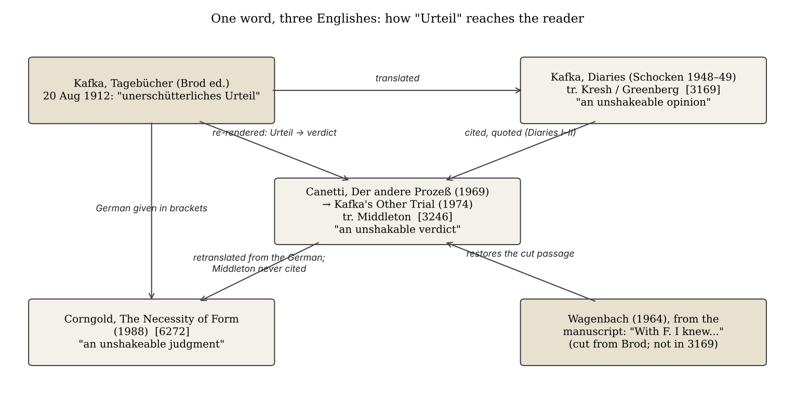

*[[shadows/weeks/elias-canetti|Elias Canetti (Author & Shadow)]] · Day 4 of 7 · 2026-10-29 · Difficulty 3 · Genealogy/influence, Shared figure or motif, Conflict*

## Books in this reading

- [[books/3246-kafka-s-other-trial-the-letters-to-felice|Kafka's Other Trial: The Letters to Felice]], [[people/elias-canetti|Elias Canetti]], [[people/christopher-middleton|Christopher Middleton]] (translator); 1969 (English 1974). *Day 4 primary (Canetti as reader/rewriter of Kafka). Scan without text layer; OCR'd with tesseract for this run; printed page = PDF page − 4.*
- [[books/6272-franz-kafka-the-necessity-of-form|Franz Kafka: The Necessity of Form]], [[people/stanley-corngold|Stanley Corngold]]; 1988. *Day 4 primary (translates Canetti afresh from Der andere Prozeß; quotes Neugroschel's Conscience of Words).*
- [[books/401-the-kraus-project|The Kraus Project]], [[people/karl-kraus|Karl Kraus]], [[people/jonathan-franzen|Jonathan Franzen]] (translator), [[people/paul-reitter|Paul Reitter]] (contributor), [[people/daniel-kehlmann|Daniel Kehlmann]] (contributor); 2013. *Day 4 primary (a translation/edition of Kraus whose annotator summarises Canetti on Kraus), set against Canetti's 'Karl Kraus: The School of Resistance' (413) and Torch 'Karl Kraus and Veza' (421).*
- [[books/3169-diaries-1910-1923|Diaries, 1910-1923]], [[people/franz-kafka|Franz Kafka]], [[people/max-brod|Max Brod]] (editor), [[people/joseph-kresh|Joseph Kresh]] (translator), [[people/martin-greenberg|Martin Greenberg]] (translator), [[people/hannah-arendt|Hannah Arendt]] (translator); 1948–49 (1964 Peregrine one-volume text). *Check text: the translation Canetti cites; used to verify every diary quotation in 3246 and Corngold's DI citation. Not a primary book.*

## The shadow so far

| Citing Book | Relation | Target | Location |
|---|---|---|---|
| [[books/413-the-conscience-of-words-with-earwitness|The Conscience of Words]] (Elias Canetti) | **Quotes** | Elias Canetti | pp. 24 (‘Power and Survival’) |
| [[books/413-the-conscience-of-words-with-earwitness|The Conscience of Words]] (Elias Canetti) | **Argues with** | Elias Canetti | p. 25 (‘Power and Survival’) |
| [[books/3123-dostoyevsky-reads-hegel-in-siberia-and-bursts-into|Dostoyevsky Reads Hegel in Siberia and Bursts Into Tears]] (László F. Földényi) | **Quotes** | Elias Canetti | 'A Capacity for Amazement', n. 3 (Stewart p. 411) |
| [[books/3123-dostoyevsky-reads-hegel-in-siberia-and-bursts-into|Dostoyevsky Reads Hegel in Siberia and Bursts Into Tears]] (László F. Földényi) | **Quotes** | Elias Canetti | 'A Capacity for Amazement', n. 1 (Nachträge aus Hampstead, p. 32) |
| [[books/926-a-temple-of-texts|A Temple of Texts]] (William H. Gass) | **Quotes** | Elias Canetti | 'The Road to the True Book' |
| [[books/926-a-temple-of-texts|A Temple of Texts]] (William H. Gass) | **Quotes** | Elias Canetti | 'The Road to the True Book' |
| [[books/926-a-temple-of-texts|A Temple of Texts]] (William H. Gass) | **Quotes** | Elias Canetti | 'Influence' |
| [[books/926-a-temple-of-texts|A Temple of Texts]] (William H. Gass) | **Quotes** | Elias Canetti | 'Influence'; also 'The Road to the True Book' (‘the last common property’; Confucius) |
| [[books/3632-the-intellectuals-and-the-masses-pride-and-prejudi|The Intellectuals and the Masses]] (John Carey) | **Argues with** | Elias Canetti | ch. 1, 'The Revolt of the Masses' (n. 11) |
| [[books/3632-the-intellectuals-and-the-masses-pride-and-prejudi|The Intellectuals and the Masses]] (John Carey) | **Quotes** | Elias Canetti | ch. 1, 'The Revolt of the Masses' (n. 11: Stewart, Gollancz 1962) |
| [[books/907-plasticity-the-promise-of-explosion-catalogued-as|Plasticity: The Promise of Explosion (catalogued as Plasticity at the Dusk of Writing)]] (Catherine Malabou) | **Argues with** | Elias Canetti | ch. 8, 'The Crowd: Figuring the Democracy to Come', p. 117 |
| [[books/907-plasticity-the-promise-of-explosion-catalogued-as|Plasticity: The Promise of Explosion (catalogued as Plasticity at the Dusk of Writing)]] (Catherine Malabou) | **Quotes** | Elias Canetti | ch. 8, pp. 115–118, n. 9 p. 129 (tr. Dashiell Wasserman) |
| [[books/4026-george-steiner-at-the-new-yorker|George Steiner at the New Yorker]] (George Steiner) | **Argues with** | Elias Canetti | 'A Tale of Three Cities' (New Yorker, 22 Nov 1982; book pp. 260–69) |
| [[books/4026-george-steiner-at-the-new-yorker|George Steiner at the New Yorker]] (George Steiner) | **Quotes** | Elias Canetti | 'A Tale of Three Cities' |
| [[books/3246-kafka-s-other-trial-the-letters-to-felice|Kafka's Other Trial: The Letters to Felice]] (Elias Canetti) | **Quotes** | Elias Canetti | p. 5 (n. 3: Diaries I, pp. 268–69); concordance across pp. 5–99, nn. 2–58 |
| [[books/3246-kafka-s-other-trial-the-letters-to-felice|Kafka's Other Trial: The Letters to Felice]] (Elias Canetti) | **Edits/introduces** | Elias Canetti | p. 99; n. 50, p. 121 |
| [[books/6272-franz-kafka-the-necessity-of-form|Franz Kafka: The Necessity of Form]] (Stanley Corngold) | **Translates** | Elias Canetti | Introduction, n. 8 (Der andere Prozeß, Hanser 1969, p. 36); also Intro n. 11; ch. 3 n. 1; ch. 6 n. 22 (two); ch. 10 n. 27 |
| [[books/6272-franz-kafka-the-necessity-of-form|Franz Kafka: The Necessity of Form]] (Stanley Corngold) | **Quotes** | Elias Canetti | ch. 6, n. 22 (Conscience of Words, tr. Neugroschel, Deutsch 1986, p. 70) |
| [[books/401-the-kraus-project|The Kraus Project]] (Karl Kraus, tr. Jonathan Franzen (note by Paul Reitter)) | **Edits/introduces** | Elias Canetti | 'Nestroy and Posterity', n. 14 (PR) |
| [[books/413-the-conscience-of-words-with-earwitness|The Conscience of Words]] (Elias Canetti) | **Argues with** | Elias Canetti | 'Karl Kraus: The School of Resistance', pp. 35–36 |

---

## 29 October 2026

## 1. Where the week stands

Week of Elias Canetti, day 4 of 7: who translates, rewrites, edits or introduces him, and whom he reads. Day 1 read *The Conscience of Words* (413) and fixed the coinages; day 2 found that the quotations of Canetti in Földényi and Gass survive while the frames around them drift; day 3 found Carey, Malabou and Steiner arguing with him, and found translation itself becoming the week’s thread (Malabou’s Stewart-via-French chain; Steiner on Neugroschel). Today follows that thread in both directions: Canetti reading Kafka in English translation, a Kafka scholar retranslating Canetti, and an annotated translation of Kraus summarising what Canetti said about Kraus.

## 2. The day’s finding

Canetti reads his two masters, Kafka and Kraus, as courts. Kafka in *Kafka’s Other Trial* is a man who turns every judgment against himself until “he is his own tribunal”; Kraus in “Karl Kraus: The School of Resistance” is a judge who “had appropriated all judging”. The translations bend toward this reading. The Schocken *Diaries* (Kresh, 1948) render Kafka’s first impression of Felice as “an unshakeable opinion”; Middleton’s English of Canetti (1974) has “an unshakable verdict”; Corngold (1988), quoting the German *unerschütterliches Urteil*, has “an unshakeable judgment”. Two of the three Englishes put the courtroom into the first diary entry about Felice; the one that does not is the one Canetti cites.

The relations, precisely:

- **Canetti →Kafka (Quotes; Edits/introduces).** Nearly all of Canetti’s diary quotations are the library’s own Kresh/Greenberg text, word for word, with cuts marked by ellipses. One is retranslated (“verdict”). One passage (“With F. I knew intimacy only in letters…”) is restored from the manuscript via Wagenbach; Canetti says it is absent from the English *Diaries*, and the library’s copy confirms it.

- **Corngold →Canetti (Translates).** Corngold quotes *Der andere Prozeß* (Hanser 1969) in his own English (six quotations in five notes) and never cites Middleton’s translation, which had been in print for fourteen years. For *The Conscience of Words* he uses Neugroschel, verbatim but for one word.

- **Reitter in *The Kraus Project* →Canetti (Edits/introduces).** A note to Franzen’s translation of Kraus summarises Canetti’s case against Kraus, without the half of the argument in which Canetti accuses himself.

## 3. The books

## 3.1 Kafka’s Other Trial: The Letters to Felice — Elias Canetti, 1969 (tr. Christopher Middleton, Schocken 1974); PDF, Calibre 3246

**Selection logic.** The week’s plan named it for day 4: Canetti following Kafka through a correspondence, a book that is half reading and half rewriting. The file is a Google scan of a University of Michigan copy with no text layer. For this run it was OCR’d (tesseract, 200 dpi); quotations below are from that OCR text, substring-checked, with the OCR’s “|” and “1” for “I” corrected. Printed page = PDF page −4.

**Overview.** Canetti read the *Letters to Felice* when they appeared in 1967 and wrote a reading of the five-year engagement as Kafka’s “other trial”, the one that ran beside *The Trial*. His thesis turns on the scene at the Askanischer Hof in Berlin in July 1914, where Kafka was confronted by Felice, her sister Erna and Grete Bloch, and the engagement was broken. Canetti finds the word *Gerichtshof* in the diary for 23 July and builds the novel’s genesis from it.

**Element 1 — the thesis, in his words (pp. 68–70).**

> “With the word Gerichtshof (“tribunal”), he had entered the sphere of the novel. With Richtplatz (“gallows,” or “place of execution’), its goal and end are foreshad-owed.” (p. 68)

> “There is no external tribunal that he acknowledges; he is his own tribunal, but very much so, and that tribunal will always be in session.” (p. 70)

**Element 2 — a concordance of Canetti’s Kafka against the library’s *Diaries* (Calibre 3169, tr. Joseph Kresh, vol. I, and Martin Greenberg with Hannah Arendt, vol. II).** Canetti’s notes cite “Diaries, I” and “Diaries, II” (Schocken 1948, 1949), the same translation as 3169 (the library’s copy is the 1964 Peregrine one-volume text, with British spellings). I aligned the 143 longer quotations (60+ characters) in the OCR text against 3169; the diary quotations are the Kresh/Greenberg text. The deviations:

> Kresh / Greenberg Canetti / Middleton

Entry (3169) (3246) Kind

> retranslated “As I was sitting 20 Aug 1912 “As I was taking my down, I looked at her seat I looked at her closely for the first closely for the first time, by the time I time, by the time I was seated I already was seated I already had an unshakable had an unshakeable opinion.” verdict.” (p. 5)

3 Jan 1912 “I atrophied in all same, with note 7: glossed toward the

| these directions.” | “The “atrophied” | thesis (thinness) |
|---|---|---|
|  | phrase in the original reads literally: “I thinned down in all these directions.”” (p. 119) |  |

23 July 1914 “The tribunal in the “The tribunal in the cut: the cab, the

| hotel. Trip in the cab. | hotel. … F.’s face. | nose, the bedbug, |
|---|---|---|
| F.’s face. She patted | She patted her hair with her hand, . . . | the father’s night journey from Malmö |
| her hair with her |  |  |
| hand, wiped her | yawned.” (p. 68) |  |
| nose, yawned.” |  |  |
| Kresh / Greenberg | Canetti / Middleton |  |

Entry (3169) (3246) Kind

20 Jan 1915 “When will it catch “When will it catch word dropped (cause

| me up again?” | up again?” (p. 77, | not determinable |
|---|---|---|
|  | n. 37) | from the library) |

1914 (on Erna) “from the tram to the “from the trolley to US vs UK printing of

| Lehrter railway | the Lehrter railroad | the same translation, |
|---|---|---|
| station” | station” (p. 68) | probably |

July 1916 entry ends “…the adds “With F. I knew restored from

| second a child, and I | intimacy only in | manuscript (n. 50) |
|---|---|---|
| was utterly | letters, in a human |  |
| confused.” | way not until the last two days. The clarity is still lacking, doubts remain. But it is beautiful, the gaze of her calm eyes, the opening of womanly depth.” (p. 99) |  |

The last row is the strongest: Canetti’s note 50 states that the passage “does not appear in the German Tagebiicher [OCR for Tagebücher] or in the English Diaries. The source is the manuscript of the diaries as cited by Klaus Wagenbach” (p. 121). In 3169 the entry stops at “utterly confused.” and the next line is “13 July.” Brod’s edition cut it; Canetti put it back; the library’s *Diaries* still lacks it.

**Element 3 — two translations of one sentence in the library.** Kafka copied a draft of his reply to Grete Bloch into the diary, so the same sentence exists in Greenberg’s English and in the Stern/Duckworth *Letters to Felice* that Canetti quotes (the *Letters* are not in the catalogue):

> Greenberg (3169): “You sat as a judge over me in the Askanischer Hof - it was awful for you, for me, for everyone - but it only seemed so; in reality all the time I was sitting in your place and sit there to this day.”

> Canetti quoting *Letters to Felice* p. 436 (3246, p. 69): “It’s true that at the Askanis-che Hof you sat in judgment over me—it was horrible for you, for me, for everyone— but it only appeared to be so; in fact I was sitting in your place, which to this day I have not left”

**A misreading worth attempting.** Read Canetti’s book as a translation of Kafka’s diary into the vocabulary of *Crowds and Power*: smallness as escape from power (“his mode of resistance to such a power is transformation into something small”, p. 35), the verdict as the instant of command. Then ask whether “verdict” in the first entry is Middleton’s choice or Canetti’s emphasis. The library cannot settle it; the German *Der andere Prozeß* is not in the catalogue.

## 3.2 Franz Kafka: The Necessity of Form — Stanley Corngold, 1988 (Cornell UP); EPUB, Calibre 6272

**Selection logic.** The search for “unerschütterliches Urteil” returned two books; this one quotes Kafka’s German in brackets. Its Mentions row shows Canetti 13 times. It turned out to be the library’s one sustained case of someone translating Canetti afresh.

**Overview.** Corngold’s study reads Kafka’s work as the necessity of literary form. Canetti appears in the Introduction and in chapters 2, 3, 6, 9 and 10, for the Kafka book always from *Der andere Prozeß* (Munich: Hanser, 1969), with German page numbers. A search of the whole text for “Middleton” and “Other Trial” returns nothing.

**Element 1 — parallel texts, Corngold’s English against Middleton’s.**

Corngold (6272) Middleton (3246)

“what Elias Canetti calls Kafka’s “The consecration of places and of states of

> mind, which operates so astonishingly with “compulsive sacralization” of places and

states of mind—which amounts to a him that one feels it is compulsive, is neither

> more nor less than a consecration of man. “sacralization of man. Every place, every

moment, every aspect, every step of the way Every place, every moment, every trait, is serious and important and unique.”” every step is serious and important and (Introduction, n. 8: German p. 36) peculiar to itself.” (p. 35)

> “Kafka, instead, comes forward with what is “instead of offering his fiancee at least the

promise of a body in place of his actual, peculiarly his own: the fullness of what he

> has seen, seen of the appearance of the unavailable body, Kafka puts in its place person being wooed. This fullness is his something [he calls] more truly his own: the body.” (p. 23) fullness of things he has seen, things seen in

the person he is courting: this fullness [of the seen] is his body.” (Introduction, n. 11: German p. 28)

> “Of all writers, Kafka is the greatest expert “Among all writers,” as Elias Canetti on power.” (p. 80) remarked, “Kafka is the greatest expert on

power,” (ch. 6, n. 22: German p. 76)

> “There is something most profoundly “There is something deeply exciting about exciting about this tenacious attempt, on the this stubborn attempt of someone who was part of a man who was lacking in power, to helpless, to exclude himself from power in withdraw from power in whatever form it any form” (ch. 6, n. 22: German p. 75) might appear.” (p. 80)

The drift is in one direction: Corngold’s Canetti is more theological (“sacralization” for “consecration”) and more compressed, and his brackets put words in the speaker’s mouth (“[he calls]”; Middleton has no such attribution).

**Element 2 — Corngold also corrects Kresh.** In chapter 2, “The Hermeneutic of “The Judgment””: “a woman about whom, at their first meeting, he had formed “an unshakeable judgment [unerschütterliches Urteil]” (DI 269; Ta 285)”. He cites the Kresh *Diaries* page and changes its noun. Canetti and Corngold, independently, take the word back to the court; in German the same noun is the title of the story Kafka wrote two days after his first letter to Felice, as Corngold notes (“Two days later he composed “The Judgment.””).

**Element 3 — where he uses the published translation.** For the Hitler essay he quotes Neugroschel’s *Conscience of Words* (413, “Hitler, According to Speer”): “Each enterprise of his and even his deepest wishes are dictated by a compulsion to outdo: One may go so far as to say that he is a slave of outdoing.” The only drift from 413 is at the end: Corngold “we could simply point out”, 413 “we should simply point out”.

## 3.3 The Kraus Project — Karl Kraus, tr. and annotated by Jonathan Franzen, with Paul Reitter and Daniel Kehlmann, 2013 (FSG); EPUB, Calibre 401

**Selection logic.** The day plan sent day 4 to the Kraus chapters of *The Torch in My Ear*; *The Last Days of Mankind* (6351) was used in an earlier triad and is excluded as a primary book. *The Kraus Project* is a translation and annotation of Kraus that names Canetti once, in a note by Reitter: a translator’s edition reading Canetti’s reading of the author it translates.

**Overview.** Bilingual edition of “Heine and the Consequences”, “Nestroy and Posterity” and other essays, with Franzen’s long running footnotes and shorter notes signed PR (Reitter) and DK (Kehlmann). The Canetti sentence sits in Reitter’s note 14 to “Nestroy and Posterity”.

**Element 1 — the summary and the source.**

> Reitter (401, “Nestroy and Posterity”, n. 14): “Elias Canetti, for example, argued that Kraus was too authoritarian a figure to encourage intellectual independence in other people, and that his style overwhelmed readers more than it stimulated their critical faculties. That Kraus had an Enlightenment project, which is one of Canetti’s points of departure, is harder to contest.”

> Canetti, “Karl Kraus: The School of Resistance” (413, pp. 35–36): “The heart of the matter was that he had appropriated all judging and did not permit anyone whose model he was to do any judging of his own.”

> Canetti (413, p. 36): “After you heard ten or twelve lectures by Karl Kraus, after you read his journal Die Fackel for a year or two, the first thing to happen was a general shrinkage of the desire to do your own judging.”

The summary is fair to one half. It leaves out the half where Canetti indicts himself: he calls his discipleship “his most ruthless dictatorship” and confesses that “I had my ‘Jews’ — people whom I snubbed when passing them in restaurants or on the street” (413, p. 37), and then declines to accuse: “since I had surrendered to it myself and ultimately also managed to liberate myself, I have no right to accuse it.” The essay’s title calls Kraus a *school* of resistance; Reitter’s paraphrase keeps only the resistance to Kraus.

**Element 2 — derived list: the court in Canetti’s Kraus.** In *The Torch in My Ear* (421, “Karl Kraus and Veza”), the first report of Kraus that reaches him, through the Asriels, is already juridical: “It was like a court of law. He brought the charges and he passed judgment. There was no defense attorney”. In 413 the image becomes a wall built of “ashlars” that “were judgements”. The same figure as the Kafka book, turned inside out: Kraus judges everyone else; Kafka is “his own tribunal”.

## 4. The shadow so far

From Relation To Location

Canetti, *Conscience* Quotes Ibn Battuta (13883) p. 24 *of Words* (413) Canetti, *Conscience* Argues with Freud on Schreber p. 25 *of Words* (413) Földényi (3123) Quotes *Crowds and Power*; “A Capacity for From

> *Notes from* Amazement”, nn. 1, 3 *Hampstead*

> Relation To Location

Gass (926) Quotes *Torch*, *Tongue*, *Play* “The Road to the

> *of the Eyes*, True Book”; *Conscience* “Influence”

Carey (3632) Argues with; Quotes *Crowds and Power*; ch. 1, n. 11

> *Torch*

Malabou (907) Argues with; Quotes *Crowds and Power*; ch. 8, pp. 115–129

> *Torch*

Steiner (4026) Argues with; Quotes Canetti’s oeuvre; “A Tale of Three

> *Torch* Cities”

**Canetti, *Kafka’s* Quotes Kafka, *Diaries* pp. 5–99; nn. 2–58 *Other Trial* (3246) (3169) Canetti, *Kafka’s* Edits/introduces Kafka, *Diaries* p. 99, n. 50 *Other Trial* (3246) (3169): restored (p. 121)**

> **passage**

**Corngold (6272) Translates *Der andere Prozeß* Intro nn. 8, 11;**

> **(3246 in English) ch. 3 n. 1; ch. 6 n. 22; ch. 10 n. 27**

**Corngold (6272) Quotes *Conscience of* ch. 6, n. 22**

> ***Words* (413) “Nestroy and Edits/introduces Canetti, “Karl Reitter in *The* Posterity”, n. 14 Kraus: The School *Kraus Project* of Resistance” (401) (413) Argues with Kraus pp. 35–37 Canetti,**

***Conscience of Words* (413)**

*Figure 1: The translation chain for one word in Kafka’s diary*

## 5. Where this sends you

**Notebook.**

1. Canetti: “he is his own tribunal … and that tribunal will always be in session.” Kraus, in his account, “appropriated all judging”. Write the third figure that neither book names: the reader who neither judges nor submits. Is that what *Crowds and Power* calls the survivor, or its opposite?

2. Kresh’s “opinion”, Middleton’s “verdict”, Corngold’s “judgment”. Pick a word in your own work that a translator could legitimately move into a different register. What would the moved word argue that you did not?

3. Canetti restores a passage the edition had cut; Reitter’s note cuts the half of Canetti’s essay that accuses Canetti. Compose a short note on the ethics of the summary: when is a fair paraphrase still a redaction?

**Rabbit holes.**

- Ross Benjamin’s unexpurgated translation of the *Diaries* (Schocken, 2023), which restores what Brod cut: rossmbenjamin.com/kafka; publisher page: [Penguin Random House.](https://www.penguinrandomhouse.com/books/612561/the-diaries-of-franz-kafka-by-franz-kafka/9780805243550/) Check whether “With F. I knew…” is there, and how Benjamin renders *Urteil*.

- University of Chicago German department, “Glimpses into Kafka’s Workshop”, a conversation on translating the unabridged diaries: german.uchicago.edu.

- *Kafka’s Other Trial* in Penguin Modern Classics: penguin.co.uk.

- S. S. Prawer, “The Making of Canetti”, *New York Review of Books*, 4 November 1982 (on Neugroschel’s *Torch*): nybooks.com/contributors/ss-prawer.

- A review of *The Kraus Project* in the *London Review of Books* (vol. 35 no. 21, 2013; the URL names Joshua Cohen, who later introduced the Canetti Reader): lrb.co.uk.

- AAC-Fackel, the Austrian Academy’s free digital edition of *Die Fackel*, 1899–1936: oeaw.ac.at. The court in its own pages.

**Also in your library.**

- *The Zürau Aphorisms of Franz Kafka* (63): translated by Michael Hofmann, whose note in the book names him as a translator of Canetti; a third Kafka/Canetti translator to compare.

- Kafka, *The Complete Stories* (3250): read “The Judgment” (“Das Urteil”) against the 20 August diary entry.

- Benjamin on Kraus is cited in Reitter’s same note: look for “Karl Kraus” (1931) in your Benjamin volumes.

## 6. From the Lexicon: Redaction

**Received vs. your sense.** Received: “The editing or arranging of material into publishable form, or a revised version so produced; in current usage, the blacking-out or deletion of passages from a document before release.” No sense of your own is recorded yet.

**Etymology.** 1785, from French *rédaction* (compiling, working-over; editorial staff), from Latin *redigere* (drive back, collect, reduce to a state): *red-* (back) + *agere* (drive). Obsolete 1620s “a driving back”; “revised version” 1810; the deletion sense popularised by the 1988 Iran-Contra hearings.

**WordNet.** oewn-06439501-n (noun.communication): “putting something (as a literary work or a legislative bill) into acceptable form”; hypernym: writing.

**Relations.** Shares a lineage with Colophon, Marginalia, Anagnōsis, Eklogē, Hypomnēmatismos, obelism and bibliomancy. Boundary tension (as recorded): “Two near-opposite senses: shaping text into form versus withholding text; WordNet records only the editorial ones.”

**Portable axiom.** None recorded.

**Why today.** Brod’s edition of the diaries is a redaction in the old sense that turned out to be one in the new sense: the shaping removed “With F. I knew intimacy only in letters”. Canetti’s ellipses in the tribunal entry and Reitter’s one-sided summary are smaller cases of the same act.

**Verified occurrence.** None: the word does not occur in the texts read today.

**New in the Lexicon** (added since yesterday’s run): apἀρυximos, mutagenicity, ensoul, acausal.

## 7. To carry

> “There is no external tribunal that he acknowledges; he is his own tribunal, but very much so, and that tribunal will always be in session.”

> — Elias Canetti, *Kafka’s Other Trial*, tr. Christopher Middleton, p. 70

*Run notes: Scribrarium mounted on the Mac today; the catalogue was read there and the book files were copied to the cloud workspace for OCR and PDF building. The calibre full-text index worked. Kafka’s Other Trial (3246) has no text layer and was OCR’d for this reading.*

## Themes

[[themes/askanischer-hof|Askanischer Hof]] · [[themes/brod-s-edition|Brod's edition]] · [[themes/corngold|Corngold]] · [[themes/dictatorship|dictatorship]] · [[themes/die-fackel|Die Fackel]] · [[themes/discipleship|discipleship]] · [[themes/felice-bauer|Felice Bauer]] · [[themes/greenberg|Greenberg]] · [[themes/judgment|judgment]] · [[themes/kafka|Kafka]] · [[themes/kraus|Kraus]] · [[themes/kresh|Kresh]] · [[themes/middleton|Middleton]] · [[themes/ocr|OCR]] · [[themes/paraphrase|paraphrase]] · [[themes/redaction|redaction]] · [[themes/restoration|restoration]] · [[themes/retranslation|retranslation]] · [[themes/sacralization|sacralization]] · [[themes/translation|translation]] · [[themes/tribunal|tribunal]] · [[themes/urteil|Urteil]] · [[themes/verdict|verdict]] · [[themes/wagenbach|Wagenbach]]

---

Previous: [[shadows/2026-10-28-shadow-elias-canetti-day-3-mob-or-organisation|Shadow — Elias Canetti, day 3: Mob or Organisation]]  
Next: [[shadows/2026-10-30-shadow-elias-canetti-day-5-the-double-crowd|Shadow — Elias Canetti, day 5: The Double Crowd]]
