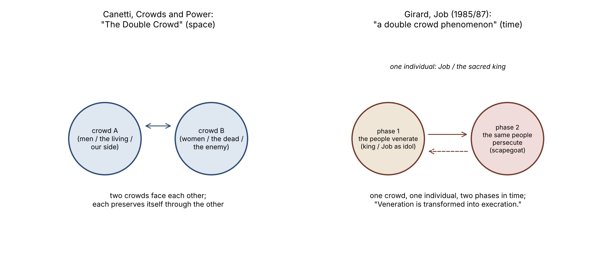

*[[shadows/weeks/elias-canetti|Elias Canetti (Author & Shadow)]] · Day 5 of 7 · 2026-10-30 · Difficulty 3 · Genealogy/influence, Conflict, Shared figure or motif*

## Books in this reading

- [[books/8264-job-the-victim-of-his-people|Job: The Victim of His People]], [[people/rene-girard|René Girard]], [[people/yvonne-freccero|Yvonne Freccero]] (translator); 1985 (English 1987, Athlone/Stanford). *Day 5 primary: suspected uncredited use of Canetti's coinage 'double crowd' (one occurrence, ch. 15, p. 93), with the concept changed from two crowds in space to one crowd in two phases.*
- [[books/6002-vampires-a-reasonable-dictionary|Vampires & a Reasonable Dictionary]], [[people/scott-abbott-zarko-radakovic|Scott Abbott; Žarko Radaković]]; 2014. *Day 5 primary: Canetti's English title quoted in quotation marks without his name (allusion), 'Belgrade, 24 May 1998', pp. 116–17.*
- [[books/7959-violence-and-the-sacred|Violence and the Sacred]], [[people/rene-girard|René Girard]], [[people/patrick-gregory|Patrick Gregory]] (translator); 1972 (English 1977). *Evidence, not a primary book: shows Girard knew Crowds and Power (p. 131 n. 3; bibliography), 13 years before Job.*

## The shadow so far

| Citing Book | Relation | Target | Location |
|---|---|---|---|
| [[books/413-the-conscience-of-words-with-earwitness|The Conscience of Words]] (Elias Canetti) | **Quotes** | Elias Canetti | pp. 24 (‘Power and Survival’) |
| [[books/413-the-conscience-of-words-with-earwitness|The Conscience of Words]] (Elias Canetti) | **Argues with** | Elias Canetti | p. 25 (‘Power and Survival’) |
| [[books/3123-dostoyevsky-reads-hegel-in-siberia-and-bursts-into|Dostoyevsky Reads Hegel in Siberia and Bursts Into Tears]] (László F. Földényi) | **Quotes** | Elias Canetti | 'A Capacity for Amazement', n. 3 (Stewart p. 411) |
| [[books/3123-dostoyevsky-reads-hegel-in-siberia-and-bursts-into|Dostoyevsky Reads Hegel in Siberia and Bursts Into Tears]] (László F. Földényi) | **Quotes** | Elias Canetti | 'A Capacity for Amazement', n. 1 (Nachträge aus Hampstead, p. 32) |
| [[books/926-a-temple-of-texts|A Temple of Texts]] (William H. Gass) | **Quotes** | Elias Canetti | 'The Road to the True Book' |
| [[books/926-a-temple-of-texts|A Temple of Texts]] (William H. Gass) | **Quotes** | Elias Canetti | 'The Road to the True Book' |
| [[books/926-a-temple-of-texts|A Temple of Texts]] (William H. Gass) | **Quotes** | Elias Canetti | 'Influence' |
| [[books/926-a-temple-of-texts|A Temple of Texts]] (William H. Gass) | **Quotes** | Elias Canetti | 'Influence'; also 'The Road to the True Book' (‘the last common property’; Confucius) |
| [[books/3632-the-intellectuals-and-the-masses-pride-and-prejudi|The Intellectuals and the Masses]] (John Carey) | **Argues with** | Elias Canetti | ch. 1, 'The Revolt of the Masses' (n. 11) |
| [[books/3632-the-intellectuals-and-the-masses-pride-and-prejudi|The Intellectuals and the Masses]] (John Carey) | **Quotes** | Elias Canetti | ch. 1, 'The Revolt of the Masses' (n. 11: Stewart, Gollancz 1962) |
| [[books/907-plasticity-the-promise-of-explosion-catalogued-as|Plasticity: The Promise of Explosion (catalogued as Plasticity at the Dusk of Writing)]] (Catherine Malabou) | **Argues with** | Elias Canetti | ch. 8, 'The Crowd: Figuring the Democracy to Come', p. 117 |
| [[books/907-plasticity-the-promise-of-explosion-catalogued-as|Plasticity: The Promise of Explosion (catalogued as Plasticity at the Dusk of Writing)]] (Catherine Malabou) | **Quotes** | Elias Canetti | ch. 8, pp. 115–118, n. 9 p. 129 (tr. Dashiell Wasserman) |
| [[books/4026-george-steiner-at-the-new-yorker|George Steiner at the New Yorker]] (George Steiner) | **Argues with** | Elias Canetti | 'A Tale of Three Cities' (New Yorker, 22 Nov 1982; book pp. 260–69) |
| [[books/4026-george-steiner-at-the-new-yorker|George Steiner at the New Yorker]] (George Steiner) | **Quotes** | Elias Canetti | 'A Tale of Three Cities' |
| [[books/3246-kafka-s-other-trial-the-letters-to-felice|Kafka's Other Trial: The Letters to Felice]] (Elias Canetti) | **Quotes** | Elias Canetti | p. 5 (n. 3: Diaries I, pp. 268–69); concordance across pp. 5–99, nn. 2–58 |
| [[books/3246-kafka-s-other-trial-the-letters-to-felice|Kafka's Other Trial: The Letters to Felice]] (Elias Canetti) | **Edits/introduces** | Elias Canetti | p. 99; n. 50, p. 121 |
| [[books/6272-franz-kafka-the-necessity-of-form|Franz Kafka: The Necessity of Form]] (Stanley Corngold) | **Translates** | Elias Canetti | Introduction, n. 8 (Der andere Prozeß, Hanser 1969, p. 36); also Intro n. 11; ch. 3 n. 1; ch. 6 n. 22 (two); ch. 10 n. 27 |
| [[books/6272-franz-kafka-the-necessity-of-form|Franz Kafka: The Necessity of Form]] (Stanley Corngold) | **Quotes** | Elias Canetti | ch. 6, n. 22 (Conscience of Words, tr. Neugroschel, Deutsch 1986, p. 70) |
| [[books/401-the-kraus-project|The Kraus Project]] (Karl Kraus, tr. Jonathan Franzen (note by Paul Reitter)) | **Edits/introduces** | Elias Canetti | 'Nestroy and Posterity', n. 14 (PR) |
| [[books/413-the-conscience-of-words-with-earwitness|The Conscience of Words]] (Elias Canetti) | **Argues with** | Elias Canetti | 'Karl Kraus: The School of Resistance', pp. 35–36 |
| [[books/8264-job-the-victim-of-his-people|Job: The Victim of His People]] (René Girard) | **Uses without credit (suspected)** | Elias Canetti | ch. 15, 'The Evolution of Ritual', p. 93 (structure set out ch. 13, p. 85) |
| [[books/7959-violence-and-the-sacred|Violence and the Sacred]] (René Girard (tr. Patrick Gregory)) | **Mentions** | Elias Canetti | p. 131 n. 3; bibliography |
| [[books/6002-vampires-a-reasonable-dictionary|Vampires & a Reasonable Dictionary]] (Scott Abbott; Žarko Radaković) | **Uses without credit (suspected)** | Elias Canetti | A Reasonable Dictionary (Abbott), 'Belgrade, 24 May 1998', pp. 116–17 |

---

## Friday 30 October 2026

## 1. Where the week stands

Elias Canetti, day 5 of 7: uncredited use (suspected). Day 1 read *The Conscience of Words* (413) and set the search terms. Day 2 found Földényi and Gass quoting him through translations of their own. Day 3 found Carey, Malabou and Steiner arguing with *Crowds and Power*. Day 4 found Canetti reading Kafka and Kraus as courts, and his translators moving *Urteil* between opinion, verdict and judgment. Today’s question: does anyone on these shelves use Canetti’s words without naming him?

## 2. The day’s finding

**Two suspicions and a set of nulls. Nothing here is a finding of plagiarism.**

| 1. René Girard, Job: | The Victim of His People (8264): | uses “double crowd”, |
|---|---|---|
| **Canetti’s chapter-title coinage, without naming him. Suspected; weak to mod-** |  |  |
| **erate.** |  |  |
| The book never mentions Canetti; its index has Frazer, Freud and Kafka but |  |  |
| not him. Girard had read *Crowds and Power*: thirteen years earlier, *Violence and the* |  |  |
| *Sacred* (7959) calls it “the best treatment of the crowd’s role in abolishing differences”. |  |  |
| He also changes what the phrase means. Canetti’s double crowd is two crowds facing |  |  |
| each other in space (men and women, the living and the dead, two armies). Girard’s |  |  |
| is one crowd that first venerates an individual and then turns on him. So the phrase |  |  |
| may have come from Canetti while the concept is Girard’s own. “Double” is also one of |  |  |
| Girard’s most-used words (the monstrous double appears 40 times in *Violence and the* |  |  |
| *Sacred*), so he could have reached “double crowd” without Canetti. |  |  |
| 2. **Scott Abbott, *Vampires & a Reasonable Dictionary* (6002): quotes Canetti’s En-** |  |  |
| **glish title in quotation marks without naming him.** This is an allusion that counts |  |  |
| on the reader knowing the book, not a borrowing. It still belongs in the record, because |  |  |
| the uncredited title stands in for “the theory” that Abbott says he has read. |  |  |
| 3. **Nulls.** |  |  |
| The coinages “crowd crystal”, “baiting crowd”, “lamenting pack”, “increase |  |  |
| pack”, “sting of command” and “invisible crowd”, plus nine more, appear in none of the |  |  |
| 107 scanned library titles about crowds, power, violence or the sacred, except in books |  |  |
| that name Canetti. “Onlyness” (de Gennaro, 6581) translates Heidegger and owes noth- |  |  |
| ing to Canetti. Bernhard’s “moment of survival” (6879) and Negarestani’s (3044) are |  |  |
| ordinary uses of the words. Two books carry Canetti’s title only through other people’s |  |  |
| article titles in their bibliographies (Thrift 2197; *Killing the Messiah* 14553). |  |  |

**Method note.** Today the calibre full-text tool answered one whole-library query (“double crowd” NOT Canetti) and then timed out on every later whole-library query. The device’s full-text-search.db was also being written to (modified 12:10 UTC), which suggests calibre was re-indexing. So I ran the day-1 leads with book_ids, and then substring-scanned the books’ own files on the Mac for a thematic subset: the 111 titles whose names contain crowd, mass, mob, multitude, power, sovereign, violence, sacred, scapegoat, survival and similar words.

Of those, 4 were Canetti’s own or already read, and 3 could not be read (two missing files, one bad EPUB). The scan covers that subset, not the whole library. **The day-5 search is therefore incomplete**: a whole-library pass for the coinages without “Canetti” is still owed.

## 3. The books

## René Girard, Job: The Victim of His People (1985; tr. Yvonne Freccero, Athlone/Stanford 1987). PDF, Calibre 8264

**Selection logic.** This was the strongest day-1 lead: the only book in the library besides Canetti’s own that contains “double crowd”. A deepfake-forensics manual matched only on “doubling”.

**Overview.** Girard reads the Book of Job as a scapegoat text. Job is not punished by God. He has been the idol of his community, and then he becomes its victim, and his friends speak for the persecuting crowd. Chapters 13 to 15 extend this to sacred kingship: kings are venerated and then ritually humiliated or killed, and Girard sets out how monarchy gradually loses its sacred character.

**Excerpt** (ch. 15, ‘The Evolution of Ritual’, p. 93; verified):

> This continuity suggests a slow evolution towards the modern desacralized monarchy, beginning with a double crowd phenomenon like the one portrayed in the text of Job.

The phrase occurs once in the book. Girard sets out the structure eight pages earlier, without the word “crowd” (ch. 13, ‘Origin and Repetition’, p. 85):

> During these rites the subjects pretend to forget their idolatory, while they briefly revolt against their idol. Veneration is transformed into execration.

> As in the case of Job, the monarchy is characterized by the very intense and double nature of the relationships between a single individual on the one hand and an entire group on the other.

(“idolatory” is the printed spelling.)

**Canetti’s own term** (*Crowds and Power*, 14938, tr. Carol Stewart; all verified):

- ‘The Double Crowd: Men and Women. The Living and the Dead’: “…and often the only, way by which a crowd can preserve itself lies in the existence of a second crowd to which it is related.” (The sentence opens “The surest”, in small caps.)

- Same chapter: “It is certainly possible to speak of the double crowd as something deeply rooted in the lives of these people.”

- ‘The Double Crowd: War’: “The third type of double crowd is that which forms in war, and this is the one which concerns us most today.”

**Diagram: the same two words, two structures.**

**The evidence, set out as a case file:**

> For a borrowing Against

Wording “double crowd” is a chapter Two common English words;

> title in *Crowds and Power*; “double” runs all through no other book in the library Girard (15 times in *Job*, uses it “monstrous double” 40 times in *Violence and the Sacred*)

> For a borrowing Against

Access *Violence and the Sacred*, The library holds only the

> p. 131 n. 3, recommends English translations. I could *Crowds and Power* (Stewart not check whether that note, tr., New York 1966) and lists or the phrase in *Job*, is in it in the bibliography Girard’s French (“La route antique des hommes pervers”, 1985) or was supplied by a translator

Subject Both books bring kingship, Girard’s sense differs: one

> crowd and victim together crowd in two phases, not two (Canetti’s ‘Rulers and crowds facing each other Paranoiacs’; Girard’s ch. 13, p. 85, where African rites “clearly attribute a primary role to this turnabout on the part of the people”) That credit concerns the Crediting habit Girard does credit a source Job–king analogy, not the in the same place: “I am not crowd the first to whom this has occurred.” […]
>
> *(Shortened for the public edition.)*

**Verdict.** This is a suspicion. If Girard took the phrase, he took the name and not the thing. A charge of uncredited use would have to show that the words were Canetti’s while the idea was not, which is close to the opposite of plagiarism.

**A misreading worth attempting.** Read Girard’s double crowd as a hidden reply to Canetti. For Canetti, a crowd preserves itself by facing a second crowd. For Girard, it preserves itself by producing a single victim out of its own number. On that reading, Girard’s lynching is Canetti’s double crowd with the second crowd shrunk to one man. Read *Violence and the Sacred* p. 131 with that in mind: “The crowd finally hurled itself on one individual”.

## Scott Abbott and Žarko Radaković, Vampires & a Reasonable Dictionary (punctum books, 2014). EPUB, Calibre 6002

**Selection logic.** Day 1 found this book carrying the string “Crowds and Power” but not the name “Canetti”. The full text confirms that “Canetti” does not appear anywhere in the EPUB.

**Overview.** The book is a two-handed travel book about Serbia in the 1990s and 2000s. Radaković writes *Vampires* (tr. Alice Copple-Tošić) and Abbott writes *A Reasonable Dictionary*. Abbott is also the translator of Handke’s *A Journey to the Rivers: Justice for Serbia*. The passage comes from his entry for Belgrade, 24 May 1998: a rally by Zoran Đinđić (spelled “Djindjić” in the book) in the rain, during the protests against Milošević.

**Excerpt** (*A Reasonable Dictionary*, ‘Belgrade, 24 May 1998’, pp. 116–17; verified):

> How do you move the masses without playing to the mass instincts that are part of the problem?

> How does a country move from “crowds and power” to a self-conscious and skeptical democracy? Education? Books that teach another kind of thinking?

> I’ve read the theory. Tonight I saw theory in action.

*Figure 1: Canetti’s double crowd (two crowds in space) and Girard’s (one crowd, two phases*

in time)

(The printed “ques-tions” and “blos-som” nearby are line-break hyphens left in the EPUB.)

**Derived list: what “the theory” is made to mean in four sentences.** The orator’s “rhythmic sentences” and “forceful repetitions”; the leader who “promises purity” and “incites to absolutes”; the crowd as something a country must “move from”; education as the way out. This is closer to Le Bon than to Canetti. In *Crowds and Power* the crowd is not a disease the leader catches. The title survives the trip; its argument does not.

**Verdict.** Unnamed, but not concealed. Abbott expects the reader to supply the name. I record it as “uses without credit (suspected)” because that is the nearest relation the table has, and the evidence field calls it an allusion.

## Checked and set aside (null results, with evidence)

> Where found without

Term (day-1 list) “Canetti” Why it does not hold

> Renders Heidegger’s “onlyness” de Gennaro, *The Weirdness* vocabulary for beyng; a *of Being* (6581): “in its withdrawn onlyness” different source

“moment of survival” Bernhard, *Old Masters* Ordinary phrase about the

> (6879): “we believe that at old masters; no link to the crucial moment of Canetti in the passage survival we can use them for our purposes”

“moment of survival” Negarestani, *Cyclonopedia* Ordinary phrase in a

> (3044): “Each moment of different theory of openness survival can be a summoning ritual”

“Crowds and Power” (title) Thrift, *Non-Representational* Only inside other authors’

> *Theory* (2197); *Killing the* article titles in a *Messiah* (14553) bibliography (J. Miller 1983; R. Myles 2020): echoes once removed

> Where found without

Term (day-1 list) “Canetti” Why it does not hold

15 coinages (crowd crystal, Substring scan of 107 Only hit without Canetti: baiting crowd, thematic titles “heap of corpses” in da lamenting/increase pack, Cunha, *Rebellion in the* sting(s) of command, *Backlands* (14306), a literal invisible/slow/reversal battlefield. The two “crowd crowd, heap of dead/corpses, crystal” hits (*An American* fear of being touched, *Utopia*, 11458) are in a book power-wielder, onlyness, that names Canetti 25 times double crowd, moment of survival)

## 4. The shadow so far

# From Relation To Location

1 Canetti, Quotes Ibn Battuta p. 24

> *Conscience of* (13883) *Words* (413) Canetti (413) Argues with p. 25 2 Freud on Schreber ‘A Capacity for 3–4 Földényi (3123) Quotes *Crowds and* Amazement’ *Power*; *Notes from Hampstead* ‘The Road to the Gass, *A Temple* Quotes *Torch*, *Tongue*, 5–8

| of Texts (926) | Play of the Eyes, | True Book’; |
|---|---|---|
|  | *Conscience* | ‘Influence’ |

9–10 Carey (3632) Argues with / *Crowds and* ch. 1

> Quotes *Power*

11–12 Malabou (907) Argues with / *Crowds and* ch. 8,

13–14 Steiner (4026) Argues with / oeuvre; *Torch* ‘A Tale of Three

> Quotes Cities’ Quotes / Edits Kafka, *Diaries* pp. 5, 99 15–16 Canetti, *Kafka’s* (3169) *Other Trial* (3246) Corngold (6272) Translates / *Der andere* Intro n. 8; ch. 6 17–18

| Quotes | Prozeß; | n. 22 |
|---|---|---|
|  | *Conscience* |  |

19 Reitter in *The* Edits/introduces Canetti on n. 14

> *Kraus Project* Kraus (413) (401) Canetti (413) Argues with pp. 35–36 20 Karl Kraus

**21 Girard, *Job* Uses without *Crowds and* ch. 15, p. 93;**

| (8264) | credit | Power, ‘The | ch. 13, p. 85 |
|---|---|---|---|
|  | **(suspected)** | **Double Crowd’** |  |

**22 Girard, Mentions *Crowds and* p. 131 n. 3;** #

| Violence and | Power | bibliography |
|---|---|---|
| ***the Sacred*** |  |  |
| **(7959)** |  |  |

> From Relation To Location

**23 Abbott, Uses without *Crowds and* ‘Belgrade, 24**

| Vampires & a | credit | Power (title) | May 1998’, |
|---|---|---|---|
| ***Reasonable*** | **(suspected)** |  | **pp. 116–17** |
| ***Dictionary*** |  |  |  |
| **(6002)** |  |  |  |

## 5. Where this sends you

**Notebook**

1. Girard credits Caquot for the idea of Job as a king and credits no one for “double crowd”. Write a short note on what can be owned: a phrase, a structure, or a turn. Which of Canetti’s coinages could someone take without taking any of his thought?

2. Abbott: “I’ve read the theory. Tonight I saw theory in action.” Choose a rally or a crowd you have seen, and describe it once in Canetti’s terms (discharge, density, direction) and once in Girard’s (unanimity, the victim). What does each vocabulary leave out?

3. The “misreading worth attempting” above makes Girard’s lynching a double crowd whose second crowd has shrunk to one man. Test it on *Violence and the Sacred* p. 131: where does the argument break?

**Rabbit holes**

- Gabriel Andrade, “René Girard (1923–2015)”, *Internet Encyclopedia of Philosophy*: https://iep.utm.edu/girard/ (no mention of Canetti, which is itself telling)

- Luca Luchesini, *Power, Crowds, Violence and Desire in Elias Canetti and René Girard* (ebook): https://buecher.de/artikel/ebook/power-crowds-violence-and-desire-in-elias-canetti-and-rene-girard-reflections-on-mimesis-politics-and-history-2-ebook-epub/72786082. The one book-length comparison I found; a short essay by a Girardian, not an academic monograph.

- *Job: The Victim of His People*, Stanford UP / De Gruyter Brill: https://www.degruyterbrill.com/document/doi/10.1515/9781503622999/html

- Abbott and Radaković, *Vampires & A Reasonable Dictionary*, open-access PDF (CC BY- NC-ND) at OAPEN: https://library.oapen.org/bitstream/20.500.12657/25544/1/1004551.pdf

- Innsbruck *Bibliography of Literature on the Mimetic Theory*, vol. XXXIV (COV&R Bulletin 41, 2012): https://www.uibk.ac.at/theol/cover/girard/pdf/bibliography_vol.xxxiv.pdf. Canetti does not appear in this volume; the other volumes are worth searching.

- *Crowds and Power* overview and reception: https://en.wikipedia.org/wiki/Crowds_and_Power

**Also in your library**

- Girard, *The Scapegoat* (8022). The persecution-text method at full length; it does not name Canetti.

- Girard, *Things Hidden Since the Foundation of the World* (8021). Check whether “double” and “crowd” meet again there.

- *A Companion to the Works of Elias Canetti* (3312). It never mentions Girard: the Canetti scholarship and the Girard scholarship on these shelves do not cite each other.

## 6. From the Lexicon: palimpsest

**Received.** A manuscript page, usually parchment, scraped or washed so it could be reused, with traces of the earlier writing still visible beneath the new. Figuratively, any surface or structure in which successive layers remain legible through one another. De Quincey applied it to memory: “What else than a natural and mighty palimpsest is the human brain?” (*Suspiria de Profundis*, 1845; quoted from the Lexicon entry, not checked against the book).

**Your sense.** Not yet written.

**Etymology.** Latin *palimpsestus*, from Greek *palimpsēstos* (“scraped again”), from *palin* (“again”) and *psēn* (“to rub smooth”). In English from the 1660s.

**WordNet** (oewn-06419157-n, noun.communication): “a manuscript (usually written on papyrus or parchment) on which more than one text has been written with the earlier writing incompletely erased and still visible”. Hypernym: *manuscript*.

**Lineage and relations.** Book History; Textual Criticism; Thomas De Quincey. Shares a lineage with *colophon*, *marginalia*, *redaction*, *anagnōsis*, *eklogē*, *hypomnēmatismos*, *obelism* and *bibliomancy*.

**Portable axiom.** None recorded.

**Why today.** A suspected uncredited use is a palimpsest read as evidence: the earlier writing is incompletely erased and still visible. In Girard’s “double crowd”, Canetti’s term shows through a new text that has written a different concept over it.

**Verified occurrence.** None in today’s books (searched in *Job*, *Violence and the Sacred*, *Crowds and Power* and *Vampires*). The Lexicon’s one attestation comes from a working file (01_ARCHITECTURE_I_BAROQUE_MONAD_CLINAMEN.md) and is not verified here.

**New in the Lexicon** (entered 29 October): Inflection, Fenestrated, monadic, PROSCENIUM, Lemma, Broodthaers, palimpsest.

## 7. To carry

> “I am not the first to whom this has occurred.” — René Girard, *Job: The Victim of His People*, ch. 14, ‘Job and the Sacred King’, p. 86 (tr. Yvonne Freccero)

## Themes

[[themes/abbott|Abbott]] · [[themes/allusion|allusion]] · [[themes/belgrade-1998|Belgrade 1998]] · [[themes/caquot|Caquot]] · [[themes/coinage|coinage]] · [[themes/double-crowd|double crowd]] · [[themes/girard|Girard]] · [[themes/handke|Handke]] · [[themes/job|Job]] · [[themes/null-result|null result]] · [[themes/palimpsest|palimpsest]] · [[themes/plagiarism|plagiarism]] · [[themes/radakovic|Radaković]] · [[themes/sacred-kingship|sacred kingship]] · [[themes/scapegoat|scapegoat]] · [[themes/search-method|search method]] · [[themes/uncredited-use|uncredited use]] · [[themes/veneration-and-execration|veneration and execration]] · [[themes/violence-and-the-sacred|Violence and the Sacred]] · [[themes/inic|Đinđić]]

---

Previous: [[shadows/2026-10-29-shadow-elias-canetti-day-4-the-tribunal-in-transla|Shadow — Elias Canetti, day 4: The Tribunal in Translation]]  
Next: —
