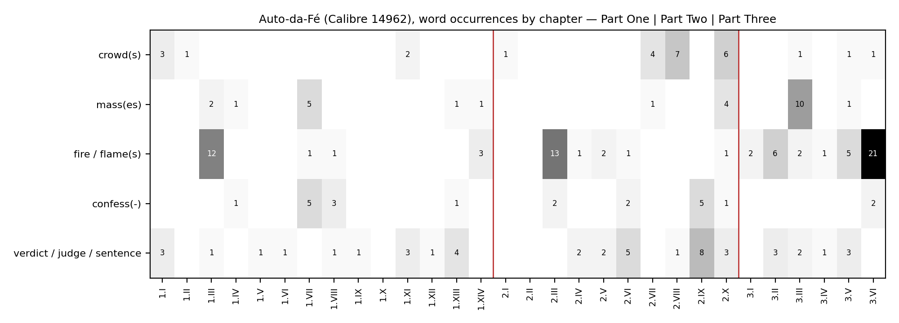

*[[shadows/weeks/elias-canetti|Elias Canetti (Author & Shadow)]] · Day 6 of 7 · 2026-10-31 · Difficulty 3 · Genealogy/influence, Conflict, Shared figure or motif*

## Books in this reading

- [[books/14962-auto-da-fe|Auto-Da-Fé]], [[people/elias-canetti|Elias Canetti]]; 1935. *Day 6 primary: the second own work, read in the light of days 2–5.*
- [[books/418-the-play-of-the-eyes|The Play of the Eyes]], [[people/elias-canetti|Elias Canetti]]; None. *Secondary: the author's afterword to the novel (not primary; used on day 2 as a source check).*
- [[books/3312-a-companion-to-the-works-of-elias-canetti|A Companion to the Works of Elias Canetti]], [[people/dagmar-c-g-lorenz|Dagmar C. G. Lorenz]] (editor); 2004. *Secondary: names the translator the EPUB omits.*

## The shadow so far

| Citing Book | Relation | Target | Location |
|---|---|---|---|
| [[books/413-the-conscience-of-words-with-earwitness|The Conscience of Words]] (Elias Canetti) | **Quotes** | Elias Canetti | pp. 24 (‘Power and Survival’) |
| [[books/413-the-conscience-of-words-with-earwitness|The Conscience of Words]] (Elias Canetti) | **Argues with** | Elias Canetti | p. 25 (‘Power and Survival’) |
| [[books/3123-dostoyevsky-reads-hegel-in-siberia-and-bursts-into|Dostoyevsky Reads Hegel in Siberia and Bursts Into Tears]] (László F. Földényi) | **Quotes** | Elias Canetti | 'A Capacity for Amazement', n. 3 (Stewart p. 411) |
| [[books/3123-dostoyevsky-reads-hegel-in-siberia-and-bursts-into|Dostoyevsky Reads Hegel in Siberia and Bursts Into Tears]] (László F. Földényi) | **Quotes** | Elias Canetti | 'A Capacity for Amazement', n. 1 (Nachträge aus Hampstead, p. 32) |
| [[books/926-a-temple-of-texts|A Temple of Texts]] (William H. Gass) | **Quotes** | Elias Canetti | 'The Road to the True Book' |
| [[books/926-a-temple-of-texts|A Temple of Texts]] (William H. Gass) | **Quotes** | Elias Canetti | 'The Road to the True Book' |
| [[books/926-a-temple-of-texts|A Temple of Texts]] (William H. Gass) | **Quotes** | Elias Canetti | 'Influence' |
| [[books/926-a-temple-of-texts|A Temple of Texts]] (William H. Gass) | **Quotes** | Elias Canetti | 'Influence'; also 'The Road to the True Book' (‘the last common property’; Confucius) |
| [[books/3632-the-intellectuals-and-the-masses-pride-and-prejudi|The Intellectuals and the Masses]] (John Carey) | **Argues with** | Elias Canetti | ch. 1, 'The Revolt of the Masses' (n. 11) |
| [[books/3632-the-intellectuals-and-the-masses-pride-and-prejudi|The Intellectuals and the Masses]] (John Carey) | **Quotes** | Elias Canetti | ch. 1, 'The Revolt of the Masses' (n. 11: Stewart, Gollancz 1962) |
| [[books/907-plasticity-the-promise-of-explosion-catalogued-as|Plasticity: The Promise of Explosion (catalogued as Plasticity at the Dusk of Writing)]] (Catherine Malabou) | **Argues with** | Elias Canetti | ch. 8, 'The Crowd: Figuring the Democracy to Come', p. 117 |
| [[books/907-plasticity-the-promise-of-explosion-catalogued-as|Plasticity: The Promise of Explosion (catalogued as Plasticity at the Dusk of Writing)]] (Catherine Malabou) | **Quotes** | Elias Canetti | ch. 8, pp. 115–118, n. 9 p. 129 (tr. Dashiell Wasserman) |
| [[books/4026-george-steiner-at-the-new-yorker|George Steiner at the New Yorker]] (George Steiner) | **Argues with** | Elias Canetti | 'A Tale of Three Cities' (New Yorker, 22 Nov 1982; book pp. 260–69) |
| [[books/4026-george-steiner-at-the-new-yorker|George Steiner at the New Yorker]] (George Steiner) | **Quotes** | Elias Canetti | 'A Tale of Three Cities' |
| [[books/3246-kafka-s-other-trial-the-letters-to-felice|Kafka's Other Trial: The Letters to Felice]] (Elias Canetti) | **Quotes** | Elias Canetti | p. 5 (n. 3: Diaries I, pp. 268–69); concordance across pp. 5–99, nn. 2–58 |
| [[books/3246-kafka-s-other-trial-the-letters-to-felice|Kafka's Other Trial: The Letters to Felice]] (Elias Canetti) | **Edits/introduces** | Elias Canetti | p. 99; n. 50, p. 121 |
| [[books/6272-franz-kafka-the-necessity-of-form|Franz Kafka: The Necessity of Form]] (Stanley Corngold) | **Translates** | Elias Canetti | Introduction, n. 8 (Der andere Prozeß, Hanser 1969, p. 36); also Intro n. 11; ch. 3 n. 1; ch. 6 n. 22 (two); ch. 10 n. 27 |
| [[books/6272-franz-kafka-the-necessity-of-form|Franz Kafka: The Necessity of Form]] (Stanley Corngold) | **Quotes** | Elias Canetti | ch. 6, n. 22 (Conscience of Words, tr. Neugroschel, Deutsch 1986, p. 70) |
| [[books/401-the-kraus-project|The Kraus Project]] (Karl Kraus, tr. Jonathan Franzen (note by Paul Reitter)) | **Edits/introduces** | Elias Canetti | 'Nestroy and Posterity', n. 14 (PR) |
| [[books/413-the-conscience-of-words-with-earwitness|The Conscience of Words]] (Elias Canetti) | **Argues with** | Elias Canetti | 'Karl Kraus: The School of Resistance', pp. 35–36 |
| [[books/8264-job-the-victim-of-his-people|Job: The Victim of His People]] (René Girard) | **Uses without credit (suspected)** | Elias Canetti | ch. 15, 'The Evolution of Ritual', p. 93 (structure set out ch. 13, p. 85) |
| [[books/7959-violence-and-the-sacred|Violence and the Sacred]] (René Girard (tr. Patrick Gregory)) | **Mentions** | Elias Canetti | p. 131 n. 3; bibliography |
| [[books/6002-vampires-a-reasonable-dictionary|Vampires & a Reasonable Dictionary]] (Scott Abbott; Žarko Radaković) | **Uses without credit (suspected)** | Elias Canetti | A Reasonable Dictionary (Abbott), 'Belgrade, 24 May 1998', pp. 116–17 |
| [[books/14938-crowds-and-power|Crowds and Power]] (Elias Canetti) | **Rewrites** | Elias Canetti | 'Baiting Crowds' (vs Auto-da-Fé Part Two ch. X 'The Button') |
| [[books/413-the-conscience-of-words-with-earwitness|The Conscience of Words]] (Elias Canetti) | **Edits/introduces** | Elias Canetti | 'The First Book: Auto-da-Fé', pp. 124–34 ('ina' is the OCR reading) |
| [[books/418-the-play-of-the-eyes|The Play of the Eyes]] (Elias Canetti) | **Edits/introduces** | Elias Canetti | 'Büchner in the Desert'; also 'The “Black Statue”' |
| [[books/3312-a-companion-to-the-works-of-elias-canetti|A Companion to the Works of Elias Canetti]] (Dagmar C. G. Lorenz (ed.); Hans Reiss) | **Mentions** | Elias Canetti | front matter, 'Principal Works by Year of First Publication'; Reiss, 'Canetti’s Attitude to Writers and Writings', p. 83 |

---

## Library resurfacing, 31 October 2026 — An author and their shadow, week 1

## 1. Where the week stands

Elias Canetti, day 6 of 7. Day 1 read *The Conscience of Words* (413) and set the week’s thesis, “The situation of survival is the central situation of power.” Day 2 found that quotations of Canetti survive while their frames drift (Földényi, Gass); day 3 heard three arguments (Carey: the crowd theory is incoherent and contemptuous; Malabou: the crowd is organised; Steiner: nothing after Opus I matches it); day 4 followed Canetti reading Kafka and Kraus as courts, and translators moving *Urteil* between opinion, verdict and judgment; day 5 found one suspicion (Girard’s “double crowd”) and several nulls. Today returns to Opus I itself: *Auto-da-Fé* (1935), Calibre 14962, read in the light of those five days.

## 2. The day’s finding

The novel already holds most of what the week’s readers did to Canetti, and in one place it is ahead of his own theory.

- **Against day 5 and against *Crowds and Power*****.** In Part Two, ch. X (“The Button”), a crowd hunting Fischerle cannot reach him and beats the hunchbacked Fishwife instead: “they had been too far off to hit Fischerle, they pay with interest now.” Twenty-five years later, *Crowds and Power* says of the baiting crowd that it “cannot be cheated of it” — its victim. The novel’s crowd is cheated and substitutes. That substitution is the mechanism Girard made his own (the scapegoat), and the 1935 novel is closer to Girard than the 1960 theory is. The only substitution of victims I found in *Crowds and Power* (searching “substitut-” and “cheated”) is sacrificial: “These animals perish instead of men, a substitution familiar from many religions: we remember Abraham and Isaac” (on the pilgrims at Arafat). **Relation: Rewrites (interpretive) — *Crowds and Power* rewrites the novel’s crowds as theory and drops the substitute victim.**

- **Against day 3 (Carey).** Carey reads the crowd in *Crowds and Power* as both subhuman and salvation, an ambivalence that “disturbs its intellectual coherence”. The novel gives the two halves to two brothers. Peter Kien, the sinologist, lectures his books on Mencius: “we must beware of these people of the masses.” Georges Kien, the psychiatrist, speaks of “the desire of men to rise into a higher type of animal, in to the mass”. What Carey calls incoherence in the treatise is, in the novel, a quarrel. Wotruba, Canetti reports in *The Play of the Eyes* (418), could not stomach exactly the second brother.

- **Against day 4 (the tribunal).** Kien judges Thérèse and acquits himself in the same paragraph: “He had condemned her to death, hunger and her own greed had executed the sentence on her.” “His trial must end with an overwhelming verdict for acquittal.” Canetti’s later phrase for Kafka — “his own tribunal” — fits Kien first.

- **Against day 2 (naming).** The sinologist was B, then Brand (“conflagration”), then Kant, then Kien (413, pp. 124–34). Canetti says that in 1935 “Except for the title and the sinologist’s name, nothing was altered.” Yet in the English novel Georges praises Peter’s “thesis on Kant and Confucius”. Either the manuscript had a scholar named Kant writing on Kant, or the line was changed when the name was. The library holds neither the German text nor the manuscript, so this stays a question.

- **Against day 4 (translation).** This EPUB (FSG 1984) names no translator: “English translation copyright © 1947 by Elias Canetti”. The Companion (3312) names C. V. Wedgwood, but gives “New York: Stein and Day, 1946” — a firm founded in 1962. The EPUB’s own Library of Congress data says “Originally published: New York: Continuum 1947”; Wikipedia gives Jonathan Cape 1946 and Knopf (as *The Tower of Babel*) 1947. Three records, three first editions.

- **Against day 1 (survival).** In *The Play of the Eyes* Canetti admits “the relief, the sense of liberation I felt at the thought of ending Kant’s life” — and, two sentences earlier, “I could not forgive myself for burning the books.” The author survives his character, and feels it.

## 3. The books

## Auto-da-Fé — Elias Canetti, 1935 (Die Blendung; English tr. C. V. Wedgwood, 1946; FSG 1984); EPUB; Calibre 14962

**Selection logic.** The day-plan’s day 6: the second own work, read in the light of days 2–5. It entered the catalogue on 26 October; day 1 had to make do without it.

**Overview.** Peter Kien, a sinologist with “a mere twenty-five thousand volumes” and no world, marries his housekeeper Thérèse to protect the library, is driven out of his flat, wanders Vienna with the chess-playing dwarf Fischerle carrying a library “in his head”, is beaten, confesses to a murder that did not happen, and is retrieved by his brother Georges, a Paris psychiatrist; alone again, he burns the library and himself. Three parts: “A Head Without a World”, “Headless World”, “The World in the Head”. Canetti drafted it in 1930–31 as one of eight novels in a “Human Comedy of Madmen” (413, pp. 127, 133).

**Element 1 — Excerpt: the cheated crowd** (Part Two, ch. X, “The Button”). The crowd has formed on a rumour: “Then everyone heard it; the joy of wanting the same thing filled them all.” “Everyone wanted his share in the robber who had taken the pearl necklace.” Fischerle slips away. The Fishwife, looking for him, stoops into the crowd:

> Suddenly somebody shrieks next to her: ‘The cripple!’ and hits her on the hump. Others shriek too, others hit her. The crowd falls upon her, they had been too far off to hit Fischerle, they pay with interest now.

Set beside it, *Crowds and Power* (“Baiting Crowds”):

> This crowd is out for killing and it knows whom it wants to kill. It heads for this goal with unique determination and cannot be cheated of it.

The novel’s crowd has a known goal, is cheated of it, and takes the nearest body that resembles it (the hump is the likeness). The treatise keeps the goal and loses the substitute.

**Element 2 — Excerpt: the rhythmic crowd** (Part Two, ch. VIII, “The Thief”). In the There-sianum, the pawnshop, Thérèse cheers on the men beating Kien: “A powerful rhythm seizes on the crowd.” Then: “Allliving [*sic*, EPUB] creatures in its huge population draw in one single deep breath together, and together, ecstatic, breathe it out again.” This is the discharge of *Crowds and Power* (“the moment when all who belong to the crowd get rid of their differences and feel equal”) written as a breath, twenty-five years early.

**Element 3 — The two brothers on the mass** (verified quotations).

| Peter Kien (sinologist) | Georges Kien (psychiatrist) |
|---|---|
| “’Always and without exception, the master tells us in these words, we must beware of these people of the masses.” (I.VII “Mobilization”, citing Mencius) | “Of that far deeper and most special motive force of history, the desire of men to rise into a higher type of animal, in to the mass, and to lose themselves in it so completely as to forget that one man ever existed, they had no idea.” (III.III “A Madhouse”) |
| “The democratization of the army will be practically expressed in the following form: from to-day onwards each single volume will stand with its back to the wall.” (I.VII — the books as his crowd) | “For they were educated men, and education is in itself a cordon sanitaire for the individual against the mass in his own soul.” (III.III) |
| “But he had an indestructible memory and could carry the entire new library in his head.” (II.I) | “There will come a time when it will not be scattered again, possibly in a single country at first, eating its way out from there, until no one can doubt any more, for there will be no I, you, he, but only it, the mass.” (III.III) |

Peter’s only crowd is his books, which he mobilises as an army. Georges’s patients are crowds in one body. Carey’s charge of intellectual contempt fits Peter; his charge of mass-salvation fits Georges; the novel lets each be wrong in his own way.

**Element 4 — Concordance by chapter** (figure). Counts from the EPUB text, whole words, case-insensitive. Totals: crowd(s) 27; mass(es) 26; fire/flame(s) 72; confess- 22; verdict/judge(s)/sentence 46 (“sentence” includes the grammatical sense, so that row over-counts). The crowd clusters in Part Two, chs. VII–X; the mass in III.III (Georges) and I.VII (Peter’s Mencius); fire in I.III (Kien’s reading of the Chinese book-burning), II.III and III.VI. The words of the trial run through all three parts.

*Figure 1: Auto-da-Fé: five word-groups by chapter*

**Element 5 — A question worth attempting (misreading).** Read Kien’s thesis on “Kant and Confucius” (III.V) as the scar of the name Kant. Canetti says the 1931 manuscript was unchanged except for title and name; if so, the thesis line once read as a scholar named Kant writing on Kant — a man who is his own subject, as he is his own tribunal. Test it against the German (*Die Blendung*, not in the library) before believing it.

**Element 6 — The end.** “When the flames reached him at last, he laughed out loud, louder than he had ever laughed in all his life.” (III.VI “The Red Cock”). Canetti on the first name: “This name contained his end: he was to end ina [*sic*, OCR] fire.” (413, p. 124). On the last: “The man was now called Kien (Pinewood), something of his combustibility got back into his name.” (p. 134). The source of the name, he says, was the archivist outside the burning Palace of Justice on 15 July 1927: “The files are burning! All the files!” (p. 127).

## Canetti on his own novel — The Play of the Eyes (418, “Büchner in the Desert”; “The ‘Black Statue’ ”) and The Conscience of Words (413, “The First Book: Auto-da-Fé”)

**Selection logic.** The author’s own afterwords, used to check what the week’s critics said about the novel (Gass’s “kindling”, Steiner’s “resinous pine-wood”). Not primary books.

**Overview.** Two retrospective accounts. *The Conscience of Words* (1973) tells the naming history and the 1927 fire; *The Play of the Eyes* (the third volume of the memoirs) tells the aftermath: guilt for the burned books, and the “desert” that followed.

**Elements.** (a) Verified: “I could not forgive myself for burning the books.” “hiding the relief, the sense of liberation I felt at the thought of ending Kant’s life.” “fire, whose connection with crowds I had recognized July 15, and books, which I lived with day after day.” (all “Büchner in the Desert”). (b) Wotruba’s objection: “it was only the sinologist’s psychiatrist brother that he couldn’t stomach.” (“The ‘Black Statue’ ”). (c) Naming chain, verified in 413: B (“Bookman”) →Brand (“This name contained his end”, p. 124) →Kant (“I redubbed him Kant, and he bore that name undisturbed for a long time.”, p. 127) →Kien (1935, at Broch’s urging, p. 134). Gass (day 2) went straight from Kant to Kien and glossed *Kien* as “kindling”; Canetti’s own word is “Pinewood”.

## A Companion to the Works of Elias Canetti, ed. Dagmar C. G. Lorenz, 2004; PDF; Calibre 3312

**Selection logic.** The day-4 thread (who translates) asked for the translator of the novel, and the EPUB is silent.

**Elements.** (a) The bibliography (front matter, “Principal Works by Year of First Publication”), verified: “Auto-da-Fé. Translated by C. V. Wedgwood. New York: Stein and Day, 1946; also as: The Tower of Babel. New York: Knopf, 1947).” Stein and Day was founded in 1962 (Wikipedia, checked); the 1946 first edition was London, Jonathan Cape. (b) Hans Reiss, “Canetti’s Attitude to Writers and Writings”, p. 83: Canetti “found warm words for Veronica Wedgwood, the distinguished historian of the seventeenth century (PA, 121–23), who translated Die Blendung” — *PA* is *Party im Blitz*, not in the library. (c) Derived list — the novel’s English titles and imprints as the library’s three records give them: *Auto-da-Fé* (Cape 1946 per Wikipedia; “Stein and Day, 1946” per 3312); *The Tower of Babel* (Knopf 1947 per 3312 and Wikipedia; “Continuum 1947” per the EPUB’s LC data); *Auto-da-Fé* (FSG 1984, this EPUB, translator unnamed).

## 4. The shadow so far

| # | From | Relation | To | Location |
|---|---|---|---|---|
| 1 | Conscience of Words (413) | Quotes | Ibn Battuta (13883) | pp. 24 |
| 2 | Conscience of Words (413) | Argues with | Freud, Schreber case | p. 25 |
| 3–4 | Földényi (3123) | Quotes | Crowds and Power; Notes from Hampstead | ‘A Capacity for Amazement’ |
| 5–8 | Gass (926) | Quotes | Torch; Tongue; Play of the Eyes; Conscience of Words | ‘Road to the True Book’; ‘Influence’ |
| 9–10 | Carey (3632) | Argues with; Quotes | Crowds and Power; Torch | ch. 1 |
| 11–12 | Malabou (907) | Argues with; Quotes | Crowds and Power | ch. 8 |
| 13–14 | Steiner (4026) | Argues with; Quotes | oeuvre; Torch | ‘A Tale of Three Cities’ |
| 15–16 | Kafka’s Other Trial (3246) | Quotes; Edits/introduces | Kafka, Diaries (3169) | pp. 5–99 |
| 17–18 | Corngold (6272) | Translates; Quotes | Kafka’s Other Trial; Conscience of Words | Intro; ch. 6 |
| 19 | Kraus Project (401) | Edits/introduces | Conscience of Words (Kraus essay) | n. 14 |
| 20 | Conscience of Words (413) | Argues with | Kraus | pp. 35–36 |
| 21 | Girard, Job (8264) | Uses without credit (suspected) | Crowds and Power | ch. 15, p. 93 |
| 22 | Girard, Violence and the Sacred (7959) | Mentions | Crowds and Power | p. 131 n. 3 |
| 23 | Abbott (6002) | Uses without credit (suspected; allusion) | Crowds and Power (title) | pp. 116–17 |
| **24 25 26** | **Crowds and Power (14938) Conscience of Words (413) Play of the Eyes (418)** | **Rewrites (interpretive) Edits/introducesAuto-da-Fé Edits/introducesAuto-da-Fé** | **Auto-da-Fé (14962)** | **‘Baiting Crowds’ vs II.X pp. 124–34 ‘Büchner in the Desert’** |
| **27** | **Companion (3312)** | **Mentions** | **Auto-da-Fé (translator)** | **front matter; p. 83** |

Tomorrow this becomes the graph.

## 5. Where this sends you

**Notebook**

1. The crowd “pay[s] with interest” on the Fishwife. Write a scene in which a crowd is cheated of its target. Who is nearest, and what likeness makes them the substitute?

2. Georges: “education is in itself a cordon sanitaire for the individual against the mass in his own soul.” Is your library a cordon sanitaire or a crowd? Kien had both in one room.

3. B, Brand, Kant, Kien: name a character four times, each name holding less of the ending. Which name would you publish under?

**Rabbit holes**

- William Collins Donahue, *The End of Modernism: Elias Canetti’s Auto-da-Fé* (UNC Press 2001), open access: https://library.oapen.org/bitstream/20.500.12657/43319/1/9781469657431.pdf

- Wikipedia, *Auto-da-Fé* (novel), for the Cape/Knopf publication history: https://en.wikipedia.org/wiki/Auto-da-F%C3%A9_(novel)

- C. V. Wedgwood, the translator (“under the author’s supervision”): https://en.wikipedia.org/wiki/C._V._Wedgwood

- Ferdinand Mount on *Party in the Blitz* (where Canetti writes about Wedgwood), *The Spectator*, 23 July 2005: https://archive.spectator.co.uk/article/23rd-july-2005/25/the-god-monster-of-hampstead

- Mencius, *Jin Xin I*, §5 in Legge (“this is the way of multitudes”) — compare with Kien’s Mencius: https://ctext.org/mengzi/jin-xin-i

- Stein and Day (founded 1962), for the Companion’s date problem: https://en.wikipedia.org/wiki/Stein_and_Day

**Also in your library**

- René Girard, *The Scapegoat* (8022) — the substitution that *Crowds and Power* left out.

- Jorge Luis Borges, *The Library of Babel and Other Stories* (11796) — the other library that contains everything and cannot be read; the novel’s first American title was *The Tower of Babel*.

- Antonio Muñoz Molina, *To Walk Alone in the Crowd* (14324) — the crowd seen by a single walker.

## 6. From the Lexicon — Colophon

**Why today.** The novel’s colophon (its copyright page) names the author as owner of the English translation and does not name the translator.

**Received vs. your sense.** Received: “An inscription at the end of a book or manuscript recording production details: scribe or printer, place, date… By extension, a publisher’s emblem or device.” Your sense: not yet written.

**Etymology.** Late Latin *colophon*, from Greek *kolōphōn* (summit, finishing touch); PIE *kel- (to be prominent; hill). English in the book sense 1774.

**WordNet.** One sense only: oewn-03075435-n, “a publisher’s emblem printed in a book (usually on the title page)”. The bibliographic sense is absent.

**Relations or lineage.** Boundary tension in the entry: the end-of-text production statement against the publisher’s emblem. Shares lineage with Marginalia, Redaction, obelism, palimpsest, Hypomnēmatismos.

**Portable axiom.** None recorded.

**Verified occurrence.** None in today’s books (the word does not occur in 14962, 14938, 413, 418 or 3312).

**New in the Lexicon.** Nothing added.

## 7. To carry

> “For they were educated men, and education is in itself a cordon sanitaire for the individual against the mass in his own soul.” — Elias Canetti, *Auto-da-Fé*, Part Three, ch. III, “A Madhouse” (Georges Kien), tr. C. V. Wedgwood

*Method notes.* Scribrarium mounted on the Mac; all reading done there from the books’ own files (EPUB spine order; PDFs with pdftotext). Every quotation substring-checked against the extracted text (31 checks, all passed). The calibre full-text index was available today (restricted searches); one passage request timed out and was not repeated.

## Themes

[[themes/15-july-1927|15 July 1927]] · [[themes/baiting-crowd|baiting crowd]] · [[themes/book-burning|book-burning]] · [[themes/brand|Brand]] · [[themes/carey|Carey]] · [[themes/colophon|colophon]] · [[themes/confession|confession]] · [[themes/crowd|crowd]] · [[themes/discharge|discharge]] · [[themes/georges-kien|Georges Kien]] · [[themes/girard|Girard]] · [[themes/guilt|guilt]] · [[themes/kant|Kant]] · [[themes/kien|Kien]] · [[themes/library-in-the-head|library in the head]] · [[themes/mass|mass]] · [[themes/mass-soul|mass-soul]] · [[themes/mencius|Mencius]] · [[themes/naming|naming]] · [[themes/rhythm|rhythm]] · [[themes/scapegoat|scapegoat]] · [[themes/substitution|substitution]] · [[themes/survival|survival]] · [[themes/translator-s-name|translator's name]] · [[themes/tribunal|tribunal]] · [[themes/verdict|verdict]] · [[themes/wedgwood|Wedgwood]]

---

Previous: [[shadows/2026-10-30-shadow-elias-canetti-day-5-the-double-crowd|Shadow — Elias Canetti, day 5: The Double Crowd]]  
Next: [[shadows/2026-11-01-shadow-elias-canetti-day-7-the-map|Shadow — Elias Canetti, day 7: The Map]]
