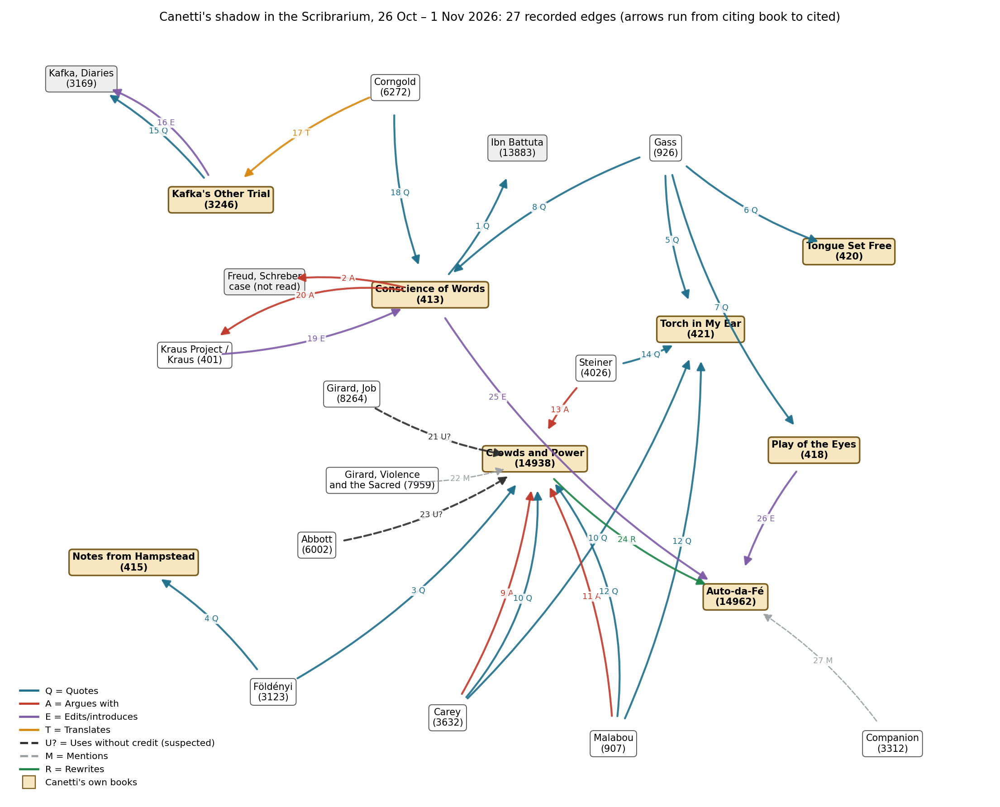

*[[shadows/weeks/elias-canetti|Elias Canetti (Author & Shadow)]] · Day 7 of 7 · 2026-11-01 · Difficulty 3 · Genealogy/influence, Conflict, Shared figure or motif*

## Books in this reading

- [[books/14938-crowds-and-power|Crowds and Power]], [[people/elias-canetti|Elias Canetti]], [[people/carol-stewart|Carol Stewart]] (translator); 1960. *Day 7: the hub of the week's graph (9 of 27 edges point at it); re-read at 'The Survivor' and the Epilogue.*
- [[books/413-the-conscience-of-words-with-earwitness|The Conscience of Words]], [[people/elias-canetti|Elias Canetti]], [[people/joachim-neugroschel|Joachim Neugroschel]] (translator); 1979 (English). *Lexicon check: 'onlyness' in 'Power and Survival', pp. 24–25 (tr. Neugroschel, © 1979). Not a primary book.*
- [[books/997-art-in-its-time-theories-and-practices-of-modern-a|Art in Its Time: Theories and Practices of Modern Aesthetics]], [[people/paul-mattick|Paul Mattick]]; 2003. *Lexicon check: quotes Toffler, The Culture Consumers (1965) p. 63, 'one-and-onlyness' (p. 176 n. 3). Not a primary book.*
- [[books/1070-insatiability|Insatiability]], [[people/stanislaw-ignacy-witkiewicz|Stanislaw Ignacy Witkiewicz]]; 1930 (tr. Iribarne 1977, rev. 1996). *Lexicon check: 'His Onlyness' as a title for the dictator Kotzmolochowicz. Not a primary book.*

## The shadow so far

| Citing Book | Relation | Target | Location |
|---|---|---|---|
| [[books/413-the-conscience-of-words-with-earwitness|The Conscience of Words]] (Elias Canetti) | **Quotes** | Elias Canetti | pp. 24 (‘Power and Survival’) |
| [[books/413-the-conscience-of-words-with-earwitness|The Conscience of Words]] (Elias Canetti) | **Argues with** | Elias Canetti | p. 25 (‘Power and Survival’) |
| [[books/3123-dostoyevsky-reads-hegel-in-siberia-and-bursts-into|Dostoyevsky Reads Hegel in Siberia and Bursts Into Tears]] (László F. Földényi) | **Quotes** | Elias Canetti | 'A Capacity for Amazement', n. 3 (Stewart p. 411) |
| [[books/3123-dostoyevsky-reads-hegel-in-siberia-and-bursts-into|Dostoyevsky Reads Hegel in Siberia and Bursts Into Tears]] (László F. Földényi) | **Quotes** | Elias Canetti | 'A Capacity for Amazement', n. 1 (Nachträge aus Hampstead, p. 32) |
| [[books/926-a-temple-of-texts|A Temple of Texts]] (William H. Gass) | **Quotes** | Elias Canetti | 'The Road to the True Book' |
| [[books/926-a-temple-of-texts|A Temple of Texts]] (William H. Gass) | **Quotes** | Elias Canetti | 'The Road to the True Book' |
| [[books/926-a-temple-of-texts|A Temple of Texts]] (William H. Gass) | **Quotes** | Elias Canetti | 'Influence' |
| [[books/926-a-temple-of-texts|A Temple of Texts]] (William H. Gass) | **Quotes** | Elias Canetti | 'Influence'; also 'The Road to the True Book' (‘the last common property’; Confucius) |
| [[books/3632-the-intellectuals-and-the-masses-pride-and-prejudi|The Intellectuals and the Masses]] (John Carey) | **Argues with** | Elias Canetti | ch. 1, 'The Revolt of the Masses' (n. 11) |
| [[books/3632-the-intellectuals-and-the-masses-pride-and-prejudi|The Intellectuals and the Masses]] (John Carey) | **Quotes** | Elias Canetti | ch. 1, 'The Revolt of the Masses' (n. 11: Stewart, Gollancz 1962) |
| [[books/907-plasticity-the-promise-of-explosion-catalogued-as|Plasticity: The Promise of Explosion (catalogued as Plasticity at the Dusk of Writing)]] (Catherine Malabou) | **Argues with** | Elias Canetti | ch. 8, 'The Crowd: Figuring the Democracy to Come', p. 117 |
| [[books/907-plasticity-the-promise-of-explosion-catalogued-as|Plasticity: The Promise of Explosion (catalogued as Plasticity at the Dusk of Writing)]] (Catherine Malabou) | **Quotes** | Elias Canetti | ch. 8, pp. 115–118, n. 9 p. 129 (tr. Dashiell Wasserman) |
| [[books/4026-george-steiner-at-the-new-yorker|George Steiner at the New Yorker]] (George Steiner) | **Argues with** | Elias Canetti | 'A Tale of Three Cities' (New Yorker, 22 Nov 1982; book pp. 260–69) |
| [[books/4026-george-steiner-at-the-new-yorker|George Steiner at the New Yorker]] (George Steiner) | **Quotes** | Elias Canetti | 'A Tale of Three Cities' |
| [[books/3246-kafka-s-other-trial-the-letters-to-felice|Kafka's Other Trial: The Letters to Felice]] (Elias Canetti) | **Quotes** | Elias Canetti | p. 5 (n. 3: Diaries I, pp. 268–69); concordance across pp. 5–99, nn. 2–58 |
| [[books/3246-kafka-s-other-trial-the-letters-to-felice|Kafka's Other Trial: The Letters to Felice]] (Elias Canetti) | **Edits/introduces** | Elias Canetti | p. 99; n. 50, p. 121 |
| [[books/6272-franz-kafka-the-necessity-of-form|Franz Kafka: The Necessity of Form]] (Stanley Corngold) | **Translates** | Elias Canetti | Introduction, n. 8 (Der andere Prozeß, Hanser 1969, p. 36); also Intro n. 11; ch. 3 n. 1; ch. 6 n. 22 (two); ch. 10 n. 27 |
| [[books/6272-franz-kafka-the-necessity-of-form|Franz Kafka: The Necessity of Form]] (Stanley Corngold) | **Quotes** | Elias Canetti | ch. 6, n. 22 (Conscience of Words, tr. Neugroschel, Deutsch 1986, p. 70) |
| [[books/401-the-kraus-project|The Kraus Project]] (Karl Kraus, tr. Jonathan Franzen (note by Paul Reitter)) | **Edits/introduces** | Elias Canetti | 'Nestroy and Posterity', n. 14 (PR) |
| [[books/413-the-conscience-of-words-with-earwitness|The Conscience of Words]] (Elias Canetti) | **Argues with** | Elias Canetti | 'Karl Kraus: The School of Resistance', pp. 35–36 |
| [[books/8264-job-the-victim-of-his-people|Job: The Victim of His People]] (René Girard) | **Uses without credit (suspected)** | Elias Canetti | ch. 15, 'The Evolution of Ritual', p. 93 (structure set out ch. 13, p. 85) |
| [[books/7959-violence-and-the-sacred|Violence and the Sacred]] (René Girard (tr. Patrick Gregory)) | **Mentions** | Elias Canetti | p. 131 n. 3; bibliography |
| [[books/6002-vampires-a-reasonable-dictionary|Vampires & a Reasonable Dictionary]] (Scott Abbott; Žarko Radaković) | **Uses without credit (suspected)** | Elias Canetti | A Reasonable Dictionary (Abbott), 'Belgrade, 24 May 1998', pp. 116–17 |
| [[books/14938-crowds-and-power|Crowds and Power]] (Elias Canetti) | **Rewrites** | Elias Canetti | 'Baiting Crowds' (vs Auto-da-Fé Part Two ch. X 'The Button') |
| [[books/413-the-conscience-of-words-with-earwitness|The Conscience of Words]] (Elias Canetti) | **Edits/introduces** | Elias Canetti | 'The First Book: Auto-da-Fé', pp. 124–34 ('ina' is the OCR reading) |
| [[books/418-the-play-of-the-eyes|The Play of the Eyes]] (Elias Canetti) | **Edits/introduces** | Elias Canetti | 'Büchner in the Desert'; also 'The “Black Statue”' |
| [[books/3312-a-companion-to-the-works-of-elias-canetti|A Companion to the Works of Elias Canetti]] (Dagmar C. G. Lorenz (ed.); Hans Reiss) | **Mentions** | Elias Canetti | front matter, 'Principal Works by Year of First Publication'; Reiss, 'Canetti’s Attitude to Writers and Writings', p. 83 |
| [[books/306-the-omnibus-homo-sacer-the-sacrament-of-language-a|The Omnibus Homo Sacer (Remnants of Auschwitz)]] (Giorgio Agamben) | **Argues with** | Elias Canetti | Remnants of Auschwitz, ch. 2 (Omnibus PDF, printed p. 795) |

---

## Sunday 1 November 2026

## 1. Where the week stands

Day 7 of 7 for Elias Canetti, the first week of “An author and their shadow”. Day 1 read *The Conscience of Words* (413) in place of *Crowds and Power*, which had not yet been catalogued; day 2 found two essayists (Földényi, Gass) quoting him accurately and framing him loosely; day 3 found Carey, Malabou and Steiner arguing with him; day 4 followed him into Kafka and Kraus and found the translations bending toward his reading; day 5 found one suspicion of uncredited use (Girard’s “double crowd”) and an allusion (Abbott); day 6 read *Auto-da-Fé* (14962) and found the novel already holding most of the week. Today draws the map from the 27 edges recorded in Shadow_Edges and writes the closing account.

## 2. The day’s finding

The library’s Canetti has one hub and two habits. The hub is *Crowds and Power*: 9 of the 27 edges point at it, more than twice as many as at any other node. The habits are these. First, what travels out of Canetti is the **sentence**, not the **concept**: the quotations recorded under “Quotes” mostly held word for word against Canetti’s own books (Földényi, Gass, Steiner, Corngold, with one-word slips), and where they drifted it was by cuts (Carey) or by passing through French (Malabou); but of the fifteen coinages set as day-5 search terms, only one (“double crowd”) turns up as a working term in a book that does not name him, and that book changes its meaning. Second, almost every edge passes through a **translator** (Stewart, Neugroschel, Middleton, Wedgwood, Wasserman, Corngold), and the most consequential changes of the week happened there, not in the arguments. A third observation is structural: **8 of the 27 edges begin in Canetti’s own books**. On these shelves he is his own most frequent commentator, which is the figure day 4 found in his reading of Kafka: “his own tribunal”.

Relations: Quotes 12; Argues with 5; Edits/introduces 4; Uses without credit (suspected) 2; Mentions 2; Translates 1; Rewrites 1. Total 27, from 15 citing books (4 of them Canetti’s).

Mentions: the day-1 capture holds 343 rows (13 own works, 330 others). Of the 330 non-own books that name him, **9 became edges** (2.7%). Two further edges came from books that never name him (Girard, *Job*, 8264; Abbott, 6002), so they could not be in Mentions at all; and *Kafka’s Other Trial* (3246) is absent from Mentions because it has no text layer and is invisible to the index (it was OCR’d on day 4). Thirteen Mentions rows are marked Promoted (the 9, plus 413, 418, 14938, 14962).

## 3. The map and the hub

## The map — the week’s citation graph (27 edges, 22 nodes)

*Selection logic:* every row in Shadow_Edges for week 2, drawn as an arrow from the citing book to the cited. Two edges (10, 12) have two targets and are drawn twice. Freud’s Schreber case is drawn as a node though the library’s copy was not read (day 1). Kraus is drawn as *The Kraus Project* (401), the edition the week used.

*Figure 1: Canetti’s shadow in the Scribrarium*

**Element: derived list — degree.** Read the shape, not the numbers alone. The memoirs (421, 420, 418) are reached only by

| Node | Arrows in | Arrows out |
|---|---|---|
| Crowds and Power (14938) | 9 | 1 |
| The Torch in My Ear (421) | 4 | 0 |
| Auto-da-Fé (14962) | 4 | 0 |
| The Conscience of Words (413) | 3 | 4 |
| Kafka, Diaries (3169) | 2 | 0 |
| Gass, A Temple of Texts (926) | 0 | 4 |
| Földényi, Carey, Malabou, Steiner, Corngold (each) | 0 | 2 |
| Kafka’s Other Trial (3246) | 1 | 2 |

quotation; *Crowds and Power* is reached by quotation, argument, mention and suspected borrowing; *Auto-da-Fé* is reached three times out of four by Canetti himself (CP rewrites it; 413 and 418 explain it), once by a reference book’s bibliography. Nobody in the library argues with the novel.

**Element: misreading worth attempting.** Read the graph as a crowd diagram in Canetti’s own terms. The hub with many arrows in is a crowd-crystal (“small, rigid groups of men, strictly delimited and of great constancy”, which Malabou’s n. 9 shortened on day 3); the arrows are the crowd’s “direction”. On that reading the week’s two “Uses without credit” edges are not thefts but the moment a crowd forgets the name of the crystal that formed it. The reading is wrong as sociology and useful as a test: it predicts that the more an idea spreads, the fewer arrows will be labelled, and the library’s data (2 unlabelled edges of 27) do not show it.

## Crowds and Power (Elias Canetti, 1960; tr. Carol Stewart 1962; EPUB, Calibre 14938) — re-read for the hub

*Selection logic:* the node with the most arrows in; read again today at the two places the week kept returning to, “The Survivor” and the Epilogue, to check the week’s frame against the book’s own.

*Overview:* the week’s readers (Carey, Malabou, Földényi) argued about the crowd; the book itself ends on the survivor. Its Epilogue, “The End of the Survivor”, reopens the double crowd that Girard borrowed (day 5) and scales it to geopolitics.

**Element: verified quotations.**

- “THE MOMENT OF survival is the moment of power.” — ‘The Survivor’ (opening sentence; small capitals in the EPUB). Day 1’s carry from *The Conscience of Words* (“The situation of survival is the central situation of power”, p. 16) restates this sentence of 1960.

- “There is a clear trend towards the formation of enormous double crowds, named after

| whole quarters of the globe—East and West.” | — Epilogue. | The double crowd stays |
|---|---|---|
| spatial at the end of the book: two masses facing each other. Girard’s “double crowd |  |  |
| phenomenon” (day 5) is one crowd at two moments. The Epilogue confirms the difference |  |  |
| the day-5 suspicion rested on. |  |  |

- “The survivor is mankind’s worst evil, its curse and perhaps its doom.” — Epilogue.

- “But it was my intention to hunt him out in all his hiding-places and show him for what he is and always has been.” — Epilogue.

**Element: excerpt (Epilogue, opening sentences; verified).**

> AFTER THIS DETAILED study of a paranoiac delusion which found only one adherent, namely its originator, it is time to consider what we have learnt about power in general. For every individual case, however valuable the clues it provides, arouses the same doubt in us. […]
>
> *(Shortened for the public edition.)*

(The “paranoiac delusion” is Schreber’s: the same case whose Freudian reading Canetti called “an utter misinterpretation” on day 1, edge 2.)

## 4. The shadow, complete

| # | From | Relation | To | Location |
|---|---|---|---|---|
| 1 | Canetti, Conscience of Words (413) | Quotes | Ibn Battuta, Travels (13883) | p. 24, ‘Power and Survival’ |
| 2 | 413 | Argues with | Freud, Schreber case | p. 25 |
| 3 | Földényi (3123) | Quotes | Crowds and Power (14938) | ‘A Capacity for Amazement’, n. 3 |
| 4 | Földényi (3123) | Quotes | Notes from Hampstead (415) | same essay, n. 1 |
| 5 | Gass (926) | Quotes | Torch in My Ear (421) | ‘The Road to the True Book’ |
| 6 | Gass (926) | Quotes | Tongue Set Free (420) | same essay |
| 7 | Gass (926) | Quotes | Play of the Eyes (418) | ‘Influence’ |
| 8 | Gass (926) | Quotes | 413 | ‘Influence’ (Kien ‘kindling’) |
| 9 | Carey (3632) | Argues with | 14938 | ch. 1, n. 11 |
| 10 | Carey (3632) | Quotes | 14938; 421 | ch. 1, n. 11 |
| 11 | Malabou (907) | Argues with | 14938 | ch. 8, p. 117 |
| 12 | Malabou (907) | Quotes | 14938; 421 | ch. 8, pp. 115–118, n. 9 |
| 13 | Steiner (4026) | Argues with | 14938 and the oeuvre | ‘A Tale of Three Cities’ |
| 14 | Steiner (4026) | Quotes | 421 | same |
| 15 | Canetti, Kafka’s Other Trial (3246) | Quotes | Kafka, Diaries (3169) | p. 5 and passim |
| 16 | 3246 | Edits/introduces | 3169 | p. 99; n. 50 |
| 17 | Corngold (6272) | Translates | 3246 | Intro n. 8 and five more |
| 18 | Corngold (6272) | Quotes | 413 | ch. 6, n. 22 |
| 19 | Kraus Project (401) | Edits/introduces | 413 | ‘Nestroy and Posterity’, n. 14 |
| 20 | 413 | Argues with | Kraus (401) | pp. 35–36 |
| 21 | Girard, Job (8264) | Uses without credit (suspected) | 14938 | ch. 15, p. 93 |
| 22 | Girard, Violence and the Sacred (7959) | Mentions | 14938 | p. 131 n. 3 |
| 23 | Abbott (6002) | Uses without credit (suspected; allusion) | 14938 (title) | pp. 116–17 |
| 24 | Crowds and Power (14938) | Rewrites | Auto-da-Fé (14962) | ‘Baiting Crowds’ vs II.X |
| 25 | 413 | Edits/introduces | 14962 | pp. 124–34 |
| 26 | Play of the Eyes (418) | Edits/introduces | 14962 | ‘Büchner in the Desert’ |
| 27 | Companion (3312) | Mentions | 14962 | front matter; p. 83 |

## 5. Closing essay: what the shelves say

**The concept did not travel; the sentence did.** Arnason and Roberts introduce their 2004 collection by saying, in substance, that social and political thought has hardly taken up the challenge of *Crowds and Power*. The library says something narrower and more checkable. The book is the most-cited node on these shelves, but the people who cite it are essayists and critics, and what they take is sentences: Földényi’s six quotations are word for word; Gass’s blocks carry two typographical slips; Carey’s lose a hedge and an “own”; Malabou’s come back from French with different nouns. Of the fifteen coinages logged on day 1 (onlyness, reverse lottery, crowd-crystal, slow crowd, baiting crowd, lamenting pack, keeper of metamorphoses and the rest), not one appears as a working term in a book that does not name Canetti, except “double crowd” in Girard, and Girard turns two crowds in space into one crowd in time. Canetti made a vocabulary nobody else uses. The shelves suggest a reason the field’s verdict may be right for the wrong cause: not that the book was neglected, but that its terms are so fused to their anecdotes (the sultan Muhammad Tughlak on his roof, Schreber in his asylum) that lifting one out leaves only a sentence.

**The arguments were about coherence, and the novel had already answered them.** Carey’s charge, that the crowd is both “a subhuman monster” and “the salvation of mankind”, and Malabou’s counter-charge, that “nothing is more organised than the mass that Canetti describes”, are both arguments about whether the theory hangs together. Day 6 found the ambivalence already split between two brothers in *Auto-da-Fé* (Peter’s Mencius against Georges’s “higher type of animal”), and found the 1935 novel’s crowd being *cheated* of its victim, a thing the 1960 theory says cannot happen. The novel is nearer to Girard than the theory is. None of the week’s critics argues with the novel; on these shelves it is explained only by its author.

**Translation is where the shadow changes shape.** The week’s largest single change of meaning was not an argument but a word: Kafka’s *unerschütterliches Urteil* is “an unshakeable opinion” in the Kresh diaries, “an unshakable verdict” in Middleton’s Canetti, “an unshakeable judgment” in Corngold. In English, Canetti’s reading of Kafka as a man on trial is carried by Middleton’s noun more than by Kafka’s. Malabou’s Canetti reached English through French and lost “rigid” from the crowd-crystal; Corngold retranslated Canetti six times and never cited the existing version; the library’s *Auto-da-Fé* does not name its translator, and the *Companion* names her with an impossible publisher and date. A reader of the English shelves is reading at least five Canettis, and the edges between critics and the author are really edges between critics and translators.

**He is his own commentator.** Eight of twenty-seven edges begin in Canetti’s books: he quotes Ibn Battuta and Kafka, argues with Freud and Kraus, rewrites his own novel as theory, and explains that novel twice in later books. Day 4’s phrase for Kafka — “his own tribunal …

and that tribunal will always be in session” — describes the shape of this graph better than it describes Kafka. The Epilogue ends on the same figure: he set out “to hunt him out in all his hiding-places”, the survivor who outlasts every other. A map that shows an author as the densest source of commentary on himself is a map of an author who meant to have the last word.

**Limits.** The graph records what the week read, not what the library holds: 321 of the 330 non-own books that name Canetti produced no edge, most of them unread, and the *Companion* (3312, 2,521 occurrences of his name) was used only for a bibliography. Full-text search timed out on days 1, 2 and 5, so the uncredited-use search is incomplete. The null result on uncredited use is a result about these shelves, not about the field.

**Next.** Kathy Acker is the only Planned row (Queue 5), so she is next by the queue and nothing has been added. The Canetti week makes her a good sequel: here uncredited use was nearly absent and translation did the rewriting; for Acker, rewriting without credit is the method itself, and day 5 will have to separate her borrowings from others’ borrowings of her.

## 6. Where this sends you

**Notebook**

1. The Epilogue says the survivor must be hunted “in all his hiding-places”. The week found Canetti’s own books to be the densest source of commentary on him. Is an author who explains his own first book acting as survivor of it? Write a page that tests the analogy and then breaks it.

2. Edge 15: *Urteil* as opinion, verdict, judgment. Pick a word in your own work that a translator would have to choose between three English nouns for, and write the three sentences. Which one would a hostile reader prefer?

3. The misreading in section 3 predicts that ideas lose their names as they spread. Find one of your own coinages in someone else’s text (or imagine it there) and decide what you would count as credit.

**Rabbit holes**

- Johann P. Arnason and David Roberts, *Elias Canetti’s Counter-Image of Society: Crowds, Power, Transformation* (Camden House, 2004), Introduction: https://www.cambridge.org/core/books/elias-canettis-counterimage-of-society/introduction/78B1219FDB1E81DAF70C5362C8CD1EE9

- Seth Lerer, “The Patience of the Hand: On Elias Canetti’s Crowds and Power and Our Current Crisis”, *Los Angeles Review of Books*, 11 June 2020: https://lareviewofbooks.org/blog/essays/patience-hand-elias-canettis-crowds-power-current-crisis/

- Franco Moretti, “Network Theory, Plot Analysis”, *New Left Review* 68 (2011) (paywalled): https://newleftreview.org/issues/ii68/articles/franco-moretti-network-theory-plot-analysis

- The same as a Stanford Literary Lab pamphlet: https://litlab.stanford.edu/projects/network-theory-plot-analysis

- Nobel Prize in Literature 1981, facts page (“for writings marked by a broad outlook, a wealth of ideas and artistic power”): https://www.nobelprize.org/prizes/literature/1981/canetti/facts/

**Also in your library**

- Franco Moretti, *Literary Lab #2* (Network Theory, Plot Analysis) — Calibre 5420. The method’s source for drawing a network from a text.

- Per Hage and Frank Harary, *Structural Models in Anthropology* — Calibre 9870. Graph theory applied to kinship and exchange; useful before the next map.

- Stanisław Ignacy Witkiewicz, *Insatiability* — Calibre 1070. A 1930 novel of crowds and a dictator called “His Onlyness”; see the Lexicon below.

## 7. From the Lexicon: onlyness

**Why today:** “onlyness” was the first of the day-1 search terms, and Canetti’s translator used it in 1979; the Lexicon entry credits its coinage to 2017.

**Received vs. your sense.** Received (Lexicon): the title concept of Nilofer Merchant’s *The Power of Onlyness* (2017), “that spot in the world only you stand in”, which she says she coined; also a loose variant of “onliness”. Your sense: not yet written.

**Etymology.* only* + *-ness*; *only* from Old English *ænlic*, “one-like”. The Lexicon dates the -y-spelling to Merchant (interview 2016; book 2017).

**WordNet.** “onlyness” is absent. Nearest: *uniqueness*, *singularity* (noun.attribute): “the quality of being one of a kind”.

**Relations.** Sister row: *Onliness* (the dictionary word, a state rather than a capacity). Canetti’s use joins the two: the sultan’s onlyness is both uniqueness and being left alone in an emptied city.

**Verified occurrences (checked today against the books’ own files).**

- Canetti, *The Conscience of Words*, tr. Joachim Neugroschel (English translation © 1979), ‘Power and Survival’, p. 24: “But the crucial moment is the moment of the sultan’s onlyness, when he gazed from the palace roof across the empty city at night”. And p. 25: “all these things would tend to show that the urge for this onlyness is something very real”.

- Alvin Toffler, *The Culture Consumers* (1965), p. 63, as quoted by Paul Mattick, *Art in Its Time* (997), p. 176 n. 3: “It is for this reason the broadest of all possible fields within which the individual can express his one-and-onlyness.” (Verified in Mattick only; Toffler’s own text not checked.)

- Witkiewicz, *Insatiability* (1070), tr. Louis Iribarne, revised version © 1996 (first version 1977): “His Onlyness is absolutely inscrutable.” (Whether the 1977 text has the same word is not checked.)

So on your own shelves the word is in print 38 years before 2017 and, hyphenated, 52 years before. That does not refute Merchant’s claim to have coined *her* sense; it does make “coined” the wrong verb for the word. (Not written to the Lexicon’s Attestations: the run changes only the resurfacing counters. For you to decide.)

**Portable axiom.** None in the Lexicon. Candidate, from Canetti: “the urge for this onlyness is something very real, a prime force to be taken seriously”.

**New in the Lexicon** (added 30–31 October): domiciliation, consignation, Clandestine, gowpen, logofascinated, onomastics.

## 8. To carry

> “But it was my intention to hunt him out in all his hiding-places and show him for what he is and always has been.”

> — Elias Canetti, *Crowds and Power*, Epilogue, ‘The End of the Survivor’, tr. Carol Stewart

## Themes

[[themes/citation-graph|citation graph]] · [[themes/crowd-crystal|crowd-crystal]] · [[themes/degree|degree]] · [[themes/double-crowd|double crowd]] · [[themes/epilogue|Epilogue]] · [[themes/hub|hub]] · [[themes/moretti|Moretti]] · [[themes/network|network]] · [[themes/null-result|null result]] · [[themes/onlyness|onlyness]] · [[themes/quotation|quotation]] · [[themes/self-commentary|self-commentary]] · [[themes/survivor|survivor]] · [[themes/toffler|Toffler]] · [[themes/translation|translation]] · [[themes/tribunal|tribunal]] · [[themes/uncredited-use|uncredited use]] · [[themes/urteil|Urteil]] · [[themes/verdict|verdict]] · [[themes/witkiewicz|Witkiewicz]]

---

Previous: [[shadows/2026-10-31-shadow-elias-canetti-day-6-the-crowd-is-cheated|Shadow — Elias Canetti, day 6: The Crowd Is Cheated]]  
Next: [[shadows/2026-11-02-shadow-kathy-acker-day-1-the-card-says-alexandria|Shadow — Kathy Acker, day 1: The Card Says Alexandria]]
