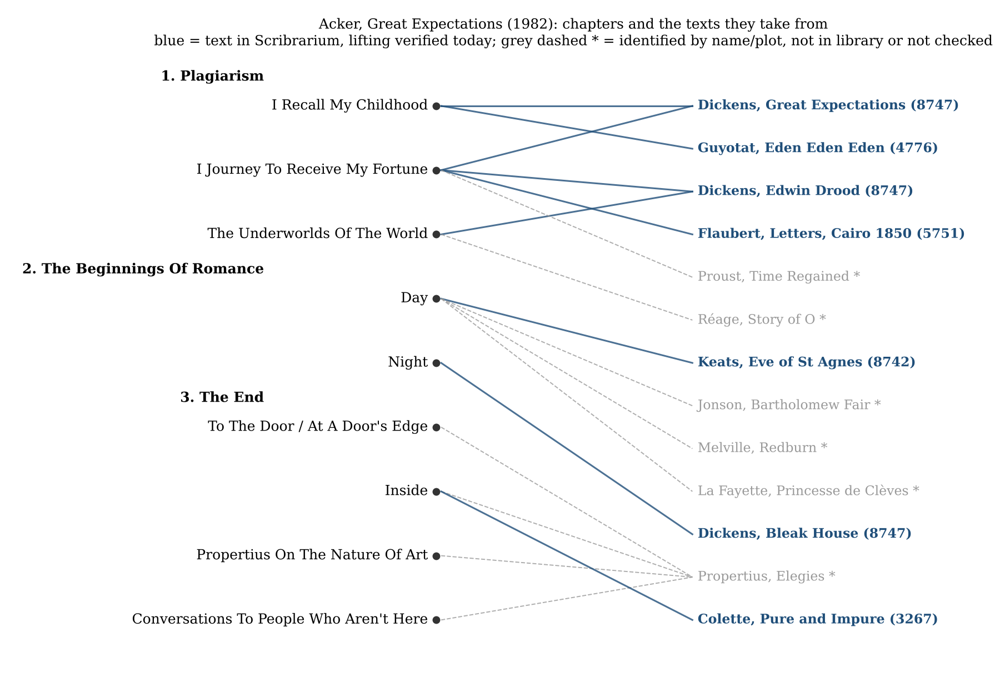

*[[shadows/weeks/kathy-acker|Kathy Acker (Author & Shadow)]] · Day 1 of 7 · 2026-11-02 · Difficulty 2 · Genealogy/influence, Shared form or method*

## Books in this reading

- [[books/1178-great-expectations|Great Expectations]], [[people/kathy-acker|Kathy Acker]]; 1982 (Penguin Modern Classics EPUB 2018). *Day 1 primary: the author's own work, read whole from its EPUB (c. 30,800 words).*
- [[books/8747-complete-works-of-charles-dickens-illustrated|Complete Works of Charles Dickens (Illustrated)]], [[people/charles-dickens|Charles Dickens]]; Delphi collection. *Source check only (not a primary book): Great Expectations chs. I, XIX, XX; Edwin Drood chs. I, XXIII; Bleak House ch. I.*

## The shadow so far

| Citing Book | Relation | Target | Location |
|---|---|---|---|
| [[books/1178-great-expectations|Great Expectations]] (Kathy Acker) | **Rewrites** | Kathy Acker | Part One, 'I Recall My Childhood' (opening); 'I Journey To Receive My Fortune' (opening) |
| [[books/1178-great-expectations|Great Expectations]] (Kathy Acker) | **Rewrites** | Kathy Acker | Part One, 'The Underworlds Of The World' (opening); 'I Journey To Receive My Fortune' (Rosa, O, Mr. Sadat) |
| [[books/1178-great-expectations|Great Expectations]] (Kathy Acker) | **Rewrites** | Kathy Acker | Part Two, 'Night' ('Portrait In Red') |
| [[books/1178-great-expectations|Great Expectations]] (Kathy Acker) | **Rewrites** | Kathy Acker | Part One, 'I Recall My Childhood' (spliced passages) |
| [[books/1178-great-expectations|Great Expectations]] (Kathy Acker) | **Rewrites** | Kathy Acker | Part One, 'I Journey To Receive My Fortune' |
| [[books/1178-great-expectations|Great Expectations]] (Kathy Acker) | **Rewrites** | Kathy Acker | Part Three, 'Inside' |
| [[books/1178-great-expectations|Great Expectations]] (Kathy Acker) | **Quotes** | Kathy Acker | Part Two, 'Day' (stanza 1 set as verse; later stanzas on Porphyro and Madeline) |

---

## Monday 2 November 2026

## 1. Where the week stands

Week two of *An author and their shadow*, and the first day for Kathy Acker (Canetti’s week closed yesterday). Acker was chosen because uncredited borrowing was her method, which turns the week’s hardest category, uncredited use, into its subject. Day 1 reads *Great Expectations* (1982) from its own file and records her footprint in the library: 263 books mention her.

## 2. The day’s finding

*Great Expectations* is a book that hides nothing about where it comes from and still lets you find out only by checking. Its first part is titled “Plagiarism”. Its first sentence is Dickens’s first sentence with one word removed and one name changed. Today I checked seven of its sources against texts that are on your shelves, and the lifts are exact, near-exact, or deliberately bent:

- **Dickens, *Great Expectations*** (8747): the opening sentence; the end of chapter XIX (Pip leaving the village) closes Acker’s first chapter; the start of chapter XX (Jaggers’s card) opens her second.

- **Dickens, *The Mystery of Edwin Drood*** (8747): Rosa Bud and the Nuns’ House, and the opium den of chapters I and XXIII. Jasper becomes “Mr. Anwar Sadat”.

- **Dickens, *Bleak House*** (8747): the fog paragraph of chapter I becomes “Portrait In Red”.

- **Pierre Guyotat, *Eden Eden Eden*** (4776): the soldiers’ passages cut into the childhood memories of chapter 1.

- **Flaubert, letters from Egypt** (5751, Steegmuller): “I shall die at eighty” becomes “I shall die at sixty”.

- **Keats, “The Eve of St. Agnes”** (8742): stanza 1, almost word for word, then the hiding-in-the-closet plot as a gothic rape.

- **Colette, *The Pure and the Impure*** (3267): a dialogue with Renée Vivien taken verbatim, until Acker gives Renée a different answer.

Others are recognisable by names and plot but cannot be checked here because the texts are not in the catalogue: Réage’s *Story of O* (O, Sir S, Natalie, Noëlle, Jeanne), Proust’s *Time Regained* (Tansonville, Gilberte, Robert), Propertius’s elegies (Cynthia, the closed door, Maecenas), Jonson’s *Bartholomew Fair* induction, Melville’s *Redburn* (Jackson, Buttons, Max the Dutchman), and Madame de La Fayette’s *Princesse de Clèves*.

The relation recorded today runs outward: **Acker rewrites** (six edges) and **Acker quotes** (one edge, Keats). The finding in one line: *she changes the smallest unit she can — one word, one name, one number, one answer — and leaves the rest standing, so that the change is the signature.*

*Figure 1: Sources map*

## 3. The book

## Great Expectations — Kathy Acker, 1982 (Penguin Modern Classics EPUB, 2018; Calibre 1178, Gestext)

**Selection logic.** The day plan named it; it is Gestext-flagged; and it is the book in which Acker names her procedure on the title page of Part One. *Portrait of an Eye* (1177) and *Blood and Guts in High School* (10951) stay in reserve for day 6.

**Overview.** About 30,800 words in three parts: “1. Plagiarism” (three chapters), “2. The Beginnings Of Romance” (“Day”, “Night”) and “3. The End” (five short pieces on Propertius and Cynthia, ending on the unfinished salutation “Dear mother,”). Under the borrowings runs one autobiographical thread: a mother’s suicide on Christmas Eve 1978, a tarot reading, a father who “only partly exists”, an art world with no money in it. The borrowed texts do not decorate this thread; they are the means by which it is told at all. Pip’s leaving the forge becomes the narrator leaving New York; Jaggers’s card gives the address of an inheritance in Egypt; Rosa Bud’s fear of her music master becomes the narrator’s fear of a lover; O’s brothel becomes “this female terrorist house which is disguised as a girls’ school”.

**How it is made.** Four procedures, all visible on the page:

1. *Substitution inside a kept sentence.* Dickens: “MY FATHER’S FAMILY name being Pirrip, and my Christian name Philip, my infant tongue could make of both names nothing longer or more explicit than Pip. So, I called myself Pip, and came to be called Pip.” (*Great Expectations*, ch. I; Calibre 8747) Acker: “My father’s name being Pirrip, and my Christian name Philip, my infant tongue could make of both names nothing longer or more explicit than Peter. So I called myself Peter, and came to be called Peter.” (“I Recall My Childhood”) She deletes “family” and the comma after “So”, and turns Pip into Peter. The next sentence (“I give Pirrip as my father’s family name on the authority of his tombstone and my sister—Mrs. Joe Gargery, who married the blacksmith.”) restores the word “family” she had just cut.

2. *Transposition of place and machine.* Dickens: “just out of Smithfield, and close by the coach-office.” Acker: “just outside Alexandria, and close by the taxi stand.” (ch. XX; “I Journey To Receive My Fortune”). The hackney-coachman “who seemed to have as many capes to his greasy great-coat as he was years old” becomes a taxi-driver “who seems to have as many jackets over his greasy winter coat as he is years old”. In the lifted passages the tense moves from past to present.

3. *Splicing.* Guyotat’s soldiers (Fox’s English, 1995, has “Soldiers, helmets cocked down, legs spread, trampling, muscles drawn back, over new-born babes swaddled in scarlet, violet shawls”; Acker, 1982, has “The helmeted bowlegged stiff-muscled soldiers trample on just-born babies swaddled in scarlet violet shawls”) are cut into the memory of a Christmas in the snow under the 59th Street Bridge. Acker’s version predates the only English translation in your library by thirteen years, so she either translated from the French or used a version that is not here.

4. *Showing the seam.* In “I Journey To Receive My Fortune” she prints a sentence about Gilberte from Proust and then prints it again with the names changed: “During our walks together, Gilberte talked to me about the way Robert was losing interest in her and increasing his attentions to other women.” “During our many walks together, Peter’s new girlfriend Shang-shi talked to me about the way Peter was losing interest in her and increasing his attentions to other women.” The second version even keeps a different spelling of the same word (“characterizes” / “characterises”) in the two copies of the sentence’s end. The procedure is not concealed; it is demonstrated.

**What it does to its sources.** It keeps their syntax and empties their moral frame. Dickens’s tears are a sign of Pip’s ingratitude being washed out:

> “Heaven knows we need never be ashamed of our tears, for they are rain upon the blinding dust of earth, overlying our hard hearts.” (ch. XIX)

Acker:

> “We don’t ever have to be ashamed of feelings of tears, for feelings are the rain upon the earth’s blinding dust: our own hard egotistic hearts.”

Heaven goes, “feelings” replaces “tears”, and the hearts become “egotistic”. Dickens closes the chapter with “This is the end of the first stage of Pip’s expectations.” Acker: “Thus ends the first segment of my life. I am a person of GREAT EXPECTATIONS.” The capitals turn the title into a self-diagnosis.

The Flaubert change is the smallest and the most revealing. Steegmuller’s Flaubert, in the letters printed under “To his mother, Cairo, January 5, 1850”: “and I shall die at eighty before having formed any opinion concerning myself”. Acker: “I shall die at sixty before having formed any opinion concerning myself.” Twenty years are removed, and the sentence is moved into a narrator who has just lost her mother. Later the same paragraph — “I live like a plant, suffusing myself with sun and light, with colors and fresh air” — becomes “I live like a plant filling myself with sun and light with colors and fresh air”. She keeps Flaubert’s ending about digestion and shit nearly whole.

With Colette she does the reverse: the text is kept and the answer is changed. Colette (*The Pure and the Impure*, PDF p. 117):

> “Tell me, Renee. Are you happy?” / Renee blushed, smiled, then abruptly stiffened. / “Why, of course, my dear Colette. Why would you want me to be unhappy?” / “I didn’t say I wanted it,” I retorted.

Acker (“Inside”) runs the same four lines and then adds what Colette’s Renée never says: “I’m happy,” Renée explained to me, “but the sexual ecstasy is so great, I’m going to be physically sick.”

**What a reader of the whole week should hold on to.** Acker states the aim twice, inside the spliced passages, where it is easy to miss:

> “I want: every part changes (the meaning of) every other part so there’s no absolute/heroic/dictatorial/S&M meaning/part” (“I Recall My Childhood”)

> “that’s why one text must subvert (the meaning of) another text until there’s only background music like reggae: the inextricability of relation-textures the organic (not meaning) recovered” (same chapter)

This is the theory the week will test. Days 2–4 will show whether the people who quote her quote the *procedure* or the *slogans*; day 5 will look for her sentences travelling without her name, which would be the shadow paying her back in her own coin.

**Element: a concordance of small changes (verified)** Credit is a currency and Acker pays in loose change: a lost “family”, a shift from eighty to

| Source (Calibre ID) | Source reads | Acker reads |
|---|---|---|
| Dickens, GE ch. I (8747) | “My father’s family name” … “Pip” | “My father’s name” … “Peter” |
| Dickens, GE ch. XX | “just out of Smithfield, and close by the coach-office.” | “just outside Alexandria, and close by the taxi stand.” |
| Dickens, GE ch. XIX | “This is the end of the first stage of Pip’s expectations.” | “Thus ends the first segment of my life. I am a person of GREAT EXPECTATIONS.” |
| Dickens, *Drood* ch. XXIII | “ ‘Alone, deary; worse luck for me, and better for you,’ replies a croaking voice.” | ““I’m always alone. Worse luck for me, deary, and better for you,” a croak replies.” |
| Dickens, *Drood* ch. I | “ ‘Visions of many butchers’ shops, and public-houses, and much credit?” | ““What visions can SHE have? Visions of more butcher shops and bars and MasterCharge cards?” |
| Dickens, *Bleak House* ch. I | “Fog everywhere. Fog up the river, where it flows among green aits and meadows” | “Red everywhere. Red up the river, where it flows among the green pines and old mining camps” |
| Flaubert, letters, “To his mother, Cairo, January 5, 1850” (5751) | “I shall die at eighty” | “I shall die at sixty” |
| Keats, “Eve of St. Agnes” st. 1 (8742) | “Numb were the Beadsman’s fingers” … “Seem’d taking flight for heaven, without a death” | “Numb were the beadman’s fingers” … “Seemed taking flight for heaven, with out a death” |
| Colette (3267, p. 117) | “”I didn’t say I wanted it,” I retorted.” | the same line, then Renée answers |

sixty, a Beadsman who loses his “s”. MasterCharge for “much credit” is the one change that names the transaction.

**Element: excerpt (opening, “I Recall My Childhood”, 79 words)**

> “My father’s name being Pirrip, and my Christian name Philip, my infant tongue could make of both names nothing longer or more explicit than Peter. So I called myself Peter, and came to be called Peter.

> I give Pirrip as my father’s family name on the authority of his tombstone and my sister—Mrs. Joe Gargery, who married the blacksmith.

> On Christmas Eve 1978 my mother committed suicide and in September of 1979 my grandmother (on my mother’s side) died.”

Three paragraphs, two centuries. The third sentence is the first one in the book that Acker did not take from anyone.

**Element: a misreading worth attempting**

Read *Great Expectations* as an inheritance plot about texts. Pip’s money comes from a convict he once helped and believes comes from Miss Havisham; the book misattributes its own fortune. Acker’s “fortune” chapter arrives through a lawyer’s card that has been rewritten, and in Part Two the narrator’s money is left to her by a father who walked out before she was

born. The misreading: *plagiarism here is the refusal to accept a false benefactor* — Acker takes from Dickens openly so as not to owe him secretly, as Pip owed Magwitch. It is probably wrong, because Acker shows no interest in debt as guilt. Its use is that it predicts something checkable: the people who quote her this week should treat her as a creditor (someone they owe a method to) more often than as a source of sentences.

**Element: day-5 search terms**

Recorded in Author_Weeks Notes for the uncredited-use search (“term” NOT Acker): “one text must subvert”; “background music like reggae”; “relation-textures”; “person of GREAT EXPECTATIONS”; “THERE’S NO SUCH THING AS POWER AND POWERLESSNESS”; “Desire is Master and Lord”; “Madness is a reality, not a perversion”; “something exists when it’s part of a narrative”; “Self-reflective consciousness is narrational”; “Questioning is our mode”; “Portrait In Red”; “female terrorist house”; and, from her other books, “Hannibal Lecter, My Father”, “Janey Smith”, “Pussy, King of the Pirates”, “Hannibal Lectrice”. Two cautions: most of her sentences are other people’s, so a match may be to her source rather than to her; and the “Acker” substring sits inside Ackerman, Thacker, Hacker and German *Acker* (field).

## 4. The shadow so far

| From | Relation | To | Location |
|---|---|---|---|
| Acker, *Great Expectations* (1178) | Rewrites | Dickens, *Great Expectations* (8747) | “I Recall My Childhood”; “I Journey To Receive My Fortune” / GE chs. I, XIX, XX |
| Acker (1178) | Rewrites | Dickens, *The Mystery of Edwin Drood* (8747) | “I Journey…”, “The Underworlds Of The World” / *Drood* chs. I, XXIII |
| Acker (1178) | Rewrites | Dickens, *Bleak House* (8747) | “Night” (“Portrait In Red”) / *Bleak House* ch. I |
| Acker (1178) | Rewrites | Guyotat, *Eden Eden Eden* (4776) | “I Recall My Childhood” |
| Acker (1178) | Rewrites | Flaubert, *Letters* (5751) | “I Journey…” / letters under “Cairo, January 5, 1850” |
| Acker (1178) | Rewrites | Colette, *The Pure and the Impure* (3267) | “Inside” / PDF p. 117 |
| Acker (1178) | Quotes | Keats, “The Eve of St. Agnes” (8742) | “Day” / stanza 1 |

Mentions captured: **263 books** (245 with the exact string “Kathy Acker”, 18 more found by the surname alone and checked by hand; 4 are her own; 13 are duplicate catalogue records). None of today’s edges come from those 263: on day 1 the arrows point away from her.

## 5. Where this sends you

**Notebook**

1. Acker changes eighty to sixty in Flaubert’s sentence. Take a sentence you admire and change one number in it so that it becomes about you. Does the change make it yours, or only make it wrong?

2. The Proust passage is printed twice, names changed, with nothing between. Write a paragraph of your own and then its double with different proper names. Where does the meaning go when only the names move?

3. “One text must subvert (the meaning of) another text until there’s only background music.” Is that a goal or a description of what happens to any commonplace book kept long enough? Test it against your own Lexicon.

**Rabbit holes**

- Project Gutenberg, Dickens, *Great Expectations*: https://www.gutenberg.org/ebooks/1400

- Project Gutenberg, Dickens, *The Mystery of Edwin Drood*: https://gutenberg.org/ebooks/564

- “A Poetics of Plagiarism: The Case of Kathy Acker”, *Between* (open access; on *Great Expectations* and Deleuze–Guattari’s desiring-machines): https://ojs.unica.it/index.php/between/article/view/380

- Gary Indiana on *Lust for Life: On the Writings of Kathy Acker*, *London Review of Books*: https://www.lrb.co.uk/v28/n24/gary-indiana/ackerville

- Kathy Acker papers, 1972–1997, Rubenstein Library, Duke (finding aid; the site may ask you to pass a bot check): https://archives.lib.duke.edu/catalog/acker

- Grove Atlantic page for the reissue of *Great Expectations*: https://groveatlantic.com/book/great-expectations/

**Also in your library**

- *Susan Sontag: An Annotated Bibliography 1948–1992* (3341): entry K100 lists *Great Expectations* (Re/Search, 1982), and its index snippet says Sontag “is one of many ghost-writers invoked”. Acker’s chapter 2 contains a letter beginning “Dear Susan Sontag,” — a day-2 lead (snippet unverified).

- *Shift Linguals* (5612; duplicate 6174), chapter “Kathy Acker: Plagiarism and Adaptation

- From Cut-Up to Cut-and-Paste” — the densest single source of quotation (61 uses of her full name).

- *Pathetic Literature* (4852) and *Against Expression* (6336) both reprint excerpts from *Great Expectations*: a chance on day 4 to see which pages editors choose.

## 6. From the Lexicon: Bastard

**Received vs. your sense.** Received: “A child born outside marriage; illegitimate offspring. From the late 14th century, figuratively, anything impure, spurious, mixed or of irregular shape or size (as in ‘bastard type’), the sense behind bastardize.” Your sense: not yet written (the field is empty). Its Greek sibling *Nothos* carries your definition — “an entity stripped of lineage whose structural displacement illuminates systemic boundaries” — and that is the one that bears on today.

**Etymology.** Early 13th c., Old French *bastard*, probably *fils de bast*, “packsaddle son”, with pejorative *-art*; figurative “not genuine” late 14th c.; *bastardize* 1610s.

**WordNet** (checked today). Four senses: adj. “fraudulent; having a misleading appearance” (with *bogus, fake, phony*); n. insult (its synonym set includes *shit* and *cocksucker*, both of which turn up in the “Author” passages of “Day”: the author is “a scared little shit”);

n. “the illegitimate offspring of unmarried parents” (*by-blow, love child*; hypernym *offspring*); n. “derogatory term for a variation that is not genuine; something irregular or inferior or of dubious origin”.

**Relations.* Nothos* ↔*Gnesios* (legitimate, later “authentic”). Your stored note on *Nothos* names Plato’s “bastard reasoning” (*Timaeus* 52b) — the only way to grasp the *chora*, the receptacle that has no form of its own.

**Portable axiom** (from *Nothos*). “The bastard is not an error within the system, but the structural revelation of the system’s boundary.”

**Why today.* Great Expectations* is a book about a child who does not know his father and a text that does not hide its fathers; the fourth WordNet sense — “a variation that is not genuine” — is how a plagiarism is usually described, and Acker’s book answers by making every variation visible.

**Verified occurrence.** Not in *Great Expectations* (no hits). In *Blood and Guts in High School* (10951), Part One “Inside High School”, section “A book report”, Acker’s rewriting of *The Scarlet Letter*: “you won’t tell us who your bastard’s father is.” The demand to name the father is the demand for attribution.

**New in the Lexicon.** Only the resurfacing count and date were updated.

## 7. To carry

> “It’s a common belief that something exists when it’s part of a narrative.” — Kathy Acker, *Great Expectations*, Part Two, “Day”

## Themes

[[themes/appropriation|appropriation]] · [[themes/attribution|attribution]] · [[themes/bastard|bastard]] · [[themes/bleak-house|Bleak House]] · [[themes/colette|Colette]] · [[themes/credit|credit]] · [[themes/dickens|Dickens]] · [[themes/edwin-drood|Edwin Drood]] · [[themes/flaubert|Flaubert]] · [[themes/great-expectations|Great Expectations]] · [[themes/guyotat|Guyotat]] · [[themes/inheritance|inheritance]] · [[themes/keats|Keats]] · [[themes/mother|mother]] · [[themes/plagiarism|plagiarism]] · [[themes/propertius|Propertius]] · [[themes/proust|Proust]] · [[themes/rewriting|rewriting]] · [[themes/splicing|splicing]] · [[themes/story-of-o|Story of O]] · [[themes/substitution|substitution]]

---

Previous: [[shadows/2026-11-01-shadow-elias-canetti-day-7-the-map|Shadow — Elias Canetti, day 7: The Map]]  
Next: [[shadows/2026-11-03-shadow-kathy-acker-day-2-the-room-no-one-else-want|Shadow — Kathy Acker, day 2: The Room No One Else Wants]]
