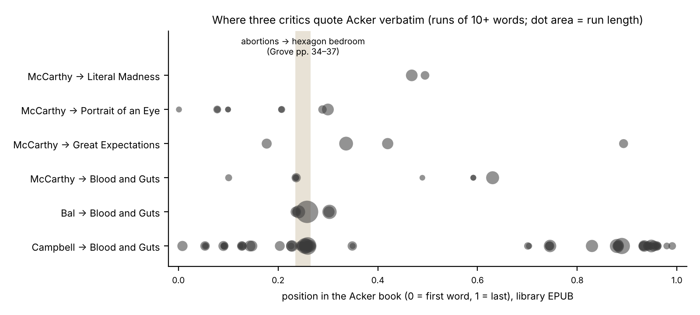

*[[shadows/weeks/kathy-acker|Kathy Acker (Author & Shadow)]] · Day 2 of 7 · 2026-11-03 · Difficulty 2 · Genealogy/influence, Shared figure or motif*

## Books in this reading

- [[books/4206-typewriters-bombs-jellyfish|Typewriters, Bombs, Jellyfish]], [[people/tom-mccarthy|Tom McCarthy]]; 2017 (New York Review Books). *Day 2 primary (quotes Acker): final essay 'Kathy Acker's Infidel Heteroglossia' (lecture, Center for Fiction, 9 May 2017), read whole and collated against four Acker books in the library.*
- [[books/9197-narratology-introduction-to-the-theory-of-narrativ|Narratology: Introduction to the Theory of Narrative]], [[people/mieke-bal|Mieke Bal]]; 2017 (4th ed., University of Toronto Press; catalogue date 1978 is wrong). *Day 2 primary (quotes Acker): ch. 2 'Story: Aspects', § 4 Rhythm (pp. 98–99) and § 5 Frequency (p. 102), read and collated against Blood and Guts.*
- [[books/5541-poetic-revolutionaries-intertextuality-subversion|Poetic Revolutionaries: Intertextuality & Subversion]], [[people/marion-may-campbell|Marion May Campbell]]; 2014 (Rodopi, Postmodern Studies 50). *Day 2 primary (quotes Acker): ch. 4 'Kathy Acker or Catheter the Hack' (pp. 153–175 read), collated against Blood and Guts.*
- [[books/10951-blood-and-guts-in-high-school|Blood and Guts in High School]], [[people/kathy-acker|Kathy Acker]]; 1978/1984 (Penguin Classics EPUB 2017). *Source check only (not a primary book; reserved for day 6): base text for collating Bal, Campbell and McCarthy.*

## The shadow so far

| Citing Book | Relation | Target | Location |
|---|---|---|---|
| [[books/1178-great-expectations|Great Expectations]] (Kathy Acker) | **Rewrites** | Kathy Acker | Part One, 'I Recall My Childhood' (opening); 'I Journey To Receive My Fortune' (opening) |
| [[books/1178-great-expectations|Great Expectations]] (Kathy Acker) | **Rewrites** | Kathy Acker | Part One, 'The Underworlds Of The World' (opening); 'I Journey To Receive My Fortune' (Rosa, O, Mr. Sadat) |
| [[books/1178-great-expectations|Great Expectations]] (Kathy Acker) | **Rewrites** | Kathy Acker | Part Two, 'Night' ('Portrait In Red') |
| [[books/1178-great-expectations|Great Expectations]] (Kathy Acker) | **Rewrites** | Kathy Acker | Part One, 'I Recall My Childhood' (spliced passages) |
| [[books/1178-great-expectations|Great Expectations]] (Kathy Acker) | **Rewrites** | Kathy Acker | Part One, 'I Journey To Receive My Fortune' |
| [[books/1178-great-expectations|Great Expectations]] (Kathy Acker) | **Rewrites** | Kathy Acker | Part Three, 'Inside' |
| [[books/1178-great-expectations|Great Expectations]] (Kathy Acker) | **Quotes** | Kathy Acker | Part Two, 'Day' (stanza 1 set as verse; later stanzas on Porphyro and Madeline) |
| [[books/4206-typewriters-bombs-jellyfish|Typewriters, Bombs, Jellyfish]] (Tom McCarthy) | **Quotes** | Kathy Acker | 'Kathy Acker's Infidel Heteroglossia', § I |
| [[books/4206-typewriters-bombs-jellyfish|Typewriters, Bombs, Jellyfish]] (Tom McCarthy) | **Quotes** | Kathy Acker | 'Kathy Acker's Infidel Heteroglossia', § I (end) |
| [[books/4206-typewriters-bombs-jellyfish|Typewriters, Bombs, Jellyfish]] (Tom McCarthy) | **Quotes** | Kathy Acker | 'Kathy Acker's Infidel Heteroglossia', §§ I–III |
| [[books/4206-typewriters-bombs-jellyfish|Typewriters, Bombs, Jellyfish]] (Tom McCarthy) | **Quotes** | Kathy Acker | 'Kathy Acker's Infidel Heteroglossia', §§ I–II |
| [[books/4206-typewriters-bombs-jellyfish|Typewriters, Bombs, Jellyfish]] (Tom McCarthy) | **Quotes** | Kathy Acker | 'Kathy Acker's Infidel Heteroglossia', § I; Juliet/Romeo in § III |
| [[books/9197-narratology-introduction-to-the-theory-of-narrativ|Narratology: Introduction to the Theory of Narrative (4th ed.)]] (Mieke Bal) | **Quotes** | Kathy Acker | ch. 2 'Story: Aspects', § 5 Frequency, p. 102 |
| [[books/9197-narratology-introduction-to-the-theory-of-narrativ|Narratology: Introduction to the Theory of Narrative (4th ed.)]] (Mieke Bal) | **Quotes** | Kathy Acker | ch. 2 'Story: Aspects', § 4 Rhythm, pp. 98–99 |
| [[books/5541-poetic-revolutionaries-intertextuality-subversion|Poetic Revolutionaries: Intertextuality & Subversion]] (Marion May Campbell) | **Quotes** | Kathy Acker | ch. 4 'Kathy Acker or Catheter the Hack', pp. 167–168 (nn. 42–46) |

---

## Tuesday 3 November 2026

## 1. Where the week stands

Week of Kathy Acker, day 2 of 7: who quotes her. Day 1 read *Great Expectations* (1178) against seven of its sources in the library and found that she changes the smallest unit (Pip to Peter, eighty to sixty, a new answer for Colette’s Renée) and leaves the rest standing, so that the change is the signature. Today turns the direction round: three books in the library that quote Acker at length, each collated against her own books as the library holds them.

## 2. The day’s finding

**Relation: Quotes** (eight edges, all from three books: Tom McCarthy, Mieke Bal, Marion May Campbell).

A comparison of 7-word runs between every one of the 259 books that mention Acker and her four books in the library (1176, 1177, 1178, 10951) shows where the field quotes her. The answer is narrow. A narratologist (Bal, *Narratology*, 4th ed. 2017) and a scholar of avant-garde parody (Campbell, *Poetic Revolutionaries*, 2014) reproduce the same passage of *Blood and Guts in High School* in full, Janey’s bedroom in the hotel, both citing page 36. (Campbell’s bibliography lists Bal’s *Narratology* in its 1997 edition; Bal’s 2017 edition does not cite Campbell.) A full-text search finds that passage (“huge white hexagon”) in no other book in the library. McCarthy and Bal also both quote the sentence two pages earlier on abortions (“the rotgut weird parts of my life”). In the chart below, all of Bal’s quotations, McCarthy’s longest from *Blood and Guts* and the densest cluster of Campbell’s fall within a few pages of the novel: the abortions, the hotel dream, the bakery.

The second finding concerns the smallest unit, which day 1 found in Acker’s hands. Each of the three critics, quoting her, changes something small. The variants against the library’s editions are:

Critic Acker (library edition) As quoted

McCarthy sexual relations in **this** world sexual relations in **the** world McCarthy **We all** live in prison. **We** live in prison McCarthy I can see **anything** in a set I can see **everything** in a set

> of shifting frameworks. of shifting frameworks.

McCarthy I look at my body **as if** it I look at my body **as though**

> were a web it were a web

McCarthy Murder for Profit by W . MURDER FOR PROFIT by W.

> **Bolitho Boitho**

Critic Acker (library edition) As quoted

> The threshold is **there**. McCarthy The threshold is **here**. (*Great Expectations*) (attributed to *Empire of the Senseless*)

Bal the only **real** way I can tell the only way I can tell you

> you

Bal If I stopped work **for just** a If I stopped work **just for** a

> second second

Campbell **My room** is the room no one **My bedroom** is the room no

> else in the world wants. one else in the world wants.

Campbell or **any** architectural or **any kind of** architectural

> regularity regularity

Campbell I bought a **red** sweater … I bought a sweater … would

> would know **that** I wasn’t a know I wasn’t a thief. thief.

Campbell The hotel is now, **is** really The hotel is now, really large

> large transparent squares. transparent squares.

Two cautions before reading anything into this. First, the base texts are the library’s editions (Penguin Classics 2017 *Blood and Guts*; the EPUBs of *Great Expectations*, *Portrait of an Eye* and *Literal Madness*), not the Grove and Picador editions the critics cite. Edition difference cannot be ruled out everywhere, but where two critics quote the same sentence they check each other: McCarthy has “only real way”, as the EPUB does, against Bal’s “only way”; Bal has “this world”, as the EPUB does, against McCarthy’s “the world”; Bal’s hexagon passage, from the 1984 Grove text, matches the EPUB word for word, against Campbell’s four changes. Second, these are ordinary transcription slips, not methods. The point is narrower: quotation drifts at exactly the scale Acker chose to work at, and in her case the drift is hard to tell from her method. Campbell’s “My bedroom is the room” brings forward a word Acker holds back until the next sentence. A page later, Campbell reads the passage through one word (“Acker does not call the coat a ‘leopard skin coat’ but a ‘leopard coat’ ”). The critic who changes one word in transcribing builds an argument on another word Acker chose.

The largest single change is McCarthy’s. He quotes as *Empire of the Senseless* (“As Empire, breaking into verse, states”) lines that stand in *Great Expectations*, Part Three, ‘Inside’, with “here” where he has “there”. *Empire* is not in the library, so whether Acker reused the lines there (she did reuse her own material) cannot be checked today. It is recorded as an open question, not an error.

## 3. The books

## Typewriters, Bombs, Jellyfish — Tom McCarthy, 2017 (EPUB, Calibre ID 4206) → [[books/4206-typewriters-bombs-jellyfish|book page]]

**Selection logic.** Highest-ranked novelist in the overlap scan (23 verbatim runs of 10+ words from four Acker books, 526 words); the only one of today’s three to quote *Great Expectations*, which day 1 read. Mentions row 423.

**Overview.** The final essay, “Kathy Acker’s Infidel Heteroglossia” (delivered at the Center for Fiction, New York, 9 May 2017, per the book’s Sources page), reads Acker through Kristeva’s abjection, Agamben’s *homo sacer*, Sade’s *120 Days* and Haraway’s cyborg. It is an argument about bodies and thresholds, built almost entirely from quotation: four Acker books in the library, plus *Empire of the Senseless* and *Don Quixote*, which are not. Its first quotation is from her *Great Expectations*:

*Figure 1: Where three critics quote Acker verbatim.*

> Dickens’s Thames may not have any jellyfish in it, but Kathy Acker’s “plagiarized” Great Expectations is awash with them. “My mother,” writes its narrator O, “is a dummy and a piece of jellyfish. The most disgusting thing in this world is her. My worst nightmare is that I’ll have some of that jellyfish in me.” (§ I)

Collated with *Great Expectations* (1178), Part One, ‘I Journey To Receive My Fortune’: exact. So are his other two *Great Expectations* quotations (the jellyfish nightmare and “so they could do whatever they want with her … This identity doesn’t exist.”, ‘The Underworlds Of The World’), and his quotation of *My Death My Life by Pier Paolo Pasolini* (1176), where Acker is “plagiarizing the magnificent climax of Flaubert’s The Temptation of Saint Anthony”. McCarthy stops at “To be matter.”; Acker goes on: “To be matter to matter.”

**Element 1: a concordance of McCarthy’s Acker quotations (library texts only).**

McCarthy quotes Source in library Result

jellyfish mother; jellyfish *GE* (1178), Part One exact nightmare; “unnameable dirt” “Sex is public … Go over this *GE*, Part Three, ‘Inside’ attributed to *Empire*; here → threshold with me.” there “tough, rotted, putrid beef” *BG* (10951), ‘Parents stink’ exact “rotgut weird parts … made *BG*, ‘The Scorpions’ this →the me know” “We live in prison” *BG*, ‘A book report’ “We all” cut Scarlet Letter; “There’s *BG*, ‘A book report’ exact going to be a world …” “as though it were a web”; *Portrait of an Eye* (1177), as if →as though; anything → “set of shifting frameworks” *Childlike Life* ch. 4 everything “All the above events are 1177, ch. 1 capitals; Bolitho →Boitho taken from myself …” “I MOVE TO SAN 1177, ch. 3 printed lower case in the FRANCISCO …” EPUB; “favorite” → McCarthy quotes

> “FAVOURITE”

> Source in library Result

“I’ve remade the outside 1177, *Childlike Life* exact prison …”; “I’m trying to get away from self-expression …” Flaubert passage; Juliet and *Literal Madness* (1176), *My* exact (cut before “To be Romeo *Death My Life* matter to matter.”)

**Element 2: verified quotations.**

- “an Acker plagiarism is instantly distinguishable from one by, say, her early mentor Burroughs or her younger admirer Stewart Home” (§ I). The day-1 claim, made by a novelist.

- On Agamben: “the Italian philosopher most of whose work (or its translation into English) Acker’s writing, far from plagiarizing, uncannily and almost to a t anticipates.” (§ II)

- After Haraway’s phrase “a powerful infidel heteroglossia”: “Those last four words (li-brarians take note) would constitute a fitting catalog description of Acker’s oeuvre.” (§ III)

- “It might just be that the final measure of a writer is not so much what they achieve themselves as what they render possible for others.” (§ III, the essay’s last sentence)

**A misreading worth attempting.** Take McCarthy’s attribution literally: the “Sex is public” lines belong to *Empire* because they were always in transit, the way the Pip sentence belongs to Dickens. Then quoting Acker under the wrong title is a way of reading her correctly.

## Narratology: Introduction to the Theory of Narrative — Mieke Bal, 4th ed., University of Toronto Press, 2017 (PDF, Calibre ID 9197; the catalogue’s 1978 date is wrong) → [[books/9197-narratology-introduction-to-the-theory-of-narrativ|book page]]

**Selection logic.** The most telling quotation in the scan: a 154-word run, Acker’s longest in any book that is not an anthology reprint, sits in a standard textbook. Mentions row 515.

**Overview.** Bal uses *Blood and Guts* twice in chapter 2, ‘Story: Aspects’, as the postmodern case that breaks the categories she has just set out. Under Rhythm (p. 98): “With postmod-ernism, the question of narrative rhythm along these lines loses its meaning altogether.” She quotes the bakery passage, “I am nobody because I work” (37), and then, at second hand, the abortions:

> As one critic wrote: “When Janey tells about the abortions in her life, she immediately makes clear that they should not be seen as dramatic moments in a life story. She tells about her abortions because they have for her symbolic value.” (p. 99)

The critic goes unnamed in the text. The only essay on Acker in Bal’s bibliography is Ernst van Alphen, “Excess and Sublimity in Kathy Acker’s Narratives” (1997); that is probably the source, but this is unconfirmed. Under Frequency (p. 102) she quotes the hexagon bedroom in full and asks of it: “Does the conflation between ‘my bedroom’ and ‘my cunt’ retrospectively turn this event into an iterative one, ironically turning the ‘explanation’ of the hotel head into an indictment of gender relations?” She closes: “The final sentence is totally unclear in terms of frequency.” The final sentence is “I walk out in a leopard coat.”

**Element 1: excerpt (as Bal prints it, p. 102; matches the library EPUB exactly). Element 2: derived list. What Bal’s categories do with Acker.**

> Of course, daddy and Sally and the boys in his band are given their rooms first. My room is the room no one else in the world wants. My bedroom is the huge white hexagon in the front left corner of the hotel. It has no clear outside or inside or any architectural regularity.

- Rhythm (pp. 98–99): *Blood and Guts* mocks any equivalence between story-time and fabula-time; the story is “hasty and fragmented, frantic” (p. 99).

- Frequency (p. 102): the hexagon passage begins as a singular event and is turned iterative by one sentence (“My cunt used to be a men’s toilet.”).

- Collation: four block quotations; two exact (the later abortions passage and the hexagon), two with one small change each (“real” dropped; “for just” →“just for”).

## Poetic Revolutionaries: Intertextuality & Subversion — Marion May Campbell, Rodopi, 2014 (PDF, Calibre ID 5541) → [[books/5541-poetic-revolutionaries-intertextuality-subversion|book page]]

**Selection logic.** The heaviest quoter in the library: 58 verbatim runs from *Blood and Guts*, 1,728 words, more than any other book in the scan except Eileen Myles’s *Pathetic Literature* (4852), which reprints part of *Great Expectations* (as does Dworkin’s *Against Expression*, 6336; both kept for day 4). Mentions row 457.

**Overview.** Chapter 4, “Kathy Acker or Catheter the Hack” (pp. 155–), follows chapters on Genet, Wittig and Carter, and introduces Acker as “the pirate punk of US postmoder-nity, Kathy Acker, who as we will see deploys myriad guerrilla tactics of bad taste, violence, ‘terrible plagiarism’, pornographic pastiche and textual shattering through cut-up practice” (p. 153). The chapter’s title is itself a rewritten name. It comes from the opening of Acker’s *Don Quixote*, which Campbell quotes: “so, she decided, ‘catheter’ is the glorification of ‘Kathy’.” (p. 155; *Don Quixote* is not in the library). Campbell reads Acker’s use of Genet as parody that turns its source on itself: “Acker wickedly reverses the order and reduces Genet to KathyJaney’s shadow, thus making him the shadow’s shadow and feminising him to the second degree.” (p. 175)

**Element 1: collation of the hotel passage (pp. 167–168 against *Blood and Guts*****, ‘The Scorpions’).** Campbell quotes the dream from “Back east, architectural objects are connected to, hidden in each other.” to “I walk out in a leopard coat.” She cites pp. 35–36 of *Blood and Guts in High School Plus Two* (London, 1984). Against the library text there are four changes: “red” and “that” dropped from the sweater sentence; “is” dropped from “The hotel is now, is really”; “My room” made “My bedroom”; “kind of” added before “architectural regularity”. The passage’s two most-quoted sentences, “My cunt used to be a men’s toilet.” and “I walk out in a leopard coat.”, are exact.

**Element 2: verified quotations.**

- “The dream narrative here condenses the theme of desire and commodification with the cogito, I am aborted therefore I am.” (p. 168)

- On the last two lines: “Note the apparent non sequitur between the last two lines of this passage” … “Of course yoking them together, Acker is asserting consequence.” (p. 168, n. 45)

- “The becoming-leopard (Acker does not call the coat a ‘leopard skin coat’ but a ‘leopard coat’ is an act of revenge, and a liberating one at that.” (p. 169; the parenthesis is unclosed in the original)

**A misreading worth attempting.** Bal finds the last sentence unclear in frequency; Campbell finds it the consequence of everything before it. Read them as one claim: the leopard coat happens every time the room is a toilet.

## 4. The shadow so far

From Relation To Location

> Rewrites Dickens, *GE*, *Drood*, Part One; Part Two, Acker, *Great*

*Expectations* (1178) *Bleak House* (8747) ‘Night’ 1178 Rewrites Guyotat, *Eden Eden* Part One, ‘I Recall

> *Eden* (4776) My Childhood’

1178 Rewrites Flaubert, *Letters* Part One, ‘I Journey

> (5751) …’

1178 Rewrites Colette, *The Pure* Part Three, ‘Inside’

> *and the Impure* (3267)

1178 Quotes Keats, ‘Eve of Part Two, ‘Day’

> St. Agnes’ (8742)

McCarthy (4206) Quotes Acker, *GE* (1178) “Infidel

> Heteroglossia” § I

4206 Quotes *GE*, ‘Inside’, as § I, end

> (misattributed?) *Empire*

4206 Quotes *Blood and Guts* §§ I–III

> (10951)

4206 Quotes *Portrait of an Eye* §§ I–II

> (1177)

4206 Quotes *Literal Madness* §§ I, III

> (1176)

Bal (9197) Quotes *Blood and Guts*, ch. 2 § 5, p. 102

> hexagon

9197 Quotes *Blood and Guts*, ch. 2 § 4, pp. 98–99

> abortions, bakery

Campbell (5541) Quotes *Blood and Guts*, ch. 4, pp. 167–168

> hotel dream

5541 Quotes *Don Quixote* (not in ch. 4, p. 155

> library)

The arrows have turned: on day 1 all seven ran outward from Acker; today all eight run in.

## 5. Where this sends you

**Notebook**

1. Campbell writes “My bedroom is the room” where Acker wrote “My room is the room”, and a page later builds an argument on “leopard coat” against “leopard skin coat”. Write a page on attention: what makes a reader exact about one word and careless about the next?

2. McCarthy proposes “a powerful infidel heteroglossia” as a catalogue description. Write the catalogue card for *Great Expectations* that a librarian following him would file, with subject headings.

3. Bal says the hexagon passage turns iterative through one sentence. Find a passage in your own work where a single sentence changes how often everything before it has happened.

**Rabbit holes**

- [The Center for Fiction event, 9 May 2017: McCarthy reads “Kathy Acker’s Infidel Heteroglossia”, then talks with Lynne Tillman (Thought Gallery listing)](https://thoughtgallery.org/?p=41146)

- [Mark Sussman on *Typewriters, Bombs, Jellyfish*, Bookforum, 15 June 2017](https://www.bookforum.com/culture/typewriters-bombs-jellyfish-by-tom-mccarthy-18066)

- [Margaret Henderson reviews Campbell’s *Poetic Revolutionaries*, JASAL 14.5 (open access)](https://openjournals.library.sydney.edu.au/JASAL/article/view/10015/10212)

- [Deakin University repository record for *Poetic Revolutionaries*](https://dro.deakin.edu.au/articles/book/Poetic_revolutionaries_intertextuality_and_subversion/20957095)

- [José Ángel García Landa’s online structural narratology, ‘Aspect’: singulative, repetitive, iterative and Bal’s “frequentative”](https://personal.unizar.es/garciala/publicaciones/structuralnarratology/3.Story/3.5.Aspect.html)

Not found in the library and worth a search: Ernst van Alphen, “Excess and Sublimity in Kathy Acker’s Narratives” (ASCA Brief, 1997), probably the critic Bal quotes but does not name.

**Also in your library**

- Edward S. Robinson, *Shift Linguals: Cut-Up Narratives From William S Burroughs to the Present* (5612; duplicate 6174): 20 verbatim runs from *Blood and Guts*, 611 words. Still open for days 3 and 4.

- Louis Armand, *Pornoterrorism* (10597): a 117-word verbatim run from *Portrait of an Eye*.

- Ellena Savage, *Blueberries* (3779): an 84-word verbatim run from *Blood and Guts*, in an essay collection (2020).

- Send To pool: no Candidates were Queued today.

## 6. From the Lexicon: Lemma

**Received.** In lexicography and morphology, the canonical or citation form chosen to represent a lexeme, and the headword under which a dictionary entry is filed (*break* for *breaks, broke, broken*). In mathematics and logic, a subsidiary proposition proved or assumed in order to prove another.

**Your sense.** Not yet written.

**Etymology.** Greek *lēmma* (pl. *lēmmata*), “something received or taken; an argument; something taken for granted”, from *lambanein*, to take. In English from the 1560s, in mathematics. Same root as *dilemma*.

**WordNet.** Three noun senses: (1) “a subsidiary proposition that is assumed to be true in order to prove another proposition” (noun.communication); (2) botanical, “the lower and stouter of the two glumes immediately enclosing the floret in most Gramineae”; (3) “the heading that indicates the subject of an annotation or a literary composition or a dictionary entry” (oewn- 06356061-n, the synset on file; hypernym *heading*).

**Relations or lineage.** Shares lineage in the Lexicon with *Onomastic*, *Vernacular*, *portmanteau*, *Onliness* and *onomastics*. Boundary tension on file: the headword and the auxiliary proposition share “something taken” but are distinct technical uses.

**Portable axiom.** None on file.

**Why today.** Section 2’s table is a critical apparatus in miniature. In the textual critic’s apparatus (WordNet’s third sense, the heading of an annotation), the lemma is the base text’s reading set before the bracket, with the variants after it. Today the lemma was Acker and the variants were her critics, and the word for what she did to Dickens, “something taken”, is in the etymology.

**Verified occurrence.** None: “lemma” does not occur in today’s three books or in *Blood and Guts* or *Great Expectations*.

**New in the Lexicon since day 1:* ratiocinate*, *Mammon*, *pyrrhic*, *Cohomology*, *crozier*.

## 7. To carry

> “My room is the room no one else in the world wants.” — Kathy Acker, *Blood and Guts in High School*, ‘Inside High School’ / ‘The Scorpions’ (Grove p. 36). Quoted whole by Bal; Campbell gives it as “My bedroom is the room”.

*Method note.* The calibre plugin’s full-text search worked on phrase queries today (one query timed out and was not repeated). The quotation scan compared every book in this week’s Mentions (259 non-own books) against the full text of Acker’s four library books, using 7- word shingles read from full-text-search.db read-only. Every quotation above was checked by substring test against text extracted from the books’ own files (EPUB in spine order; PDF via pdftotext). Page numbers are the printed ones.

## Themes

[[themes/abjection|abjection]] · [[themes/abortion|abortion]] · [[themes/blood-and-guts-in-high-school|Blood and Guts in High School]] · [[themes/collation|collation]] · [[themes/critical-apparatus|critical apparatus]] · [[themes/frequency|frequency]] · [[themes/genet|Genet]] · [[themes/great-expectations|Great Expectations]] · [[themes/haraway|Haraway]] · [[themes/heteroglossia|heteroglossia]] · [[themes/kristeva|Kristeva]] · [[themes/leopard-coat|leopard coat]] · [[themes/misattribution|misattribution]] · [[themes/naming|naming]] · [[themes/narratology|narratology]] · [[themes/parody|parody]] · [[themes/plagiarism|plagiarism]] · [[themes/quotation|quotation]] · [[themes/textual-drift|textual drift]] · [[themes/variant|variant]]

---

Previous: [[shadows/2026-11-02-shadow-kathy-acker-day-1-the-card-says-alexandria|Shadow — Kathy Acker, day 1: The Card Says Alexandria]]  
Next: —
