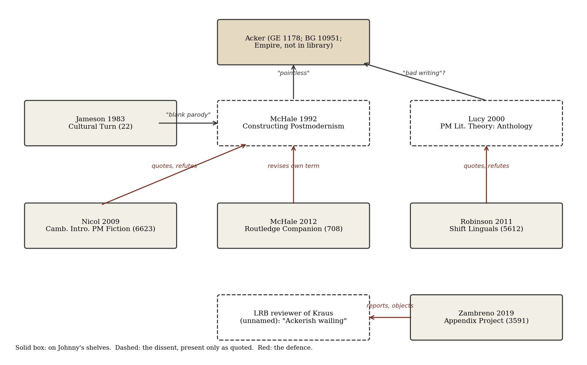

*[[shadows/weeks/kathy-acker|Kathy Acker (Author & Shadow)]] · Day 3 of 7 · 2026-11-04 · Difficulty 3 · Conflict, Genealogy/influence*

## Books in this reading

- [[books/6623-the-cambridge-introduction-to-postmodern-fiction|The Cambridge Introduction to Postmodern Fiction]], [[people/bran-nicol|Bran Nicol]]; 2009 (Cambridge University Press). *Day 3 primary (argues with Acker): ch. 6 'Postmodern fiction by women: Carter, Atwood, Acker', the Acker section on plagiarism (printed pp. 158–162), read and collated against GE (1178) and BG (10951).*
- [[books/708-the-routledge-companion-to-experimental-literature|The Routledge Companion to Experimental Literature]], [[people/joe-bray|Joe Bray]] (editor), [[people/alison-gibbons|Alison Gibbons]] (editor), [[people/brian-mchale|Brian McHale]] (editor); 2012 (Routledge). *Day 3 primary (argues with Acker): McHale, ch. 11 'Postmodernism and Experiment', § III 'The zone of the interior' and § IV; the Gibson/Acker passage collated against Neuromancer (9341, ch. 5).*
- [[books/5612-shift-linguals-cut-up-narratives-from-william-s-bu|Shift Linguals: Cut-Up Narratives From William S Burroughs to the Present]], [[people/edward-s-robinson|Edward S. Robinson]]; 2011 (Rodopi). *Day 3 primary (argues with Acker): ch. 'Kathy Acker: Plagiarism and Adaptation – From Cut-Up to Cut-and-Paste' (printed pp. 164–166, 182), read and collated against BG (10951).*

## The shadow so far

| Citing Book | Relation | Target | Location |
|---|---|---|---|
| [[books/1178-great-expectations|Great Expectations]] (Kathy Acker) | **Rewrites** | Kathy Acker | Part One, 'I Recall My Childhood' (opening); 'I Journey To Receive My Fortune' (opening) |
| [[books/1178-great-expectations|Great Expectations]] (Kathy Acker) | **Rewrites** | Kathy Acker | Part One, 'The Underworlds Of The World' (opening); 'I Journey To Receive My Fortune' (Rosa, O, Mr. Sadat) |
| [[books/1178-great-expectations|Great Expectations]] (Kathy Acker) | **Rewrites** | Kathy Acker | Part Two, 'Night' ('Portrait In Red') |
| [[books/1178-great-expectations|Great Expectations]] (Kathy Acker) | **Rewrites** | Kathy Acker | Part One, 'I Recall My Childhood' (spliced passages) |
| [[books/1178-great-expectations|Great Expectations]] (Kathy Acker) | **Rewrites** | Kathy Acker | Part One, 'I Journey To Receive My Fortune' |
| [[books/1178-great-expectations|Great Expectations]] (Kathy Acker) | **Rewrites** | Kathy Acker | Part Three, 'Inside' |
| [[books/1178-great-expectations|Great Expectations]] (Kathy Acker) | **Quotes** | Kathy Acker | Part Two, 'Day' (stanza 1 set as verse; later stanzas on Porphyro and Madeline) |
| [[books/4206-typewriters-bombs-jellyfish|Typewriters, Bombs, Jellyfish]] (Tom McCarthy) | **Quotes** | Kathy Acker | 'Kathy Acker's Infidel Heteroglossia', § I |
| [[books/4206-typewriters-bombs-jellyfish|Typewriters, Bombs, Jellyfish]] (Tom McCarthy) | **Quotes** | Kathy Acker | 'Kathy Acker's Infidel Heteroglossia', § I (end) |
| [[books/4206-typewriters-bombs-jellyfish|Typewriters, Bombs, Jellyfish]] (Tom McCarthy) | **Quotes** | Kathy Acker | 'Kathy Acker's Infidel Heteroglossia', §§ I–III |
| [[books/4206-typewriters-bombs-jellyfish|Typewriters, Bombs, Jellyfish]] (Tom McCarthy) | **Quotes** | Kathy Acker | 'Kathy Acker's Infidel Heteroglossia', §§ I–II |
| [[books/4206-typewriters-bombs-jellyfish|Typewriters, Bombs, Jellyfish]] (Tom McCarthy) | **Quotes** | Kathy Acker | 'Kathy Acker's Infidel Heteroglossia', § I; Juliet/Romeo in § III |
| [[books/9197-narratology-introduction-to-the-theory-of-narrativ|Narratology: Introduction to the Theory of Narrative (4th ed.)]] (Mieke Bal) | **Quotes** | Kathy Acker | ch. 2 'Story: Aspects', § 5 Frequency, p. 102 |
| [[books/9197-narratology-introduction-to-the-theory-of-narrativ|Narratology: Introduction to the Theory of Narrative (4th ed.)]] (Mieke Bal) | **Quotes** | Kathy Acker | ch. 2 'Story: Aspects', § 4 Rhythm, pp. 98–99 |
| [[books/5541-poetic-revolutionaries-intertextuality-subversion|Poetic Revolutionaries: Intertextuality & Subversion]] (Marion May Campbell) | **Quotes** | Kathy Acker | ch. 4 'Kathy Acker or Catheter the Hack', pp. 167–168 (nn. 42–46) |
| [[books/6623-the-cambridge-introduction-to-postmodern-fiction|The Cambridge Introduction to Postmodern Fiction]] (Bran Nicol) | **Argues with** | Kathy Acker | ch. 6 'Postmodern fiction by women: Carter, Atwood, Acker', pp. 159–160 (also p. 162) |
| [[books/708-the-routledge-companion-to-experimental-literature|The Routledge Companion to Experimental Literature]] (Brian McHale (ch. 11)) | **Argues with** | Kathy Acker | ch. 11 'Postmodernism and Experiment', § III 'The zone of the interior'; § IV |
| [[books/5612-shift-linguals-cut-up-narratives-from-william-s-bu|Shift Linguals: Cut-Up Narratives From William S Burroughs to the Present]] (Edward S. Robinson) | **Argues with** | Kathy Acker | ch. 'Kathy Acker: Plagiarism and Adaptation – From Cut-Up to Cut-and-Paste', pp. 164–165 |
| [[books/5612-shift-linguals-cut-up-narratives-from-william-s-bu|Shift Linguals: Cut-Up Narratives From William S Burroughs to the Present]] (Edward S. Robinson) | **Quotes** | Kathy Acker | ch. 'Kathy Acker: Plagiarism and Adaptation', p. 166 |
| Appendix Project: Talks and Essays (Kate Zambreno) | **Argues with** | Kathy Acker | Appendix E 'The Art of Diseuse' (talk, Poetry Project, 27 Oct 2017), section 'Saying Ugly Things' |

---

## Wednesday 4 November 2026

## 1. Where the week stands

Day 3 of the Kathy Acker week. Day 1 read *Great Expectations* (1178) against seven of its sources and found that Acker changes the smallest unit — one word, one number, one name — and leaves the rest standing. Day 2 found that the critics who quote her drift at that same scale. Today asks who, on Johnny’s shelves, argues with her.

## 2. The day’s finding

The library holds no book that argues against Acker in its own voice. The dissent is there, but only as quotation inside her defenders: Brian McHale’s 1992 verdict that her appropriation of Gibson is “pointless” survives as a sentence in Bran Nicol (2009); Niall Lucy’s suggestion that *Blood and Guts* might be “bad writing” survives in Edward S. Robinson (2011); an *LRB* reviewer’s “Ackerish wailing and stamping” survives in Kate Zambreno (2019). None of the three source texts is in the catalogue. Each is quoted in order to be refuted. The relation is **argues with**, but at one remove: the shelf keeps the objection the way an Alexandrian editor kept an obelized line, in the text and flagged, not cut.

Two further results. First, McHale himself is on the shelf, in his 2012 chapter for the *Routledge Companion to Experimental Literature* (708), and there, three years after Nicol answered him, the procedure he had called “pointless” has become “an ontological flicker”. He cites his 1992 pages but does not repeat the verdict, and he does not retract it in so many words. Second, the defence is weakest exactly where day 1 was strongest. Nicol calls her borrowing “almost deliberately clumsy and slapdash” and says her opening differs from Dickens’s only by “Pip” →“Peter”; it also cuts the word “family”. McHale says she adds “oddly irrelevant details of her own”; one of them, “A construct.”, is Gibson’s own word, taken from two sentences further on. The quarrel over whether the borrowing has a point is conducted by readers who have not collated it.

## 3. The books

## The Cambridge Introduction to Postmodern Fiction — Bran Nicol, 2009 (PDF, Calibre 6623)

**Selection logic.** Day-2 lead from the Author_Weeks notes; 58 “Acker” in the index (Mentions row 475). Its Acker section is the only place in the library where McHale’s charge is quoted and answered head-on. Not from the Send To pool (the pool is empty).

**Overview.** Chapter 6, “Postmodern fiction by women: Carter, Atwood, Acker”, gives Acker the role of the “aesthetic terrorist” who, unlike Atwood and Carter, never reached the mass canon. The pages on plagiarism (printed pp. 158–162) make a case in three steps: the borrowing is

*Figure 1: The argument on the shelves. Dashed boxes: dissent present only as quotation.*

too blatant to be plagiarism; its crudeness is deliberate; and the “pointlessness” McHale found is the point.

**Verified quotations.**

> “Acker’s plagiarism is blatant. But this is what makes it hard to see in terms of the definition of plagiarism, as a devious attempt to pass off the work of others as one’s own.” (p. 159)

> “her insertion of other texts seems random, free-associative, almost deliberately clumsy and slapdash, as if to make what she is doing as obvious as possible.” (p. 159)

> “These two sentences are identical to the two which begin Dickens’s Great Expectations, except for the change of the name ‘Pip’ to ‘Peter’.” (p. 160)

> “Brian McHale … argues that the act of appropriation is entirely ‘pointless’ … But, at the risk of sounding glib, the pointlessness is actually the point.” (p. 160; the first sentence abridged here, the last verbatim)

> “for Acker demonstrates that pastiche has a powerful critical edge when it becomes too faithful, as it were, moving from homage into outright theft.” (p. 160)

**Collation: the defender at the smallest unit. A misreading worth attempting.** Read Nicol’s “deliberately clumsy” as praise of precision:

| Nicol says | The text says (checked) |
|---|---|
| Opening identical to Dickens “except for … | Dickens: “My father’s family name being |
| ‘Pip’ to ‘Peter’ ” (p. 160) | Pirrip”; Acker: “My father’s name being Pirrip” — “family” also cut (day 1, edge 29) |
| “Her ‘Pip’ metamorphoses …” (p. 162) | No “Pip” anywhere in Acker’s GE (1178): her narrator is Peter |
| “Jenny is ‘fucked’ violently” (p. 162) | *Blood and Guts* (10951): “Janey” 314 times, “Jenny” 0 |
| “I want: every part changes (the meaning of) every other part …” (p. 162) | Exact against 1178 |
| Robbins apology “In 1975” (p. 159) | Cologne Acker Reading Room dates the Robbins accusation after *Young Lust* (1989); not resolvable here |

the clumsiness is a costume worn so that the one exact change (eighty →sixty) can pass unnoticed. Then the “slapdash” reading is what the method was built to produce.

## The Routledge Companion to Experimental Literature — ed. Joe Bray, Alison Gibbons, Brian McHale, 2012 (EPUB, Calibre 708, Gestext)

**Selection logic.** The arguer himself. Nicol’s rebuttal cites McHale 1992 (*Constructing Postmodernism*, not in the catalogue); this volume holds McHale’s own later chapter on the same Acker passage. Mentions row 359.

**Overview.** Chapter 11, “Postmodernism and Experiment”, asks whether postmodernism is experimental at all, using three cases (Perelman’s “China”, Hejinian’s *My Life*, Acker’s *Empire of the Senseless*). In § III, “The zone of the interior”, McHale sets Gibson’s Molly passage beside Acker’s version, then lists the same names for it he once used to dismiss it — and concludes the other way.

**Verified quotations.**

> “Acker rewrites Gibson, deleting some (but not all) of Gibson’s techno-speak, and adding oddly irrelevant details of her own:” (ch. 11, § III)

> “Or something more like what Jameson calls pastiche, which he defines as postmodern “blank parody,” lacking the pointedness, the “ulterior motives,” of satirical parody (Jameson 1991: 16–17)?” (§ III)

> “However we choose to characterize Acker’s rewriting procedure, as soon as it is recognized, it interrupts the smooth production of a storyworld, introducing an intrusive element of second-handedness, of mediacy.” (§ III)

> “an effect of vacillation between two worlds – an ontological flicker.” (§ III)

**Collation: McHale’s Acker against Gibson’s own text (*****Neuromancer*****, 9341, ch. 5).** McHale’s quotation of Gibson is exact against 9341. His claim that Acker adds “details of her

| Gibson (9341) | Acker as McHale prints her (708) |
|---|---|
| “Eight derms, each a different size and color, ran in a neat line down her left wrist.” | “Eight derms, each a different colour size and form, ran in a neat line down her right wrist and down the vein of the right upper thigh.” |
| “An Akai transdermal unit lay beside her” | “A transdermal unit, separated from her body,” (brand cut) |
| next paragraph: “The crisp circle of light fell directly on the Flatline’s construct.” | “… by means of thin red leads. A construct.” |

own” is true of the bruises and the thigh; it is not true of “A construct.”, which is Gibson’s noun moved up two sentences. The change of left to right is again the smallest unit. (*Empire of the Senseless* is not in the library, so McHale’s Acker text cannot itself be checked here.)

**Derived list: the argument’s three positions on the same page of Gibson.** (1) McHale 1992: pointless, “blank parody” (quoted in Nicol, p. 160). (2) Nicol 2009: the pointlessness is the point; pastiche “too faithful” becomes critique. (3) McHale 2012: “however we choose to characterize” it, it produces an “ontological flicker” and a “secret” experimentalism. The term Jameson supplied (1983) is asked as a question in 2012, not asserted.

## Shift Linguals: Cut-Up Narratives from William S. Burroughs to the Present — Edward S. Robinson, 2011 (PDF, Calibre 5612; duplicate 6174)

**Selection logic.** Day-2 note: “Robinson (5612) on cut-up vs plagiarism”; 340 “Acker” in the extracted text, the densest Acker book in the Mentions list after her own. Mentions row 458 (465 for the duplicate).

**Overview.** The chapter “Kathy Acker: Plagiarism and Adaptation – From Cut-Up to Cut-and- Paste” places her in Burroughs’s line. Robinson records the hostility (“extremely divisive”), quotes the sharpest objection the library contains, and answers it with an appeal to her learning. Later he shows Acker herself arguing with her master.

**Verified quotations.**

> “Even now, her work remains extremely divisive.” (p. 164)

> “(Sometimes a cigar is just a cigar, and the nonconformity of Acker’s novel could just be the consequence of bad writing rather than transgressive writing.) (2000: 33)” — Niall Lucy, as quoted (p. 165)

> “Such criticisms overlook Acker’s extensive knowledge of classical, canonical and avant-garde literature, and in this context it is less problematic to accept Blood and Guts as transgressive.” (p. 165)

> “there were times at which Acker felt compelled to “reject” him, saying “20 years ago, everyone thought that Burroughs was some kind of way-out science fiction writer, but now he looks a bit tame” (Schmieder 1991).” (p. 182)

**Note on the objection.** Robinson cuts Lucy at the moment Lucy is about to qualify himself: the quoted passage opens “To say… that Blood and Guts … shouldn’t be undervalued … would not be to say …”, and the parenthesis is a hypothesis, not a verdict. Robinson’s bibliography gives the source as Lucy’s “Introduction: (On the Way to Genre)” in *Postmodern Literary Theory: An Anthology* (Blackwell, 2000); neither it nor Lucy’s 1997 *Introduction* is in the catalogue. Lucy’s *Dictionary of Postmodernism* (1192) is, and it names Acker only in a list of former entries.

**Collation.** Robinson quotes *Blood and Guts* (p. 166): “depended on her father for everything, and regarded her father as boyfriend, brother, sister, money, amusement, father”. The Penguin 2017 EPUB (10951): “depended on her father for everything and regarded her father as boyfriend, brother, sister, money, amusement, and father.” A comma added, an “and” dropped. His “to get rid of language” (Acker 1984: 76, p. 185) does not occur in the EPUB’s text layer; it may sit in one of the hand-drawn pages, unverified.

## Also argued with, briefly

- **Kate Zambreno, *Appendix Project* (3591, 2019)**, Appendix E, “The Art of Diseuse” (talk at the Poetry Project, 27 October 2017), section “Saying Ugly Things”: “Recently I read a review in the London Review of Books of Chris Kraus’s biography of Kathy Acker, and the reviewer referred, dismissively I thought, to ‘Ackerish wailing and stamping.’ ” (inner quotation marks changed to single here) The reviewer is not named; Zambreno objects to the habit of setting two women writers against each other. Verified; edge recorded.

- **Jameson, *The Cultural Turn* (22)**, ch. 1, “Postmodernism and Consumer Society”: “Pastiche is blank parody, parody that has lost its sense of humour”. Jameson does not mention Acker; he supplies the term both sides fight over. The Norton Anthology (3266) prints the American “humor” (p. 1761), and Judith Butler, quoting it in the same anthology (p. 2386), shortens it to “parody that has lost its humor.” The drift reaches the theory too.

## 4. The shadow so far

| From | Relation | To | Location |
|---|---|---|---|
| Acker, GE (1178) | Rewrites ×6, Quotes ×1 | Dickens, Guyotat, Flaubert, Colette, Keats | day 1, edges 29–35 |
| McCarthy (4206) | Quotes ×5 | Acker GE, BG, Portrait, Literal Madness | day 2, edges 36–40 |
| Bal (9197) | Quotes ×2 | Acker BG | day 2, edges 41–42 |
| Campbell (5541) | Quotes | Acker BG | day 2, edge 43 |
| Nicol (6623) | Argues with | Acker (and McHale 1992 on her) | pp. 158–162 |
| McHale (708) | Argues with | Acker, Empire | ch. 11, § III |
| Robinson (5612) | Argues with | Acker (Lucy’s objection, refuted) | pp. 164–165 |
| Robinson (5612) | Quotes | Acker BG | p. 166 |
| Zambreno (3591) | Argues with | Acker (reported LRB dismissal, refuted) | App. E |

## 5. Where this sends you

**Notebook.**

1. Nicol says the borrowing is “almost deliberately clumsy and slapdash”; day 1 found eighty changed to sixty. Write a page on the difference between a careless copy and a copy that wants to look careless. What would count as evidence for either?

2. McHale moved from “pointless” to “an ontological flicker” without repeating or retract-ing the first verdict. Pick a judgement you once wrote and later reversed. Write the paragraph in which the reversal is visible only to someone who has read both.

3. The dissent against Acker on these shelves exists only inside her defenders. Choose a writer you admire and list the objections to them you know only from the people who answered them. Which of those objections have you never read in their own words?

**Rabbit holes.**

- Brian McHale, *Constructing Postmodernism* (Routledge, 1992), the “pointless” chapter: https://www.routledge.com/products/9780415060141

- Victoria de Zwaan, “Rethinking the Slipstream: Kathy Acker Reads Neuromancer”, *Science Fiction Studies* 73: https://www.depauw.edu/sfs/backissues/73/dezwaan73.htm

- Jameson, *The Cultural Turn* (Verso), ch. 1 with “blank parody”, open PDF at Monoskop: https://www.monoskop.org/images/5/59/Jameson_Fredric_Cultural_Turn_Selected_Writings_on_the_Postmodern_1983-1998.pdf

- Niall Lucy (ed.), *Postmodern Literary Theory: An Anthology* (Blackwell, 2000), the source of “bad writing”: https://gov.wiley.com/WileyCDA/WileyTitle/productCd-063121027X.html

- Kathy Acker Reading Room, University of Cologne, biography (Robbins and *The Pirate*): https://anglistik1.phil-fak.uni-koeln.de/en/abteilungen-lehrende/literaturwissenschaft/juniorprofessur-amerikanistik-prof-rauscher/research/kathy-acker-reading-room/biography

**Also in your library.**

- Nicholas Zurbrugg, *The Parameters of Postmodernism* (9053): his interview with Acker, where she turns argument outward, on Baudrillard’s *America*: “a celebration of con-sumerism” (as quoted in his *Critical Vices*, 14732). The reverse direction for day 7.

- *The Fate of Difficulty in the Poetry of Our Time*, ed. Altieri and Nace (3321): in ch. 20, “Ethical Character Recognition”, Bob Perelman faults Rachel Zolf for “(improperly)” combining Janey Canuck with Acker’s Janey Smith — an argument about a use of Acker.

- Marjorie Perloff, *Unoriginal Genius* (2582): Silliman’s reply to Goldsmith cites “Kathy Acker’s appropriation of the work of Harold Robbins” as proof that appropriation “is hardly news”.

- Send To pool: no books were Queued in Candidates today, so none bears on this week.

## 6. From the Lexicon: obelism

**Received sense.** The act or practice of obelizing: marking a passage in a manuscript with an obelus (a horizontal stroke, later ÷ or †) to flag it as spurious or doubtful; by extension the system of marginal critical signs. Introduced by Zenodotus in his Alexandrian Homer, elaborated by Aristarchus; Origen used obelus and metobelus in the Hexapla.

**Your sense.** Not yet written in the Lexicon.

**Etymology.** Middle Greek *obelismos*, from Greek *obelizein*, “to mark with an obelus”, from *obelos*, “spit, skewer”.

**WordNet.** Absent (recorded as such in the Lexicon).

**Relations.** Shares lineage with Colophon, Marginalia, Redaction, palimpsest, Syntopicon and others in the Lexicon.

**Boundary.** As the Lexicon records: an obelized line was kept in the text and flagged, not deleted; the mark records doubt rather than excision.

**Why today.** It names what the library does with the case against Acker: it keeps McHale’s “pointless”, Lucy’s “bad writing” and the *LRB*’s “wailing and stamping” in the text of her defenders, each marked for rejection, none allowed its own book.

**Verified occurrence.** None in today’s books. **Attestations** in the Lexicon are unverified.

## 7. To carry

> “But, at the risk of sounding glib, the pointlessness is actually the point.” — Bran Nicol, *The Cambridge Introduction to Postmodern Fiction*, ch. 6, p. 160

*Method: An author and their shadow, day 3. Scribrarium mounted read-only on the Mac; texts extracted from each book’s own file (PDF: pdftotext, page by page; EPUB: spine order); every quotation substring-checked against the extracted text (line-end hyphens closed). The plugin’s full-text search timed out on one whole-library query and worked on a narrower one.*

## Themes

[[themes/argument|argument]] · [[themes/bad-writing|bad writing]] · [[themes/blank-parody|blank parody]] · [[themes/burroughs|Burroughs]] · [[themes/chris-kraus|Chris Kraus]] · [[themes/collation|collation]] · [[themes/cut-up|cut-up]] · [[themes/dissent|dissent]] · [[themes/empire-of-the-senseless|Empire of the Senseless]] · [[themes/gibson|Gibson]] · [[themes/harold-robbins|Harold Robbins]] · [[themes/jameson|Jameson]] · [[themes/lrb|LRB]] · [[themes/mchale|McHale]] · [[themes/neuromancer|Neuromancer]] · [[themes/niall-lucy|Niall Lucy]] · [[themes/obelism|obelism]] · [[themes/pastiche|pastiche]] · [[themes/plagiarism|plagiarism]] · [[themes/refutation|refutation]] · [[themes/textual-drift|textual drift]] · [[themes/zambreno|Zambreno]]

---

Previous: [[shadows/2026-11-03-shadow-kathy-acker-day-2-the-room-no-one-else-want|Shadow — Kathy Acker, day 2: The Room No One Else Wants]]  
Next: —
