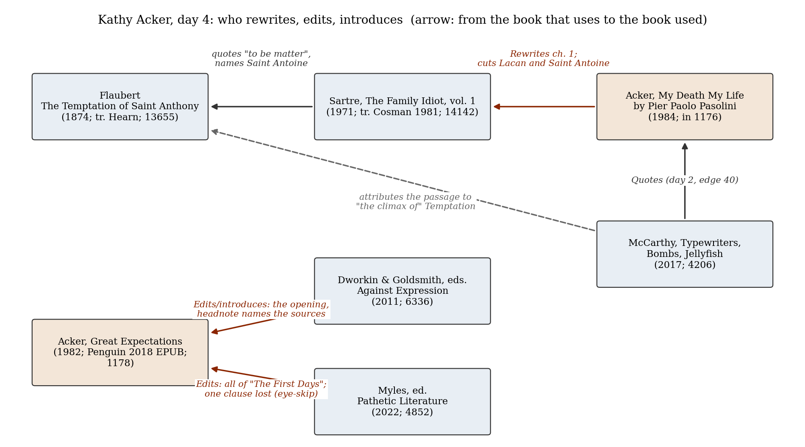

*[[shadows/weeks/kathy-acker|Kathy Acker (Author & Shadow)]] · Day 4 of 7 · 2026-11-05 · Difficulty 3 · Genealogy/influence, Shared form or method*

## Books in this reading

- [[books/14142-the-family-idiot-gustave-flaubert-1821-1857-volume|The Family Idiot: Gustave Flaubert, 1821-1857, Volume 1]], [[people/jean-paul-sartre|Jean-Paul Sartre]]; 1971 (tr. Carol Cosman, University of Chicago Press 1981). *Day 4 primary (the source Acker rewrites): ch. 1 'A Problem', subsection 'Naïveté and Language', collated sentence by sentence against My Death My Life (1176). Target of edge 49.*
- [[books/1176-literal-madness-3-novels-kathy-goes-to-haiti-my-de|Literal Madness: 3 Novels: Kathy Goes to Haiti, My Death My Life by Pier Paolo Pasolini, and Florida]], [[people/kathy-acker|Kathy Acker]]; 1987 (Grove; My Death My Life first pub. Pan 1984). *Day 4, own work (the rewriter): My Death My Life, section 'My Death' (before 'Nominalism'), collated against Sartre (14142). Citing book of edge 49.*
- [[books/6336-against-expression-an-anthology-of-conceptual-writ|Against Expression: An Anthology of Conceptual Writing]], [[people/craig-dworkin|Craig Dworkin]] (editor), [[people/kenneth-goldsmith|Kenneth Goldsmith]] (editor); 2011 (Northwestern University Press). *Day 4 primary (edits/introduces Acker): headnote and the GE opening excerpt, printed pp. 28–31, collated against the Penguin 2018 EPUB (1178). Edge 50.*
- [[books/4852-pathetic-literature|Pathetic Literature]], [[people/eileen-myles|Eileen Myles]] (editor); 2022 (Grove Press). *Day 4 primary (edits Acker): 'Excerpt from Great Expectations' = all of Part Two 'Day: The First Days' (3,096 words), collated against the Penguin 2018 EPUB (1178). Edge 51.*

## The shadow so far

| Citing Book | Relation | Target | Location |
|---|---|---|---|
| [[books/1178-great-expectations|Great Expectations]] (Kathy Acker) | **Rewrites** | Kathy Acker | Part One, 'I Recall My Childhood' (opening); 'I Journey To Receive My Fortune' (opening) |
| [[books/1178-great-expectations|Great Expectations]] (Kathy Acker) | **Rewrites** | Kathy Acker | Part One, 'The Underworlds Of The World' (opening); 'I Journey To Receive My Fortune' (Rosa, O, Mr. Sadat) |
| [[books/1178-great-expectations|Great Expectations]] (Kathy Acker) | **Rewrites** | Kathy Acker | Part Two, 'Night' ('Portrait In Red') |
| [[books/1178-great-expectations|Great Expectations]] (Kathy Acker) | **Rewrites** | Kathy Acker | Part One, 'I Recall My Childhood' (spliced passages) |
| [[books/1178-great-expectations|Great Expectations]] (Kathy Acker) | **Rewrites** | Kathy Acker | Part One, 'I Journey To Receive My Fortune' |
| [[books/1178-great-expectations|Great Expectations]] (Kathy Acker) | **Rewrites** | Kathy Acker | Part Three, 'Inside' |
| [[books/1178-great-expectations|Great Expectations]] (Kathy Acker) | **Quotes** | Kathy Acker | Part Two, 'Day' (stanza 1 set as verse; later stanzas on Porphyro and Madeline) |
| [[books/4206-typewriters-bombs-jellyfish|Typewriters, Bombs, Jellyfish]] (Tom McCarthy) | **Quotes** | Kathy Acker | 'Kathy Acker's Infidel Heteroglossia', § I |
| [[books/4206-typewriters-bombs-jellyfish|Typewriters, Bombs, Jellyfish]] (Tom McCarthy) | **Quotes** | Kathy Acker | 'Kathy Acker's Infidel Heteroglossia', § I (end) |
| [[books/4206-typewriters-bombs-jellyfish|Typewriters, Bombs, Jellyfish]] (Tom McCarthy) | **Quotes** | Kathy Acker | 'Kathy Acker's Infidel Heteroglossia', §§ I–III |
| [[books/4206-typewriters-bombs-jellyfish|Typewriters, Bombs, Jellyfish]] (Tom McCarthy) | **Quotes** | Kathy Acker | 'Kathy Acker's Infidel Heteroglossia', §§ I–II |
| [[books/4206-typewriters-bombs-jellyfish|Typewriters, Bombs, Jellyfish]] (Tom McCarthy) | **Quotes** | Kathy Acker | 'Kathy Acker's Infidel Heteroglossia', § I; Juliet/Romeo in § III |
| [[books/9197-narratology-introduction-to-the-theory-of-narrativ|Narratology: Introduction to the Theory of Narrative (4th ed.)]] (Mieke Bal) | **Quotes** | Kathy Acker | ch. 2 'Story: Aspects', § 5 Frequency, p. 102 |
| [[books/9197-narratology-introduction-to-the-theory-of-narrativ|Narratology: Introduction to the Theory of Narrative (4th ed.)]] (Mieke Bal) | **Quotes** | Kathy Acker | ch. 2 'Story: Aspects', § 4 Rhythm, pp. 98–99 |
| [[books/5541-poetic-revolutionaries-intertextuality-subversion|Poetic Revolutionaries: Intertextuality & Subversion]] (Marion May Campbell) | **Quotes** | Kathy Acker | ch. 4 'Kathy Acker or Catheter the Hack', pp. 167–168 (nn. 42–46) |
| [[books/6623-the-cambridge-introduction-to-postmodern-fiction|The Cambridge Introduction to Postmodern Fiction]] (Bran Nicol) | **Argues with** | Kathy Acker | ch. 6 'Postmodern fiction by women: Carter, Atwood, Acker', pp. 159–160 (also p. 162) |
| [[books/708-the-routledge-companion-to-experimental-literature|The Routledge Companion to Experimental Literature]] (Brian McHale (ch. 11)) | **Argues with** | Kathy Acker | ch. 11 'Postmodernism and Experiment', § III 'The zone of the interior'; § IV |
| [[books/5612-shift-linguals-cut-up-narratives-from-william-s-bu|Shift Linguals: Cut-Up Narratives From William S Burroughs to the Present]] (Edward S. Robinson) | **Argues with** | Kathy Acker | ch. 'Kathy Acker: Plagiarism and Adaptation – From Cut-Up to Cut-and-Paste', pp. 164–165 |
| [[books/5612-shift-linguals-cut-up-narratives-from-william-s-bu|Shift Linguals: Cut-Up Narratives From William S Burroughs to the Present]] (Edward S. Robinson) | **Quotes** | Kathy Acker | ch. 'Kathy Acker: Plagiarism and Adaptation', p. 166 |
| Appendix Project: Talks and Essays (Kate Zambreno) | **Argues with** | Kathy Acker | Appendix E 'The Art of Diseuse' (talk, Poetry Project, 27 Oct 2017), section 'Saying Ugly Things' |
| [[books/1176-literal-madness-3-novels-kathy-goes-to-haiti-my-de|Literal Madness (My Death My Life by Pier Paolo Pasolini)]] (Kathy Acker) | **Rewrites** | Kathy Acker | My Death My Life, 'My Death' (just before 'Nominalism'); TARGET Sartre ch. 1 'A Problem', 'Naïveté and Language' |
| [[books/6336-against-expression-an-anthology-of-conceptual-writ|Against Expression: An Anthology of Conceptual Writing]] (Craig Dworkin and Kenneth Goldsmith (eds.)) | **Edits/introduces** | Kathy Acker | 'Kathy Acker, from Great Expectations', headnote p. 28; excerpt pp. 28–31 (PDF pp. 82–85) |
| [[books/4852-pathetic-literature|Pathetic Literature]] (Eileen Myles (ed.)) | **Edits/introduces** | Kathy Acker | 'Excerpt from Great Expectations' (= GE Part Two, 'Day: The First Days', whole); acknowledgments '© 1982 ... Reprinted by permission of Grove Press, Inc.' |

---

## Thursday 5 November 2026

## 1. Where the week stands

Kathy Acker, day 4 of 7: who translates, rewrites, edits or introduces her. Day 1 read *Great Expectations* (1178) and found her changing the smallest unit of a borrowed text (Pip to Peter, eighty to sixty). Day 2 found her critics doing the same thing to her while quoting her. Day 3 found that no book on these shelves argues against her in its own voice; the objections survive only inside her defenders.

## 2. The day’s finding

The relation runs both ways today, and in both directions the attribution moves.

**Outward (Acker rewrites).** On day 2, Tom McCarthy said that a passage in *My Death My Life by Pier Paolo Pasolini* was Acker “plagiarizing the magnificent climax of Flaubert’s *The Temptation of Saint Anthony*.” The passage is not from the *Temptation*. It comes from Sartre’s *The Family Idiot*, volume 1 (Carol Cosman’s translation, Chicago 1981): ch. 1, “A Problem”, the subsection “Naïveté and Language”, where Sartre describes the child Gustave Flaubert. A 6-word shingle comparison finds six runs of 8 to 17 words shared by the two books (and a seventh of 6), all in one stretch of “My Death”, the section just before “Nominalism”. Acker turns Sartre’s little Gustave into the “he” of her Pasolini book and sets him beside a first-person detective plot. In the process she cuts the two names Sartre gives inside his own sentences, Lacan (“as Lacan would say, ‘inarticulable’ ”) and Saint Antoine (“the final vow of Saint Antoine—‘to be matter’ ”), and keeps their words. McCarthy then restores one of those names, and pins the whole passage on Flaubert. He is half right: Flaubert’s words are in it, but only the three words Sartre quoted. The *Temptation* on the shelf (Hearn’s translation, 13655) gives the same vow as “be matter itself!”

**Inward (others edit and introduce her).** Two anthologies reprint *Great Expectations*. Dworkin and Goldsmith’s *Against Expression* (6336) gives the opening (printed pp. 28–31) with a headnote that does what Acker would not: it names Dickens and Guyotat as sources and credits the equation “plagiarism + pornography = autobiography” to Ron Silliman, with a page reference. Eileen Myles’s *Pathetic Literature* (4852) reprints the whole of “Day: The First Days” (3,096 words) with no headnote at all, and drops a clause in a classic scribal eye-skip, jumping from one “living” to the next: “If everything is living, it’s not a name but moving. And without this living there is nothing” becomes “If everything is living there is nothing”. The clause that goes missing is the one about names.

Relations: **Rewrites** (Acker →Sartre); **Edits/introduces** (Dworkin & Goldsmith →Acker; Myles →Acker). A correction to day 2’s edge 40 follows from the first.

*Figure 1: The day’s edges. Red: today’s relations. Dashed: McCarthy’s attribution.*

## 3. The books

**Jean-Paul Sartre, *The Family Idiot: Gustave Flaubert, 1821–1857*****, vol. 1 (1971; tr. Carol Cosman, Chicago 1981) — EPUB, Calibre 14142 (Gestext); duplicate 14041. Read against Acker, *My Death My Life by Pier Paolo Pasolini*****, in *Literal Madness* (1176, EPUB, Gestext)**

**Selection logic.** Day 4’s plan named both directions of rewriting. McCarthy’s attribution to the *Temptation* was the lead: the *Temptation* (13655) has no verbatim overlap with any of Acker’s four books in the library. A full-text search for the phrase “weight of nomination” returned four books: McCarthy, Acker and two copies of Sartre’s *Family Idiot* vol. 1. Sartre does not name Acker, so he is not in the week’s Mentions; he is the target of the edge, not the citing book.

**Overview.* My Death My Life* (Pan, London 1984) is Acker’s book in the voice of a murdered Pasolini. In “My Death” she alternates a detective plot (Ross Hart, Gype, Sally, a $25,000 ransom; source not in the library) with sentences about a silent, credulous child. Those sentences are Sartre’s, from the opening of his multi-volume study of Flaubert, where he asks why the young Gustave could not learn to read and was thought an idiot. Acker names Sartre once elsewhere, as reading, not as a source: “I read Sartre De Sade Laing Esterson and Leduc.” (*Portrait of an Eye*, 1177, *The Childlike Life of the Black Tarantula*, ch. 3.)

**Element 1: collation (verified quotations).** Sartre on the left (14142, ch. 1, “Naïveté and Language”), Acker on the right (1176, “My Death”). Each string was substring-checked in its own file.

| Sartre, tr. Cosman | Acker |
|---|---|
| “He would sit for hours, a finger in his mouth, looking almost stupid; this calm child who reacts badly when spoken to” “no doubt because their substance is, as Lacan would say, ‘inarticulable.’ But is not the real cause an early difficulty with articulation, reinforced by a secret preference for the inarticulate?” | “He would sit for hours, a finger in his mouth, looking almost stupid. The calm child who reacts poorly when spoken to.” “Affection remains inarticulable and ineffectual. A secret preference for the inarticulable and inarticulate.” |
| “As if the sign itself, instead of merging with its interior image, retained for the child’s consciousness its resonant materiality.” … “It is, if comprehension is arrested before its completion.” “the speech of the Other seems to him a word that has been given, in every sense of the term.” | “As if words themselves instead of merging with possible meanings retain for the child’s consciousness their resonant materiality. That is, comprehension has been arrested before its completion.” “the speech of another person seems to him a word that has been GIVEN, in every sense of the term, like a commandment” |
| “One could say that he seeks to merge with unnamable nature, fleeing the weight of nomination in the unnamed texture of things, in the irregular, indefinable movements of the foliage, of the waves. I see surprising affinities between these first unconscious ventures beyond the self and the final vow of Saint Antoine—‘to be matter.’ ” | “One could say that he seeks to merge with unnameable nature, fleeing the weight of nomination in the unnameable texture of things, I want people to treat me as an animal, in the irregular indefinable movements of the foliage, of the waves. To be matter. To be matter to matter.” |
| “he realizes that truth is alien to him. This is why he is the most credulous child; since he does not possess truth, since it is a relationship of the others with things and between themselves” … “he relies upon the principle of authority.” | “Truth is alien to him. That’s why he’s the most credulous child: since he doesn’t possess the truth, since only other people do it is their language, … he relies on the principle of authority because socially nothing matters.” |

**Element 2: a derived list of what she does to the source.** (1) *Cuts the attributions inside the source*: Lacan goes, Saint Antoine goes, and “the Other”, Lacan’s capital again, becomes “another person”. (2) *Changes one word*: badly to poorly, unnamed to unnameable, the sign to words, its interior image to possible meanings. (3) *Capitalises the gift*: given becomes GIVEN, and Sartre’s “commands rather than statements” (a page earlier) becomes “like a commandment”. (4) *Moves the first person into a third-person sentence*: “I want people to treat me as an animal” is set inside Sartre’s sentence about the child. (5) *Doubles the quotation and gives it an object*: “To be matter. To be matter to matter.” (6) *Answers the source*: Sartre’s “since it is a relationship of the others with things” becomes “since only other people do it is their language”.

**Element 3: a misreading worth attempting.** Read McCarthy’s error as accurate. Acker took Flaubert’s three words out of Sartre and left Sartre’s surrounding prose unattributed. McCarthy recognised the three words, which were Flaubert’s, and assigned the prose to Flaubert as well. The method that hides one author makes the most famous name in the passage absorb the rest. By that measure the misattribution is a reading of Acker’s method, and day 1’s “change is the signature” has a corollary: the uncredited sentence goes to whoever is named nearest to it.

**Craig Dworkin and Kenneth Goldsmith, eds., *Against Expression: An Anthology of Conceptual Writing* (Northwestern University Press, 2011) — PDF, Calibre 6336 (Gestext)**

**Selection logic.** Named in the Day_Plan as reprinting a *Great Expectations* excerpt; Mentions row 466 (not yet promoted). It is the one book in the library that puts a headnote over Acker’s text.

**Overview.** An anthology (650 pages in the PDF) arranged alphabetically by author; Acker comes after Vito Acconci. The selection is the opening of *Great Expectations* (“1. Plagiarism”, “I Recall My Childhood”), from Pip/Peter through the Guyotat splice, printed pp. 28–31. It stops at “some stones blow up”, the end of the Guyotat paragraph; the next paragraph in the novel (“My mother is the most beautiful woman in the world”) is not reprinted.

**Element 1: the headnote, verbatim** (p. 28): “In the opening to Great Expectations: A Novel (New York: Grove, 1983), Kathy Acker appropriates, deforms, summarizes, and rewrites passages from Charles Dickens’s Great Expectations and Pierre Guyotat’s Eden, Eden, Eden to solve the equation plagiarism + pornography = autobiography. For the formulation of this equivalence, see Ron Silliman’s ‘E-mail Interview’ (Quarry West 34 [1998]: 13).” Four verbs, ordered roughly by distance from the source. The editors cite even the equation they use to describe her. A full-text search for the equation finds it in no other book in the library.

**Element 2: collation against the Penguin Classics 2018 EPUB (1178).** The PDF’s text layer drops old-style numerals and small capitals (1978, 1979, April 18th, TERROR, TOTAL HUMAN RESPONSIBILITY, PIG, IT); the page images (pp. 28–29) show them printed, so those gaps are the file’s, not the editors’. Four real differences remain. The anthology cites Grove 1983 and the EPUB is Penguin 2018, so neither text can be taken as the original:

| Against Expression | Penguin 2018 |
|---|---|
| “This powerful image depends on the Empress, the image I” | “This powerful image depends on the image of the Empress, the image I have of my mother.” |
| “There is not time; there is.” | “There is no time; there is.” |
| “the stream from hot train rails” | “the steam from hot train rails” |
| “S&M meaning/part of the soldier’s” | “S&M meaning/part the soldier’s” |

**Eileen Myles, ed., *Pathetic Literature* (Grove Press, 2022) — EPUB, Calibre 4852**

**Selection logic.** Mentions row 441. Day 2’s shingle scan ranked it first for verbatim Acker (3,318 words), because it is a reprint; today it is read as an edition.

**Overview.** A large anthology of what Myles calls the pathetic: “In general poems are pathetic and diaries are pathetic. Really Literature is pathetic.” (Introduction.) The principle of selection is stated just as flatly: “All these pieces of the rock (meaning Literature) long and short are just what I like.” Acker’s piece is headed only “Excerpt from Great Expectations / KATHY ACKER”; the back matter has a contributor note listing her books and the permission line “Excerpt from Great Expectations © 1982 by Kathy Acker. Reprinted by permission of Grove Press, Inc.” There is no headnote and no mention of plagiarism. Myles chose a section whose borrowings are less obvious than the Dickens opening (Sarah, her actress mother, the aunts at Ashington House; one borrowing is shown below), and the excerpt ends where the section ends.

**Element 1: the eye-skip, verified in both files.**

> Penguin 2018: “If everything is living, it’s not a name but moving. And without this living there is nothing; this living is the only matter matters.”

> Myles: “If everything is living there is nothing; this living is the only matter matters.”

This is *saut du même au même*, the copyist’s jump from one occurrence of a word to the next, here “living” to “living”. A compositor does not add a clause of exactly the right length between two occurrences of the same word, so the omission is almost certainly in Myles’s text (or in the Grove setting she reprinted), not an addition in Penguin’s. It cannot be checked against the 1982 Grove edition here. Note what drops out: “it’s not a name but moving”.

**Element 2: the other variants** (3,096 words; difflib ratio 0.993):

| Myles | Penguin 2018 |
|---|---|
| “evade responsibility” | “evade the responsibility” |
| “I walked down to Greenwich Avenue” “the more memories fade: the last meaning.” | “I walked down to Greenwich Village” “the more memories fade: the least meaning.” |
| “I’ve never met them before.” | “I’ve never met then before.” (Penguin typo) |
| “The family decided to help you” | “The family has decided to help you” |

Not checkable in the library: the same section opens a paragraph with the first sentence of Woolf’s *Orlando* (“He—for there can be no doubt of his sex, though the fashion of the time did something to disguise it—was in the act of slicing at the head of a Moor which swung from the rafters.”), then gives the Moor’s head “the color of an old football”. *Orlando* is not in the catalogue.

## 4. The shadow so far

| # | From | Relation | To | Location |
|---|---|---|---|---|
| 29–34 | Acker, *Great Expectations* (1178) | Rewrites | Dickens; Drood; Bleak House; Guyotat; Flaubert letters; Colette | Parts One–Three |
| 35 | Acker, *GE* | Quotes | Keats, “Eve of St. Agnes” | Part Two, “Day” |
| 36–40 | McCarthy (4206) | Quotes | Acker (GE, BG, Portrait, MDML) | “Infidel Heteroglossia” |
| 41–42 | Bal (9197) | Quotes | Acker, *Blood and Guts* | pp. 98–102 |
| 43 | Campbell (5541) | Quotes | Acker, *BG* | pp. 167–168 |
| 44 | Nicol (6623) | Argues with | Acker (via McHale 1992) | pp. 159–162 |
| 45 | McHale in *Routledge Companion* (708) | Argues with | Acker, *Empire* | ch. 11 § III |
| 46–47 | Robinson (5612) | Argues with / Quotes | Acker | pp. 164–166 |
| 48 | Zambreno (3591) | Argues with | Acker (via LRB) | Appendix E |
| **49 50 51** | **Acker, *My Death My Life* (1176) Dworkin & Goldsmith (6336) Myles (4852)** | **Rewrites Edits/introducesAcker, *GE* Edits/introducesAcker, *GE*** | **Sartre, *Family Idiot* I (14142)** | **“My Death”; Sartre ch. 1, “Naïveté and Language” pp. 28–31 “Excerpt from Great Expectations”** |

Twenty-three edges so far: 8 outward from Acker’s own books, 15 inward. Of 263 Mentions, 9 are now promoted.

## 5. Where this sends you

**Notebook.**

1. Acker removes the names inside Sartre’s sentences (Lacan, Saint Antoine) and keeps their words; McCarthy puts one name back and gets the attribution wrong. Write a paragraph from a source of your own, removing every proper name but keeping the quoted words. Then give it to someone and ask whose it is.

2. The *Against Expression* headnote uses four verbs: appropriates, deforms, summarizes, rewrites. Take one page of your own writing that borrows from somewhere and mark each borrowed sentence with the one of the four that applies. Which verb has no instance, and why?

3. Myles’s eye-skip removes “it’s not a name but moving.” Write the sentence that the omission has made true, then the one it has made false.

**Rabbit holes.**

- Flaubert, *The Temptation of St. Anthony*, tr. Lafcadio Hearn (Project Gutenberg 52225), to read the vow in its place: https://www.gutenberg.org/ebooks/52225

- Brian Nelson, “Actively passive: Abridging Sartre’s gargantuan opus”, *Australian Book Review* 453 (May 2023), on Cosman’s translation and the abridgement: https://www.australianbookreview.com.au/abr-online/archive/2023/may-2023-no-453/brian-nelson-reviews-the-family-idiot-gustave-flaubert-1821-1857-an-abridged-edition-by-jean-paul-sartre-translated-by-carol-cosman-edited-by-joseph-s-catalano

- *Against Expression*, front matter and the two editors’ essays (Goldsmith, “Why Conceptual Writing? Why Now?”; Dworkin, “The Fate of Echo”), on UbuWeb: https://ubu.punctumbooks.com/concept/AgainstExpressionTOC-Essays.pdf

- Cassie Packard on *Pathetic Literature*, *Brooklyn Rail*, December 2022: https://brooklynrail.org/2022/12/books/Eileen-Myles-Pathetic-Literature

- Kirkus on *Literal Madness* (1 January 1987), where *My Death My Life* “takes up where Don Quixote left off”: https://www.kirkusreviews.com/book-reviews/kathy-acker-2/literal-madness-three-novels/

- Grove Atlantic’s page for *Pathetic Literature*: https://groveatlantic.com/?p=16139

**Also in your library.**

- Matias Viegener, *2500 Random Things About Me Too* (5070): Acker’s friend, with her ashes on the coast south of San Francisco and an epigraph: “And I’m working at trying to find a kind of language where I won’t be so easily modulated by expectation.” (PDF p. 59). A candidate for day 6 or the map.

- Flaubert, *The Temptation of Saint Anthony* (13655): read Foucault’s introduction, “Fantasia of the Library”, which quotes the same vow as Sartre in a different English: “to descend to the very depths of matter, to become matter.”

- Chris Kraus, *Torpor* (4750), named in the Day_Plan as someone who rewrites her; seven mentions of Kathy, not yet read.

- The Send To pool: no Candidates were queued today.

## 6. From the Lexicon: eklogē (ἐκλογή)

**Received vs. your sense.** Received: “Selection, choice: the act of picking out, or the thing picked … in literary use, a selection of excerpts, giving the title Eklogai/Eclogae to anthologies and, via Latin, the eclogue. In the practice Foucault describes in ‘Self Writing’, it is the deliberate selection of heterogeneous passages for one’s notebooks.” Your sense: not yet written.

**Etymology.** Ancient Greek *eklogḗ*, from *eklégō*, to pick out: *ek* (out) + *légō* (to gather, choose), from PIE *leg- (to collect). Latin *ecloga* (selection, short poem) gives English *eclogue*, mid-15th century.

**WordNet.** Absent in this sense. It has only the derived *eclogue* (oewn-06391062-n: “a short poem descriptive of rural or pastoral life”). The nearest English sense is *selection*, n. 5 (oewn- 06412153-n, with excerpt, excerption, extract): “a passage selected from a larger work.”

**Relations.** The entry’s boundary tension: “in one God chooses people, in the other a reader chooses passages.” It shares lineage with Colophon, Marginalia, Redaction, palimpsest, obelism, Hypomnēmatismos and Syntopicon.

**Why today.** Three selections in one day. Acker picks Sartre’s sentences out of his book and leaves his names behind. Dworkin and Goldsmith pick her opening and name her sources. Myles picks a section whose borrowings do not show and names nothing. Each *eklogē* says what it is by what it leaves out.

**Verified occurrence.** Myles states the principle of her selection outright: “All these pieces of the rock (meaning Literature) long and short are just what I like.” (*Pathetic Literature*, Introduction.)

**New in the Lexicon.* Xaipe* (added late on 4 November) and *gematria* (earlier the same day).

## 7. To carry

“The word is never his; the trance soon absorbs the word, and by and by the word, fallen from the sky, oppresses him.” — Jean-Paul Sartre, *The Family Idiot*, vol. 1, tr. Carol Cosman, ch. 1, “Naïveté and Language”

*Method note.* Scribrarium mounted read-only on the Mac; texts extracted from each book’s own file; matching by 6-word shingles and difflib; every quotation substring-checked. Calibre’s search_full_text worked today on the queries used. Page images of *Against Expression* pp. 28–29 were rendered to check the text layer; the temporary images were left in a _to_delete folder in the output folder.

## Themes

[[themes/anthology|anthology]] · [[themes/attribution|attribution]] · [[themes/collation|collation]] · [[themes/conceptual-writing|conceptual writing]] · [[themes/dworkin|Dworkin]] · [[themes/editing|editing]] · [[themes/eye-skip|eye-skip]] · [[themes/flaubert|Flaubert]] · [[themes/goldsmith|Goldsmith]] · [[themes/headnote|headnote]] · [[themes/lacan|Lacan]] · [[themes/misattribution|misattribution]] · [[themes/my-death-my-life|My Death My Life]] · [[themes/myles|Myles]] · [[themes/pasolini|Pasolini]] · [[themes/pathetic-literature|pathetic literature]] · [[themes/rewriting|rewriting]] · [[themes/sartre|Sartre]] · [[themes/saut-du-meme-au-meme|saut du même au même]] · [[themes/selection|selection]] · [[themes/silliman|Silliman]] · [[themes/temptation-of-saint-anthony|Temptation of Saint Anthony]] · [[themes/the-family-idiot|The Family Idiot]]

---

Previous: [[shadows/2026-11-04-shadow-kathy-acker-day-3-the-dissent-is-absent|Shadow — Kathy Acker, day 3: The Dissent Is Absent]]  
Next: [[shadows/2026-11-06-shadow-kathy-acker-day-5-everything-s-closing-in|Shadow — Kathy Acker, day 5: Everything's Closing In]]
