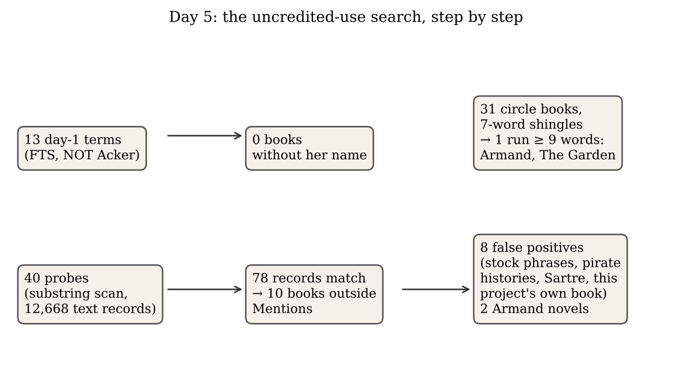

*[[shadows/weeks/kathy-acker|Kathy Acker (Author & Shadow)]] · Day 5 of 7 · 2026-11-06 · Difficulty 3 · Genealogy/influence, Shared form or method*

## Books in this reading

- [[books/13051-the-garden|The Garden]], [[people/louis-armand|Louis Armand]]; 2001 (Salt); library copy 11:11 Press Director's Cut, 2020 (dated 'Marrakech 1994 Prague 2019'). *Day 5 primary (suspected uncredited use): the only book outside Mentions with a 9+-word run from Acker's library books; citing book of edge 52.*
- [[books/14221-clair-obscur|Clair Obscur]], [[people/louis-armand|Louis Armand]]; 2011 (Equus, Prague). *Day 5 secondary (weak suspicion): edge 53.*
- [[books/1176-literal-madness-3-novels-kathy-goes-to-haiti-my-de|Literal Madness: 3 Novels: Kathy Goes to Haiti, My Death My Life by Pier Paolo Pasolini, and Florida]], [[people/kathy-acker|Kathy Acker]]; 1987 (Grove; My Death My Life first pub. Pan 1984). *Day 5, own work as target and as rewriter (repeat from day 4, required by the relation): MDML '1SEX' '4. War' (target of edge 52), '3VIOLENCE' heading (edge 53), '2LANGUAGE' '3. Nominalism' (citing book of edge 54).*
- [[books/1200-aesthetic-theory-essential-texts-for-architecture|Aesthetic Theory: Essential Texts for Architecture and Design]], [[people/mark-foster-gage|Mark Foster Gage]] (editor); 2011 (Norton); Benjamin tr. Harry Zohn. *Day 5 witness: the library's only text of Benjamin's 'Work of Art' essay containing the Gance sentence; target of edge 54.*

## The shadow so far

| Citing Book | Relation | Target | Location |
|---|---|---|---|
| [[books/1178-great-expectations|Great Expectations]] (Kathy Acker) | **Rewrites** | Kathy Acker | Part One, 'I Recall My Childhood' (opening); 'I Journey To Receive My Fortune' (opening) |
| [[books/1178-great-expectations|Great Expectations]] (Kathy Acker) | **Rewrites** | Kathy Acker | Part One, 'The Underworlds Of The World' (opening); 'I Journey To Receive My Fortune' (Rosa, O, Mr. Sadat) |
| [[books/1178-great-expectations|Great Expectations]] (Kathy Acker) | **Rewrites** | Kathy Acker | Part Two, 'Night' ('Portrait In Red') |
| [[books/1178-great-expectations|Great Expectations]] (Kathy Acker) | **Rewrites** | Kathy Acker | Part One, 'I Recall My Childhood' (spliced passages) |
| [[books/1178-great-expectations|Great Expectations]] (Kathy Acker) | **Rewrites** | Kathy Acker | Part One, 'I Journey To Receive My Fortune' |
| [[books/1178-great-expectations|Great Expectations]] (Kathy Acker) | **Rewrites** | Kathy Acker | Part Three, 'Inside' |
| [[books/1178-great-expectations|Great Expectations]] (Kathy Acker) | **Quotes** | Kathy Acker | Part Two, 'Day' (stanza 1 set as verse; later stanzas on Porphyro and Madeline) |
| [[books/4206-typewriters-bombs-jellyfish|Typewriters, Bombs, Jellyfish]] (Tom McCarthy) | **Quotes** | Kathy Acker | 'Kathy Acker's Infidel Heteroglossia', § I |
| [[books/4206-typewriters-bombs-jellyfish|Typewriters, Bombs, Jellyfish]] (Tom McCarthy) | **Quotes** | Kathy Acker | 'Kathy Acker's Infidel Heteroglossia', § I (end) |
| [[books/4206-typewriters-bombs-jellyfish|Typewriters, Bombs, Jellyfish]] (Tom McCarthy) | **Quotes** | Kathy Acker | 'Kathy Acker's Infidel Heteroglossia', §§ I–III |
| [[books/4206-typewriters-bombs-jellyfish|Typewriters, Bombs, Jellyfish]] (Tom McCarthy) | **Quotes** | Kathy Acker | 'Kathy Acker's Infidel Heteroglossia', §§ I–II |
| [[books/4206-typewriters-bombs-jellyfish|Typewriters, Bombs, Jellyfish]] (Tom McCarthy) | **Quotes** | Kathy Acker | 'Kathy Acker's Infidel Heteroglossia', § I; Juliet/Romeo in § III |
| [[books/9197-narratology-introduction-to-the-theory-of-narrativ|Narratology: Introduction to the Theory of Narrative (4th ed.)]] (Mieke Bal) | **Quotes** | Kathy Acker | ch. 2 'Story: Aspects', § 5 Frequency, p. 102 |
| [[books/9197-narratology-introduction-to-the-theory-of-narrativ|Narratology: Introduction to the Theory of Narrative (4th ed.)]] (Mieke Bal) | **Quotes** | Kathy Acker | ch. 2 'Story: Aspects', § 4 Rhythm, pp. 98–99 |
| [[books/5541-poetic-revolutionaries-intertextuality-subversion|Poetic Revolutionaries: Intertextuality & Subversion]] (Marion May Campbell) | **Quotes** | Kathy Acker | ch. 4 'Kathy Acker or Catheter the Hack', pp. 167–168 (nn. 42–46) |
| [[books/6623-the-cambridge-introduction-to-postmodern-fiction|The Cambridge Introduction to Postmodern Fiction]] (Bran Nicol) | **Argues with** | Kathy Acker | ch. 6 'Postmodern fiction by women: Carter, Atwood, Acker', pp. 159–160 (also p. 162) |
| [[books/708-the-routledge-companion-to-experimental-literature|The Routledge Companion to Experimental Literature]] (Brian McHale (ch. 11)) | **Argues with** | Kathy Acker | ch. 11 'Postmodernism and Experiment', § III 'The zone of the interior'; § IV |
| [[books/5612-shift-linguals-cut-up-narratives-from-william-s-bu|Shift Linguals: Cut-Up Narratives From William S Burroughs to the Present]] (Edward S. Robinson) | **Argues with** | Kathy Acker | ch. 'Kathy Acker: Plagiarism and Adaptation – From Cut-Up to Cut-and-Paste', pp. 164–165 |
| [[books/5612-shift-linguals-cut-up-narratives-from-william-s-bu|Shift Linguals: Cut-Up Narratives From William S Burroughs to the Present]] (Edward S. Robinson) | **Quotes** | Kathy Acker | ch. 'Kathy Acker: Plagiarism and Adaptation', p. 166 |
| Appendix Project: Talks and Essays (Kate Zambreno) | **Argues with** | Kathy Acker | Appendix E 'The Art of Diseuse' (talk, Poetry Project, 27 Oct 2017), section 'Saying Ugly Things' |
| [[books/1176-literal-madness-3-novels-kathy-goes-to-haiti-my-de|Literal Madness (My Death My Life by Pier Paolo Pasolini)]] (Kathy Acker) | **Rewrites** | Kathy Acker | My Death My Life, 'My Death' (just before 'Nominalism'); TARGET Sartre ch. 1 'A Problem', 'Naïveté and Language' |
| [[books/6336-against-expression-an-anthology-of-conceptual-writ|Against Expression: An Anthology of Conceptual Writing]] (Craig Dworkin and Kenneth Goldsmith (eds.)) | **Edits/introduces** | Kathy Acker | 'Kathy Acker, from Great Expectations', headnote p. 28; excerpt pp. 28–31 (PDF pp. 82–85) |
| [[books/4852-pathetic-literature|Pathetic Literature]] (Eileen Myles (ed.)) | **Edits/introduces** | Kathy Acker | 'Excerpt from Great Expectations' (= GE Part Two, 'Day: The First Days', whole); acknowledgments '© 1982 ... Reprinted by permission of Grove Press, Inc.' |
| [[books/13051-the-garden|The Garden (Director's Cut)]] (Louis Armand) | **Uses without credit (suspected)** | Kathy Acker | The Garden, p. 132 (PDF p. 140); TARGET My Death My Life (1176), '1SEX', '4. War', 'Beginning:' |
| [[books/14221-clair-obscur|Clair Obscur]] (Louis Armand) | **Uses without credit (suspected)** | Kathy Acker | Clair Obscur, p. 69 (PDF p. 71); TARGET My Death My Life (1176), '3VIOLENCE' heading 'Purpose: To Get Rid of Meaning' |
| [[books/1176-literal-madness-3-novels-kathy-goes-to-haiti-my-de|Literal Madness (My Death My Life by Pier Paolo Pasolini)]] (Kathy Acker) | **Rewrites** | Kathy Acker | My Death My Life, '2LANGUAGE', '3. Nominalism'; TARGET Benjamin, 'The Work of Art in the Age of Mechanical Reproduction', tr. Zohn, § II (witness: Aesthetic Theory, ed. Gage, 1200) |

---

## 6 November 2026

## 1. Where the week stands

Kathy Acker, day 5 of 7. Day 1 showed that she changes the smallest unit of a source (one word, one name, one number) and leaves the rest standing. Day 2 found the critics quoting her drifting at the same scale. Day 3 found no book in the library that argues with her in its own voice. Day 4 found that a passage critics credit to Flaubert is really Sartre’s, with the names cut out. Today’s question turns that method back on her: who in the library uses Acker without naming her?

## 2. The day’s finding

**Relations: Uses without credit (suspected) ×2, inward; Rewrites ×1, outward.**

The planned search came back empty. None of the thirteen day-1 search terms turns up in any book that doesn’t name her. A wider scan of 40 probes over the whole full-text index produced ten books outside the Mentions list. Eight of them are false positives. The other two are novels by **Louis Armand**.

The stronger case is *The Garden* (13051). On p. 132 it carries a nine-word sentence from *My Death My Life*: “already I can tell everything’s closing in on me.” The next clause reads “somewhere you’re repeating my too familiar phrases.” The library holds no third book with that sentence. Armand co-edited *Pornoterrorism* (10597), which includes a long chapter on Acker that quotes *My Death My Life* at length. *The Garden* credits Guyotat, whom Acker also rewrote, and never names her. I record this as a suspicion, not a finding.

The one uncredited use the scan actually proves runs the other way. *My Death My Life* takes a sentence of Benjamin’s “Work of Art” essay word for word, then glosses it in her own voice. It also cuts Abel Gance out of the sentence that follows. That is the same operation day 4 found in her handling of Sartre. Armand quotes the same Benjamin sentence, with credit, in *Solicitations* (10595).

**How the search was done, and where it can mislead.**

- **Day-1 terms.** All thirteen were run through the calibre index with NOT Acker. None of them appears in a book that lacks her name. The only hits were her own *Great Expectations* (1178) and the Myles anthology (4852), which reprints her with credit. “Something exists when it’s part of a narrative” and “Self-reflective consciousness is narrational” show up only in those two.

- **The NOT Acker filter leaks.** The index treats “Acker’s” as its own word, so a book that only ever writes “Acker’s” passes the filter. *Green Girl* (3597), Nace (3321) and *Private Novelist* (11242) came back as Acker-free this way. Any positive hit from NOT has to be checked against Mentions by hand.

*Figure 1: The search, step by step*

- **Substring scan.** I scanned all 12,668 text records in full-text-search.db, read-only, for 40 probes: the day-1 terms, her most-quoted lines and her titles. 78 records matched. Ten of the matching books are not in Mentions:

- ** The pirate histories (8385, 8395) matched “King of the Pirates.”

- ** Hölderlin’s *Hyperion* (5700) and Benjamin’s *Early Writings* (12642) matched “the childlike life.”

- ** A heraldry book (32) matched “my death my life.”

- ** The two Sartre records (14041, 14142) are her source from day 4.

- ** Myles, *Not Me* (4914), prints “Hannibal Lecter, My Father / KATHY ACKER” in a capitalised series backlist. Day 1’s exact-case capture missed it, so I’ve added it to Mentions.

- ** Book 15020 is this project’s own compilation of the Canetti week. It now contains Acker material from our own edge notes, so the library is indexing the routine. Added to Mentions with a note to exclude it.

- ** That leaves Armand’s *Clair Obscur* (14221).

- **Shingle comparison.** I compared 31 non-naming books by writers in or near Acker’s circle against her four library books, using 7-word sequences. The books: Armand ×13, Cooper ×2, Myles ×2, Kraus, Gary Indiana, Lotringer ×2, Kapil ×3, Wojnarowicz, Zambreno ×2, Heti, *Valencia* (14513), and Shields’s *Reality Hunger*. *Reality Hunger*, a collage of uncredited quotations, shares nothing with her. Apart from copyright boilerplate and stock phrases (“I don’t know what to do”), three runs remain:

- * The Garden*: 9 words.

- ** Armand, *Solicitations*: 15 words. This is Benjamin, a source they share.

- ** Armand, *Joycemedia* (13048): “Alexander Keyes, tea, wine and spirit merchant.” This is *Ulysses*, which *My Death My Life* pastiches in its “Aeolus” passage. Noted, not collated.

## 3. The books

## The Garden — Louis Armand, 2001 (library copy: 11:11 Press Director’s Cut, 2020); PDF, Calibre 13051

**Selection logic.** It was the only book in the 31-book shingle comparison with a run of nine or more words that isn’t boilerplate. It was in that batch because Armand co-edited *Pornoterrorism* (10597), which has a chapter on Acker (David Vichnar, “ ‘Disruption Necessary for Business’: Kathy Acker’s Terrorist Aesthetics”). The Send-To pool was empty today.

**Overview.** The book grew out of notebooks from a 1994 journey through Morocco and the Western Sahara. It is printed as one unpunctuated sentence of about 34,000 words. The front matter names its references: Genesis, Bosch, Nefzawi’s *Perfumed Garden*, Guyotat’s *Eden Eden Eden*, and Jarman. Acker is not among them, and her name appears nowhere in the text. A substring test for “acker” finds nothing in it.

**Excerpt with the suspected sentence** (p. 132; PDF p. 140):

> all of your faces knotted & drawn already I can tell everything’s closing in on me somewhere you’re repeating my too familiar phrases lying on your back in the dark in the twilight or staring into a mirror a voice forever in the past of memories you know belong to no-one

**Collation against the source. The case for and against.**

| My Death My Life (1176), “1SEX”, “4. War” | The Garden (13051), p. 132 |
|---|---|
| Frame “Beginning:” then a new paragraph | mid-sentence, after “all of your faces knotted & drawn” |
| Text “Already I can tell | “already I can tell |
| everything’s closing in on me.” | everything’s closing in on me” |
| Change — | capital A dropped, full stop dropped, straight apostrophe now curly |
| What follows “I want to list the | “somewhere you’re |
| possibilities or the lack of possibilities: I can no longer ask real questions.” | repeating my too familiar phrases” |

- *For:*

- ** It is nine words, verbatim, and no other book in the library has it. (Calibre’s index misses Armand’s copy because of the curly apostrophe; the substring scan found it.)

- ** Armand has documented contact with this exact book: *Pornoterrorism* quotes *My Death My Life* in runs of up to 46 words.

- ** The two writers share a source in Guyotat.

- ** The next clause in *The Garden* reads like a remark on the borrowing itself.

- *Against:*

- ** The sentence is plain English and could have been written independently.

- ** No second Acker phrase stands near it. A 5-word comparison of the whole book finds only stock phrases.

- ** The notebooks date from 1994, and *My Death My Life* had been in print since 1984, so the dates allow it but prove nothing.

- *Verdict:* moderate suspicion. A single sentence is the smallest unit a borrowing can have, which is also the scale at which Acker herself worked.

**A misreading worth attempting.** Read “somewhere you’re repeating my too familiar phrases” as Acker’s voice speaking back from inside Armand’s sentence, which would make the borrowed line the only place in *The Garden* where someone else’s voice is heard.

## Clair Obscur — Louis Armand, 2011 (Equus, Prague); PDF, Calibre 14221

**Selection logic.** It matched the probe “to get rid of meaning” in the substring scan. It is not in Mentions. The only “acker” strings in it are inside “mackerel” and “attacker.”

**Overview.** A novel set against the war in former Yugoslavia, about memory, guilt and fantasy.

**Verified quotation** (p. 69; PDF p. 71): “And what if the sole purpose now is to get rid of meaning? To make darkness the general condition?”

**Derived list: what it shares with Acker, and how much.**

- Shared words: “purpose” and “to get rid of meaning.” Acker’s version is a heading in *My Death My Life*, “3VIOLENCE”: “Purpose: To Get Rid of Meaning.”

- No 7-word run is shared, apart from stock phrases and “here we go round the mulberry bush.”

- *Verdict:* weak. It is worth recording only because it makes two Armand novels that each meet the same Acker book at one phrase.

## Literal Madness (My Death My Life by Pier Paolo Pasolini) — Kathy Acker, 1987 (MDML 1984); EPUB, Calibre 1176

**Selection logic.** This book was day 4’s primary. It returns today because both Armand matches lead to it, and because comparing it with Armand’s *Solicitations* exposed the Benjamin passage. The day’s relation requires reading it again.

**Concordance: where today’s edges sit in *My Death My Life*****.**

1. **“1SEX”, “4. War”.** The section opens: “Beginning: / Already I can tell everything’s closing in on me.” This is the target of edge 52. Three paragraphs on, it reads: “Don’t consider any possibility which leaves you bound.”

2. **“2LANGUAGE”, “3. Nominalism”.** “One might generalize by saying: the technique of reproduction detaches the reproduced object from the domain of tradition. Meaning, for example: a book no longer has anything to do with literary history so the history of literarture you’re taught in school is for shit.” This is edge 54. The typo “literarture” is in the EPUB.

3. **Same section.** “Presumably, without intending it, he issued an invitation to a far-reaching liquidation. Now I want to give you an analogy.” The section ends: “I must give people art that demands very little attention and takes almost nothing for me to do.”

4. **“3VIOLENCE”, heading.** “Purpose: To Get Rid of Meaning / for the German Expres-sionists / who believed nothing / and the primacy of language over form.” This is the target of edge 53.

**Collation with Benjamin** (Zohn’s translation, in *Aesthetic Theory*, ed. Gage, Calibre 1200, § II):

| Benjamin (1200) | Acker (1176) |
|---|---|
| “One might generalize by saying: the technique of reproduction detaches the reproduced object from the domain of tradition.” | identical |
| “By making many reproductions it substitutes a plurality of copies for a unique existence.” | replaced by her gloss: “Meaning, for example: a book no longer has anything to do with literary history…” |
| “In 1927 Abel Gance exclaimed enthusiastically: …” | cut |
| “Presumably without intending it, he issued an invitation to a far-reaching liquidation.” | “Presumably, without intending it, he …” (comma added; “he” now refers to no one) |

Removing Gance leaves a pronoun with no one to refer to. On day 4 she did the same to Sartre’s sentences, removing Lacan and Saint Antoine. In Benjamin’s argument, reproduction cuts the object loose from tradition. In her sentence it cuts the man loose from his name. Calibre’s index finds “far-reaching liquidation” in only these two books.

## Aesthetic Theory: Essential Texts for Architecture and Design — ed. Mark Foster Gage, 2011; EPUB, Calibre 1200

**Selection logic.** It is the witness text. The full-text search for “far-reaching liquidation” returned only this book and Acker’s.

**Overview.** A Norton anthology of writing on beauty, from Plato to Freedberg and Gallese. Benjamin’s essay appears in Harry Zohn’s translation, excerpted.

**Verified quotations** (Benjamin, § II):

- “One might generalize by saying: the technique of reproduction detaches the reproduced object from the domain of tradition. By making many reproductions it substitutes a plurality of copies for a unique existence.”

- “Presumably without intending it, he issued an invitation to a far-reaching liquidation.”

**Excerpt note.** Gage’s excerpt does not include the passage comparing the painter with the cameraman, so Acker’s paraphrase of it (“A painter represents or makes … reality by keeping distant from it and picturing it totally. A cameraman, on the other hand, permeates with mechanical equipment …”) can’t be collated against a text in the library. The full essay is on marxists.org, in the same Zohn translation.

## 4. The shadow so far (edges 29–54)

| Edge | From | Relation | To | Location |
|---|---|---|---|---|
| 29–34 | Acker, *Great Expectations* (1178) | Rewrites | Dickens ×3, Guyotat, Flaubert, Colette | Parts One–Three |
| 35 | Acker, *Great Expectations* | Quotes | Keats, “St. Agnes” | Part Two, “Day” |
| 36–40 | McCarthy (4206) | Quotes | Acker ×4 books | “Infidel Heteroglossia” |
| 41–42 | Bal (9197) | Quotes | *Blood and Guts* | pp. 98–102 |
| 43 | Campbell (5541) | Quotes | *Blood and Guts* | pp. 167–168 |
| 44 | Nicol (6623) | Argues with | Acker (via McHale 1992) | pp. 159–162 |
| 45 | McHale (708) | Argues with | Acker | ch. 11 § III |
| 46–47 | Robinson (5612) | Argues with / Quotes | Acker | pp. 164–166 |
| 48 | Zambreno (3591) | Argues with | Acker (via an LRB review) | Appendix E |
| 49 | Acker, *My Death My Life* (1176) | Rewrites | Sartre, *Family Idiot* (14142) | “My Death” |
| 50 | Dworkin & Goldsmith (6336) | Edits/introduces | *Great Expectations* | pp. 28–31 |
| 51 | Myles (4852) | Edits/introduces | *Great Expectations* | “Day” |
| **52** | **Armand, *The Garden* (13051)** | **Uses without credit (suspected)** | ***My Death My Life*****, “4. War”** | **p. 132** |
| **53** | **Armand, *Clair Obscur* (14221)** | **Uses without credit (suspected, weak)** | ***My Death My Life*****, “3VIOLENCE”** | **p. 69** |
| **54** | **Acker, *My Death My Life* (1176)** | **Rewrites** | **Benjamin, “Work of Art” (Zohn; 1200)** | **“2LANGUAGE”, “3. Nominalism”** |

Of the 26 edges so far, 9 begin in Acker’s own books. *My Death My Life* now has five edges: two going out (to Sartre and Benjamin) and three coming in (McCarthy, edge 40, and the two from Armand).

## 5. Where this sends you

**Notebook**

1. Armand drops the full stop from Acker’s sentence, and inside a book that is one unpunctuated sentence, the borrowed line becomes impossible to locate. Take a sentence you once borrowed and write the paragraph in which it would no longer be findable. What did you have to remove?

2. Acker keeps Benjamin’s sentence about reproduction cutting the object loose from tradition, and cuts out the name of the man who “issued an invitation to a far-reaching liquidation.” Write the line Gance would say if he could find himself in her paragraph.

3. “Somewhere you’re repeating my too familiar phrases.” Write two short paragraphs: one with Armand as the speaker, one with Acker. Which reading needs more evidence than *The Garden* gives?

**Rabbit holes** (each link checked today)

- Walter Benjamin, “The Work of Art in the Age of Mechanical Reproduction,” tr. Harry Zohn (Marxists Internet Archive). Both of Acker’s sentences are in § II. https://www.marxists.org/reference/subject/philosophy/works/ge/benjamin.htm

- Louis Armand, *The Garden* (Director’s Cut), 11:11 Press, 2020. The publisher’s page lists Guyotat, Nefzawi, Bosch and Jarman, and does not mention Acker. https://1111press.com/the-garden

- Louis Armand, *Clair Obscur* (Equus, 2011), Internet Archive record (lending-restricted). https://archive.org/details/clairobscur0000arma

- Christina Milletti, “Violent Acts, Volatile Words: Kathy Acker’s Terrorist Aesthetic,” *Studies in the Novel* 36.3 (2004). Vichnar’s chapter in *Pornoterrorism* cites “Volatile Words.” https://researchconnect.buffalo.edu/en/publications/violent-acts-volatile-words-kathy-ackers-terrorist-aesthetic/

- David Simpson, “Lucretius,” *Internet Encyclopedia of Philosophy*, on the swerve (clinamen) in the Physics section. https://iep.utm.edu/lucretiu/

- “Clinamen,” Wikipedia, as a starting point: Lucretius, and Swift’s satire in *A Tale of a Tub*. https://en.wikipedia.org/wiki/Clinamen

**Also in your library**

- *Pornoterrorism: De-Aestheticising Power*, ed. Armand and Lelek (10597): Vichnar’s chapter on Acker, which quotes *My Death My Life* at length (the Armand–Acker link).

- Armand, *Solicitations* (10595): Benjamin credited (PDF p. 38), and the clinamen as a “strophic ‘turning away’ ” (PDF p. 223).

- Armand, *Joycemedia* (13048): the Keyes advertisement from *Ulysses*, against *My Death My Life*’s “Aeolus” pastiche (not collated).

- Send-To pool: no Queued candidates today.

## 6. From the Lexicon — clinamen

**Received vs. your sense.** The received definition gives two senses. In Lucretius (*De rerum natura* II.216–224, 251), it is the minimal, unpredictable swerve of falling atoms, “at no fixed place or time,” without which nothing would collide; he makes it the ground of free will. In Harold Bloom’s *The Anxiety of Influence* (1973), it is the first revisionary ratio: a poet’s corrective swerve, or misprision, away from a precursor. Your entry stays with Lucretius and notes that he never gives the swerve a primary cause.

**Etymology.** Latin *clinamen*, from *clinare*, “to incline”; plural *clinamina*. The term is Lucretius’s (1st c. BCE). Epicurus’s own account of the swerve is known mainly through him. Bloom carried the word into literary theory.

**WordNet.** “Clinamen” is not in WordNet (checked today). The nearest sense is *swerve*, n. 2 (oewn-07425950-n): “an erratic deflection from an intended course.”

**Relations or lineage.** Lucretius →Bloom (the swerve away from a precursor). Your Boundary_Tensions note holds: the physical swerve and the poetics of misreading travel under one word.

**Portable axiom.** None recorded.

**Why today.** All week, every change found has been a minimal swerve from a straight copy: Pip to Peter, “eighty” to “sixty,” a comma added before “without,” a name cut out. Armand drops a full stop. If that counts as a swerve, the borrowing is a clinamen in Lucretius’s sense: almost no deviation, and the collision still happens.

**Verified occurrence.** Louis Armand, *Solicitations* (10595), PDF p. 223: “In this sense, the geodesic curvature also describes a type of clinamen, a strophic”turning away,” or “swerve.”” The same book, at PDF p. 38, carries the Benjamin sentence Acker used.

**New in the Lexicon.** Last_Resurfaced set to today; Times_Resurfaced 0 →1.

## 7. To carry

“already I can tell everything’s closing in on me somewhere you’re repeating my too familiar phrases” — Louis Armand, *The Garden*, p. 132

## Themes

[[themes/abel-gance|Abel Gance]] · [[themes/aeolus|Aeolus]] · [[themes/benjamin|Benjamin]] · [[themes/clair-obscur|Clair Obscur]] · [[themes/clinamen|clinamen]] · [[themes/false-positive|false positive]] · [[themes/full-stop|full stop]] · [[themes/guyotat|Guyotat]] · [[themes/joyce|Joyce]] · [[themes/louis-armand|Louis Armand]] · [[themes/my-death-my-life|My Death My Life]] · [[themes/null-result|null result]] · [[themes/plagiarism|plagiarism]] · [[themes/pornoterrorism|Pornoterrorism]] · [[themes/possessive|possessive]] · [[themes/shingles|shingles]] · [[themes/single-sentence|single sentence]] · [[themes/suspicion|suspicion]] · [[themes/the-garden|The Garden]] · [[themes/tokenisation|tokenisation]] · [[themes/uncredited-use|uncredited use]] · [[themes/vichnar|Vichnar]] · [[themes/work-of-art|Work of Art]] · [[themes/zohn|Zohn]]

---

Previous: [[shadows/2026-11-05-shadow-kathy-acker-day-4-the-sentence-was-sartre-s|Shadow — Kathy Acker, day 4: The Sentence Was Sartre's]]  
Next: [[shadows/2026-11-08-shadow-kathy-acker-day-6-slave-trader-first|Shadow — Kathy Acker, day 6: Slave Trader First]]
