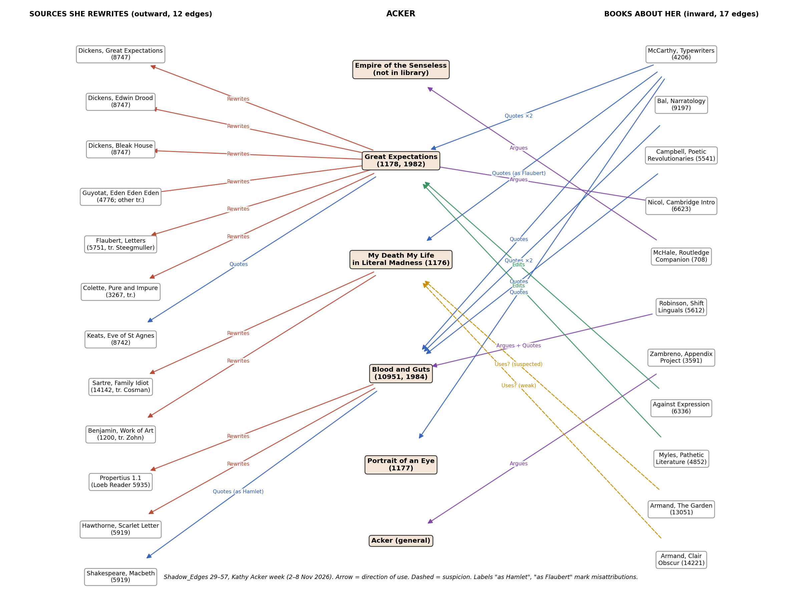
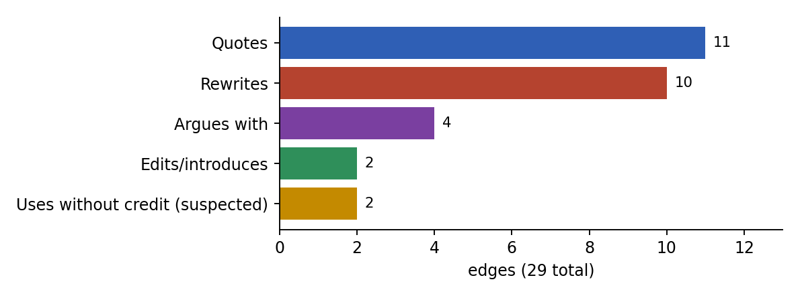

*[[shadows/weeks/kathy-acker|Kathy Acker (Author & Shadow)]] · Day 7 of 7 · 2026-11-08 · Difficulty 3 · Genealogy/influence, Shared form or method*

## Books in this reading

## The shadow so far

| Citing Book | Relation | Target | Location |
|---|---|---|---|
| [[books/1178-great-expectations|Great Expectations]] (Kathy Acker) | **Rewrites** | Kathy Acker | Part One, 'I Recall My Childhood' (opening); 'I Journey To Receive My Fortune' (opening) |
| [[books/1178-great-expectations|Great Expectations]] (Kathy Acker) | **Rewrites** | Kathy Acker | Part One, 'The Underworlds Of The World' (opening); 'I Journey To Receive My Fortune' (Rosa, O, Mr. Sadat) |
| [[books/1178-great-expectations|Great Expectations]] (Kathy Acker) | **Rewrites** | Kathy Acker | Part Two, 'Night' ('Portrait In Red') |
| [[books/1178-great-expectations|Great Expectations]] (Kathy Acker) | **Rewrites** | Kathy Acker | Part One, 'I Recall My Childhood' (spliced passages) |
| [[books/1178-great-expectations|Great Expectations]] (Kathy Acker) | **Rewrites** | Kathy Acker | Part One, 'I Journey To Receive My Fortune' |
| [[books/1178-great-expectations|Great Expectations]] (Kathy Acker) | **Rewrites** | Kathy Acker | Part Three, 'Inside' |
| [[books/1178-great-expectations|Great Expectations]] (Kathy Acker) | **Quotes** | Kathy Acker | Part Two, 'Day' (stanza 1 set as verse; later stanzas on Porphyro and Madeline) |
| [[books/4206-typewriters-bombs-jellyfish|Typewriters, Bombs, Jellyfish]] (Tom McCarthy) | **Quotes** | Kathy Acker | 'Kathy Acker's Infidel Heteroglossia', § I |
| [[books/4206-typewriters-bombs-jellyfish|Typewriters, Bombs, Jellyfish]] (Tom McCarthy) | **Quotes** | Kathy Acker | 'Kathy Acker's Infidel Heteroglossia', § I (end) |
| [[books/4206-typewriters-bombs-jellyfish|Typewriters, Bombs, Jellyfish]] (Tom McCarthy) | **Quotes** | Kathy Acker | 'Kathy Acker's Infidel Heteroglossia', §§ I–III |
| [[books/4206-typewriters-bombs-jellyfish|Typewriters, Bombs, Jellyfish]] (Tom McCarthy) | **Quotes** | Kathy Acker | 'Kathy Acker's Infidel Heteroglossia', §§ I–II |
| [[books/4206-typewriters-bombs-jellyfish|Typewriters, Bombs, Jellyfish]] (Tom McCarthy) | **Quotes** | Kathy Acker | 'Kathy Acker's Infidel Heteroglossia', § I; Juliet/Romeo in § III |
| [[books/9197-narratology-introduction-to-the-theory-of-narrativ|Narratology: Introduction to the Theory of Narrative (4th ed.)]] (Mieke Bal) | **Quotes** | Kathy Acker | ch. 2 'Story: Aspects', § 5 Frequency, p. 102 |
| [[books/9197-narratology-introduction-to-the-theory-of-narrativ|Narratology: Introduction to the Theory of Narrative (4th ed.)]] (Mieke Bal) | **Quotes** | Kathy Acker | ch. 2 'Story: Aspects', § 4 Rhythm, pp. 98–99 |
| [[books/5541-poetic-revolutionaries-intertextuality-subversion|Poetic Revolutionaries: Intertextuality & Subversion]] (Marion May Campbell) | **Quotes** | Kathy Acker | ch. 4 'Kathy Acker or Catheter the Hack', pp. 167–168 (nn. 42–46) |
| [[books/6623-the-cambridge-introduction-to-postmodern-fiction|The Cambridge Introduction to Postmodern Fiction]] (Bran Nicol) | **Argues with** | Kathy Acker | ch. 6 'Postmodern fiction by women: Carter, Atwood, Acker', pp. 159–160 (also p. 162) |
| [[books/708-the-routledge-companion-to-experimental-literature|The Routledge Companion to Experimental Literature]] (Brian McHale (ch. 11)) | **Argues with** | Kathy Acker | ch. 11 'Postmodernism and Experiment', § III 'The zone of the interior'; § IV |
| [[books/5612-shift-linguals-cut-up-narratives-from-william-s-bu|Shift Linguals: Cut-Up Narratives From William S Burroughs to the Present]] (Edward S. Robinson) | **Argues with** | Kathy Acker | ch. 'Kathy Acker: Plagiarism and Adaptation – From Cut-Up to Cut-and-Paste', pp. 164–165 |
| [[books/5612-shift-linguals-cut-up-narratives-from-william-s-bu|Shift Linguals: Cut-Up Narratives From William S Burroughs to the Present]] (Edward S. Robinson) | **Quotes** | Kathy Acker | ch. 'Kathy Acker: Plagiarism and Adaptation', p. 166 |
| Appendix Project: Talks and Essays (Kate Zambreno) | **Argues with** | Kathy Acker | Appendix E 'The Art of Diseuse' (talk, Poetry Project, 27 Oct 2017), section 'Saying Ugly Things' |
| [[books/1176-literal-madness-3-novels-kathy-goes-to-haiti-my-de|Literal Madness (My Death My Life by Pier Paolo Pasolini)]] (Kathy Acker) | **Rewrites** | Kathy Acker | My Death My Life, 'My Death' (just before 'Nominalism'); TARGET Sartre ch. 1 'A Problem', 'Naïveté and Language' |
| [[books/6336-against-expression-an-anthology-of-conceptual-writ|Against Expression: An Anthology of Conceptual Writing]] (Craig Dworkin and Kenneth Goldsmith (eds.)) | **Edits/introduces** | Kathy Acker | 'Kathy Acker, from Great Expectations', headnote p. 28; excerpt pp. 28–31 (PDF pp. 82–85) |
| [[books/4852-pathetic-literature|Pathetic Literature]] (Eileen Myles (ed.)) | **Edits/introduces** | Kathy Acker | 'Excerpt from Great Expectations' (= GE Part Two, 'Day: The First Days', whole); acknowledgments '© 1982 ... Reprinted by permission of Grove Press, Inc.' |
| [[books/13051-the-garden|The Garden (Director's Cut)]] (Louis Armand) | **Uses without credit (suspected)** | Kathy Acker | The Garden, p. 132 (PDF p. 140); TARGET My Death My Life (1176), '1SEX', '4. War', 'Beginning:' |
| [[books/14221-clair-obscur|Clair Obscur]] (Louis Armand) | **Uses without credit (suspected)** | Kathy Acker | Clair Obscur, p. 69 (PDF p. 71); TARGET My Death My Life (1176), '3VIOLENCE' heading 'Purpose: To Get Rid of Meaning' |
| [[books/1176-literal-madness-3-novels-kathy-goes-to-haiti-my-de|Literal Madness (My Death My Life by Pier Paolo Pasolini)]] (Kathy Acker) | **Rewrites** | Kathy Acker | My Death My Life, '2LANGUAGE', '3. Nominalism'; TARGET Benjamin, 'The Work of Art in the Age of Mechanical Reproduction', tr. Zohn, § II (witness: Aesthetic Theory, ed. Gage, 1200) |
| [[books/10951-blood-and-guts-in-high-school|Blood and Guts in High School]] (Kathy Acker) | **Rewrites** | Kathy Acker | Outside high school, 'Translating', 'On the desire for love'; TARGET Propertius 1.1.1–16, Loeb Classical Library Reader (5935), pp. 168–169 |
| [[books/10951-blood-and-guts-in-high-school|Blood and Guts in High School]] (Kathy Acker) | **Rewrites** | Kathy Acker | Outside high school, 'A book report'; TARGET Hawthorne, The Scarlet Letter, ch. I 'The Prison-Door' (Harvard Classics 5919) |
| [[books/10951-blood-and-guts-in-high-school|Blood and Guts in High School]] (Kathy Acker) | **Quotes** | Kathy Acker | Outside high school, 'The mysterious Mr Linker'; TARGET Shakespeare, Macbeth, Act V (Harvard Classics 5919) |

---

## Weekend edition, 8 November 2026 — the second own book, then the map

## 1. Where the week stands

Kathy Acker, days 6 and 7 of 7, run together because the 7 November run was missed. Day 1 read *Great Expectations* (1178) and found she changes the smallest unit (one word, one number, one name) and leaves the rest standing. Day 2 found her quoters drift at that same scale. Day 3 found no book in the library that argues against her in its own voice. Day 4 traced *My Death My Life* to Sartre’s *Family Idiot* in Cosman’s translation. Day 5 left one moderate suspicion (Armand, *The Garden*) and turned up a second outward source, Benjamin in Zohn’s translation. Today: *Blood and Guts in High School* read whole, then the map of all 29 edges.

## PART I — DAY 6: THE AUTHOR AGAIN

## 2. The day’s finding

*Blood and Guts* shows the other half of her method. In *Great Expectations* and *My Death My Life* she keeps the sentence and cuts the name (Lacan and Saint Antoine out of Sartre, edge 49; Abel Gance out of Benjamin, edge 54). In *Blood and Guts* she keeps the name and lets the sentence go. The book report names Hawthorne on almost every page, and a 6-word shingle comparison against *The Scarlet Letter* (Harvard Classics, 5919) finds three runs and 19 words in all; the only real one is Hawthorne’s opening phrase. Genet is named and quoted, but the library has no file for *The Thief’s Journal* (record 1791), so the quotation can’t be checked here. Shakespeare is named, and named wrongly: the lines Mr Linker, the lobotomist who lectures on Culture, recites are from *Macbeth*, and the next line attributes them to *Hamlet*.

The one place where the source’s order survives intact is the Propertius. Janey “copied down all she could remember” of Elegies 1.1, and what she produces is a schoolroom crib: English words laid out in Latin word order, each one matched to its Latin word. Every name and gender is changed: Cynthia becomes the Slave Trader, Milanion becomes Psyche, the girl becomes “the boy”. The order of the words, and nothing else, is kept from the Latin. Relations: **Rewrites** (Propertius, Hawthorne) and **Quotes, misattributed** (Shakespeare). These are three new outward edges, 55–57.

## 3. The book

## Blood and Guts in High School — Kathy Acker, 1978/1984 (Penguin Classics EPUB 2017; Calibre 10951)

**Selection logic.** Named for day 6 in the week’s Day_Plan, and held back on day 2 (Books row 128, “reserved for day 6”). The field quotes this book more than any other Acker book, but only a narrow band of it (days 2–3: Bal and Campbell both quote the hexagon bedroom, Grove p. 36; McCarthy and Bal both quote the “rotgut” abortions sentence). Today’s reading is of everything after that band. It is not from the Send To pool: the Candidates table is empty.

**Overview.** About 39,000 words in two parts. “Inside high school” (“Parents stink”, “The Scorpions”) is the part the critics quote. “Outside high school” holds what they mostly leave alone: Janey’s sale to a Persian slave trader through Mr Linker, the book report on *The Scarlet Letter* written in the locked room, the Persian lessons and the Propertius “translations”, the drawings (dream maps), the meeting with Genet in Tangier, the journey through North Africa, Janey’s death, and a coda (“The Journey”, “The World”) where a dead Catullus holds the book that everyone is looking for. The book closes on a question that points to her next novel: “Shall we find our way out of all expectations?” (‘The World’).

**Element 1 — Concordance of named sources (derived list)**

Each name is checked against a library text where one exists.

| Name in BG | Where | Library witness | Verbatim overlap |
|---|---|---|---|
| Hawthorne / Hester / *Scarlet Letter* | ‘A book report’ | Harvard Classics 5919 | 7-word run: “of bearded men, in sad-coloured garments” |
| Sextus Propertius | ‘Translating’ | Loeb Classical Library Reader 5935 (Goold) | Latin word order kept line by line (Element 2) |
| Shakespeare (“in | ‘The mysterious Mr | Harvard Classics | Two lines, |
| Hamlet”) | Linker’ | 5919 (*Macbeth*, Act V) | “that”→“who” |
| Jean Genet / *Journal du Voleur* | ‘Tangier’ | *The Thief’s Journal* (1791) has no file; *Our Lady of the Flowers* (2848): no run over 6 words | unverifiable here |
| Sartre (*Nausea*), Goethe, Schiller | Mr Linker’s lecture | named only | — |
| Catullus | ‘The Journey’, ‘The World’ | — | named only; a dead poet holding a book |

**Element 2 — The Propertius crib, collated (verified quotation + diagram)**

Acker, ‘Translating’, ‘On the desire for love’ (lines as printed):

> Slave Trader first with his lousy me imprisoned eyes diseased by no before wants. Then my strong he threw down the drain individuality and head forced into the dust LOVE’S feet, until me he had taught undiseased to be evil, him evil, and without to live plan.

Propertius 1.1.1–6, Loeb Classical Library Reader (5935), ed. and tr. G. P. Goold, printed p. 168:

> Cynthia prima suis miserum me cepit ocellis, contactum nullis ante cupidinibus, tum mihi constantis deiecit lumina fastus et caput impositis pressit Amor pedibus,

Goold’s English (p. 169): “Cynthia first with her eyes ensnared me, poor wretch, that had previously been untouched by desire.”

**Alignment (my reading; the match of words is inferred from order, not stated by Acker):** All Latin lines and all of Acker’s lines above are substring-checked in their files. Two of her

| Latin (order kept) | Acker |
|---|---|
| Cynthia · prima · suis · miserum · me · cepit · ocellis | Slave Trader · first · with his · lousy · me · imprisoned · eyes |
| contactum · nullis · ante · cupidinibus tum · mihi · constantis · deiecit · lumina fastus | diseased · by no · before · wants Then · my · strong · he threw down · the drain individuality |
| et caput · impositis · pressit · Amor · pedibus | and head · forced into the dust · LOVE’S · feet |
| Milanion · nullos · fugiendo · Tulle · labores | Psyche · by no · fleeing · labours · hard times |
| saevitiam durae contudit Iasidos ergo · velocem · potuit domuisse · puellam | Love / the ferocity of all-mighty she battled In this way · fast-changing · she controlled · the boy |
| tantum in amore fides et benefacta valent | So much against love prayers and enduring help out |

choices go against the dictionary in a pattern: *contactum* (“touched”) becomes “diseased”, and *castas* (“chaste”) becomes “undiseased”. The Latin’s purity becomes, in her English, a matter of health. The lines are not a paraphrase. They are Latin syntax under English words, which is why they read as damaged English: Latin hyperbaton (see section 6) carried into a language that cannot hold it. PoemTalk #88 (Jacket2) discusses this poem and “The Diseased” as Acker’s Propertius.

**Element 3 — The book report against Hawthorne (verified quotation, collation)**

Acker, ‘A book report’: “A throng of bearded men, in sad-coloured garments, were assembled in front of a gaol.”

Hawthorne, ch. I ‘The Prison-Door’ (5919): “ATHRONG of bearded men, in sad-coloured garments and grey steeple-crowned hats, intermixed with women, some wearing hoods, and others bareheaded, was assembled in front of a wooden edifice” (the run-together “ATHRONG” is in the EPUB, from a drop capital).

What she removes is the women (“intermixed with women, some wearing hoods, and others bareheaded”), so the crowd waiting for Hester is men only. The verb follows: “was” becomes “were”. The rest of the report summarises rather than quotes. Dimmesdale’s plea, “I charge thee to speak out the name of thy fellow-sinner and fellow-sufferer!” (ch. III), becomes its opposite: “‘You are the worst piece of trash-cunt whoever lived, no one will ever ever love you,” spoken by the man who fathered Hester’s child. Hawthorne: “His name was announced as Roger Chillingworth.” Acker: “This husband is now called Roger Chillingworth.” She also reads “The Custom House” as Hawthorne’s self-protection: “In ‘The Custom House’, the introduction to The Scarlet Letter, Hawthorne makes sure he tells us the story of The Scarlet Letter occurred long ago and has nothing to do with anyone who’s now living.” That is a

reading of a disclaimer, written by a writer whose own method makes disclaimers impossible.

**Element 4 — A misreading worth attempting: the misattribution belongs to Culture**

Mr Linker: “ ‘The only thing we have,’ Mr Linker continued telling his hoodlums, ‘which separates us from the beasts is Culture.” He then recites “Out, out, brief candle”, including “A poor player who struts and frets his hour upon the stage,”, and the narrator says: “Shakespeare said that in Hamlet. He said we are nothing without our culture.” The Harvard Classics *Macbeth* reads “Life’s but a walking shadow, a poor player / That struts and frets his hour upon the stage”.

So there are two errors: the play’s name, and “that”→“who”, the smallest unit again. The line about Hamlet is not in quotation marks, so the book leaves open whether the error is Linker’s or the narrator’s. The misreading worth attempting is to take it as deliberate. In a book where the novelist cuts names and keeps the words, the one person who attaches the wrong name to the right words is the lobotomist who runs the white-slave trade and preaches Culture. Day 2 found McCarthy doing the same (Flaubert for Sartre, edge 40). Acker had already put that error in the mouth of the book’s worst man.

**Element 5 — Genet, named and not checkable**

“Genet wrote: ‘Loneliness and poverty made me not walk but fly.” Later: “In Journal du Voleur Genet wrote:”, followed by a paragraph that ends “It was the very symbol of treason.” and then turns into Janey’s voice without a break (“Here all the big men I’ve known…”). Full-text search for “symbol of treason” finds only BG and two unrelated books. The library’s *Thief’s Journal* is a record with no file, so it is not known where Genet ends and Janey begins. Record this as a gap, not an edge.

**Element 6 — The ending’s two cemeteries (derived observation)**

“So the doves” puts Janey’s grave “over Janey’s grave in the grey Saba Pacha cemetery in Luxor.” Two pages later, ‘The World’ puts the book of transformation “hidden with the corpse Catullus in the Saba Pacha Cemetery in Alexandria”, “because all books were written by dead people.” The cemetery moves cities. Day 1’s Jaggers card also moved Smithfield to Alexandria (“just outside Alexandria, and close by the taxi stand.”). Alexandria is where both books send their substituted places.

## PART II — DAY 7: THE MAP

## 4. The shadow (graph and table)

| # | From | Relation | To | Location |
|---|---|---|---|---|
| 29–31 | Acker, *GE* (1178) | Rewrites | Dickens, *GE*, *Drood*, *Bleak House* (8747) | Part One; Part Two ‘Night’ |
| 32 | *GE* | Rewrites | Guyotat, *Eden* (4776, not Fox’s tr.) | ‘I Recall My Childhood’ |
| 33 | *GE* | Rewrites | Flaubert, *Letters* (5751, Steegmuller) | ‘I Journey…’ (eighty→sixty) |
| 34 | *GE* | Rewrites | Colette, *Pure and Impure* (3267) | Part Three ‘Inside’ |
| 35 | *GE* | Quotes | Keats, ‘Eve of St Agnes’ (8742) | Part Two ‘Day’ |
| 36–40 | McCarthy (4206) | Quotes | *GE*, *BG*, *Portrait*, *MDML* | ‘Infidel Heteroglossia’ |
| 41–42 | Bal (9197) | Quotes | *BG* | pp. 98–102 |
| 43 | Campbell (5541) | Quotes | *BG* | pp. 167–168 |
| 44 | Nicol (6623) | Argues with | Acker (*GE*) | pp. 159–160 |
| 45 | McHale (708) | Argues with | *Empire* (not in library) | ch. 11 § III |
| 46–47 | Robinson (5612) | Argues with; Quotes | *BG* | pp. 164–166 |
| 48 | Zambreno (3591) | Argues with | Acker | Appendix E |
| 49 | *MDML* (1176) | Rewrites | Sartre, *Family Idiot* (14142, Cosman) | ‘My Death’ |
| 50 | *Against Expression* (6336) | Edits/introduces | *GE* | pp. 28–31 |
| 51 | Myles (4852) | Edits/introduces | *GE* | ‘Day: The First Days’ |
| 52–53 | Armand (13051, 14221) | Uses without credit (suspected) | *MDML* | *Garden* p. 132; *Clair Obscur* p. 69 |
| 54 | *MDML* | Rewrites | Benjamin, ‘Work of Art’ (1200, Zohn) | ‘2LANGUAGE’, ‘Nominalism’ |
| **55** | ***BG* (10951)** | **Rewrites** | **Propertius 1.1 (Loeb Reader 5935)** | **‘Translating’** |
| **56** | ***BG*** | **Rewrites** | **Hawthorne, *Scarlet Letter* (5919)** | **‘A book report’** |
| **57** | ***BG*** | **Quotes (misattributed)** | **Shakespeare, *Macbeth* (5919)** | **‘The mysterious Mr Linker’** |

**Counts.** 29 edges: Quotes 11, Rewrites 10, Argues with 4, Edits/introduces 2, Uses without credit (suspected) 2. Twelve run outward (Acker uses others) and seventeen inward (others use her). Every outward edge starts in one of her own books. *Great Expectations* is the hub, touched by 12 edges (7 out, 5 in). *Blood and Guts* has 9 (3 out, 6 in). *My Death My Life* has 5 (2 out, 3 in), and is the only book with suspected uncredited users.

**Mentions.** The day-1 capture holds 265 rows (4 own works, 261 other books). Nine of the 261 became edges (3.4%); the Canetti week’s figure was 2.7%. Two edges (52–53) come from books that never name her, and twelve point to sources that are not about her at all.

*Figure 1: The Acker week: 29 Shadow_Edges. Acker’s four library books in the centre; the*

sources she rewrites on the left (outward); the books that quote, argue with, edit or may use her on the right (inward).

*Figure 2: Edges by relation.*

## 5. Closing essay: what the shelves say

The field’s story about Acker is that she plagiarised the canon, men’s books above all: Dickens, Cervantes, Gibson, Burroughs. The edges on the left of the map don’t fit that story well. Of the twelve sources she rewrites, five reach her through an English translator. Sartre comes through Carol Cosman, Benjamin through Harry Zohn, and Flaubert’s letters through Francis Steegmuller. Colette’s dialogue is in English and Guyotat’s soldiers are in an English that is not Graham Fox’s (his came later). A sixth, Propertius, comes through her own schoolroom crib. Searches of the four Acker books in the library find no translator’s name in any of them. The writer best known for taking from Dickens took more often from translators, and the translators are the only people in her chains of borrowing who are never named, not even wrongly. Read on these shelves, the plagiarism question turns into a question about translation. When she copies Cosman’s Sartre, whose sentence is she copying?

The second finding concerns scale, and it held across all seven days. She changes the smallest unit: eighty→sixty, Pip→Peter, badly→poorly, “was”→“were” once the women are gone. Everyone who passes her on works at the same scale, whether or not they mean to. McCarthy writes “the world” for “this world”, Campbell writes “My bedroom” for “My room”, Myles’s reprint skips a line on “living”, and Armand drops a full stop. Even her defenders’ errors are one word long: Nicol writes “Jenny” for Janey, McHale “right wrist” for “left”. Without intending to, the library has run an experiment on her method, and the result is that it can’t be told apart from what happens to any text that gets copied. That is either the strongest defence of her procedure or the end of the idea that it was a procedure. The shelves don’t settle which.

The third finding is that names and sentences come apart. In the later books she cuts the names and keeps the sentences: Lacan, Saint Antoine and Gance are taken out, their words left in place. In *Blood and Guts* she keeps the names and loses the sentences: Hawthorne gets a book report and one phrase, Genet gets a quotation that turns into Janey halfway through, and Propertius gets his word order and nothing else. The misattributions on the map (McCarthy’s Flaubert, Mr Linker’s Hamlet) sit where name and sentence meet, and in her own book the man who joins them wrongly is the one who sells girls and lectures on Culture.

The fourth finding was day 3’s, and day 7 confirms it. Nobody on these shelves argues against Acker in their own voice. The objections (McHale 1992, Lucy, an LRB reviewer) survive only in quotation inside her defenders, and none of the source texts is in the catalogue. What the library holds is her reception, filtered by the people who answered the objections.

**Limits.** 252 of 261 mentioning books produced no edge. *Empire of the Senseless*, *Don Quixote* and *Pussy, King of the Pirates* are not in the catalogue. *The Thief’s Journal* has no file. Story of O, Proust, Jonson, Melville, Woolf’s *Orlando* and the nested-box tale in BG’s coda (“a gold box in a silver box in an ivory box…”, which looks like the Egyptian Setne story; unchecked) could not be checked. Full-text searches timed out on several days, including twice today, so the uncredited-use search is incomplete. The Armand suspicion stays a suspicion.

## 6. Where this sends you

**Notebook**

1. Element 2: Take four lines of a poem in a language you read and set English words under them in the original order, as Acker did with Propertius. Then change one name to someone in your own life. Which carries more of the original, the order or the meaning?

2. Element 4: Mr Linker gets the play wrong while praising Culture. Write a short scene in which a figure of authority misquotes, and make the misquotation the only true thing he says.

3. Essay: Write the acknowledgements page Acker never wrote, naming only the translators (Cosman, Zohn, Steegmuller, and the unnamed ones). Then list the translators your own commonplace book leaves out.

**Rabbit holes**

- PoemTalk #88, “Me no one will take” (Damon, Wagner, Harris on Acker’s Propertius poems): https://jacket2.org/podcasts/me-no-one-will-take-poemtalk-88

- Tremenheere, *The Cynthia of Propertius* (1899), archive.org PDF: https://www.archive.org/download/cy

- *The Scarlet Letter*, Project Gutenberg: https://gutenberg.org/cache/epub/25344/pg25344- images.html

- Silva Rhetoricae, “hyperbaton”: https://rhetoric.byu.edu/Figures/H/hyperbaton.htm

- For next week: Charles A. Perrone on the two 2020 translations of *Brás Cubas* (Words

| Without | Borders): | https://wordswithoutborders.org/book-reviews/machado-de-assis-gains-different-voices-in-new-translations-of-posthumous-m/ |
|---|---|---|
| gains-different-voices-in-new-translations-of-posthumous-m/ |  |  |

- Penguin Classics, *The Posthumous Memoirs of Brás Cubas*, tr. Flora Thomson-DeVeaux: https://www.penguinrandomhouse.com/books/618216/the-posthumous-memoirs-of-bras-cubas-by-machado-de-assis-translated-with-an-introduction-and-notes-by-flora-thomson-deveaux-foreword-by-dave-eggers/

**Also in your library**

- *Oxford Readings in Catullus* (2850): the dead poet of BG’s coda, and today’s hyperbaton.

- *A Loeb Classical Library Reader* (5935): the rest of Propertius 1.1 and 1.4, for anyone who wants to carry on with the crib.

- *Our Lady of the Flowers* (2848): the only Genet in the library with a text layer. *The Thief’s Journal* (1791) needs a file.

- Send To pool: empty (0 queued), so nothing from it bears on this week.

## 7. From the Lexicon — Hyperbaton

**Received vs. your sense.** Received: “A figure of disorder: the departure from normal word order for emphasis or effect. In its original classical sense, a phrase made discontinuous by inserting other words between elements that belong together (frequent in Latin prose and verse)…” Your own sense is not written yet (My_Definition is empty).

**Etymology.** Greek *hyperbaton* (ὑπέρβατον), “stepping over”, from *hyper* + *bainein*; Latin *transgressio*.

**WordNet.** oewn-07118468-n: “reversal of normal word order (as in ‘cheese I love’)”; hypernym *rhetorical device*.

**Relations.** Shares lineage with Apothegm, Maxim, Sententia, Ethopoiesis, Paradigm, paratactic, antimetabole, metathesis. Boundary tension (from the record): Silva Rhetoricae’s second sense, a word added to a sentence that is already complete. *Blood and Guts* fits both senses, since Acker’s lines are Latin order plus additions (“the drain”, “into the dust”).

**Portable axiom.** None on file.

**Why today.** Acker’s Propertius is hyperbaton carried across a border: “Slave Trader first with his lousy me imprisoned eyes” keeps *suis … ocellis* apart in English, where the separation reads as damage rather than art. The Latin name for the figure, *transgressio*, is also the word the critics in days 2–3 kept reaching for.

**Verified occurrence.* Oxford Readings in Catullus* (2850), essay on Catullus XLII, printed p. 358, on Virgil, *Eclogue* 9: “the strong emphasis is brought out by the hyperbaton nostri … agelli”. The emphasis is on ownership (“I am the owner of this piece of land”), so in that passage hyperbaton is a figure of property. (Substring-checked in the PDF text layer.)

**New in the Lexicon** (added since 6 Nov): tosafists, halakhic, sugya, Rash, Ilinx, Ignoble, Charivari, contumelious.

## 8. To carry

> “because all books were written by dead people.” — Kathy Acker, *Blood and Guts in High School*, ‘The World’

*Method notes.* Scribrarium mounted (folder access granted at run time). Texts extracted from EPUB/PDF files on the device and every quotation substring-checked (49 checks, all passed). Calibre full-text search worked on narrow queries and timed out twice on broader ones; overlaps were found with 6-word shingle comparisons. Graph drawn with matplotlib.

## Themes

[[themes/acker|Acker]] · [[themes/attribution|attribution]] · [[themes/citation-graph|citation graph]] · [[themes/credit|credit]] · [[themes/dissent|dissent]] · [[themes/map|map]] · [[themes/misattribution|misattribution]] · [[themes/plagiarism|plagiarism]] · [[themes/reception|reception]] · [[themes/smallest-unit|smallest unit]] · [[themes/textual-drift|textual drift]] · [[themes/translation|translation]] · [[themes/translator|translator]]

---

Previous: [[shadows/2026-11-08-shadow-kathy-acker-day-6-slave-trader-first|Shadow — Kathy Acker, day 6: Slave Trader First]]  
Next: [[shadows/2026-11-09-shadow-machado-de-assis-day-1-the-complete-and-una|Shadow — Machado de Assis, day 1: The Complete and Unabridged Gap]]
