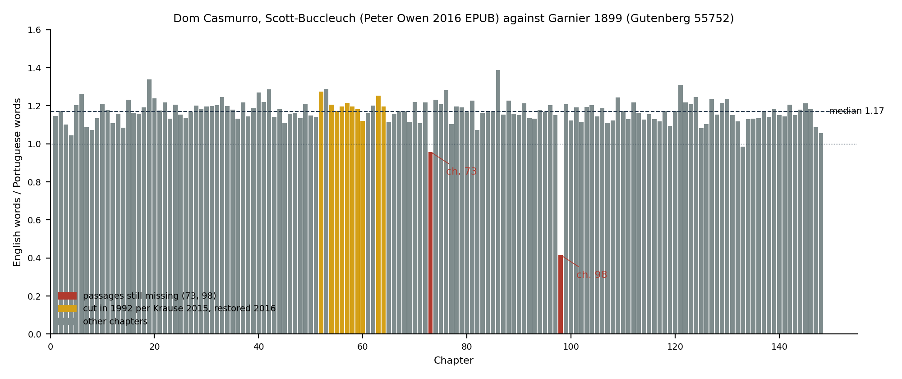

*[[shadows/weeks/machado-de-assis|Machado de Assis (Author & Shadow)]] · Day 1 of 7 · 2026-11-09 · Difficulty 3 · Genealogy/influence, Shared form or method*

## Books in this reading

- [[books/1035-dom-casmurro|Dom Casmurro]], [[people/joaquim-maria-machado-de-assis|Joaquim Maria Machado de Assis]], [[people/r-l-scott-buccleuch|R. L. Scott-Buccleuch]] (translator); 1899. *Day 1 — the author's own work, read against the Garnier 1899 Portuguese: a 'complete and unabridged' translation that still omits two passages*

## The shadow so far

| Citing Book | Relation | Target | Location |
|---|---|---|---|
| [[books/1035-dom-casmurro|Dom Casmurro (Peter Owen 'complete and unabridged edition' 2016)]] (R. L. Scott-Buccleuch (translator)) | **Translates** | Machado de Assis | ch. 98 'Five Years', p. 158 (chapter ends here); TARGET Machado, Dom Casmurro, Garnier 1899, ch. XCVIII 'Cinco annos' (Project Gutenberg 55752) |
| [[books/1035-dom-casmurro|Dom Casmurro (Peter Owen 'complete and unabridged edition' 2016)]] (R. L. Scott-Buccleuch (translator)) | **Translates** | Machado de Assis | ch. 73 'The Stage Manager', p. 125; TARGET Machado, ch. LXXIII 'O contra-regra' (Gutenberg 55752) |
| [[books/1035-dom-casmurro|Dom Casmurro]] (Machado de Assis / R. L. Scott-Buccleuch) | **Quotes** | Machado de Assis | ch. 72 'A Reform in the Drama', p. 124; TARGET Shakespeare, Othello I.iii (checkable in Bartlett's 10410/13825, Concise Oxford Dictionary of Quotations 11435) |
| [[books/1035-dom-casmurro|Dom Casmurro]] (Machado de Assis) | **Rewrites** | Machado de Assis | ch. 72 'A Reform in the Drama', p. 124; TARGET Shakespeare, Othello (named; also ch. 62 'A Touch of Iago', ch. 135 'Othello') |

---

## Library resurfacing, Monday 9 November 2026 · An author and their shadow, week 3

## 1. Where the week stands

Machado de Assis’s week begins today (Author_Weeks row 3, Queue 6; chosen by Johnny during the Acker finale). Day 1 reads one of his own books: *Dom Casmurro* (1899) in R. L. Scott-Buccleuch’s English, the only copy of the novel in Scribrarium. The Acker week closed on translation (“on these shelves plagiarism becomes a question of translation”); Machado’s week opens on it.

The full capture of his footprint is done: **152 books** in the full-text index name him (Mentions rows 609–760; 9 of them his own). *The Posthumous Memoirs of Brás Cubas* (Jull Costa & Patterson, 15092) and *Memorial de Ayres* (15091) arrived in the catalogue at 10:30 UTC this morning, ten minutes after this run had started on *Dom Casmurro*; they are counted, and Brás Cubas is proposed for day 6.

## 2. The day’s finding

The Calibre file is Peter Owen’s 2016 EPUB, whose copyright page reads “This complete and unabridged edition 2016”. Scott-Buccleuch’s 1992 version had cut whole chapters. According to James R. Krause (2015), the cuts were ch. 52, most of 54, 55, the first paragraph of 56, 57– 60, 63 and 64. The 2016 file restores them: all 148 chapters are present, with titles matching the 1899 Garnier text.

A chapter-by-chapter word count against the Portuguese (Project Gutenberg 55752, the Garnier first edition) shows that the restored edition is **still not complete**. Two passages are missing, and neither is on Krause’s list.

- **Ch. 98, ‘Five Years’** (EN/PT ratio 0.42; median 1.17). The English stops after the first two paragraphs. The 229 Portuguese words that follow are gone. They are the paragraphs in which Escobar goes into the coffee trade, borrows money from Dona Glória, becomes “o terceiro” (*the third*) in the letters between Bentinho and Capitu, carries Capitu’s first letter, marries Sancha and starts calling Capitu “sua cunhadinha”. The chapter’s last sentence goes too: “Assim se formam as affeições e os parentescos, as aventuras e os livros.” (*thus are affections and kinships formed, adventures and books*)

- **Ch. 73, ‘The Stage Manager’** (ratio 0.96). The 67 words citing José de Alencar (a play of 1858) and Álvares de Azevedo (a poem of 1851) on courting on horseback are gone, including “tudo se perde na noite dos tempos!” (*everything is lost in the night of time*)

**Relations: Translates (×2), Quotes, Rewrites.** In the case against Capitu, the first cut removes the evidence that the narrator himself put Escobar between the lovers. The second removes the Brazilian literature from a novel whose 1991 introduction (still printed at the front) praises it for being “easily accessible to the European and North American reader”. A

third, smaller substitution runs the other way. Machado gives Othello in Portuguese (“Ella amou o que me affligira, / Eu amei a piedade della.”). The English puts back Shakespeare’s own couplet, which undoes Machado’s version of Shakespeare.

*Figure 1: Chapter-by-chapter length ratio, English to Portuguese. Red: the two passages still*

missing. Gold: the chapters cut in 1992 and restored in 2016.

## 3. The book

## Dom Casmurro — Joaquim Maria Machado de Assis, 1899; tr. R. L. Scott-Buccleuch (1992; Peter Owen “complete and unabridged edition” 2016). EPUB, Calibre ID 1035 → [[books/1035-dom-casmurro|book page]]

**Selection logic.** This follows the week’s Day_Plan (“Dom Casmurro (1035), or Brás Cubas if added”). At the start of the run, Brás Cubas was not in the catalogue. *Dom Casmurro* had not been used in any earlier set, and it is the book the plan expected later days to circle: Othello, the unreliable narrator, the translators. No candidates were queued in the Send-To pool.

**Overview.** Bento Santiago, an old lawyer living alone in Engenho Novo, has had his childhood house in Rua de Matacavalos copied exactly. The copy was supposed to “link together the two ends of my life” (ch. 2, p. 8), and it failed to. So he writes the book instead. His subject is Capitu, the neighbour’s daughter: his love for her, his mother’s vow that he will become a priest, his marriage to Capitu, his friendship with Escobar, and his conviction that his son Ezequiel is Escobar’s. The book is written as a case for the prosecution, by a lawyer who keeps telling the reader how to read him. Its chapters are short. Several are about the book itself: ‘The Book’, ‘A Reform in the Drama’, ‘We Come to the Chapter’, ‘Let’s Come to the Chapter’. One of them, ch. 59, tells the reader what to do with a book that has gaps.

**How it is made, and what it does to its sources.** Machado’s sources show on the surface. Othello is named, reversed (ch. 72) and watched from a theatre seat (ch. 135). Faust is quoted in ch. 2. Ecclesiasticus is cited by chapter and verse in ch. 148. Homer appears as “Homer’s cow” (ch. 61). Then there is the “old Italian tenor” for whom “Life is an opera” (ch. 8, p. 18). The narrator makes each source a witness: he quotes so as to rule. In English, a second hand acts on those same places. The translator decides which witnesses stay in court.

**Element 1 — Excerpt and its missing half (ch. 98)**

The English chapter, in full, ends:

> Capitu’s mother died, and her father retired, occupying the same position as he had held when he wanted to take his own life. (ch. 98, p. 158)

The Portuguese continues for two more paragraphs (Gutenberg 55752, ch. XCVIII). Some of the omitted text, verbatim:

> A separação não nos esfriou. Elle foi o terceiro na troca das cartas entre mim e Capitú.

> Venceu Escobar; posto que vexada, Capitú entregou-lhe a primeira carta, que foi mãe e avó das outras.

> Assim se formam as affeições e os parentescos, as aventuras e os livros.

(My literal gloss, not a published translation: *the separation did not cool us; he was the third in the exchange of letters between me and Capitu … Escobar won; though embarrassed, Capitu gave him the first letter, which was mother and grandmother of the others … thus are affections and kinships formed, adventures and books.*)

The English bears a scar where the cut was made. Ten pages later Escobar refers to Capitu as his sister-in-law, and the narrator adds a parenthesis:

> His sister-in-law (which is how he continued to refer to Capitu) had spoken about it during our last visit to Andaraí, mentioning the reason for keeping it secret. (ch. 106, p. 168)

“Continued”: in this edition there is nothing for him to have continued. The habit began in the omitted sentence (“chamava a esta a «sua cunhadinha.»”). Escobar’s marriage to Sancha is likewise never announced in the English. It arrives already made: “Sancha and Capitu continued, after their marriage, the friendship begun at school” (ch. 104, p. 165).

**Element 2 — Verified quotations (locations are chapter and EPUB page markers) Element 3 — Diagram**

- “This complete and unabridged edition 2016” — copyright page.

- “The result is a tale of suburban life which, though essentially Brazilian in character, is easily accessible to the European and North American reader.” — Translator’s Introduction, p. 4.

- “Otherwise, with the subtropical setting deliberately subdued, the urban background might well be a variation of Paris, Vienna or London.” — Translator’s Introduction, p. 4.

- “It was the custom of the time to conduct one’s love affairs on horseback.” — ch. 73, p. 125. The Portuguese follows this sentence at once with “Relê Alencar: «Porque um estudante (dizia um dos seus personagens de theatro de 1858) não póde estar sem estas duas cousas, um cavallo e uma namorada.» Relê Alvares de Azevedo.” The English goes straight on to the dandy on the bay horse.

- “There is no way of emending a confused book, but everything may be supplied in the case of books with omissions.” — ch. 59, p. 103 (a chapter cut in 1992 and restored in 2016).

- “In this respect there are perhaps certain reforms that might be introduced, and as a start I would propose that plays should begin at the end.” — ch. 72, p. 124.

- “Perhaps this discreet silence concerning the eaten texts was just another way of devouring again what had already been eaten.” — ch. 17 ‘The Maggots’, p. 34.

- “If you remember Capitu the girl, you must admit that the one was inside the other as the fruit is inside the husk.” — ch. 148, p. 220.

The chart above shows each chapter’s English word count divided by its Portuguese word count (Garnier text, chapter titles and numbers excluded). The median is 1.17, since English runs longer than Portuguese. Only four chapters fall below 1.0: 73, 98, 133 (‘An Idea’) and 64. Chapter 133 was checked and is complete; it is short and dense. Ch. 64 sits at 1.20 and was checked by eye. A sweep for proper names in each Portuguese chapter that do not appear in the English found nothing else of substance; most hits were spelling differences (Massinissa/Masinissa, Thomaz/Tomas). **Limit:** these two sweeps would not catch a dropped sentence of ordinary words inside a long chapter. A sentence-by-sentence alignment is still to be done.

**Element 4 — Glossary of the English title-names**

- **Dom Casmurro / Lord Taciturn.** The book keeps the Portuguese title, but inside it the narrator’s nickname is translated: “Next day he began calling me names and finished up nicknaming me ‘Lord Taciturn’.” (ch. 1, p. 7). The translator admits the loss: “Casmurro means gloomy, withdrawn, irritable, stubborn, with an overlying air of sadness, which is not completely rendered by ‘taciturn’.” (Introduction, p. 5).

- **Whirlpool eyes** (*olhos de ressaca*: literally the undertow, the backwash). “Whirlpool eyes? Very well then, whirlpool eyes be it.” (ch. 32, p. 59).

- **Sly and cunning like a gypsy’s** (José Dias’s “olhos de cigana obliqua e dissimulada”, Garnier spelling: *eyes of an oblique, dissembling gypsy*). “They’re sly and cunning like a gypsy’s.” (ch. 25, p. 46). The English drops *oblique*. Machado needs it: of Ezequiel’s grateful eyes he writes later “não eram obliquos, nem de ressaca, eram direitos, claros, lucidos”.

- **History of the Suburbs.** The other book the narrator meant to write, promised again in the last line: “Now let’s turn to the History of the Suburbs.” (ch. 148, p. 220).

**Element 5 — A misreading worth attempting**

Read ch. 59 as an instruction to the translator rather than to the reader: “The fact is, everything is to be found outside a book that has gaps, gentle reader. This is the way I fill in other’s lacunae; in the same way you may fill in mine.” (p. 103). Scott-Buccleuch cut this chapter in 1992. Krause’s abstract (as retrieved from the journal page; the article is not in the library) calls the cuts “a deliberate and calculated decision on the part of a highly engaged reader”, and argues he is a reader who behaves like the narrator. If so, the 2016 restorers put the instruction back and left two lacunae in place for the reader to fill. In one of them, Escobar carries the lovers’ letters. Bento’s case is stronger without it: a reader who never sees Escobar placed as the go-between by Bento’s own hand is readier to believe Escobar slipped into the marriage on his own. This is the misreading: that the translation is the first convert to the narrator’s verdict.

## 4. The shadow so far

| From | Relation | To | Location |
|---|---|---|---|
| Dom Casmurro (1035), tr. Scott-Buccleuch | Translates (omits ¶¶ 3–4) | Machado, *Dom Casmurro*, Garnier 1899, ch. XCVIII | ch. 98 ‘Five Years’, p. 158 |
| Dom Casmurro (1035), tr. Scott-Buccleuch | Translates (omits Alencar, Álvares de Azevedo) | Machado, ch. LXXIII | ch. 73 ‘The Stage Manager’, p. 125 |
| Dom Casmurro (1035), Machado / Scott-Buccleuch | Quotes (English restored over Machado’s Portuguese) | Shakespeare, *Othello* I.iii (Bartlett’s 10410; Concise ODQ 11435) | ch. 72, p. 124 |
| Dom Casmurro (1035), Machado | Rewrites (Othello reversed) | Shakespeare, *Othello* | ch. 72, p. 124 |

## 5. Where this sends you

**Notebook**

1. Ch. 98 ends in English on a man who once “wanted to take his own life”; in Portuguese it ends on “as aventuras e os livros”. Write the last sentence of a chapter of your own twice: once so that it closes on a person, once so that it closes on books. Which ending makes the reader suspect the narrator?

2. Ch. 59 says everything may be supplied in a book with omissions. Take the Escobar paragraphs (Element 1) and write the English for them yourself, without looking at any published version. Then decide whether your English helps Bento’s case or Capitu’s.

3. “Lord Taciturn” against *casmurro*: list four English words that each catch one part of the translator’s gloss (gloomy, withdrawn, irritable, stubborn, sad). Which one would you put on the cover, and what does it decide about the narrator before page one?

**Rabbit holes** (all links checked today)

- James R. Krause, “The translator’s sleight of hand: Robert L. Scott-Buccleuch as unreliable reader of *Dom Casmurro*”, *Machado de Assis em Linha* 8.16 (2015), 62–81 — https://scielo.br/j/mael/a/tmyPxQZdNKdwwrhQvzfKJRr/abstract/?lang=en

- *Dom Casmurro*, Garnier 1899 text (Portuguese), Project Gutenberg 55752 — https://www.gutenberg.org/ebooks/55752

- “The record of Machado de Assis’s works published in English (1950–1960)”, *Machado de Assis em Linha* — https://www.scielo.br/j/mael/a/CzHknFfF3f4j4fYksZQJxZp/?lang=en

- Helen Caldwell, the first English translator of *Dom Casmurro* (1953) and author of *The Brazilian Othello of Machado de Assis* (1960) — https://en.wikipedia.org/wiki/Helen_Caldwell

- Benjamin Moser’s review of the Jull Costa & Patterson translations — https://benjaminmoser.substack.com/p/machado-de-assis-in-english

**Also in your library**

- *The Posthumous Memoirs of Brás Cubas*, tr. Jull Costa & Patterson (2020) — Calibre 15092 (added this morning; proposed for day 6).

- Nicholas Dames, *The Chapter: A Segmented History from Antiquity to the Twenty-First Century* — 11289 (treats *Dom Casmurro* and *Esau and Jacob* among its cases; a day-2 lead).

- *Out of Context: Historical Reference and the Representation of Reality* — 13736 (on Machado’s “Instinto de nacionalidade”, the 1873 essay on national reference in Brazilian writing: the subject of the ch. 73 cut).

- Send-To pool: no candidates were queued today.

## 6. From the Lexicon — Taciturn

**Received.** “Habitually silent or reserved in speech; disposed to say little. Describes a settled disposition, not a single episode of silence.” **Your sense.** “habitually reserved and uncommunicative”.

**Etymology.** From French *taciturne* (15th c.) or back-formed from *taciturnity* (mid-15th c., from Latin *taciturnitas*); ultimately Latin *taciturnus*, “disposed to be silent”, from *tacitus*, “silent” (whence also *tacit*). The adjective is attested in English from the 1650s.

**WordNet.** One sense only: oewn-02391948-a (adj.all), “habitually reserved and uncommunicative”; no examples.

**Relations.** Boundary tensions, as recorded: unlike *reticent* (holding back on a particular matter) or *laconic* (brief when one does speak), *taciturn* marks a habitual disinclination to speak at all. Your notes add William the Silent (William the Taciturn) and the Scots-law sense of *taciturnity*: abandonment of a right through failure to assert it.

**Portable axiom.** None recorded.

**Why today.** In this edition *casmurro* becomes “Lord Taciturn”, and the translator says the word fails. The Scots-law sense fits the day better than the gloss does. The translation is silent about two passages, and in law that silence would count as giving up the claim to them.

**Verified occurrences (today’s book).** “Next day he began calling me names and finished up nicknaming me ‘Lord Taciturn’.” (ch. 1, p. 7); “…which is not completely rendered by ‘taciturn’.” (Translator’s Introduction, p. 5). The Lexicon’s Attestations field is empty; nothing there is presented as verified.

**New in the Lexicon.** Since the last run: one Inbox entry (a second record of “contumelious”, 8 Nov); nothing new outside the Inbox.

## 7. To carry

> “The fact is, everything is to be found outside a book that has gaps, gentle reader.” — Machado de Assis, *Dom Casmurro*, ch. 59 ‘Companions with Good Memories’, tr. R. L. Scott-Buccleuch (Peter Owen, 2016), p. 103

*Method notes.* The whole-library search_full_text call for “Machado de Assis” timed out at 60 s, so the Mentions capture was done with the read-only substring scan of full-text-search.db (12,682 text records). It found 145 books containing the exact string “Machado de Assis”, 2 more where the name is broken across a line, and 5 that name only *Dom Casmurro* or *Quincas Borba* (Hans Staden’s historical Braz Cubas excluded). Total: 152 distinct books. The plugin was not used for partitioning, so there is no index total to reconcile against. The Garnier Portuguese text was downloaded from Project Gutenberg for the comparison. No folders were connected at start; access to Scribrarium and the output folder was requested and granted. Every quotation above was substring-checked against the extracted EPUB text or the Gutenberg file.

## Themes

[[themes/abridgement|abridgement]] · [[themes/alencar|Alencar]] · [[themes/books-with-omissions|books with omissions]] · [[themes/capitu|Capitu]] · [[themes/casmurro|casmurro]] · [[themes/dom-casmurro|Dom Casmurro]] · [[themes/escobar|Escobar]] · [[themes/go-between|go-between]] · [[themes/krause|Krause]] · [[themes/lacuna|lacuna]] · [[themes/letters|letters]] · [[themes/lord-taciturn|Lord Taciturn]] · [[themes/national-reference|national reference]] · [[themes/omission|omission]] · [[themes/othello|Othello]] · [[themes/restoration|restoration]] · [[themes/scott-buccleuch|Scott-Buccleuch]] · [[themes/translation|translation]] · [[themes/unreliable-narrator|unreliable narrator]] · [[themes/whirlpool-eyes|whirlpool eyes]] · [[themes/alvares-de-azevedo|Álvares de Azevedo]]

---

Previous: [[shadows/2026-11-08-shadow-kathy-acker-day-7-the-translator-is-the-one|Shadow — Kathy Acker, day 7: The Translator Is the One She Leaves Out]]  
Next: [[shadows/2026-11-10-shadow-machado-de-assis-day-2-the-butterfly-on-the|Shadow — Machado de Assis, day 2: The Butterfly on the Desk]]
