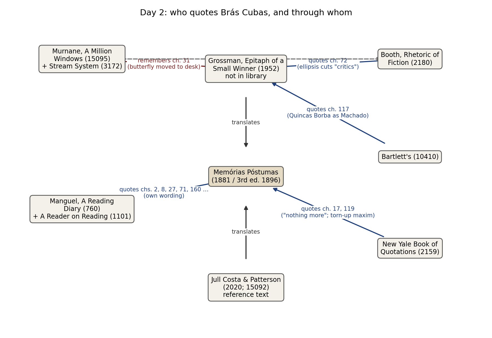

*[[shadows/weeks/machado-de-assis|Machado de Assis (Author & Shadow)]] · Day 2 of 7 · 2026-11-10 · Difficulty 3 · Genealogy/influence, Shared form or method*

## Books in this reading

- [[books/15095-a-million-windows|A Million Windows]], [[people/gerald-murnane|Gerald Murnane]]; 2014. *Day 2 primary: quotes Brás Cubas ch. 31 from memory and moves the butterfly to the writing desk*
- [[books/3172-stream-system|Stream System]], [[people/gerald-murnane|Gerald Murnane]]; 2018. *Day 2 cross-check: the earlier account of the same butterfly memory; names Booth as the source of 'implied author'*
- [[books/760-a-reading-diary|A Reading Diary]], [[people/alberto-manguel|Alberto Manguel]]; 2004. *Day 2 primary: a chapter of quotations from Brás Cubas in Manguel's own (uncredited) English*
- [[books/1101-a-reader-on-reading|A Reader on Reading]], [[people/alberto-manguel|Alberto Manguel]]; 2010. *Day 2 cross-check: Manguel's second telling of ch. 8, with the attic turned into cellars*
- [[books/2180-the-rhetoric-of-fiction|The Rhetoric of Fiction]], [[people/wayne-c-booth|Wayne C. Booth]]; 1961. *Day 2 primary: the only library book printing Grossman's Epitaph under licence; epigraph from ch. 72 with an ellipsis over the critics*
- [[books/10410-bartlett-s-familiar-quotations|Bartlett's Familiar Quotations]], [[people/geoffrey-o-brien|Geoffrey O'Brien]] (editor); 2012 (18th ed.). *Day 2 cross-check: a character's doctrine printed as Machado's saying*
- [[books/2159-the-new-yale-book-of-quotations|The New Yale Book of Quotations]], [[people/fred-r-shapiro|Fred R. Shapiro]] (editor); 2021. *Day 2 cross-check: 'nothing more' for nada menos; prints a maxim the 1881 narrator says he tore up*

## The shadow so far

| Citing Book | Relation | Target | Location |
|---|---|---|---|
| [[books/1035-dom-casmurro|Dom Casmurro (Peter Owen 'complete and unabridged edition' 2016)]] (R. L. Scott-Buccleuch (translator)) | **Translates** | Machado de Assis | ch. 98 'Five Years', p. 158 (chapter ends here); TARGET Machado, Dom Casmurro, Garnier 1899, ch. XCVIII 'Cinco annos' (Project Gutenberg 55752) |
| [[books/1035-dom-casmurro|Dom Casmurro (Peter Owen 'complete and unabridged edition' 2016)]] (R. L. Scott-Buccleuch (translator)) | **Translates** | Machado de Assis | ch. 73 'The Stage Manager', p. 125; TARGET Machado, ch. LXXIII 'O contra-regra' (Gutenberg 55752) |
| [[books/1035-dom-casmurro|Dom Casmurro]] (Machado de Assis / R. L. Scott-Buccleuch) | **Quotes** | Machado de Assis | ch. 72 'A Reform in the Drama', p. 124; TARGET Shakespeare, Othello I.iii (checkable in Bartlett's 10410/13825, Concise Oxford Dictionary of Quotations 11435) |
| [[books/1035-dom-casmurro|Dom Casmurro]] (Machado de Assis) | **Rewrites** | Machado de Assis | ch. 72 'A Reform in the Drama', p. 124; TARGET Shakespeare, Othello (named; also ch. 62 'A Touch of Iago', ch. 135 'Othello') |
| [[books/15095-a-million-windows|A Million Windows]] (Gerald Murnane) | **Quotes** | Machado de Assis | section 19 (of 34); TARGET Brás Cubas ch. XXXI 'A borboleta preta' (Grossman's Epitaph, not in library; checked vs 1881 Gutenberg 54829 and Jull Costa 15092) |
| [[books/3172-stream-system|Stream System]] (Gerald Murnane) | **Mentions** | Machado de Assis | title story 'Stream System'; TARGET Brás Cubas ch. XXXI (via Grossman) |
| [[books/760-a-reading-diary|A Reading Diary]] (Alberto Manguel) | **Quotes** | Machado de Assis | ch. 12 'May: The Posthumous Memoirs of Brás Cubas'; TARGETS Brás Cubas chs. II, VI, VIII, XI, XXIV, XXVII, LXXI, CLX and others |
| [[books/1101-a-reader-on-reading|A Reader on Reading]] (Alberto Manguel) | **Mentions** | Machado de Assis | essay text (calibre get_passage on 'metaphor belongs to Machado'); TARGET Brás Cubas ch. VIII 'Razão contra Sandice' |
| [[books/2180-the-rhetoric-of-fiction|The Rhetoric of Fiction]] (Wayne C. Booth) | **Quotes** | Machado de Assis | p. 148 (index), epigraph opening ch. VI 'Types of Narration'; TARGET Brás Cubas ch. LXXII 'O bibliomano' (Grossman, credited in acknowledgments) |
| [[books/10410-bartlett-s-familiar-quotations|Bartlett's Familiar Quotations (18th ed.)]] (Geoffrey O'Brien (ed.)) | **Quotes** | Machado de Assis | Machado de Assis entry ('Epitaph of a Small Winner [1881]', note 4 'Translated by WILLIAM L. GROSSMAN.'); TARGET Brás Cubas ch. CXVII 'O Humanitismo' |
| [[books/2159-the-new-yale-book-of-quotations|The New Yale Book of Quotations]] (Fred R. Shapiro (ed.)) | **Quotes** | Machado de Assis | p. 510, Machado de Assis 1 (ch. 17) and 2 (ch. 119: 'It is better to fall from above the clouds than from the third floor.'); TARGET Brás Cubas chs. XVII, CXIX |

---

## Library resurfacing, Tuesday 10 November 2026

## 1. Where the week stands

Week 3, Machado de Assis, day 2 of 7 (who quotes him). Day 1 read *Dom Casmurro* (1035) against the Garnier 1899 Portuguese and found that the 2016 “complete and unabridged” Scott-Buccleuch still leaves out the end of ch. 98 (Escobar as go-between of the letters) and ch. 73’s citation of Alencar and Álvares de Azevedo. The question carried forward: what reaches an English reader of Machado, and through whom.

## 2. The day’s finding

Relation: **Quotes**, in seven books by five quoters, and in every case the quotation passes through a translation the library does not hold. Most of them go through William L. Grossman’s *Epitaph of a Small Winner* (1952). The yardsticks here are the 1881 first book edition of *Memórias Posthumas de Braz Cubas* (Typographia Nacional; Project Gutenberg 54829) and the 2020 Jull Costa & Patterson translation (15092, from the third edition, whose “Author’s Preface” mentions “a few more amendments and deletions”).

What changes is where each sentence stands, more than its wording:

- **Murnane** (*A Million Windows*, 15095) remembers one detail from the novel, the black butterfly of ch. 31. He moves it from Brás’s life (Tijuca, the morning after he meets Eugênia) into the time of writing: it lands “on his desk”. There is no desk in the chapter. In *Stream System* (3172) he says what he was watching for when he read it on a train: “the writer’s way of interrupting his narrative”. His memory supplied the interruption the chapter does not make.

- **Booth** (*The Rhetoric of Fiction*, 2180) uses ch. 72 (“The bibliomaniac”) as an epigraph and marks a cut with an ellipsis. In the Portuguese, the cut falls on the clause “e eu não quero dar pasto á critica do futuro” (and I do not want to give fodder to future critics). A critic quotes the chapter about critics and leaves the critics out. (Grossman’s own wording can’t be checked here. The ellipsis shows that something was cut, and the Portuguese shows what stands in that place.)

- **Manguel** (*A Reading Diary*, 760) quotes at least ten passages in his own wording. He drops “de graça” (for free) from the editor who gives the definitive edition to the worms. He renders Sandice (Folly) as “Stupidity”. Six years later, in *A Reader on Reading* (1101), he retells the same passage with “madness” invading “our cellars”. In Machado it starts in the attic (sótão).

- **The quotation books** cut the sentences free of their speakers. *Bartlett’s* (10410, credited to Grossman) prints Quincas Borba’s Humanitist argument for reproduction, “only one genuine misfortune: not to be born”, as Machado’s own saying. The novel ends with Brás pleased that he had no children. *The New Yale Book of Quotations* (2159) prints “Marcela loved me during fifteen months and three thousand dollars; nothing more.” The Portuguese says “nada menos”: no less. It also prints, as Machado’s maxim, one of the maxims that the 1881 Brás says he “tore up straight afterwards, as not worthy of print”.

*Figure 1: Today’s edges. Blue arrows quote; red recalls; the dashed line is Murnane’s debt*

to Booth’s vocabulary.

## 3. The books

## 3.1 A Million Windows — Gerald Murnane, 2014 (EPUB; Calibre 15095), with Stream System (2018; EPUB; 3172)

**Selection logic.** Mentions rows 760 and 650. Murnane names *Epitaph of a Small Winner* in three library books (3172, 3352 = the same story, 15095). It is the only case in the Mentions list where a writer says what the quotation is: a remainder, “the only detail that I can recall”.

**Overview.* A Million Windows* is a novel in thirty-four sections about narrators and the “personage seemingly responsible for the existence of the text”. In section 19 Murnane sets two remembered butterflies side by side, Machado’s and Hardy’s in *The Mayor of Casterbridge*, then Zhuangzi’s dream, and ends on whether “the narrator reporting its existence was seemingly reliable and to be trusted”. The story “Stream System” (in the collection of that name) gives the same memory in another key, as an example of how books keep their places on his shelves.

**Element 1: the two accounts, verbatim.**

> “The first-person narrator pauses in his account of his life-story, so to call it, and reports that a butterfly had come into his room through an open window a few

> minutes before and had alighted on his desk and had seemed to look at him as though he might have been the god of the butterflies.” (*A Million Windows*, section 19)

> “…a passage reporting the arrival of a butterfly through a window into the room where the writer of the narrative was writing…” and he would stop reading “in order to observe the writer’s way of interrupting his narrative from time to time in order to report one or another detail from the time when he was writing or the place where he was writing.” (*Stream System*, title story)

**Element 2: concordance of the memory against the chapter.** The library copy of *Stream System* does not date the story, so the two reading dates cannot

| Detail | Murnane (15095 / 3172) | Machado, ch. XXXI “A borboleta preta” (1881) | Jull Costa 2020, ch. XXXI |
|---|---|---|---|
| When | “a few minutes before” the writing; the narrator “pauses in his account” | “No dia seguinte” — in the story, the day after the veranda scene | “THE FOLLOWING DAY, as I was preparing to go down to the city” |
| Where it lands | “on his desk” | “pousou-me na testa”; then “na vidraça”; then “em cima de um velho retrato de meu pae” | “came to rest on my head”; windowpane; “an old portrait of my father” |
| What it takes him | “the god of the | «Este é | “This is probably |
| for | butterflies” | provavelmente o inventor das borboletas.» | the inventor of butterflies.” |
| What happens to it | not remembered | killed with a towel (“toalha”), flicked into the garden | “swatted it with a washcloth” |
| Reading date | “twelve years before” (*Stream System*); “nearly forty years ago” (2014) | — | — |

be checked against each other. The desk and the writing time are not in the chapter. “God” is either Grossman’s word or Murnane’s. Nothing in the library can decide which, though the Portuguese has “um ar divino” a line earlier.

**Misreading worth attempting.** Take Murnane’s version as a correction of the novel rather than a mistake. Brás writes after death, so his writing desk is no nearer to the reader than his room at Tijuca. Murnane has put the butterfly where a dead narrator ought to receive his visitors. Then write the chapter Machado did not write: the butterfly arriving at the posthumous desk.

## 3.2 A Reading Diary — Alberto Manguel, 2004 (EPUB; Calibre 760), with A Reader on Reading (2010; EPUB; 1101)

**Selection logic.** Mentions rows 616 and 623. Manguel gives the novel a whole chapter (ch. 12, “May”). “Machado” and “Brás Cubas” each occur 26 times in it. He says, “I count on my shelves five editions of Brás Cubas (three in translation)”, and names no translator.

**Overview.** A year of rereadings, one book a month, entered as diary days. The Brás Cubas month opens with an insomnia anthology and moves through the dedication, the trapeze, Folly, digression and the closing “negatives”. The quotations are in English and none matches Jull Costa or the 2020 text closely. They read as Manguel’s own versions from the Portuguese, but the book does not say so.

**Element 1: verified quotations, set against the 1881 text and Jull Costa. Element 2: a derived list of drifts.**

| Manguel (760, ch. 12) | 1881 Portuguese | Jull Costa 2020 |
|---|---|---|
| “Each season of life is an edition that amends the previous one, and that will in turn be amended, until the definitive edition is reached, which the editor will present to the worms.” | “Cada estação da vida é uma edição, que corrige a anterior, e que será corrigida tambem, até a edição definitiva, que o editor dá de graça aos vermes.” (ch. XXVII) | “…which the editor donates for free to the worms.” |
| “It is an old trick of Stupidity to become enamoured with other people’s houses…” “Decipher me or I’ll devour you.” | “Mas é sestro antigo da Sandice criar amor ás casas alheias…” (ch. VIII, “Razão contra Sandice”) “decifra-me ou devoro-te.” (ch. II) | “Reason versus folly”; “Folly finally agreed to make do with a small corner in the attic.” “Either decipher me or I will eat you up.” |
| “I did not bestow on any other creature the legacy of our misfortune.” | “não transmitti a nenhuma creatura o legado da nossa miseria.” (ch. CLX) | “did not bequeath to any creature the legacy of our misery.” |

1. *de graça* lost. The worms get the definitive edition for free in Machado and in Jull Costa; in Manguel they are merely “presented” with it.

2. *Sandice* →“Stupidity” (2004), from which Manguel builds his gloss “For Machado de Assis, stupidity is the essence of the human condition”. Then *Sandice* →“the madness of the world” (2010).

3. *sótão* (attic) →“cellars” (2010): “though it invades our cellars (the metaphor belongs to Machado de Assis) and then softly takes over the dining room, the living room, the whole house.” In Machado, Folly asks for “um cantinho no sotão”, and Reason says Folly wants to pass “do sotão á sala de jantar”. Manguel credits the metaphor and turns it upside down.

4. *miseria* →“misfortune”. Grossman’s word cannot be checked here.

**Misreading worth attempting.** Manguel moves Folly from the attic to the cellar, which is roughly the move psychoanalysis made with the mind. Read ch. VIII against that, and ask whether Machado’s attic is the earlier and odder model: madness as a lodger *above* reason, coming down the stairs.

## 3.3 The Rhetoric of Fiction — Wayne C. Booth, 1961 (PDF; Calibre 2180)

**Selection logic.** Mentions row 633 was captured from Booth’s permissions page (“From Epitaph of a Small Winner by Machado de Assis, trans. William L. Grossman. Copyright © 1952”). That makes it the one library book that prints Grossman’s words under licence. It is also the book Murnane says taught him “implied author”, so it closes the day’s circle.

**Overview.** Booth’s argument that authors cannot avoid rhetoric. Chapter VI, “Types of Narration”, opens with three epigraphs about narrators who expect to be caught out: Svevo’s “Dr. S.”, Furetière, and Machado.

**Element 1: the epigraph, verbatim** (p. 148 by the book’s index; the epigraphs that open ch. VI):

> “Perhaps I shall eliminate the preceding chapter. Among other reasons, there is, in the last few lines, something that might be construed as an error on my part. . . . Let us look into the future. Seventy years from now, a thin, sallow, grey-haired fellow, who loves nothing but books, is bent over the preceding page trying to find the error.”—MACHADO DE ASSIS, *Epitaph of a Small Winner*

**Element 2: the ellipsis restored from the 1881 text** (ch. LXXII, “O bibliomano”):

> “Talvez supprima o capitulo anterior; entre outros motivos, ha ahi, nas ultimas lin-has, uma phrase muito parecida com desproposito, **e eu não quero dar pasto á critica do futuro.** / Olhae: daqui a setenta annos, um sugeito magro, amarello, grisalho, que não ama nenhuma outra cousa além dos livros, inclina-se sobre a pagina anterior, a ver se lhe descobre o desproposito…”

The cut falls on the clause about critics, with the paragraph break after it. Jull Costa keeps it: “and I don’t want to give fodder to my future critics.” Booth also stops before the man becomes “a bibliomaniac” who, in Jull Costa’s version, “cannot find the nonsense”. As an epigraph, the passage tells Booth’s reader to look for the error. In the novel, the search fails.

**Note.** Machado’s “seventy years” from the 1880s lands in the 1950s, which is when Grossman’s translation appeared.

## 3.4 Cross-check: two quotation books — Bartlett’s Familiar Quotations (18th ed., ed. O’Brien; EPUB; 10410) and The New Yale Book of Quotations (ed. Shapiro; PDF; 2159)

**Selection logic.** Mentions rows 725 and 632. These are the books where Machado is quoted at the shortest length. Bartlett’s 13825 is a duplicate record of 10410.

**Element: concordance of the entries.** The 1896 Portuguese of ch. CXIX is not in the library. What I state about it comes only from

| Entry, verbatim | Where it stands in the novel | What the entry loses |
|---|---|---|
| Bartlett’s: “There is only one genuine misfortune: not to be born.” — *Epitaph of a Small Winner* [1881]; the page’s note 4: “Translated by WILLIAM L. GROSSMAN.” | Ch. CXVII “Humanitism”: Quincas Borba’s syllogism that reproduction is “the high point of the spiritual mass”. 1881: “Porquanto, verdadeiramente ha só uma desgraça: é não nascer.” | The speaker (a philosopher who will go mad), the “Thus”, and the irony of the novel’s last chapter: “I did not have children”. |
| Yale: “Marcela loved me during fifteen months and three thousand dollars; nothing more.” — *Posthumous Memoirs of Brás Cubas* ch. 17 (1881). No translator named. | Ch. XVII. 1881: “Marcella amou-me durante quinze mezes e onze contos de réis; nada menos.” | The currency (contos → dollars) and the polarity: *nada menos* (no less; Jull Costa “no less”) becomes “nothing more”. Whether Grossman or Yale made the change can’t be checked here. |
| Yale: “It is better to fall from above the clouds than from the third floor.” — ch. 119 (1881). | Ch. CXIX. In the 1881 text, Brás introduces his maxims as ones he “rasguei logo depois, por não me parecerem dignas do prélo” (tore up straight | The first half (“Não te irrites se te pagarem mal um beneficio”: “Don’t be annoyed if your good deeds are poorly paid”), and the fact that the narrator either |
|  | afterwards, as not worthy of print). In Jull Costa (third edition), they are “yawns of boredom” that “can serve as epigraphs to speeches on no particular subject”. | destroyed these maxims or offered them as epigraphs for empty speeches. |

Jull Costa’s English and her edition note.

## 4. The shadow so far

| # | From | Relation | To | Location |
|---|---|---|---|---|
| 58 | *Dom Casmurro* 1035 (Scott- Buccleuch) | Translates (omits) | Machado, *Dom Casmurro* | ch. 98 |
| 59 | *Dom Casmurro* 1035 | Translates (omits) | Machado, *Dom Casmurro* | ch. 73 |
| 60 | *Dom Casmurro* 1035 | Quotes | Shakespeare, *Othello* | ch. 72 |
| 61 | *Dom Casmurro* 1035 | Rewrites | Shakespeare, *Othello* | ch. 72 |
| 62 | Murnane, *A Million Windows* 15095 | Quotes (from memory) | *Brás Cubas* ch. 31 | section 19 |
| 63 | Murnane, *Stream System* 3172 | Mentions | *Brás Cubas* ch. 31 | title story |
| 64 | Manguel, *A Reading Diary* 760 | Quotes | *Brás Cubas* chs. 2, 8, 27, 71, 160 | ch. 12 “May” |
| 65 | Manguel, *A Reader on Reading* 1101 | Mentions (paraphrase) | *Brás Cubas* ch. 8 | “the metaphor belongs to Machado” |
| 66 | Booth, *Rhetoric of Fiction* 2180 | Quotes | *Brás Cubas* ch. 72 (Grossman) | p. 148, epigraph to ch. VI |
| 67 | Bartlett’s 10410 | Quotes | *Brás Cubas* ch. 117 (Grossman) | Machado entry |
| 68 | New Yale Book of Quotations 2159 | Quotes | *Brás Cubas* chs. 17, 119 | p. 510 |

## 5. Where this sends you

**Notebook**

1. Murnane puts the butterfly on the desk, and Booth cuts the critics out of a passage about critics. Both make the novel more like what they came to it looking for. Write a page on a quotation that improves its source, and say whether “improves” is a charge or a compliment.

2. *Nada menos* / “nothing more”. A two-word change turns a joke about the price of love into a complaint about how little it lasted. Find a line you carry about that might have been reversed the same way, and check it against the original.

3. The 1881 Brás tears up his maxims; the later one offers them as epigraphs for “speeches on no particular subject”. Which of the two is the commonplace book’s ancestor?

**Rabbit holes**

- *Memorias Posthumas de Braz Cubas*, 1881 Typographia Nacional text, Project Gutenberg 54829: https://www.gutenberg.org/ebooks/54829

- Grossman, *Epitaph of a Small Winner* (FSG printing, borrowable), Internet Archive: https://archive.org/details/epitaphofsmallwi0000mach. This is where to settle “god of the butterflies”, “three thousand dollars; nothing more” and Booth’s ellipsis.

- Booth, *The Rhetoric of Fiction* (1961), Internet Archive: https://archive.org/details/rhetoricoffictio0000boot

- Manguel, *A Reading Diary*, Internet Archive: https://archive.org/details/readingdiary00mang

- Murnane, *A Million Windows*, Giramondo: https://giramondopublishing.com/books/a-million-windows/

- *The New Yale Book of Quotations*, Yale University Press: https://yalebooks.yale.edu/book/9780300205978/the-new-yale-book-of-quotations/

- Search prompts: “Murnane” AND “Machado” in interviews; Jull Costa’s translator’s note on the 1881 vs 1896 texts; the critical edition of *Memórias póstumas* (Comissão Machado de Assis, 1960) for ch. CXIX’s variants.

**Also in your library**

- Genette, *Paratexts* (692): quotes the “Ao leitor” preface (“a diffuse work in which I, Braz Cubas, having adopted the free style of a Sterne or Xavier de Maistre…”) as an example of a fictional author’s preface. Another quoter, and a day-4 lead on paratext.

- Richardson, *Unnatural Voices* (6651): the posthumous narrator, a day-3 candidate.

- *The Paris Review Interviews, IV* (4347): an interviewee who “read a man named Machado de Assis”, a further quoter.

- Send To pool: no Queued candidates today, so there was nothing to use or dismiss.

## 6. From the Lexicon: Maxim

- **Received vs. your sense.** Received: “A concise statement of a general principle or rule of conduct, accepted on its own merits. Originally logical: a self-evident premise; from the 1590s, a practical rule or guide.” No sense of your own entered yet.

- **Etymology.** ”Early 15c. maxime, from Old French maxime, Late Latin maxima, short for maxima propositio (Boethius) or maxima sententia, ‘greatest premise’; maximus (greatest), PIE *meg- (great).” (Harper, Online Etymology Dictionary.)

- **WordNet.** Present: oewn-07167656-n, noun.communication, “a saying that is widely accepted on its own merits”; hypernym *saying*.

- **Relations or lineage.** Classical Rhetoric; shares that lineage with Apothegm, Sententia, Hyperbaton, antimetabole, metathesis, paratactic, Paradigm, Ethopoiesis. Boundary note on file: more practical than the aphorism; Kant’s maxim is a subjective principle of action; Grice’s are norms of talk.

- **Portable axiom.** None on file.

- **Why today.** Brás’s ch. CXIX names its sayings “maximas” and, in 1881, measures them against La Bruyère’s. Yale and Bartlett turn the novel back into maxims “accepted on [their] own merits”, which is the one thing these sentences are not.

- **Verified occurrence.** 1881, ch. CXIX: “transcrevendo algumas das que compuz por aquelle tempo, e rasguei logo depois, por não me parecerem dignas do prélo.” Jull Costa: “half a dozen maxims from among the many I jotted down at around that time.”

- **New in the Lexicon.** Nothing since yesterday’s run (the latest entry is *Lavengro*).

## 7. To carry

> “Just imagine: seventy years from now, a thin, sallow, gray-haired fellow, who loves only books, sits hunched over the preceding page to see if he can spot that nonsense.” — Machado de Assis, *The Posthumous Memoirs of Brás Cubas*, ch. LXXII “The bibliomaniac”, tr. Jull Costa & Patterson (15092)

*Method notes.* The Scribrarium folder was not connected at the start of the run. Folder access was requested and granted, and all reading was done on your Mac. Texts were extracted from each book’s own file (EPUB spine order; PDF via pdftotext). Every quotation above was substring-checked by script: 39 English strings against the extracted book files and 21 Portuguese strings against Gutenberg 54829. All were present, and the remaining short phrases were checked by eye in the same texts. The Portuguese comes from Gutenberg 54829, the 1881 first book edition, and it can differ from the third edition that Jull Costa translates. The full-text plugin was not needed today, since the Mentions list from day 1 supplied the candidates.

## Themes

[[themes/1881-vs-third-edition|1881 vs third edition]] · [[themes/attic|attic]] · [[themes/bartlett-s|Bartlett's]] · [[themes/bibliomaniac|bibliomaniac]] · [[themes/booth|Booth]] · [[themes/butterfly|butterfly]] · [[themes/cellar|cellar]] · [[themes/critics|critics]] · [[themes/ellipsis|ellipsis]] · [[themes/epigraph|epigraph]] · [[themes/epitaph-of-a-small-winner|Epitaph of a Small Winner]] · [[themes/folly|folly]] · [[themes/grossman|Grossman]] · [[themes/humanitism|Humanitism]] · [[themes/manguel|Manguel]] · [[themes/maxim|maxim]] · [[themes/memory|memory]] · [[themes/misquotation|misquotation]] · [[themes/murnane|Murnane]] · [[themes/nada-menos|nada menos]] · [[themes/narrating-time|narrating time]] · [[themes/quincas-borba|Quincas Borba]] · [[themes/quotation|quotation]] · [[themes/quotation-books|quotation books]] · [[themes/sandice|Sandice]] · [[themes/translation|translation]] · [[themes/yale-book-of-quotations|Yale Book of Quotations]]

---

Previous: [[shadows/2026-11-09-shadow-machado-de-assis-day-1-the-complete-and-una|Shadow — Machado de Assis, day 1: The Complete and Unabridged Gap]]  
Next: [[shadows/2026-11-11-shadow-machado-de-assis-day-3-retreated-from-brazi|Shadow — Machado de Assis, day 3: Retreated from Brazilian Particularity]]
