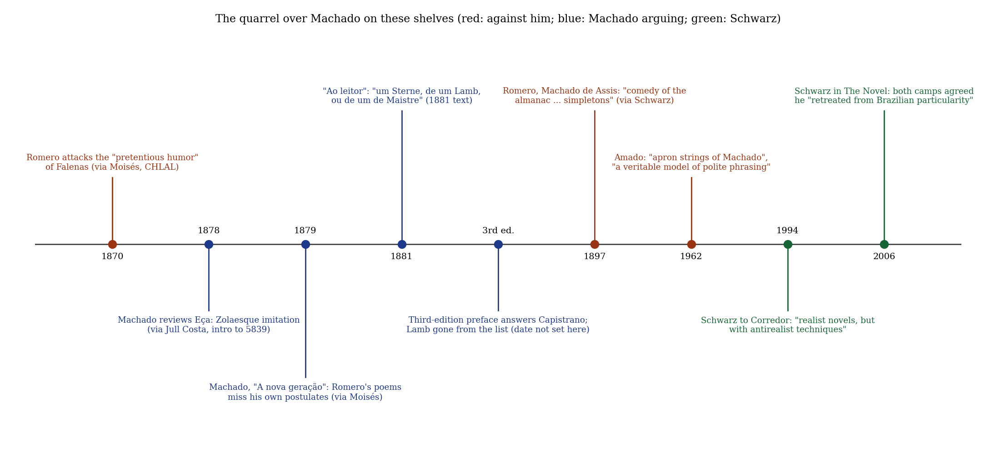

*[[shadows/weeks/machado-de-assis|Machado de Assis (Author & Shadow)]] · Day 3 of 7 · 2026-11-11 · Difficulty 3 · Conflict, Genealogy/influence*

## Books in this reading

- [[books/1275-the-novel-volume-1-history-geography-and-culture|The Novel, Volume 1: History, Geography, and Culture]], [[people/franco-moretti-ed-chapter-by-roberto-schwarz|Franco Moretti (ed.); chapter by Roberto Schwarz]], [[people/sharon-lubkemann-allen|Sharon Lubkemann Allen]] (translator); 2006. *Day 3 primary: Schwarz argues with both Machado's attackers and admirers; the only library text quoting Romero's 1897 book verbatim*
- [[books/13307-the-devil-to-pay-in-the-backlands|The Devil to Pay in the Backlands]], [[people/joao-guimaraes-rosa-foreword-by-jorge-amado|João Guimarães Rosa; foreword by Jorge Amado]]; 1963. *Day 3 primary: Amado's foreword argues against Machado's legacy as polite, unexperimental middle-class fiction*
- [[books/1261-the-cambridge-history-of-latin-american-literature|The Cambridge History of Latin American Literature, Volume 1: Discovery to Modernism]], [[people/roberto-gonzalez-echevarria|Roberto González Echevarría]], [[people/enrique-pupo-walker-eds-chapters-by-thomas-e-skidmore|Enrique Pupo-Walker (eds.); chapters by Thomas E. Skidmore]], [[people/massaud-moises|Massaud Moisés]]; 1996. *Day 3: reports the Romero–Machado exchange (1870, 1879, 1897); file contains vol. 3 (Brazilian Literature) despite the title*
- [[books/15092-posthumous-memoirs-of-bras-cubas-a-novel|Posthumous Memoirs of Brás Cubas: A Novel]], [[people/machado-de-assis-tr-margaret-jull-costa|Machado de Assis; tr. Margaret Jull Costa]], [[people/robin-patterson|Robin Patterson]]; 2020. *Day 3 cross-check: Machado's third-edition preface answers Capistrano de Abreu; 'To the Reader' without Lamb*
- [[books/5839-the-crime-of-father-amaro|The Crime of Father Amaro]], [[people/eca-de-queiros-tr|Eça de Queirós; tr.]], [[people/intro-margaret-jull-costa|intro. Margaret Jull Costa]]; 2003. *Day 3 cross-check: Machado as critic (1878 review of Eça) and Eça's denial of imitation*
- [[books/7664-lukacs-after-communism-interviews-with-contemporar|Lukács After Communism: Interviews With Contemporary Intellectuals]], [[people/eva-l-corredor|Eva L. Corredor]]; 1997. *Day 3 cross-check: Schwarz corrects his interviewer on Machado's realism; Zola as competitor*

## The shadow so far

| Citing Book | Relation | Target | Location |
|---|---|---|---|
| [[books/1035-dom-casmurro|Dom Casmurro (Peter Owen 'complete and unabridged edition' 2016)]] (R. L. Scott-Buccleuch (translator)) | **Translates** | Machado de Assis | ch. 98 'Five Years', p. 158 (chapter ends here); TARGET Machado, Dom Casmurro, Garnier 1899, ch. XCVIII 'Cinco annos' (Project Gutenberg 55752) |
| [[books/1035-dom-casmurro|Dom Casmurro (Peter Owen 'complete and unabridged edition' 2016)]] (R. L. Scott-Buccleuch (translator)) | **Translates** | Machado de Assis | ch. 73 'The Stage Manager', p. 125; TARGET Machado, ch. LXXIII 'O contra-regra' (Gutenberg 55752) |
| [[books/1035-dom-casmurro|Dom Casmurro]] (Machado de Assis / R. L. Scott-Buccleuch) | **Quotes** | Machado de Assis | ch. 72 'A Reform in the Drama', p. 124; TARGET Shakespeare, Othello I.iii (checkable in Bartlett's 10410/13825, Concise Oxford Dictionary of Quotations 11435) |
| [[books/1035-dom-casmurro|Dom Casmurro]] (Machado de Assis) | **Rewrites** | Machado de Assis | ch. 72 'A Reform in the Drama', p. 124; TARGET Shakespeare, Othello (named; also ch. 62 'A Touch of Iago', ch. 135 'Othello') |
| [[books/15095-a-million-windows|A Million Windows]] (Gerald Murnane) | **Quotes** | Machado de Assis | section 19 (of 34); TARGET Brás Cubas ch. XXXI 'A borboleta preta' (Grossman's Epitaph, not in library; checked vs 1881 Gutenberg 54829 and Jull Costa 15092) |
| [[books/3172-stream-system|Stream System]] (Gerald Murnane) | **Mentions** | Machado de Assis | title story 'Stream System'; TARGET Brás Cubas ch. XXXI (via Grossman) |
| [[books/760-a-reading-diary|A Reading Diary]] (Alberto Manguel) | **Quotes** | Machado de Assis | ch. 12 'May: The Posthumous Memoirs of Brás Cubas'; TARGETS Brás Cubas chs. II, VI, VIII, XI, XXIV, XXVII, LXXI, CLX and others |
| [[books/1101-a-reader-on-reading|A Reader on Reading]] (Alberto Manguel) | **Mentions** | Machado de Assis | essay text (calibre get_passage on 'metaphor belongs to Machado'); TARGET Brás Cubas ch. VIII 'Razão contra Sandice' |
| [[books/2180-the-rhetoric-of-fiction|The Rhetoric of Fiction]] (Wayne C. Booth) | **Quotes** | Machado de Assis | p. 148 (index), epigraph opening ch. VI 'Types of Narration'; TARGET Brás Cubas ch. LXXII 'O bibliomano' (Grossman, credited in acknowledgments) |
| [[books/10410-bartlett-s-familiar-quotations|Bartlett's Familiar Quotations (18th ed.)]] (Geoffrey O'Brien (ed.)) | **Quotes** | Machado de Assis | Machado de Assis entry ('Epitaph of a Small Winner [1881]', note 4 'Translated by WILLIAM L. GROSSMAN.'); TARGET Brás Cubas ch. CXVII 'O Humanitismo' |
| [[books/2159-the-new-yale-book-of-quotations|The New Yale Book of Quotations]] (Fred R. Shapiro (ed.)) | **Quotes** | Machado de Assis | p. 510, Machado de Assis 1 (ch. 17) and 2 (ch. 119: 'It is better to fall from above the clouds than from the third floor.'); TARGET Brás Cubas chs. XVII, CXIX |
| [[books/1275-the-novel-volume-1-history-geography-and-culture|The Novel, Volume 1 (ch. 'Posthumous Memoirs of Brás Cubas')]] (Roberto Schwarz (tr. Sharon Lubkemann Allen)) | **Argues with** | Machado de Assis | p. 819 (also pp. 818–820, 839); TARGET Machado's critics and admirers on Brás Cubas |
| [[books/1275-the-novel-volume-1-history-geography-and-culture|The Novel, Volume 1 (quoting Romero, Machado de Assis, 1897)]] (Sílvio Romero (via Schwarz)) | **Argues with** | Machado de Assis | p. 819, n. 4 (Romero, Machado de Assis (1897), Unicamp 1992, p. 160); TARGET Machado, Brás Cubas and later novels |
| [[books/13307-the-devil-to-pay-in-the-backlands|The Devil to Pay in the Backlands (foreword 'The Place of Guimarães Rosa in Brazilian Literature')]] (Jorge Amado) | **Argues with** | Machado de Assis | Foreword (signed Rio de Janeiro, September 1962); TARGET Machado's legacy in Minas Gerais fiction |
| [[books/1261-the-cambridge-history-of-latin-american-literature|The Cambridge History of Latin American Literature vol. 3 (file catalogued as vol. 1)]] (Thomas E. Skidmore; Massaud Moisés) | **Argues with** | Machado de Assis | Skidmore, 'The essay: architects of Brazilian national identity', p. 347; Moisés, 'Brazilian poetry from 1878 to 1902', p. 83; TARGET Romero ⇄ Machado |
| [[books/15092-posthumous-memoirs-of-bras-cubas-a-novel|Posthumous Memoirs of Brás Cubas (Author's Preface to the Third Edition)]] (Machado de Assis (tr. Jull Costa & Patterson)) | **Argues with** | Machado de Assis | Author's Preface to the Third Edition; TARGET Capistrano de Abreu's review ('Is Posthumous Memoirs of Brás Cubas a novel?') and Macedo Soares's comparison to Garrett |
| [[books/5839-the-crime-of-father-amaro|The Crime of Father Amaro (Introduction)]] (Margaret Jull Costa, reporting Machado's 1878 review) | **Argues with** | Machado de Assis | Introduction; TARGET Eça, O Crime do Padre Amaro (1876) and O Primo Basílio (1878) |
| [[books/7664-lukacs-after-communism-interviews-with-contemporar|Lukács After Communism (Interview with Roberto Schwarz, 15 Aug 1994)]] (Roberto Schwarz / Eva L. Corredor) | **Mentions** | Machado de Assis | Interview with Roberto Schwarz; TARGET Machado's novels (realism, Zola, Sterne, Diderot) |

---

## 2026-11-11

## 1. Where the week stands

Machado de Assis, day 3 of 7: who argues with him. Day 1 found that the 2016 “complete and unabridged” *Dom Casmurro* (1035) still cuts the passages where the novel cites Brazilian literature. Day 2 found that his quoters keep his words and move his sentences (Murnane’s butterfly on the desk, Booth’s ellipsis over the critics, Bartlett’s giving a character’s maxim to the author). Today the library is asked who quarrels with him, and about what.

## 2. The day’s finding

The argument about Machado on these shelves is one argument, run for nearly 140 years, about **where his books live**: in Brazil or nowhere in particular. Sílvio Romero (1870, 1897), quoted by Schwarz and reported by the *Cambridge History*, says the humour is affected and the novels hollow (no memorable characters, “the comedy of the almanac”); Jorge Amado (1962), in his foreword to the English Guimarães Rosa, says Machado’s legacy is polite middle-class mediocrity that the backlands novel had to escape. Roberto Schwarz (*The Novel*, 2006; interview 1994) argues with both the attackers and the admirers: “sympathizers and opponents were both of the opinion that Machado retreated from Brazilian particularity”, and both were wrong. The quarrel also runs the other way: Machado argued back (Romero’s poetry, 1879; Eça’s “Zolaesque” imitation, 1878; Capistrano de Abreu’s “Is it a novel?”, in the third-edition preface). One small, checkable change sits in the middle of it: the 1881 “Ao leitor” lists his models as “um Sterne, de um Lamb, ou de um de Maistre”; the later text, as both Jull Costa (15092) and Schwarz’s citation of the Aguilar *Obras completas* give it, lists only Sterne and Xavier de Maistre. Charles Lamb, the one English name, is gone. The library cannot date the change, so it cannot be tied to any one critic.

Relations today: **Argues with** (6 edges: Schwarz, Romero via Schwarz, Amado, Skidmore and Moisés on Romero and Machado, Machado vs Eça, Machado vs Capistrano), one **Mentions** (Schwarz interview). Edges 69–75.

## 3. The books

**3.1 “Posthumous Memoirs of Brás Cubas”, Roberto Schwarz, in *The Novel, Volume 1: History, Geography, and Culture*****, ed. Franco Moretti — Princeton UP, 2006 (catalogue date 2001); PDF; Calibre 1275**

**Selection logic.** Mentions row 627 snippet (“a novelist of world importance … scarcely better known in Spanish America”). A read-only substring scan of all 152 Mentions books for “Sílvio Romero” / “Silvio Romero” found this chapter, the only library text that quotes Romero’s 1897 book verbatim. Translated by Sharon Lubkemann Allen (p. 840).

*Figure 1: The quarrel over Machado as it appears on these shelves. Each event is dated from*

the library text that reports it.

**Overview.** Schwarz’s essay (pp. 816–840) is the short form of *A Master on the Periphery of Capitalism*. Its argument with the reception is on pp. 819–820: both the critics who attacked Brás Cubas and those who praised him read the narrator’s games as cosmopolitan and placeless. Schwarz’s counter-claim is that the narrator’s arbitrariness is itself the Brazilian material: the behaviour of a slave-owning elite that uses liberal ideas without being bound by them.

**Verified quotations** (substring-checked against the extracted PDF text):

> “According to one adversary, Machado took refuge in philosophical and formalist af-fectations, and peculiarly English ones, in order to avert the battles of the Brazilian writer.” (p. 819)

> “In changing the rules of the game in the very face of the reader, only to change them again immediately, the narrator engages in a kind of dissolute jesting, in poor taste, unworthy of a serious Brazilian, and poorly disguising both an intellectual incapacity and a lack of narrative stamina.” (p. 819, Schwarz’s summary of the attack)

> “Thus, sympathizers and opponents were both of the opinion that Machado retreated from Brazilian particularity, whether to interrogate the human condition or to devote himself to ‘the comedy of the almanac, the pessimism of ephemeral hack writing, which manages to delude those few simpletons who find it marvelous.’ ” (p. 819; the inner quotation is Romero, *Machado de Assis* (1897), Unicamp ed. 1992, p. 160, n. 4)

> “The idea that Brazilian reality did not pose universal problems, and vice versa, was common to both sides,” (p. 819)

> “Machado comprehended the comic impasse inherent in this tonal disparity and, instead of avoiding it, made of it a central element in his literary art.” (p. 820)

> “Machado’s classical borrowings are endless and have led critics to seek his merit in that domain, to our loss in comprehending the contemporary and advanced char-

> acter of his experimentation.” (p. 839)

**Element: a note on the “one adversary”.** The “peculiarly English” sentence is not footnoted; the Romero footnote is attached to the next sentence. Schwarz does not name this adversary. The Romero attribution is likely but not proven by this page.

**Element: the counter-witness in the footnote.** Schwarz’s n. 5 (p. 820) quotes José Veríssimo, the admirer, conceding the nationalist case: “These criteria, when applied by our critic, as well as by others, to the works of Machado de Assis, would certainly place them in an inferior position in our literature.” The defender and the attacker share the yardstick; only the verdict differs.

**Element: Lamb.** Schwarz quotes the preface as “the free form of a Sterne, or of a Xavier de Maistre” (p. 818, from the 1959 Aguilar *Obras completas*). The 1881 Typographia Nacional text (Gutenberg 54829) reads: “se adoptei a fórma livre de um Sterne, de um Lamb, ou de um de Maistre, não sei se lhe metti algumas rabugens de pessimismo.” Jull Costa’s 2020 translation from the third edition (15092) agrees with Schwarz: “may well have adopted the free form of a Sterne or a Xavier de Maistre”. The English essayist drops out between 1881 and the later edition; the Portuguese of the third edition itself is not in the library, so the date of the change is not fixed here.

**A misreading worth attempting.** Read Romero’s “simpletons who find it marvelous” as an accurate description of Brás Cubas’s ideal reader, the five readers of “Ao leitor”. The insult and the preface describe the same audience.

**3.2 “The Place of Guimarães Rosa in Brazilian Literature”, Jorge Amado, foreword to João Guimarães Rosa, *The Devil to Pay in the Backlands* — Knopf, 1963 (the translators are not named in this EPUB’s text); EPUB; Calibre 13307**

**Selection logic.** Mentions row 746 (“apron strings”), noted on day 2 as a day-3 lead. Signed “JORGE AMADO / Rio de Janeiro, September 1962”.

**Overview.** Amado introduces Rosa to English readers by placing him against two generations: the Northeastern regionalists (his own) and the polite tradition of Minas Gerais. Machado stands for the second. The argument is the reverse of Romero’s: where Romero found the humour affected and frivolous, Amado finds the inheritance timid and well-mannered. Both measure Machado by his distance from the backlands.

**Verified quotations:**

> “Its fiction has not yet freed itself from the apron strings of Machado de Assis, and goes on recreating the unimaginative, mediocre life of the middle class, eschew-ing startling innovations, experiments with language, a veritable model of polite phrasing.”

> “While the critics were arguing the validity of the experiment, quoting Joyce and showing off their erudition”

> Of Rosa: “Brazilian and universal at one and the same time” … “(I have deliberately said ‘literature’ and not ‘Brazilian literature’)”

**Element: derived list. What Amado’s sentence says Machado lacks.** Startling innovation; experiments with language; a subject outside the middle class. On day 2, Murnane, Booth and Manguel valued Brás Cubas for exactly the first two. Amado is arguing with Machado’s Minas Gerais heirs rather than with the 1881 novel, but the sentence attaches the charge to Machado’s name.

**Element: the praise Schwarz would contest.** Amado gives Rosa the compliment Schwarz says the whole reception withheld from Machado: “Brazilian and universal at one and the same time”. On Amado’s terms, Machado was polite and universal, Rosa local and universal.

Schwarz’s point is that the local was in Machado’s manners all along.

**Edition note.** The copyright page reads: “Originally published in Portuguese by Livraria José Olympio Editera as Grande Sertao: Veredas in 1936.” The novel appeared in 1956. The error belongs to this EPUB (or its source), not to Amado.

**3.3 *The Cambridge History of Latin American Literature*****, vol. 3 (Brazilian Literature), ed. González Echevarría and Pupo-Walker — Cambridge UP, 1996; PDF; Calibre 1261 (catalogued as “Volume 1”; 7019 carries the same text)**

**Selection logic.** Mentions row 626; the snippet “a scathing criticism … memorable fictional personages” was the first sign of the Romero quarrel. Two chapters bear on it.

**Element: Skidmore on Romero’s verdict.** Thomas E. Skidmore, “The essay: architects of Brazilian national identity”, p. 347: “His most remembered literary judgment was also his least felicitous: a scathing criticism of Machado de Assis for having failed to create any memorable fictional personages (*Machado de Assis*). However, he was closer to the mark in excoriating the Brazilian reading public as apathetic.” (OCR text has spaced letters; the check was made with spaces removed.) Skidmore argues with Romero in one sentence and lets him go in the next.

**Element: the quarrel runs both ways.** Massaud Moisés, “Brazilian poetry from 1878 to 1902”, p. 83: in 1870 Romero attacked “the subjectivist lyricism and the pretentious humor of the Falenas of Machado de Assis”; and “The fact that Romero’s poetry did not completely match the postulates he had set forth in 1870 was duly noted by Machado de Assis” in “A nova geração” (*Revista Brasileira*, 1 Dec. 1879). So the 1897 book is the late phase of a long exchange. Romero’s charge of “humor” (1870) comes before Brás Cubas; it was aimed at the poems.

**3.4 Cross-checks (read today, cited above)**

**Machado, “Author’s Preface to the Third Edition”, *Posthumous Memoirs of Brás Cubas*****, tr. Jull Costa & Patterson (Liveright 2020; EPUB; 15092).** Machado answers a critic: “When reviewing the book, Capistrano de Abreu asked, ‘Is Posthumous Memoirs of Brás Cubas a novel?’ ” His answer turns on difference from his models: “It is an engraved goblet, and while it may resemble the work of engravers of the same school, it contains a very different wine.” He closes: “I say no more so as not to speak ill of the dead”. Jull Costa’s introduction records the 1881 reception: “It received mixed reviews, some readers feeling that it lacked plot, that the characters were uninteresting, that it was more a philosophical treatise than a novel.” Element: the dead narrator lets Machado decline the argument he is making.

**Eça de Queirós, *The Crime of Father Amaro*****, tr. and introduced by Margaret Jull Costa (New Directions 2003; EPUB; 5839).** Here Machado is the critic: “However, when the great Brazilian novelist, Machado de Assis, accused Eça of squandering his talents and of pandering to the worst excesses of realism and Zolaesque naturalism in the 1876 version of Father Amaro, and to a salacious public in Cousin Basílio, Eça was stung.” Eça “denied that his work was a mere imitation of such novels as La Faute de l’Abbé Mouret”, and the 1880 title page reads “Corrected, rewritten and entirely different in form and plot from the original edition.” Element: Machado’s charge is imitation, the same charge Romero brings against him (English affectation); and the translator who reports it later translated Brás Cubas (15092). Machado’s 1878 review is not in the library.

**Roberto Schwarz, interview with Eva L. Corredor, 15 August 1994, in *Lukács After Communism* (Duke 1997; EPUB; 7664).** Schwarz corrects his interviewer, who calls his “realism” naturalism: “He wrote realist novels, but with antirealist techniques. It is quite

paradoxical.” On Zola, “whom he certainly had in mind as a competitor he wanted to outdo”; and on Machado’s Brazilian contemporaries: “This rather absurd combination, which was at the bottom of the artistic failure of his fellow novelists, became the source of Machado’s strength.” When Corredor calls the humour light: “Well, it is actually terrible once you understand it better.”

## 4. The shadow so far

| Edge | From | Relation | To | Location |
|---|---|---|---|---|
| 58 | Scott- Buccleuch, *Dom Casmurro* (1035) | Translates | Machado, DC ch. 98 | p. 158 (omission) |
| 59 | Scott- Buccleuch (1035) | Translates | Machado, DC ch. 73 | p. 125 (omission) |
| 60 | *Dom Casmurro* (1035) | Quotes | Shakespeare, *Othello* I.iii | ch. 72, p. 124 |
| 61 | *Dom Casmurro* (1035) | Rewrites | Shakespeare, *Othello* | ch. 72, p. 124 |
| 62 | Murnane, *A Million Windows* (15095) | Quotes | Brás Cubas ch. 31 | section 19 |
| 63 | Murnane, *Stream System* (3172) | Mentions | Brás Cubas ch. 31 | title story |
| 64 | Manguel, *A Reading Diary* (760) | Quotes | Brás Cubas chs. 2–160 | ch. 12 |
| 65 | Manguel, *A Reader on Reading* (1101) | Mentions | Brás Cubas ch. 8 | essay |
| 66 | Booth, *Rhetoric of Fiction* (2180) | Quotes | Brás Cubas ch. 72 | p. 148 |
| 67 | *Bartlett’s* (10410) | Quotes | Brás Cubas ch. 117 | Machado entry |
| 68 | *New Yale Book of Quotations* (2159) | Quotes | Brás Cubas chs. 17, 119 | p. 510 |
| 69 | Schwarz, in *The Novel* (1275) | Argues with | Machado’s critics and admirers; Brás Cubas | pp. 819–820, 839 |
| 70 | Romero (1897), quoted in 1275 | Argues with | Machado, Brás Cubas | p. 819, n. 4 |
| 71 | Amado, foreword (13307) | Argues with | Machado’s legacy | “The Place of Guimarães Rosa” |
| 72 | Skidmore / Moisés, *CHLAL* vol. 3 (1261) | Argues with | Romero ⇄ Machado (1870, 1879, 1897) | pp. 83, 347 |
| 73 | Machado, preface 3rd ed. (15092) | Argues with | Capistrano de Abreu | preface |
| 74 | Machado (1878), reported in 5839 | Argues with | Eça, *Father Amaro*, *Cousin Basílio* | Introduction |
| 75 | Schwarz interview (7664) | Mentions | Machado (realism, Zola) | interview, 1994 |

## 5. Where this sends you

**Notebook**

1. Schwarz says attackers and admirers shared one premise. Write down the premise in one sentence, then look for it in your own reading of Borges or Kafka: who else gets praised for being “universal” in a way that erases where they wrote from?

2. Romero’s “simpletons who find it marvelous” against “Ao leitor”’s five readers: is the insult already inside the book, anticipated and answered? Draft the paragraph in which Brás Cubas replies to Romero.

3. Charles Lamb’s name disappears from the list of models. Write the list of influences you would cut from your own preface, and why: honesty, tact, or strategy?

**Rabbit holes**

- Sílvio Romero, *Machado de Assis: estudo comparativo de litteratura brasileira* (Laem-mert, 1897), page images at HathiTrust: https://catalog.hathitrust.org/Record/008955805 (check p. 160 against Schwarz’s quotation, and look for the “English” humour charge).

- Hélio de Seixas Guimarães, “Romero, Araripe, Veríssimo e a recepção crítica do romance machadiano”, *Estudos Avançados* 18:51 (2004), open access: https://scielo.br/j/ea/a/TDtsk8DkFn8rJWYWrc793Jj/?lang=pt (also on Lafayette Rodrigues Pereira’s 1898 defence, *Vindiciae*).

- Roberto Schwarz, *A Master on the Periphery of Capitalism: Machado de Assis*, tr. John Gledson (Duke UP, 2001): https://www.dukeupress.edu/a-master-on-the-periphery-of-capitalism

- Astrojildo Pereira, “Machado de Assis na crítica”, *Machado de Assis em linha* 3:5 (2010): https://machadodeassis.fflch.usp.br/sites/machadodeassis.fflch.usp.br/files/u73/num05artigo01.pdf

- *Memórias posthumas de Braz Cubas* (1881), Project Gutenberg 54829, for the “Lamb” text of “Ao leitor”: https://www.gutenberg.org/ebooks/54829

Keep searching: Machado’s 1878 review of *O Primo Basílio* (Eleazar) and Eça’s reply; “Instinto de nacionalidade” (1873) set beside Borges’s “El escritor argentino y la tradición”.

**Also in your library**

- *Encyclopedia of Twentieth-Century Latin American and Caribbean Literature* (4520): calls “Instinto de nacionalidade” (1873) an anticipation of Borges’s 1951 essay.

- *Out of Context: Historical Reference and the Representation of Reality* (13736), on “the uncanny parallels” between that Borges essay and Machado’s.

- Vieira, *Interiors and Narrative* (5849): “Several critics have also emphasized the literary debates between Eça de Queirós and Machado de Assis.”

- Send To pool: no Candidates queued today.

## 6. From the Lexicon: vernacular

**Why today.** Romero and Amado both ask Machado to write a vernacular in the national sense, and Schwarz finds the vernacular in the manners of a slave-owning class; the word’s root, *verna*, is the slave born in the master’s house.

**Received sense.** As a noun: the native, everyday language or idiom of a place or people, as distinguished from a literary, learned or standard language; by extension, the characteristic speech of a particular group, and the native style of a place in other domains (as in “vernacular architecture”).

**Your sense.** “The language of the local, distinct alignment of speech codes with sociocultural identifiers.” (Bastardization op: *inverted*.)

**Etymology** (Lexicon entry, after Harper). From Latin *vernaculus* (“domestic, native, indigenous”), from *verna* (“slave born in the master’s house”, later “a native”), possibly of Etruscan origin. English adjective c. 1600; noun “native speech of a place” from 1706.

**WordNet.** Present: oewn-07171831-n (noun.communication), “the everyday speech of the people (as distinguished from literary language)”; hypernym: non-standard speech.

**Relations or lineage.** Lineages: Lexicology, Sociolinguistics. Shares a lineage with *onomastic*, *portmanteau*, *onliness*, *lemma*, *onomastics* and one Greek entry. No typed Relations yet. No portable axiom yet.

**Boundary and tensions** (from the entry). Defined against literary or standard language; the root in *verna*, the home-born slave, sits under the later neutral sense of “native”.

**Verified occurrence.** Amado, foreword to 13307: “transforming the vernacular of Brazil into an instrument of artistic creation” (of the first generation of writers after Freyre).

**New in the Lexicon.* soteriology* (added 10 Nov., evening).

## 7. To carry

> “It is an engraved goblet, and while it may resemble the work of engravers of the same school, it contains a very different wine.”

> Machado de Assis, “Author’s Preface to the Third Edition”, *Posthumous Memoirs of Brás Cubas*, tr. Margaret Jull Costa and Robin Patterson (Liveright, 2020; Calibre 15092)

*Run notes.* Nested quotation marks inside quotations are set as single quotes. Scribrarium mounted after a folder-access grant at run start. The calibre plugin’s search_full_text and one get_passage call timed out (80 s); the Romero / “Instinto” / Eça search was done by a read-only substring scan of full-text-search.db restricted to the 152 Mentions books, so a book that names Romero but not Machado would be missed. The translators of 13307 are not named in the EPUB.

## Themes

[[themes/a-nova-geracao|A nova geração]] · [[themes/ao-leitor|Ao leitor]] · [[themes/argument|argument]] · [[themes/capistrano-de-abreu|Capistrano de Abreu]] · [[themes/charles-lamb|Charles Lamb]] · [[themes/eca-de-queiros|Eça de Queirós]] · [[themes/falenas|Falenas]] · [[themes/guimaraes-rosa|Guimarães Rosa]] · [[themes/humour|humour]] · [[themes/imitation|imitation]] · [[themes/jorge-amado|Jorge Amado]] · [[themes/misplaced-ideas|misplaced ideas]] · [[themes/nationalism|nationalism]] · [[themes/periphery|periphery]] · [[themes/reception|reception]] · [[themes/schwarz|Schwarz]] · [[themes/sterne|Sterne]] · [[themes/silvio-romero|Sílvio Romero]] · [[themes/third-edition|third edition]] · [[themes/universalism|universalism]] · [[themes/vernacular|vernacular]] · [[themes/verissimo|Veríssimo]] · [[themes/xavier-de-maistre|Xavier de Maistre]] · [[themes/zola|Zola]]

---

Previous: [[shadows/2026-11-10-shadow-machado-de-assis-day-2-the-butterfly-on-the|Shadow — Machado de Assis, day 2: The Butterfly on the Desk]]  
Next: [[shadows/2026-11-12-shadow-machado-de-assis-day-4-psychiatrist-find-an|Shadow — Machado de Assis, day 4: Psychiatrist, Find and Replace]]
