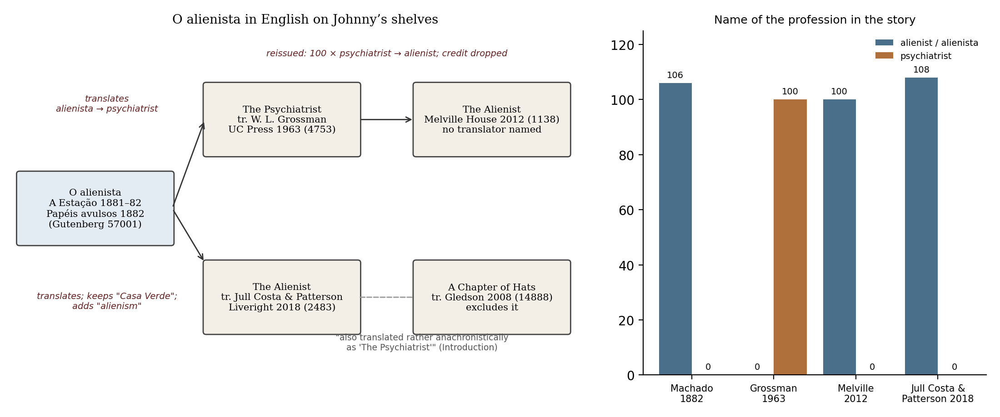

*[[shadows/weeks/machado-de-assis|Machado de Assis (Author & Shadow)]] · Day 4 of 7 · 2026-11-12 · Difficulty 3 · Genealogy/influence, Shared form or method*

## Books in this reading

- [[books/4753-the-psychiatrist-other-stories|The Psychiatrist & Other Stories]], [[people/machado-de-assis|Machado de Assis]], [[people/william-l-grossman|William L. Grossman]] (translator), [[people/helen-caldwell|Helen Caldwell]] (translator); 1963. *Day 4 primary: Grossman's 1963 translation of O alienista, the source text of the 2012 Melville House Alienist; his introduction transplants the story to Manhattan*
- [[books/2483-the-collected-stories-of-machado-de-assis|The Collected Stories of Machado de Assis]], [[people/machado-de-assis|Machado de Assis]], [[people/margaret-jull-costa|Margaret Jull Costa]] (translator), [[people/robin-patterson|Robin Patterson]] (translator); 2018. *Day 4 primary: the only other independent English O alienista in the library; keeps 'alienist' and 'Casa Verde', adds a gloss ('also known at that time as alienism')*
- [[books/1138-the-alienist|The Alienist]], [[people/joaquim-maria-machado-de-assis|Joaquim Maria Machado de Assis]], [[people/william-l-grossman|William L. Grossman]] (translator); 2012. *Day 4 cross-check (used as primary in Triads set 21; required here because it is the edition examined): Grossman's 1963 text with 100 'psychiatrist'→'alienist'; no translator named*
- [[books/14888-a-chapter-of-hats-and-other-stories|A Chapter of Hats and Other Stories]], [[people/machado-de-assis|Machado de Assis]], [[people/john-gledson|John Gledson]] (translator); 2008. *Day 4 cross-check: Gledson's introduction excludes The Alienist and calls 'The Psychiatrist' anachronistic*
- [[books/11676-the-oxford-guide-to-literature-in-english-translat|The Oxford Guide to Literature in English Translation]], [[people/peter-france|Peter France]] (editor); 2000. *Day 4 cross-check: survey of Machado's English translators; Scott-Buccleuch 'omits nine chapters' (cf. day 1)*
- [[books/6515-sympathy-for-the-traitor-a-translation-manifesto|Sympathy for the Traitor: A Translation Manifesto]], [[people/mark-polizzotti|Mark Polizzotti]]; 2018. *Day 4 cross-check, other direction: Machado (with Pushkin) as reader of Sterne in poor French translations, via Thirlwell*

## The shadow so far

| Citing Book | Relation | Target | Location |
|---|---|---|---|
| [[books/1035-dom-casmurro|Dom Casmurro (Peter Owen 'complete and unabridged edition' 2016)]] (R. L. Scott-Buccleuch (translator)) | **Translates** | Machado de Assis | ch. 98 'Five Years', p. 158 (chapter ends here); TARGET Machado, Dom Casmurro, Garnier 1899, ch. XCVIII 'Cinco annos' (Project Gutenberg 55752) |
| [[books/1035-dom-casmurro|Dom Casmurro (Peter Owen 'complete and unabridged edition' 2016)]] (R. L. Scott-Buccleuch (translator)) | **Translates** | Machado de Assis | ch. 73 'The Stage Manager', p. 125; TARGET Machado, ch. LXXIII 'O contra-regra' (Gutenberg 55752) |
| [[books/1035-dom-casmurro|Dom Casmurro]] (Machado de Assis / R. L. Scott-Buccleuch) | **Quotes** | Machado de Assis | ch. 72 'A Reform in the Drama', p. 124; TARGET Shakespeare, Othello I.iii (checkable in Bartlett's 10410/13825, Concise Oxford Dictionary of Quotations 11435) |
| [[books/1035-dom-casmurro|Dom Casmurro]] (Machado de Assis) | **Rewrites** | Machado de Assis | ch. 72 'A Reform in the Drama', p. 124; TARGET Shakespeare, Othello (named; also ch. 62 'A Touch of Iago', ch. 135 'Othello') |
| [[books/15095-a-million-windows|A Million Windows]] (Gerald Murnane) | **Quotes** | Machado de Assis | section 19 (of 34); TARGET Brás Cubas ch. XXXI 'A borboleta preta' (Grossman's Epitaph, not in library; checked vs 1881 Gutenberg 54829 and Jull Costa 15092) |
| [[books/3172-stream-system|Stream System]] (Gerald Murnane) | **Mentions** | Machado de Assis | title story 'Stream System'; TARGET Brás Cubas ch. XXXI (via Grossman) |
| [[books/760-a-reading-diary|A Reading Diary]] (Alberto Manguel) | **Quotes** | Machado de Assis | ch. 12 'May: The Posthumous Memoirs of Brás Cubas'; TARGETS Brás Cubas chs. II, VI, VIII, XI, XXIV, XXVII, LXXI, CLX and others |
| [[books/1101-a-reader-on-reading|A Reader on Reading]] (Alberto Manguel) | **Mentions** | Machado de Assis | essay text (calibre get_passage on 'metaphor belongs to Machado'); TARGET Brás Cubas ch. VIII 'Razão contra Sandice' |
| [[books/2180-the-rhetoric-of-fiction|The Rhetoric of Fiction]] (Wayne C. Booth) | **Quotes** | Machado de Assis | p. 148 (index), epigraph opening ch. VI 'Types of Narration'; TARGET Brás Cubas ch. LXXII 'O bibliomano' (Grossman, credited in acknowledgments) |
| [[books/10410-bartlett-s-familiar-quotations|Bartlett's Familiar Quotations (18th ed.)]] (Geoffrey O'Brien (ed.)) | **Quotes** | Machado de Assis | Machado de Assis entry ('Epitaph of a Small Winner [1881]', note 4 'Translated by WILLIAM L. GROSSMAN.'); TARGET Brás Cubas ch. CXVII 'O Humanitismo' |
| [[books/2159-the-new-yale-book-of-quotations|The New Yale Book of Quotations]] (Fred R. Shapiro (ed.)) | **Quotes** | Machado de Assis | p. 510, Machado de Assis 1 (ch. 17) and 2 (ch. 119: 'It is better to fall from above the clouds than from the third floor.'); TARGET Brás Cubas chs. XVII, CXIX |
| [[books/1275-the-novel-volume-1-history-geography-and-culture|The Novel, Volume 1 (ch. 'Posthumous Memoirs of Brás Cubas')]] (Roberto Schwarz (tr. Sharon Lubkemann Allen)) | **Argues with** | Machado de Assis | p. 819 (also pp. 818–820, 839); TARGET Machado's critics and admirers on Brás Cubas |
| [[books/1275-the-novel-volume-1-history-geography-and-culture|The Novel, Volume 1 (quoting Romero, Machado de Assis, 1897)]] (Sílvio Romero (via Schwarz)) | **Argues with** | Machado de Assis | p. 819, n. 4 (Romero, Machado de Assis (1897), Unicamp 1992, p. 160); TARGET Machado, Brás Cubas and later novels |
| [[books/13307-the-devil-to-pay-in-the-backlands|The Devil to Pay in the Backlands (foreword 'The Place of Guimarães Rosa in Brazilian Literature')]] (Jorge Amado) | **Argues with** | Machado de Assis | Foreword (signed Rio de Janeiro, September 1962); TARGET Machado's legacy in Minas Gerais fiction |
| [[books/1261-the-cambridge-history-of-latin-american-literature|The Cambridge History of Latin American Literature vol. 3 (file catalogued as vol. 1)]] (Thomas E. Skidmore; Massaud Moisés) | **Argues with** | Machado de Assis | Skidmore, 'The essay: architects of Brazilian national identity', p. 347; Moisés, 'Brazilian poetry from 1878 to 1902', p. 83; TARGET Romero ⇄ Machado |
| [[books/15092-posthumous-memoirs-of-bras-cubas-a-novel|Posthumous Memoirs of Brás Cubas (Author's Preface to the Third Edition)]] (Machado de Assis (tr. Jull Costa & Patterson)) | **Argues with** | Machado de Assis | Author's Preface to the Third Edition; TARGET Capistrano de Abreu's review ('Is Posthumous Memoirs of Brás Cubas a novel?') and Macedo Soares's comparison to Garrett |
| [[books/5839-the-crime-of-father-amaro|The Crime of Father Amaro (Introduction)]] (Margaret Jull Costa, reporting Machado's 1878 review) | **Argues with** | Machado de Assis | Introduction; TARGET Eça, O Crime do Padre Amaro (1876) and O Primo Basílio (1878) |
| [[books/7664-lukacs-after-communism-interviews-with-contemporar|Lukács After Communism (Interview with Roberto Schwarz, 15 Aug 1994)]] (Roberto Schwarz / Eva L. Corredor) | **Mentions** | Machado de Assis | Interview with Roberto Schwarz; TARGET Machado's novels (realism, Zola, Sterne, Diderot) |
| [[books/1138-the-alienist|The Alienist (Melville House 'Art of the Novella' 2012)]] (Melville House (editor unnamed); translation William L. Grossman, not named in the EPUB) | **Edits/introduces** | Machado de Assis | whole text, chs. I–XIII (quote ch. XIII); TARGET Grossman, The Psychiatrist (4753, 1963) |
| [[books/4753-the-psychiatrist-other-stories|The Psychiatrist and Other Stories ('The Psychiatrist')]] (William L. Grossman (translator)) | **Translates** | Machado de Assis | section II 'A Torrent of Madmen' + note 1; TARGET O alienista ch. II (Papeis Avulsos 1882, Gutenberg 57001) |
| [[books/4753-the-psychiatrist-other-stories|The Psychiatrist and Other Stories ('The Psychiatrist')]] (William L. Grossman (translator)) | **Translates** | Machado de Assis | section XIII 'Plus Ultra' (end); TARGET O alienista ch. XIII |
| [[books/4753-the-psychiatrist-other-stories|The Psychiatrist and Other Stories (Introduction)]] (William L. Grossman) | **Edits/introduces** | Machado de Assis | Introduction (signed WILLIAM L. GROSSMAN); TARGET O alienista ch. XI ('quatro quintos da' population) |
| [[books/2483-the-collected-stories-of-machado-de-assis|The Collected Stories of Machado de Assis ('The Alienist')]] (Margaret Jull Costa & Robin Patterson (translators)) | **Translates** | Machado de Assis | The Alienist ch. 1; TARGET O alienista ch. I |
| [[books/14888-a-chapter-of-hats-and-other-stories|A Chapter of Hats and Other Stories (Translator's Introduction)]] (John Gledson) | **Edits/introduces** | Machado de Assis | Translator's Introduction; TARGET O alienista and its English titles |
| [[books/11676-the-oxford-guide-to-literature-in-english-translat|The Oxford Guide to Literature in English Translation]] (Peter France (ed.), 'Brazilian Literature' section II.k.15) | **Mentions** | Machado de Assis | p. 444 (PDF p. 470); bibliography p. 446; TARGET Machado's English translators (Grossman, Scott-Buccleuch, Caldwell) |
| [[books/6515-sympathy-for-the-traitor-a-translation-manifesto|Sympathy for the Traitor: A Translation Manifesto]] (Mark Polizzotti (citing Adam Thirlwell, The Delighted States)) | **Mentions** | Machado de Assis | ch. 9, p. 150; TARGET Machado as reader of Sterne in French (cf. 'Ao leitor', 'fórma livre de um Sterne', edge 73) |

---

## Daily library resurfacing · Scribrarium · 12 November 2026

## 1. Where the week stands

Machado de Assis, day 4 of 7: who translates, edits or introduces him. Day 1 found the ”complete and unabridged” Dom Casmurro (1035) still missing two passages; day 2 found his quoters keeping his words and moving his sentences; day 3 found one argument, carried on for a century, about whether his books live in Brazil. Every one of those days ran through a translation. Today the translators are the subject.

## 2. The day’s finding

The library holds three English books of *O alienista* (1882), and only two translations. The Melville House *The Alienist* (2012, Calibre 1138) is William L. Grossman’s *The Psychiatrist* (1963, in 4753) with the profession renamed. A token-level comparison of the two texts (about 20,000 tokens each, similarity 0.99) finds 100 ”psychiatrist” →”alienist”, ”psychiatric doctrine” →”alienist doctrine”, ”psychiatry” →”treatment” once and ”psychopathology” once, ellipses reset, and a handful of OCR errors corrected (”hps” →”lips”, ”fives” →”lives”). Every other word is Grossman’s, his two footnotes included. The EPUB names no translator: its copyright page gives the 1881 journal, the 1882 volume and ”© 2012 Melville House Publishing”; its appendix credits the 1921 *Brazilian Tales* by title but not Isaac Goldberg, who translated it. (Wikipedia lists the Melville edition as Grossman’s; whether the printed book credits him can’t be checked here.)

The renaming goes back to Machado’s word, *alienista* (106 times in the story), and it is the word the newer translators argue for: Gledson (14888) says the story has been ”also translated rather anachronistically as ‘The Psychiatrist’”, and Jull Costa & Patterson (2483) write ”alienist” 108 times. But the 2012 book swaps one word and its family and keeps everything else Grossman decided. Grossman’s freedoms stay in place: he cuts Father Lopes’s threat to report the doctor to the Pope and gives the priest a different joke; at the end he has Bacamarte die ”as insane as ever” where Machado says only ”no mesmo estado em que entrou”; and he turns the rumour about Father Lopes into its opposite. The profession went back to 1882; the sentences stayed in 1963.

Relations: **Translates** (Grossman; Jull Costa & Patterson), **Edits/introduces** (Melville House; Grossman’s introduction; Gledson’s introduction), **Mentions** (the Oxford Guide on Machado’s translators; Polizzotti on Machado reading Sterne in poor French). Edges 76–83.

*Figure 1: O alienista in English on the shelves: one source, two translations, three books.*

## 3. The books

**The Psychiatrist and Other Stories — Machado de Assis, tr. William L. Grossman & Helen Caldwell, 1963 (EPUB, Calibre 4753)**

**Selection logic.** The day-4 plan named Grossman. A Mentions row (684) and the catalogue made this the oldest English *O alienista* in the library, and the comparison with 1138 made it the source of two books. Not from the Send To pool (the pool is empty).

**Overview.** A University of California Press selection: twelve stories, eight by Caldwell, four by Grossman, each signed at its end (”Translated by WILLIAM L. GROSSMAN”). Grossman’s introduction places Machado for a US readership in 1963 and reads the title story through Pascal and a recent survey of Manhattan.

**Element 1 — Collation: one passage in four texts.** Chapter II, Bacamarte’s quip about his asylum (Gutenberg 57001; Grossman, section II; Melville 1138, ch. II; Jull Costa & Patterson in 2483, ch. 2):

| Text |
|---|
| Machado 1882 ”A Casa Verde, disse elle ao vigario, é agora uma especie de mundo, em que ha o governo temporal e o governo _espiritual._ |
| E o padre Lopes ria deste pio trocado” … |
| ”Deixe estar, deixe estar, que hei de mandal-o denunciar ao papa.” |
| Grossman 1963 ”Father Lopes laughed. “What a delightful novelty,” he said, “to find a society in which the spiritual dominates.”” — with footnote |
| 1: ”A play on words, for espiritual means both “spiritual” and “pertaining to the mind.”” |
| Melville 2012 Grossman’s sentence and footnote unchanged, the note renumbered ”[1]”. |
| Jull Costa & Patterson 2018 ”Father Lopes laughed at this godly quip and added, with the sole aim of making his own little joke: “Any more of that and I’ll have you reported to the Pope himself.”” |

Grossman explains the pun in a note and writes the priest a new joke; the Pope goes. The 2012 edition, which changed the doctor’s title a hundred times, kept the invented joke.

**Element 2 — Verified quotations: the ending.** Machado: ”Dizem os chronistas que elle morreu dalli a dezesete mezes, no mesmo estado em que entrou, sem ter podido alcançar nada.” Grossman (section XIII, ’Plus Ultra’): ”The chroniclers state, however, that he died seventeen months later as insane as ever.” Machado: ”Alguns chegam ao ponto de conjec-turar que nunca houve outro louco, além delle, em ltaguahy”. Grossman: ”Some even venture the opinion that he was the only madman (in the vulgar or non-Bacamartian sense) ever committed to the asylum.” Machado calls the rumour doubtful because it is ”attribuido ao padre Lopes, que com tanto fogo realçara as qualidades do grande homem” (it comes from the man who praised him, so it is suspect); Grossman: ”doubtless erroneously, for, as everybody knew, the priest liked and admired the psychiatrist”. Three changes in three sentences: the narrator now judges Bacamarte insane, the madman’s field shrinks from the town to the asylum, and the priest’s praise moves from the reason to doubt the rumour to the reason it can’t be true. All three survive in 1138, with ”psychiatrist” changed to ”alienist”.

**Element 3 — The introduction as transplant.** Grossman: ”By a curious coincidence, four-fifths of the people in Itaguai were found by Dr. Bacamarte to be mentally ill, and four-fifths of the persons residing in a certain part of Manhattan were recently found by investigators to be not “free enough of emotional symptoms to be considered well.”” Machado’s ”quatro quintos da” population is real (Gutenberg 57001, ch. XI); the Manhattan survey is the prefacer’s. The title and the preface do the same thing: they bring the story to 1960s American psychiatry. Isabel C. Gómez’s 2014 review of Chasteen’s translation (not in the library) criticises the ”Psychiatrist” title for tying Machado’s parody of positivism to twentieth-century psychiatry.

**The Collected Stories of Machado de Assis — tr. Margaret Jull Costa & Robin Patterson, foreword by Michael Wood, 2018 (EPUB, Calibre 2483)**

**Selection logic.** The only other independent English *O alienista* in the library (Mentions row 640); named in the day-4 plan. Same translators as Brás Cubas (15092, day 2–3).

**Overview.** All seven of Machado’s story collections plus uncollected stories. A foreword by Wood (”Machado has generally been well served by translators”) and a translators’ introduction on difficulties word by word.

**Element 1 — A gloss written into the text.** Machado, ch. I: ”Foi então que um dos recan-tos desta lhe chamou especialmente a attenção,--o recanto psychico, o exame da pathologia cerebral.” Jull Costa & Patterson: ”It was at this point that one of its lesser nooks and cran-nies caught his particular attention: that pertaining to the psychic, to the examination of cerebral pathology, also known at that time as alienism.” The last six words are not in the 1882 text. Grossman has ”psychopathology” here. The 2018 translation keeps Machado’s profession and still adds a note for the reader inside the sentence. Neither translation leaves the passage as Machado wrote it.

**Element 2 — The translators on their own method.** From the introduction: ”The translator must also resist normalizing oddity, for Machado does sometimes say some very odd things.” And: ”The Portuguese word we have translated as “bespattered” (“respingava ”)

means “splashed,” but carries within it notions of “soiling” and “staining,” which the English version must reflect.” They keep *Casa Verde* untranslated (62 times; Grossman: ”Green House” 59). Their ending is close to the Portuguese: ”The chroniclers say that he died seventeen months later, in the same state in which he entered the Casa Verde, having achieved nothing.”

**Element 3 — Derived list: what each English keeps of the ending (ch. XIII). Cross-check: The Alienist — Machado de Assis, Melville House ’Art of the Novella’,**

| Machado 1882 | Grossman 1963 / Melville 2012 | Jull Costa & Patterson 2018 |
|---|---|---|
| trancou os ouvidos á saudade da mulher | (omitted) | shut his ears to his wife’s pleas |
| no mesmo estado em que entrou | as insane as ever | in the same state in which he entered the Casa Verde |
| sem ter podido alcançar nada | (omitted) | having achieved nothing |
| nunca houve outro louco, além delle | the only madman (in the vulgar or non-Bacamartian sense) ever committed to the asylum | he had always been the sole lunatic in Itaguaí |
| que com tanto fogo realçara as qualidades | as everybody knew, the priest liked and admired the psychiatrist [alienist] | who had so ardently praised the great man’s virtues |

**2012 (EPUB, Calibre 1138)**

Used as a primary book in Triads set 21, so it can’t be the day’s primary; the day’s relation needs it, because it is the edition being examined. Appendix (’Illuminations’): Goldberg’s 1921 versions of ”The Fortune Teller” and ”Life”, credited ”from Brazilian Tales, by Machado de Assis, 1921”, period writing on Rio and insanity, and sketches. Token comparison with 4753 above; the full substitution table is in Shadow_Edges 76.

**Cross-check: A Chapter of Hats and Other Stories — tr. John Gledson, 2008 (EPUB, Calibre 14888)**

Gledson’s introduction leaves the story out: ”the longest, ‘The Alienist’ (also translated rather anachronistically as ‘The Psychiatrist’), is also the most wide-ranging” … ”I have excluded it partly because it is available in more than one translation, but also because its length would have meant leaving out too many others.” Of the translations on these shelves, only Grossman’s existed in 2008; four years later, one of the ”more than one” on the market was Grossman again. He also notes that a Portuguese paper ”which serialised Epitaph in 1883, dropped it after chapter twenty-six”.

**Cross-check: The Oxford Guide to Literature in English Translation, ed. Peter France, 2000 (PDF, Calibre 11676), p. 444**

The Machado paragraph praises Grossman’s *Epitaph* (”retains much of the original’s humour and bite”), says nothing about the stories, and on Dom Casmurro says Scott-Buccleuch’s version ”is a fine rendering, even if it omits nine chapters from the original, while the more complete translation by Caldwell reveals a perhaps excessive influence of her own views on Machado de Assis.” That fits day 1: the nine chapters are the 1992 cuts, which the 2016 ”complete and unabridged” edition restores, except for the two passages day 1 found still missing.

**Cross-check: Mark Polizzotti, Sympathy for the Traitor, 2018 (PDF, Calibre 6515), p. 150**

The other direction: Machado as a reader of translations. Polizzotti, following Adam Thirlwell’s *The Delighted States* (not in the library): ”Thirlwell brings up the Russian Pushkin and the Brazilian Machado de Assis, both taking inspiration from poor French translations of Laurence Sterne’s Tristram Shandy and A Sentimental Journey.” Brás Cubas’s ”fórma livre de um Sterne” (day 3) may be a French Sterne. The library can’t settle which French Sterne Machado owned.

**A misreading worth attempting.** Read the Melville *Alienist* as a Bacamarte case. A publisher applies one rule (every psychiatrist is an alienist) to a whole text, the way the doctor applies one theory to a whole town, and declares the result restored. Then read the last chapter: the doctor shuts himself in to study his own case and ”achieved nothing”. The edition needed the opposite treatment: someone to examine the other 19,900 tokens.

## 4. The shadow so far

| From | Relation | To | Location |
|---|---|---|---|
| Dom Casmurro, tr. Scott-Buccleuch (1035) | Translates (2) | Dom Casmurro 1899 | chs. 98, 73 |
| Dom Casmurro (1035) | Quotes / Rewrites | Othello | chs. 72, 62, 135 |
| Murnane, A Million Windows (15095); Stream System (3172) | Quotes / Mentions | Brás Cubas ch. 31 | sec. 19; title story |
| Manguel (760; 1101) | Quotes / Mentions | Brás Cubas chs. 8, 27 etc. | ch. 12; essay |
| Booth (2180) | Quotes | Brás Cubas ch. 72 | p. 148 |
| Bartlett’s (10410); Yale (2159) | Quotes | Brás Cubas chs. 117; 17, 119 | entries; p. 510 |
| Schwarz in Moretti, The Novel (1275) | Argues with (2) | Machado’s critics; Romero | pp. 816–840 |
| Amado, foreword to Rosa (13307) | Argues with | Machado’s legacy | Foreword |
| CHLAL vol. 3 (1261) | Argues with | Romero ⇄Machado | pp. 83, 347 |
| Brás Cubas, 3rd-ed. preface (15092) | Argues with | Capistrano de Abreu | Preface |
| Jull Costa on Eça (5839) | Argues with | Eça (Machado’s 1878 review) | Introduction |
| Schwarz interview (7664) | Mentions | Machado’s realism | Interview |
| **The Alienist, Melville House (1138)** | **Edits/introduces** | **Grossman’s Psychiatrist (4753)** | **whole text** |
| **The Psychiatrist, tr. Grossman (4753)** | **Translates (2)** | **O alienista ch. II; ch. XIII** | **secs. II, XIII** |
| **Grossman, Introduction (4753)** | **Edits/introduces** | **O alienista** | **Introduction** |
| **The Alienist, tr. Jull Costa & Patterson (2483)** | **Translates** | **O alienista ch. I** | **ch. 1** |
| **Gledson, Introduction (14888)** | **Edits/introduces** | **O alienista (excluded)** | **Introduction** |
| **Oxford Guide (11676)** | **Mentions** | **Machado’s translators** | **p. 444** |
| **Polizzotti (6515)** | **Mentions** | **Machado reading Sterne in French** | **p. 150** |

Edges 58–83: 26 to date (today’s 8 in bold). Mentions promoted today: 734 (Oxford Guide), 701 (Polizzotti); the other new edges start in Machado’s own books (Own_Work rows are not promoted).

## 5. Where this sends you

**Notebook**

1. Grossman cuts the Pope and footnotes the pun; Jull Costa & Patterson keep the Pope and drop the pun’s second sense. Which loss is worse for a story about the line between the spiritual and the mental? Try your own English for ”pio trocado”.

2. ”also known at that time as alienism”: a translator’s gloss inside the sentence. Is that a footnote with its markers removed, or a commentary posing as the text? Compare Benjamin on the translator’s task.

3. The Melville edition fixes the *word* and keeps the *sentences*. Write one paragraph of a theory of retranslation in which the unit of fidelity is the sentence, and one in which it is the term. Which describes what Machado’s own narrators do to their sources?

**Rabbit holes**

- *Papeis Avulsos* (Lombaerts, 1882), Project Gutenberg 57001, the Portuguese used today: https://www.gutenberg.org/ebooks/57001

- Isabel C. Gómez, review of Chasteen, *The Alienist and Other Stories of Nineteenth- Century Brazil*, *Machado de Assis em Linha* 7.13 (2014), open access: https://www.scielo.br/j/mael/a/R4QKpnV79HJBBGHCTYyzTqs/

- UC Press page for *The Psychiatrist and Other Stories* (still in print): https://www.ucpress.edu/books/the-psychiatrist-and-other-stories/paper

- Charles A. Perrone, ”Machado de Assis Gains Different Voices in New Translations of ’Posthumous Memoirs of Brás Cubas’”, *Words Without Borders*, 9 July 2020 (Thomson- DeVeaux vs Jull Costa & Patterson, with Grossman, Ellis, Rabassa): https://wordswithoutborders.org/book-review/machado-de-assis-gains-different-voices-in-new-translations-of-posthumous-m

- ”O alienista”, Wikipedia (lists Grossman 1963, Melville 2012 as Grossman, Chasteen 2013): https://en.wikipedia.org/wiki/O_alienista

- Isaac Goldberg, *Brazilian Tales* (1921), the earliest English Machado, reprinted in 1138’s appendix: https://www.gutenberg.org/ebooks/21040

**Also in your library**

- *Translation in Anthologies and Collections* (Seruya et al., 12060): pp. 60–61 on Machado as translator (Falenas). The day-4 lead not taken today; it fits day 6.

- *The Psychiatrist* (4753), Grossman’s ”Midnight Mass” against Gledson’s in *A Chapter of Hats* (14888) and Jull Costa & Patterson’s (2483): a second three-way collation, if Brás Cubas leaves room on day 6.

- Genette, *Paratexts* (692): quotes ”Ao leitor”; a frame for title pages that drop a translator.

- Send To pool: no Candidates queued today.

## 6. From the Lexicon — transclude

**Received.** In hypertext, the inclusion of part or all of one document inside another *by reference* rather than by copying, so that the same content appears, knowably, in more than one place while the original stays intact at its source (Ted Nelson, *Literary Machines*, 1980; Project Xanadu).

**Your sense.** Not yet written.

**Etymology.** Latin *trans-* (across) + *-clude* on the model of include/exclude (*claudere*, to shut). Nelson’s coinage.

**WordNet.** Absent (checked today: ”’transclude’ is not in WordNet”). WordNet does carry *alienist*: ”a psychiatrist and specialist in the legal aspects of mental illness”: the dictionary defines the 1882 word by the 1963 one.

**Relations / lineage.** Ted Nelson; Computer Science; Web Technologies. Boundary tension recorded in the entry: Nelson separates transclusion from *transquotation* (a quotation kept connected to its origin) and *transdelivery*; ordinary web usage merges all three as ”embed-ding”.

**Portable axiom.** None recorded.

**Why today.** The Melville *Alienist* is Grossman’s text included in another book without the reference: copying that looks like transclusion with the link cut. Nelson’s term names what a translation credit is for: the visible tie back to the source.

**Verified occurrence.** None in today’s reading.

**New in the Lexicon.* Anamnesis* and *soteriology* (both added 11 November).

## 7. To carry

“The translator must also resist normalizing oddity, for Machado does sometimes say some very odd things.” — Margaret Jull Costa & Robin Patterson, Introduction, *The Collected Stories of Machado de Assis* (2483)

## Themes

[[themes/alienist|alienist]] · [[themes/anachronism|anachronism]] · [[themes/casa-verde|Casa Verde]] · [[themes/credit|credit]] · [[themes/edition|edition]] · [[themes/ending|ending]] · [[themes/father-lopes|Father Lopes]] · [[themes/footnotes|footnotes]] · [[themes/french-translation|French translation]] · [[themes/gledson|Gledson]] · [[themes/gloss|gloss]] · [[themes/grossman|Grossman]] · [[themes/jull-costa|Jull Costa]] · [[themes/manhattan|Manhattan]] · [[themes/melville-house|Melville House]] · [[themes/o-alienista|O alienista]] · [[themes/oxford-guide|Oxford Guide]] · [[themes/pascal|Pascal]] · [[themes/patterson|Patterson]] · [[themes/polizzotti|Polizzotti]] · [[themes/psychiatrist|psychiatrist]] · [[themes/pun|pun]] · [[themes/retranslation|retranslation]] · [[themes/sterne|Sterne]] · [[themes/the-psychiatrist|The Psychiatrist]] · [[themes/thirlwell|Thirlwell]] · [[themes/transclusion|transclusion]] · [[themes/translation|translation]] · [[themes/translator|translator]]

---

Previous: [[shadows/2026-11-11-shadow-machado-de-assis-day-3-retreated-from-brazi|Shadow — Machado de Assis, day 3: Retreated from Brazilian Particularity]]  
Next: [[shadows/2026-11-13-shadow-machado-de-assis-day-5-not-in-his-biographi|Shadow — Machado de Assis, day 5: Not in His Biographical Dictionaries]]
