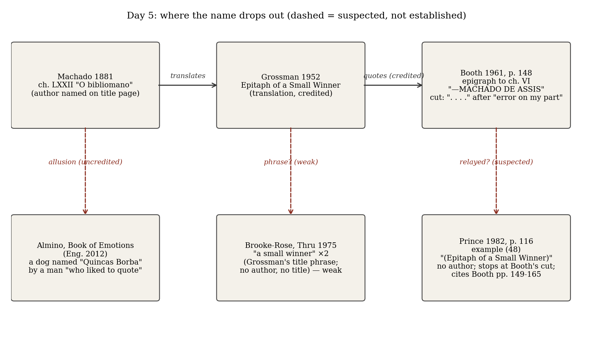

*[[shadows/weeks/machado-de-assis|Machado de Assis (Author & Shadow)]] · Day 5 of 7 · 2026-11-13 · Difficulty 3 · Genealogy/influence, Oblique/structural*

## Books in this reading

- [[books/2975-narratology-the-form-and-functioning-of-narrative|Narratology: The Form and Functioning of Narrative]], [[people/gerald-prince|Gerald Prince]]; 1982. *Day 5 primary: quotes Brás Cubas ch. 72 (Grossman) credited by title only; suspected relay from Booth's epigraph (2180, p. 148)*
- [[books/2269-the-book-of-emotions|The Book of Emotions]], [[people/joao-almino-elizabeth-jackson|João Almino; Elizabeth Jackson]]; 2012. *Day 5 primary: uncredited allusion — a dog named 'Quincas Borba' by a character who 'liked to quote'; Machado never named*
- [[books/721-four-novels-out-64-such-66-between-68-thru-75-the|Four Novels: Out ('64), Such ('66), Between ('68) & Thru ('75): The Christine Brooke-Rose Omnibus]], [[people/christine-brooke-rose|Christine Brooke-Rose]]; 1986. *Day 5 primary (weak suspicion): Thru uses Grossman's title phrase 'small winner' twice; story 'Medium Losers and Small Winners' (via Canepari-Labib 2299)*
- [[books/2180-the-rhetoric-of-fiction|The Rhetoric of Fiction]], [[people/wayne-c-booth|Wayne C. Booth]]; 1961. *Day 5 cross-check (day-2 primary; required as the suspected source of Prince's quotation)*

## The shadow so far

| Citing Book | Relation | Target | Location |
|---|---|---|---|
| [[books/1035-dom-casmurro|Dom Casmurro (Peter Owen 'complete and unabridged edition' 2016)]] (R. L. Scott-Buccleuch (translator)) | **Translates** | Machado de Assis | ch. 98 'Five Years', p. 158 (chapter ends here); TARGET Machado, Dom Casmurro, Garnier 1899, ch. XCVIII 'Cinco annos' (Project Gutenberg 55752) |
| [[books/1035-dom-casmurro|Dom Casmurro (Peter Owen 'complete and unabridged edition' 2016)]] (R. L. Scott-Buccleuch (translator)) | **Translates** | Machado de Assis | ch. 73 'The Stage Manager', p. 125; TARGET Machado, ch. LXXIII 'O contra-regra' (Gutenberg 55752) |
| [[books/1035-dom-casmurro|Dom Casmurro]] (Machado de Assis / R. L. Scott-Buccleuch) | **Quotes** | Machado de Assis | ch. 72 'A Reform in the Drama', p. 124; TARGET Shakespeare, Othello I.iii (checkable in Bartlett's 10410/13825, Concise Oxford Dictionary of Quotations 11435) |
| [[books/1035-dom-casmurro|Dom Casmurro]] (Machado de Assis) | **Rewrites** | Machado de Assis | ch. 72 'A Reform in the Drama', p. 124; TARGET Shakespeare, Othello (named; also ch. 62 'A Touch of Iago', ch. 135 'Othello') |
| [[books/15095-a-million-windows|A Million Windows]] (Gerald Murnane) | **Quotes** | Machado de Assis | section 19 (of 34); TARGET Brás Cubas ch. XXXI 'A borboleta preta' (Grossman's Epitaph, not in library; checked vs 1881 Gutenberg 54829 and Jull Costa 15092) |
| [[books/3172-stream-system|Stream System]] (Gerald Murnane) | **Mentions** | Machado de Assis | title story 'Stream System'; TARGET Brás Cubas ch. XXXI (via Grossman) |
| [[books/760-a-reading-diary|A Reading Diary]] (Alberto Manguel) | **Quotes** | Machado de Assis | ch. 12 'May: The Posthumous Memoirs of Brás Cubas'; TARGETS Brás Cubas chs. II, VI, VIII, XI, XXIV, XXVII, LXXI, CLX and others |
| [[books/1101-a-reader-on-reading|A Reader on Reading]] (Alberto Manguel) | **Mentions** | Machado de Assis | essay text (calibre get_passage on 'metaphor belongs to Machado'); TARGET Brás Cubas ch. VIII 'Razão contra Sandice' |
| [[books/2180-the-rhetoric-of-fiction|The Rhetoric of Fiction]] (Wayne C. Booth) | **Quotes** | Machado de Assis | p. 148 (index), epigraph opening ch. VI 'Types of Narration'; TARGET Brás Cubas ch. LXXII 'O bibliomano' (Grossman, credited in acknowledgments) |
| [[books/10410-bartlett-s-familiar-quotations|Bartlett's Familiar Quotations (18th ed.)]] (Geoffrey O'Brien (ed.)) | **Quotes** | Machado de Assis | Machado de Assis entry ('Epitaph of a Small Winner [1881]', note 4 'Translated by WILLIAM L. GROSSMAN.'); TARGET Brás Cubas ch. CXVII 'O Humanitismo' |
| [[books/2159-the-new-yale-book-of-quotations|The New Yale Book of Quotations]] (Fred R. Shapiro (ed.)) | **Quotes** | Machado de Assis | p. 510, Machado de Assis 1 (ch. 17) and 2 (ch. 119: 'It is better to fall from above the clouds than from the third floor.'); TARGET Brás Cubas chs. XVII, CXIX |
| [[books/1275-the-novel-volume-1-history-geography-and-culture|The Novel, Volume 1 (ch. 'Posthumous Memoirs of Brás Cubas')]] (Roberto Schwarz (tr. Sharon Lubkemann Allen)) | **Argues with** | Machado de Assis | p. 819 (also pp. 818–820, 839); TARGET Machado's critics and admirers on Brás Cubas |
| [[books/1275-the-novel-volume-1-history-geography-and-culture|The Novel, Volume 1 (quoting Romero, Machado de Assis, 1897)]] (Sílvio Romero (via Schwarz)) | **Argues with** | Machado de Assis | p. 819, n. 4 (Romero, Machado de Assis (1897), Unicamp 1992, p. 160); TARGET Machado, Brás Cubas and later novels |
| [[books/13307-the-devil-to-pay-in-the-backlands|The Devil to Pay in the Backlands (foreword 'The Place of Guimarães Rosa in Brazilian Literature')]] (Jorge Amado) | **Argues with** | Machado de Assis | Foreword (signed Rio de Janeiro, September 1962); TARGET Machado's legacy in Minas Gerais fiction |
| [[books/1261-the-cambridge-history-of-latin-american-literature|The Cambridge History of Latin American Literature vol. 3 (file catalogued as vol. 1)]] (Thomas E. Skidmore; Massaud Moisés) | **Argues with** | Machado de Assis | Skidmore, 'The essay: architects of Brazilian national identity', p. 347; Moisés, 'Brazilian poetry from 1878 to 1902', p. 83; TARGET Romero ⇄ Machado |
| [[books/15092-posthumous-memoirs-of-bras-cubas-a-novel|Posthumous Memoirs of Brás Cubas (Author's Preface to the Third Edition)]] (Machado de Assis (tr. Jull Costa & Patterson)) | **Argues with** | Machado de Assis | Author's Preface to the Third Edition; TARGET Capistrano de Abreu's review ('Is Posthumous Memoirs of Brás Cubas a novel?') and Macedo Soares's comparison to Garrett |
| [[books/5839-the-crime-of-father-amaro|The Crime of Father Amaro (Introduction)]] (Margaret Jull Costa, reporting Machado's 1878 review) | **Argues with** | Machado de Assis | Introduction; TARGET Eça, O Crime do Padre Amaro (1876) and O Primo Basílio (1878) |
| [[books/7664-lukacs-after-communism-interviews-with-contemporar|Lukács After Communism (Interview with Roberto Schwarz, 15 Aug 1994)]] (Roberto Schwarz / Eva L. Corredor) | **Mentions** | Machado de Assis | Interview with Roberto Schwarz; TARGET Machado's novels (realism, Zola, Sterne, Diderot) |
| [[books/1138-the-alienist|The Alienist (Melville House 'Art of the Novella' 2012)]] (Melville House (editor unnamed); translation William L. Grossman, not named in the EPUB) | **Edits/introduces** | Machado de Assis | whole text, chs. I–XIII (quote ch. XIII); TARGET Grossman, The Psychiatrist (4753, 1963) |
| [[books/4753-the-psychiatrist-other-stories|The Psychiatrist and Other Stories ('The Psychiatrist')]] (William L. Grossman (translator)) | **Translates** | Machado de Assis | section II 'A Torrent of Madmen' + note 1; TARGET O alienista ch. II (Papeis Avulsos 1882, Gutenberg 57001) |
| [[books/4753-the-psychiatrist-other-stories|The Psychiatrist and Other Stories ('The Psychiatrist')]] (William L. Grossman (translator)) | **Translates** | Machado de Assis | section XIII 'Plus Ultra' (end); TARGET O alienista ch. XIII |
| [[books/4753-the-psychiatrist-other-stories|The Psychiatrist and Other Stories (Introduction)]] (William L. Grossman) | **Edits/introduces** | Machado de Assis | Introduction (signed WILLIAM L. GROSSMAN); TARGET O alienista ch. XI ('quatro quintos da' population) |
| [[books/2483-the-collected-stories-of-machado-de-assis|The Collected Stories of Machado de Assis ('The Alienist')]] (Margaret Jull Costa & Robin Patterson (translators)) | **Translates** | Machado de Assis | The Alienist ch. 1; TARGET O alienista ch. I |
| [[books/14888-a-chapter-of-hats-and-other-stories|A Chapter of Hats and Other Stories (Translator's Introduction)]] (John Gledson) | **Edits/introduces** | Machado de Assis | Translator's Introduction; TARGET O alienista and its English titles |
| [[books/11676-the-oxford-guide-to-literature-in-english-translat|The Oxford Guide to Literature in English Translation]] (Peter France (ed.), 'Brazilian Literature' section II.k.15) | **Mentions** | Machado de Assis | p. 444 (PDF p. 470); bibliography p. 446; TARGET Machado's English translators (Grossman, Scott-Buccleuch, Caldwell) |
| [[books/6515-sympathy-for-the-traitor-a-translation-manifesto|Sympathy for the Traitor: A Translation Manifesto]] (Mark Polizzotti (citing Adam Thirlwell, The Delighted States)) | **Mentions** | Machado de Assis | ch. 9, p. 150; TARGET Machado as reader of Sterne in French (cf. 'Ao leitor', 'fórma livre de um Sterne', edge 73) |
| [[books/2975-narratology-the-form-and-functioning-of-narrative|Narratology: The Form and Functioning of Narrative]] (Gerald Prince) | **Uses without credit (suspected)** | Machado de Assis | ch. 4 'Reading Narrative', p. 116, example (48); TARGET Brás Cubas ch. LXXII 'O bibliomano' (Grossman), via Booth 2180 p. 148 |
| [[books/2269-the-book-of-emotions|The Book of Emotions]] (João Almino (tr. Elizabeth Jackson)) | **Uses without credit (suspected)** | Machado de Assis | ch. 7 'Quincas Borba and his owner' (also ch. 11 'Quincas’s warning of danger'); TARGET Machado, Quincas Borba (1891), the dog named for the philosopher (cf. 1036 introduction) |
| [[books/721-four-novels-out-64-such-66-between-68-thru-75-the|Thru (in Four Novels omnibus)]] (Christine Brooke-Rose) | **Uses without credit (suspected)** | Machado de Assis | Thru (1975), seminar scene (Doreen's essay); also Larissa passage 'keeping them as a small winner'; TARGET Grossman's title Epitaph of a Small Winner (PT 'um pequeno saldo', ch. CLX) |

---

## 13 November 2026

## 1. Where the week stands

Machado de Assis, day 5 of 7. Day 1 found that the “complete and unabridged” 2016 *Dom Casmurro* (1035) still omits two passages; day 2 that his quoters keep his words and move his sentences; day 3 that the argument about him is an argument over where his books live; day 4 that the Melville House *Alienist* (1138) is Grossman’s 1963 *Psychiatrist* with one word changed throughout. Today’s question: who in the library uses him without naming him?

## 2. The day’s finding

Of 63 search strings drawn from the day-1 list (English variants from four translators, plus the Portuguese), none turns up a borrowed sentence of Machado’s in a book that never names him. *Humanitism*, *Lord Taciturn*, *olhos de ressaca* and its English versions, the oblique gypsy eyes, *Life is an opera*, Homer’s cow, the *History of the Suburbs*, the two ends of a life, the worm of the dedication, the *legacy of our misery*, Bacamarte and Itaguaí: every hit is in a book that names him. The concepts do not travel without the name.

What does travel without it is smaller: a title, a name, a selection.

1. **Prince, *Narratology* (2975, 1982), p. 116.** He prints the opening of Brás Cubas ch. 72 as example (48), credited only “(Epitaph of a Small Winner)”. It is the passage Booth used as the epigraph to ch. VI of *The Rhetoric of Fiction* (2180, p. 148), and it stops where Booth’s ellipsis begins. Booth names “MACHADO DE ASSIS”; Prince drops the name. Prince cites Booth “pp. 149-165”, the chapter that opens the page after the epigraph. **Suspected relay** from Booth, with the author left out. Plausibility: moderate to high. It is still a suspicion: Prince may have had Grossman’s book on his own desk.

| 2. Almino, | The Book of Emotions (2269, | English 2012). | A Brasília couple’s |
|---|---|---|---|
| Weimaraner is called “Quincas Borba”, a name given by a character “who liked to quote |  |  |  |
| left and right”. In Machado’s *Quincas Borba* (1891) the dog carries the philosopher’s |  |  |  |
| name. The book never names Machado. This is **an allusion, not a borrowing**: certain |  |  |  |
| as a reference, uncredited by design, and a Brazilian reader needs no footnote. |  |  |  |
| 3. **Brooke-Rose, *Thru* (in 721, 1975).** “A small winner” appears twice, and her story |  |  |  |
| “Medium Losers and Small Winners” (given as 1975 by Canepari-Labib, 2299) has the |  |  |  |
| same words. “Small winner” is Grossman’s title phrase, not Machado’s (the last chapter |  |  |  |
| has “um pequeno saldo”). *Thru* names Booth 22 times. **Weak suspicion.** Two common |  |  |  |
| words make a thin thread. |  |  |  |

Relation for all three: *Uses without credit (suspected)*. Mentions row 636 (Almino) promoted. Prince and Brooke-Rose were not in Mentions, because neither names him.

The ironic part comes from the chapter Prince quotes. Machado’s next paragraph imagines the bibliomaniac seventy years on, bent over this page: “Não conhece o autor; este nome

de Braz Cubas não vem nos seus diccionarios biographicos.” Prince’s example arrives in the same condition: the passage is kept and the author is gone.

*Figure 1: The relay and the two weaker threads. Dashed arrows are suspicions.*

## 3. The books

## 3a. Narratology: The Form and Functioning of Narrative — Gerald Prince, 1982 (PDF, Calibre 2975)

**Selection logic.** The day-5 substring scan for “small winner” found it among three books without “machado”; it was the only one quoting a sentence.

**Overview.** A short structuralist grammar of narrative (Mouton). Chapter 4, “Reading Narrative”, lists signs of metanarrative and gives three examples of narratives that refer to themselves: Dumas, Machado, Swift.

**Element 1 — the two texts side by side (verbatim, substring-checked):**

> Prince, p. 116, ex. (48): “Perhaps I shall eliminate the preceding chapter. Among other reasons, there is, in the last few lines, something that might be construed as an error on my part.” (Epitaph of a Small Winner)

> Booth, *The Rhetoric of Fiction* (2180), p. 148, epigraph to ch. VI: “Perhaps I shall eliminate the preceding chapter. Among other reasons, there is, in the last few lines, something that might be construed as an error on my part. . . . Let us look into the future. […]”—MACHADO DE ASSIS, Epitaph of a Small Winner

**Element 2 — derived list: what the evidence is and is not.**

- *For relay:* the same passage out of 160 chapters; the same cut point; Booth’s other two epigraph texts (Svevo, Furetière) are not Prince’s, but Prince’s note cites the very chapter the epigraph heads: “see Wayne C. Booth, The Rhetoric of Fiction (Chicago, 1961). pp. 149-165 et passim” (Notes); his preface acknowledges a debt to Booth among others.

- *Against:* identical wording proves nothing, since both would be copying Grossman; Prince gives Grossman’s title correctly, which anyone with Booth’s page could also do; Dumas and Swift show he gathered examples himself.

- *What is lost either way:* the author, and the critic Machado’s own sentence fends off. Ch. 72 continues “e eu não quero dar pasto á critica do futuro” (Gutenberg 54829), which Booth’s ellipsis also cuts (edge 66).

**A misreading worth attempting.** Read Prince’s list as a fourth chapter of *Brás Cubas*: a narratologist, seventy years after Machado wrote it, scrutinising the page and finding no error, only an example.

## 3b. The Book of Emotions — João Almino, tr. Elizabeth Jackson (EPUB, Calibre 2269)

**Selection logic.** Mentions row 636 (day 1: “5 × ‘Quincas Borba’, no full name”); confirmed today by the scan: 0 × “Machado”.

**Overview.** A blind photographer in Brasília rebuilds his past from a photographic diary; chapters are numbered after the photographs. Chapter 7 is called after the dog.

**Element 1 — concordance of “Quincas” in the book (8 occurrences; quotations verbatim): Element 2 — the source, in the library.** The introduction to *Quincas Borba* (1036): “A

| Where | Text |
|---|---|
| Ch. 7 title | “7. Quincas Borba and his owner” |
| Ch. 7 | “I took a picture of Quincas Borba, the couple’s Weimaraner.” |
| Ch. 7 | “– Guga came up with the name “Quincas Borba,” Tânia told me.” |
| Ch. 7, just before | “When he heard the click of my camera, Guga, who liked to quote left and right,” |
| Ch. 7, Guga | “His theories were almost always summed up by the observation that life was a long lament and nothing was worth the trouble.” |
| Ch. 11 title | “11. Quincas’s warning of danger” (the dog barks when the narrator moves on his friend’s wife) |
| Ch. 11 | “Would I be capable of betraying a friend?” |

major character in Quincas Borba is a dog of the same name, who may or may not be the reincarnation of a philosopher named Quincas Borba.” Almino’s dog keeps the philosopher-dog’s other function: he watches, and he judges.

**Note.** The pessimism that Guga, the giver of the name, keeps repeating is a weak echo of Brás Cubas’s final chapter of negatives; it is not a quotation. Neither the reviews checked (Three Percent) nor the author’s page mention Machado.

## 3c. Thru — Christine Brooke-Rose, 1975 (in Four Novels, EPUB, Calibre 721; with Canepari-Labib, Word-Worlds, PDF, 2299)

**Selection logic.** Scan hit for “small winner”; a novel built from the critical texts of the 1960s and 70s, where any echo of Booth’s epigraph page would be at home.

**Element 1 — the two occurrences (verbatim):**

- Seminar scene, Doreen’s essay on Don Juan: “But if he’s a small winner he’s at least a great loser.”

- Larissa on Stavro Laretino: “he will miss his victory and his it in me, keeping them as a small winner.”

- Canepari-Labib (2299): “which Brooke-Rose first introduced in the short-story ‘Medium Losers and Small Winners’ (1975, 132)”.

**Element 2 — assessment.** For: Grossman’s coinage (the 1881 last chapter has “pequeno saldo”, a small balance) is rare in English; *Thru* names Booth 22 times; Don Juan and the small winner sit together as Brás Cubas and his loves do. Against: no title, no author, no sentence; Grossman, Machado and the epitaph appear nowhere in the omnibus; “winner” and “loser” are a common pair. **Leave it as a question. Null results (searched today, no book without “machado”):** Humanitism; to the vic-

## 4. The shadow so far (edges 58–86)

| # | From | Relation | To | Location |
|---|---|---|---|---|
| 58–59 | Scott- Buccleuch, *Dom Casmurro* (1035) | Translates (omits) | DC chs. 98, 73 | pp. 158, 125 |
| 60–61 | *Dom Casmurro* (1035) | Quotes / Rewrites | *Othello* | ch. 72 |
| 62–63 | Murnane (15095, 3172) | Quotes / Mentions | BC ch. 31 butterfly | §19; title story |
| 64–65 | Manguel (760, 1101) | Quotes / Mentions | BC chs. 8, 27 etc. | ch. 12 |
| 66 | Booth (2180) | Quotes | BC ch. 72 | p. 148 |
| 67–68 | Bartlett’s (10410), Yale (2159) | Quotes | BC chs. 117, 17, 119 | entries; p. 510 |
| 69–70 | Schwarz / Romero (1275) | Argues with | Machado’s reception | p. 819 |
| 71 | Amado (13307) | Argues with | Machado’s legacy | Foreword |
| 72 | Skidmore, Moisés (1261) | Argues with | Romero ⇄ Machado | pp. 347, 83 |
| 73–74 | Machado (15092; via 5839) | Argues with | Capistrano; Eça | 3rd-ed. preface; intro |
| 75 | Schwarz (7664) | Mentions | the novels | interview |
| 76–79 | Melville (1138), Grossman (4753) | Edits / Translates | *O alienista* | chs. II, XIII; intro |
| 80–81 | Jull Costa & Patterson (2483), Gledson (14888) | Translates / Edits | *O alienista* | ch. 1; intro |
| 82–83 | Oxford Guide (11676), Polizzotti (6515) | Mentions | translators; Sterne | p. 444; p. 150 |
| **84** | **Prince (2975)** | **Uses without credit (suspected)** | **BC ch. 72, via Booth** | **p. 116, ex. (48)** |
| **85** | **Almino (2269)** | **Uses without credit (suspected): allusion** | ***Quincas Borba*****, the dog** | **chs. 7, 11** |
| **86** | **Brooke-Rose (721)** | **Uses without credit (suspected): weak** | **Grossman’s “small winner”** | ***Thru*** |

tor, the potatoes / vencedor, as batatas; Lord Taciturn; Capitu (FTS: 7 hits, all split *capitulate* or Latin); olhos de ressaca, whirlpool / undertow eyes (one “whirlpool eyes” in Burroughs Jr., 11802, an owl: coincidence); oblique and dissembling / cigana oblíqua; life is an opera; God is the poet (5 hits, unrelated); Homer’s cow; History of the Suburbs; two ends of my life; the eaten texts; worm who first gnawed / first worm to gnaw; legacy of our misery / legado da nossa miséria; of this book is you, reader; trapeze in my brain; Bacamarte; Itaguaí / Itaguahy; Braz Cubas (Staden 1168, the historical Brás Cubas). “Casmurro” without “machado”: Clark’s Lacan bibliographies (396/655, an article title) and the *American Heritage Dictionary* (9982, where the headword is broken by layout); both are mentions, not uses.

**Method and limits.** Read-only substring scan of full-text-search.db (12,715 text records, 63 lowercase strings, eight bridge calls of about 150 s), because the calibre plugin handles phrases but stems single words (*Humanitism* matched *humanité*; a NEAR query and a “Small Winner” query timed out). A book was excluded if it contained “machado” anywhere, which also excludes books naming only Antonio Machado: a few true uncredited uses could be hidden there. Broad strings (black butterfly 32, deceased author 42, the alienist 74, a dead man who 96, midnight mass 175) were checked by title and by spot contexts only (Sorrentino 2437, Lobo Antunes 14290, Ocampo 5009, Davis 2635, Michon 886: all unrelated). Translation dependence is the main limit: a borrowing from an English version not on these shelves would not be caught by these phrasings.

## 5. Where this sends you

**Notebook**

1. Prince keeps the sentence and loses the name; Almino keeps the name and loses every sentence. Which is closer to what Machado’s bibliomaniac does with “Braz Cubas”?

2. Booth’s ellipsis cut the critic, and Prince’s citation cut the author. Write the rule of quotation that would allow both cuts and forbid neither.

3. “Small winner” belongs to Grossman, not to Machado. When a translator’s coinage cir-culates uncredited, whose shadow is it in?

**Rabbit holes**

- Machado, *Memórias póstumas de Braz Cubas* (1881), Project Gutenberg plain text: https://www.gutenberg.org/cache/epub/54829/pg54829.txt

- Grossman, *Epitaph of a Small Winner* (1952), borrowable: https://archive.org/details/epitaphofsmallwi0000mach

- Booth, *The Rhetoric of Fiction*, University of Chicago Press: https://press.uchicago.edu/ucp/books/book/chicago/R/bo5965941.html

- Review of Prince’s *Narratology* in *Language in Society*: https://cambridge.org/core/journals/language-in-society/article/abs/gerald-prince-narratology-the-form-and-function-of-narrative-berlin-mouton-1982-pp-vii-184/87FB839A560B9B6F1227DCF13952804E

- *The Book of Emotions*, review at Three Percent (Rochester): https://www.rochester.edu/College/translation/threepercent/2012/10/19/the-book-of-emotions/

- João Almino, author page on the novel: https://joaoalmino.com/livro-das-emocoes/

**Also in your library**

- *The Rhetoric of Fiction* (2180): read pp. 148–165 with Prince’s ch. 4 open beside it.

- *Quincas Borba* (1036): the dog’s naming, for day 6 or 7.

- Genette, *Paratexts* (692): the epigraph as a genre (a day-3 lead not yet used).

- Send-To pool: no Candidates queued today.

## 6. From the Lexicon — clandestine

- **Received:** “Kept secret or done covertly, typically because the action is illicit or would meet opposition: conducted with hidden aims or by hidden methods.”

- **Your sense:** not yet written.

- **Etymology:** Latin *clandestinus* (“secret, hidden”), from *clam* (“secretly”), from the base of *celare* (“to hide”); PIE *kel- (“to cover, conceal”); possibly modelled on *intestinus*. English from the 1560s.

- **WordNet:** oewn-01710918-s (adj.all), “conducted with or marked by hidden aims or methods”; lemmas clandestine, cloak-and-dagger, hole-and-corner, hugger-mugger, hush-hush, secret, surreptitious, undercover, underground; similar to *covert*.

- **Relations or lineage:** none recorded.

- **Portable axiom:** none recorded.

- **Why today:** none of today’s three uses is clandestine: Prince prints the title, Almino puts the name in a chapter heading, Brooke-Rose may be doing nothing at all. Day 5 is filed under “uses without credit”, but the library’s version of it is omission in plain sight.

- **Verified occurrence:** none in today’s books (2975, 2269, 721, 15092).

- **Attestations:** one in the Lexicon, from a Gemini skill request, unverified.

## 7. To carry

“He doesn’t know the author; the name “Brás Cubas” doesn’t appear in his biographical dictionaries.” — Machado de Assis, *Posthumous Memoirs of Brás Cubas*, ch. LXXII “The bibliomaniac”, tr. Margaret Jull Costa & Robin Patterson (15092). Portuguese 1881: “Não conhece o autor; este nome de Braz Cubas não vem nos seus diccionarios biographicos.”

## Themes

[[themes/allusion|allusion]] · [[themes/almino|Almino]] · [[themes/author-s-name|author's name]] · [[themes/bibliomaniac|bibliomaniac]] · [[themes/booth|Booth]] · [[themes/brooke-rose|Brooke-Rose]] · [[themes/clandestine|clandestine]] · [[themes/dog|dog]] · [[themes/epigraph|epigraph]] · [[themes/epitaph-of-a-small-winner|Epitaph of a Small Winner]] · [[themes/example|example]] · [[themes/grossman|Grossman]] · [[themes/narratology|narratology]] · [[themes/null-result|null result]] · [[themes/omission|omission]] · [[themes/prince|Prince]] · [[themes/quincas-borba|Quincas Borba]] · [[themes/relay|relay]] · [[themes/small-winner|small winner]] · [[themes/suspicion|suspicion]] · [[themes/thru|Thru]] · [[themes/translator-s-coinage|translator's coinage]] · [[themes/uncredited-use|uncredited use]]

---

Previous: [[shadows/2026-11-12-shadow-machado-de-assis-day-4-psychiatrist-find-an|Shadow — Machado de Assis, day 4: Psychiatrist, Find and Replace]]  
Next: [[shadows/2026-11-14-shadow-machado-de-assis-day-6-the-thinking-erratum|Shadow — Machado de Assis, day 6: The Thinking Erratum]]
