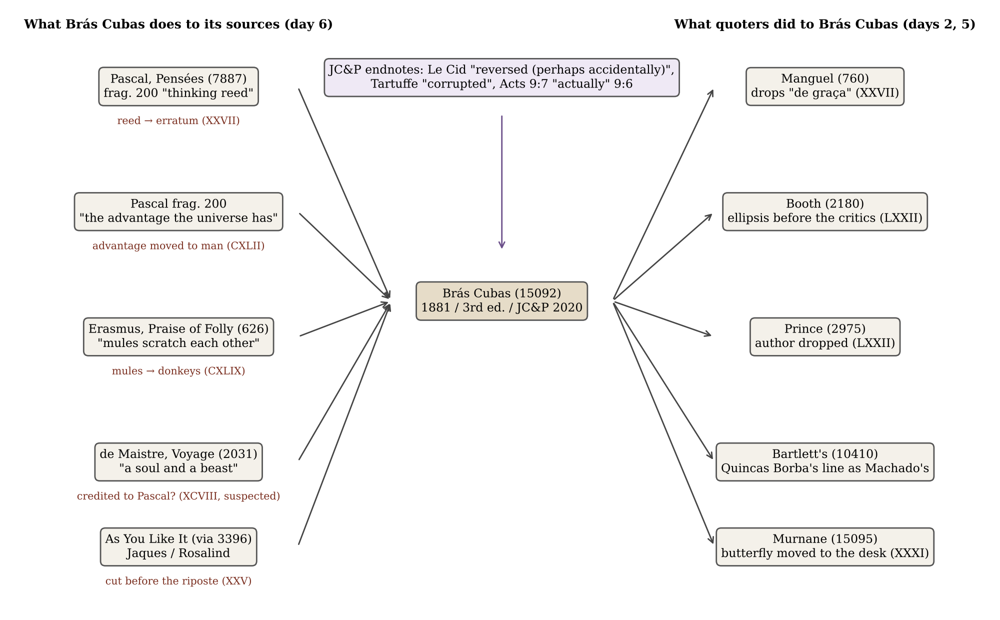

*[[shadows/weeks/machado-de-assis|Machado de Assis (Author & Shadow)]] · Day 6 of 7 · 2026-11-14 · Difficulty 3 · Genealogy/influence, Shared form or method*

## Books in this reading

- [[books/15092-posthumous-memoirs-of-bras-cubas-a-novel|Posthumous Memoirs of Brás Cubas: A Novel]], [[people/joaquim-maria-machado-de-assis-tr-margaret-jull-costa|Joaquim Maria Machado de Assis; tr. Margaret Jull Costa]], [[people/robin-patterson|Robin Patterson]]; 2020. *Day 6 primary (the author again): the novel's own borrowings from Pascal, Erasmus, de Maistre, Shakespeare, Corneille, Molière and Acts, read against the week's quoters*
- [[books/7887-pensees|Pensees]], [[people/blaise-pascal-tr-a-j-krailsheimer|Blaise Pascal; tr. A. J. Krailsheimer]]; 1670. *Day 6 cross-check: source of Brás Cubas chs. XXVII, XCVIII, CXLII (frags. 113, 200, 678)*
- [[books/626-praise-of-folly|Praise of Folly]], [[people/desiderius-erasmus-tr-betty-radice|Desiderius Erasmus; tr. Betty Radice]]; 1511. *Day 6 cross-check: source of Brás Cubas ch. CXLIX (mules → donkeys)*
- [[books/2031-voyage-around-my-room|Voyage Around My Room]], [[people/xavier-de-maistre-intro-richard-howard|Xavier de Maistre; intro. Richard Howard]]; 1794. *Day 6 cross-check: named model in 'To the Reader'; ch. VI soul/beast as suspected source of BC ch. XCVIII; Howard's introduction names Machado (Mentions 631)*
- [[books/3396-delphi-complete-works-of-johann-wolfgang-von-goeth|Delphi Complete Works of Johann Wolfgang Von Goethe (Illustrated)]], [[people/johann-wolfgang-von-goethe|Johann Wolfgang von Goethe]]; 2013. *Day 6 cross-check (one passage): As You Like It text verifying Rosalind's riposte to Jaques (BC ch. XXV)*

## The shadow so far

| Citing Book | Relation | Target | Location |
|---|---|---|---|
| [[books/1035-dom-casmurro|Dom Casmurro (Peter Owen 'complete and unabridged edition' 2016)]] (R. L. Scott-Buccleuch (translator)) | **Translates** | Machado de Assis | ch. 98 'Five Years', p. 158 (chapter ends here); TARGET Machado, Dom Casmurro, Garnier 1899, ch. XCVIII 'Cinco annos' (Project Gutenberg 55752) |
| [[books/1035-dom-casmurro|Dom Casmurro (Peter Owen 'complete and unabridged edition' 2016)]] (R. L. Scott-Buccleuch (translator)) | **Translates** | Machado de Assis | ch. 73 'The Stage Manager', p. 125; TARGET Machado, ch. LXXIII 'O contra-regra' (Gutenberg 55752) |
| [[books/1035-dom-casmurro|Dom Casmurro]] (Machado de Assis / R. L. Scott-Buccleuch) | **Quotes** | Machado de Assis | ch. 72 'A Reform in the Drama', p. 124; TARGET Shakespeare, Othello I.iii (checkable in Bartlett's 10410/13825, Concise Oxford Dictionary of Quotations 11435) |
| [[books/1035-dom-casmurro|Dom Casmurro]] (Machado de Assis) | **Rewrites** | Machado de Assis | ch. 72 'A Reform in the Drama', p. 124; TARGET Shakespeare, Othello (named; also ch. 62 'A Touch of Iago', ch. 135 'Othello') |
| [[books/15095-a-million-windows|A Million Windows]] (Gerald Murnane) | **Quotes** | Machado de Assis | section 19 (of 34); TARGET Brás Cubas ch. XXXI 'A borboleta preta' (Grossman's Epitaph, not in library; checked vs 1881 Gutenberg 54829 and Jull Costa 15092) |
| [[books/3172-stream-system|Stream System]] (Gerald Murnane) | **Mentions** | Machado de Assis | title story 'Stream System'; TARGET Brás Cubas ch. XXXI (via Grossman) |
| [[books/760-a-reading-diary|A Reading Diary]] (Alberto Manguel) | **Quotes** | Machado de Assis | ch. 12 'May: The Posthumous Memoirs of Brás Cubas'; TARGETS Brás Cubas chs. II, VI, VIII, XI, XXIV, XXVII, LXXI, CLX and others |
| [[books/1101-a-reader-on-reading|A Reader on Reading]] (Alberto Manguel) | **Mentions** | Machado de Assis | essay text (calibre get_passage on 'metaphor belongs to Machado'); TARGET Brás Cubas ch. VIII 'Razão contra Sandice' |
| [[books/2180-the-rhetoric-of-fiction|The Rhetoric of Fiction]] (Wayne C. Booth) | **Quotes** | Machado de Assis | p. 148 (index), epigraph opening ch. VI 'Types of Narration'; TARGET Brás Cubas ch. LXXII 'O bibliomano' (Grossman, credited in acknowledgments) |
| [[books/10410-bartlett-s-familiar-quotations|Bartlett's Familiar Quotations (18th ed.)]] (Geoffrey O'Brien (ed.)) | **Quotes** | Machado de Assis | Machado de Assis entry ('Epitaph of a Small Winner [1881]', note 4 'Translated by WILLIAM L. GROSSMAN.'); TARGET Brás Cubas ch. CXVII 'O Humanitismo' |
| [[books/2159-the-new-yale-book-of-quotations|The New Yale Book of Quotations]] (Fred R. Shapiro (ed.)) | **Quotes** | Machado de Assis | p. 510, Machado de Assis 1 (ch. 17) and 2 (ch. 119: 'It is better to fall from above the clouds than from the third floor.'); TARGET Brás Cubas chs. XVII, CXIX |
| [[books/1275-the-novel-volume-1-history-geography-and-culture|The Novel, Volume 1 (ch. 'Posthumous Memoirs of Brás Cubas')]] (Roberto Schwarz (tr. Sharon Lubkemann Allen)) | **Argues with** | Machado de Assis | p. 819 (also pp. 818–820, 839); TARGET Machado's critics and admirers on Brás Cubas |
| [[books/1275-the-novel-volume-1-history-geography-and-culture|The Novel, Volume 1 (quoting Romero, Machado de Assis, 1897)]] (Sílvio Romero (via Schwarz)) | **Argues with** | Machado de Assis | p. 819, n. 4 (Romero, Machado de Assis (1897), Unicamp 1992, p. 160); TARGET Machado, Brás Cubas and later novels |
| [[books/13307-the-devil-to-pay-in-the-backlands|The Devil to Pay in the Backlands (foreword 'The Place of Guimarães Rosa in Brazilian Literature')]] (Jorge Amado) | **Argues with** | Machado de Assis | Foreword (signed Rio de Janeiro, September 1962); TARGET Machado's legacy in Minas Gerais fiction |
| [[books/1261-the-cambridge-history-of-latin-american-literature|The Cambridge History of Latin American Literature vol. 3 (file catalogued as vol. 1)]] (Thomas E. Skidmore; Massaud Moisés) | **Argues with** | Machado de Assis | Skidmore, 'The essay: architects of Brazilian national identity', p. 347; Moisés, 'Brazilian poetry from 1878 to 1902', p. 83; TARGET Romero ⇄ Machado |
| [[books/15092-posthumous-memoirs-of-bras-cubas-a-novel|Posthumous Memoirs of Brás Cubas (Author's Preface to the Third Edition)]] (Machado de Assis (tr. Jull Costa & Patterson)) | **Argues with** | Machado de Assis | Author's Preface to the Third Edition; TARGET Capistrano de Abreu's review ('Is Posthumous Memoirs of Brás Cubas a novel?') and Macedo Soares's comparison to Garrett |
| [[books/5839-the-crime-of-father-amaro|The Crime of Father Amaro (Introduction)]] (Margaret Jull Costa, reporting Machado's 1878 review) | **Argues with** | Machado de Assis | Introduction; TARGET Eça, O Crime do Padre Amaro (1876) and O Primo Basílio (1878) |
| [[books/7664-lukacs-after-communism-interviews-with-contemporar|Lukács After Communism (Interview with Roberto Schwarz, 15 Aug 1994)]] (Roberto Schwarz / Eva L. Corredor) | **Mentions** | Machado de Assis | Interview with Roberto Schwarz; TARGET Machado's novels (realism, Zola, Sterne, Diderot) |
| [[books/1138-the-alienist|The Alienist (Melville House 'Art of the Novella' 2012)]] (Melville House (editor unnamed); translation William L. Grossman, not named in the EPUB) | **Edits/introduces** | Machado de Assis | whole text, chs. I–XIII (quote ch. XIII); TARGET Grossman, The Psychiatrist (4753, 1963) |
| [[books/4753-the-psychiatrist-other-stories|The Psychiatrist and Other Stories ('The Psychiatrist')]] (William L. Grossman (translator)) | **Translates** | Machado de Assis | section II 'A Torrent of Madmen' + note 1; TARGET O alienista ch. II (Papeis Avulsos 1882, Gutenberg 57001) |
| [[books/4753-the-psychiatrist-other-stories|The Psychiatrist and Other Stories ('The Psychiatrist')]] (William L. Grossman (translator)) | **Translates** | Machado de Assis | section XIII 'Plus Ultra' (end); TARGET O alienista ch. XIII |
| [[books/4753-the-psychiatrist-other-stories|The Psychiatrist and Other Stories (Introduction)]] (William L. Grossman) | **Edits/introduces** | Machado de Assis | Introduction (signed WILLIAM L. GROSSMAN); TARGET O alienista ch. XI ('quatro quintos da' population) |
| [[books/2483-the-collected-stories-of-machado-de-assis|The Collected Stories of Machado de Assis ('The Alienist')]] (Margaret Jull Costa & Robin Patterson (translators)) | **Translates** | Machado de Assis | The Alienist ch. 1; TARGET O alienista ch. I |
| [[books/14888-a-chapter-of-hats-and-other-stories|A Chapter of Hats and Other Stories (Translator's Introduction)]] (John Gledson) | **Edits/introduces** | Machado de Assis | Translator's Introduction; TARGET O alienista and its English titles |
| [[books/11676-the-oxford-guide-to-literature-in-english-translat|The Oxford Guide to Literature in English Translation]] (Peter France (ed.), 'Brazilian Literature' section II.k.15) | **Mentions** | Machado de Assis | p. 444 (PDF p. 470); bibliography p. 446; TARGET Machado's English translators (Grossman, Scott-Buccleuch, Caldwell) |
| [[books/6515-sympathy-for-the-traitor-a-translation-manifesto|Sympathy for the Traitor: A Translation Manifesto]] (Mark Polizzotti (citing Adam Thirlwell, The Delighted States)) | **Mentions** | Machado de Assis | ch. 9, p. 150; TARGET Machado as reader of Sterne in French (cf. 'Ao leitor', 'fórma livre de um Sterne', edge 73) |
| [[books/2975-narratology-the-form-and-functioning-of-narrative|Narratology: The Form and Functioning of Narrative]] (Gerald Prince) | **Uses without credit (suspected)** | Machado de Assis | ch. 4 'Reading Narrative', p. 116, example (48); TARGET Brás Cubas ch. LXXII 'O bibliomano' (Grossman), via Booth 2180 p. 148 |
| [[books/2269-the-book-of-emotions|The Book of Emotions]] (João Almino (tr. Elizabeth Jackson)) | **Uses without credit (suspected)** | Machado de Assis | ch. 7 'Quincas Borba and his owner' (also ch. 11 'Quincas’s warning of danger'); TARGET Machado, Quincas Borba (1891), the dog named for the philosopher (cf. 1036 introduction) |
| [[books/721-four-novels-out-64-such-66-between-68-thru-75-the|Thru (in Four Novels omnibus)]] (Christine Brooke-Rose) | **Uses without credit (suspected)** | Machado de Assis | Thru (1975), seminar scene (Doreen's essay); also Larissa passage 'keeping them as a small winner'; TARGET Grossman's title Epitaph of a Small Winner (PT 'um pequeno saldo', ch. CLX) |
| [[books/15092-posthumous-memoirs-of-bras-cubas-a-novel|Posthumous Memoirs of Brás Cubas]] (Machado de Assis (tr. Jull Costa & Patterson)) | **Rewrites** | Machado de Assis | ch. XXVII 'Virgília?', last paragraph; TARGET Pascal, Pensées frag. 200 (Krailsheimer, 7887): 'Man is only a reed, the weakest in nature, but he is a thinking reed.' (also frag. 113 'Thinking reed.') |
| [[books/15092-posthumous-memoirs-of-bras-cubas-a-novel|Posthumous Memoirs of Brás Cubas]] (Machado de Assis (character Quincas Borba; tr. Jull Costa & Patterson)) | **Quotes** | Machado de Assis | ch. CXLII 'The secret request'; TARGET Pascal, Pensées frag. 200 (7887): 'because he knows that he is dying and the advantage the universe has over him. The universe knows none of this.' |
| [[books/15092-posthumous-memoirs-of-bras-cubas-a-novel|Posthumous Memoirs of Brás Cubas]] (Machado de Assis (character Quincas Borba; tr. Jull Costa & Patterson)) | **Rewrites** | Machado de Assis | ch. CXLIX 'Theory of good deeds'; TARGET Erasmus, Praise of Folly (Radice, 626), Folly on flattery: 'What shows such willingness to please as the way mules scratch each other?' |
| [[books/15092-posthumous-memoirs-of-bras-cubas-a-novel|Posthumous Memoirs of Brás Cubas]] (Machado de Assis (tr. Jull Costa & Patterson)) | **Uses without credit (suspected)** | Machado de Assis | ch. XCVIII (end); TARGET de Maistre, Voyage Around My Room (2031) ch. VI 'system of the soul and the beast'; credited source Pascal frag. 678 (7887) |
| [[books/15092-posthumous-memoirs-of-bras-cubas-a-novel|Posthumous Memoirs of Brás Cubas]] (Machado de Assis (tr. Jull Costa & Patterson)) | **Quotes** | Machado de Assis | ch. XXV; TARGET As You Like It IV.i (Jaques), text verified in Delphi Goethe 3396: 'Rosalind. Why, then, ’tis good to be a post.' |
| [[books/15092-posthumous-memoirs-of-bras-cubas-a-novel|Posthumous Memoirs of Brás Cubas (translators' endnotes)]] (Margaret Jull Costa & Robin Patterson) | **Edits/introduces** | Machado de Assis | endnotes to ch. VI (Le Cid), ch. VIII (Tartuffe), ch. XXXV (Acts); TARGET Machado's own quotations of Corneille, Molière, Acts |
| [[books/2031-voyage-around-my-room|Voyage Around My Room (Introduction)]] (Richard Howard) | **Mentions** | Machado de Assis | Introduction 'Invitation to the Voyages of X...'; TARGET Machado as heir of Sterne via de Maistre |

---

## Library resurfacing, Scribrarium · 14 November 2026 · An author and their shadow

## 1. Where the week stands

Machado de Assis, day 6 of 7 (Set 52). Day 1 found that the “complete and unabridged” English *Dom Casmurro* still leaves out Escobar's letters. Days 2 and 5 found quoters who keep Machado's words and move, cut or re-credit them: Murnane's butterfly lands on the writing desk, Booth's ellipsis falls on the critics, Manguel drops “de graça”, Bartlett's hands Quincas Borba's maxim to Machado, and Prince prints Booth's epigraph with the author's name gone. Day 3 found the argument about where his books live; day 4 found a translator's word (*psychiatrist*) replaced and the translator's name lost. Today returns to Machado's own book, *Posthumous Memoirs of Brás Cubas*, and asks what it does with the sentences it borrows.

## 2. The day's finding

*Brás Cubas* does to its sources what the week's quoters did to *Brás Cubas*. It keeps the name and corrects, moves or cuts the sentence. Pascal's thinking reed becomes “a thinking erratum” (ch. XXVII). Quincas Borba, finger on the page, quotes Pascal's fragment 200 and moves “the advantage” from the universe to man (ch. CXLII). Erasmus's mules become donkeys, and flattery becomes superiority, followed by “I will say what he did not” (ch. CXLIX). Jaques is quoted without Rosalind's reply (ch. XXV), which is where Booth's ellipsis fell on day 2. The translators' endnotes then do the bibliomaniac's job and catch Machado's own slips: *Le Cid* reversed, *Tartuffe* “corrupted”, Acts 9:7 that is “actually” 9:6, a verse number that is already there in the 1881 text.

The novel names the procedure itself. Each season of life is “a new edition that corrects the preceding one” (ch. XXVII), and eleven chapters later Brás is “in my fourth edition, revised and amended, but still infested with mistakes and barbarisms” (ch. XXXVIII). The relations today are **Rewrites** (Pascal, Erasmus), **Quotes** (Pascal, Shakespeare), **Uses without credit (suspected)** (de Maistre), **Edits/introduces** (the translators' notes) and **Mentions** (Richard Howard on de Maistre and Machado). Edges 87–93.

## 3. The books

**Posthumous Memoirs of Brás Cubas — Machado de Assis, 1881; tr. Margaret Jull Costa & Robin Patterson, Liveright 2020 (EPUB; Calibre 15092)**

**Selection logic.** The week's plan named this book for day 6 (it was the preferred day-1 book and arrived in the catalogue during the day-1 run). It is the book every quoter of days 2 and 5 was quoting. Not from the Send To pool: no Candidates were queued.

**How much was read.** Targeted, not whole. The EPUB was extracted in spine order (body

*Figure 1: Day 6: sources in, quoters out. Left: what the novel does to five sources (today).*

Right: what five quoters did to the novel (days 2 and 5). Top: the translators' endnotes.

72,259 words) and searched for some sixty names of authors and characters. Read in full: To the Reader, the Author's Preface to the Third Edition, the translators' Introduction (2,019 words), all 49 translators' endnotes, and chapters VIII, XXVII, XXXI, LXXII, CXLII and CLX; read in part: I, VI, XXV, XXXV, XXXVIII, LXXXIII, XCVIII, CXLIX. About 8% of the 160 chapters were read whole. Collated against the 1881 Typographia Nacional text (Project Gutenberg 54829) at chs. XXVII, XXXI, XXXV, LXXII, XCVIII, CXLII, CXLIX and “Ao leitor”.

**Overview.** The memoir of a dead man, written “with the pen of mirthful mockery and the ink of melancholy” (Introduction, quoting the novel). Its narrator borrows constantly: the translators' notes gloss Corneille, Isaiah, Molière, Tertullian, Bocage, Luke, Cervantes, Klopstock, Virgil, Acts, Voltaire, Dante, Plutarch, Beaumarchais, Pascal, Homer, Helvétius and others. The translators' Introduction says it plainly:

> Another regular feature in Machado’s work is the use of not-quite-accurate quotations. Quincas Borba is particularly fond of tinkering with the texts of other philosophers—Pascal and Erasmus are two examples—to suit his own purposes and perhaps to give himself the appearance of being superior to other scholars. Or is this a further example of Brás Cubas’s theory of man as a thinking erratum? Or another way to trip up the unwary reader?

**Element 1 — Excerpt: the theory (ch. XXVII, “Virgília?”).**

> For this is what makes us the lords of the Earth, this ability to restore the past, to realize the fragility of our impressions and the futility of our affections. Pascal may say that man is a thinking reed, but he isn’t, he’s a thinking erratum. […]
>
> *(Shortened for the public edition.)*

1881: “Deixa lá dizer o Pascal que o homem é um caniço pensante. Não; é uma errata pensante, isso sim.” This is the passage Manguel quoted on day 2 without “de graça” (edge 64). A quoter trimmed the sentence about correction.

**Element 2 — Verified quotations: the novel's borrowings, collated.** Quincas Borba on Pascal, a few lines later (ch. CXLII): “It seems to me (if it would not be im-

| Chapter | What the novel says | The source in the library | What changed |
|---|---|---|---|
| XXVII | “Pascal may say that man is a thinking reed, but he isn’t, he’s a thinking erratum.” | Pascal 7887, frag. 200: “Man is only a reed, the weakest in nature, but he is a thinking reed.” | Quoted to be corrected; the correction is a printer's word |
| CXLII | “He says that man has ‘a great advantage over the rest of the world: he knows that he is dying, whereas the universe is entirely unaware of it.’” | 7887, frag. 200: “because he knows that he is dying and the advantage the universe has over him. The universe knows none of this.” | “Advantage” moved from the universe to man; then “improved” to hunger |
| CXLIX | “Erasmus, who wrote some fine things in his treatise In Praise of Folly, drew attention to the pleasure with which two donkeys scratch each other.” | Erasmus 626: “What shows such willingness to please as the way mules scratch each other?” | Mules become donkeys (1881 “dois burros”); flattery becomes superiority |
| XCVIII | “except that the eminent Jansenist did not allow for the simultaneous enjoyment of those two natures” | Pascal 7887, frag. 678: “Man is neither angel nor beast, and it is unfortunately the case that anyone trying to act the angel acts the beast.” | Correct attribution; the simultaneity is closer to de Maistre (suspected; see below) |
| XXV | ““ ’Tis good to be sad and say nothing.” When I first read those words by Shakespeare” | 3396 (play text): “Rosalind. Why, then, ’tis good to be a post.” | Cut before the riposte |
| XXXV | “whispering these words from the Scriptures (Acts 9:7):” | no Bible in the catalogue | Endnote: “The quotation is actually from Acts 9:6.” 1881 reads “(*Act.*, IX, 7)”: the slip is Machado's (or Brás's), not the translators' |

modest to say so) that Pascal’s formulation is inferior to mine, although it is still a fine thought, and Pascal a fine man.” The 1881 wording of the misquotation is «uma grande vantagem sobre o resto do universo: sabe que morre, ao passo que o universo ignora-o absolutamente.» Jull Costa and Patterson's “rest of the world” for “resto do universo” weakens the echo of Pascal's “universe”, which appears twice in the Portuguese sentence. That adds the translators' small drift on top of the character's.

**Element 3 — Derived list: thinkers named in the narrative (string counts in the 160 chapters, notes excluded).** Pascal 5 (XXVII, XCVIII, CXLII); Helvétius 4 (CXXXIII); Pangloss 4 and Voltaire 3 (XLIX, CXVII, CXL, CLIX); Aristotle 3; Seneca 3; Shakespeare 3 plus Hamlet 2 and Othello 1; Erasmus 2 (CXLIX). Every Pascal citation is a correction or an “improvement”. (Counts are substring counts; “Virgil” was excluded because it matches “Virgília”.)

**Element 4 — The translators as bibliomaniacs (endnotes).** Three of the 49 notes catch a misquotation:

- ch. VI title: “The order of the two lines has been reversed (perhaps accidentally)”. The 1881 title reads “Chimène, qui l'eut dit?--Rodrigue, qui l'eut cru?”; this EPUB prints “Chimène, que l’eût dit?” (“que” for “qui”). Whether that is a third-edition variant, a translators' change or an EPUB slip cannot be settled here.

- ch. VIII: “A corrupted version of the words spoken by Tartuffe in Molière’s comedy of the same name”.

- ch. XXXV: “The quotation is actually from Acts 9:6.”

Le Cid, Tartuffe and a Bible are not in the catalogue, so these three claims are the translators', not checked today.

**A misreading worth attempting.** In ch. LXXII Brás imagines a bibliomaniac, seventy years on, hunting a sentence that “comes very close to being sheer nonsense”, and failing to find it. Read the endnotes as his report, delivered 139 years after the book: he found the nonsense, three times over, and printed it at the back. (1881 differs: “lava-as, e nada. Fica sempre o mesmo desproposito”, which is closer to “the same nonsense always remains” than to “he cannot find the nonsense”. Not resolved: it may be a third-edition revision. Recorded as an open question.)

**Pensées — Blaise Pascal, tr. A. J. Krailsheimer (Penguin; EPUB; Calibre 7887) — cross-check**

**Selection logic.** The thinker *Brás Cubas* names most. Not from the pool. **Read:** fragments 113, 200 and 678 with context; contents (under 1%).

**Element 1 — Excerpt (frag. 200).**

> Man is only a reed, the weakest in nature, but he is a thinking reed. There is no need for the whole universe to take up arms to crush him: a vapour, a drop of water is enough to kill him. But even if the universe were to crush him, man would still be nobler than his slayer, because he knows that he is dying and the advantage the universe has over him. The universe knows none of this.

**Element 2 — Concordance of Pascal in Brás Cubas.** XXVII “thinking reed” →“thinking erratum” (frag. 200; also frag. 113, “Thinking reed.”). XCVIII *l'ange et la bête* (frag. 678; the endnote's own translation reads “angel nor brute”, Krailsheimer's “angel nor beast”). CXLII “he knows that he is dying” (frag. 200, advantage moved). Limit: Krailsheimer is not what Machado read; no French Pensées was checked.

**Praise of Folly — Desiderius Erasmus, tr. Betty Radice (Penguin; EPUB; Calibre 626) — cross-check**

**Selection logic.** Named by Quincas Borba in ch. CXLIX. **Read:** every “scratch” (4) and “mule” (9) with context (under 1%).

**Element 1 — Quotes.** “What shows such willingness to please as the way mules scratch each other?” (Folly's speech on flattery, before n. 87). And, earlier: “A purblind man who takes a donkey for a mule or one who praises an ill-written poem as an excellent one certainly won’t be thought insane.” (Folly's speech on insanity.)

**Element 2 — A misreading worth attempting.** Erasmus excuses in advance the exact substitution Quincas Borba makes. The philosopher whose “semi-madness” Brás mentions in the last chapter (ch. CLX) passes Folly's own sanity test on this one point. Whether *burros* is Machado's slip or his joke the text does not say.

**Voyage Around My Room — Xavier de Maistre, intro. Richard Howard (EPUB; Calibre 2031) — cross-check; Mentions row 631**

**Selection logic.** Named in “To the Reader” as one of the novel's models; Mentions row 631 (day 1) showed the book names Machado. **Read:** Howard's paragraph on filiations; the start of ch. VI; under 2%.

**Element 1 — Quotes.** Howard: “a resonance that would be echoed throughout Europe and even in Latin America (from Goncharov to Machado de Assis); Sainte-Beuve detected even more of the grace souriante et sensible of Charles Lamb in these whimsical chapters”. Sterne,

de Maistre and Lamb are the three names of Machado's 1881 “Ao leitor” (“um Sterne, de um Lamb, ou de um de Maistre”), from which Lamb later disappears (day 3, edge 73). De Maistre, ch. VI: “I have noticed, through many and sundry observations, that man is made up of a soul and a beast.— These two beings are absolutely distinct, yet so contained within one another, or rather on top of one another,”

**Element 2 — Suspicion (edge 90), stated as such.** Brás says Pascal's angel and beast fail him because the Jansenist “did not allow for the simultaneous enjoyment of those two natures”. De Maistre's soul and beast are simultaneous by definition (“on top of one another”). Guess: the duality Brás enjoys is de Maistre's, credited to Pascal. Against it: both pairs are commonplaces, and Machado credits de Maistre elsewhere. Confidence low to moderate.

**Delphi Complete Works of Goethe (EPUB; Calibre 3396) — cross-check, one passage**

**Selection logic.** Apart from *Brás Cubas*, the only books in the index containing Jaques's line are two Goethe omnibuses (3396, 7228). Why a Goethe omnibus carries *As You Like It* was not investigated. **Elements:** Quotes: “Why, ’tis good to be sad and say nothing.” / “Rosalind. Why, then, ’tis good to be a post.” Concordance: the riposte that Jull Costa and Patterson cite (“he does, it seems, entirely fail to notice Rosalind’s riposte”) is in the play where they say it is; their Introduction spells the speaker “Jacques”.

## 4. The shadow so far (edges 58–93)

| # | From | Relation | To | Location |
|---|---|---|---|---|
| 58–59 | Scott-Buccleuch, *Dom Casmurro* 1035 | Translates (omits) | DC chs. 98, 73 | pp. 158, 125 |
| 60–61 | *Dom Casmurro* 1035 | Quotes / Rewrites | *Othello* | ch. 72 |
| 62–63 | Murnane 15095, 3172 | Quotes / Mentions | BC ch. XXXI | sect. 19 |
| 64–65 | Manguel 760, 1101 | Quotes / Mentions | BC chs. XXVII, VIII | ch. 12 |
| 66 | Booth 2180 | Quotes | BC ch. LXXII | p. 148 |
| 67–68 | Bartlett's 10410; Yale 2159 | Quotes | BC chs. CXVII, XVII, CXIX | p. 510 |
| 69–72 | Schwarz/Romero 1275; Amado 13307; CHLAL 1261 | Argues with | Machado | p. 819; foreword; pp. 83, 347 |
| 73–74 | BC preface 15092; Jull Costa on Eça 5839 | Argues with | Capistrano; Eça | Preface; Intro |
| 75 | Schwarz interview 7664 | Mentions | Machado's realism | interview |
| 76 | Melville House 1138 | Edits/introduces | Grossman 4753 | whole |
| 77–78, 80 | Grossman 4753; JC&P 2483 | Translates | *O alienista* | chs. I, II, XIII |
| 79, 81 | Grossman 4753; Gledson 14888 | Edits/introduces | *O alienista* | Introductions |
| 82–83 | Oxford Guide 11676; Polizzotti 6515 | Mentions | translators; Sterne | p. 444; p. 150 |
| 84–86 | Prince 2975; Almino 2269; Brooke-Rose 721 | Uses without credit (suspected) | BC ch. LXXII; *Quincas Borba*; Grossman's title | p. 116; ch. 7; *Thru* |
| **87** | **BC 15092** | **Rewrites** | **Pascal 7887 frag. 200** | **ch. XXVII** |
| **88** | **BC 15092 (Quincas Borba)** | **Quotes** | **Pascal 7887 frag. 200** | **ch. CXLII** |
| **89** | **BC 15092 (Quincas Borba)** | **Rewrites** | **Erasmus 626** | **ch. CXLIX** |
| **90** | **BC 15092** | **Uses without credit (suspected)** | **de Maistre 2031, ch. VI** | **ch. XCVIII** |
| **91 92** | **BC 15092 JC&P endnotes 15092** | **Quotes Edits/introduces *Le Cid*****,** | ***As You Like It* (via 3396) *Tartuffe*****, Acts** | **ch. XXV notes to VI, VIII, XXXV** |
| **93** | **Howard, intro. 2031** | **Mentions** | **Machado (Sterne line; Lamb)** | **Introduction** |

Through day 6: 36 edges this week. Today's seven all point outward from Machado or his editors except 93, which points in.

## 5. Where this sends you

**Notebook**

1. Brás calls man “a thinking erratum” and Quincas Borba improves Pascal on the page he is pointing at. Is a misquotation that announces itself still a misquotation? Write the rule that separates Quincas Borba from Manguel.

2. Erasmus says the man who “takes a donkey for a mule” is not mad; Quincas Borba takes a mule for a donkey and ends in “semi-madness” (ch. CLX). Write the chapter Erasmus would add.

3. Jaques without Rosalind; Machado's ch. LXXII without its critics (Booth). Find a quotation in your own commonplace book that is famous only because its reply was cut.

**Rabbit holes**

- *Memorias Posthumas de Braz Cubas*, 1881 text, Project Gutenberg: https://www.gutenberg.org/ebooks/54829

- Pascal's *Pensées* (Trotter's English), Project Gutenberg: https://www.gutenberg.org/ebooks/18269

- Erasmus, *The Praise of Folly*, Project Gutenberg: https://www.gutenberg.org/ebooks/9371

- “Blaise Pascal”, *Stanford Encyclopedia of Philosophy*: https://plato.stanford.edu/entries/pascal/; and the IEP entry: https://www.iep.utm.edu/pascal-b/

- *Machado de Assis em Linha* (open-access journal, search “citação” or “Pascal”): https://www.scielo.br/j/mael/

- de Maistre in French, *Voyage autour de ma chambre*, Gutenberg search: https://www.gutenberg.org/ebooks/search/?query=voyage+autour+de+ma+chambre

**Also in your library**

- *Quincas Borba* (1036): does the philosopher keep misquoting Pascal and Erasmus in his own novel?

- *Herodotea* (4217): its index of textual errors (“loss of negatives”, “metathesis”, “omission”, “polar opposite”) is a ready-made taxonomy for this week's drift (e.g. “nada menos” →“nothing more”, day 2).

- *Collected Works of Erasmus* (13016) and *Apophthegmata* (625): for the mules proverb in Erasmus's own Latin.

- Send To pool: no Candidates were queued today.

## 6. From the Lexicon — metathesis

**Received.** The transposition of sounds, letters or syllables within a word (or, less commonly, of words within a sentence), whether as historical sound change (Old English *bridd* > *bird*), regional variation (*ask* / *aks*), or deliberate wordplay. Linguists distinguish local (adjacent) metathesis from distant metathesis, also called hyperthesis (Latin *parabola* > Spanish *pal-abra*).

**Your sense.** None recorded yet.

**Etymology.** Greek μετάθεσις, *metathesis* (change of position, transposition, change of opinion), from *metatithenai* (to transpose), *meta-* (change) + *tithenai* (to place, set), from PIE *dhe- (to set, put). In English from the 1570s in grammar for the transposition of letters; c. 1600 for the rhetorical transposition of words.

**WordNet.** oewn-13536723-n: “a linguistic process of transposition of sounds or syllables within a word or words within a sentence”; hypernym: linguistic process.

**Relations or lineage.** Shares lineage with antimetabole, hyperbaton, sententia, maxim, apothegm, paratactic, cognates and onomastics. Boundary: in rhetoric a metaplasm (a change to a word's form), sometimes a kind of paronomasia; in chemistry a double-displacement reaction (AB + CD →AD + CB).

**Portable axiom.** None recorded.

**Why today.** The Greek word covers both “transposition” and “change of opinion”, and that is the novel's habit in brief: *Le Cid*'s two lines swapped, Pascal's “advantage” moved from the universe to man, and then the opinion changed.

**Verified occurrence.** Lanham, *A Handlist of Rhetorical Terms* (10717), alphabetical list: “Metathesis (me TA the sis; G. ”transposition, change”) — Antisthecon; Transposition.” (checked with calibre get_passage). The stored attestation (The Free Dictionary) is not verified here.

**New in the Lexicon** since yesterday's run: *panegyrics*, *morphism*, *monstration* (added 14 Nov).

## 7. To carry

> “Pascal may say that man is a thinking reed, but he isn’t, he’s a thinking erratum.” — Machado de Assis, *Posthumous Memoirs of Brás Cubas*, ch. XXVII, tr. Jull Costa & Patterson (15092)

*Method notes.* Scribrarium mounted in device_bash after folder access was requested and granted. Texts read from the EPUB (15092) and the Calibre full-text index; the 1881 Portuguese downloaded from Project Gutenberg into the cloud workspace. search_full_text and get_passage worked today. No Candidates queued; no Mentions row promoted except 631.

Reading notes: 15092 — Machado — Posthumous Memoirs of Brás Cubas.md; 7887 — Pascal — Pensées.md; 626 — Erasmus — Praise of Folly.md; 2031 — de Maistre — Voyage Around My Room.md; 3396 — Goethe — Delphi Complete Works (As You Like It).md

## Themes

[[themes/1881-vs-third-edition|1881 vs third edition]] · [[themes/acts|Acts]] · [[themes/angel-and-beast|angel and beast]] · [[themes/as-you-like-it|As You Like It]] · [[themes/bibliomaniac|bibliomaniac]] · [[themes/charles-lamb|Charles Lamb]] · [[themes/correction|correction]] · [[themes/donkeys|donkeys]] · [[themes/edition|edition]] · [[themes/endnotes|endnotes]] · [[themes/erasmus|Erasmus]] · [[themes/erratum|erratum]] · [[themes/frag-200|frag. 200]] · [[themes/humanitism|Humanitism]] · [[themes/jaques|Jaques]] · [[themes/jull-costa|Jull Costa]] · [[themes/le-cid|Le Cid]] · [[themes/metathesis|metathesis]] · [[themes/misquotation|misquotation]] · [[themes/mules|mules]] · [[themes/pascal|Pascal]] · [[themes/patterson|Patterson]] · [[themes/praise-of-folly|Praise of Folly]] · [[themes/quincas-borba|Quincas Borba]] · [[themes/rosalind|Rosalind]] · [[themes/shakespeare|Shakespeare]] · [[themes/soul-and-beast|soul and beast]] · [[themes/sterne|Sterne]] · [[themes/tartuffe|Tartuffe]] · [[themes/thinking-reed|thinking reed]] · [[themes/translator|translator]] · [[themes/xavier-de-maistre|Xavier de Maistre]]

---

Previous: [[shadows/2026-11-13-shadow-machado-de-assis-day-5-not-in-his-biographi|Shadow — Machado de Assis, day 5: Not in His Biographical Dictionaries]]  
Next: [[shadows/2026-11-15-shadow-machado-de-assis-day-7-name-kept-sentence-m|Shadow — Machado de Assis, day 7: Name Kept, Sentence Moved]]
