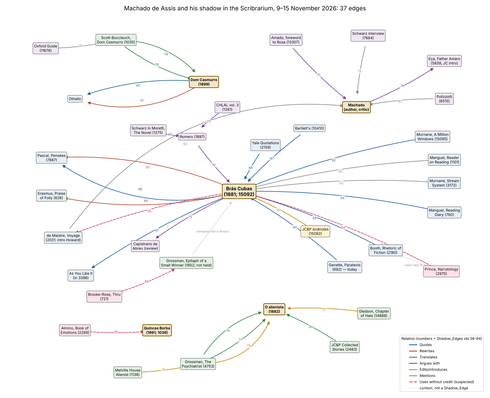

*[[shadows/weeks/machado-de-assis|Machado de Assis (Author & Shadow)]] · Day 7 of 7 · 2026-11-15 · Difficulty 3 · Genealogy/influence, Shared form or method*

## Books in this reading

- [[books/692-paratexts-thresholds-of-interpretation|Paratexts: Thresholds of Interpretation]], [[people/gerard-genette-tr-jane-e-lewin-foreword-richard-macksey|Gérard Genette; tr. Jane E. Lewin; foreword Richard Macksey]]; 1987. *Day 7: the week's last inward edge (94, Quotes): 'To the Reader' quoted via E. Percy Ellis 1955; Brás Cubas filed as a fictive actorial preface. Bridge to the proposed next author.*
- [[books/15092-posthumous-memoirs-of-bras-cubas-a-novel|Posthumous Memoirs of Brás Cubas: A Novel]], [[people/joaquim-maria-machado-de-assis-tr-margaret-jull-costa|Joaquim Maria Machado de Assis; tr. Margaret Jull Costa]], [[people/robin-patterson|Robin Patterson]]; 2020. *Day 7: hub of the week's graph (17 of 37 edges); 'To the Reader' collated with Ellis (via 692) and the 1881 'Ao leitor'. Used as primary on day 6 (Set 52); re-used today because the map's relation requires the hub.*

## The shadow so far

| Citing Book | Relation | Target | Location |
|---|---|---|---|
| [[books/1035-dom-casmurro|Dom Casmurro (Peter Owen 'complete and unabridged edition' 2016)]] (R. L. Scott-Buccleuch (translator)) | **Translates** | Machado de Assis | ch. 98 'Five Years', p. 158 (chapter ends here); TARGET Machado, Dom Casmurro, Garnier 1899, ch. XCVIII 'Cinco annos' (Project Gutenberg 55752) |
| [[books/1035-dom-casmurro|Dom Casmurro (Peter Owen 'complete and unabridged edition' 2016)]] (R. L. Scott-Buccleuch (translator)) | **Translates** | Machado de Assis | ch. 73 'The Stage Manager', p. 125; TARGET Machado, ch. LXXIII 'O contra-regra' (Gutenberg 55752) |
| [[books/1035-dom-casmurro|Dom Casmurro]] (Machado de Assis / R. L. Scott-Buccleuch) | **Quotes** | Machado de Assis | ch. 72 'A Reform in the Drama', p. 124; TARGET Shakespeare, Othello I.iii (checkable in Bartlett's 10410/13825, Concise Oxford Dictionary of Quotations 11435) |
| [[books/1035-dom-casmurro|Dom Casmurro]] (Machado de Assis) | **Rewrites** | Machado de Assis | ch. 72 'A Reform in the Drama', p. 124; TARGET Shakespeare, Othello (named; also ch. 62 'A Touch of Iago', ch. 135 'Othello') |
| [[books/15095-a-million-windows|A Million Windows]] (Gerald Murnane) | **Quotes** | Machado de Assis | section 19 (of 34); TARGET Brás Cubas ch. XXXI 'A borboleta preta' (Grossman's Epitaph, not in library; checked vs 1881 Gutenberg 54829 and Jull Costa 15092) |
| [[books/3172-stream-system|Stream System]] (Gerald Murnane) | **Mentions** | Machado de Assis | title story 'Stream System'; TARGET Brás Cubas ch. XXXI (via Grossman) |
| [[books/760-a-reading-diary|A Reading Diary]] (Alberto Manguel) | **Quotes** | Machado de Assis | ch. 12 'May: The Posthumous Memoirs of Brás Cubas'; TARGETS Brás Cubas chs. II, VI, VIII, XI, XXIV, XXVII, LXXI, CLX and others |
| [[books/1101-a-reader-on-reading|A Reader on Reading]] (Alberto Manguel) | **Mentions** | Machado de Assis | essay text (calibre get_passage on 'metaphor belongs to Machado'); TARGET Brás Cubas ch. VIII 'Razão contra Sandice' |
| [[books/2180-the-rhetoric-of-fiction|The Rhetoric of Fiction]] (Wayne C. Booth) | **Quotes** | Machado de Assis | p. 148 (index), epigraph opening ch. VI 'Types of Narration'; TARGET Brás Cubas ch. LXXII 'O bibliomano' (Grossman, credited in acknowledgments) |
| [[books/10410-bartlett-s-familiar-quotations|Bartlett's Familiar Quotations (18th ed.)]] (Geoffrey O'Brien (ed.)) | **Quotes** | Machado de Assis | Machado de Assis entry ('Epitaph of a Small Winner [1881]', note 4 'Translated by WILLIAM L. GROSSMAN.'); TARGET Brás Cubas ch. CXVII 'O Humanitismo' |
| [[books/2159-the-new-yale-book-of-quotations|The New Yale Book of Quotations]] (Fred R. Shapiro (ed.)) | **Quotes** | Machado de Assis | p. 510, Machado de Assis 1 (ch. 17) and 2 (ch. 119: 'It is better to fall from above the clouds than from the third floor.'); TARGET Brás Cubas chs. XVII, CXIX |
| [[books/1275-the-novel-volume-1-history-geography-and-culture|The Novel, Volume 1 (ch. 'Posthumous Memoirs of Brás Cubas')]] (Roberto Schwarz (tr. Sharon Lubkemann Allen)) | **Argues with** | Machado de Assis | p. 819 (also pp. 818–820, 839); TARGET Machado's critics and admirers on Brás Cubas |
| [[books/1275-the-novel-volume-1-history-geography-and-culture|The Novel, Volume 1 (quoting Romero, Machado de Assis, 1897)]] (Sílvio Romero (via Schwarz)) | **Argues with** | Machado de Assis | p. 819, n. 4 (Romero, Machado de Assis (1897), Unicamp 1992, p. 160); TARGET Machado, Brás Cubas and later novels |
| [[books/13307-the-devil-to-pay-in-the-backlands|The Devil to Pay in the Backlands (foreword 'The Place of Guimarães Rosa in Brazilian Literature')]] (Jorge Amado) | **Argues with** | Machado de Assis | Foreword (signed Rio de Janeiro, September 1962); TARGET Machado's legacy in Minas Gerais fiction |
| [[books/1261-the-cambridge-history-of-latin-american-literature|The Cambridge History of Latin American Literature vol. 3 (file catalogued as vol. 1)]] (Thomas E. Skidmore; Massaud Moisés) | **Argues with** | Machado de Assis | Skidmore, 'The essay: architects of Brazilian national identity', p. 347; Moisés, 'Brazilian poetry from 1878 to 1902', p. 83; TARGET Romero ⇄ Machado |
| [[books/15092-posthumous-memoirs-of-bras-cubas-a-novel|Posthumous Memoirs of Brás Cubas (Author's Preface to the Third Edition)]] (Machado de Assis (tr. Jull Costa & Patterson)) | **Argues with** | Machado de Assis | Author's Preface to the Third Edition; TARGET Capistrano de Abreu's review ('Is Posthumous Memoirs of Brás Cubas a novel?') and Macedo Soares's comparison to Garrett |
| [[books/5839-the-crime-of-father-amaro|The Crime of Father Amaro (Introduction)]] (Margaret Jull Costa, reporting Machado's 1878 review) | **Argues with** | Machado de Assis | Introduction; TARGET Eça, O Crime do Padre Amaro (1876) and O Primo Basílio (1878) |
| [[books/7664-lukacs-after-communism-interviews-with-contemporar|Lukács After Communism (Interview with Roberto Schwarz, 15 Aug 1994)]] (Roberto Schwarz / Eva L. Corredor) | **Mentions** | Machado de Assis | Interview with Roberto Schwarz; TARGET Machado's novels (realism, Zola, Sterne, Diderot) |
| [[books/1138-the-alienist|The Alienist (Melville House 'Art of the Novella' 2012)]] (Melville House (editor unnamed); translation William L. Grossman, not named in the EPUB) | **Edits/introduces** | Machado de Assis | whole text, chs. I–XIII (quote ch. XIII); TARGET Grossman, The Psychiatrist (4753, 1963) |
| [[books/4753-the-psychiatrist-other-stories|The Psychiatrist and Other Stories ('The Psychiatrist')]] (William L. Grossman (translator)) | **Translates** | Machado de Assis | section II 'A Torrent of Madmen' + note 1; TARGET O alienista ch. II (Papeis Avulsos 1882, Gutenberg 57001) |
| [[books/4753-the-psychiatrist-other-stories|The Psychiatrist and Other Stories ('The Psychiatrist')]] (William L. Grossman (translator)) | **Translates** | Machado de Assis | section XIII 'Plus Ultra' (end); TARGET O alienista ch. XIII |
| [[books/4753-the-psychiatrist-other-stories|The Psychiatrist and Other Stories (Introduction)]] (William L. Grossman) | **Edits/introduces** | Machado de Assis | Introduction (signed WILLIAM L. GROSSMAN); TARGET O alienista ch. XI ('quatro quintos da' population) |
| [[books/2483-the-collected-stories-of-machado-de-assis|The Collected Stories of Machado de Assis ('The Alienist')]] (Margaret Jull Costa & Robin Patterson (translators)) | **Translates** | Machado de Assis | The Alienist ch. 1; TARGET O alienista ch. I |
| [[books/14888-a-chapter-of-hats-and-other-stories|A Chapter of Hats and Other Stories (Translator's Introduction)]] (John Gledson) | **Edits/introduces** | Machado de Assis | Translator's Introduction; TARGET O alienista and its English titles |
| [[books/11676-the-oxford-guide-to-literature-in-english-translat|The Oxford Guide to Literature in English Translation]] (Peter France (ed.), 'Brazilian Literature' section II.k.15) | **Mentions** | Machado de Assis | p. 444 (PDF p. 470); bibliography p. 446; TARGET Machado's English translators (Grossman, Scott-Buccleuch, Caldwell) |
| [[books/6515-sympathy-for-the-traitor-a-translation-manifesto|Sympathy for the Traitor: A Translation Manifesto]] (Mark Polizzotti (citing Adam Thirlwell, The Delighted States)) | **Mentions** | Machado de Assis | ch. 9, p. 150; TARGET Machado as reader of Sterne in French (cf. 'Ao leitor', 'fórma livre de um Sterne', edge 73) |
| [[books/2975-narratology-the-form-and-functioning-of-narrative|Narratology: The Form and Functioning of Narrative]] (Gerald Prince) | **Uses without credit (suspected)** | Machado de Assis | ch. 4 'Reading Narrative', p. 116, example (48); TARGET Brás Cubas ch. LXXII 'O bibliomano' (Grossman), via Booth 2180 p. 148 |
| [[books/2269-the-book-of-emotions|The Book of Emotions]] (João Almino (tr. Elizabeth Jackson)) | **Uses without credit (suspected)** | Machado de Assis | ch. 7 'Quincas Borba and his owner' (also ch. 11 'Quincas’s warning of danger'); TARGET Machado, Quincas Borba (1891), the dog named for the philosopher (cf. 1036 introduction) |
| [[books/721-four-novels-out-64-such-66-between-68-thru-75-the|Thru (in Four Novels omnibus)]] (Christine Brooke-Rose) | **Uses without credit (suspected)** | Machado de Assis | Thru (1975), seminar scene (Doreen's essay); also Larissa passage 'keeping them as a small winner'; TARGET Grossman's title Epitaph of a Small Winner (PT 'um pequeno saldo', ch. CLX) |
| [[books/15092-posthumous-memoirs-of-bras-cubas-a-novel|Posthumous Memoirs of Brás Cubas]] (Machado de Assis (tr. Jull Costa & Patterson)) | **Rewrites** | Machado de Assis | ch. XXVII 'Virgília?', last paragraph; TARGET Pascal, Pensées frag. 200 (Krailsheimer, 7887): 'Man is only a reed, the weakest in nature, but he is a thinking reed.' (also frag. 113 'Thinking reed.') |
| [[books/15092-posthumous-memoirs-of-bras-cubas-a-novel|Posthumous Memoirs of Brás Cubas]] (Machado de Assis (character Quincas Borba; tr. Jull Costa & Patterson)) | **Quotes** | Machado de Assis | ch. CXLII 'The secret request'; TARGET Pascal, Pensées frag. 200 (7887): 'because he knows that he is dying and the advantage the universe has over him. The universe knows none of this.' |
| [[books/15092-posthumous-memoirs-of-bras-cubas-a-novel|Posthumous Memoirs of Brás Cubas]] (Machado de Assis (character Quincas Borba; tr. Jull Costa & Patterson)) | **Rewrites** | Machado de Assis | ch. CXLIX 'Theory of good deeds'; TARGET Erasmus, Praise of Folly (Radice, 626), Folly on flattery: 'What shows such willingness to please as the way mules scratch each other?' |
| [[books/15092-posthumous-memoirs-of-bras-cubas-a-novel|Posthumous Memoirs of Brás Cubas]] (Machado de Assis (tr. Jull Costa & Patterson)) | **Uses without credit (suspected)** | Machado de Assis | ch. XCVIII (end); TARGET de Maistre, Voyage Around My Room (2031) ch. VI 'system of the soul and the beast'; credited source Pascal frag. 678 (7887) |
| [[books/15092-posthumous-memoirs-of-bras-cubas-a-novel|Posthumous Memoirs of Brás Cubas]] (Machado de Assis (tr. Jull Costa & Patterson)) | **Quotes** | Machado de Assis | ch. XXV; TARGET As You Like It IV.i (Jaques), text verified in Delphi Goethe 3396: 'Rosalind. Why, then, ’tis good to be a post.' |
| [[books/15092-posthumous-memoirs-of-bras-cubas-a-novel|Posthumous Memoirs of Brás Cubas (translators' endnotes)]] (Margaret Jull Costa & Robin Patterson) | **Edits/introduces** | Machado de Assis | endnotes to ch. VI (Le Cid), ch. VIII (Tartuffe), ch. XXXV (Acts); TARGET Machado's own quotations of Corneille, Molière, Acts |
| [[books/2031-voyage-around-my-room|Voyage Around My Room (Introduction)]] (Richard Howard) | **Mentions** | Machado de Assis | Introduction 'Invitation to the Voyages of X...'; TARGET Machado as heir of Sterne via de Maistre |
| [[books/692-paratexts-thresholds-of-interpretation|Paratexts: Thresholds of Interpretation]] (Gérard Genette (tr. Jane E. Lewin; quotation in E. Percy Ellis's translation)) | **Quotes** | Machado de Assis | ch. 10 'Other prefaces, other functions', pp. 290–291 (also ch. 8 p. 190, cell F; Additional references p. 414); TARGET Brás Cubas, 'Ao leitor' / 'To the Reader' (1881, Gutenberg 54829; JC&P 15092) |

---

## Daily library resurfacing · Sunday 15 November 2026 · An author and their shadow (v0.5)

## 1. Where the week stands

Day 7 of Machado de Assis (9–15 November). Day 1 found the 2016 “complete and unabridged” *Dom Casmurro* still missing two passages; day 2 found his quoters keeping his words and moving his sentences; day 3 found one long argument about whether his books live in Brazil; day 4 found Grossman’s *Psychiatrist* reissued as *The Alienist* by find-and-replace; day 5 found no borrowed sentence, only a relayed epigraph, a dog and a translator’s title; day 6 found *Brás Cubas* doing to Pascal and Erasmus what the week’s quoters did to Brás Cubas. Today: the map, one last edge (Genette), and the essay.

## 2. The day’s finding

**One new edge, Quotes (94): Genette, *Paratexts* (692) →‘To the Reader’.** Genette quotes Brás Cubas’s preface on p. 291 and classifies it on p. 190 as a fictive actorial preface, the narrator-hero signing the threshold of the book he claims to have written. The English edition does not translate Genette’s French quotation: it substitutes E. Percy Ellis’s 1955 translation (listed under “Additional references”). Ellis reads “a Sterne or Xavier de Maistre”. That is a third witness for the variant found on day 3: the 1881 ‘Ao leitor’ names “um Sterne, de um Lamb, ou de um de Maistre”; Ellis (1955) and Jull Costa & Patterson (2020, from the third edition) both lack Lamb. Ellis also renders “puro romance” as “pure romance”: Portuguese *romance* means novel, so a sentence about genre turns into one about mood. That is the question Capistrano put to the book (day 3: was it a novel?). The edge also closes the week’s loop: the three narratologists the week found quoting Machado (Booth, Prince, Genette) all take him at the threshold — a preface or a chapter about the chapter before — and all through translations they did not make.

**The week’s map.** 37 edges (58–94): Quotes 9, Argues with 6, Mentions 6, Translates 5, Edits/introduces 4, Uses without credit (suspected) 4, Rewrites 3. Nine run outward from Machado’s own books; 23 run into them; five connect his intermediaries (critics of Romero, editors of Grossman, a guide to Scott-Buccleuch, a novelist borrowing Grossman’s title).

| Node | In | Out | Total | Edges |
|---|---|---|---|---|
| *Brás Cubas* (1881; 15092) | 11 | 6 | 17 | in 62–68, 70, 84, 92, 94; out 73, 87–91 |
| *O alienista* (1882) | 5 | 0 | 5 | 77–81 |
| Machado as author and critic | 4 | 1 | 5 | in 71, 75, 83, 93; out 74 |
| *Dom Casmurro* (1899) | 2 | 2 | 4 | in 58, 59; out 60, 61 |
| Grossman, *The Psychiatrist* (4753) | 1 | 3 | 4 | in 76; out 77–79 |
| *Quincas Borba* (1891; 1036) | 1 | 0 | 1 | 85 |

**Mentions.** 152 rows captured on day 1, 143 not his own books. 19 rows became edges (including Paratexts, row 614, promoted today): 17 distinct titles once two duplicate catalogue records are folded (3352 = 3172; 7019 = 1261): 13.3% of non-own rows, against 2.7% for Canetti and 3.4% for Acker. The rate is high because the footprint is small, not because the shelves are especially attentive. Three edges come from books that never name him (Prince 2975, Almino 2269, Brooke-Rose 721).

## 3. The books

**Paratexts: Thresholds of Interpretation — Gérard Genette, tr. Jane E. Lewin, 1997 (*****Seuils*****, 1987); PDF; Calibre 692**

**Selection logic.** A day-2 lead never followed (“Genette, Paratexts (692) quotes ‘Ao leitor’ ”); Mentions row 614 had captured only the p. 190 snippet. On day 7 it is the last unread inward edge and a bridge to the next author proposed below. Not from the Send To pool (the pool was empty all week).

**Overview.** Genette’s survey of everything at a book’s border: titles, prefaces, dedications, notes, interviews. Machado appears twice in the index (pp. 190, 291), and both times the subject is the preface. Read: passages only, under 1% of the book.

**Verified quotations.**

> “most often the character promoted to the role of preface-writer is the narrator-hero of a first-person narrative, which - via the preface itself - he claims to have written. That is the case for Lazarillo […] for Tristram Shandy, on account of its internal preface; for Poe’s Gordon Pym; for the Braz Cubas of Machado de Assis;” (ch. 8, pp. 189–190, cell F)

> “it is as the author that Braz Cubas announces a”diffuse work in which I, Braz Cubas, having adopted the free style of a Sterne or Xavier de Maistre, am not sure that an underlying vein of pessimism does not come to the surface here and there. It is

| possible. | The work of a deceased being. | Written with the pen of cheerfulness, |
|---|---|---|
| dipped in the ink of melancholy, it should not be difficult to predict the result of |  |  |
| such a conjugal union.” (ch. 10, pp. 290–291) |  |  |
| “[This list contains works published in English originally or in English translation |  |  |
| which are cited in the text but not referenced in the notes.]” (Additional references, |  |  |
| p. 411); entry: “Machado de Assis, Joaquim Maria. Posthumous Reminiscences of |  |  |
| Braz Cubas. Translated by E. Percy Ellis. Rio de Janeiro: Instituto Nacional do |  |  |
| Livro, 1955.” (p. 414) |  |  |

**Derived list: one sentence, three witnesses.**

*Figure 1: The week’s citation graph. Numbers are Shadow_Edges ids; dashed red = sus-*

pected uncredited use; dotted grey = context drawn for reading, not an edge.

| 1881 ‘Ao leitor’ (Gutenberg 54829) | Ellis 1955 (via Genette 692, p. 291) | Jull Costa & Patterson 2020 (15092) |
|---|---|---|
| models “um Sterne, de um Lamb, ou de um de Maistre” | “a Sterne or Xavier de Maistre” | “a Sterne or a Xavier de Maistre” |
| pessimism “algumas rabugens de pessimismo” | “an underlying vein of pessimism” | “a little petulant pessimism of my own” |
| pen and ink “a penna da galhofa | “the pen of | “the pen of mirthful |
| e a tinta da | cheerfulness, dipped | mockery and the ink |
| melancholia” | in the ink of melancholy” | of melancholy” |
| union “desse connubio” | “such a conjugal union” | “such a marriage” |
| genre “umas apparencias de puro romance” | “pure romance” | “a run-of-the-mill novel” |

**A misreading worth attempting.** Genette’s grid has a cell for every preface but files this book in only one of them. *Brás Cubas* carries two prefaces: the dead narrator’s ‘To the Reader’ (fictive, actorial) and, from the third edition, the living author’s preface signed “Machado de Assis” (authorial), which answers the critics. Read the pair as one paratext arguing with itself: the dead man claims Sterne and de Maistre; the living man drops Lamb from the dead man’s list. The author edits his character’s preface, and the character never notices.

**Posthumous Memoirs of Brás Cubas — Machado de Assis, tr. Margaret Jull Costa & Robin Patterson, 2020; EPUB; Calibre 15092**

**Selection logic.** The hub of the week’s graph (17 of 37 edges). Day 7 returned only to its threshold, ‘To the Reader’, to collate it with today’s Ellis text. Not from the Send To pool.

**Overview.** Read: ‘To the Reader’ whole (about 300 words) and one paragraph of the translators’ Introduction; under 1% of the book (the novel was read on day 6 at about 8% of chapters).

**Verified quotations.**

> “True, it is a somewhat rambling book, and although I, Brás Cubas, may well have adopted the free form of a Sterne or a Xavier de Maistre,* I have added a little petulant pessimism of my own. Why not? This is, after all, the work of a dead man. I wrote it with the pen of mirthful mockery and the ink of melancholy, and it is not hard to foresee what would result from such a marriage.” (‘To the Reader’)

> “The literary models Machado mentions in his preface are Laurence Sterne, Xavier de Maistre, and Almeida Garrett,” (translators’ Introduction)

**Observation.** The Introduction merges the two prefaces: Sterne and de Maistre come from ‘To the Reader’, Garrett from the third-edition preface. Lamb is in neither later text and in neither list. The date of his removal still cannot be fixed from the library: no second- or third-edition Portuguese is held.

## 4. The shadow, whole

| Id | From | Relation | To | Location |
|---|---|---|---|---|
| 58–59 | Scott-Buccleuch, *Dom Casmurro* (1035) | Translates (omissions) | *Dom Casmurro* | ch. 98, ch. 73 |
| 60–61 | *Dom Casmurro* | Quotes; Rewrites | *Othello* | ch. 72 |
| 62 | Murnane, *A Million Windows* (15095) | Quotes | *Brás Cubas* | section 19 |
| 63 | Murnane, *Stream System* (3172) | Mentions | *Brás Cubas* | title story |
| 64 | Manguel, *A Reading Diary* (760) | Quotes | *Brás Cubas* | ch. 12 |
| 65 | Manguel, *A Reader on Reading* (1101) | Mentions | *Brás Cubas* ch. VIII | essay |
| 66 | Booth, *Rhetoric of Fiction* (2180) | Quotes | *Brás Cubas* ch. LXXII | p. 148 |
| 67 | Bartlett’s (10410) | Quotes | *Brás Cubas* ch. CXVII | Machado entry |
| 68 | *New Yale Book of Quotations* (2159) | Quotes | *Brás Cubas* chs. XVII, CXIX | p. 510 |
| 69 | Schwarz in Moretti, *The Novel* (1275) | Argues with | Romero / Veríssimo | p. 819 |
| 70 | Romero (via 1275) | Argues with | *Brás Cubas* and later novels | p. 819 n. 4 |
| 71 | Amado, foreword to Rosa (13307) | Argues with | Machado’s legacy | Foreword |
| 72 | CHLAL vol. 3 (1261) | Argues with | Romero | pp. 347, 83 |
| 73 | *Brás Cubas*, 3rd-ed. preface | Argues with | Capistrano de Abreu | Preface |
| 74 | Machado (reported, 5839) | Argues with | Eça | JC Introduction |
| 75 | Schwarz interview (7664) | Mentions | Machado | 1994 interview |
| 76 | Melville House *Alienist* (1138) | Edits/introduces | Grossman (4753) | whole text |
| 77–79 | Grossman (4753) | Translates ×2; Edits/introduces | *O alienista* | II, XIII; Introduction |
| 80 | Jull Costa & Patterson (2483) | Translates | *O alienista* | ch. 1 |
| 81 | Gledson (14888) | Edits/introduces | *O alienista* | Introduction |
| 82 | Oxford Guide (11676) | Mentions | Scott-Buccleuch | p. 444 |
| 83 | Polizzotti (6515) | Mentions | Machado reading Sterne | p. 150 |
| 84 | Prince, *Narratology* (2975) | Uses without credit (suspected) | *Brás Cubas* ch. LXXII via Booth | p. 116 |
| 85 | Almino (2269) | Uses without credit (suspected) | *Quincas Borba* | ch. 7 |
| 86 | Brooke-Rose, *Thru* (721) | Uses without credit (suspected, weak) | Grossman’s title | seminar scene |
| 87–88 | *Brás Cubas* | Rewrites; Quotes | Pascal (7887) | chs. XXVII, CXLII |
| 89 | *Brás Cubas* | Rewrites | Erasmus (626) | ch. CXLIX |
| 90 | *Brás Cubas* | Uses without credit (suspected) | de Maistre (2031) | ch. XCVIII |
| 91 | *Brás Cubas* | Quotes | *As You Like It* (3396) | ch. XXV |
| 92 | Jull Costa & Patterson endnotes (15092) | Edits/introduces | *Brás Cubas* | notes to VI, VIII, XXXV |
| 93 | Howard, intro to de Maistre (2031) | Mentions | Machado | Introduction |
| **94** | **Genette, *Paratexts* (692)** | **Quotes** | ***Brás Cubas*****, ‘To the Reader’** | **pp. 190, 291** |

**Closing essay: what these shelves say about Machado**

The field at large tells a familiar story about Machado: the Brazilian classic who has to be rescued, alternately, from a nationalism that found him not Brazilian enough and a cosmopolitanism that found him only Sternean. Schwarz’s work, which these shelves carry in two places (1275, 7664), is the strongest version of the rescue. The shelves tell a narrower and stranger story. They hold only one complete *Brás Cubas* in English, the 2020 Jull Costa & Patterson, and no one on the shelves quotes it, because everyone who quotes him wrote before it. The Machado these books pass around is a translator’s Machado. At least ten of the 37 edges pass through William Grossman: the Murnane books, Booth, Bartlett’s, Prince and Brooke-Rose through *Epitaph of a Small Winner* (not in the library), and four edges through *The Psychiatrist*, which the library also holds a second time, renamed. Today’s edge passes through Ellis. The Acker week ended with “the translator is the one she leaves out”. This week the translator is the one everyone uses and almost no one names: Bartlett’s credits Grossman and Booth’s acknowledgements do; Prince gives only the title; Melville House names no one.

The second finding is a pattern of cutting. Booth’s ellipsis falls on the clause about future critics; Prince stops where Booth’s ellipsis starts; Brás quotes Jaques and stops before Rosalind answers; Scott-Buccleuch’s “unabridged” text still loses the paragraphs in which Escobar carries the lovers’ letters and the sentence in which Machado cites Alencar; Grossman ends *O alienista* with “as insane as ever”, which is a verdict, and drops “sem ter podido alcançar nada”. The cut keeps falling at the turn, where a text answers itself, and Machado had already said where he wanted it read: “everything is to be found outside a book that has gaps”

(*Dom Casmurro*, ch. 59, day 1). The shelves read him the way he asked to be read, and then lose track of where the gaps were.

Third, the three weeks now sit side by side. Canetti: the sentence travels and the concept does not. Acker: names and sentences come apart. Machado: the name is kept and the sentence is moved. His quoters move the butterfly to the writing desk, the attic to the cellar, Quincas Borba’s maxim to Machado, “nada menos” to “nothing more”. He does the same to Pascal (the advantage changes sides), Erasmus (mules become donkeys) and Shakespeare (the reply is cut), always with the name in plain view. Day 5’s null result fits: nothing of his travels without his name except a dog’s name, a translator’s phrase, and one relayed epigraph. What the shelves cannot take from him is the credit; what they always take is the exact sentence.

Fourth, the argument of day 3 (Brazil or the world) is settled on these shelves by default, and against Brazil. The surviving cut in *Dom Casmurro* removes Brazilian literature (Alencar, Álvares de Azevedo); the Othello couplet comes back in Shakespeare’s English instead of Machado’s Portuguese; Grossman’s introduction moves Itaguaí to Manhattan; Yale prints “three thousand dollars” for “onze contos de réis”. Schwarz’s complaint, that friends and enemies alike assumed Machado had left Brazilian particularity behind, describes what the English editions do as well as what the critics thought.

Last, the theorists. Booth, Prince and Genette — the three narratologists the week found quoting him — all take him at the threshold: ch. 72’s chapter about the chapter before, and the preface. That is where the field meets him, and where the variant (Lamb) and the drift (romance / novel) sit. The library’s map puts Machado where it puts its theory of reading, at the edge of the page. The open question for the next reader of these shelves is the one the map cannot answer: when Machado took Lamb out of the dead man’s preface, was he correcting Brás, or himself?

**Limits.** Grossman’s *Epitaph*, Rabassa (1997), Thomson-DeVeaux (2020), Caldwell’s *Dom Casmurro* and the third-edition Portuguese are not in the library; the substring scans of days 1 and 5 exclude books containing “machado” anywhere, and missed Machados written differently; 124 of the 143 non-own mentioning rows produced no edge; *Memorial de Ayres* (15091), *Esau and Jacob* (1034) and the stories in 14888 were not read this week.

> 15092 — Machado — Posthumous Memoirs of Brás Cubas.md **Reading-notes files this week.** 692 — Genette — Paratexts.md (day 7); 2031 — de Maistre — Voyage Around My (days 6, 7);

Room.md; 626 — Erasmus — Praise of Folly.md; 7887 — Pascal — Pensées.md; 3396 — Goethe — Delphi Complete Works (As You Like It).md (day 6); 2975 — Prince — Narratology.md; 2269 — Almino — The Book of Emotions.md; 721 — Brooke-Rose — Four Novels (Thru).md; 2180 — Booth — The Rhetoric of Fiction.md (day 5). Days 1–4 predate the notes experiment (begun 14 November with day 6’s files; the day-5 files were written retrospectively under that heading).

**Next author (proposed, Queue 7): Gérard Genette.** Four Gestext-flagged books (*The Architext* 691, *Paratexts* 692, *Palimpsests* 2356, *Narrative Discourse* 5343; also *Figures of Literary Discourse* 6534 and a DJVU duplicate 5345). He is the theorist of the shadow method itself — *Palimpsests* names “hypertextuality”, the relation days 4 and 5 keep chasing — and he arrived on this map today. His footprint is large (783 books contain “Genette” in the full-text index; the Debray-Genette false positive must be excluded), so the day-1 capture will need the substring scan. The Send To pool was empty, so it did not decide the choice. Raymond Queneau (Gestext, 7 books; 639 books) sits beside Brás Cubas on Genette’s p. 190 and is the alternative.

## 5. Where this sends you

**Notebook**

1. Ellis’s “pure romance” makes Brás’s genre joke a joke about mood. Take a sentence of yours that names a genre, translate it into a language you half-know and back, and see which word goes false first.

2. The third-edition preface lets Machado correct Brás’s list of masters without telling him. Write a preface for something of yours in which the author quietly removes one of the narrator’s influences.

3. Genette’s grid files *Brás Cubas* under one kind of preface. Draw the cell he left empty (the fictive preface-writer for a real author’s book) and write the preface that would fill it.

**Rabbit holes**

- Tal Goldfajn, “ ‘The Greatest Defect of This Book Is You, Reader’: On Two Translations of Machado de Assis’s *The Posthumous Memoirs of Brás Cubas*”, *Los Angeles Review of Books*, 22 Sept. 2020 (names Grossman and Ellis as the 1950s versions): https://lareviewofbooks.org/article/the-greatest-defect-of-this-book-is-you-reader-on-two-translations-of-machado-de-assiss-the-posthumous-memoirs-of-bras-cubas

- Charles A. Perrone, “Machado de Assis Gains Different Voices in New Translations of *Posthumous Memoirs*”, *Words Without Borders*, 9 July 2020: https://wordswithoutborders.org/book-review/machado-de-assis-gains-different-voices-in-new-translations-of-posthumous-m

- The Complete Review on *Brás Cubas*, with all five English versions listed (Grossman 1952, Ellis 1955, Rabassa 1997, Thomson-DeVeaux and Jull Costa & Patterson 2020): https://complete-review.com/reviews/machado/brascubas.htm

- The 1881 text, Project Gutenberg 54829: https://www.gutenberg.org/ebooks/54829

- Machadiana da BBM (USP): first editions of the 25 books Machado published in his lifetime, 37 copies digitised; the place to hunt the third-edition ‘Ao leitor’: https://machadodeassis.bbm.usp.br/

- “Paratext” (Wikipedia), for Genette’s peritext/epitext before next week: https://en.wikipedia.org/wiki/Paratext

**Also in your library**

- Genette, *Palimpsests: Literature in the Second Degree* (2356): hypertextuality, the relation the next week will live in.

- Kathryn Batchelor, *Translation and Paratexts* (7052; duplicate 10575): judging by the title, Genette’s thresholds applied to translations; a likely day-4 book next week (not opened today).

- Booth, *The Rhetoric of Fiction* (2180), p. 148: the epigraph that starts the relay to Prince.

- Send To pool: no Queued candidates this week.

## 6. From the Lexicon: marginalia

**Received vs. your sense.** Received: “Notes, glosses and marks written in the margins of a text; by extension, the reader’s annotations as a body of commentary in their own right.” Your sense: not yet written.

**Etymology.** Latin *marginalia*, neuter plural of *marginalis* (marginal), from *margo, marginis* (edge, border); PIE *merg- (boundary). English 1832. *Margin* in the writing sense, late 14th century. (Lexicon entry, after the Online Etymology Dictionary.)

**WordNet.** Present: oewn-06517926-n, noun.communication, “notes written in the margin”; hypernym *note*.

**Relations or lineage.** Lineage: Book History. Shares that lineage with colophon, redaction, anagnōsis, eklogē, hypomnēmatismos, obelism, bibliomancy, palimpsest, Syntopicon.

**Portable axiom.** None recorded.

**Why today.** The week ended in the margins: Jull Costa & Patterson’s endnotes correcting Machado’s quotations (edge 92), and Genette’s book on everything at a text’s edge (edge 94).

**Verified occurrence.** Genette, *Paratexts* (692), p. 390, n. 23, on Stendhal’s interrupted journal: “Unless one”reconstitutes” it, as V. del Litto does, that is, puts together as a journal the notes and marginalia scattered after that date throughout Stendhal’s whole library.” Stendhal is also the first name in ‘Ao leitor’.

**New in the Lexicon.** Added since 14 November: *panegyrics*, *morphism*, *monstration* (14 Nov) and *quincunx* (15 Nov, 01:09 UTC), all enriched (Auto); *Admantic* (13 Nov) still waits in the Inbox.

## 7. To carry

> “I wrote it with the pen of mirthful mockery and the ink of melancholy, and it is not hard to foresee what would result from such a marriage.” — Machado de Assis, *Posthumous Memoirs of Brás Cubas*, ‘To the Reader’, tr. Margaret Jull Costa & Robin Patterson (15092)

Reading notes: 692 — Genette — Paratexts.md (new); 15092 — Machado — Posthumous Memoirs of Brás Cubas.md (appended).

## Themes

[[themes/ao-leitor|Ao leitor]] · [[themes/booth|Booth]] · [[themes/brazilian-particularity|Brazilian particularity]] · [[themes/charles-lamb|Charles Lamb]] · [[themes/citation-graph|citation graph]] · [[themes/cut|cut]] · [[themes/ellipsis|ellipsis]] · [[themes/ellis|Ellis]] · [[themes/fictive-actorial-preface|fictive actorial preface]] · [[themes/genette|Genette]] · [[themes/genre|genre]] · [[themes/grossman|Grossman]] · [[themes/jull-costa|Jull Costa]] · [[themes/map|map]] · [[themes/marginalia|marginalia]] · [[themes/name-and-sentence|name and sentence]] · [[themes/narratology|narratology]] · [[themes/novel|novel]] · [[themes/omission|omission]] · [[themes/paratext|paratext]] · [[themes/patterson|Patterson]] · [[themes/preface|preface]] · [[themes/prince|Prince]] · [[themes/romance|romance]] · [[themes/schwarz|Schwarz]] · [[themes/stendhal|Stendhal]] · [[themes/sterne|Sterne]] · [[themes/third-edition|third edition]] · [[themes/threshold|threshold]] · [[themes/translation|translation]] · [[themes/variant|variant]] · [[themes/xavier-de-maistre|Xavier de Maistre]]

---

Previous: [[shadows/2026-11-14-shadow-machado-de-assis-day-6-the-thinking-erratum|Shadow — Machado de Assis, day 6: The Thinking Erratum]]  
Next: [[shadows/2026-11-16-shadow-gerard-genette-day-1-the-most-irritating-pa|Shadow — Gérard Genette, day 1: The Most Irritating Palimpsest]]
