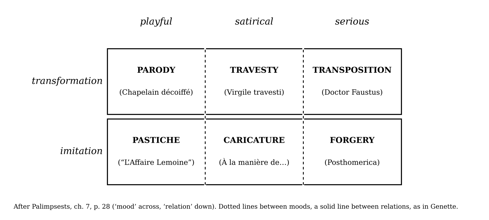
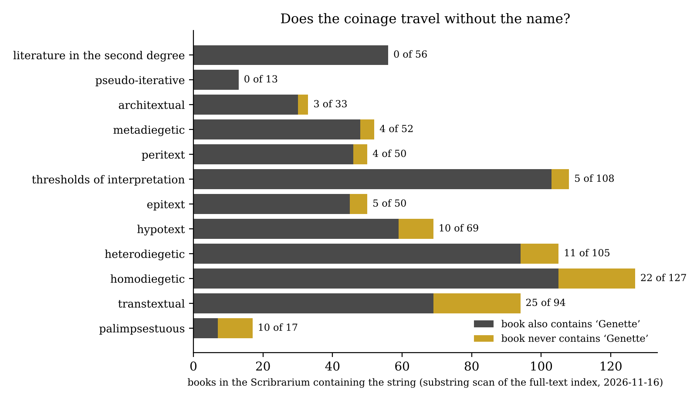

*[[shadows/weeks/gerard-genette|Gérard Genette (Author & Shadow)]] · Day 1 of 7 · 2026-11-16 · Difficulty 3 · Genealogy/influence, Shared form or method*

## Books in this reading

- [[books/2356-palimpsests-literature-in-the-second-degree|Palimpsests: Literature in the Second Degree]], [[people/gerard-genette|Gérard Genette]], [[people/channa-newman|Channa Newman]] (translator), [[people/claude-doubinsky|Claude Doubinsky]] (translator); 1982. *Day 1 (the author): the primary book of the Genette week. Image-only PDF, OCR'd in the cloud (508 pp.); ~54 pp. read in full (Foreword, Preface, chs. 1–7, 41 opening, 52, 78, 80, n. 7 p. 471). Edges 95–99.*

## The shadow so far

| Citing Book | Relation | Target | Location |
|---|---|---|---|
| [[books/2356-palimpsests-literature-in-the-second-degree|Palimpsests: Literature in the Second Degree (Foreword)]] (Gerald Prince) | **Edits/introduces** | Gérard Genette | Foreword, p. ix (PDF p. 9); TARGET Genette, Palimpsests / Palimpsestes (1982) |
| [[books/2356-palimpsests-literature-in-the-second-degree|Palimpsests: Literature in the Second Degree (Translators' Preface)]] (Channa Newman & Claude Doubinsky) | **Translates** | Gérard Genette | Translators' Preface, p. xiii (PDF p. 13); TARGET Palimpsestes (Seuil 1982, not in library) |
| [[books/2356-palimpsests-literature-in-the-second-degree|Palimpsests: Literature in the Second Degree]] (Gérard Genette (tr. Newman & Doubinsky)) | **Quotes** | Gérard Genette | ch. 52, p. 252 (PDF p. 268); TARGET Borges, prologue to A Universal History of Infamy (1935): Collected Fictions, tr. Hurley (7517); cf. Nicol 6623 epigraph (di Giovanni 1972) |
| [[books/2356-palimpsests-literature-in-the-second-degree|Palimpsests: Literature in the Second Degree]] (Gérard Genette (tr. Newman & Doubinsky)) | **Quotes** | Gérard Genette | ch. 80 n. 7, p. 471 (PDF p. 487; text p. 399), citing Labyrinths p. 44 (Yates & Irby); cf. ch. 5 p. 17; TARGET Borges, 'Pierre Menard, Author of the Quixote', Collected Fictions (7517) |
| [[books/2356-palimpsests-literature-in-the-second-degree|Palimpsests: Literature in the Second Degree]] (Gérard Genette (tr. Newman & Doubinsky)) | **Mentions** | Gérard Genette | ch. 1, p. 2 (PDF p. 18); also ch. 75 p. 360 ('This provocative use of plagiarism also comes from Lautréamont, by way of Maldoror'); TARGET Lautréamont, Maldoror and Poems (837) |

---

## Library resurfacing · Monday 16 November 2026 · Set 54

## 1. Where the week stands

A new week begins with Gérard Genette (1930–2018), proposed at the close of the Machado week because he is the theorist of the method itself and because he arrived on that map on its last day (edge 94: *Paratexts* quoting Brás Cubas through Ellis 1955). Today is day 1: his own book, *Palimpsests: Literature in the Second Degree* (Calibre 2356). The Send To pool was empty this morning, so nothing queued bore on the choice.

The library’s footprint is large. A read-only scan of the full-text index found the word *Genette* in 750 books after false positives were removed (the animal genet, Flaubert’s correspondent Mme Roger des Genettes, Raymonde Debray-Genette, Genette Ashby-Beach and other people of the name). All 750 are now in Mentions (rows 761–1510); the calibre plugin reports 783 books for “Genette” and 394 for “Gérard Genette”, and the difference is mostly the false positives and stemming. For comparison, Canetti had 339, Acker 263, Machado 152.

## 2. The day’s finding

*Palimpsests* defines itself by what it leaves out. Of Genette’s five kinds of “transtextuality”, the book studies one, hypertextuality, and within it only “the sunnier side”: derivation that is massive and openly declared. Undeclared borrowing, the very category this method treats as its hardest (“uses without credit”), Genette files under the *first* type, intertextuality, as “plagiarism (in Lautréamont, for instance)”. He sets it aside on principle, because he refuses “hypertextual hermeneutics”, the reader’s licence to find sources everywhere. It comes back only once, near the end (ch. 78), as a hypertext whose hypotext is lost: Stendhal’s *Lucien Leuwen* growing out of Mme Gaulthier’s vanished manuscript, “the most irritating palimpsest of all”. So the week’s day-5 question has already been asked by its subject, and he declined it.

Three relations are named today. **Edits/introduces**: Gerald Prince’s Foreword, whose sentences already summarise Genette in words that are not Genette’s. **Translates**: Newman and Doubinsky, who with his permission moved the French-only examples to an Appendix. **Quotes**: Borges twice, in English versions that differ from the library’s own Borges (Hurley, *Collected Fictions*, 7517). One more, **Mentions**: Lautréamont (837).

## 3. The book

## Palimpsests: Literature in the Second Degree — Gérard Genette, 1982 (English 1997, tr. Channa Newman & Claude Doubinsky; foreword Gerald Prince; University of Nebraska Press). PDF, Calibre 2356, Gestext.

**Selection logic.** Named in the week’s Day_Plan as day 1: it is the book in which Genette names the relation (hypertext and hypotext) that the shadow method keeps chasing. It is Gestext-flagged and had not been used as a primary book in any earlier set.

**The file.** The PDF is a 508-page image scan with **no text layer**, so it is invisible to the Calibre full-text index (the same is true of *The Architext*, 691). I staged it to the cloud workspace and ran OCR (tesseract, 300 dpi, all 508 pages; about 171,000 words in the body). Every quotation below was substring-checked against that OCR text after joining hyphenated line breaks, and was compared with the page image where OCR looked doubtful. Two OCR misreadings were corrected from the page images (“Ouixote” for *Quixote*, “Leawen” for *Leuwen*), each flagged where it occurs. Hurley’s inner double quotes are shown as single quotes. Printed page = PDF page −16 for the main text.

**How much I read.** About 54 pages of roughly 475 (≈11%) in full: Prince’s Foreword (pp. ix– xi), the Translators’ Preface (p. xiii), chapters 1–7 (pp. 1–30, the theory and the chart), the opening of ch. 41 on translation (pp. 214–217), ch. 52 on Borges’s pseudosummary (pp. 251– 253), a passage of ch. 75 on Aragon’s *Télémaque* (p. 360), ch. 78 (pp. 381–384), ch. 80, the conclusion (pp. 394–400), and note 7 to ch. 80 (p. 471). The rest was searched, not read, for *Menard*, *plagiarism*, *palimpsest*, the week’s earlier authors, and a short concordance.

**Overview.** The book opens with a classification and spends 400 pages taking it apart. Genette lists five kinds of transtextual relation: intertextuality (quotation, plagiarism, allusion), paratextuality (titles, prefaces, notes), metatextuality (commentary), architextuality (genre) and hypertextuality, any text B “grafted” onto an earlier text A “in a manner that is not that of commentary”. Hypertexts derive either by *transformation* (saying the same thing differently: Joyce’s *Ulysses*) or by *imitation* (saying another thing similarly: the *Aeneid*). Crossed with three “moods”, playful, satirical and serious, this gives a six-square chart, which the book promises to “blur, dissolve, and eventually erase”. The long middle (chapters 8–79) runs from parody and Oulipian games through pastiche (Proust’s Flaubert) and continuation, to the large territory of serious transposition: translation, versification, excision, condensation, amplification, proximization and transvaluation. Machado’s forebear Sterne gets two index entries. Machado does not appear. Neither does Acker: the string *acker* turns up only inside “Thackeray” and the “blacker” swans of a Borges preface, the same trap the Acker week met in “Thacker”.

**Element 1 — Diagram: the chart, redrawn**

Genette draws the line between the two relations solid and the lines between the moods dotted (p. 28). On p. 29 he goes further and wishes the moods were a “rose window” with ironic, polemical and humorous gradations. The one boundary he never softens is transformation versus imitation, and on p. 394 he says he finds “no trace of evidence” of a third type.

**Element 2 — Verified quotations**

1. “The trouble with “research” is that by dint of searching one often discovers . . . what one did not seek to find.” (ch. 1, p. 1)

2. “In another less explicit and canonical form, it is the practice of plagiarism (in Lautréamont, for instance), which is an undeclared but still literal borrowing.” (ch. 1, p. 2)

*Figure 1: Genette’s chart of hypertextual practices (Palimpsests, ch. 7, p. 28), redrawn.*

3. “Paratextuality, as one can see, is first and foremost a treasure trove of questions without answers.” (ch. 1, p. 4)

4. “The fifth type (yes, I know), the most abstract and most implicit of all, is architextuality, as defined above.” (ch. 1, p. 4). The fourth is held back to p. 5 because “it, and it alone, will be of direct concern to us here.”

5. “Having long been at odds with textual hermeneutics—and quite happily so—I do not intend at this late stage to embrace hypertextual hermeneutics.” (ch. 2, p. 9)

6. “With some exceptions, I will therefore deal here with the sunnier side of hypertextuality: that in which the shift from hypotext to hypertext is both massive (an entire work B deriving from an entire work A) and more or less officially stated.” (ch. 2, p. 9)

7. “Jorge Luis Borges succeeded in demonstrating with the imaginary example of Pierre Menard that the mere displacement of context turns even the most literal rewriting into a creation.” (ch. 5, p. 17)

8. “This is the most irritating palimpsest of all, which reduces me to hunches and to questionings.” (ch. 78, p. 383)

9. “every successive state of a written text functions like a hypertext in relation to the state that precedes it and like a hypotext in relation to the one that follows.” (ch. 80, p. 395)

10. “Official humor is a contradiction in terms.” (ch. 80, p. 400)

**Element 3 — Excerpt: the paleographer (ch. 78, p. 383)**

> Each sentence of the first part of Leuwen can conceal a trap: might it not be the pure, unadulterated text of Mme Gaulthier herself?—I cannot for one moment believe it. But why not impure? And to what degree? The curious (and ever frustrated) readers find themselves in the position of a paleographer who already knows that his text conceals another but does not yet know which one. […]
>
> *(Shortened for the public edition.)*

(The OCR prints “Leawen” in the first sentence. That one word is corrected here from the page image. The rest is substring-checked.) This is day 5’s position exactly: knowing that a text hides another without knowing which. Genette’s response is not to guess but to propose a game. No hoaxer, he notes, has yet thought of “filling that gap” by publishing the lost *Lieutenant*, the field of “pseudohypotexts” (p. 384).

**Element 4 — Three Englishes of one Borges sentence (a translation collation)**

On p. 252 Genette quotes the 1935 prologue to *A Universal History of Infamy* and rests a point on one preposition. The library holds two other Englishes of the same sentence:

| Source | The sentence on reading |
|---|---|
| *Palimpsests* p. 252 (tr. Newman & Doubinsky, from Genette’s French) | “Reading, obviously, is an activity that comes after that of writing; it is more modest, more unobtrusive, more intellectual.” |
| Nicol, *Cambridge Introduction to Postmodern Fiction* (6623), epigraph, credited to Norman Thomas di Giovanni (1972) | “Reading, obviously, is an activity which comes after that of writing; it is more modest, more unobtrusive, more intellectual.” |
| Borges, *Collected Fictions* (7517), tr. Andrew Hurley | “Reading, meanwhile, is an activity subsequent to writing—more resigned, more civil, more intellectual.” |

Genette’s gloss follows: “Do take note of the preposition “after”: reading comes after writing;” (p. 252). Hurley keeps the order (“subsequent”) but turns the qualities toward manners (“resigned”, “civil”). The swans also differ: Genette has “even blacker and rarer swans than good writers”, the same as di Giovanni, while Hurley has “good readers are poets as singular, and as awesome, as great authors themselves.” The English Genette is all but word for word di Giovanni (*that* for *which*). Either the translators used di Giovanni without saying so, or Genette’s French and di Giovanni’s English happen to coincide. I cannot settle which from the library, and that question goes to day 4.

The same thing happens in note 7 to ch. 80 (p. 471), where Genette’s palimpsest comes from Borges’s Menard in the Yates–Irby *Labyrinths*: “I have reflected that it is permissible to see in this ‘final’ Quixote a kind of palimpsest, through which the traces—tenuous but not indecipherable—of our friend’s ‘previous’ writing should be translucently visible” (OCR reads “Ouixote”). Hurley (7517): “I have reflected that it is legitimate to see the ‘final’ Quixote as a kind of palimpsest, in which the traces—faint but not undecipherable—of our friend’s ‘previous’ text must shine through.” The book’s governing image reaches English already in two layers.

**Element 5 — Derived list: does the coinage travel without the name?**

Day 5 will search Genette’s terms in books that never name him. A first count from today’s index scan:

Two results stand out. The subtitle, *literature in the second degree*, occurs in 56 books and never without his name. *Palimpsestuous*, the one word in the book that Prince notes is “not Genette’s; it was coined by Philippe Lejeune” (Foreword, p. ix), is the term most often found without him (10 of 17). Counts are of substrings and are unverified. *Hypertextual* (151 of 271 without him) is left out because hypertext fiction and HTML use the word in other senses.

**Element 6 — A misreading worth attempting**

Read *Palimpsests* as a book about paratext that pretends otherwise. It begins by confessing a renamed term (“what I once called … paratextuality”, p. 1). It turns on Joyce removing his Homeric chapter titles (p. 3). It ends by confessing (ch. 79, p. 394) that the whole book “is nothing other than the faithful transcription of a no less faithful nightmare” born of Borges and a dictionary of works. The hypertext is the stated subject, but the threshold keeps doing the work.

*Figure 2: Coinages with and without the name Genette in the same book (substring counts;*

unverified).

## 4. The shadow so far

| From | Relation | To | Location |
|---|---|---|---|
| Gerald Prince, Foreword to 2356 | Edits/introduces | Genette, *Palimpsests* | pp. ix–xi |
| Newman & Doubinsky, 2356 | Translates | Genette, *Palimpsestes* (1982) | Translators’ Preface, p. xiii |
| Genette, *Palimpsests* (2356) | Quotes | Borges, prologue to *A Universal History of Infamy* (7517; cf. 6623) | ch. 52, p. 252 |
| Genette, *Palimpsests* (2356) | Quotes | Borges, “Pierre Menard” (7517) | ch. 80 n. 7, p. 471; cf. ch. 5 p. 17 |
| Genette, *Palimpsests* (2356) | Mentions | Lautréamont, *Maldoror and Poems* (837) | ch. 1, p. 2 |

Edges 95–99. Two inward and three outward, all starting in the book itself, so no Mentions row is promoted today.

## 5. Where this sends you

**Notebook.**

1. Genette refuses “hypertextual hermeneutics” (p. 9) yet spends ch. 78 wanting a lost hypotext. Write a page that takes his refusal seriously: when is *not* looking for a source a method rather than a lack?

2. “every successive state of a written text functions like a hypertext in relation to the state that precedes it” (p. 395). Take one of your own drafts in two states and describe the second as a hypertext of the first: is it transformation or imitation?

3. Three Englishes of Borges’s swans (Element 4). Write the fourth, from the Spanish if you have it, and say which of Genette’s operations you performed.

**Rabbit holes.**

- *Palimpsests: Literature in the Second Degree*, Wikipedia: https://en.wikipedia.org/wiki/Palimpsests:_Literature_in_the_Second_Degree

- *Palimpsestes* (Seuil, 1982) on Open Library, with a borrowable copy through the Internet Archive: https://openlibrary.org/works/OL15723777W

- Gérard Genette, Wikipedia: https://en.wikipedia.org/wiki/G%C3%A9rard_Genette

- “Pierre Menard, Author of the Quixote”, Wikipedia: https://en.wikipedia.org/wiki/Pierre_Menard,_Author_of_the_Quixote

- Philippe Lejeune interviewed by Florian Pennanech, “Poéticien : l’être ou l’avoir été ?”, *Fabula-LhT* 10 (2012). Lejeune is the coiner of “palimpsestuous”: https://www.fabula.org/lht/10/lejeune.html

- *The living handbook of narratology* (open access; Genette’s terms throughout): https://www.lhn.uni-hamburg.de/node/12.html

**Also in your library.** Borges, *Collected Fictions* (7517), for Menard and the Infamy prologue in Hurley’s English. Lautréamont, *Maldoror and Poems* (837; its OCR is spaced out letter by letter, so it is hard to search). Rachel Douglas, *Frankétienne and Rewriting* (12448), whose “grafting itself palimpsestually onto a hypotext, an earlier text that it imitates or transforms” echoes Prince’s Foreword, not Genette. Boldrini & Novak, *Experiments in Life-Writing* (133), which credits “massive and explicit palimpsestuous” to Genette’s *Palimpsests*, though the phrasing is Prince’s and the adjective Lejeune’s. Graham Allen, *Intertextuality* (3806; ‘Genette’ ×147). No candidates were queued in the Send To pool.

## 6. From the Lexicon — palimpsest

**Received vs. your sense.** Received: “A manuscript page, usually parchment, scraped or washed so it could be reused, with traces of the earlier writing still visible beneath the new. Figuratively, any surface or structure in which successive layers remain legible through one another.” You have not yet recorded a sense of your own (My_Definition is empty).

**Etymology.** Latin *palimpsestus*, from Greek *palimpsēstos* (“scraped again”), from *palin* (again) + *psēn* (to rub smooth). In English from the 1660s (Lexicon entry).

**WordNet.** oewn-06419157-n (noun.communication): “a manuscript (usually written on papyrus or parchment) on which more than one text has been written with the earlier writing incompletely erased and still visible”. Hypernym: manuscript.

**Relations or lineage.** Lineages: Book History, Textual Criticism, Thomas De Quincey. It shares lineage with colophon, marginalia (yesterday’s term), redaction, anagnōsis, eklogē, hypomnēmatismos, obelism, bibliomancy and Syntopicon.

**Portable axiom.** None recorded.

**Why today.** It is the title of today’s book, and the word barely appears inside it: four times in about 171,000 words of OCR’d body text, plus once more on p. 398 where OCR misreads it. The figure is saved for the last pages.

**Verified occurrence.* Palimpsests*, ch. 80, pp. 398–399: “on the same parchment, one text can become superimposed upon another, which it does not quite conceal but allows to show through.” De Quincey’s “What else than a natural and mighty palimpsest is the human brain?” occurs in the library’s *Complete Works of Thomas De Quincey* (8496) and is quoted in Borges’s *Collected Fictions* (7517), as checked in the full-text index today. The Lexicon’s Attestations field is not presented here as verified.

**New in the Lexicon.** Nothing beyond today’s resurfacing date.

## 7. To carry

“one who really loves texts must wish from time to time to love (at least) two together.” (Genette, *Palimpsests*, ch. 80, p. 399)

Reading notes: 2356 — Genette — Palimpsests.md (new).

## Themes

[[themes/architext|architext]] · [[themes/auto-hypertextuality|auto-hypertextuality]] · [[themes/borges|Borges]] · [[themes/caricature|caricature]] · [[themes/di-giovanni|di Giovanni]] · [[themes/doubinsky|Doubinsky]] · [[themes/foreword|foreword]] · [[themes/forgery|forgery]] · [[themes/gerald-prince|Gerald Prince]] · [[themes/hermeneutics|hermeneutics]] · [[themes/hurley|Hurley]] · [[themes/hypertextuality|hypertextuality]] · [[themes/hypotext|hypotext]] · [[themes/imitation|imitation]] · [[themes/intertextuality|intertextuality]] · [[themes/irby|Irby]] · [[themes/lautreamont|Lautréamont]] · [[themes/lejeune|Lejeune]] · [[themes/lost-hypotext|lost hypotext]] · [[themes/lucien-leuwen|Lucien Leuwen]] · [[themes/metatext|metatext]] · [[themes/mme-gaulthier|Mme Gaulthier]] · [[themes/newman|Newman]] · [[themes/ocr|OCR]] · [[themes/palimpsest|palimpsest]] · [[themes/palimpsestuous|palimpsestuous]] · [[themes/paratext|paratext]] · [[themes/parody|parody]] · [[themes/pastiche|pastiche]] · [[themes/pierre-menard|Pierre Menard]] · [[themes/plagiarism|plagiarism]] · [[themes/pseudohypotext|pseudohypotext]] · [[themes/second-degree|second degree]] · [[themes/stendhal|Stendhal]] · [[themes/transformation|transformation]] · [[themes/translation|translation]] · [[themes/transposition|transposition]] · [[themes/transtextuality|transtextuality]] · [[themes/travesty|travesty]] · [[themes/universal-history-of-infamy|Universal History of Infamy]] · [[themes/yates|Yates]]

---

Previous: [[shadows/2026-11-15-shadow-machado-de-assis-day-7-name-kept-sentence-m|Shadow — Machado de Assis, day 7: Name Kept, Sentence Moved]]  
Next: [[shadows/2026-11-17-shadow-gerard-genette-day-2-according-to-riffaterr|Shadow — Gérard Genette, day 2: According to Riffaterre]]
