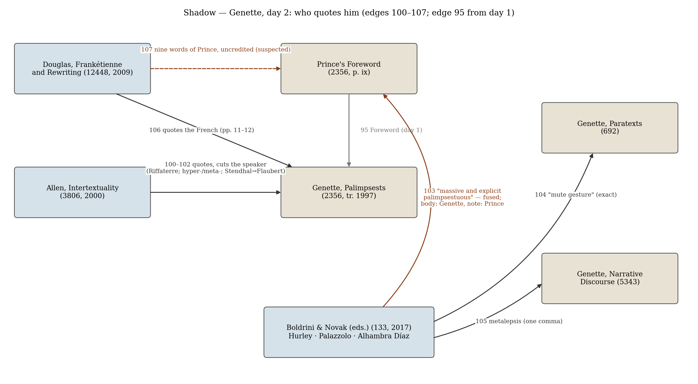

*[[shadows/weeks/gerard-genette|Gérard Genette (Author & Shadow)]] · Day 2 of 7 · 2026-11-17 · Difficulty 3 · Genealogy/influence, Shared form or method*

## Books in this reading

- [[books/3806-intertextuality|Intertextuality]], [[people/graham-allen|Graham Allen]]; 2000. *Day 2 (who quotes him): the main quoting book. Read: ch. 3 Genette section pp. 95–110 (~7%) and glossary entries, collated against 21 pp. of Palimpsests OCR'd today. Edges 100–102; Mentions 950 promoted.*
- [[books/133-experiments-in-life-writing-intersections-of-auto|Experiments in Life-Writing: Intersections of Auto/Biography and Fiction]], [[people/lucia-boldrini|Lucia Boldrini]] (editor), [[people/julia-novak|Julia Novak]] (editor); 2017. *Day 2 (who quotes him): three contributors quote three Genette books (Hurley ch. 11 Palimpsests via Prince; Palazzolo ch. 5 Paratexts; Alhambra Díaz ch. 9 Narrative Discourse). Read: all 11 'Genette' occurrences in context with notes (~2%). Cross-checked against 2356 (OCR), 692, 5343. Edges 103–105; Mentions 779 promoted.*
- [[books/12448-franketienne-and-rewriting-a-work-in-progress|Frankétienne and Rewriting: A Work in Progress]], [[people/rachel-douglas|Rachel Douglas]]; 2009. *Day 2 (who quotes him): quotes Palimpsestes in French, credited; glosses it with Prince's English Foreword, uncredited (suspected). Read: Introduction pp. 3–8 and notes 7–15 (~3%). Edges 106–107; Mentions 1394 promoted.*

## The shadow so far

| Citing Book | Relation | Target | Location |
|---|---|---|---|
| [[books/2356-palimpsests-literature-in-the-second-degree|Palimpsests: Literature in the Second Degree (Foreword)]] (Gerald Prince) | **Edits/introduces** | Gérard Genette | Foreword, p. ix (PDF p. 9); TARGET Genette, Palimpsests / Palimpsestes (1982) |
| [[books/2356-palimpsests-literature-in-the-second-degree|Palimpsests: Literature in the Second Degree (Translators' Preface)]] (Channa Newman & Claude Doubinsky) | **Translates** | Gérard Genette | Translators' Preface, p. xiii (PDF p. 13); TARGET Palimpsestes (Seuil 1982, not in library) |
| [[books/2356-palimpsests-literature-in-the-second-degree|Palimpsests: Literature in the Second Degree]] (Gérard Genette (tr. Newman & Doubinsky)) | **Quotes** | Gérard Genette | ch. 52, p. 252 (PDF p. 268); TARGET Borges, prologue to A Universal History of Infamy (1935): Collected Fictions, tr. Hurley (7517); cf. Nicol 6623 epigraph (di Giovanni 1972) |
| [[books/2356-palimpsests-literature-in-the-second-degree|Palimpsests: Literature in the Second Degree]] (Gérard Genette (tr. Newman & Doubinsky)) | **Quotes** | Gérard Genette | ch. 80 n. 7, p. 471 (PDF p. 487; text p. 399), citing Labyrinths p. 44 (Yates & Irby); cf. ch. 5 p. 17; TARGET Borges, 'Pierre Menard, Author of the Quixote', Collected Fictions (7517) |
| [[books/2356-palimpsests-literature-in-the-second-degree|Palimpsests: Literature in the Second Degree]] (Gérard Genette (tr. Newman & Doubinsky)) | **Mentions** | Gérard Genette | ch. 1, p. 2 (PDF p. 18); also ch. 75 p. 360 ('This provocative use of plagiarism also comes from Lautréamont, by way of Maldoror'); TARGET Lautréamont, Maldoror and Poems (837) |
| [[books/3806-intertextuality|Intertextuality]] (Graham Allen) | **Quotes** | Gérard Genette | ch. 3, p. 98; TARGET Palimpsests (2356) ch. 1, pp. 2–3 |
| [[books/3806-intertextuality|Intertextuality]] (Graham Allen) | **Quotes** | Gérard Genette | ch. 3, p. 108; TARGET Palimpsests (2356) ch. 78, pp. 382–383 |
| [[books/3806-intertextuality|Intertextuality]] (Graham Allen) | **Quotes** | Gérard Genette | ch. 3, p. 104; TARGET Palimpsests (2356) ch. 1, p. 5 |
| [[books/133-experiments-in-life-writing-intersections-of-auto|Experiments in Life-Writing (ch. 11, 'Custom-Breaker: Writing the Life of Elizabeth Cary')]] (Ursula Hurley (in Boldrini & Novak, eds.)) | **Quotes** | Gérard Genette | ch. 11, at n. 27 (n. 27: 'Gerald Prince, foreword to Palimpsests … ix'); TARGET Prince's Foreword to Palimpsests (2356) p. ix |
| [[books/133-experiments-in-life-writing-intersections-of-auto|Experiments in Life-Writing (ch. 5, on Jackie Kay)]] (Pietra Palazzolo (in Boldrini & Novak, eds.)) | **Quotes** | Gérard Genette | ch. 5, at n. 8 (Paratexts, 156); TARGET Paratexts (692) ch. 7 'Epigraphs', Functions, p. 156 |
| [[books/133-experiments-in-life-writing-intersections-of-auto|Experiments in Life-Writing (ch. 9, on Marías, Dark Back of Time)]] (María Alhambra Díaz (in Boldrini & Novak, eds.)) | **Quotes** | Gérard Genette | ch. 9, at n. 34 (Narrative Discourse 234–235); TARGET Narrative Discourse (5343) ch. 5 'Voice', pp. 234–235 |
| [[books/12448-franketienne-and-rewriting-a-work-in-progress|Frankétienne and Rewriting: A Work in Progress]] (Rachel Douglas) | **Quotes** | Gérard Genette | Introduction, pp. 4–5, n. 11 (Palimpsestes, Seuil 1982, 11–12); TARGET Palimpsestes (not in library); English equivalent 2356 p. 5 |
| [[books/12448-franketienne-and-rewriting-a-work-in-progress|Frankétienne and Rewriting: A Work in Progress]] (Rachel Douglas) | **Uses without credit (suspected)** | Gérard Genette | Introduction, p. 5; TARGET Prince, Foreword to Palimpsests (2356) p. ix |

---

## Tuesday 17 November 2026

## 1. Where the week stands

Week four of *An author and their shadow*: Gérard Genette. Day 1 read *Palimpsests* (2356) from a fresh OCR and found a book that studies only declared, massive derivation and sets undeclared borrowing aside; it also found that Gerald Prince’s Foreword had begun to travel as Genette. Day 2 asks who quotes him, and reads three of the 744 non-own books in Mentions.

## 2. The day’s finding

**Relation: Quotes** (seven edges), plus one **Uses without credit (suspected)**.

The three books quote Genette accurately word by word, and still move the speaker. Graham Allen’s *Intertextuality* (3806) puts an ellipsis where Genette wrote “according to Riffaterre”, so Genette’s account of Riffaterre’s view becomes Genette’s own “analogy with the pictorial arts”; another ellipsis removes the clause in which Genette admits that “second degree” covers commentary as well as transformation; and the day-1 passage about the lost hypotext reaches the most-read English guide as “Flaubert’s novel Leuwen” (Genette’s p. 382 names Stendhal). In *Experiments in Life-Writing* (133), Ursula Hurley credits Genette’s *Palimpsests* in her sentence with a phrase that her own note gives to Prince, and that neither writes: it fuses two of Prince’s sentences. Rachel Douglas (12448) quotes Genette in French, with credit, and glosses the quotation in nine English words from Prince’s Foreword, without credit (suspected). The two other quotations in 133, from *Paratexts* and *Narrative Discourse*, are exact.

So on these shelves the declared quotation is where undeclared change happens: the thing Genette filed under “intertextuality” and left out of his book.

## 3. The books

## Intertextuality — Graham Allen, 2000 (Routledge, The New Critical Idiom; PDF; Calibre 3806)

**Selection logic.** Mentions row 950 (147 occurrences of “genette”). Allen’s ch. 3, “Structuralist approaches: Genette and Riffaterre”, is the usual English introduction to *Palimpsests*, so its quotations are the likeliest to be re-quoted. Read: the Genette section (pp. 95–110, about 7% of the book) and two glossary entries, against 21 pages of *Palimpsests* OCR’d today.

**Overview.** A clear, fair textbook account of transtextuality, which then argues (via Laurent Jenny) that Genette’s separation of reading “for itself” and reading for the hypotext is “a kind

*Figure 1: Day 2: who quotes Genette (edges 100–107).*

of bad faith” (p. 110; day-3 material). Every quotation of *Palimpsests* checks out word for word; the trouble is in the cuts.

**Element 1 — Collation of three quotations (verified).** A fourth, smaller: Allen’s every hypertext “ ‘can be read for itself and in its relation to its

| Allen | Genette, Palimpsests (tr. Newman & Doubinsky) | What moved |
|---|---|---|
| “Taking up an analogy with the pictorial arts, Genette writes: ‘The intertextual “trace” … is therefore more akin (like the allusion) to the limited figure (to the pictorial detail) than to the work considered as a structural whole’ (ibid.: 2–3).” (p. 98) | “The intertextual “trace” according to Riffaterre is therefore more akin (like the allusion) to the …” (p. 2) | The speaker: Riffaterre’s view becomes Genette’s |
| “He writes: ‘let us posit the general notion of a text in the second degree … i.e., a text derived from another pre-existent text’ (ibid.: 5).” (p. 104) | “let us posit the general notion of a text in the second degree (for such a transitory use, I shall forgo the attempt to find a prefix that would simultaneously subsume the hyper- and the meta-): i.e., a text derived from another preexistent text.” (p. 5) | The admission that the term covers metatext too |
| “He gives the example of Flaubert’s novel Leuwen, which may have a hypotext in a manuscript draft of a novel entitled Le Lieutenant sent to the author by Mme Gaulthier in 1833.” (p. 108) | “we are missing what we must take to be the first version of Lucien Leuwen, which was not yet—scrawlings excepted—by Stendhal’s hand.” (p. 382) | The author |

hypotext’ (ibid.: 397)” drops Genette’s “both” (“a hypertext can be read both for itself and in its relation to its hypotext”, p. 397).

**Element 2 — Verified quotation (p. 108).** Allen quotes the day-1 sentence exactly and answers it well:

> Genette’s response to this kind of indeterminate case is perhaps revealing: ‘This is the most irritating palimpsest of all, which reduces me to hunches and to questionings’ (ibid.: 383). We might want to suggest, however, that it is precisely in that critical act of interpretation of the text which he eschews that such hunches and questionings are positively embraced.

**Element 3 — Misreading worth attempting.** Take Allen’s “Flaubert” seriously. A *Leuwen* written by Flaubert is a Menard case: the same text with another author, whose meaning changes with the name. Allen has, by accident, written the hypertext Genette’s p. 317 imagines.

## Experiments in Life-Writing: Intersections of Auto/Biography and Fiction — Lucia Boldrini & Julia Novak (eds.), 2017 (Palgrave; EPUB; Calibre 133)

**Selection logic.** Day-1 lead (edge 95): “massive and explicit palimpsestuous” credited to *Palimpsests*. Mentions row 779. Read: all eleven occurrences of “Genette” in context, with notes (about 2%).

**Overview.** Twelve essays on hybrid life-writing. Genette appears through three books in three chapters by three authors; two are exact, the one through *Palimpsests* is Prince.

**Element 1 — The fused phrase (ch. 11, Ursula Hurley, on Elizabeth Cary; verified).**

> Gérard Genette’s Palimpsests draws attention to the “massive and explicit palimpsestuous” qualities of literary texts.

Note 27: “Gerald Prince, foreword to Palimpsests: Literature in the Second Degree by Gérard Genette, trans. Channa Newman and Claude Dubinsky (Lincoln: University of Nebraska Press, 1997), ix.” Prince, p. ix, has “some are more hypertextual than others, more massively and explicitly palimpsestuous. It is that massive and explicit hypertextuality that Genette …”, and a sentence earlier says of “palimpsestuous”: “for once, adjective is not Genette’s; it was coined by Philippe Lejeune”. Three names stand behind five words. The note is accurate; the sentence is not.

**Element 2 — Concordance of “Genette” in 133 (11 occurrences).**

| Chapter | Author | Genette book | Check |
|---|---|---|---|
| 4 | (on Brooke-Rose, *Remake*) | “allobiography (a term borrowed from Genette)” | name only |
| 5 | Pietra Palazzolo | *Paratexts* p. 156: “is always a mute gesture” | exact (692) |
| 9 | María Alhambra Díaz | *Narrative Discourse* pp. 234–235, metalepsis | exact but one comma (“etc.), or the inverse” →“etc.) or the inverse”) (5343) |
| 11 | Ursula Hurley | *Palimpsests* via Prince p. ix | fused, attribution split between text and note |

## Frankétienne and Rewriting: A Work in Progress — Rachel Douglas, 2009 (Lexington Books; PDF; Calibre 12448)

**Selection logic.** Day-1 lead: “grafting itself palimpsestually onto a hypotext”. Mentions row 1394. Read: Introduction pp. 3–8 and its notes 7–15 (about 3%).

**Overview.** A study of a Haitian writer who rewrites his own books by accretion. Douglas takes Genette as “the principal theorist” and quotes *Palimpsestes* in French; she also argues with him: his “auto-” terms are “quickly designated ‘special cases,’ about which he has almost nothing to say” (day-3 material).

**Element 1 — Verified quotation and gloss (pp. 4–5).** She quotes the French definition (“sur lequel il se greffe d’une manière qui n’est pas celle du commentaire”, n. 11: *Palimpsestes*, 11–12), then writes:

> This image, in the quotation above, of a text as a hypertext, grafting itself palimpsestually onto a hypotext, an earlier text that it imitates or transforms, is one that is especially relevant to Frankétienne’s rewriting

**Element 2 — Side-by-side (the suspicion).** Nine words identical; one added. “Imitates or transforms” is not in the French she quotes. Her

| Douglas (p. 5) | Prince, Foreword (p. ix) |
|---|---|
| a text as a hypertext, grafting itself **palimpsestually** onto a hypotext, an earlier text that it imitates or transforms | Any text is a hypertext, grafting itself onto a hypotext, an earlier text that it imitates or transforms |

notes and bibliography cite only the Seuil edition; “Nebraska” and “Newman” do not occur. Recorded as *suspected*: the phrase is short and the gloss natural. On p. 4 she also writes that critics “see all writing as rewriting” (Prince: “any writing is rewriting”), too common to count.

## 4. The shadow so far

| # | From | Relation | To | Location |
|---|---|---|---|---|
| 95 | Prince, Foreword (2356) | Edits/introduces | *Palimpsests* | p. ix |
| 96 | Newman & Doubinsky (2356) | Translates | *Palimpsestes* | p. xiii |
| 97 | *Palimpsests* (2356) | Quotes | Borges, Infamy prologue (7517) | p. 252 |
| 98 | *Palimpsests* (2356) | Quotes | Borges, “Pierre Menard” (7517) | p. 471 n. 7 |
| 99 | *Palimpsests* (2356) | Mentions | Lautréamont (837) | p. 2 |
| 100 | Allen (3806) | Quotes | *Palimpsests* | p. 98 ←p. 2 (“according to Riffaterre” cut) |
| 101 | Allen (3806) | Quotes | *Palimpsests* | p. 108 ← pp. 382–383 (Stendhal → Flaubert) |
| 102 | Allen (3806) | Quotes | *Palimpsests* | p. 104 ←p. 5 (hyper-/meta-clause cut) |
| 103 | Hurley in Boldrini & Novak (133) | Quotes | *Palimpsests* (via Prince p. ix) | ch. 11 n. 27 |
| 104 | Palazzolo in 133 | Quotes | *Paratexts* (692) | ch. 5 n. 8 ← p. 156 |
| 105 | Alhambra Díaz in 133 | Quotes | *Narrative Discourse* (5343) | ch. 9 n. 34 ← pp. 234–235 |
| 106 | Douglas (12448) | Quotes | *Palimpsestes* (French) | pp. 4–5 n. 11 |
| 107 | Douglas (12448) | Uses without credit (suspected) | Prince, Foreword (2356) | p. 5 ←p. ix |

## 5. Where this sends you

**Notebook.**

1. Allen’s ellipsis removes three words, “according to Riffaterre”, and keeps every other word true. Write a page on the ellipsis as an act of authorship: when does “…” assign a sentence to a new speaker?

2. Hurley’s note is right and her sentence wrong. Is the footnote a confession the reader rarely hears? Try writing a paragraph whose notes contradict it, and see which one the reader believes.

3. Douglas glosses a French quotation with someone else’s English. Every reader of a translated theorist does this. Whose words do you think in when you think “hypertext”?

**Rabbit holes.**

- *Palimpsestes* (Seuil, 1982) on Open Library, borrowable from the Internet Archive: https://openlibrary.org/books/OL3058617M/Palimpsestes. Check Douglas’s French (pp. 11– 12) and the “second degree” parenthesis in the original.

- Boldrini & Novak, *Experiments in Life-Writing*, Springer page (the Introduction is open access): https://link.springer.com/9783319554136; Goldsmiths record: https://research.gold.ac.uk/22691.

- Louise Hardwick’s review of Douglas, *International Journal of Francophone Studies* 15.1 (2012): https://research.birmingham.ac.uk/en/publications/frank%C3%A9tienne-and-rewriting-a-work-in-progress.

- *Palimpsests: Literature in the Second Degree*, overview: https://en.wikipedia.org/wiki/Palimpsests:_Literature_in_the_Second_Degree.

- Search prompt: whether Allen’s 2nd (2011) or 3rd edition still says “Flaubert’s novel Leuwen”.

**Also in your library.** McCaffery & Rasula (eds.), *Imagining Language* (11325) — quotes “Genette’s suggestion that ‘one who really loves …’ ” (Mentions 1347; the last line of *Palimpsests*?); Batchelor, *Translation and Paratexts* (7052; duplicate 10575) — 446 occurrences of “genette”, the obvious day-4 book; Plett (ed.), *Intertextuality* (7277). Send To pool: empty today.

## 6. From the Lexicon — sententia

**Received.** In Latin rhetoric, a short, pointed saying that states a judgment or general truth; kin to the Greek gnome and the maxim (*Rhetorica ad Herennium* 4.17.24; Quintilian 8.5).

**Your sense.** Not yet written in the Lexicon.

**Etymology.** Latin *sententia* (opinion, judgment, vote, sense of words), from *sentire*, to feel, perceive.

**WordNet.** Absent (checked today).

**Relations.** Shares lineage with apothegm, maxim, ethopoiesis, paradigm, paratactic, hyperbaton, antimetabole, metathesis, panegyrics. Boundary: sententia names the rhetorical figure, not the folk saying.

**Why today.** A quotation turns a sentence into a sententia: detached, portable, general. The cut that makes Genette’s sentence about Riffaterre portable is the cut that loses Riffaterre.

**Verified occurrence.** None in today’s six books (full-text search: 0).

**New in the Lexicon.** Nothing added.

## 7. To carry

> “for the use of an epigraph is always a mute gesture whose interpretation is left up to the reader.” — Genette, *Paratexts*, tr. Jane E. Lewin, ch. 7 “Epigraphs”, p. 156 (Calibre 692)

Reading notes: 3806 — Allen — Intertextuality.md (new); 133 — Boldrini — Experiments in Life-Writing.md (new); 12448 — Douglas — Frankétienne and Rewriting.md (new); 2356 — Genette — Palimpsests.md (appended); 692 — Genette — Paratexts.md (appended); 5343 — Genette — Narrative Discourse.md (new).

## Themes

[[themes/attribution|attribution]] · [[themes/auto-hypertextuality|auto-hypertextuality]] · [[themes/ellipsis|ellipsis]] · [[themes/epigraph|epigraph]] · [[themes/flaubert|Flaubert]] · [[themes/footnotes|footnotes]] · [[themes/foreword|foreword]] · [[themes/franketienne|Frankétienne]] · [[themes/french-original|French original]] · [[themes/fused-quotation|fused quotation]] · [[themes/hypertext|hypertext]] · [[themes/intertextual-trace|intertextual trace]] · [[themes/lejeune|Lejeune]] · [[themes/life-writing|life-writing]] · [[themes/lost-hypotext|lost hypotext]] · [[themes/lucien-leuwen|Lucien Leuwen]] · [[themes/metalepsis|metalepsis]] · [[themes/metatext|metatext]] · [[themes/misattribution|misattribution]] · [[themes/mme-gaulthier|Mme Gaulthier]] · [[themes/mute-gesture|mute gesture]] · [[themes/palimpsestuous|palimpsestuous]] · [[themes/prince|Prince]] · [[themes/quotation|quotation]] · [[themes/rewriting|rewriting]] · [[themes/riffaterre|Riffaterre]] · [[themes/second-degree|second degree]] · [[themes/sententia|sententia]] · [[themes/stendhal|Stendhal]] · [[themes/textbook|textbook]] · [[themes/translation|translation]]

---

Previous: [[shadows/2026-11-16-shadow-gerard-genette-day-1-the-most-irritating-pa|Shadow — Gérard Genette, day 1: The Most Irritating Palimpsest]]  
Next: [[shadows/2026-11-18-shadow-gerard-genette-day-3-a-game-of-chance-like|Shadow — Gérard Genette, day 3: A Game of Chance, Like Roulette]]
