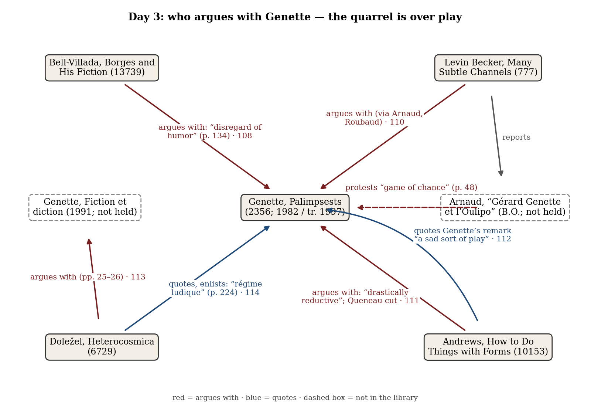

*[[shadows/weeks/gerard-genette|Gérard Genette (Author & Shadow)]] · Day 3 of 7 · 2026-11-18 · Difficulty 3 · Genealogy/influence, Shared form or method*

## Books in this reading

- [[books/13739-borges-and-his-fiction-a-guide-to-his-mind-and-art|Borges and His Fiction: A Guide to His Mind and Art]], [[people/gene-h-bell-villada|Gene H. Bell-Villada]]; 1981 (rev. ed. 1999). *Day 3 (argues with): the charge of humourlessness. Read: 'Pierre Menard' section of ch. 6 (pp. ~128–136), p. 6 with n. 1, end of the 1981 preface (~4%). Edges 108–109; Mentions 1470 promoted.*
- [[books/777-many-subtle-channels-in-praise-of-potential-litera|Many Subtle Channels: In Praise of Potential Literature]], [[people/daniel-levin-becker|Daniel Levin Becker]]; 2012. *Day 3 (argues with): reports Arnaud's and Roubaud's objections; its own definitions of the Oulipo deny Genette's p. 48. Read: 'publish and perish' B.O. paragraph and n. 8, 'a library burning' opening, 'get it in writing' (clinamen), 'safety in letters' (~3%). Edge 110; Mentions 819 promoted.*
- [[books/10153-how-to-do-things-with-forms-the-oulipo-and-its-inv|How to Do Things With Forms: The Oulipo and Its Inventions]], [[people/chris-andrews|Chris Andrews]]; 2022. *Day 3 (argues with): the best-informed argument; finds Queneau missing from the English p. 397. Read: ch. 4 pp. 97–100 with notes 1–11; ch. 7 pp. 192–193 with notes; p. 217 (~4%). Edges 111–112; Mentions 1280 promoted.*
- [[books/6729-heterocosmica-fiction-and-possible-worlds|Heterocosmica: Fiction and Possible Worlds]], [[people/lubomir-dolezel|Lubomír Doležel]]; 1998. *Day 3 (argues with): dissents from Fiction et diction, then enlists Palimpsests in his own translation. Read: Prologue pp. 24–26, Epilogue pp. 222–226, notes 20, 25, 28, 29 (~4%). Edges 113–114; Mentions 1108 promoted.*
- [[books/2356-palimpsests-literature-in-the-second-degree|Palimpsests: Literature in the Second Degree]], [[people/gerard-genette|Gérard Genette]]; 1982 (English 1997). *Cross-check (target of the day's arguments; primary book of Set 54). Whole PDF re-OCR'd on the Mac; read ch. 9 pp. 39–48 whole and pp. 17, 122, 225, 252–253, 384, 396–397, 399–400 (~4%).*

## The shadow so far

| Citing Book | Relation | Target | Location |
|---|---|---|---|
| [[books/2356-palimpsests-literature-in-the-second-degree|Palimpsests: Literature in the Second Degree (Foreword)]] (Gerald Prince) | **Edits/introduces** | Gérard Genette | Foreword, p. ix (PDF p. 9); TARGET Genette, Palimpsests / Palimpsestes (1982) |
| [[books/2356-palimpsests-literature-in-the-second-degree|Palimpsests: Literature in the Second Degree (Translators' Preface)]] (Channa Newman & Claude Doubinsky) | **Translates** | Gérard Genette | Translators' Preface, p. xiii (PDF p. 13); TARGET Palimpsestes (Seuil 1982, not in library) |
| [[books/2356-palimpsests-literature-in-the-second-degree|Palimpsests: Literature in the Second Degree]] (Gérard Genette (tr. Newman & Doubinsky)) | **Quotes** | Gérard Genette | ch. 52, p. 252 (PDF p. 268); TARGET Borges, prologue to A Universal History of Infamy (1935): Collected Fictions, tr. Hurley (7517); cf. Nicol 6623 epigraph (di Giovanni 1972) |
| [[books/2356-palimpsests-literature-in-the-second-degree|Palimpsests: Literature in the Second Degree]] (Gérard Genette (tr. Newman & Doubinsky)) | **Quotes** | Gérard Genette | ch. 80 n. 7, p. 471 (PDF p. 487; text p. 399), citing Labyrinths p. 44 (Yates & Irby); cf. ch. 5 p. 17; TARGET Borges, 'Pierre Menard, Author of the Quixote', Collected Fictions (7517) |
| [[books/2356-palimpsests-literature-in-the-second-degree|Palimpsests: Literature in the Second Degree]] (Gérard Genette (tr. Newman & Doubinsky)) | **Mentions** | Gérard Genette | ch. 1, p. 2 (PDF p. 18); also ch. 75 p. 360 ('This provocative use of plagiarism also comes from Lautréamont, by way of Maldoror'); TARGET Lautréamont, Maldoror and Poems (837) |
| [[books/3806-intertextuality|Intertextuality]] (Graham Allen) | **Quotes** | Gérard Genette | ch. 3, p. 98; TARGET Palimpsests (2356) ch. 1, pp. 2–3 |
| [[books/3806-intertextuality|Intertextuality]] (Graham Allen) | **Quotes** | Gérard Genette | ch. 3, p. 108; TARGET Palimpsests (2356) ch. 78, pp. 382–383 |
| [[books/3806-intertextuality|Intertextuality]] (Graham Allen) | **Quotes** | Gérard Genette | ch. 3, p. 104; TARGET Palimpsests (2356) ch. 1, p. 5 |
| [[books/133-experiments-in-life-writing-intersections-of-auto|Experiments in Life-Writing (ch. 11, 'Custom-Breaker: Writing the Life of Elizabeth Cary')]] (Ursula Hurley (in Boldrini & Novak, eds.)) | **Quotes** | Gérard Genette | ch. 11, at n. 27 (n. 27: 'Gerald Prince, foreword to Palimpsests … ix'); TARGET Prince's Foreword to Palimpsests (2356) p. ix |
| [[books/133-experiments-in-life-writing-intersections-of-auto|Experiments in Life-Writing (ch. 5, on Jackie Kay)]] (Pietra Palazzolo (in Boldrini & Novak, eds.)) | **Quotes** | Gérard Genette | ch. 5, at n. 8 (Paratexts, 156); TARGET Paratexts (692) ch. 7 'Epigraphs', Functions, p. 156 |
| [[books/133-experiments-in-life-writing-intersections-of-auto|Experiments in Life-Writing (ch. 9, on Marías, Dark Back of Time)]] (María Alhambra Díaz (in Boldrini & Novak, eds.)) | **Quotes** | Gérard Genette | ch. 9, at n. 34 (Narrative Discourse 234–235); TARGET Narrative Discourse (5343) ch. 5 'Voice', pp. 234–235 |
| [[books/12448-franketienne-and-rewriting-a-work-in-progress|Frankétienne and Rewriting: A Work in Progress]] (Rachel Douglas) | **Quotes** | Gérard Genette | Introduction, pp. 4–5, n. 11 (Palimpsestes, Seuil 1982, 11–12); TARGET Palimpsestes (not in library); English equivalent 2356 p. 5 |
| [[books/12448-franketienne-and-rewriting-a-work-in-progress|Frankétienne and Rewriting: A Work in Progress]] (Rachel Douglas) | **Uses without credit (suspected)** | Gérard Genette | Introduction, p. 5; TARGET Prince, Foreword to Palimpsests (2356) p. ix |
| [[books/13739-borges-and-his-fiction-a-guide-to-his-mind-and-art|Borges and His Fiction: A Guide to His Mind and Art]] (Gene H. Bell-Villada) | **Argues with** | Gérard Genette | ch. 6 'Ficciones II', p. 134; TARGET Genette on 'Pierre Menard' (Palimpsests 2356 pp. 17, 122, 252–253; possibly the 1960s essays) |
| [[books/13739-borges-and-his-fiction-a-guide-to-his-mind-and-art|Borges and His Fiction: A Guide to His Mind and Art]] (Gene H. Bell-Villada) | **Mentions** | Gérard Genette | ch. 1, p. 6, n. 1 ('Genette, ‘‘L’utopie littéraire,’’ pp. 123 –132'); TARGET 'L’utopie littéraire' (Figures I, not in library) |
| [[books/777-many-subtle-channels-in-praise-of-potential-litera|Many Subtle Channels: In Praise of Potential Literature]] (Daniel Levin Becker) | **Argues with** | Gérard Genette | 'publish and perish' and n. 8 (Roubaud via Guy Bennett: 'a particularly mediocre text'); TARGET Palimpsests (2356) ch. 9 'Oulipian games' pp. 39–48, esp. p. 48 |
| [[books/10153-how-to-do-things-with-forms-the-oulipo-and-its-inv|How to Do Things With Forms: The Oulipo and Its Inventions]] (Chris Andrews) | **Argues with** | Gérard Genette | ch. 4 'Manipulation, Translation, and Composition', pp. 98–99, nn. 3–10; TARGET Palimpsests (2356) pp. 7, 40, 42, 44, 397, 400; Palimpsestes p. 449 (not held) |
| [[books/10153-how-to-do-things-with-forms-the-oulipo-and-its-inv|How to Do Things With Forms: The Oulipo and Its Inventions]] (Chris Andrews) | **Quotes** | Gérard Genette | ch. 7 'Games Gone Wrong', p. 192, n. 7 (Thomas, La langue, la poésie, 165); TARGET Genette, oral remark (not in a Genette book) |
| [[books/6729-heterocosmica-fiction-and-possible-worlds|Heterocosmica: Fiction and Possible Worlds]] (Lubomír Doležel) | **Argues with** | Gérard Genette | Prologue, pp. 25–26; TARGET Fiction et diction (1991, p. 91; not in library) |
| [[books/6729-heterocosmica-fiction-and-possible-worlds|Heterocosmica: Fiction and Possible Worlds]] (Lubomír Doležel) | **Quotes** | Gérard Genette | Epilogue, p. 224; also n. 29 ('regime ludique', Genette 1982, 452-53); TARGET Palimpsestes p. 435 = Palimpsests (2356) ch. 79, p. 384 |

---

## Library resurfacing · Wednesday 18 November 2026 · An author and their shadow (Set 56)

## 1. Where the week stands

Week 4, Gérard Genette, day 3 of 7: who argues with him. Day 1 read *Palimpsests* (2356) and found that it theorises only the “sunnier side” of derivation, the declared kind. Day 2 found three quoters who keep his words and move the speaker (Allen drops “according to Riffaterre”; Hurley fuses two of Prince’s sentences; Douglas glosses the French with Prince’s English). Today: four books that dispute him, checked against a fresh OCR of the whole of *Palimpsests* made on the Mac this morning.

## 2. The day’s finding

**Relations: Argues with (4), Quotes (2), Mentions (1). Edges 108–114.**

On these shelves the argument with Genette is an argument about play, and it comes from two sides at once. A Borges critic says he is too serious: Bell-Villada (13739) accuses “Critics like Gerard Genette” of “apparent disregard of Borges’s general spirit of humor and parody” in taking “Pierre Menard” as theory. The Oulipo says he is too casual about play: Noël Arnaud protested Genette’s chapter on “Oulipian games”, reported by Levin Becker (777) and argued in detail by Andrews (10153), because *Palimpsests* p. 48 calls the Oulipism “like roulette, … a game of chance” and puts it in “the Surrealist tradition”. The group’s own doctrine says the opposite: “it is not invested in wrangling randomness or automatism or chance”.

The book had already answered both sides, in part. It makes its own Menard joke (p. 122) and ends on humour (“Official humor is a contradiction in terms”, p. 400). It also says plainly, “I shall therefore consider only one aspect of this Oulipic activity” (p. 40), so the reduction the Oulipo complains of is declared, not hidden. Two smaller findings: (1) the English translation leaves Queneau, co-founder of the Oulipo (with Le Lionnais, p. 39), out of Genette’s list of hypertextual moderns (p. 397: “Proust, Joyce, Mann, Borges, Nabokov, Calvino”). Andrews (n. 7) says the French p. 449 has his name; the English side is verified here, the French is not held. (2) Doležel (6729) argues with the later Genette (*Fiction et diction*, 1991, not held) and then borrows the earlier one. He translates *Palimpsestes* p. 435 himself and cuts the clause on “all second-degree artistic practices”. He ends by using Genette’s “régime ludique” against the ideological readers of Coetzee’s *Foe*. So the people who argue with Genette end up siding with his play.

*Figure 1: Day 3 edges*

## 3. The books

## Borges and His Fiction: A Guide to His Mind and Art — Gene H. Bell- Villada, 1981 / rev. 1999 (PDF; Calibre 13739)

**Selection.** Mentions row 1470 (the “apparent disregard” snippet), listed as a day-3 lead on day 1. It answers day 1’s two Borges edges (97–98).

**Overview.** A general reader’s guide by a critic hostile to the theory mandarinate. The 1981 preface complains of criticism “allowing the literary mandarinate to distance itself still further from its audiences—in some cases, from literature itself.” (p. xv). Read: the “Pierre Menard” section of ch. 6 (pp. ~128–136), p. 6 with n. 1, the end of the 1981 preface (≈4% of the book).

**Verified quotations.**

> Borges’s story is an extended satire of the intellectual patterns, formal subtypes, and sophistries of the genre of literary criticism. (ch. 6, p. 133)

> Last but not least, in his final paragraphs Borges prophetically satirizes the ahistorical structuralists of the future, with their synchronic and reversible perceptions of the entirety of world literature, their emphasis on reader rather than author, and their attraction for words like “palimpsest.” (Critics like Gerard Genette, in apparent disregard of Borges’s general spirit of humor and parody, have built entire theories on the fanciful notions played with in “Pierre Menard.”) (ch. 6, pp. 133– 134)

Same book, p. 6: “structuralist theorists and critics such as Gérard Génette have found in Borges not just another exotic genius on whom to lavish high Gallic praise, but a wise master from whose doctrine of literary space they can learn a great deal” (n. 1: Genette, “L’utopie littéraire”). Praise on p. 6, mockery on p. 134, and the accent wrong on p. 6.

**Against the source (Palimpsests, OCR).** The charge holds against p. 17, where Borges “succeeded in demonstrating with the imaginary example of Pierre Menard that the mere displacement of context turns even the most literal rewriting into a creation.” It does not hold against p. 122, “I can imagine a noble exercise for some idle and reverential Pierre Menard”, nor against p. 253, where Borges writes “with a jaded critic’s reserve and ironic detachment”, nor against the last page of the book (see below).

**A misreading worth attempting.** Read Bell-Villada’s parenthesis as a fragment of “Pierre Menard”: one more critic in the story’s catalogue, the one who mocks the critics for taking it seriously. **Doubt:** the parenthesis may date from 1981, a year before *Palimpsestes*, in which case its target is the 1960s essays, not the book I checked it against. The 1981 text is not in the library.

## Many Subtle Channels: In Praise of Potential Literature — Daniel Levin Becker, 2012 (EPUB; Calibre 777)

**Selection.** Mentions row 819, listed as a day-3 lead on day 1.

**Overview.** An account of the Oulipo from inside, by one of its members. He reports the quarrel and does not join it. Read: the B.O. paragraph in “publish and perish” and its note 8; the opening definition in “a library burning”; the clinamen paragraph in “get it in writing”; a summary in “safety in letters” (≈3%).

**Verified quotations.** Note 8: “Genette spends ten pages of his 1982 book Palimpsests: Literature in the Second De-

> Noël Arnaud used it as a platform to protest literary theorist Gérard Genette’s description of oulipian endeavor as “a game of chance, like roulette.” (“publish and perish”)

gree on a characteristically shrewd analysis”. Ten pages is exact (ch. 9, pp. 39–48). Roubaud is then given the last word, in Guy Bennett’s English, “describing Genette as “a (usually more inspired) literary theorist who seemed to be better informed, more thoughtful, and less credulous, and who allowed himself to write a particularly mediocre text on the subject” of the Oulipo.”

**Concordance of the dispute (derived list).**

| Palimpsests p. 48 (Newman & Doubinsky) | Levin Becker |
|---|---|
| “Parody is a game of skill; the Oulipism, like roulette, is a game of chance.” | “a game of chance, like roulette” (word order reversed inside quotation marks; probably his translation from the French, which is not held) |
| “Chance is at the helm; no semantic intention is at work, nothing “tendentious” or premeditated.” | “it is not invested in wrangling randomness or automatism or chance” (“a library burning”) |
| “belongs to the Surrealist tradition, and Oulipism is a variant of the cadavre exquis” | “it is most definitely not an offshoot of Surrealism.” |
| — | “it has no use for chance or for notions of beauty” (“safety in letters”) |

## How to Do Things with Forms: The Oulipo and Its Inventions — Chris Andrews, 2022 (PDF; Calibre 10153)

**Selection.** Found today with Genette AND roulette (59 books); its notes cite Arnaud’s “Gérard Genette et l’Oulipo” (B.O. vol. 5, p. 14). Mentions row 1280.

**Overview.** The library’s best-informed argument with Genette: page numbers in French and English, a concession, and a precise charge. Read: ch. 4 “Manipulation, Translation, and Composition” pp. 97–100 with notes 1–11; ch. 7 “Games Gone Wrong” pp. 192–193 with notes; p. 217 (≈4%).

**Verified quotations.**

> Nevertheless, Genette’s treatment of the Oulipo is drastically reductive […] As Arnaud remarks, Genette seems to confuse Oulipian exercises and works. (ch. 4, p. 98)

> Although his opinion is not thoroughly informed, as Arnaud demonstrates, it is worth considering as a symptom, and as the index of a risk. (ch. 4, p. 99)

Note 7 (ch. 4): “In the English translation, Queneau’s name has been left out of the list.” Checked on the English side: *Palimpsests* p. 397, “the names Proust, Joyce, Mann, Borges, Nabokov, Calvino, among others, quite naturally come to mind.” Andrews also reports, in ch. 7 (p. 192), an oral remark of Genette’s: “Gérard Genette remarked that if play there was, it was “a sad sort of play.” (n. 7: Thomas, *La langue, la poésie*, 165). Genette’s quotation from p. 40 is exact apart from one comma (“namely, its” in the English).

**Element: what Andrews concedes and contests.** He concedes the distinction between transformation and imitation (“a useful distinction”). He contests the reduction of the Oulipo to its transformational exercises and the generalising of Lescure’s “mechanical” (Genette pp. 42, 44: “Among other “mechanical operations” (Jean Lescure’s formula)”). And he ends by turning Genette’s last page into praise of the Oulipian *work*: “the Oulipian work at is best matches Genette’s ideal for the hypertext” (sic, “at is best”, p. 99).

## Heterocosmica: Fiction and Possible Worlds — Lubomír Doležel, 1998 (PDF; Calibre 6729)

**Selection.** Mentions row 1108 (“Gerard Genette dissents”), listed as a day-3 lead on day 1.

**Overview.** Possible-worlds semantics of fiction. Genette appears 21 times; three uses matter. Read: Prologue pp. 24–26, Epilogue pp. 222–226, notes 20, 25, 28, 29 (≈4%).

**Verified quotations.**

> Gerard Genette dissents. […] But this conclusion only confirms that narrativity is not a criterion for the fiction/nonfiction distinction. Genette does not mention the existence of a semantic, truth-conditional criterion. (Prologue, pp. 25–26; against *Fiction et diction*, 1991, not held)

> Genette, who does not work with the concepts of possible-worlds semantics, emphasizes at the conclusion of his major sweep through “hypertextuality”: “Every object can be transformed, every method imitated; there is no art that, by nature, escapes these two modes ofderivation which, in literature, define hypertextuality’ ’ (1982, 435). (Epilogue, p. 224; “ofderivation” is the PDF’s OCR)

**Collation with the English (Palimpsests ch. 79, p. 384).** “Every object can be transformed, every manner imitated, and no art can by nature escape those two modes of derivation that define hypertextuality in literature and more generally define all second-degree artistic practices, or hyperartistic practices.” Doležel has “method” for “manner” and cuts the widen-ing clause. Genette’s next sentence narrows it again: “For reasons yet to be discussed, I do not believe that we can legitimately extend the notion of the text, and thus of the hypertext, to all arts.” Last, note 29: “The ideological critic is insensitive to the “regime ludique” (Genette 1982, 452-53) of the rewrite transduction.”

## Cross-check: Palimpsests — Gérard Genette, tr. Newman & Doubinsky, 1997 (PDF, image only; Calibre 2356)

Re-OCR’d whole on the Mac (tesseract, 508 pages). Read today: ch. 9 pp. 39–48 whole, pp. 17, 122, 225, 252–253, 384, 396–397, 399–400. The closing apology that answers Bell-Villada and serves Andrews and Doležel:

> The hypertext at its best is an indeterminate compound, unpredictable in its specifics, of seriousness and playfulness (lucidity and ludicity), of intellectual achievement and entertainment. This, of course, is called humor (ch. 80, p. 400)

On the same page: “the best jokes are often unintentional.” On p. 399: “true play always entails some degree of perversion.” And p. 48 ends its roulette paragraph against chance after all: “a throw of the dice will never abolish meaning.”

## 4. The shadow so far

| # | From | Relation | To | Location |
|---|---|---|---|---|
| 95 | Prince, Foreword (2356) | Edits/introduces | Palimpsests | p. ix |
| 96 | Newman & Doubinsky (2356) | Translates | Palimpsestes | p. xiii |
| 97 | Palimpsests | Quotes | Borges, Infamy prologue (7517) | p. 252 |
| 98 | Palimpsests | Quotes | Borges, “Pierre Menard” (7517) | p. 471 n. 7 |
| 99 | Palimpsests | Mentions | Lautréamont (837) | p. 2 |
| 100–102 | Allen, Intertextuality (3806) | Quotes | Palimpsests | pp. 98, 104, 108 |
| 103–105 | Hurley, Palazzolo, Alhambra Díaz (133) | Quotes | Prince / Paratexts / Narrative Discourse | chs. 11, 5, 9 |
| 106 | Douglas (12448) | Quotes | Palimpsestes (French) | pp. 4–5 |
| 107 | Douglas (12448) | Uses without credit (suspected) | Prince, Foreword | p. 5 |
| **108** | Bell-Villada (13739) | Argues with | Palimpsests / Genette on Menard | ch. 6, p. 134 |
| **109** | Bell-Villada (13739) | Mentions | “L’utopie littéraire” (not held) | ch. 1, p. 6, n. 1 |
| **110** | Levin Becker (777) | Argues with (reported) | Palimpsests ch. 9 | “publish and perish”, n. 8 |
| **111** | Andrews (10153) | Argues with | Palimpsests ch. 9; p. 397 | ch. 4, pp. 98–99, n. 7 |
| **112** | Andrews (10153) | Quotes | Genette, oral remark (via Thomas) | ch. 7, p. 192 |
| **113** | Doležel (6729) | Argues with | Fiction et diction (not held) | Prologue, pp. 25–26 |
| **114** | Doležel (6729) | Quotes | Palimpsestes p. 435 = English p. 384 | Epilogue, p. 224; n. 29 |

Mentions promoted today: 1470, 819, 1280, 1108.

## 5. Where this sends you

**Notebook.**

1. Bell-Villada says Genette built “entire theories on the fanciful notions played with in “Pierre Menard.”” Name a theory of your own that started from a joke. Did the joke survive the theory?

2. Genette on p. 48: chance “cannot fail to turn into a re-creation”; the Oulipo: the clinamen is chosen. Write a paragraph in which the swerve is chosen by neither the writer nor chance, but by the translator (Queneau’s name on p. 397).

3. Doležel’s cut keeps “in literature” and drops “all second-degree artistic practices”. Write the gesture-theory version of that sentence: can a gesture be hypertextual, or does Genette’s restriction to texts stop it at the page?

**Rabbit holes.**

- Jean-Marie Schaeffer, “Fictional vs. Factual Narration”, *the living handbook of narratology*. It discusses *Fiction & Diction*, the book Doležel disputes: https://www-archiv.fdm.uni-hamburg.de/lhn/node/56.html

- *La Bibliothèque oulipienne*, contents by volume. Vol. V opens with “63. Noël Arnaud: Gérard Genette et l’OULIPO”: https://en.wikipedia.org/wiki/La_Biblioth%C3%A8que_oulipienne

- BnF, *L’Oulipo — bibliographie* (archives and catalogue; the place to look for Arnaud’s text and the French *Palimpsestes*): https://www.bnf.fr/fr/loulipo-bibliographie

- Monoskop, Gérard Genette (bibliography of the French and English editions, including *Fiction et diction*): https://monoskop.org/Gérard_Genette

- Chris Andrews, *How to Do Things with Forms* (McGill-Queen’s, 2022), publisher’s listing: https://49thshelf.com/Books/H/How-to-Do-Things-with-Forms

**Also in your library.**

- Caselli, *Beckett’s Dantes* (7286): Genette against Riffaterre, quoting *Palimpsestes* p. 450 in her own English (“there is an ambiguity which Riffaterre denies to the intertextual reading”). It is the same passage as English p. 397, one page after the missing Queneau.

- Motte, *Oulipo: A Primer of Potential Literature* (7745) and Brotchie, *Oulipo Compendium* (3837): check whether either mentions Genette.

- Ankersmit & Mooij, *Knowledge and Language III* (10911): “an attack upon Genette’s well-known view” of voice and mode (not read today; the attacker is not yet identified).

- Send To pool: no Queued candidates today.

## 6. From the Lexicon: clinamen

**Received vs. your sense.** Received: “In Epicurean atomism as presented by Lucretius (De rerum natura II.216–224, 251), the minimal, unpredictable swerve of atoms from their straight downward fall ‘at no fixed place or time’.” Bloom (1973) made it “a poet’s corrective swerve, or misprision, away from a precursor”. Your entry’s own definition is close to the received one (“the unpredictable swerve of atoms … Lucretius never gives the primary cause of the deflections.”), so it is still waiting for your sense.

**Etymology.** Latin *clinamen*, from *clinare* “to incline”; plural *clinamina*. Lucretius’s term (1st c. BCE).

**WordNet.** Not in WordNet (checked today).

**Lineage.** Epicurus →Lucretius →Harold Bloom; today the Oulipo adds a fourth sense (below). The entry’s boundary tension holds: “Two distinct senses travel under one word”.

**Portable axiom.** None recorded.

**Why today.** Genette made the Oulipo a game of chance; the Oulipo’s own word for its swerve is a chosen deviation, so the term sits exactly where today’s argument does.

**Verified occurrence.** Levin Becker, *Many Subtle Channels* (777), “get it in writing”: “As far as the Oulipo is concerned, the clinamen is a voluntary breaking of a self-imposed rule.” Andrews (10153) gives ch. 5 the title “Meaningful Forms and Clinamen”.

**New in the Lexicon.** No terms added since 16 November.

## 7. To carry

> “Official humor is a contradiction in terms.” — Gérard Genette, *Palimpsests*, tr. Newman & Doubinsky, ch. 80, p. 400

Reading notes: 13739 — Bell-Villada — Borges and His Fiction.md (new); 777 — Levin Becker — Many Subtle Channels.md (new); 10153 — Andrews — How to Do Things with Forms.md (new); 6729 — Dolezel — Heterocosmica.md (new); 2356 — Genette — Palimpsests.md (appended).

## Themes

[[themes/argument|argument]] · [[themes/arnaud|Arnaud]] · [[themes/borges|Borges]] · [[themes/cadavre-exquis|cadavre exquis]] · [[themes/chance|chance]] · [[themes/clinamen|clinamen]] · [[themes/coetzee|Coetzee]] · [[themes/compossibility|compossibility]] · [[themes/constraint|constraint]] · [[themes/dispute|dispute]] · [[themes/exercise-vs-work|exercise vs work]] · [[themes/fiction-et-diction|Fiction et diction]] · [[themes/fiction-vs-nonfiction|fiction vs nonfiction]] · [[themes/foe|Foe]] · [[themes/game-of-skill|game of skill]] · [[themes/humour|humour]] · [[themes/irony|irony]] · [[themes/le-lionnais|Le Lionnais]] · [[themes/lescure|Lescure]] · [[themes/ludic|ludic]] · [[themes/mechanical|mechanical]] · [[themes/ocr|OCR]] · [[themes/omission|omission]] · [[themes/oulipo|Oulipo]] · [[themes/palimpsest|palimpsest]] · [[themes/pierre-menard|Pierre Menard]] · [[themes/play|play]] · [[themes/possible-worlds|possible worlds]] · [[themes/queneau|Queneau]] · [[themes/roubaud|Roubaud]] · [[themes/roulette|roulette]] · [[themes/regime-ludique|régime ludique]] · [[themes/satire-of-criticism|satire of criticism]] · [[themes/seriousness|seriousness]] · [[themes/structuralism|structuralism]] · [[themes/surrealism|surrealism]] · [[themes/translation|translation]]

---

Previous: [[shadows/2026-11-17-shadow-gerard-genette-day-2-according-to-riffaterr|Shadow — Gérard Genette, day 2: According to Riffaterre]]  
Next: [[shadows/2026-11-19-shadow-gerard-genette-day-4-the-right-to-be-unfait|Shadow — Gérard Genette, day 4: The Right to Be Unfaithful]]
