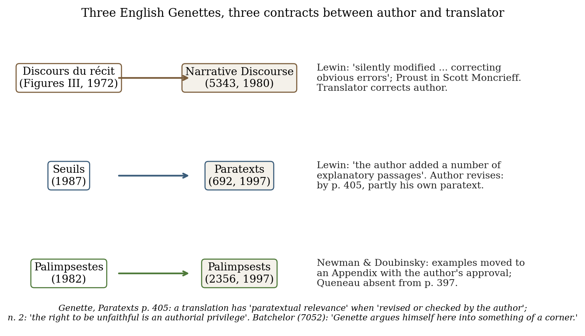

*[[shadows/weeks/gerard-genette|Gérard Genette (Author & Shadow)]] · Day 4 of 7 · 2026-11-19 · Difficulty 3 · Genealogy/influence, Shared form or method*

## Books in this reading

- [[books/7052-translation-and-paratexts|Translation and Paratexts]], [[people/kathryn-batchelor|Kathryn Batchelor]]; 2018. *Day 4 (rewrites): carries Paratexts into translation studies and replaces its criterion. Read: Introduction and ch. 1 whole, ch. 7 opening (pp. 141–145), Conclusion pp. 194–195 (~15%). Edges 115–116; Mentions 1137 promoted. Duplicate record 10575 (PDF) not used.*
- [[books/692-paratexts-thresholds-of-interpretation|Paratexts: Thresholds of Interpretation]], [[people/gerard-genette|Gérard Genette]], [[people/jane-e-lewin|Jane E. Lewin]] (translator); 1997 (Seuils 1987). *Day 4 (translates; edits/introduces): the threshold of the English Paratexts and Genette's own page on translation. Read: pp. xi–xxv, 1, 5 n. 8, 9, 264, 405 (~4%). Edges 117–118 (and target of 115). Own work: no Mentions row promoted.*
- [[books/5343-narrative-discourse-an-essay-in-method|Narrative Discourse: An Essay in Method]], [[people/gerard-genette|Gérard Genette]], [[people/jane-e-lewin|Jane E. Lewin]] (translator); 1980 (Discours du récit 1972). *Day 4 (translates; edits/introduces): Lewin's Translator's Preface and Culler's Foreword. Read: copyright page, pp. 7–17 (~3.5%). Edges 119–120. Own work: no Mentions row promoted. Day 6 candidate still (metalepsis section).*
- [[books/2356-palimpsests-literature-in-the-second-degree|Palimpsests: Literature in the Second Degree]], [[people/gerard-genette|Gérard Genette]], [[people/channa-newman|Channa Newman]] (translator), [[people/claude-doubinsky|Claude Doubinsky]] (translator); 1997 (Palimpsestes 1982). *Day 4 cross-check: target of Batchelor's quotations (edge 116). Read: pp. 3, 4, 7 re-OCR'd today (<1%).*

## The shadow so far

| Citing Book | Relation | Target | Location |
|---|---|---|---|
| [[books/2356-palimpsests-literature-in-the-second-degree|Palimpsests: Literature in the Second Degree (Foreword)]] (Gerald Prince) | **Edits/introduces** | Gérard Genette | Foreword, p. ix (PDF p. 9); TARGET Genette, Palimpsests / Palimpsestes (1982) |
| [[books/2356-palimpsests-literature-in-the-second-degree|Palimpsests: Literature in the Second Degree (Translators' Preface)]] (Channa Newman & Claude Doubinsky) | **Translates** | Gérard Genette | Translators' Preface, p. xiii (PDF p. 13); TARGET Palimpsestes (Seuil 1982, not in library) |
| [[books/2356-palimpsests-literature-in-the-second-degree|Palimpsests: Literature in the Second Degree]] (Gérard Genette (tr. Newman & Doubinsky)) | **Quotes** | Gérard Genette | ch. 52, p. 252 (PDF p. 268); TARGET Borges, prologue to A Universal History of Infamy (1935): Collected Fictions, tr. Hurley (7517); cf. Nicol 6623 epigraph (di Giovanni 1972) |
| [[books/2356-palimpsests-literature-in-the-second-degree|Palimpsests: Literature in the Second Degree]] (Gérard Genette (tr. Newman & Doubinsky)) | **Quotes** | Gérard Genette | ch. 80 n. 7, p. 471 (PDF p. 487; text p. 399), citing Labyrinths p. 44 (Yates & Irby); cf. ch. 5 p. 17; TARGET Borges, 'Pierre Menard, Author of the Quixote', Collected Fictions (7517) |
| [[books/2356-palimpsests-literature-in-the-second-degree|Palimpsests: Literature in the Second Degree]] (Gérard Genette (tr. Newman & Doubinsky)) | **Mentions** | Gérard Genette | ch. 1, p. 2 (PDF p. 18); also ch. 75 p. 360 ('This provocative use of plagiarism also comes from Lautréamont, by way of Maldoror'); TARGET Lautréamont, Maldoror and Poems (837) |
| [[books/3806-intertextuality|Intertextuality]] (Graham Allen) | **Quotes** | Gérard Genette | ch. 3, p. 98; TARGET Palimpsests (2356) ch. 1, pp. 2–3 |
| [[books/3806-intertextuality|Intertextuality]] (Graham Allen) | **Quotes** | Gérard Genette | ch. 3, p. 108; TARGET Palimpsests (2356) ch. 78, pp. 382–383 |
| [[books/3806-intertextuality|Intertextuality]] (Graham Allen) | **Quotes** | Gérard Genette | ch. 3, p. 104; TARGET Palimpsests (2356) ch. 1, p. 5 |
| [[books/133-experiments-in-life-writing-intersections-of-auto|Experiments in Life-Writing (ch. 11, 'Custom-Breaker: Writing the Life of Elizabeth Cary')]] (Ursula Hurley (in Boldrini & Novak, eds.)) | **Quotes** | Gérard Genette | ch. 11, at n. 27 (n. 27: 'Gerald Prince, foreword to Palimpsests … ix'); TARGET Prince's Foreword to Palimpsests (2356) p. ix |
| [[books/133-experiments-in-life-writing-intersections-of-auto|Experiments in Life-Writing (ch. 5, on Jackie Kay)]] (Pietra Palazzolo (in Boldrini & Novak, eds.)) | **Quotes** | Gérard Genette | ch. 5, at n. 8 (Paratexts, 156); TARGET Paratexts (692) ch. 7 'Epigraphs', Functions, p. 156 |
| [[books/133-experiments-in-life-writing-intersections-of-auto|Experiments in Life-Writing (ch. 9, on Marías, Dark Back of Time)]] (María Alhambra Díaz (in Boldrini & Novak, eds.)) | **Quotes** | Gérard Genette | ch. 9, at n. 34 (Narrative Discourse 234–235); TARGET Narrative Discourse (5343) ch. 5 'Voice', pp. 234–235 |
| [[books/12448-franketienne-and-rewriting-a-work-in-progress|Frankétienne and Rewriting: A Work in Progress]] (Rachel Douglas) | **Quotes** | Gérard Genette | Introduction, pp. 4–5, n. 11 (Palimpsestes, Seuil 1982, 11–12); TARGET Palimpsestes (not in library); English equivalent 2356 p. 5 |
| [[books/12448-franketienne-and-rewriting-a-work-in-progress|Frankétienne and Rewriting: A Work in Progress]] (Rachel Douglas) | **Uses without credit (suspected)** | Gérard Genette | Introduction, p. 5; TARGET Prince, Foreword to Palimpsests (2356) p. ix |
| [[books/13739-borges-and-his-fiction-a-guide-to-his-mind-and-art|Borges and His Fiction: A Guide to His Mind and Art]] (Gene H. Bell-Villada) | **Argues with** | Gérard Genette | ch. 6 'Ficciones II', p. 134; TARGET Genette on 'Pierre Menard' (Palimpsests 2356 pp. 17, 122, 252–253; possibly the 1960s essays) |
| [[books/13739-borges-and-his-fiction-a-guide-to-his-mind-and-art|Borges and His Fiction: A Guide to His Mind and Art]] (Gene H. Bell-Villada) | **Mentions** | Gérard Genette | ch. 1, p. 6, n. 1 ('Genette, ‘‘L’utopie littéraire,’’ pp. 123 –132'); TARGET 'L’utopie littéraire' (Figures I, not in library) |
| [[books/777-many-subtle-channels-in-praise-of-potential-litera|Many Subtle Channels: In Praise of Potential Literature]] (Daniel Levin Becker) | **Argues with** | Gérard Genette | 'publish and perish' and n. 8 (Roubaud via Guy Bennett: 'a particularly mediocre text'); TARGET Palimpsests (2356) ch. 9 'Oulipian games' pp. 39–48, esp. p. 48 |
| [[books/10153-how-to-do-things-with-forms-the-oulipo-and-its-inv|How to Do Things With Forms: The Oulipo and Its Inventions]] (Chris Andrews) | **Argues with** | Gérard Genette | ch. 4 'Manipulation, Translation, and Composition', pp. 98–99, nn. 3–10; TARGET Palimpsests (2356) pp. 7, 40, 42, 44, 397, 400; Palimpsestes p. 449 (not held) |
| [[books/10153-how-to-do-things-with-forms-the-oulipo-and-its-inv|How to Do Things With Forms: The Oulipo and Its Inventions]] (Chris Andrews) | **Quotes** | Gérard Genette | ch. 7 'Games Gone Wrong', p. 192, n. 7 (Thomas, La langue, la poésie, 165); TARGET Genette, oral remark (not in a Genette book) |
| [[books/6729-heterocosmica-fiction-and-possible-worlds|Heterocosmica: Fiction and Possible Worlds]] (Lubomír Doležel) | **Argues with** | Gérard Genette | Prologue, pp. 25–26; TARGET Fiction et diction (1991, p. 91; not in library) |
| [[books/6729-heterocosmica-fiction-and-possible-worlds|Heterocosmica: Fiction and Possible Worlds]] (Lubomír Doležel) | **Quotes** | Gérard Genette | Epilogue, p. 224; also n. 29 ('regime ludique', Genette 1982, 452-53); TARGET Palimpsestes p. 435 = Palimpsests (2356) ch. 79, p. 384 |
| [[books/7052-translation-and-paratexts|Translation and Paratexts]] (Kathryn Batchelor) | **Rewrites** | Gérard Genette | ch. 7, p. 142 (definition); ch. 1, pp. 19–22 ('Translation in Genette's framework'); TARGET Paratexts (692) p. 405 and n. 2, p. 264 n. 22 |
| [[books/7052-translation-and-paratexts|Translation and Paratexts]] (Kathryn Batchelor) | **Quotes** | Gérard Genette | Introduction, epigraph, p. 1; ch. 1, pp. 7–8 (block quotation cited 'Genette 1997b, 33'); TARGET Palimpsests (2356) ch. 1, pp. 3–4 |
| [[books/692-paratexts-thresholds-of-interpretation|Paratexts: Thresholds of Interpretation (Translator's note)]] (Jane E. Lewin) | **Translates** | Gérard Genette | Translator's note, p. xxv (PDF p. 25); TARGET Seuils (Seuil 1987, not in library) |
| [[books/692-paratexts-thresholds-of-interpretation|Paratexts: Thresholds of Interpretation (Foreword)]] (Richard Macksey) | **Edits/introduces** | Gérard Genette | Foreword, p. xxi; also p. xiii n. 4 ('a forthcoming translation of Palimpsestes by Channa Newman'), p. xxiii, p. xvii ('a sly wink at his long-time publisher'); TARGET Genette; Lewin; Newman & Doubinsky |
| [[books/5343-narrative-discourse-an-essay-in-method|Narrative Discourse: An Essay in Method (Translator's Preface)]] (Jane E. Lewin) | **Translates** | Gérard Genette | Translator's Preface, pp. 15–17 (PDF pp. 17–19); TARGET Discours du récit (Figures III, Seuil 1972, not in library) |
| [[books/5343-narrative-discourse-an-essay-in-method|Narrative Discourse: An Essay in Method (Foreword)]] (Jonathan Culler) | **Edits/introduces** | Gérard Genette | Foreword, p. 10; also p. 13 ('Genette’s work is testimony to the power of the marginal, the supplementary, the exception', n. 5 Derrida, Of Grammatology); TARGET Narrative Discourse |

---

## 2026-11-19

## 1. Where the week stands

Day 4 of Gérard Genette. Day 1 read *Palimpsests* (2356) and found a theory of declared derivation that leaves undeclared borrowing to others; day 2 found his quoters keeping his words and moving the speaker (Allen’s ellipsis removes “according to Riffaterre”); day 3 found the arguments with him to be about play (Bell-Villada, the Oulipo, Doležel). Today: who translates, edits, introduces or rewrites him.

## 2. The day’s finding

Genette has one paragraph on translation as paratext (*Paratexts*, p. 405): a translation counts when it is “revised or checked by the author”, or made by him, and then only “with care, for the right to be unfaithful is an authorial privilege” (n. 2). The library’s three English Genettes are each made under a different contract between author and translator, and each threshold says which:

- *Narrative Discourse* (5343, 1980): the translator corrects the author. Lewin “silently modified the French edition of this book by correcting obvious errors”. Culler’s Foreword calls the translation “admirably clear”, so there is nothing to outline, and reads the book as a lesson in “the power of the marginal, the supplementary”.

- *Paratexts* (692, 1997): the author revises the translation. Lewin’s note ends: “For the English translation, the author added a number of explanatory passages.” By Genette’s own p. 405, the English *Paratexts* is partly Genette’s commentary on *Seuils*, and nothing marks which passages. By p. 264 n. 22, the translator’s note “ceases to be allographic” where it talks about its own choices (the masculine pronouns). Macksey’s Foreword credits the translator in a parenthesis and gives the forthcoming *Palimpsests* to “Channa Newman” alone. Doubinsky is not named anywhere in 692.

- *Palimpsests* (2356, 1997): the translators move examples to an Appendix with the author’s approval (day 1, edge 96), and Queneau is absent from p. 397 (day 3).

Kathryn Batchelor (7052, 2018) **rewrites** the concept for translation studies. She shows that p. 405 forces Genette “into something of a corner”: if only the author may be unfaithful, a translation done without him is the better commentary but the less paratextual one. Her new definition drops authorial intention (“A paratext is a consciously crafted threshold…”). She reverses p. 405, so that a translation becomes “a text in its own right and with its own paratexts”. She never tests this on Genette’s own English books, which carry the whole problem on their first pages. Her quotations of *Palimpsests* change it at the smallest unit, as day 2’s quoters did: an ellipsis removes “as one can see”, glosses in brackets sit inside the quotation marks, and p. 3 is cited as “33”.

Relations: Translates (Lewin ×2), Edits/introduces (Macksey, Culler), Rewrites (Batchelor), Quotes (Batchelor →*Palimpsests*).

*Figure 1: Three English Genettes*

## 3. The books

**Translation and Paratexts — Kathryn Batchelor, 2018 (EPUB; Calibre 7052; duplicate 10575)**

**Selection logic.** The library’s only book-length adaptation of *Paratexts* (Mentions row 1137; “Genette” 446 in the index count), with a section headed “Translation in Genette’s framework”. It does more than mention him and less than argue with him. It rewrites him for another discipline. Not from the Send To pool (empty).

**Overview.** Part I sets out Genette’s concept and its uptake. Part II is case studies (Nietzsche in English, Chinese translation theory, Walter Presents). Part III proposes a functional definition. Read: Introduction and chapter 1 whole, opening of chapter 7, start of the Conclusion (≈15%).

**Verified quotations.**

> “Genette argues himself here into something of a corner. If the author has the right to be unfaithful to his own text, but the translator pure and servile by implication does not, then in this sense translations produced without the author would be more reliable commentaries on the text.” (ch. 1, p. 20)

> “A paratext is a consciously crafted threshold for a text which has the potential to influence the way(s) in which the text is received.” (ch. 7, p. 142)

> “in this model a translated text would be considered a text in its own right and with its own paratexts, as opposed to being viewed as a paratext to an original text, as in Genette’s model.” (ch. 7, p. 142)

**Collation: Batchelor’s *Palimpsests* against the book (OCR of 2356 made today). A misreading worth attempting.**

| Batchelor | Palimpsests (tr. Newman & Doubinsky) |
|---|---|
| “Paratextuality . . . is first and foremost a treasure trove of questions without answers.” (epigraph, p. 1; cited p. 4) | “Paratextuality, as one can see, is first and foremost a treasure trove of questions without answers.” (p. 4) |
| “relationship that binds the text properly speaking . . . to what can be called its paratext” (p. 8; cited “33”) | “binds the text properly speaking, taken within the totality of the literary work, to what can be called its paratext” (p. 3) |
| “whether allographic [from a third party] or autographic [from the author].” | “whether allographic or autographic.” (p. 3) |
| textual ‘transcendance’ (Macksey 1997, xviii) | Macksey: “A textual transcendence” (p. xviii); the French spelling occurs nowhere in 692 |

> Read “consciously crafted” as authorial intention re-

turned under another name and spread over everyone who makes a threshold: translator, publisher, subtitler. Batchelor has not abolished Genette’s criterion. She has given it to more people.

**Paratexts: Thresholds of Interpretation — Gérard Genette, tr. Jane E. Lewin, foreword Richard Macksey, 1997 (PDF; Calibre 692)**

**Selection logic.** Own work, read for its threshold (Translator’s note, Foreword) and for the one page where Genette treats translation. Pages read: xi–xxv, 1, 5 n. 8, 9, 264, 405 (≈4%).

**Verified quotations.**

> “The first of the three practices is translation, particularly when it is more or less revised or checked by the author, as Groethuysen’s German version of Les Nourrit-ures terrestres was by Gide; and all the more so when the entire task is undertaken by the author alone, in keeping with the established practice of a bilingual writer such as Beckett, each of whose translations must, in one way or another, serve as commentary on the original text.” (Conclusion, p. 405)

> “But a commentary to be used with care, for the right to be unfaithful is an authorial privilege.” (p. 405 n. 2)

> “In the case of a translation, the preface may be signed by the translator, as we have just seen. The translator-preface-writer may possibly comment on, among other things, his own translation; on this point and in this sense, his preface then ceases to be allographic.” (p. 264 n. 22)

> “For the English translation, the author added a number of explanatory passages.” (Translator’s note, p. xxv)

> “this humor and richness are pervasive, a signature of his style (nicely captured here by his translator)” (Macksey, Foreword, p. xxi)

**Derived list: who is named on the threshold of 692.** Genette (author); Lewin (translator; Translator’s note; praised p. xiii “the admirable translator”, p. xxi in parenthesis); Macksey (Foreword); Thaïs E. Morgan (Mimologics, p. xiii n. 4, p. xxiii); Alan Sheridan (Figures, p. xxiii); Catherine Porter (Fiction and Diction, p. xxiii); “Channa Newman” for *Palimpsests* (p. xiii n. 4; p. xxiii). Claude Doubinsky: absent.

**Two Englishes of one sentence.** Lewin (p. 1): “For us, accordingly, the paratext is what enables a text to become a book and to be offered as such to its readers” (verified). Marie Maclean’s earlier translation of the same introduction (*New Literary History* 22.2, 1991, pp. 261–72), as given by LexiconSE (not verified against the journal): “the paratext is for

us the means by which a text makes a book of itself and proposes itself as such to its readers.” In Maclean’s version the text makes itself into a book; in Lewin’s the paratext enables it. The 1991 English is a second translation of *Seuils* that none of the library’s quoters uses.

**Narrative Discourse: An Essay in Method — Gérard Genette, tr. Jane E. Lewin, foreword Jonathan Culler, 1980 (PDF/DJVU; Calibre 5343)**

**Selection logic.** Own work, read for its threshold. Copyright page, Foreword and Translator’s Preface whole (≈3.5%).

**Verified quotations.**

> “I have silently modified the French edition of this book by correcting obvious errors, occasionally supplementing the documentation, and giving both French and English versions of quotations from Proust when the French version seemed essential (mainly in Chapter 3).” (Translator’s Preface, p. 16)

> “All quotations from the Recherche are from the Scott Moncrieff and Mayor translation, except for a very few (indicated in the notes) which are my translation, at those places where Genette’s exposition required a strictly literal rendering.” (pp. 15–16)

> “Since Genette’s presentation and Jane Lewin’s translation are admirably clear, there is no need to outline the book’s argument” (Culler, Foreword, p. 10)

> “But it might also be the case that Genette’s work is testimony to the power of the marginal, the supplementary, the exception.” (Culler, p. 13)

**Note.** Lewin’s preface ends with a history of other hands on Proust’s text: Grasset’s 500-page limit, the posthumous editors, Clarac-Ferré, and Mayor’s “liberty”. It sets out, in 1980, the problem *Seuils* would name in 1987, and it does so in a translator’s preface, where Genette’s theory gives the translator no authorship.

## 4. The shadow so far (edges 95–120)

| # | From | Relation | To | Location |
|---|---|---|---|---|
| 95 | Prince, Foreword (2356) | Edits/introduces | *Palimpsests* | p. ix |
| 96 | Newman & Doubinsky (2356) | Translates | *Palimpsestes* | p. xiii |
| 97–98 | Genette (2356) | Quotes | Borges | pp. 252, 471 n. 7 |
| 99 | Genette (2356) | Mentions | Lautréamont | p. 2 |
| 100–102 | Allen (3806) | Quotes | *Palimpsests* | pp. 98, 104, |
| 103–105 | Boldrini & Novak (133) | Quotes | Prince / *Paratexts* / *ND* | chs. 5, 9, 11 |
| 106–107 | Douglas (12448) | Quotes / Uses w/o credit (susp.) | *Palimpsestes* / Prince | pp. 4–5 |
| 108–109 | Bell-Villada (13739) | Argues with / Mentions | Genette on Menard | pp. 134, 6 |
| 110 | Levin Becker (777) | Argues with | ch. 9 p. 48 | n. 8 |
| 111–112 | Andrews (10153) | Argues with / Quotes | ch. 9; oral remark | pp. 98–99, 192 |
| 113–114 | Doležel (6729) | Argues with / Quotes | *Fiction et diction*; p. 384 | pp. 25–26, 224 |
| **115** | **Batchelor (7052)** | **Rewrites** | ***Paratexts* p. 405** | **ch. 1 p. 20; ch. 7 p. 142** |
| **116** | **Batchelor (7052)** | **Quotes** | ***Palimpsests* pp. 3–4** | **p. 1, pp. 7–8** |
| **117 118** | **Lewin (692) Macksey (692)** | **Translates Edits/introduces*****Paratexts*****;** | ***Seuils* Lewin; Newman** | **p. xxv pp. xiii n. 4, xxi, xxiii** |
| **119 120** | **Lewin (5343) Culler (5343)** | **Translates Edits/introduces*****Narrative*** | ***Discours du récit Discourse*** | **pp. 15–17 pp. 10, 13** |

## 5. Where this sends you

**Notebook.**

1. Lewin’s sentence “the author added a number of explanatory passages” has no list attached. Write the paragraph Genette might have added for English readers of *Seuils*, then ask what kind of paratext it would be.

2. Batchelor’s “consciously crafted”: does a threshold have to be made on purpose? Think of an accidental one, such as a library’s catalogue error or a scan’s OCR, that changed how you read a book.

3. p. 405 n. 2 gives infidelity to the author alone. Where in your own rewriting (John Roapes, the Gesturalist) would you claim it, and where would you deny it to a translator of your work?

**Rabbit holes.**

| • LexiconSE (University of Antwerp, | scholarly editing): | Genette’s 1991 definition |
|---|---|---|
| in Maclean’s English: |  |  |
| https://lexiconse.uantwerpen.be/definitions/paratext_1991_Genette_1.html |  |  |
| xt_1991_Genette_1.html. |  |  |
| Its bibliography gives the full NLH citation: |  | https: |
| //lexiconse.uantwerpen.be/bibliography |  |  |
| • Review of Batchelor by Mirian Soledad Trigueros de la Fuente, *Hikma* 20.2 (2021), open |  |  |
| access: https://journals.uco.es/hikma/article/view/13707 |  |  |
| • Review of Batchelor by Nathaly Bernal, *Cultura, Lenguaje y Representación* 23 (2020), |  |  |
| open access: https://www.e-revistes.uji.es/index.php/clr/article/view/4139 |  |  |
| • Wikipedia, “Paratext”, for its bibliography of translation-studies uses (Pellatt’s edited |  |  |
| volume): https://en.wikipedia.org/wiki/Paratext |  |  |
| • Keep searching: Genette, “Introduction to the Paratext”, tr. Marie Maclean, *New Liter-* |  |  |
| *ary History* 22.2 (1991) 261–72 (JSTOR). Compare it with Lewin’s chapter 1 sentence by |  |  |
| sentence. Also Şehnaz Tahir-Gürçağlar, “What Texts Don’t Tell” (2002), which Batchelor |  |  |
| calls the most cited translation-studies article on paratexts. |  |  |

**Also in your library.* Figures of Literary Discourse* (6534, tr. Alan Sheridan, introduction by Marie-Rose Logan; unread, the fourth translator of the week). Caselli, *Beckett’s Dantes* (7286), for Beckett, Genette’s own example of the self-translator whose translations “serve as commentary”. Batchelor’s duplicate record (10575, PDF). The Send To pool is empty.

## 6. From the Lexicon — parergon (πάρεργον)

**Received.** A by-work: something subordinate or accessory to a main work. Kant (*Critique of Judgment* § 14) uses *parerga* for frames, drapery and colonnades; Derrida (“Parergon”, *La vérité en peinture*, 1978) takes the frame as a limit neither inside nor outside, on which the work depends. **Your sense.** None recorded yet.

**Etymology.** Greek *parergon*, neuter of *parergos*, “beside the main work”: *para-* + *ergon*. Plural *parerga*.

**WordNet.** Absent (looked up today: “not in WordNet”).

**Relations.** The Lexicon’s boundary note: in Greek and Kantian usage the parergon is secondary and detachable; Derrida makes it constitutive; applied to titles, prefaces and epigraphs it overlaps with Genette’s paratext. **Portable axiom.** None recorded.

**Why today.** Every edge today runs through a parergon: a foreword, a translator’s note, a footnote. Genette’s p. 405 tries to decide when a translation is one.

**Verified occurrence.** Batchelor (7052), ch. 1 n. 7: Derrida’s essay on Kant “interrogating the concepts of the ergon (work of art) and the parergon (that which frames it)”. Genette does not cite it (Batchelor: “Genette does not refer to any of these developments”). Culler’s Foreword (5343, p. 13) uses Derrida’s neighbouring term, the supplement.

**New in the Lexicon.** Added 18 Nov: *Roman-fleuve*, *Opusculum*, *excursus*, *Parergon*.

## 7. To carry

> “But a commentary to be used with care, for the right to be unfaithful is an authorial privilege.” Genette, *Paratexts*, tr. Lewin, p. 405 n. 2

Reading notes: 7052 — Batchelor — Translation and Paratexts.md (new); 692 — Genette — Paratexts.md (appended); 5343 — Genette — Narrative Discourse.md (appended); 2356 — Genette — Palimpsests.md (appended).

## Themes

[[themes/allographic|allographic]] · [[themes/authorial-intention|authorial intention]] · [[themes/authorisation|authorisation]] · [[themes/batchelor|Batchelor]] · [[themes/beckett|Beckett]] · [[themes/bracketed-gloss|bracketed gloss]] · [[themes/clarac-ferre|Clarac-Ferré]] · [[themes/consciously-crafted-threshold|consciously crafted threshold]] · [[themes/culler|Culler]] · [[themes/derrida|Derrida]] · [[themes/discours-du-recit|Discours du récit]] · [[themes/doubinsky|Doubinsky]] · [[themes/ellipsis|ellipsis]] · [[themes/foreword|foreword]] · [[themes/gide|Gide]] · [[themes/groethuysen|Groethuysen]] · [[themes/infidelity|infidelity]] · [[themes/lewin|Lewin]] · [[themes/macksey|Macksey]] · [[themes/maclean|Maclean]] · [[themes/mayor|Mayor]] · [[themes/misquotation|misquotation]] · [[themes/newman|Newman]] · [[themes/paratext|paratext]] · [[themes/parergon|parergon]] · [[themes/proust|Proust]] · [[themes/rewriting|rewriting]] · [[themes/scott-moncrieff|Scott Moncrieff]] · [[themes/self-translation|self-translation]] · [[themes/seuils|Seuils]] · [[themes/silent-correction|silent correction]] · [[themes/supplement|supplement]] · [[themes/translation|translation]] · [[themes/translation-studies|translation studies]] · [[themes/translator-s-note|translator's note]] · [[themes/translator-s-preface|translator's preface]]

---

Previous: [[shadows/2026-11-18-shadow-gerard-genette-day-3-a-game-of-chance-like|Shadow — Gérard Genette, day 3: A Game of Chance, Like Roulette]]  
Next: [[shadows/2026-11-20-shadow-gerard-genette-day-5-gerard-ginette|Shadow — Gérard Genette, day 5: Gerard Ginette]]
