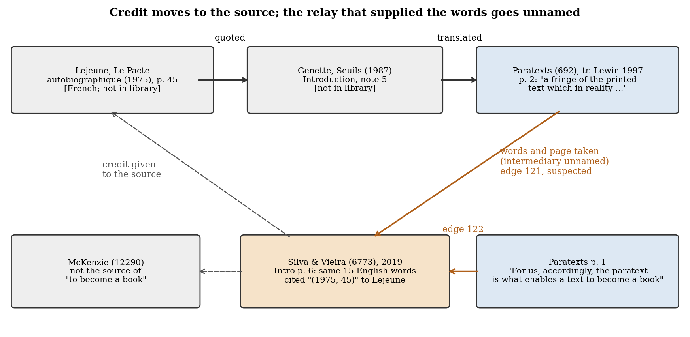

*[[shadows/weeks/gerard-genette|Gérard Genette (Author & Shadow)]] · Day 5 of 7 · 2026-11-20 · Difficulty 3 · Genealogy/influence, Shared form or method*

## Books in this reading

- [[books/6773-the-politics-of-the-book-a-study-on-the-materialit|The Politics of the Book: A Study on the Materiality of Ideas]], [[people/filipe-carreira-da-silva|Filipe Carreira da Silva]], [[people/monica-brito-vieira|Mónica Brito Vieira]]; 2019. *Day 5 (uses without credit, suspected): relays Lejeune from Paratexts p. 2 n. 5 in Lewin's English, cited to the French; gives Genette's p. 1 sentence to McKenzie. Read: Introduction 'Paratexts' section, notes 3–5, bibliography and index entries (<1%). Edges 121–122; Mentions 1109 promoted.*
- [[books/12079-porn-archives-ch-6-up-from-underground|Porn Archives (ch. 6, 'Up from Underground')]], [[people/loren-glass|Loren Glass]]; 2014. *Day 5 (uses without credit, suspected, weak): Genette's adjective and subtitle ('paratextual packaging ... thresholds of interpretation') with no Genette in the volume. Read: ch. 6 opening, all 10 'paratext' uses, acknowledgements, ch. 6 n. (<1%). Edge 123. Not in Mentions (no 'genette').*
- [[books/5996-weaponising-speculation|Weaponising Speculation]], [[people/caoimhe-doyle|Caoimhe Doyle]]; 2014. *Day 5 (method): credited quotation of Paratexts p. 319 under the name 'Gerard Ginette' (6×), invisible to every 'Genette' search and to the day-1 capture. Read: opening paragraph and notes i–iv (<1%). Edge 124; Mentions row added (1511) and promoted.*
- [[books/692-paratexts-thresholds-of-interpretation|Paratexts: Thresholds of Interpretation]], [[people/gerard-genette|Gérard Genette]], [[people/jane-e-lewin|Jane E. Lewin]] (translator); 1997 (Seuils 1987). *Day 5 cross-check: target of edges 121, 122, 124 (and 123). Read: pp. 1–2 with nn. 1–5; p. 319 n. 1 (~1%). Own work: no Mentions row promoted.*
- [[books/9756-cryptomimesis-the-gothic-and-jacques-derrida-s-gho|Cryptomimesis: The Gothic and Jacques Derrida's Ghost Writing]], [[people/jodey-castricano|Jodey Castricano]]; 2001. *Day 5 cross-check (null): 'transtextuality' as Esther Rashkin's own coinage, a different concept. Read: one passage, 'The First Partition' p. 17 (<1%). No edge.*
- [[books/4688-conrad-language-and-narrative|Conrad, Language, and Narrative]], [[people/michael-greaney|Michael Greaney]]; catalogue 1997. *Day 5 cross-check (null): 'transtextual' characters, the term Cedric Watts's (1984). Read: one passage (<1%). No edge.*
- [[books/3535-existential-thought-and-fictional-technique-kierke|Existential Thought and Fictional Technique: Kierkegaard Sartre Beckett]], [[people/edith-kern|Edith Kern]]; 1970. *Day 5 cross-check (null, priority): 'Marcel become a writer' in 1970, before Discours du récit (1972). Read: one passage (<1%). No edge.*

## The shadow so far

| Citing Book | Relation | Target | Location |
|---|---|---|---|
| [[books/2356-palimpsests-literature-in-the-second-degree|Palimpsests: Literature in the Second Degree (Foreword)]] (Gerald Prince) | **Edits/introduces** | Gérard Genette | Foreword, p. ix (PDF p. 9); TARGET Genette, Palimpsests / Palimpsestes (1982) |
| [[books/2356-palimpsests-literature-in-the-second-degree|Palimpsests: Literature in the Second Degree (Translators' Preface)]] (Channa Newman & Claude Doubinsky) | **Translates** | Gérard Genette | Translators' Preface, p. xiii (PDF p. 13); TARGET Palimpsestes (Seuil 1982, not in library) |
| [[books/2356-palimpsests-literature-in-the-second-degree|Palimpsests: Literature in the Second Degree]] (Gérard Genette (tr. Newman & Doubinsky)) | **Quotes** | Gérard Genette | ch. 52, p. 252 (PDF p. 268); TARGET Borges, prologue to A Universal History of Infamy (1935): Collected Fictions, tr. Hurley (7517); cf. Nicol 6623 epigraph (di Giovanni 1972) |
| [[books/2356-palimpsests-literature-in-the-second-degree|Palimpsests: Literature in the Second Degree]] (Gérard Genette (tr. Newman & Doubinsky)) | **Quotes** | Gérard Genette | ch. 80 n. 7, p. 471 (PDF p. 487; text p. 399), citing Labyrinths p. 44 (Yates & Irby); cf. ch. 5 p. 17; TARGET Borges, 'Pierre Menard, Author of the Quixote', Collected Fictions (7517) |
| [[books/2356-palimpsests-literature-in-the-second-degree|Palimpsests: Literature in the Second Degree]] (Gérard Genette (tr. Newman & Doubinsky)) | **Mentions** | Gérard Genette | ch. 1, p. 2 (PDF p. 18); also ch. 75 p. 360 ('This provocative use of plagiarism also comes from Lautréamont, by way of Maldoror'); TARGET Lautréamont, Maldoror and Poems (837) |
| [[books/3806-intertextuality|Intertextuality]] (Graham Allen) | **Quotes** | Gérard Genette | ch. 3, p. 98; TARGET Palimpsests (2356) ch. 1, pp. 2–3 |
| [[books/3806-intertextuality|Intertextuality]] (Graham Allen) | **Quotes** | Gérard Genette | ch. 3, p. 108; TARGET Palimpsests (2356) ch. 78, pp. 382–383 |
| [[books/3806-intertextuality|Intertextuality]] (Graham Allen) | **Quotes** | Gérard Genette | ch. 3, p. 104; TARGET Palimpsests (2356) ch. 1, p. 5 |
| [[books/133-experiments-in-life-writing-intersections-of-auto|Experiments in Life-Writing (ch. 11, 'Custom-Breaker: Writing the Life of Elizabeth Cary')]] (Ursula Hurley (in Boldrini & Novak, eds.)) | **Quotes** | Gérard Genette | ch. 11, at n. 27 (n. 27: 'Gerald Prince, foreword to Palimpsests … ix'); TARGET Prince's Foreword to Palimpsests (2356) p. ix |
| [[books/133-experiments-in-life-writing-intersections-of-auto|Experiments in Life-Writing (ch. 5, on Jackie Kay)]] (Pietra Palazzolo (in Boldrini & Novak, eds.)) | **Quotes** | Gérard Genette | ch. 5, at n. 8 (Paratexts, 156); TARGET Paratexts (692) ch. 7 'Epigraphs', Functions, p. 156 |
| [[books/133-experiments-in-life-writing-intersections-of-auto|Experiments in Life-Writing (ch. 9, on Marías, Dark Back of Time)]] (María Alhambra Díaz (in Boldrini & Novak, eds.)) | **Quotes** | Gérard Genette | ch. 9, at n. 34 (Narrative Discourse 234–235); TARGET Narrative Discourse (5343) ch. 5 'Voice', pp. 234–235 |
| [[books/12448-franketienne-and-rewriting-a-work-in-progress|Frankétienne and Rewriting: A Work in Progress]] (Rachel Douglas) | **Quotes** | Gérard Genette | Introduction, pp. 4–5, n. 11 (Palimpsestes, Seuil 1982, 11–12); TARGET Palimpsestes (not in library); English equivalent 2356 p. 5 |
| [[books/12448-franketienne-and-rewriting-a-work-in-progress|Frankétienne and Rewriting: A Work in Progress]] (Rachel Douglas) | **Uses without credit (suspected)** | Gérard Genette | Introduction, p. 5; TARGET Prince, Foreword to Palimpsests (2356) p. ix |
| [[books/13739-borges-and-his-fiction-a-guide-to-his-mind-and-art|Borges and His Fiction: A Guide to His Mind and Art]] (Gene H. Bell-Villada) | **Argues with** | Gérard Genette | ch. 6 'Ficciones II', p. 134; TARGET Genette on 'Pierre Menard' (Palimpsests 2356 pp. 17, 122, 252–253; possibly the 1960s essays) |
| [[books/13739-borges-and-his-fiction-a-guide-to-his-mind-and-art|Borges and His Fiction: A Guide to His Mind and Art]] (Gene H. Bell-Villada) | **Mentions** | Gérard Genette | ch. 1, p. 6, n. 1 ('Genette, ‘‘L’utopie littéraire,’’ pp. 123 –132'); TARGET 'L’utopie littéraire' (Figures I, not in library) |
| [[books/777-many-subtle-channels-in-praise-of-potential-litera|Many Subtle Channels: In Praise of Potential Literature]] (Daniel Levin Becker) | **Argues with** | Gérard Genette | 'publish and perish' and n. 8 (Roubaud via Guy Bennett: 'a particularly mediocre text'); TARGET Palimpsests (2356) ch. 9 'Oulipian games' pp. 39–48, esp. p. 48 |
| [[books/10153-how-to-do-things-with-forms-the-oulipo-and-its-inv|How to Do Things With Forms: The Oulipo and Its Inventions]] (Chris Andrews) | **Argues with** | Gérard Genette | ch. 4 'Manipulation, Translation, and Composition', pp. 98–99, nn. 3–10; TARGET Palimpsests (2356) pp. 7, 40, 42, 44, 397, 400; Palimpsestes p. 449 (not held) |
| [[books/10153-how-to-do-things-with-forms-the-oulipo-and-its-inv|How to Do Things With Forms: The Oulipo and Its Inventions]] (Chris Andrews) | **Quotes** | Gérard Genette | ch. 7 'Games Gone Wrong', p. 192, n. 7 (Thomas, La langue, la poésie, 165); TARGET Genette, oral remark (not in a Genette book) |
| [[books/6729-heterocosmica-fiction-and-possible-worlds|Heterocosmica: Fiction and Possible Worlds]] (Lubomír Doležel) | **Argues with** | Gérard Genette | Prologue, pp. 25–26; TARGET Fiction et diction (1991, p. 91; not in library) |
| [[books/6729-heterocosmica-fiction-and-possible-worlds|Heterocosmica: Fiction and Possible Worlds]] (Lubomír Doležel) | **Quotes** | Gérard Genette | Epilogue, p. 224; also n. 29 ('regime ludique', Genette 1982, 452-53); TARGET Palimpsestes p. 435 = Palimpsests (2356) ch. 79, p. 384 |
| [[books/7052-translation-and-paratexts|Translation and Paratexts]] (Kathryn Batchelor) | **Rewrites** | Gérard Genette | ch. 7, p. 142 (definition); ch. 1, pp. 19–22 ('Translation in Genette's framework'); TARGET Paratexts (692) p. 405 and n. 2, p. 264 n. 22 |
| [[books/7052-translation-and-paratexts|Translation and Paratexts]] (Kathryn Batchelor) | **Quotes** | Gérard Genette | Introduction, epigraph, p. 1; ch. 1, pp. 7–8 (block quotation cited 'Genette 1997b, 33'); TARGET Palimpsests (2356) ch. 1, pp. 3–4 |
| [[books/692-paratexts-thresholds-of-interpretation|Paratexts: Thresholds of Interpretation (Translator's note)]] (Jane E. Lewin) | **Translates** | Gérard Genette | Translator's note, p. xxv (PDF p. 25); TARGET Seuils (Seuil 1987, not in library) |
| [[books/692-paratexts-thresholds-of-interpretation|Paratexts: Thresholds of Interpretation (Foreword)]] (Richard Macksey) | **Edits/introduces** | Gérard Genette | Foreword, p. xxi; also p. xiii n. 4 ('a forthcoming translation of Palimpsestes by Channa Newman'), p. xxiii, p. xvii ('a sly wink at his long-time publisher'); TARGET Genette; Lewin; Newman & Doubinsky |
| [[books/5343-narrative-discourse-an-essay-in-method|Narrative Discourse: An Essay in Method (Translator's Preface)]] (Jane E. Lewin) | **Translates** | Gérard Genette | Translator's Preface, pp. 15–17 (PDF pp. 17–19); TARGET Discours du récit (Figures III, Seuil 1972, not in library) |
| [[books/5343-narrative-discourse-an-essay-in-method|Narrative Discourse: An Essay in Method (Foreword)]] (Jonathan Culler) | **Edits/introduces** | Gérard Genette | Foreword, p. 10; also p. 13 ('Genette’s work is testimony to the power of the marginal, the supplementary, the exception', n. 5 Derrida, Of Grammatology); TARGET Narrative Discourse |
| [[books/6773-the-politics-of-the-book-a-study-on-the-materialit|The Politics of the Book: A Study on the Materiality of Ideas]] (Filipe Carreira da Silva & Mónica Brito Vieira) | **Uses without credit (suspected)** | Gérard Genette | Introduction, 'Paratexts', p. 6; TARGET Paratexts (692) p. 2 and n. 5 (Lejeune, Le Pacte autobiographique, Seuil 1975, 45, in Lewin's English) |
| [[books/6773-the-politics-of-the-book-a-study-on-the-materialit|The Politics of the Book: A Study on the Materiality of Ideas]] (Filipe Carreira da Silva & Mónica Brito Vieira) | **Quotes** | Gérard Genette | Introduction, 'Paratexts', p. 6; TARGET Paratexts (692) Introduction p. 1 |
| [[books/12079-porn-archives-ch-6-up-from-underground|Porn Archives (ch. 6, 'Up from Underground')]] (Loren Glass) | **Uses without credit (suspected)** | Gérard Genette | ch. 6, opening section, pp. 127–28; TARGET Paratexts (692): term and subtitle |
| [[books/5996-weaponising-speculation|Weaponising Speculation ('MOUTH')]] (Edia Connole & Scott Wilson (per index heading; book catalogued under Caoimhe Doyle)) | **Quotes** | Gérard Genette | 'MOUTH', opening paragraph and notes ii–iii; TARGET Paratexts (692) ch. 12 'Notes', p. 319 and n. 1 |

---

## Library resurfacing, 20 November 2026 · An author and their shadow · Set 58

## 1. Where the week stands

Week 4 is Gérard Genette. Day 1 read *Palimpsests* (2356), which studies only “the sunnier side” of hypertextuality and puts undeclared borrowing outside its subject. Day 2 found quoters who keep his words and move the speaker. Day 3 found arguments about play (Bell-Villada, the Oulipo, Doležel). Day 4 found three English Genettes made under three different trans-lation contracts. Today, day 5, looks for use without credit: his coinages and sentences in books that never name him.

## 2. The day’s finding

**Relation: Uses without credit (suspected); Quotes.** Genette’s sentences don’t travel without his name. Of the books in the library that quote his best-known phrases, every one names him: “not only of transition but also of transaction” (13 books), the “vestibule” sentence (6), “Marcel becomes a writer” (8; the one exception is from 1970, two years before *Discours du récit*). His coinages travel freely: *hypotext*, *peritext*, *metadiegetic* and *transtextual* turn up as common nouns in books that never mention him. *Transtextual* has at least two other inventors on these shelves (Rashkin; Watts on Conrad).

What goes uncredited is the work his footnotes did. Silva and Vieira, *The Politics of the Book* (6773, 2019), name Genette for his sentences. They cite Lejeune’s “fringe of the printed text” to the French *Le pacte autobiographique* “(1975, 45)”, in Jane Lewin’s English, word for word. That is Genette’s note 5 and Lewin’s translation. They also give one of Genette’s own sentences to McKenzie. So the borrowing runs at the level of the apparatus: the sentence keeps its credit, and the finding and translating are taken without it.

Two further results are about method. A credit can be invisible to the search: “Gerard Ginette” (5996, six times), “Gennette” (9365), and a letter-spaced “ge ne tt e” (5196). And the index’s NOT Genette lets “Genette’s” through when the apostrophe is curly (1136, 6505, 7332). So a book that looks uncredited to the search may only have spelled the name in a way the search can’t match. Loren Glass’s “paratextual packaging … thresholds of interpretation” (12079) is the one case where the subtitle, as well as the vocabulary, appears with no name anywhere in the volume, and it is weak.

**Searches run** (calibre full-text, then a substring check of each hit for ‘genette’, ‘ginette’

> "hypotext" NOT Genette 11; peritext NOT Genette 5; epitext and a letters-only ‘genette’):

NOT Genette 1; architextual NOT Genette 3; metadiegetic NOT Genette 4; transtextuality NOT Genette 27; palimpsestuous NOT Genette 13; "serious transformation" NOT Genette 13 (all ordinary English); "thresholds of interpretation" NOT Genette 6; phrase searches without NOT: “not only of transition but also of transaction” 13, “vestibule that offers the world” 6, “fringe of the printed text” 5, “Marcel becomes a writer” 8, “always a mute gesture” 2, “consciously crafted threshold” 3, “imitates or transforms” 4, “two texts for the price of one”

0, “sunnier side” 12 (none from Genette: *Palimpsests* has no text layer). Timed out (80 s, not repeated): proximization NOT Genette; "who sees" AND "who speaks" AND narrator NOT Genette; "game of chance" AND Oulipo; "right to be unfaithful".

*Figure 1: The relay in 6773: credit goes to the source and the intermediary is not named.*

Edges 121–122.

## 3. The books

## 3.1 The Politics of the Book: A Study on the Materiality of Ideas — Filipe Carreira da Silva & Mónica Brito Vieira, 2019 (EPUB; Calibre 6773)

**Selection logic.** From the phrase search “fringe of the printed text”: five books, of which this is the only one that gives the sentence to Lejeune alone. It is in Mentions (row 1109; ‘genette’ 9 times), so it names Genette elsewhere. **Read:** the Introduction’s “Paratexts” section, the bibliography entries for Genette, Lejeune, Miller and McKenzie, the index entries, and the Introduction’s notes 3–5 (under 1% of the book).

**Overview.** A sociology of how the classics of sociology were made as books. The Introduction takes its account of the paratext from Genette’s first two pages, and takes the apparatus of those pages as well.

**Collation (verified, substring-checked): Evidence and limits.** The fifteen English words quoted from Lejeune are Lewin’s translation.

| Silva & Vieira, Introduction pp. 5–6 | Genette, Paratexts (692), tr. Lewin, pp. 1–2 |
|---|---|
| “Their intervention in what Philippe Lejeune describes as a pivotal “fringe of the printed text which in reality controls one’s whole reading of the text” (1975, 45)” | “or, as Philippe Lejeune put it, ”a fringe of the printed text which in reality controls one’s whole reading of the text.”” — n. 5: “Philippe Lejeune, Le Pacte autobiographique (Seuil, 1975), 45.” |
| Bibliography: “Lejeune, Philippe. 1975. Le pacte autobiographique. Paris: Seuil.” | (French; Genette’s Seuil edition is not in the library) |
| ““a text to become a book and to be offered as such to its readers and, more generally, to the public” (McKenzie quoted in Genette 1997, 1)” | “For us, accordingly, the paratext is what enables a text to become a book and to be offered as such to its readers and, more generally, to the public.” (p. 1; McKenzie is not named on the page) |
| “signifying simultaneously proximity and distance, similarity and difference, interiority and exteriority, a boundary, or both sides of the boundary line at once divided and connected by it (J. Miller 1979, 219)” | n. 2, Hillis Miller as Genette quotes him: “ ‘Para’ is a double antithetical prefix signifying at once proximity and distance, similarity and difference, interiority and exteriority” |

The bibliography gives only the French book, and the page is the one Genette’s note gives. Plausibility of a relay through *Paratexts*: moderate to high. It is a suspicion, not a finding: I have not seen Leary’s 1989 English *On Autobiography*, and if it happened to agree with Lewin the case would weaken. The McKenzie attribution is a verified error. McKenzie’s *Bibliography and the Sociology of Texts* (12290, the 1986 edition held) contains neither “become a book” nor “offered as such”. The Miller paraphrase can’t be decided from the wording, since Miller is English and in their bibliography.

**A misreading worth attempting.** Read the McKenzie slip as a correct reading of Genette’s p. 1. “To become a book” is McKenzie’s whole programme, and the sentence sounds like him. A reader who hears in Genette’s definition the bibliographer he did not cite has found a debt the page doesn’t declare.

## 3.2 “Up from Underground” — Loren Glass, in Porn Archives, ed. Tim Dean, Steven Ruszczycky & David Squires, 2014 (PDF; Calibre 12079)

**Selection logic.** "thresholds of interpretation" NOT Genette returned six books. Four are bibliography lines or titles. This is the only one that uses the phrase in its own prose, and the volume has no ‘genette’ at all. **Read:** the chapter’s opening (pp. 127–28), all ten uses of “paratext” in the volume, the acknowledgements and the chapter’s first note (under 1% of the volume).

**Quotations (verified):**

- “This testimony in turn supplied the basis for the paratextual packaging—academic prefaces, judicial decisions, and sometimes even trial transcripts—that established the initial thresholds of interpretation of these texts for an entire generation of readers.” (ch. 6, pp. 127–28)

- Grove’s Richard Seaver to the translator Austryn Wainhouse, 1965: the apparatus was meant “to convince the censors (or judge) that we are serious about this business, that we have spent a long time preparing this work, which is a work of considerable scholarship.” (ch. 6, Sade section)

- “This chapter derives from my book, Counterculture Colophon: Grove Press, the Evergreen Review, and the Incorporation of the Avant-Garde (Stanford, CA: Stanford University Press, 2013).” (ch. 6, notes)

**Assessment.** Weak. Genette’s adjective and his subtitle appear in one sentence, and the next sentence moves to Bourdieu’s “consecration”. By 2014, “paratext” is a word book historians use without a note, as “intertextuality” is. The chapter is also a reprint; the source book, not

held, may cite Genette. The Seaver letter is worth keeping. Here the paratext is aimed at a judge, a reader Genette’s theory never considers.

## 3.3 Weaponising Speculation — catalogued under Caoimhe Doyle, 2014; the piece “MOUTH” (Edia Connole & Scott Wilson, as the index text’s heading reads) (PDF; Calibre 5996)

**Selection logic.** Same search. A full and careful Paratexts citation, under a name the index cannot connect to Genette. **Read:** the opening paragraph and notes i–iv (under 1%).

**Quotations (verified):**

- “in his work Paratext, the literary theorist Gerard Ginette described them as the ‘mediocre attached to the beautiful’ [ii].” (opening paragraph)

- Note ii: “Ginette actually says this in a footnote, and is quoting the French author Alain, who is in turn quoted in the Petit Robert dictionary”

| • Genette, Paratexts p. 319 n. 1: | “A cliche we will not mention again: | ”A note is |
|---|---|---|
| the mediocre attached to the beautiful” (Alain, quoted in the Robert dictionary).” |  |  |
| The bracket that follows, which is Lewin’s, names the “Petit Robert dictionary” for |  |  |
| *Poujadism*. |  |  |

**Derived list: the drift, smallest unit first.** (1) “dust-like” for Lewin’s “dustlike”. (2) The title becomes singular: *Paratext*. (3) Alain’s line is given to Genette, then taken back in the note. (4) The translator’s bracket (“Petit Robert”) becomes Alain’s source. (5) The name becomes “Ginette”, which hides the whole citation from any search for Genette and kept it out of the day-1 capture. Other spellings found today: “Gennette, G. (1997). Paratexts - Thresholds of Interpretation.” (9365); “ge ra r d ge ne tt e” (5196, a series list).

## 3.4 Cross-checks (not edges)

- **Castricano, *Cryptomimesis* (9756):** “Rashkin, in Family Secrets and the Psychoanalysis of Narrative, calls “transtextuality,” a term she proposes for “the specific kind of intertextual relationship at work in narratives organized by phantoms” (45).” The same word for a different concept. A coinage on its own cannot prove a borrowing.

- **Greaney, *Conrad, Language, and Narrative* (4688):** “Schomberg is one of Conrad’s stock of ‘transtextual’ ” characters (a note marker follows the word in the index text). The term is Cedric Watts’s (1984), as the *Victory* edition (4834) notes.

- **Kern, *Existential Thought and Fictional Technique* (3535, 1970):** “with reference to Marcel become a writer”. The summary predates Genette’s use of it (1972) as the verb that the whole Recherche expands.

- **Paratexts (692):** pp. 1–2, nn. 1–5, p. 319 n. 1 read against the three books above.

## 4. The shadow so far

| Edge | From | Relation | To | Location |
|---|---|---|---|---|
| 95 | Prince (2356 Foreword) | Edits/introduces | Palimpsests | p. ix |
| 96 | Newman & Doubinsky (2356) | Translates | Palimpsestes | Translators’ Preface p. xiii |
| 97 | Genette (2356) | Quotes | Borges, Infamy prologue | ch. 52 p. 252 |
| 98 | Genette (2356) | Quotes | Borges, “Pierre Menard” | ch. 80 n. 7 p. 471 |
| 99 | Genette (2356) | Mentions | Lautréamont (837) | ch. 1 p. 2 |
| 100–102 | Allen (3806) | Quotes | Palimpsests | pp. 98, 104, |
| 103 | Hurley (133) | Quotes | Prince Foreword | ch. 11 n. 27 |
| 104 | Palazzolo (133) | Quotes | Paratexts | ch. 5 n. 8 |
| 105 | Alhambra Díaz (133) | Quotes | Narrative Discourse | ch. 9 n. 34 |
| 106 | Douglas (12448) | Quotes | Palimpsestes (French) | Intro pp. 4–5 |
| 107 | Douglas (12448) | Uses without credit (suspected) | Prince Foreword | Intro p. 5 |
| 108 | Bell-Villada (13739) | Argues with | Genette on Menard | ch. 6 p. 134 |
| 109 | Bell-Villada (13739) | Mentions | “L’utopie littéraire” | ch. 1 p. 6 n. 1 |
| 110 | Levin Becker (777) | Argues with | Palimpsests ch. 9 | n. 8 |
| 111–112 | Andrews (10153) | Argues with; Quotes | Palimpsests; oral remark | ch. 4 pp. 98–99; ch. 7 p. 192 |
| 113–114 | Doležel (6729) | Argues with; Quotes | Fiction et diction; Palimpsestes p. 435 | pp. 25–26; p. 224 |
| 115–116 | Batchelor (7052) | Rewrites; Quotes | Paratexts p. 405; Palimpsests pp. 3–4 | ch. 7 p. 142; p. 1 |
| 117 | Lewin (692) | Translates | Seuils | p. xxv |
| 118 | Macksey (692) | Edits/introduces | Paratexts | Foreword p. xxi |
| 119 | Lewin (5343) | Translates | Discours du récit | pp. 15–17 |
| 120 | Culler (5343) | Edits/introduces | Narrative Discourse | Foreword p. 10 |
| **121** | **Silva & Vieira (6773)** | **Uses without credit (suspected)** | **Paratexts p. 2 n. 5 (Lejeune via Lewin)** | **Intro p. 6** |
| **122** | **Silva & Vieira (6773)** | **Quotes (misattributed to McKenzie)** | **Paratexts p. 1** | **Intro p. 6** |
| **123** | **Glass (12079)** | **Uses without credit (suspected)** | **Paratexts (vocabulary, subtitle)** | **ch. 6 pp. 127–28** |
| **124** | **Connole & Wilson (5996)** | **Quotes (as “Ginette”)** | **Paratexts p. 319 n. 1** | **“MOUTH”, n. ii** |

## 5. Where this sends you

**Notebook.**

1. Silva and Vieira credit Lejeune for words they took from Lewin. Write the citation a strict scholar would have given (Lejeune, as quoted and translated in Genette, tr. Lewin). Then decide whether that citation is more honest or only longer.

2. “Gerard Ginette”: a misspelt name keeps the credit and still makes it unfindable. Name a writer in your own reading whom you know under a wrong spelling, and what that spelling has cost you.

3. Genette on p. 319: “That had to be said in a note.” Write a note that says something the main text could not have said.

**Rabbit holes** (all checked today):

- Genette, *Paratexts*, Cambridge Core: https://www.cambridge.org/core/product/identifier/9780511549373/type/book

- Lejeune, *On Autobiography*, ed. Eakin, tr. Leary (1989), WorldCat: https://search.worldcat.org/title/On-autobiography/oclc/17354063. Check how Leary renders “frange du texte imprimé”.

- Phil Ford on Glass’s *Counterculture Colophon*, LARB: https://lareviewofbooks.org/article/vulgar-modernism-on-counterculture-colophon/

- BMCR review of Grafton, *The Footnote*: https://bmcr.brynmawr.edu/?p=52352

- Frank Kermode on *The Footnote*, LRB 20.6: https://www.lrb.co.uk/v20/n06/frank-kermode/enemy-of-the-enemies-of-truth

- *Palimpsests*, Wikipedia: https://en.wikipedia.org/wiki/Palimpsests:_Literature_in_the_Second_Degree

- Search further: Esther Rashkin, *Family Secrets and the Psychoanalysis of Narrative* (Princeton, 1992), for her “transtextuality”; Michel Schneider, *Voleurs de mots* (1985), on plagiarism.

**Also in your library.**

- Grafton, *The Footnote: A Curious History* (11594). Note: it has no text in the full-text index.

- McKenzie, *Bibliography and the Sociology of Texts* (12290). It is the book 6773 credits with Genette’s sentence.

- Lowry, *In Ballast to the White Sea* (7332). The editors’ introduction reports Grace bringing Genette’s *Palimpsestes* and Schneider’s *Voleurs de mots* to Lowry’s “obsession with plagiarism”.

- Send To pool: no Candidates queued this week.

## 6. From the Lexicon: tosafists

**Received.** “The medieval Talmudic scholars, chiefly of northern France and Germany (12th– 14th c.), who wrote the Tosafot (‘additions’): critical and explanatory glosses on selected Talmud passages, often disputing Rashi’s commentary.” Printed Talmuds set the Tosafot in the outer margin, with Rashi in the inner.

**Your sense.** Not yet written.

**Etymology.** English agent noun on Hebrew *tosafot* (“ ,)תוספותadditions”.

**WordNet.** Absent (Lexicon record).

**Relations.** Shares lineage with *gematria*, *halakhic*, *sugya*. Boundary tension (Lexicon): what the additions are added to, Rashi or the Talmud itself, is disputed, and “most tosafists are anonymous.”

**Portable axiom.** None recorded.

**Why today.** Silva and Vieira’s borrowing is a tosafist’s problem: commentary on a commentary, where the source and the gloss are printed on one page and the glossator goes unnamed. Genette’s notes are an inner margin; whoever lifts Lejeune from them writes in the outer one.

**Verified occurrence.** Scholem, *Major Trends in Jewish Mysticism* (12878): “the writings of many Talmudists and Tosafists—the name generally given to the school of Talmudic casuists in Germany and Northern France in the twelfth and thirteenth centuries—in so far as they deal at all with religious subjects, are steeped in the same kind of mystical thought.” (index text; lecture not located). The Lexicon’s Attestation (TheFreeDictionary) is not verified.

**New in the Lexicon** since the last run: *the warp*, *Mormaer*.

## 7. To carry

“That had to be said in a note.” — Genette, *Paratexts*, tr. Jane E. Lewin, ch. 12 “Notes”, p. 319 n. 1.

Reading notes: 6773 — Silva — The Politics of the Book.md (new); 12079 — Glass — Porn Archives (Up from Underground).md (new); 5996 — Doyle — Weaponising Speculation.md (new); 692 — Genette — Paratexts.md (appended); 9756 — Castricano — Cryptomimesis.md (new); 4688 — Greaney — Conrad, Language, and Narrative.md (new); 3535 — Kern — Existential Thought and Fictional Technique.md (new).

## Themes

[[themes/alain|Alain]] · [[themes/apparatus|apparatus]] · [[themes/bourdieu|Bourdieu]] · [[themes/censorship|censorship]] · [[themes/citation|citation]] · [[themes/coinage|coinage]] · [[themes/consecration|consecration]] · [[themes/epitext|epitext]] · [[themes/footnotes|footnotes]] · [[themes/full-text-index|full-text index]] · [[themes/ginette|Ginette]] · [[themes/grove-press|Grove Press]] · [[themes/hillis-miller|Hillis Miller]] · [[themes/hypotext|hypotext]] · [[themes/le-pacte-autobiographique|Le pacte autobiographique]] · [[themes/lejeune|Lejeune]] · [[themes/lewin|Lewin]] · [[themes/mckenzie|McKenzie]] · [[themes/misattribution|misattribution]] · [[themes/misspelling|misspelling]] · [[themes/notes|notes]] · [[themes/paratext|paratext]] · [[themes/peritext|peritext]] · [[themes/petit-robert|Petit Robert]] · [[themes/rashkin|Rashkin]] · [[themes/relay|relay]] · [[themes/sade|Sade]] · [[themes/search-blindness|search blindness]] · [[themes/seaver|Seaver]] · [[themes/sociology-of-texts|sociology of texts]] · [[themes/tosafists|tosafists]] · [[themes/translation|translation]] · [[themes/transtextuality|transtextuality]] · [[themes/uncredited-use|uncredited use]] · [[themes/vocabulary|vocabulary]] · [[themes/wainhouse|Wainhouse]] · [[themes/watts|Watts]]

---

Previous: [[shadows/2026-11-19-shadow-gerard-genette-day-4-the-right-to-be-unfait|Shadow — Gérard Genette, day 4: The Right to Be Unfaithful]]  
Next: [[shadows/2026-11-21-shadow-gerard-genette-day-6-people-off-to-the-side|Shadow — Gérard Genette, day 6: People Off to the Side]]
