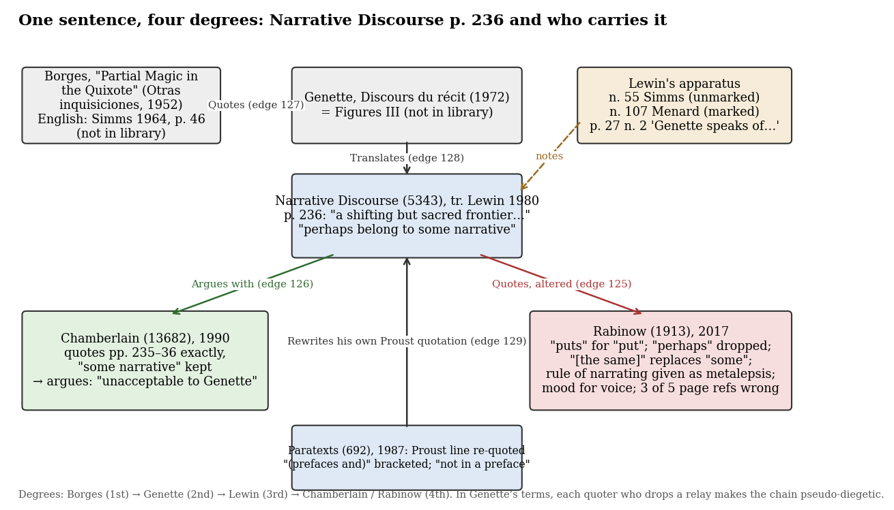

*[[shadows/weeks/gerard-genette|Gérard Genette (Author & Shadow)]] · Day 6 of 7 · 2026-11-21 · Difficulty 3 · Genealogy/influence, Shared form or method*

## Books in this reading

- [[books/5343-narrative-discourse-an-essay-in-method|Narrative Discourse: An Essay in Method]], [[people/gerard-genette|Gérard Genette]], [[people/jane-e-lewin|Jane E. Lewin]] (translator); 1980. *Day 6 (the author again): primary book, read in the light of days 2–5. Read: Preface, Introduction pp. 25–27 and p. 31 notes, 'Voice' pp. 212, 227–237, 260–262, Afterword pp. 263–268, pp. 160–161, 186, 211; 22 Translator's notes located, 14 read in place (≈16%). Edges 127 (Quotes Borges), 128 (Lewin's notes: Translates).*
- [[books/1913-unconsolable-contemporary-observing-gerhard-richte|Unconsolable Contemporary: Observing Gerhard Richter]], [[people/paul-rabinow|Paul Rabinow]]; 2017. *Day 6: quoter of Narrative Discourse pp. 31, 234, 236 who agrees and alters (page refs, mood for voice, rule given as transgression, hedge dropped, '[the same]' for 'some'). Read: ch. 3 section on mood and metalepsis, nn. 13–19, bibliography (<2%). Edge 125; Mentions 858 promoted.*
- [[books/13682-narrative-perspective-in-fiction-a-phenomenologica|Narrative Perspective in Fiction: A Phenomenological Mediation of Reader, Text, and World]], [[people/daniel-frank-chamberlain|Daniel Frank Chamberlain]]; 1990. *Day 6 control: quotes Narrative Discourse pp. 235–36 exactly, then argues ('Metalepsis is unacceptable to Genette'). Read: pp. 81–82 (<1%). Edge 126; Mentions 1454 promoted.*
- [[books/692-paratexts-thresholds-of-interpretation|Paratexts: Thresholds of Interpretation]], [[people/gerard-genette|Gérard Genette]], [[people/jane-e-lewin|Jane E. Lewin]] (translator); 1997. *Day 6 cross-check (own work, already read Set 53 and day 4): Genette re-quotes the Proust line Narrative Discourse p. 261 quotes whole, bracketing '(prefaces and)' and filing it under hypocrisy. Read: two passages and two notes, pp. 135, 231 (<1%). Edge 129. Used again as the day requires (self-rewriting).*

## The shadow so far

| Citing Book | Relation | Target | Location |
|---|---|---|---|
| [[books/2356-palimpsests-literature-in-the-second-degree|Palimpsests: Literature in the Second Degree (Foreword)]] (Gerald Prince) | **Edits/introduces** | Gérard Genette | Foreword, p. ix (PDF p. 9); TARGET Genette, Palimpsests / Palimpsestes (1982) |
| [[books/2356-palimpsests-literature-in-the-second-degree|Palimpsests: Literature in the Second Degree (Translators' Preface)]] (Channa Newman & Claude Doubinsky) | **Translates** | Gérard Genette | Translators' Preface, p. xiii (PDF p. 13); TARGET Palimpsestes (Seuil 1982, not in library) |
| [[books/2356-palimpsests-literature-in-the-second-degree|Palimpsests: Literature in the Second Degree]] (Gérard Genette (tr. Newman & Doubinsky)) | **Quotes** | Gérard Genette | ch. 52, p. 252 (PDF p. 268); TARGET Borges, prologue to A Universal History of Infamy (1935): Collected Fictions, tr. Hurley (7517); cf. Nicol 6623 epigraph (di Giovanni 1972) |
| [[books/2356-palimpsests-literature-in-the-second-degree|Palimpsests: Literature in the Second Degree]] (Gérard Genette (tr. Newman & Doubinsky)) | **Quotes** | Gérard Genette | ch. 80 n. 7, p. 471 (PDF p. 487; text p. 399), citing Labyrinths p. 44 (Yates & Irby); cf. ch. 5 p. 17; TARGET Borges, 'Pierre Menard, Author of the Quixote', Collected Fictions (7517) |
| [[books/2356-palimpsests-literature-in-the-second-degree|Palimpsests: Literature in the Second Degree]] (Gérard Genette (tr. Newman & Doubinsky)) | **Mentions** | Gérard Genette | ch. 1, p. 2 (PDF p. 18); also ch. 75 p. 360 ('This provocative use of plagiarism also comes from Lautréamont, by way of Maldoror'); TARGET Lautréamont, Maldoror and Poems (837) |
| [[books/3806-intertextuality|Intertextuality]] (Graham Allen) | **Quotes** | Gérard Genette | ch. 3, p. 98; TARGET Palimpsests (2356) ch. 1, pp. 2–3 |
| [[books/3806-intertextuality|Intertextuality]] (Graham Allen) | **Quotes** | Gérard Genette | ch. 3, p. 108; TARGET Palimpsests (2356) ch. 78, pp. 382–383 |
| [[books/3806-intertextuality|Intertextuality]] (Graham Allen) | **Quotes** | Gérard Genette | ch. 3, p. 104; TARGET Palimpsests (2356) ch. 1, p. 5 |
| [[books/133-experiments-in-life-writing-intersections-of-auto|Experiments in Life-Writing (ch. 11, 'Custom-Breaker: Writing the Life of Elizabeth Cary')]] (Ursula Hurley (in Boldrini & Novak, eds.)) | **Quotes** | Gérard Genette | ch. 11, at n. 27 (n. 27: 'Gerald Prince, foreword to Palimpsests … ix'); TARGET Prince's Foreword to Palimpsests (2356) p. ix |
| [[books/133-experiments-in-life-writing-intersections-of-auto|Experiments in Life-Writing (ch. 5, on Jackie Kay)]] (Pietra Palazzolo (in Boldrini & Novak, eds.)) | **Quotes** | Gérard Genette | ch. 5, at n. 8 (Paratexts, 156); TARGET Paratexts (692) ch. 7 'Epigraphs', Functions, p. 156 |
| [[books/133-experiments-in-life-writing-intersections-of-auto|Experiments in Life-Writing (ch. 9, on Marías, Dark Back of Time)]] (María Alhambra Díaz (in Boldrini & Novak, eds.)) | **Quotes** | Gérard Genette | ch. 9, at n. 34 (Narrative Discourse 234–235); TARGET Narrative Discourse (5343) ch. 5 'Voice', pp. 234–235 |
| [[books/12448-franketienne-and-rewriting-a-work-in-progress|Frankétienne and Rewriting: A Work in Progress]] (Rachel Douglas) | **Quotes** | Gérard Genette | Introduction, pp. 4–5, n. 11 (Palimpsestes, Seuil 1982, 11–12); TARGET Palimpsestes (not in library); English equivalent 2356 p. 5 |
| [[books/12448-franketienne-and-rewriting-a-work-in-progress|Frankétienne and Rewriting: A Work in Progress]] (Rachel Douglas) | **Uses without credit (suspected)** | Gérard Genette | Introduction, p. 5; TARGET Prince, Foreword to Palimpsests (2356) p. ix |
| [[books/13739-borges-and-his-fiction-a-guide-to-his-mind-and-art|Borges and His Fiction: A Guide to His Mind and Art]] (Gene H. Bell-Villada) | **Argues with** | Gérard Genette | ch. 6 'Ficciones II', p. 134; TARGET Genette on 'Pierre Menard' (Palimpsests 2356 pp. 17, 122, 252–253; possibly the 1960s essays) |
| [[books/13739-borges-and-his-fiction-a-guide-to-his-mind-and-art|Borges and His Fiction: A Guide to His Mind and Art]] (Gene H. Bell-Villada) | **Mentions** | Gérard Genette | ch. 1, p. 6, n. 1 ('Genette, ‘‘L’utopie littéraire,’’ pp. 123 –132'); TARGET 'L’utopie littéraire' (Figures I, not in library) |
| [[books/777-many-subtle-channels-in-praise-of-potential-litera|Many Subtle Channels: In Praise of Potential Literature]] (Daniel Levin Becker) | **Argues with** | Gérard Genette | 'publish and perish' and n. 8 (Roubaud via Guy Bennett: 'a particularly mediocre text'); TARGET Palimpsests (2356) ch. 9 'Oulipian games' pp. 39–48, esp. p. 48 |
| [[books/10153-how-to-do-things-with-forms-the-oulipo-and-its-inv|How to Do Things With Forms: The Oulipo and Its Inventions]] (Chris Andrews) | **Argues with** | Gérard Genette | ch. 4 'Manipulation, Translation, and Composition', pp. 98–99, nn. 3–10; TARGET Palimpsests (2356) pp. 7, 40, 42, 44, 397, 400; Palimpsestes p. 449 (not held) |
| [[books/10153-how-to-do-things-with-forms-the-oulipo-and-its-inv|How to Do Things With Forms: The Oulipo and Its Inventions]] (Chris Andrews) | **Quotes** | Gérard Genette | ch. 7 'Games Gone Wrong', p. 192, n. 7 (Thomas, La langue, la poésie, 165); TARGET Genette, oral remark (not in a Genette book) |
| [[books/6729-heterocosmica-fiction-and-possible-worlds|Heterocosmica: Fiction and Possible Worlds]] (Lubomír Doležel) | **Argues with** | Gérard Genette | Prologue, pp. 25–26; TARGET Fiction et diction (1991, p. 91; not in library) |
| [[books/6729-heterocosmica-fiction-and-possible-worlds|Heterocosmica: Fiction and Possible Worlds]] (Lubomír Doležel) | **Quotes** | Gérard Genette | Epilogue, p. 224; also n. 29 ('regime ludique', Genette 1982, 452-53); TARGET Palimpsestes p. 435 = Palimpsests (2356) ch. 79, p. 384 |
| [[books/7052-translation-and-paratexts|Translation and Paratexts]] (Kathryn Batchelor) | **Rewrites** | Gérard Genette | ch. 7, p. 142 (definition); ch. 1, pp. 19–22 ('Translation in Genette's framework'); TARGET Paratexts (692) p. 405 and n. 2, p. 264 n. 22 |
| [[books/7052-translation-and-paratexts|Translation and Paratexts]] (Kathryn Batchelor) | **Quotes** | Gérard Genette | Introduction, epigraph, p. 1; ch. 1, pp. 7–8 (block quotation cited 'Genette 1997b, 33'); TARGET Palimpsests (2356) ch. 1, pp. 3–4 |
| [[books/692-paratexts-thresholds-of-interpretation|Paratexts: Thresholds of Interpretation (Translator's note)]] (Jane E. Lewin) | **Translates** | Gérard Genette | Translator's note, p. xxv (PDF p. 25); TARGET Seuils (Seuil 1987, not in library) |
| [[books/692-paratexts-thresholds-of-interpretation|Paratexts: Thresholds of Interpretation (Foreword)]] (Richard Macksey) | **Edits/introduces** | Gérard Genette | Foreword, p. xxi; also p. xiii n. 4 ('a forthcoming translation of Palimpsestes by Channa Newman'), p. xxiii, p. xvii ('a sly wink at his long-time publisher'); TARGET Genette; Lewin; Newman & Doubinsky |
| [[books/5343-narrative-discourse-an-essay-in-method|Narrative Discourse: An Essay in Method (Translator's Preface)]] (Jane E. Lewin) | **Translates** | Gérard Genette | Translator's Preface, pp. 15–17 (PDF pp. 17–19); TARGET Discours du récit (Figures III, Seuil 1972, not in library) |
| [[books/5343-narrative-discourse-an-essay-in-method|Narrative Discourse: An Essay in Method (Foreword)]] (Jonathan Culler) | **Edits/introduces** | Gérard Genette | Foreword, p. 10; also p. 13 ('Genette’s work is testimony to the power of the marginal, the supplementary, the exception', n. 5 Derrida, Of Grammatology); TARGET Narrative Discourse |
| [[books/6773-the-politics-of-the-book-a-study-on-the-materialit|The Politics of the Book: A Study on the Materiality of Ideas]] (Filipe Carreira da Silva & Mónica Brito Vieira) | **Uses without credit (suspected)** | Gérard Genette | Introduction, 'Paratexts', p. 6; TARGET Paratexts (692) p. 2 and n. 5 (Lejeune, Le Pacte autobiographique, Seuil 1975, 45, in Lewin's English) |
| [[books/6773-the-politics-of-the-book-a-study-on-the-materialit|The Politics of the Book: A Study on the Materiality of Ideas]] (Filipe Carreira da Silva & Mónica Brito Vieira) | **Quotes** | Gérard Genette | Introduction, 'Paratexts', p. 6; TARGET Paratexts (692) Introduction p. 1 |
| [[books/12079-porn-archives-ch-6-up-from-underground|Porn Archives (ch. 6, 'Up from Underground')]] (Loren Glass) | **Uses without credit (suspected)** | Gérard Genette | ch. 6, opening section, pp. 127–28; TARGET Paratexts (692): term and subtitle |
| [[books/5996-weaponising-speculation|Weaponising Speculation ('MOUTH')]] (Edia Connole & Scott Wilson (per index heading; book catalogued under Caoimhe Doyle)) | **Quotes** | Gérard Genette | 'MOUTH', opening paragraph and notes ii–iii; TARGET Paratexts (692) ch. 12 'Notes', p. 319 and n. 1 |
| [[books/1913-unconsolable-contemporary-observing-gerhard-richte|Unconsolable Contemporary: Observing Gerhard Richter]] (Paul Rabinow) | **Quotes** | Gérard Genette | ch. 3 'Assembling: Abet and Facilitate', section on mood and metalepsis, nn. 14–18 (EPUB, no pages); TARGET Narrative Discourse (5343) p. 31 n. 9, p. 234, p. 236 |
| [[books/13682-narrative-perspective-in-fiction-a-phenomenologica|Narrative Perspective in Fiction: A Phenomenological Mediation of Reader, Text, and World]] (Daniel Frank Chamberlain) | **Argues with** | Gérard Genette | pp. 81–82 (after block quotation of Narrative Discourse pp. 235–36); TARGET Narrative Discourse (5343) pp. 228, 234–237 |
| [[books/5343-narrative-discourse-an-essay-in-method|Narrative Discourse: An Essay in Method]] (Gérard Genette (tr. Jane E. Lewin)) | **Quotes** | Gérard Genette | ch. 5 'Voice', 'Metalepses', p. 236 and n. 55 (Borges, Other Inquisitions, tr. Simms, 1964, p. 46); also p. 262 'Pierre Menard inventing Quixote word for word' with Lewin's n. 107; TARGET Borges, 'Partial Magic in the Quixote' (Otras inquisiciones; Simms's English not in library) |
| [[books/5343-narrative-discourse-an-essay-in-method|Narrative Discourse: An Essay in Method (Translator's notes)]] (Jane E. Lewin) | **Translates** | Gérard Genette | Introduction p. 27 n. 2; p. 33 n. 1 (Metz altered); p. 37 n. 8 (Mazon replaced); p. 94 n. 15 (omission); 22 Translator's notes in all; TARGET Discours du récit (Figures III, 1972, not in library) |
| [[books/692-paratexts-thresholds-of-interpretation|Paratexts: Thresholds of Interpretation]] (Gérard Genette (tr. Jane E. Lewin)) | **Rewrites** | Gérard Genette | ch. 6 'Dedications', p. 135; ch. 9, p. 231 and n. 36 (Pléiade 3:911; Mayor 3:949); TARGET Narrative Discourse (5343) p. 261 and n. 105 (same Proust passage, quoted whole, Scott Moncrieff RH II 1031–1032) |

---

## Saturday, 21 November 2026

## 1. Where the week stands

The week follows Gérard Genette through Scribrarium. Day 1 read *Palimpsests* (2356) and found a theory of declared borrowing that leaves undeclared borrowing to someone else. Day 2 found quoters who keep his words and move the speaker (Allen drops “according to Riffaterre”). Day 3 found the arguments are about play. Day 4 found three English Genettes and three translator’s contracts, one of them “silent”. Day 5 found no stolen sentences, only an unsigned apparatus and credits misspelt past the reach of search (“Gerard Ginette”). To-day is the author again: *Narrative Discourse* (5343), read for what days 2–5 found.

## 2. The day’s finding

*Narrative Discourse* (Discours du récit, 1972; tr. Jane E. Lewin, 1980) already contains the grammar of this week’s shadow, ten years before *Palimpsestes* (1982) and fifteen before *Seuils* (1987).

- **The relay dropped has a name.** On p. 236 Genette describes the *Theaetetus*: Eucleides removes “and I said” and “he asserted” and turns a reported conversation into direct speech. Genette calls such forms “reduced metadiegetic … or pseudo-diegetic” (p. 237), and says they economise on a narrative level. Allen cutting “according to Riffaterre” (edge 100) does exactly this to Genette.

- **“Second degree” and “threshold” begin here, as terms of narrative level.** The metadiegetic is “a narrative in the second degree” (p. 228 and n. 41); what separates the levels is “a sort of threshold represented by the narrating itself” (p. 228). In 1982 “second degree” becomes literature on literature; in 1987 the threshold moves out to the title page.

- **Infidelity is first the reader’s right.** The Proustian narratee is invited “to rewrite it, being totally unfaithful and wonderfully exact, like Pierre Menard” (pp. 261–262). In *Paratexts* (1987, p. 405 n. 2; edge 115) “the right to be unfaithful is an authorial privilege”. Same word, given to the other party.

- **Play is a danger, not chance.** Metalepsis is a set of “games”; he learned “the metaleptic game” from a history teacher’s lapse, “perhaps a deliberate one” (p. 235 n. 54); Proust’s “formidable game … with Time” is “also a dangerous one” (p. 160 n. 97). This complicates both day-3 charges (Bell-Villada: no sense of Borges’s humour; the Oulipo: play reduced to chance), without answering either directly.

- **The English edition adds a level.** Lewin, who “silently” corrected errors (day 4), also *narrates* Genette in her notes: “In a note at this point Genette speaks of …” (p. 27 n. 2). The author becomes a third-person character on his own page. She declares one omission (p. 94 n. 15) and one substitution of translations (p. 37 n. 8), and leaves others unmarked (the Borges of p. 236 n. 55, in Simms’s English).

Two later readers then carry the same sentence on p. 236, the one about the frontier between “the world in which one tells, the world of which one tells”. Chamberlain (13682, 1990) quotes it exactly and argues against Genette (edge 126). Rabinow (1913, 2017) agrees with him and changes almost everything around it: the page numbers, the chapter (mood for voice), the definition (the rule of narrating given as the definition of metalepsis), a hedge (“perhaps”), and a word under cover of a bracket (“[the same]” for “some”) (edge 125). Relations today: Quotes, Argues with, Translates, Rewrites.

## 3. The books

## Narrative Discourse: An Essay in Method — Gérard Genette, tr. Jane E. Lewin, foreword by Jonathan Culler (Cornell, 1980); PDF (also DJVU), Calibre 5343

**Selection logic.** The day-6 book named in the week’s plan since day 1 (Gestext-flagged; text layer present). Days 2 and 4 had read only pp. 234–235 and the front matter.

**How much was read.** Chapters and passages, about 45 of ~285 pages (≈16%): Preface (pp. 21–23); Introduction pp. 25–27 with notes on p. 31; the ‘Voice’ chapter pp. 212, 227– 237 continuously (‘Narrative Levels’, ‘Metadiegetic Narrative’, ‘Metalepses’, start of ‘From Jean Santeuil to the Recherche’) and pp. 260–262; the whole Afterword (pp. 263–268); single pages 160–161, 186, 211. All 22 “Translator’s note” markers located by search; 14 read in place. Text from pdftotext of the PDF (OCR of a scan; printed page = PDF page −2).

**Overview.** Genette’s study of Proust’s *Recherche* as a “method of analysis”: order, duration, frequency (tense), mood (distance and focalization, “who sees?”) and voice (“who speaks?”: narrating instance, narrative levels, person, narratee). The Preface declares the paradox of every poetics: “by seeking the specific I find the universal, and that by wishing to put theory at the service of criticism I put criticism, against my will, at the service of theory” (p. 23). The Afterword predicts that the book’s terms will become “other packaging, the detritus of Poetics” (p. 263).

**Verified quotations.**

> “What separates them is less a distance than a sort of threshold represented by the narrating itself, a difference of level.” (ch. 5 ‘Voice’, ‘Narrative Levels’, p. 228)

> “The transition from one narrative level to another can in principle be achieved only by the narrating, the act that consists precisely of introducing into one situation, by means of a discourse, the knowledge of another situation. Any other form of transit is, if not always impossible, at any rate always transgressive.” (ch. 5, ‘Metalepses’, p. 234)

> “All these games, by the intensity of their effects, demonstrate the importance of the boundary they tax their ingenuity to overstep, in defiance of verisimilitude—a boundary that is precisely the narrating (or the performance) itself: a shifting but sacred frontier between two worlds, the world in which one tells, the world of which one tells.” (ch. 5, p. 236)

> “that the extradiegetic is perhaps always diegetic, and that the narrator and his narratees—you and I—perhaps belong to some narrative.” (ch. 5, p. 236)

> “these forms we will call reduced metadiegetic (implying: reduced to the diegetic), or pseudo-diegetic.” (ch. 5, p. 237)

> “the real author of the narrative is not only he who tells it, but also, and at times even more, he who hears it. And who is not necessarily the one it is addressed to:

> there are always people off to the side.” (ch. 5, end, p. 262)

> “if the critic can dream of an achievement in the second degree, the poetician for his part knows that he labors in—let us say rather at—the ephemeral, a worker aware of becoming un-worked.” (Afterword, p. 263)

> “Even—or especially?—when he is silent, the critic says too much.” (Afterword, p. 268)

**Derived list: Lewin’s visible hands (Translator’s notes read in place). A misreading worth attempting.**

| Page | What the note does |
|---|---|
| p. 23 n. 2 | Translates Genette’s Virgil tag (“amant alterna Camenae”) with Rhoades |
| p. 25 n. 1 | *récit* = “narrative” throughout |
| p. 27 n. 2 | Replaces Genette’s note with a report of it: “In a note at this point Genette speaks of …” |
| p. 31 n. 10 | Glosses “instance” (Benveniste) |
| p. 33 n. 1 | “I have altered this translation [Metz] slightly so as to align its terms” |
| p. 37 n. 8 | “Genette’s reference in the text is to the French translation by Paul Mazon” (Iliad replaced by Lang, Leaf and Myers) |
| p. 38 n. 10 | Hopkins’s *Jean Santeuil* “very free”; her own literal version used |
| p. 90 n. 5, n. 9 | Pléiade page concordance; who Agostinelli was |
| p. 94 n. 15 | “I have omitted from the text a brief statement on French terminology.” |
| p. 160 n. 97 | “my translation” of Proust’s “formidable game” |
| p. 261 n. 106; p. 262 n. 107 | Who Nathanaël is; the source of Pierre Menard (Genette’s text names none) |
| p. 236 n. 55 | Borges cited in Simms’s English (1964): no translator’s mark (French source not checkable here) |

> Read p. 228 (“a sort of threshold represented by the

narrating itself”) as the first sentence of *Paratexts*, and *Paratexts* as the story of that threshold moving outward from the act of telling to the printed object, until the translator’s note (p. 27 n. 2) becomes a narrating act of its own, with Genette as its character.

## Unconsolable Contemporary: Observing Gerhard Richter — Paul Rabinow (Duke, 2017); EPUB, Calibre 1913

**Selection logic.** Full-text search for Borges’s sentence “Such inversions suggest” as Genette quotes it: 7 books; two quote it through Genette. In Mentions (row 858).

**How much was read.** Passages: the section of ch. 3 (‘Assembling: Abet and Facilitate’) on mood and metalepsis (~600 words), notes 13–19, the Genette bibliography entries (<2%). EPUB, no printed pages.

**Overview.** An anthropologist’s account of Richter’s practice; ch. 3 borrows Genette’s mood and metalepsis to describe how Richter’s paintings unsettle the spectator’s distance.

**Concordance against Genette (verified both sides).** Rabinow also places metalepsis under mood; Genette treats it under voice, and on p. 186

| Rabinow (ch. 3) | Genette, tr. Lewin | Change |
|---|---|---|
| “in a long chapter on ‘mood’ … quotes the definition of ‘mood’ from … Littré” (n. 14: p. 182) | The sentence is Introduction n. 9, p. 31; the chapter’s version is p. 161 | wrong place, wrong page |
| “Name given to different forms of the verb that are used to affirm more or less the same thing in question and to express the different points of view” | “Name given to the different forms of the verb that are used to affirm more or less the thing in question, and to express… the different points of view” (p. 31 n. 9) | “the” dropped, “same” added, ellipsis removed |
| “the Littre [sic] dictionary” | “the Littré dictionary” (pp. 31, 161) | [sic] marks an error not in the source |
| “technically metalepsis is | that act is *narrating*, the | rule given as its |
| achieved through ‘the act that consists precisely of introducing into one situation, by means of a discourse, the knowledge of another situation’ ” (n. 15: p. 234) | lawful transit; metalepsis is “Any other form of transit” (p. 234) | transgression |
| “Whence the uneasiness that Borges so well puts his finger on” (n. 17: “Ibid.” = 234) | “so well put his finger on” (p. 236) | tense; page |
| “the extra-textual is always textual” | “the extradiegetic is perhaps always diegetic” (p. 236) | hedge dropped; levels become text |
| “perhaps belong to [the same] narrative” (n. 18: p. 236) | “perhaps belong to some narrative” (p. 236) | a word replaced inside a bracket |

calls “a regrettable confusion between what I call here mood and voice” the common fault of earlier theory. Two of the five page references are right (nn. 15, 18).

## Narrative Perspective in Fiction — Daniel Frank Chamberlain (Toronto, 1990); PDF, Calibre 13682

**Selection logic.** The other book that carries the Borges sentence through Genette; chosen as a control for Rabinow. In Mentions (row 1454).

**How much was read.** pp. 81–82 (~700 words), <1%. OCR text.

**Overview.** A phenomenological (Ricoeur-led) study of narrative perspective, with a chapter setting Genette’s “closed borders” against Ricoeur’s mediation.

**Verified quotations.**

> “the narrator and his narratees - you and I - perhaps belong to some narrative. (235- 6)” (p. 82; his block quotation, exact)

> “Metalepsis is unacceptable to Genette because of the fundamentally visual and spatial nature of his understanding of narrative.” (p. 82)

> “Genette’s recent Palimpsestes of course does explore ‘transtextualite ou transcendance textuelle du texte’ (1982, 7).” (p. 82)

**Element: the argument and its slip.** Chamberlain keeps every word and both hedges, then makes Genette’s adjective his verdict: in Genette the hypothesis is “unacceptable and insistent”, a description of its effect; Genette himself calls metaleptic figures “games” and extends them to Pirandello, Genet and Robbe-Grillet (p. 235). Chamberlain’s “additional detour” (237) is Genette’s phrase for the pseudo-diegetic digression, not for metalepsis. My reading; he may mean that Genette’s system has no place for it.

## Paratexts: Thresholds of Interpretation — Gérard Genette, tr. Jane E. Lewin (1997); PDF, Calibre 692 (cross-check)

**Selection logic.* Narrative Discourse* p. 261 quotes Proust’s line about “the insincere language of prefaces and dedications”; full-text search showed *Paratexts* quotes it twice.

**How much was read.** Two passages and two notes (pp. 135, 231), <1%.

**Verified quotations.**

> In all of that there is something basically oblique, which Proust called the “insincere language of (prefaces and) dedications” (ch. 6 ‘Dedications’, p. 135)

> About hypocrisy: this is the place to recall Proust’s famous line about “the insincere language of prefaces and dedications” - but this line does not appear in a preface.36 (ch. 9, p. 231)

**Element: one line, three handlings.** 1972: quoted whole, in praise of the reader’s freedom. 1987, dedications: “(prefaces and)” bracketed out of the way. 1987, prefaces: filed under hypocrisy, with the note that the line is not itself in a preface. The syntax of 1972 also returns on p. 135: the dedication says “I am telling So-and-So …” “but also, and sometimes even more, ‘I am telling the reader …’ ” — the dedicatee as narratee, the reader as the person off to the side.

## 4. The shadow so far

| Edge | From | Relation | To | Location |
|---|---|---|---|---|
| 95 | Prince (Foreword, 2356) | Edits/introduces | Palimpsests | p. ix |
| 96 | Newman & Doubinsky (2356) | Translates | Palimpsestes | p. xiii |
| 97–98 | Genette, Palimpsests | Quotes | Borges (Infamy prologue; Menard) | pp. 252, 471 n. 7 |
| 99 | Genette, Palimpsests | Mentions | Lautréamont | p. 2 |
| 100–102 | Allen, Intertextuality (3806) | Quotes | Palimpsests | pp. 98, 104, 108 |
| 103–105 | Hurley, Palazzolo, Alhambra Díaz (133) | Quotes | Prince / Paratexts / Narrative Discourse | chs. 11, 5, 9 |
| 106–107 | Douglas, Frankétienne (12448) | Quotes; Uses without credit (suspected) | Palimpsestes; Prince | pp. 4–5 |
| 108–109 | Bell-Villada (13739) | Argues with; Mentions | Genette on Menard | pp. 134, 6 |
| 110 | Levin Becker (777) | Argues with | Palimpsests ch. 9 | “publish and perish” |
| 111–112 | Andrews (10153) | Argues with; Quotes | Palimpsests; oral remark | pp. 98–99, 192 |
| 113–114 | Doležel (6729) | Argues with; Quotes | Fiction et diction; Palimpsestes | pp. 25–26, 224 |
| 115–116 | Batchelor (7052) | Rewrites; Quotes | Paratexts; Palimpsests | ch. 7 p. 142; p. 1 |
| 117–120 | Lewin; Macksey; Lewin; Culler | Translates; Edits/introduces | Seuils; Discours du récit | 692 p. xxv, xxi; 5343 pp. 10, 15–17 |
| 121–122 | Silva & Vieira (6773) | Uses without credit (suspected); Quotes | Paratexts | Intro p. 6 |
| 123 | Glass (12079) | Uses without credit (suspected) | Paratexts | ch. 6 pp. 127–28 |
| 124 | Connole & Wilson (5996) | Quotes | Paratexts p. 319 n. 1 | ‘MOUTH’ |
| **125** | **Rabinow (1913)** | **Quotes (altered)** | **Narrative Discourse pp. 31, 234,** | **ch. 3 nn. 14–18** |
| **126** | **Chamberlain (13682)** | **Argues with** | **Narrative Discourse pp. 234–237** | **pp. 81–82** |
| **127** | **Genette, Narrative Discourse** | **Quotes** | **Borges, “Partial Magic in the Quixote” (Simms); Menard** | **p. 236 n. 55; p. 262 n. 107** |
| **128** | **Lewin (notes in 5343)** | **Translates** | **Discours du récit** | **p. 27 n. 2; p. 37 n. 8; p. 94 n. 15** |
| **129** | **Genette, Paratexts (692)** | **Rewrites** | **his own Proust quotation (5343 p. 261)** | **pp. 135, 231** |

*Figure 1: One sentence, four degrees: Narrative Discourse p. 236 and who carries it*

## 5. Where this sends you

**Notebook.**

1. Genette on the *Theaetetus* (p. 236): the “and I said” is removed for the reader’s comfort. Take a paragraph you have quoted from someone who was quoting someone else, and restore every “and he said”. Then decide which version you would publish.

2. “Totally unfaithful and wonderfully exact” (p. 261) is granted to the reader in 1972; “the right to be unfaithful” is reserved for the author in 1987. Write the clause that would reconcile them, or the one that shows they cannot be.

3. Rabinow’s “[the same]” looks like an editor’s gloss and does the work of a rewrite. Write a sentence of your own whose meaning turns entirely on a bracket.

**Rabbit holes.**

- John Pier, “Metalepsis”, *the living handbook of narratology*: https://www-archiv.fdm.uni-hamburg.de/lhn/node/51.html

- Genette, “Frontières du récit”, *Communications* 8 (1966), on Persée (the essay behind *Figures II*, where the levels start): https://www.persee.fr/doc/comm_0588-8018_1966_num_8_1_1121

- Borges, *Other Inquisitions 1937–1952*, tr. Simms, on the Internet Archive (check p. 46 against Genette’s n. 55): https://archive.org/details/otherinquisition00borg

- Plato, *Theaetetus* 143c, Perseus (Eucleides on removing “and I said”): http://www.perseus.tufts.edu/hopper/text?doc=Plat.+Theaet.+143c

- Cornell University Press, *Narrative Discourse*: https://www.cornellpress.cornell.edu/book/9780801492594/narrative-discourse/

- Duke University Press, Rabinow, *Unconsolable Contemporary*: https://www.dukeupress.edu/unconsolable-contemporary

- Search: Genette, *Métalepse: De la figure à la fiction* (2004); *Narrative Discourse Revis-ited* (tr. Lewin, 1988) — neither is in the library.

**Also in your library.** Julian Hanebeck, *Understanding Metalepsis* (4363); Diderot, *Jacques the Fatalist* (12434), Genette’s own example; Pirandello, *Six Characters in Search of an Author* (11818), “a vast expansion of metalepsis” (p. 235); Andrea MacRae, *Discourse Deixis in Metafiction* (717; duplicate 13006). The Send To pool had no queued candidates today.

## 6. From the Lexicon: excursus

**Received.** “An extended discussion of a particular point, set apart from the main text, typically as an appendix or appended note in a book or commentary; more loosely, a digression within a narrative or argument.” Classical rhetoric’s planned departure (Quintilian IV.3). **Your sense:** not yet written.

**Etymology.** Latin *excursus*, “a running out, sally, digression”, from *excurrere* (ex- + currere). In English from about 1800.

**WordNet.** Present: oewn-06613037-n (noun.communication), “a message that departs from the main subject”; hypernym: message. WordNet keeps only the digression inside the text, not the appendix outside it.

**Relations or lineage.** Classical Rhetoric; Quintilian. Shares a lineage with apothegm, maxim, sententia, hyperbaton, metathesis.

**Portable axiom.** None in the entry.

**Why today.** Genette’s narrator who stops the story to comment is making an excursus, and the question of where it sits (inside the narrative or outside it) is today’s question of levels. Lewin’s notes are excursuses in the other placement.

**Verified occurrence.** “those commentarial excursuses in the present tense which, ever since Blin and Brombert, we have generally called author’s intrusions or interventions” (*Narrative Discourse*, ch. 2 ‘Duration’, p. 94, footnote; the OCR splits “Brom- bert” across a line).

**New in the Lexicon.** Six terms added since yesterday’s run (20 November, evening): labrys, haruspicy, eagre, extispicy, ebberman, Ecbatic. Two of them (haruspicy, extispicy) are one practice under two names.

## 7. To carry

“the real author of the narrative is not only he who tells it, but also, and at times even more, he who hears it.” — Genette, *Narrative Discourse*, tr. Lewin, ch. 5 ‘Voice’, p. 262

Reading notes: 5343 — Genette — Narrative Discourse.md (appended); 1913 — Rabinow — Unconsolable Contemporary.md (new); 13682 — Chamberlain — Narrative Perspective in Fiction.md (new); 692 — Genette — Paratexts.md (appended).

## Themes

[[themes/afterword|Afterword]] · [[themes/borges|Borges]] · [[themes/bracket|bracket]] · [[themes/chamberlain|Chamberlain]] · [[themes/cortazar|Cortázar]] · [[themes/culler|Culler]] · [[themes/dedication|dedication]] · [[themes/diderot|Diderot]] · [[themes/eucleides|Eucleides]] · [[themes/excursus|excursus]] · [[themes/game|game]] · [[themes/hedge|hedge]] · [[themes/infidelity|infidelity]] · [[themes/insincere-language-of-prefaces|insincere language of prefaces]] · [[themes/lewin|Lewin]] · [[themes/metadiegetic|metadiegetic]] · [[themes/metalepsis|metalepsis]] · [[themes/misquotation|misquotation]] · [[themes/mood-vs-voice|mood vs voice]] · [[themes/narratee|narratee]] · [[themes/narrative-levels|narrative levels]] · [[themes/pierre-menard|Pierre Menard]] · [[themes/pirandello|Pirandello]] · [[themes/play|play]] · [[themes/proust|Proust]] · [[themes/pseudo-diegetic|pseudo-diegetic]] · [[themes/quotation|quotation]] · [[themes/rabinow|Rabinow]] · [[themes/reader|reader]] · [[themes/reduced-metadiegetic|reduced metadiegetic]] · [[themes/relay|relay]] · [[themes/richter|Richter]] · [[themes/ricoeur|Ricoeur]] · [[themes/second-degree|second degree]] · [[themes/sic|sic]] · [[themes/simms|Simms]] · [[themes/sterne|Sterne]] · [[themes/theaetetus|Theaetetus]] · [[themes/threshold|threshold]] · [[themes/translator-s-note|translator's note]]

---

Previous: [[shadows/2026-11-20-shadow-gerard-genette-day-5-gerard-ginette|Shadow — Gérard Genette, day 5: Gerard Ginette]]  
Next: [[shadows/2026-11-22-shadow-gerard-genette-day-7-the-old-analogy|Shadow — Gérard Genette, day 7: The Old Analogy]]
