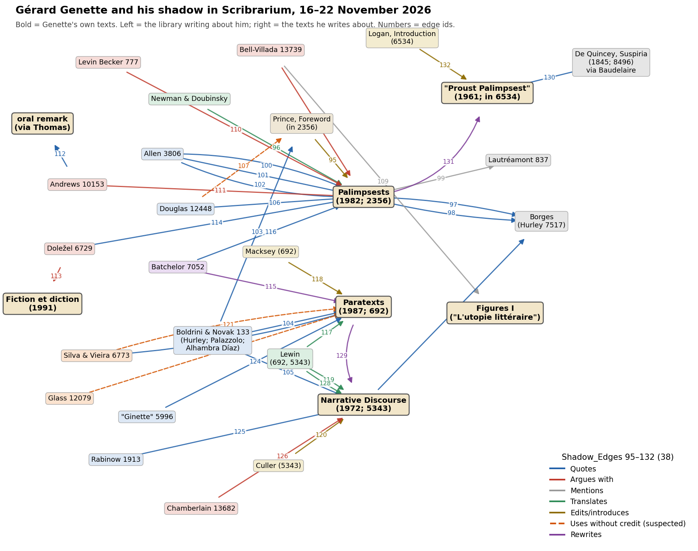

*[[shadows/weeks/gerard-genette|Gérard Genette (Author & Shadow)]] · Day 7 of 7 · 2026-11-22 · Difficulty 3 · Genealogy/influence, Shared form or method*

## Books in this reading

- [[books/6534-figures-of-literary-discourse|Figures of Literary Discourse]], [[people/gerard-genette|Gérard Genette]], [[people/alan-sheridan|Alan Sheridan]] (translator); 1982 (essays 1961–1972). *Day 7 (the author, last own work): 'Proust Palimpsest' (1961) and its n. 59 (Baudelaire's De Quincey, De Quincey unnamed); 'Principles of Pure Criticism' p. 72 (the palimpsest as his 'critical desire'); Logan's Introduction. Read: Contents, pp. xv–xvi, 72–74, 203–204, 213, 226–228 with notes (≈3%), pdftotext of an OCR layer. Edges 130, 132; middle term of 131. Own work: no Mentions row promoted.*
- [[books/2356-palimpsests-literature-in-the-second-degree|Palimpsests: Literature in the Second Degree]], [[people/gerard-genette|Gérard Genette]], [[people/channa-newman|Channa Newman]] (translator), [[people/claude-doubinsky|Claude Doubinsky]] (translator); 1997 (Palimpsestes 1982). *Day 7 cross-check (primary book of Set 54; used again as the day requires): where the book says the palimpsest comes from. Read: pp. 398–400, n. 6–7 p. 471, index pages B, D, G, P, Q, OCR'd on the Mac today (≈2%). Edge 131 (self-rewrite).*
- [[books/8496-complete-works-of-thomas-de-quincey-with-illustrat|Complete Works of Thomas De Quincey (With Illustrations)]], [[people/thomas-de-quincey|Thomas De Quincey]]; 2019 (Suspiria de Profundis 1845). *Day 7: target of edge 130 — De Quincey's own English for the sentence 6534 n. 59 gives via Baudelaire. Read: ~1,200 words of 'The Palimpsest of The Human Brain' (<0.1%).*
- [[books/7517-collected-fictions-the-south|Collected Fictions]], [[people/jorge-luis-borges|Jorge Luis Borges]], [[people/andrew-hurley|Andrew Hurley]] (translator); 1998. *Day 7 cross-check (context for edges 98, 130; no new edge): 'Shakespeare's Memory' names De Quincey for the palimpsest and makes its layers 'text'. Read: one paragraph and adjacent notes (<0.1%).*
- [[books/1101-a-reader-on-reading|A Reader on Reading]], [[people/alberto-manguel|Alberto Manguel]]; 2010. *Day 7 cross-check (context for edge 130; no new edge): gives De Quincey's question to Baudelaire. Read: one paragraph (<0.1%).*

## The shadow so far

| Citing Book | Relation | Target | Location |
|---|---|---|---|
| [[books/2356-palimpsests-literature-in-the-second-degree|Palimpsests: Literature in the Second Degree (Foreword)]] (Gerald Prince) | **Edits/introduces** | Gérard Genette | Foreword, p. ix (PDF p. 9); TARGET Genette, Palimpsests / Palimpsestes (1982) |
| [[books/2356-palimpsests-literature-in-the-second-degree|Palimpsests: Literature in the Second Degree (Translators' Preface)]] (Channa Newman & Claude Doubinsky) | **Translates** | Gérard Genette | Translators' Preface, p. xiii (PDF p. 13); TARGET Palimpsestes (Seuil 1982, not in library) |
| [[books/2356-palimpsests-literature-in-the-second-degree|Palimpsests: Literature in the Second Degree]] (Gérard Genette (tr. Newman & Doubinsky)) | **Quotes** | Gérard Genette | ch. 52, p. 252 (PDF p. 268); TARGET Borges, prologue to A Universal History of Infamy (1935): Collected Fictions, tr. Hurley (7517); cf. Nicol 6623 epigraph (di Giovanni 1972) |
| [[books/2356-palimpsests-literature-in-the-second-degree|Palimpsests: Literature in the Second Degree]] (Gérard Genette (tr. Newman & Doubinsky)) | **Quotes** | Gérard Genette | ch. 80 n. 7, p. 471 (PDF p. 487; text p. 399), citing Labyrinths p. 44 (Yates & Irby); cf. ch. 5 p. 17; TARGET Borges, 'Pierre Menard, Author of the Quixote', Collected Fictions (7517) |
| [[books/2356-palimpsests-literature-in-the-second-degree|Palimpsests: Literature in the Second Degree]] (Gérard Genette (tr. Newman & Doubinsky)) | **Mentions** | Gérard Genette | ch. 1, p. 2 (PDF p. 18); also ch. 75 p. 360 ('This provocative use of plagiarism also comes from Lautréamont, by way of Maldoror'); TARGET Lautréamont, Maldoror and Poems (837) |
| [[books/3806-intertextuality|Intertextuality]] (Graham Allen) | **Quotes** | Gérard Genette | ch. 3, p. 98; TARGET Palimpsests (2356) ch. 1, pp. 2–3 |
| [[books/3806-intertextuality|Intertextuality]] (Graham Allen) | **Quotes** | Gérard Genette | ch. 3, p. 108; TARGET Palimpsests (2356) ch. 78, pp. 382–383 |
| [[books/3806-intertextuality|Intertextuality]] (Graham Allen) | **Quotes** | Gérard Genette | ch. 3, p. 104; TARGET Palimpsests (2356) ch. 1, p. 5 |
| [[books/133-experiments-in-life-writing-intersections-of-auto|Experiments in Life-Writing (ch. 11, 'Custom-Breaker: Writing the Life of Elizabeth Cary')]] (Ursula Hurley (in Boldrini & Novak, eds.)) | **Quotes** | Gérard Genette | ch. 11, at n. 27 (n. 27: 'Gerald Prince, foreword to Palimpsests … ix'); TARGET Prince's Foreword to Palimpsests (2356) p. ix |
| [[books/133-experiments-in-life-writing-intersections-of-auto|Experiments in Life-Writing (ch. 5, on Jackie Kay)]] (Pietra Palazzolo (in Boldrini & Novak, eds.)) | **Quotes** | Gérard Genette | ch. 5, at n. 8 (Paratexts, 156); TARGET Paratexts (692) ch. 7 'Epigraphs', Functions, p. 156 |
| [[books/133-experiments-in-life-writing-intersections-of-auto|Experiments in Life-Writing (ch. 9, on Marías, Dark Back of Time)]] (María Alhambra Díaz (in Boldrini & Novak, eds.)) | **Quotes** | Gérard Genette | ch. 9, at n. 34 (Narrative Discourse 234–235); TARGET Narrative Discourse (5343) ch. 5 'Voice', pp. 234–235 |
| [[books/12448-franketienne-and-rewriting-a-work-in-progress|Frankétienne and Rewriting: A Work in Progress]] (Rachel Douglas) | **Quotes** | Gérard Genette | Introduction, pp. 4–5, n. 11 (Palimpsestes, Seuil 1982, 11–12); TARGET Palimpsestes (not in library); English equivalent 2356 p. 5 |
| [[books/12448-franketienne-and-rewriting-a-work-in-progress|Frankétienne and Rewriting: A Work in Progress]] (Rachel Douglas) | **Uses without credit (suspected)** | Gérard Genette | Introduction, p. 5; TARGET Prince, Foreword to Palimpsests (2356) p. ix |
| [[books/13739-borges-and-his-fiction-a-guide-to-his-mind-and-art|Borges and His Fiction: A Guide to His Mind and Art]] (Gene H. Bell-Villada) | **Argues with** | Gérard Genette | ch. 6 'Ficciones II', p. 134; TARGET Genette on 'Pierre Menard' (Palimpsests 2356 pp. 17, 122, 252–253; possibly the 1960s essays) |
| [[books/13739-borges-and-his-fiction-a-guide-to-his-mind-and-art|Borges and His Fiction: A Guide to His Mind and Art]] (Gene H. Bell-Villada) | **Mentions** | Gérard Genette | ch. 1, p. 6, n. 1 ('Genette, ‘‘L’utopie littéraire,’’ pp. 123 –132'); TARGET 'L’utopie littéraire' (Figures I, not in library) |
| [[books/777-many-subtle-channels-in-praise-of-potential-litera|Many Subtle Channels: In Praise of Potential Literature]] (Daniel Levin Becker) | **Argues with** | Gérard Genette | 'publish and perish' and n. 8 (Roubaud via Guy Bennett: 'a particularly mediocre text'); TARGET Palimpsests (2356) ch. 9 'Oulipian games' pp. 39–48, esp. p. 48 |
| [[books/10153-how-to-do-things-with-forms-the-oulipo-and-its-inv|How to Do Things With Forms: The Oulipo and Its Inventions]] (Chris Andrews) | **Argues with** | Gérard Genette | ch. 4 'Manipulation, Translation, and Composition', pp. 98–99, nn. 3–10; TARGET Palimpsests (2356) pp. 7, 40, 42, 44, 397, 400; Palimpsestes p. 449 (not held) |
| [[books/10153-how-to-do-things-with-forms-the-oulipo-and-its-inv|How to Do Things With Forms: The Oulipo and Its Inventions]] (Chris Andrews) | **Quotes** | Gérard Genette | ch. 7 'Games Gone Wrong', p. 192, n. 7 (Thomas, La langue, la poésie, 165); TARGET Genette, oral remark (not in a Genette book) |
| [[books/6729-heterocosmica-fiction-and-possible-worlds|Heterocosmica: Fiction and Possible Worlds]] (Lubomír Doležel) | **Argues with** | Gérard Genette | Prologue, pp. 25–26; TARGET Fiction et diction (1991, p. 91; not in library) |
| [[books/6729-heterocosmica-fiction-and-possible-worlds|Heterocosmica: Fiction and Possible Worlds]] (Lubomír Doležel) | **Quotes** | Gérard Genette | Epilogue, p. 224; also n. 29 ('regime ludique', Genette 1982, 452-53); TARGET Palimpsestes p. 435 = Palimpsests (2356) ch. 79, p. 384 |
| [[books/7052-translation-and-paratexts|Translation and Paratexts]] (Kathryn Batchelor) | **Rewrites** | Gérard Genette | ch. 7, p. 142 (definition); ch. 1, pp. 19–22 ('Translation in Genette's framework'); TARGET Paratexts (692) p. 405 and n. 2, p. 264 n. 22 |
| [[books/7052-translation-and-paratexts|Translation and Paratexts]] (Kathryn Batchelor) | **Quotes** | Gérard Genette | Introduction, epigraph, p. 1; ch. 1, pp. 7–8 (block quotation cited 'Genette 1997b, 33'); TARGET Palimpsests (2356) ch. 1, pp. 3–4 |
| [[books/692-paratexts-thresholds-of-interpretation|Paratexts: Thresholds of Interpretation (Translator's note)]] (Jane E. Lewin) | **Translates** | Gérard Genette | Translator's note, p. xxv (PDF p. 25); TARGET Seuils (Seuil 1987, not in library) |
| [[books/692-paratexts-thresholds-of-interpretation|Paratexts: Thresholds of Interpretation (Foreword)]] (Richard Macksey) | **Edits/introduces** | Gérard Genette | Foreword, p. xxi; also p. xiii n. 4 ('a forthcoming translation of Palimpsestes by Channa Newman'), p. xxiii, p. xvii ('a sly wink at his long-time publisher'); TARGET Genette; Lewin; Newman & Doubinsky |
| [[books/5343-narrative-discourse-an-essay-in-method|Narrative Discourse: An Essay in Method (Translator's Preface)]] (Jane E. Lewin) | **Translates** | Gérard Genette | Translator's Preface, pp. 15–17 (PDF pp. 17–19); TARGET Discours du récit (Figures III, Seuil 1972, not in library) |
| [[books/5343-narrative-discourse-an-essay-in-method|Narrative Discourse: An Essay in Method (Foreword)]] (Jonathan Culler) | **Edits/introduces** | Gérard Genette | Foreword, p. 10; also p. 13 ('Genette’s work is testimony to the power of the marginal, the supplementary, the exception', n. 5 Derrida, Of Grammatology); TARGET Narrative Discourse |
| [[books/6773-the-politics-of-the-book-a-study-on-the-materialit|The Politics of the Book: A Study on the Materiality of Ideas]] (Filipe Carreira da Silva & Mónica Brito Vieira) | **Uses without credit (suspected)** | Gérard Genette | Introduction, 'Paratexts', p. 6; TARGET Paratexts (692) p. 2 and n. 5 (Lejeune, Le Pacte autobiographique, Seuil 1975, 45, in Lewin's English) |
| [[books/6773-the-politics-of-the-book-a-study-on-the-materialit|The Politics of the Book: A Study on the Materiality of Ideas]] (Filipe Carreira da Silva & Mónica Brito Vieira) | **Quotes** | Gérard Genette | Introduction, 'Paratexts', p. 6; TARGET Paratexts (692) Introduction p. 1 |
| [[books/12079-porn-archives-ch-6-up-from-underground|Porn Archives (ch. 6, 'Up from Underground')]] (Loren Glass) | **Uses without credit (suspected)** | Gérard Genette | ch. 6, opening section, pp. 127–28; TARGET Paratexts (692): term and subtitle |
| [[books/5996-weaponising-speculation|Weaponising Speculation ('MOUTH')]] (Edia Connole & Scott Wilson (per index heading; book catalogued under Caoimhe Doyle)) | **Quotes** | Gérard Genette | 'MOUTH', opening paragraph and notes ii–iii; TARGET Paratexts (692) ch. 12 'Notes', p. 319 and n. 1 |
| [[books/1913-unconsolable-contemporary-observing-gerhard-richte|Unconsolable Contemporary: Observing Gerhard Richter]] (Paul Rabinow) | **Quotes** | Gérard Genette | ch. 3 'Assembling: Abet and Facilitate', section on mood and metalepsis, nn. 14–18 (EPUB, no pages); TARGET Narrative Discourse (5343) p. 31 n. 9, p. 234, p. 236 |
| [[books/13682-narrative-perspective-in-fiction-a-phenomenologica|Narrative Perspective in Fiction: A Phenomenological Mediation of Reader, Text, and World]] (Daniel Frank Chamberlain) | **Argues with** | Gérard Genette | pp. 81–82 (after block quotation of Narrative Discourse pp. 235–36); TARGET Narrative Discourse (5343) pp. 228, 234–237 |
| [[books/5343-narrative-discourse-an-essay-in-method|Narrative Discourse: An Essay in Method]] (Gérard Genette (tr. Jane E. Lewin)) | **Quotes** | Gérard Genette | ch. 5 'Voice', 'Metalepses', p. 236 and n. 55 (Borges, Other Inquisitions, tr. Simms, 1964, p. 46); also p. 262 'Pierre Menard inventing Quixote word for word' with Lewin's n. 107; TARGET Borges, 'Partial Magic in the Quixote' (Otras inquisiciones; Simms's English not in library) |
| [[books/5343-narrative-discourse-an-essay-in-method|Narrative Discourse: An Essay in Method (Translator's notes)]] (Jane E. Lewin) | **Translates** | Gérard Genette | Introduction p. 27 n. 2; p. 33 n. 1 (Metz altered); p. 37 n. 8 (Mazon replaced); p. 94 n. 15 (omission); 22 Translator's notes in all; TARGET Discours du récit (Figures III, 1972, not in library) |
| [[books/692-paratexts-thresholds-of-interpretation|Paratexts: Thresholds of Interpretation]] (Gérard Genette (tr. Jane E. Lewin)) | **Rewrites** | Gérard Genette | ch. 6 'Dedications', p. 135; ch. 9, p. 231 and n. 36 (Pléiade 3:911; Mayor 3:949); TARGET Narrative Discourse (5343) p. 261 and n. 105 (same Proust passage, quoted whole, Scott Moncrieff RH II 1031–1032) |
| [[books/6534-figures-of-literary-discourse|Figures of Literary Discourse ('Proust Palimpsest', 1961)]] (Gérard Genette (tr. Alan Sheridan)) | **Quotes** | Gérard Genette | 'Proust Palimpsest', n. 59, p. 228 (PDF p. 252); TARGET De Quincey, Suspiria de Profundis (1845), 'The Palimpsest of The Human Brain', in Complete Works (8496), via Baudelaire, Les Paradis artificiels (1860; not in library) |
| [[books/2356-palimpsests-literature-in-the-second-degree|Palimpsests: Literature in the Second Degree]] (Gérard Genette (tr. Newman & Doubinsky)) | **Rewrites** | Gérard Genette | ch. 80, pp. 398–399 (PDF 414–415), n. 6–7 p. 471 (PDF 487), index p. 480 (PDF 496); TARGET 'Proust Palimpsest' (1961, Figures I 1966) in Figures of Literary Discourse (6534) pp. 203–228; also 'Principles of Pure Criticism' p. 72 |
| [[books/6534-figures-of-literary-discourse|Figures of Literary Discourse (Introduction, '“Ut Figura Poiesis”: The Work of Gérard Genette')]] (Marie-Rose Logan) | **Edits/introduces** | Gérard Genette | Introduction pp. xv–xvi (PDF pp. 19–20); editor's notes p. 74 n. 12–13 ('[Proust palimpseste,” Figures I; included in this volume.—M.-R.L.]'); p. 227 n. 21 ('Translation modified'); TARGET Figures of Literary Discourse; Introduction à l'architexte (1979; The Architext 691, no text layer) |

---

## Daily library resurfacing · Sunday 22 November 2026 · An author and their shadow (v0.7)

## 1. Where the week stands

Day 7 of Gérard Genette (16–22 November). Day 1 read *Palimpsests* and found a theory of declared borrowing that leaves undeclared borrowing to someone else. Day 2 found quoters who keep his words and move the speaker. Day 3 found that the arguments with him are about play. Day 4 found three English Genettes and three translators’ contracts. Day 5 found no borrowed sentences, only an unsigned apparatus and a credit misspelt past the reach of search (“Gerard Ginette”). Day 6 found the week’s grammar already in *Narrative Discourse*: the dropped relay has a name, the “pseudo-diegetic”. Today: one last own work, three last edges, the map and the essay.

## 2. The day’s finding

**The palimpsest has a source Genette stopped naming.** Three dates, three palimpsests, all in Scribrarium:

- **1961, “Proust Palimpsest”** (first published 1961, collected in *Figures I*, 1966; English

| in Figures of Literary Discourse, 6534, tr. | Alan Sheridan, 1982). | The palimpsest is |
|---|---|---|
| Proust’s vision: memory and perception laid over one another. The essay ends on the |  |  |
| word, and its last note (n. 59, p. 228) gives the figure a source: “this page from Baude- |  |  |
| laire’s *Paradis artificiels*, translated from the *Suspiria de Profundis*”. De Quincey, the au- |  |  |
| thor of the *Suspiria*, is not named. The string “quincey” occurs nowhere in the extracted |  |  |
| text of 6534 (0 hits; the full-text index agrees). The English reader gets De Quincey’s |  |  |
| sentence after three passages, De Quincey →Baudelaire →Genette →Sheridan, while |  |  |
| De Quincey’s own English sits elsewhere in the library (8496). **Edge 130, Quotes.** |  |  |

- **1966, “Principles of Pure Criticism”** (same volume, p. 72). The palimpsest is now Genette’s own “critical desire”, offered as an example “again personal and therefore in no sense an exemplary one”. Logan’s editorial note 13 points back to “Proust palimpseste”.

- **1982, *Palimpsests*** (2356, pp. 398–399). The figure is now “the old analogy” for one text written over another. It is credited to Amossy and Rosen’s 1974 article (“designate literature as a palimpsest”, n. 6) and to Borges’s Menard (n. 7; edge 98). The English index under “Genette, Gérard” lists *Figures II*, *Figures III*, *Mimologiques*, *Narrative Discourse* and *Palimpsests*. It does not list *Figures I*, and it has no entry for De Quincey. Baudelaire’s entry lists the poems, not the *Paradis artificiels*. **Edge 131, Rewrites (self).** Limits: I checked the index (OCR’d today) and the concluding pages, not the whole book; the French *Palimpsestes* is not in the library.

The figure keeps its name and changes what it covers. In 1961 the layers belong to one mind, and the work “can only be deciphered together, in their inextricable totality”. In 1982 the layers are two texts, and the reader “must wish from time to time to love (at least) two to-

gether”. It also loses its relay. On day 6 Genette described Eucleides cutting “and I said” out of the *Theaetetus*. Here Genette does the same to his own earlier essay and to De Quincey. Two neighbours on the shelf show the same move. Borges (“Shakespeare’s Memory”, 7517) names De Quincey and turns his “ideas, images, feelings” into “text”. Manguel (1101) gives De Quincey’s question to “Charles Baudelaire in 1869”. The third edge is the frame around the 1961 essay: Marie-Rose Logan’s Introduction to the English volume defines the palimpsest for the reader and quotes *Introduction à l’architexte* on transtextuality (**edge 132, Edits/introduces**).

**The week’s map.** 38 edges (95–132): Quotes 17, Argues with 5, Translates 4, Edits/introduces 4, Uses without credit (suspected) 3, Rewrites 3, Mentions 2. Thirty-one run from the library into Genette’s books (or into their forewords and translations), five run outward from his books to others (Borges ×3, Lautréamont, De Quincey), and two connect his own books (129, 131).

| Node | In | Out | Edges |
|---|---|---|---|
| *Palimpsests* (incl. Prince’s Foreword, Newman & Doubinsky) | 13 | 4 | in 95, 96, 100–103, 106–108, 110, 111, 114, 116; out 97–99, 131 |
| *Paratexts* (692) | 8 | 1 | in 104, 115, 117, 118, 121–124; out |
| *Narrative Discourse* (5343) | 7 | 1 | in 105, 119, 120, 125, 126, 128, 129; out 127 |
| *Figures I* / “Proust Palimpsest” (6534) | 3 | 1 | in 109, 131, 132; out 130 |
| *Fiction et diction*; an oral remark | 2 | 0 | 112, 113 |

**Mentions.** 753 rows: 750 captured on day 1 and 3 added on day 5 for credits the capture missed. Six are his own books, leaving 747. Twelve became edges, which is 1.6% of the non-own rows, against 13.3% for Machado, 3.4% for Acker and 2.7% for Canetti. One edge (Glass, 12079) comes from a book that never names him. No Mentions row was promoted today, since 6534 is his own work.

## 3. The books

## Figures of Literary Discourse — Gérard Genette, tr. Alan Sheridan, introduction by Marie-Rose Logan (Columbia, 1982; essays 1961–1972); PDF; Calibre 6534

**Selection logic.** The one own work in the library the week had not opened. Its Mentions row (1080) counted 86 “genette” strings. It holds the 1961 essay whose title the 1982 book takes over. Not from the Send To pool (the pool was empty all week).

**How much was read.** Passages: Logan’s Introduction pp. xv–xvi; “Principles of Pure Criticism” pp. 72–74 with notes; “Proust Palimpsest” pp. 203–204, 213 and 226–228 with notes 1–59; Contents. About 10 of ~300 pages (≈3%). The PDF’s text layer is OCR, and on some pages the line order is scrambled (p. 72). Every quotation below was checked as a substring of the pdftotext output.

*Figure 1:*

> The week’s citation graph. Bold boxes are Genette’s texts; numbers are

Shadow_Edges ids; dashed orange = suspected uncredited use.

**Verified quotations.**

> “Like Proust’s writing, Proust’s work is a palimpsest in which several figures and several meanings are merged and entangled together, all present together at all times, and which can only be deciphered together, in their inextricable totality.” (“Proust Palimpsest”, p. 226; dated [1961])

> “but in a very modest way. On the other hand, it is given a particularly high (and very Proustian) value in this page from Baudelaire’s Paradis artificiels, translated from the Suspiria de Profundis:”What is the human brain, if not an immense natural palimpsest? My brain is a palimpsest, as yours is too, reader. Innumerable layers of ideas and feelings have fallen one after another on your brain, as gently as light.” (n. 59, p. 228)

> “The form of the palimpsest, or superimpression, struck me as being a common characteristic of Proust’s writing” … “it organized, in a single gesture, the space of the world and the space of language.” (“Principles of Pure Criticism”, p. 72; [1966])

> “A palimpsest: a manuscript which has been scratched or erased in order to write something else on the parchment.” (Logan, Introduction, p. xv)

**Derived list: one sentence, four witnesses.**

> Genette 1961 via Baudelaire,

| De Quincey | tr. Sheridan | Borges 1983, tr. | Manguel 2010 |
|---|---|---|---|
|  | (6534 n. 59) | Hurley (7517) | (1101) |
| 1845 (8496) |  | “De Quincey | “asked Charles |

speaker named De Quincey “Baudelaire’s

| Paradis | says” | Baudelaire in |
|---|---|---|
|  |  | 1869” |
| artificiels” | “man’s brain is | “What is the |
| “What is the |  |  |

the question “What else than

| a natural and | human brain, if | a palimpsest” | human brain … |
|---|---|---|---|
|  | not an immense |  | but an immense |
| mighty | natural |  | and natural |
| palimpsest is | palimpsest?” |  | palimpsest?” |
| the human |  |  |  |
| brain?” |  |  |  |

the layers “ideas, images, “ideas and “Every new —

how they fall “softly as light” “as gently as “covers the —

> light” previous one”

Baudelaire’s French is not in the library, so I cannot tell whether “images” was dropped by Baudelaire, by Genette or by Sheridan. The *Paradis artificiels* first appeared in 1860; Manguel’s “1869” may refer to a later edition (a guess).

**A misreading worth attempting.** Read n. 59 as the hypotext of *Palimpsests*. On that reading the 1982 book is an amplification, in its own terms, of a footnote from 1961. Its own taxonomy then has to file it under the practice its first chapter sets aside: undeclared but literal borrowing, here from himself.

## Palimpsests: Literature in the Second Degree — Gérard Genette, tr. Channa Newman & Claude Doubinsky (Nebraska, 1997; Seuil 1982); PDF (image only); Calibre 2356

**Selection logic.** Cross-check, as the day’s relation requires (the target of edge 131; the primary book of Set 54). Today I asked it one question: where does it say the palimpsest comes from?

**How much was read.** Pages 398–400 (PDF 414–416), notes p. 471 (PDF 487) and the index pages for B, D, G, P and Q (PDF 492–496, 500–503, 505). I OCR’d them on the Mac today (tesseract, 200–300 dpi). About 2% of the book. The OCR reads “pakmpsest” on p. 398.

**Verified quotations.**

> “That duplicity of the object, in the sphere of textual relations, can be represented by the old analogy of the [palimpsest]: on the same parchment, one text can become superimposed upon another, which it does not quite conceal but allows to show through. It has been aptly said that pastiche and parody”designate literature as a palimpsest.”” (ch. 80, pp. 398–399; bracket = OCR “pakmpsest”)

> “one who really loves texts must wish from time to time to love (at least) two together.” (p. 399)

> “Ruth Amossy and Elisheva Rosen,”La dame aux catleyas,” Littérature 14 (May 1974).” (n. 6, p. 471)

**Derived list: the index entry “Genette, Gérard”** (p. 480; OCR, with “PUrfé” read as d’Urfé and “0.6” as n.6): “36; abridgment of d’Urfé’s L’Astrée, 231; Figures II, 264, 433 n.6; Figures III, 109, 294; Mimologiques, 433 n.6; Narrative Discourse, 278, 469 n.3; Palimpsests, 394; transmetrification of Valéry’s”Le Cimetière marin,” 416”. There is no *Figures I* and no “Proust palimpseste”, and the D and Q pages have no De Quincey.

## Complete Works of Thomas De Quincey (ebook omnibus, 2019); EPUB; Calibre 8496 — Suspiria de Profundis (1845), “The Palimpsest of The Human Brain”

**Selection logic.** FTS “mighty palimpsest” (6 books) found the English that n. 59 reaches only through Baudelaire. **How much was read.** About 1,200 words of the section around the passage; under 0.1% of a 22-million-character omnibus.

> “What else than a natural and mighty palimpsest is the human brain? Such a palimpsest is my brain; such a palimpsest, oh reader! is yours. Everlasting layers of ideas, images, feelings, have fallen upon your brain softly as light.” (“The Palimpsest of The Human Brain”)

**Observation.** De Quincey also writes, a few lines later, of “the vellum palimpsest, lying amongst the other diplomata of human archives or libraries”. The document comes first and the brain second. So the textual sense Genette arrives at in 1982 was already in the source he cited in 1961.

## Collected Fictions — Jorge Luis Borges, tr. Andrew Hurley (Viking, 1998); EPUB; Calibre 7517 — “Shakespeare’s Memory”

**Selection logic.** The same FTS query; Borges is the source *Palimpsests* names for the figure (edge 98). **How much was read.** The one paragraph, and Hurley’s notes, which quote the same De Quincey passage; under 0.1%.

> “De Quincey says that man’s brain is a palimpsest. Every new text covers the previous one, and is in turn covered by the text that follows” (“Shakespeare’s Memory”)

**Observation.** Borges names his source and in the same breath turns De Quincey’s “ideas, images, feelings” into “text”. *Palimpsests* gives Borges the credit for the textual palimpsest; here Borges hands it on to De Quincey.

## A Reader on Reading — Alberto Manguel (Yale, 2010); EPUB; Calibre 1101

**Selection logic.** FTS “natural palimpsest” (5 books). It is the one witness that names Baudelaire as the speaker. **How much was read.** One paragraph; under 0.1%.

> ““What is the human brain,” asked Charles Baudelaire in 1869, “but an immense and natural palimpsest?”” … “Like Baudelaire’s almost infinite palimpsest, the library of the mind has no discernable limits.”

**Observation.** This is the relay the week kept finding, here completed: the translator becomes the author. Genette’s n. 59 had kept the “translated from”.

## 4. The shadow: the map

The graph above shows all 38 edges. The table lists only today’s three; days 1–6 are in Sets 54–59.

| From | Relation | To | Location |
|---|---|---|---|
| Genette, “Proust Palimpsest” (6534) | Quotes (130) | De Quincey, *Suspiria* (8496), via Baudelaire | p. 228 n. 59 |
| Genette, *Palimpsests* (2356) | Rewrites, self (131) | “Proust Palimpsest” (6534) | pp. 398–399; n. 6–7 p. 471; index |
| Logan, Introduction (6534) | Edits/introduces (132) | *Figures of Literary Discourse*; *Introduction à l’architexte* | pp. xv–xvi; p. 74 n. 13 |

## 5. The week in one essay: what the shelves say

**The library’s Genette is the second-degree Genette, not the narratologist.** The field remembers *Narrative Discourse*, focalization and “who sees, who speaks”. On these shelves *Palimpsests* draws almost twice the edges *Narrative Discourse* does (13 to 7). The arguments (day 3) are about play: Bell-Villada says he missed Borges’s humour, and the Oulipo says he reduced their constraints to roulette. None of the week’s arguments is about focalization; the one argument with *Narrative Discourse* (Chamberlain) is about metalepsis and the borders between levels. That is partly a property of this collection, which holds Oulipo and Borges criticism in depth, and partly a fact the citation counts of the field would hide.

**His readers do to him what his theory describes, and what his theory refuses to study.** *Palimpsests* studies only the “sunnier side” of derivation, the massive and declared kind, and files undeclared borrowing under intertextuality (day 1). The library’s readers practise the other side. Allen keeps the words and cuts “according to Riffaterre” (day 2). Hurley fuses Prince with Genette. Silva and Vieira relay Lejeune in Lewin’s English and cite the French (day 5). Rabinow changes the chapter, the hedge and a word under cover of a bracket (day 6). None of this is plagiarism. It is what day 6 called the pseudo-diegetic: the relay dropped

for the reader’s comfort.

**He did it first, to himself.** Today’s finding closes the loop. The title figure of *Palimpsests* had a named source in 1961 (Baudelaire’s De Quincey) and an author (Genette, “Proust palimpseste”). In 1982 it has neither. It is “the old analogy”, credited to two later borrowers. The theorist of declared derivation took his central metaphor by undeclared self-derivation. The field reads *Palimpsests* as a taxonomy; the shelves show it is also a case in its own taxonomy. The evidence rests on the English edition and its index. The French *Palimpsestes* is not in the library, and it may name De Quincey where the English index does not.

**The English Genette is a translated, introduced and partly co-written Genette.** All three English books carry a translator’s contract (day 4): Lewin “silently” corrects *Narrative Discourse*; Genette added unmarked passages to the English *Paratexts*; *Palimpsests* moves material to an Appendix with the author’s approval. All three introducers (Culler, Macksey and Logan) place him beside Derrida. On these shelves the threshold is never Genette’s alone.

**Search cannot find all of his credit.** The capture found 753 books. Twelve became edges (1.6%), the lowest rate of the four weeks, because the name travels as vocabulary through handbooks. And one credited quotation, “Gerard Ginette” (5996), could not be found by any search for his name. A complete footprint is a claim about spelling, not about influence.

**What the shelves say that the field might not:** that Genette’s lasting contribution here is a vocabulary for exactly the losses this week recorded. That his own books show those losses (the dropped relay, the self-borrowing, the translator’s silent hand) as clearly as his readers do. And that the palimpsest, his emblem, is the place where he forgot his own earlier writing, which is De Quincey’s argument for the palimpsest in the first place.

**Reading-notes files this week** (_readings/): 2356 Palimpsests; 3806 Allen; 133 Boldrini; 12448 Douglas; 13739 Bell-Villada; 777 Levin Becker; 10153 Andrews; 6729 Dolezel; 7052 Batchelor; 692 Paratexts; 5343 Narrative Discourse; 6773 Silva; 12079 Glass; 5996 Doyle; 9756 Castricano; 4688 Greaney; 3535 Kern; 1913 Rabinow; 13682 Chamberlain; and today 6534, 8496, 7517 and 1101 (new) and 2356 (appended).

## 6. Next subject

There is no Planned row. **I propose Jacques Derrida (Author_Weeks row 9, Idea).** He is the subject the finished week points to most. Each of the three English introducers sets Genette beside him: Culler reads *Narrative Discourse* through the supplement (edge 120), Macksey and Logan name him. Batchelor’s parergon note (day 4) and Castricano (day 5) also lead to him. FTS counts 562 books containing both “Genette” and “Derrida” (not checked for false positives). The draft day 1 is *Dissemination* (606), whose “Outwork” is a book-length argument about prefaces, the threshold Genette mapped. **Runner-up: Susan Sontag** (row 6; 180 books with both names). Stefan Zweig (row 10) is the most Gestext-flagged Idea row. The schools (rows 11, 12) are waiting on their method, which is not yet Active. The next run will wait until you promote a row to Planned with a Queue number.

**Methods menu.** Active: An author and their shadow. On hand: Triads; Lens and specimen; News oracle; Margin and Lexicon; Mnemosyne panel. Wish list: Pairs/Doubles/Doppelgangers; The Bildungsroman; Reading by Country/Region; Applying Freud; Applying Marx; Literary Cartographies; Library of America: Crime Novels; Black Mountain Poets; New York School Poets; and A school: precursors to afterlives (Procedure written, Status not yet Active).

## 7. Where this sends you

**Notebook.**

1. De Quincey’s “ideas, images, feelings” arrives in Genette’s English as “ideas and feelings” after three hands. Take a sentence you first loved in translation, find the original, and list what each stage removed. Then write the sentence that the missing word would have made.

2. In 1966 the palimpsest is “personal and therefore in no sense an exemplary one”; in 1982 it is “the old analogy”. Write the paragraph in which a figure of your own (the gesture, say) stops needing your name. At what point does it?

3. “can only be deciphered together” (1961) against “love (at least) two together” (1982): one together means simultaneity in a single mind, the other the pairing of two texts. Write a short piece, prose or verse, in which the two senses refuse to separate.

**Rabbit holes.**

- Amossy & Rosen, “La dame aux catleyas : fonction du pastiche et de la parodie dans *À la recherche du temps perdu*”, *Littérature* 14 (1974), Genette’s n. 6 (Persée): https://www.persee.fr/doc/litt_0047-4800_1974_num_14_2_1087

- De Quincey, *Suspiria de Profundis*, “The Palimpsest of the Human Brain” (Standard Ebooks): https://standardebooks.org/ebooks/thomas-de-quincey/suspiria-de-profundis/text/the-palimpsest-of-the-human-brain

- Baudelaire, *Les Paradis artificiels*, French text (Wikisource), to find which stage dropped “images”: https://fr.wikisource.org/wiki/Les_Paradis_artificiels

- Sarah Dillon, “Re-inscribing De Quincey’s palimpsest: the significance of the palimpsest in contemporary literary and cultural studies”, *Textual Practice* 19.3 (2005): https://research-portal.st-andrews.ac.uk/en/publications/re-inscribing-de-quinceys-palimpsest-the-significance-of-the-pali/

- The whole issue of *Littérature* 14, “L’effet littéraire” (1974), the year Genette’s figure acquired its later credit: https://www.persee.fr/issue/litt_0047-4800_1974_num_14_2

**Also in your library.** Emily Salines, *Alchemy and Amalgam: Translation in the Works of Charles Baudelaire* (5609), on what Baudelaire owes De Quincey and the reverse. Frances Wilson, *Guilty Thing* (8492), a De Quincey life whose ‘The Palimpsest’ section quotes the same sentence. Julian Hanebeck, *Understanding Metalepsis* (4363), the book on day 6’s open question. Queued candidates: none (the Send To pool was empty all week).

## 8. From the Lexicon — anamnesis

**Received.** In Plato, the doctrine that learning is recollection: the soul, having known the truth before birth (in the *Phaedo*, the Forms), recovers that latent knowledge when prompted, by dialectical questioning in the *Meno* or by sense-perception in the *Phaedo*. It is offered as the answer to Meno’s paradox of inquiry and revised in the *Phaedrus*. **Your sense.** Not yet written. Your note (from myNoise) frames it as recovery of “latent knowledge acquired from eternity, but lost in the trauma of birth”. **Etymology.** Greek *anamnēsis* (ἀνάμνησις), “a calling to mind”, from *anamimnēskein*: *ana-* (back) + *mimnēskesthai* (to recall); cf. *mnēmē*; PIE *men- (to think). In English from the 1650s. **WordNet.** oewn-05769915-n, noun.cognition: “the ability to recall past occurrences”; hypernym *memory*. **Relations.** It shares a lineage with *sophrosyne*, *phronesis*, *paradigm* and *monstration*. The Lexicon’s boundary note says the medical sense (a patient’s own account of their history) belongs to another field. **Portable axiom.** None recorded. **Why today.** De Quincey’s palimpsest is a secular anamnesis: nothing written on the mind is erased, only covered, and “The palimpsest of memory is indestructible” (as given in 6534, n. 59). Genette’s 1961 essay sets metaphor against its rival: “metaphor has an added advantage over reminiscence” (p. 204). **Verified occurrence.** None: “anamnesis”

occurs in none of today’s books (FTS on 6534, 8496, 7517, 1101, 5343, 692, 4363). **New in the Lexicon** since 20 November: the warp, Mormaer, labrys, haruspicy, eagre, extispicy, ebberman, Ecbatic, apophenia, Patternicity.

## 9. To carry

> “Like Proust’s writing, Proust’s work is a palimpsest in which several figures and several meanings are merged and entangled together, all present together at all times, and which can only be deciphered together, in their inextricable totality.” — Gérard Genette, “Proust Palimpsest” (1961), tr. Alan Sheridan, *Figures of Literary Discourse*, p. 226

*Reading notes:* 6534 — Genette — Figures of Literary Discourse.md (new); 2356 — Genette — Palimpsests.md (appended); 8496 — De Quincey — Complete Works (Suspiria).md (new); 7517 — Borges — Collected Fictions.md (new); 1101 — Manguel — A Reader on Reading.md (new).

## Themes

[[themes/amossy|Amossy]] · [[themes/anamnesis|anamnesis]] · [[themes/architext|architext]] · [[themes/baudelaire|Baudelaire]] · [[themes/borges|Borges]] · [[themes/citation-graph|citation graph]] · [[themes/critical-desire|critical desire]] · [[themes/de-quincey|De Quincey]] · [[themes/derrida|Derrida]] · [[themes/gesture|gesture]] · [[themes/index|index]] · [[themes/introduction|introduction]] · [[themes/logan|Logan]] · [[themes/manguel|Manguel]] · [[themes/map|map]] · [[themes/memory|memory]] · [[themes/misattribution|misattribution]] · [[themes/old-analogy|old analogy]] · [[themes/palimpsest|palimpsest]] · [[themes/paradis-artificiels|Paradis artificiels]] · [[themes/parody|parody]] · [[themes/pastiche|pastiche]] · [[themes/pierre-menard|Pierre Menard]] · [[themes/proust|Proust]] · [[themes/rosen|Rosen]] · [[themes/self-citation|self-citation]] · [[themes/self-rewriting|self-rewriting]] · [[themes/shakespeare-s-memory|Shakespeare's Memory]] · [[themes/sheridan|Sheridan]] · [[themes/superimpression|superimpression]] · [[themes/suspiria-de-profundis|Suspiria de Profundis]] · [[themes/translation-relay|translation relay]] · [[themes/transtextuality|transtextuality]]

---

Previous: [[shadows/2026-11-21-shadow-gerard-genette-day-6-people-off-to-the-side|Shadow — Gérard Genette, day 6: People Off to the Side]]  
Next: —
