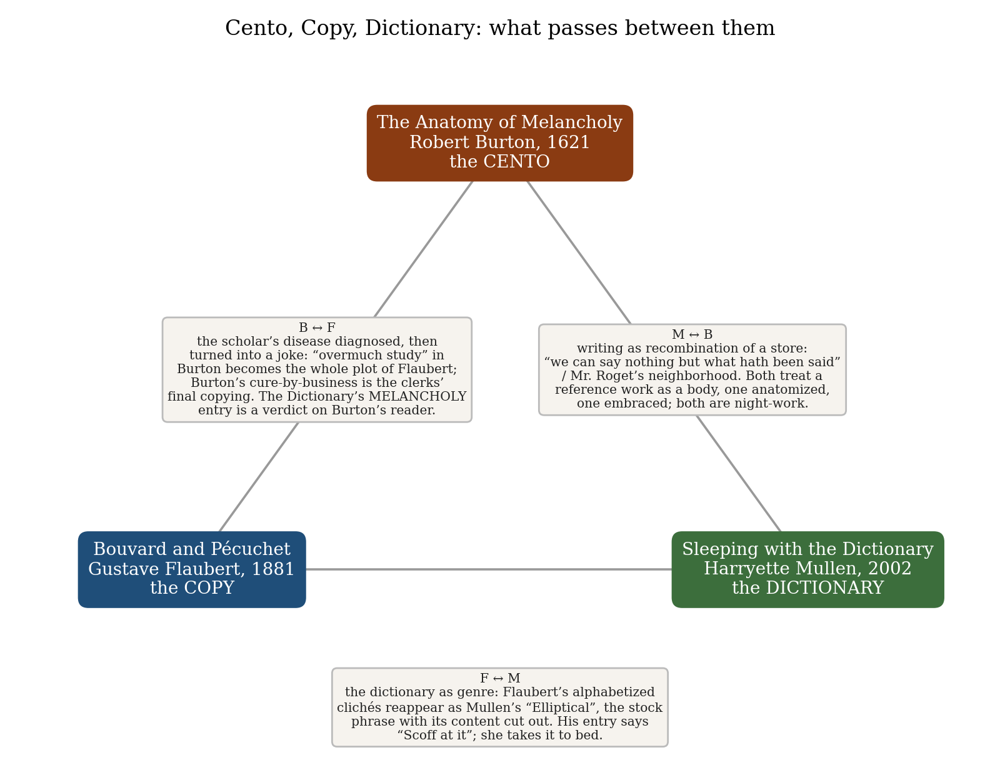
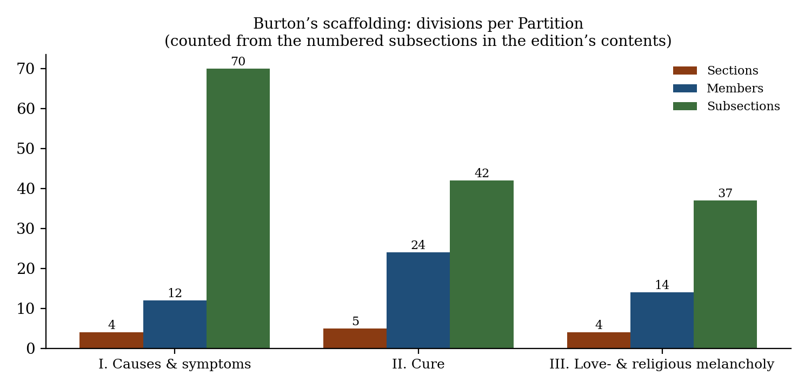
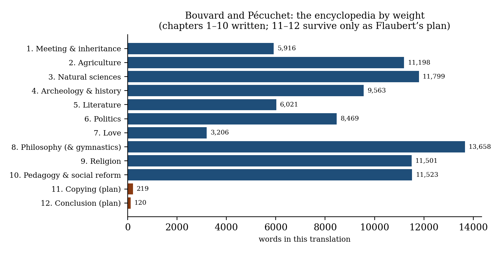
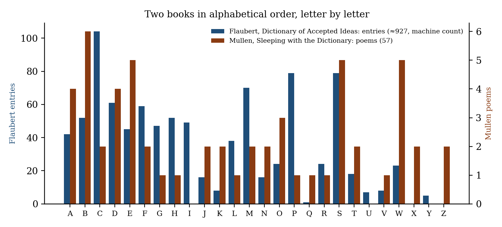

*Triad 1 of 32 · 2026-09-24 · Difficulty 3 · Shared form or method, Conflict, Oblique/structural*

## The three books

- [[books/8773-the-anatomy-of-melancholy|The Anatomy of Melancholy]], [[people/robert-burton|Robert Burton]]; 1621. *Anchor: the cento. Compiling as cure; diagnosis of scholars' melancholy.*
- [[books/2964-bouvard-and-pecuchet|Bouvard and Pécuchet]], [[people/gustave-flaubert|Gustave Flaubert]]; 1881. *The copy: encyclopedic reading as comedy and disease; the Dictionary of Accepted Ideas as hinge to Mullen.*
- [[books/5096-sleeping-with-the-dictionary|Sleeping with the Dictionary]], [[people/harryette-mullen|Harryette Mullen]]; 2002. *The dictionary: the reference work as partner rather than pathology; the emptied cliché.*

---

Three books from Scribrarium: Robert Burton, *The Anatomy of Melancholy* (ID 8773); Gustave Flaubert, *Bouvard and Pécuchet* (ID 2964); Harryette Mullen, *Sleeping with the Dictionary* (ID 5096).

## The Thread

All three books are made out of other books, and each one says so. Burton builds the *Anatomy* as a cento stitched from hundreds of authorities, and says the compiling is his therapy: “I write of melancholy, by being busy to avoid melancholy.” Flaubert gives two copy-clerks an inheritance and sends them through agriculture, chemistry, archeology, literature, politics, philosophy, religion and pedagogy. His plan was to end them where they began, at the desk, copying, with a *Dictionary of Accepted Ideas* among the things they copy: the reference book shrunk to reflex. Mullen takes the dictionary and the thesaurus to bed and gets poems out of them. In her hands alphabetical order becomes a way to compose, Roget’s columns turn into a class analysis, and the frame of a cliché survives with its content cut out.

What makes the link worth the trouble is that the three disagree about the same object: the store of language that has already been said. For Burton the store is medicine. For Flaubert it is a disease passing itself off as knowledge. For Mullen it is a lover. Read together, they give the old rhetorical *commonplace* three incompatible answers. Flaubert’s *Dictionary* even carries entries that land on the other two books. **Connection kinds:** Shared form or method; Conflict; Oblique/structural. **Difficulty: 3/5.** The shared method is plain once you name it. The disagreement about what copying does to the copier takes longer to see.

## Constellation

| From | To | What passes between them |
|---|---|---|
| Burton | Flaubert | The scholar’s disease, first diagnosed and then played for comedy. What Burton files as “overmuch study” (Part. 1, Sect. 2, Memb. 3, Subs. 15) is the whole plot of Flaubert’s novel. Burton’s cure by keeping busy becomes the clerks’ last activity, copying. Flaubert’s entry MELANCHOLY reads like a verdict on Burton’s ideal reader. |
| Flaubert | Mullen | The dictionary as a genre. Flaubert’s alphabetized clichés come back in Mullen’s “Elliptical”: stock phrases with their content removed, so that only the shape of the prejudice is left. His entry DICTIONARY says to scoff at it; she takes it to bed. |
| Mullen | Burton | Writing as recombining a store. Burton’s “we can say nothing but what hath been said” lies behind Mullen’s “Mr. Roget’s Neighborhood.” Both treat a reference work as a body, his anatomized and hers embraced, and both write at night. |

## 1. The Anatomy of Melancholy: Robert Burton (1621; this text is the Penguin Classics edition, ed. Angus Gowland, 2021)

*EPUB · Calibre ID 8773* → [[books/8773-the-anatomy-of-melancholy|book page]]

**Selection logic.** Burton is the anchor. His is the largest cento in English and the book that theorizes its own method most openly, in the preface. He supplies the diagnosis that Flaubert dramatizes (scholars’ melancholy) and the method that Mullen practises (recombining what has already been said). He also supplies the triad’s moral: *omne meum, nihil meum*.

**Overview.** Burton first published the book in 1621 as “Democritus Junior” and revised it in 1624, 1628, 1632, 1638 and 1651, adding to it each time. It anatomizes melancholy in three Partitions: causes and symptoms; cure; and two special kinds, love-melancholy and religious melancholy. Each Partition divides into Sections, Members and Subsections, and each opens with a branching synopsis. Nearly every sentence carries a borrowed authority, usually quoted in Latin and then Englished. The long satirical preface, “Democritus Junior to the Reader,” explains why he wrote the book (to keep busy) and how (by compiling). Gowland’s note on the text quotes Borges on editions: the idea of a ‘definitive’ text ‘belongs only to religion or fatigue’.

**Excerpt: the compiler’s apology.** This is Burton defending the cento, in the preface:

> As a good housewife out of diverse fleeces weaves one piece of cloth, a Bee gathers wax and honey out of many flowers, and makes a new bundle of all […] I have laboriously collected this Cento out of diverse Writers, and that sine injuria [without harm], I have wronged no authors, but given every man his own

> — “Democritus Junior to the Reader”

**Quotes.**

- “I write of melancholy, by being busy to avoid melancholy.” (“Democritus Junior to the Reader”)

- “we can say nothing but what hath been said, the composition and method is ours only, & shows a Scholar.” (“Democritus Junior to the Reader”)

- “we shall have a vast Chaos and confusion of Books, we are oppressed with them, our eyes ache with reading, our fingers with turning.” (“Democritus Junior to the Reader”)

- “Many men (saith he) come to this malady by continual Study, and night-waking, and of all other men, Scholars are most subject to it” (Part. 1, Sect. 2, Memb. 3, Subs. 15, “Love of Learning, or overmuch study”, citing Lemnius)

- “I no sooner (saith he) come into the Library, but I bolt the door to me excluding lust, ambition, avarice, and all such vices, whose nurse is idleness the mother of Ignorance, and Melancholy herself, and in the very lap of eternity, amongst so many divine souls, I take my seat” (Part. 2, Sect. 2, Memb. 4, Subs. 1, “Exercise rectified of Body and mind”; Heinsius, keeper of the library at Leiden)

**Derived list: Burton’s images for his own method** (all from “Democritus Junior to the Reader”):

*Figure 1: Constellation of the three books*

1. The housewife who “out of diverse fleeces weaves one piece of cloth.”

2. The bee that “gathers wax and honey out of many flowers.”

3. The dwarf: “A dwarf standing on the shoulders of a Giant may see farther than a Giant himself” (after Didacus Stella).

4. The meal: “Our writings are as so many dishes, our readers guests.”

5. The book as a macaronic mix: “to set out this my Maceronicon, the method only is mine own.”

6. The thief, his least flattering image of the trade: “scrape Ennius’ dunghills, and out of Democritus’ pit, as I have done.”

7. The rope-maker, his complaint about everyone else: “we weave the same web still, twist the same rope again and again.”

**Diagram: the scaffolding.** Counted from the 149 numbered subsections in the edition’s contents. The First Partition, on causes, has almost twice as many subsections as the cure.

*Figure 2: Burton’s divisions per Partition*

## 2. Bouvard and Pécuchet: Gustave Flaubert (1881, posthumous; trans. Mark Polizzotti, Dalkey Archive, 2005)

*EPUB · Calibre ID 2964* → [[books/2964-bouvard-and-pecuchet|book page]]

**Selection logic.** This is Burton’s negative image. The same encyclopedic reading is carried out by two amateurs, and melancholy gives way to stupidity as the subject. Burton’s cure, keep busy, becomes the machine that drives the novel. Your edition also contains the *Dictionary of Accepted Ideas*, which is the hinge to Mullen. It is also tagged priority_tbr, so this is a nudge.

**Overview.** Flaubert was still writing the novel when he died in 1880, and it was published in 1881. Two Paris copy-clerks meet on a deserted boulevard on a hot day. One of them inherits money, and the two retire to Chavignolles in Normandy, where they work through one discipline after another. Each attempt ends in failure and in a new set of books. Flaubert wrote ten chapters. The eleventh and twelfth survive only as a plan, in which the two return to copying. Polizzotti’s introduction notes that Flaubert “famously read some fifteen hundred volumes, much like the protagonists themselves.” The Dalkey edition adds Queneau’s preface, the *Dictionary*, and the “Catalogue of Fashionable Ideas,” which the translator’s note says is “presented in English for the first time.”

**Derived list: the encyclopedia chapter by chapter** (Queneau’s preface): “chapter 2 is Agriculture; 3, the Natural Sciences; 4, Archeology and History; 5, Literature; 6, Politics; 7, Love; 8, Philosophy (and at first, Gymnastics); 9, Religion; 10, Pedagogy and Social Reforms; 11, Copying.”

*Figure 3: Chapter lengths*

**Excerpt: the plan for the ending.** Flaubert’s notes for chapter 11, “Their Copy,” read like a description of Burton’s workshop run by people who have lost faith in it:

> They copy haphazardly, whatever falls into their hands, all the papers and manuscripts they come across, tobacco packets, old newspapers, lost letters, believing it all to be important and worth preserving. […] The pleasure they feel in the physical act of copying. […] Write the history of the world in howlers. Dictionary of accepted ideas. Catalogue of fashionable ideas.

> — ch. 11, “Their Copy” (plan)

And from the plan for the conclusion (ch. 12): “No time for reflection! Let’s copy! The page must be filled, the “monument” completed.” … “End with a view of our two heroes leaning over their desk, copying.”

**Quotes: the *Dictionary* on the other two books.**

- “MELANCHOLY: Sign of a distinguished heart and an elevated mind.” (Burton’s reader, as society would like him.)

- “DICTIONARY: Scoff at it—is only for ignoramuses.” (Mullen, preemptively scoffed at.)

- “BOOK: No matter which one, always too long.” (Compare Burton, quoting Callimachus: “a great Book is a great mischief.”)

- “Beware of Latin quotations, they always contain something risqué.” (s.v. LATIN: aimed, across 250 years, at Burton’s every page.)

- “POET: Synonym for dreamer and ninny.”

- “LIBRARY: Always have one at home, especially when living in the country.”

- And from the novel itself (ch. 1): “At the national library, they wanted to know the exact number of volumes.”

*Location note: the Dictionary entries are from the appendix “Dictionary of Accepted Ideas”, under their letters. In the EPUB the headword is followed by “ :”; the space has been normalized here.*

## 3. Sleeping with the Dictionary: Harryette Mullen (2002)

*EPUB · Calibre ID 5096* → [[books/5096-sleeping-with-the-dictionary|book page]]

**Selection logic.** Mullen brings the reference book back from pathology. Flaubert’s *Dictionary* lists what not to say; Mullen writes with the dictionary and the thesaurus as collaborators. She also turns Flaubert’s own device, the stock phrase, against its speakers: in “Elliptical” the content is cut away and only the pattern of condescension is left. And like Burton’s, hers is a book written at night.

**Overview.** Published by the University of California Press (New California Poetry, 4), the book collects 57 prose poems and lists, arranged alphabetically by title from “All She Wrote” to “Zombie Hat”. The epigraph is Breton: “Dark words more radiant than onyx!” It was a National Book Award finalist. The procedures vary from poem to poem (see the list below). What stays constant is the source: dictionary, thesaurus, cliché, advertising, the sonnet tradition.

**Quotes.**

- “In the dark night’s insomnia, the book is a stimulating sedative, awakening my tired imagination to the hypnagogic trance of language.” (“Sleeping with the Dictionary”)

- “Any exit from the logic of language might be an entry in a symptomatic dictionary.” (“Sleeping with the Dictionary”)

- “The alphabetical order of this ample block of knowledge might render a dense lexicon of lucid hallucinations.” (“Sleeping with the Dictionary”)

- “Beside the bed, a pad lies open to record the meandering of migratory words.” (“Sleeping with the Dictionary”; Burton’s notebook, Pécuchet’s register)

- “This dream is not a map. A poem is not the territory.” (“Exploring the Dark Content”)

**Derived list: her procedures, each located in a poem.**

1. *The emptied cliché.* “They just can’t seem to … They should try harder to … They ought to be more … We all wish they weren’t so …” (“Elliptical”). Flaubert’s *Dictionary* in reverse: the frame is kept and the opinion deleted, so the reader supplies it and is caught doing so.

2. *The thesaurus column.* “cozy comfortable homey homelike sheltered protected private concealed covered snug content relaxed restful sedate untroubled complacent placid serene calm undisturbed wealthy affluent prosperous …” and, by the end, “penniless penurious poor poverty-stricken embarrassing upsetting awkward ill-at-ease nervous self-conscious tense” (“Mantra for a Classless Society, or Mr. Roget’s Neighborhood”). A synonym chain that slides from comfort to class.

3. *The sonnet translated into commercial vernacular.* “My honeybunch’s peepers are nothing like neon.” (“Dim Lady”; see also “Variation on a Theme Park”)

4. *Anaphoric catalogue by sound.* “You are a ukulele beyond my microphone You are a Yukon beyond my Micronesia” (“Any Lit”): every “you” line opens on a *yu-* sound and every “my” line on a *mi-* sound.

5. *The simile with its tenor gone.* “as dictionary as you like as shadow as promised” (“Wipe That Simile Off Your Aphasia”)

6. *Alphabetical order* as the book’s own table of contents, borrowed from the dictionary.

**Diagram: two alphabets.** Flaubert’s *Dictionary* and Mullen’s book are both ordered A to Z. The Flaubert count is a machine parse of headwords (about 927) and is approximate. The Mullen count uses the 57 titles, ignoring a leading “The”.

**A misreading worth attempting.** Read *Sleeping with the Dictionary* as the manuscript Bouvard and Pécuchet would have produced if copying had made them happy rather than simply occupied. The misreading fails in instructive places. Mullen’s copying is never indiscriminate, and her “symptomatic dictionary” records the logic of language breaking down instead of the stupidity of its users. Seeing where the misreading breaks shows what Flaubert’s satire

*Figure 4: Two alphabets*

leaves out: the pleasure of the copy, which his own plan admits (“The pleasure they feel in the physical act of copying”) and then does nothing with.

## Where this sends you

## Notebook

1. **Omne meum, nihil meum.** Put Burton’s “’tis all mine, and none mine” next to Mullen’s “Any exit from the logic of language might be an entry in a symptomatic dictionary.” Write one page made entirely of lines from your own commonplace notebooks, then write the single dictionary entry that page is a symptom of. Note the sentence at which the method stops being yours.

2. **A Dictionary of Accepted Ideas for theory.** Using Flaubert’s MELANCHOLY and DICTIONARY entries as models, write ten entries for the received ideas of your own field (ARCHIVE:, RHIZOME:, THE OTHER:, LABYRINTH:, GESTURE: …). Then rewrite them as Mullen does in “Elliptical”, keeping only the frames. Which lasts longer, the stock opinion or the stock syntax?

3. **Two postures in a library.** Heinsius bolts the door and sits down “in the very lap of eternity”; the clerks “wanted to know the exact number of volumes.” Describe a third posture toward a library, neither consolation nor inventory, as a single gesture: one paragraph, one hand, one shelf.

## Rabbit holes

- Noga Arikha, “As a Lute out of Tune: Robert Burton’s Melancholy,” *The Public Domain Review* (2013), on the Anatomy against humoural theory: https://publicdomainreview.org/essay/as-a-lute-out-of-tune-robert-burtons-melancholy/

- “Robert Burton 1577–1640,” *Book Owners Online*. The compiler’s own library: some 1,740 books, split between the Bodleian and Christ Church, and how he marked them. https://bookowners.online/Robert_Burton_1577-1640

- *The Anatomy of Melancholy*, Project Gutenberg (ebook 10800), for full-text searching alongside your Penguin: https://www.gutenberg.org/ebooks/10800

- Flaubert, *Le dictionnaire des idées reçues* (Paris: L. Conard, 1913), scanned at the Internet Archive, to set the French entries beside Polizzotti’s: https://archive.org/details/ledictionnairede00flau

- *Bouvard and Pécuchet*, the older English translation (part 1), Project Gutenberg, for comparing translations: https://www.gutenberg.org/ebooks/25014

- PennSound: Harryette Mullen. Includes *Cross Cultural Poetics* #92, “Sleeping with the Dictionary” (2005), with her reading the title poem and “Dim Lady”: https://writing.upenn.edu/pennsound/x/Mullen-Harryette.php. The Jacket2 tag page links PoemTalk #172 on the same two poems: https://jacket2.org/category/commentary-tags/harryette-mullen

## Also in your library

- Gary Saul Morson, *The Words of Others: From Quotations to Culture* (ID 7241, PDF): a theory of the quotation, and so of the cento.

- Walter Benjamin, *The Arcades Project* (ID 236, PDF): a book built as a montage of citations, left unfinished like Flaubert’s.

- Lisa Block de Behar, *Borges: The Passion of an Endless Quotation* (ID 400, EPUB): Borges, citation, and the author as a reader.

## To carry

> “Omne meum, nihil meum, ’tis all mine, and none mine.” — Robert Burton, *The Anatomy of Melancholy*, “Democritus Junior to the Reader”

*Method: every quotation was checked as a substring of text extracted from your own EPUB files. Editorial footnote markers in the Penguin EPUB (“fn71” etc.) were removed and stray spaces before punctuation, left by the EPUB markup, were normalized; the wording is otherwise untouched. Brackets […] mark omissions. The EPUBs have no fixed page numbers, so locations are given by chapter, section or poem.*

## Themes

[[themes/alphabetical-order|alphabetical order]] · [[themes/cento|cento]] · [[themes/cliche|cliché]] · [[themes/commonplace|commonplace]] · [[themes/compilation|compilation]] · [[themes/copying|copying]] · [[themes/dictionary|dictionary]] · [[themes/encyclopedia|encyclopedia]] · [[themes/melancholy-of-scholars|melancholy of scholars]] · [[themes/received-ideas|received ideas]]

---

Previous: —  
Next: [[triads/2026-09-25-the-two-clocks-problem|The Two Clocks Problem]]
