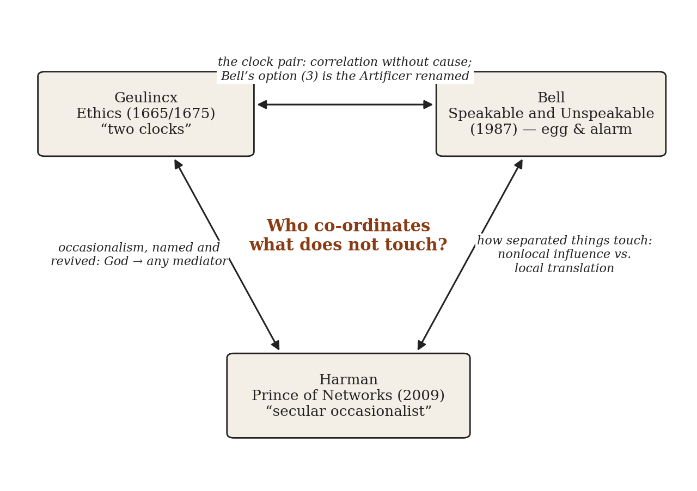
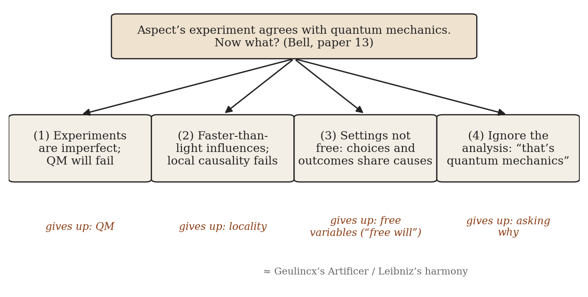
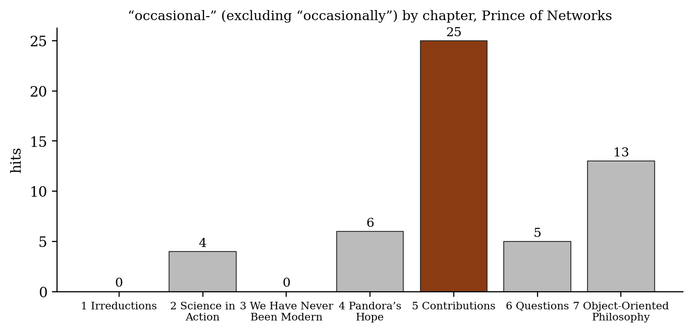
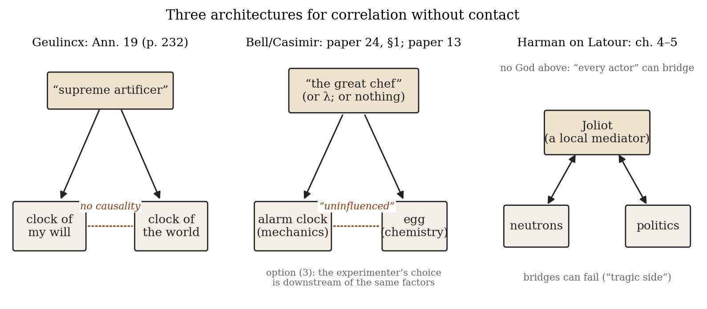

*Triad 2 of 32 · 2026-09-25 · Difficulty 4 · Shared figure or motif, Genealogy/influence, Conflict, Oblique/structural*

## The three books

- [[books/8067-ethics|Ethics]], [[people/arnold-geulincx|Arnold Geulincx]], [[people/samuel-beckett|Samuel Beckett]] (contributor), [[people/martin-wilson|Martin Wilson]] (translator); 1665 (Treatise I); 1675 complete; Brill ed. 2006. *Anchor and source of the figure: the two clocks, the baby in the cradle, occasionalism as the ground of ethics (ubi nihil vales, ibi nihil velis).*
- [[books/13286-speakable-and-unspeakable-in-quantum-mechanics-col|Speakable and Unspeakable in Quantum Mechanics: Collected Papers on Quantum Philosophy]], [[people/john-stewart-bell|John Stewart Bell]]; 1987 (2nd ed. 2004 with Aspect intro). *The oblique edge: a physicist who meets the two-clock structure (egg and alarm clock; option 3, superdeterminism) and refuses it.*
- [[books/389-prince-of-networks-bruno-latour-and-metaphysics|Prince of Networks: Bruno Latour and Metaphysics]], [[people/graham-harman|Graham Harman]]; 2009. *The lineage named and decentralized: occasionalism made secular and local ('vicarious causation'), where any actor can be the mediator and the bridge can fail.*

---

## Geulincx · Bell · Harman

## The Thread

Three books ask the same question in three centuries: how do two things that never touch stay in step? In an annotation to his *Ethics*, Arnold Geulincx gives the image: two clocks that chime together “without any causality,” because one artificer built both. Three hundred years later, in “La nouvelle cuisine,” John Bell opens with a boiled egg and an alarm clock (a passage he quotes from Casimir). Each runs by its own laws, “uninfluenced” by the other, and the coincidence is meaningful only because “I, the great chef, imposed a structure on my kitchen.” Bell’s third way out of his own theorem (paper 13) is the occasionalist God with the theology removed: the experimenters’ settings and the particles’ outcomes share hidden causes, and “our apparent free will is entangled with them.” Graham Harman, reading Bruno Latour, names the tradition outright. For him occasionalism is a live question that was never solved, only ridiculed, and Latour is its “first secular occasionalist”: the gap between any two things is real, and a local mediator closes it, not God.

**Connection kinds:** shared figure or motif (the clock pair, the unseen co-ordinator); genealogy (occasionalism, from al-Ash’ari through Malebranche and Geulincx to Latour); conflict (Bell will not accept the co-ordinator, Geulincx makes it the ground of ethics, Harman decen-tralizes it). **Difficulty: 4.** The Geulincx–Harman edge is a lineage Harman states himself. The Bell edge is the oblique one: Bell never cites Geulincx, but his option (3), “superdeterminism,” has the same structure as the two clocks. His refusal of it (“I do not expect to see a serious theory of this kind”) amounts to a physicist declining occasionalism. It is worth your time because it turns a question from your quantum-foundations reading (what does a correlation owe to a cause?) into a question about gesture and will. Geulincx’s axiom, *ubi nihil vales, ibi nihil velis*, is what his clocks imply for ethics, and Beckett copied it into his notebooks.

## 1. Ethics — Arnold Geulincx (Treatise I, De virtute, 1665; complete Ethica 1675, posthumous)

PDF · Calibre ID 8067 · Brill edition, 2006, trans. Martin Wilson, ed. Han van Ruler, Anthony Uhlmann and Martin Wilson, with Samuel Beckett’s notes. Page numbers are printed pages; PDF page = printed + 47. → [[books/8067-ethics|book page]]

**Selection logic.** This is the anchor and the source of the image. The Brill edition prints Geulincx’s own Annotations, and after them the Latin passages Beckett copied out in the 1930s. The two-clock annotation appears twice in the book, once in Geulincx and once in Beckett’s notes. It gives the triad its figure and its ethics. The will does nothing outside itself, so the virtuous response is humility: do not will where you have no power.

*Figure 1: Constellation: what passes between the three books*

**Overview.** Geulincx (1624–1669), a Cartesian who moved from Louvain to Leiden, built an ethics of the four cardinal virtues on the “Inspection of Oneself.” I see the world, but I did not make it. My body moves when I will, but I do not move it, because I do not know how the motion is produced. So I am a spectator, and all action outside the mind belongs to God. The Annotations take this further with the baby in the cradle and the two clocks. From it follows the “axiom of morals,” *ubi nihil vales, ibi nihil velis*, which Beckett quotes in *Murphy* and kept returning to.

**Excerpt: the two clocks.* Annotations to Treatise I, ch. II, sect. II, §2, Ann. 19, p. 232.* This is the passage Leibniz’s “pre-established harmony” would echo; the editors note that Pfleiderer argued in 1884 that Leibniz arrived at it independently.

> It is the same as if two clocks agree precisely with each other and with the daily course of the Sun: when one chimes and tells the hours, the other also chimes and likewise indicates the hour; and all that without any causality in the sense of one having a causal effect on the other, but rather on account of mere dependence, inasmuch as both of them have been constructed with the same art and similar industry.

**Quotes.**

- “I do not know how such a thing is brought about, and it would be impudent of me to say that I do what I do not know how to do.” (Treatise I, ch. II, sect. II, §2 [4], p. 33)

- “Thus, I am a mere spectator of a machine whose workings I can neither adjust nor readjust. I neither construct nor demolish anything here: the whole thing is someone else’s affair.” (ibid. [8], p. 34)

- “It is just like a baby laid in his cradle: if he wishes the cradle to rock it sometimes rocks, though not because he wishes it, but because his mother or nurse, sitting beside it, wills it” (Ann. 19, p. 232)

- “the clock of my will and the clock of the world” (Ann. 48, p. 242)

- “wherein you have no power, therein you should not will” (Annotations to Treatise I, ch. I, §2, Ann. 3, p. 178; the editors’ note gives the Latin: *Ubi nihil vales, ibi nihil velis*)

**Derived list: the four parts of the human condition, and what Inspection finds in each.** *(The Argument of §2, Annotations p. 243.)* Geulincx concludes: “And we learn by inspecting ourselves that we can do nothing about any part of the human condition, we have no power, and no rights over it; that it is all down to someone else’s power.”

1. *Action*: moving my body, and other bodies through it. It begins in me and ends in God.

2. *Passion*: receiving an image of the world through the senses. It begins outside me and ends in me.

3. *Birth*: my “first coming into this state and condition,” which I did not choose. (“I came upon this scene unconscious, ignorant, and unwilling,” Ann. 52.)

4. *Death*: my “departure from this condition,” which I cannot bring forward or put off.

**A misreading worth attempting.** The editors write that “Beckett seems to allude to this image in *Molloy*, where Molloy and Moran hear and comment upon what is probably the same bell sounding, in their separate narratives” (p. 232 n.). Read *Molloy* as a two-clock novel: two narratives that never touch, synchronized by an author who plays the part of the artificer. Then ask what Beckett has done to the axiom. Where you are worth nothing, you go on willing anyway.

## 2. Speakable and Unspeakable in Quantum Mechanics — John Stewart Bell (1987; this file is the 2004 revised edition with Alain Aspect’s introduction)

EPUB · Calibre ID 13286 · Locations are given by paper number and title (EPUB, no fixed pages). → [[books/13286-speakable-and-unspeakable-in-quantum-mechanics-col|book page]]

**Selection logic.** This is the modern restatement, and it comes without theology. Bell’s papers are the most careful account anyone has given of the difference between a correlation and a cause, and at two points they reach for Geulincx’s figure without knowing it: the egg and the alarm clock, and the clock whose hands “will have moved” before any experiment can be repeated. His list of four responses to the Aspect experiment works as a map of what Geulincx and Harman each give up.

**Overview.** The collection gathers Bell’s papers on the foundations of quantum theory from 1964 to 1990: the hidden-variables theorem, the locality inequality, the “beables,” Bertlmann’s socks, “Against ‘measurement’,” and last, “La nouvelle cuisine.” The through-line is a demand that physics say what exists and what causes what. Quantum mechanics predicts correlations between separated measurements that no locally causal theory can reproduce. Bell will not shrug this off, and he will not buy locality back by making the experimenters’ choices unfree.

**Excerpt: the egg.* “La nouvelle cuisine” (paper 24), §1, quoting H. B. G. Casimir, “Haphazard Reality” (1983).* This is the two-clock image in a kitchen, with the artificer played by the cook.

> I want to boil an egg. I put the egg into boiling water and I set an alarm for five minutes. Five minutes later the alarm rings and the egg is done. Now the alarm clock has been running according to the laws of classical mechanics uninfluenced by what happened to the egg. […]
>
> *(Shortened for the public edition.)*

**Derived list: Bell’s four attitudes after Aspect.* (Paper 13, “Atomic-cascade photons and quantum-mechanical nonlocality.”)*

1. “The inefficiencies of the counter, and so on, are essential. Quantum mechanics will fail in sufficiently critical experiments.”

2. “There are influences going faster than light, even if we cannot control them for practical telegraphy. Einstein local causality fails, and we must live with this.”

3. The settings are “not independently variable as we supposed,” which means “apparently separate parts of the world become deeply entangled, and our apparent free will is entangled with them.” This is the Geulincx option: one artificer, two clocks.

4. “The whole analysis can be ignored. The lesson of quantum mechanics is not to look behind the predictions of the formalism.” Bell’s gloss on (4): “Just as the French legislators might shrug off a correlation between Lille and Lyon with, ‘Well, that’s people.’ ”

*Figure 2: Bell’s four attitudes, and what each gives up*

**Quotes.**

- “How does the second sock know what the first has done?” (paper 16, “Bertlmann’s socks and the nature of reality”)

- “Disgrace indeed, to be caught in a metaphysical position!” (paper 12, “Free variables and local causality”)

- “In this matter of causality it is a great inconvenience that the real world is given to us once only.” (paper 12)

- “the hands of the clock will have moved, and the moons of Jupiter.” (paper 12)

- “In such ‘superdeterministic’ theories the apparent free will of experimenters, and any other apparent randomness, would be illusory.” (paper 24, §10) Then: “However I do not expect to see a serious theory of this kind.” (ibid.)

**Another element: Geulincx read as a physicist.** Set Geulincx’s words against Bell’s. Geulincx has “without any causality” where Bell has “uninfluenced.” Geulincx’s “mere dependence … constructed with the same art” is Bell’s common cause λ. The “clock of my will” corresponds to the “free variables” *a* and *b*. For Geulincx, the will’s inability to cause is humility. For Bell, it would be superdeterminism, and “illusory.” They describe the same structure and put opposite valuations on it. Bell will not let his “free-willed experimental physicists” be babies in cradles.

## 3. Prince of Networks: Bruno Latour and Metaphysics — Graham Harman (2009)

EPUB · Calibre ID 389 · re.press, Melbourne (Anamnesis series; open access). Page numbers are the running heads carried in the EPUB, so they are approximate to ±1. → [[books/389-prince-of-networks-bruno-latour-and-metaphysics|book page]]

**Selection logic.** Harman is the third clock: he turns occasionalism from a curiosity into a program. He accepts the premise Geulincx and Bell share, that separate things do not simply bleed into one another. What he rejects is the monopoly: in each older version one privileged entity (God, custom, the mind) does all the connecting. Harman’s Latour lets anything connect anything, locally and at a cost, and the connection can fail. That gives the triad its conflict: a single artificer (Geulincx), no artificer if at all possible (Bell), many small artificers (Latour according to Harman).

**Overview.** Part I reads four of Latour’s books (*Irreductions*, *Science in Action*, *We Have Never Been Modern*, *Pandora’s Hope*) as metaphysics. Part II (“Contributions,” “Questions”) sets out Latour’s gains and limits. Chapter 7 turns to Harman’s own object-oriented philosophy. The central claim is that Latour’s actor-network theory is an occasionalism made secular and local: “vicarious causation.” Frédéric Joliot links neutrons and politics, and no God is involved.

**Quotes.**

- “This brand of philosophy, widely known as ‘occasionalism’, was as acceptable in the seventeenth century as it is ridiculed today.” (ch. 2, “Science in Action,” p. 35)

- “Latour is probably the first thinker in history to invent a local option for occasional cause—one not passing through God (as in al-Ash’ari, Malebranche, and even Whitehead) or the human mind (as when Hume and Kant turn human habit or categories into the seat of all relations).” (ch. 4, “Pandora’s Hope,” p. 81)

- “More occasionalist than Bergsonian, Latour’s actors have no choice but to occupy punc-tiform cinematic frames.” (ch. 5, “Contributions,” p. 105)

- “they allow a single pampered entity to break the ban on relations that is cruelly enforced on all others.” (ch. 5, p. 113)

- “Bruno Latour is the first secular occasionalist” and “Latour also concedes that local causes might fail in their efforts: an interesting tragic side of causation that was always denied, for obvious reasons, to God.” (ch. 5, p. 115)

**Derived list: who owns the bridges.* (Assembled from ch. 4 p. 81 and ch. 5 pp. 113–115.)* **Diagram: where the word lives.** The count of “occasional-” (excluding “occasionally”) by

| System | What separates things | Who or what connects them |
|---|---|---|
| Ash’arite occasionalism | every created thing, from | God, for every event |
| (al-Ash’ari) | moment to moment |  |
| Malebranche (Geulincx too, | body from body, mind from | God |
| for mind and body) | body |  |
| Hume | qualities | custom (“Custom is to Hume what God is to the occasionalists: the only genuine link between separate realities”) |
| Kant | things-in-themselves from phenomena | the categories of the human mind |
| Whitehead | actual entities | “eternal objects” located in God |
| Latour, as Harman reads | every actor from every | any actor: a local mediator, |
| him | other | who may fail |

chapter, taken from the EPUB text. The concept is almost absent from the Latour exposition in Part I and concentrated in “Contributions” (25 of 53), where Harman claims local occasionalism as Latour’s “greatest achievement.” It comes back in the object-oriented chapter where Harman speaks in his own name (13).

*Figure 3: Harman: occasionalism by chapter*

*Figure 4: Three architectures for correlation without contact*

## Where this sends you

**Notebook**

1. *The will’s clock.* Take Geulincx’s “I do not know how such a thing is brought about, and it would be impudent of me to say that I do what I do not know how to do” (p. 33) and write a page on a gesture of your own (a hand lifting a pen) in the three registers: occasionalist (someone else moves it), Bell’s option 3 (the choice was already correlated with its outcome), Latourian (the pen, the desk and the habit are mediators, and any of them can fail). What does the gesture mean in each?

2. *Superdeterminism as an ethics.* Bell treats option (3) as a *reductio*: “our apparent free will is entangled with them.” Geulincx draws a morality from the same premise: *ubi nihil vales, ibi nihil velis*. Write the ethics Bell refused. What would humility look like to a physicist who accepted superdeterminism? Which Beckett sentence would be its motto?

3. *The chef.* Casimir’s “I, the great chef, imposed a structure on my kitchen” places meaning in a third party who arranges the coincidence. Harman says a Latourian bridge can fail, which is “an interesting tragic side of causation that was always denied … to God.” Write a short fiction of a failed synchronization: two clocks, one chime, a mediator who does not show up.

**Rabbit holes**

- Sukjae Lee, “Occasionalism,” *Stanford Encyclopedia of Philosophy*. The Ash’arites, Malebranche and Cordemoy, with Geulincx in context. https://plato.stanford.edu/entries/occasionalism/

- “Geulincx, Arnold,” *Internet Encyclopedia of Philosophy*. Covers the two clocks, the cradle, and the Leibniz question. https://iep.utm.edu/geulincx/

- “Bell’s Theorem,” *Stanford Encyclopedia of Philosophy*. Covers the free-variables assumption and why superdeterminism is its loophole. https://plato.stanford.edu/entries/bell-theorem/

- Sabine Hossenfelder and Tim Palmer, “Rethinking Superdeterminism” (2020). The serious modern case for Bell’s option (3), the one he did not expect to see. https://arxiv.org/abs/1912.06462

- Graham Harman, “On Vicarious Causation,” *Collapse* II (2007). The short manifesto behind the Latour book’s key term. https://www.urbanomic.com/chapter/collapse-ii-graham-harman-on-vicarious-causation/

- *Prince of Networks* at re.press, the publisher’s open-access page. https://re-press.org/title/prince-of-networks-bruno-latour-and-metaphysics/

**Also in your library**

- *Leibniz’s Monadology: A New Translation and Guide*, trans. Lloyd Strickland (Calibre ID 8876). Windowless monads and pre-established harmony, the clock image in its most famous form.

- *Murphy*, Samuel Beckett (Calibre ID 5257). Chapter 9 gives “In the beautiful Belgo-Latin of Arnold Geulincx: *Ubi nihil vales, ibi nihil velis*.”

- *Theodicy*, Leibniz (Calibre ID 8897). The harmony argued out against Bayle, with the occasionalists never far off.

## To carry

> “In this matter of causality it is a great inconvenience that the real world is given to us once only.” — John Stewart Bell, “Free variables and local causality,” *Speakable and Unspeakable in Quantum Mechanics*, paper 12

All quotations were extracted from the files in Scribrarium (PDF via pdftotext; EPUB via the spine) and checked by substring match against the extracted text.

## Themes

[[themes/beckett|Beckett]] · [[themes/correlation-vs-causation|correlation vs causation]] · [[themes/free-will|free will]] · [[themes/gesture|gesture]] · [[themes/mediation|mediation]] · [[themes/occasionalism|occasionalism]] · [[themes/pre-established-harmony|pre-established harmony]] · [[themes/superdeterminism|superdeterminism]] · [[themes/two-clocks|two clocks]] · [[themes/vicarious-causation|vicarious causation]]

---

Previous: [[triads/2026-09-24-cento-copy-dictionary|Cento, Copy, Dictionary]]  
Next: [[triads/2026-09-26-certificates-without-originals|Certificates Without Originals]]
