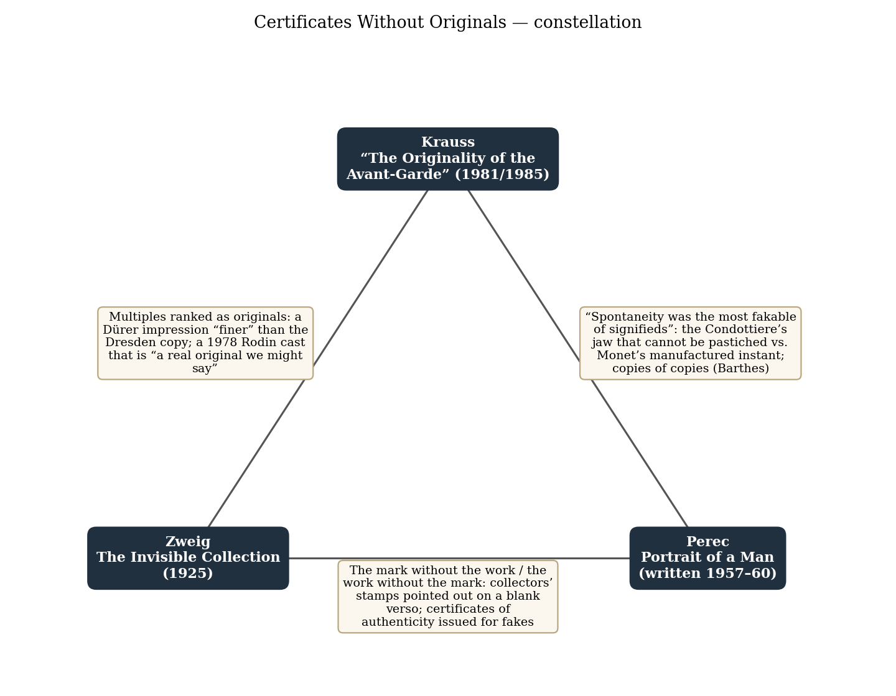
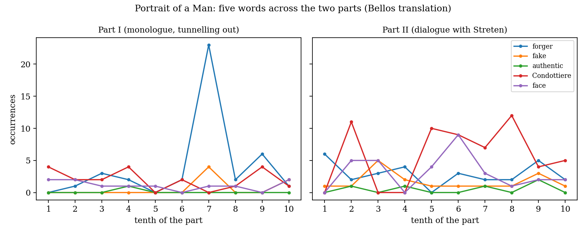
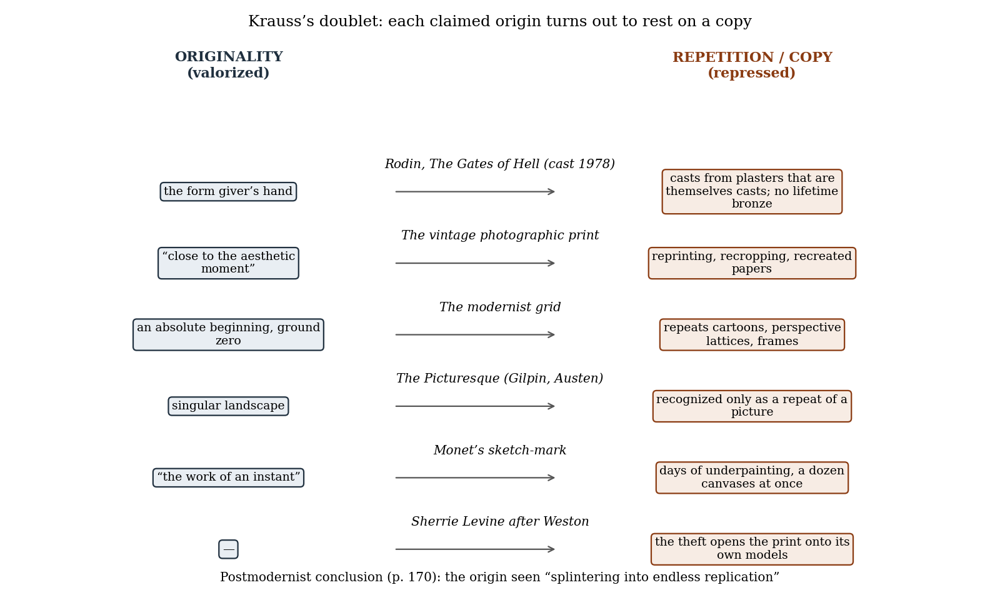

*Triad 3 of 32 · 2026-09-26 · Difficulty 3 · Same subject, Shared figure or motif, Conflict*

## The three books

- [[books/4963-the-invisible-collection|The Invisible Collection]], [[people/stefan-zweig|Stefan Zweig]], [[people/anthea-bell|Anthea Bell]] (translator); 1925 (Die unsichtbare Sammlung); Pushkin Press ed.. *Anchor: certification without an object. A blind collector shows blank sheets and points to collectors' stamps on their empty versos.*
- [[books/782-portrait-of-a-man|Portrait of a Man]], [[people/georges-perec|Georges Perec]], [[people/david-bellos|David Bellos]] (translator); written 1957–60; French publ. 2012 (Le Condottière); Eng. 2014. *The object without its provenance: a forger with certificates for everything who cannot make an authentic Antonello, and finds his own face instead.*
- [[books/729-the-originality-of-the-avant-garde-and-other-moder|The Originality of the Avant-Garde and Other Modernist Myths]], [[people/rosalind-e-krauss|Rosalind E. Krauss]]; 1985 (title essay October 18, 1981). *The theory both fictions test: the discourse of originality rests on a repressed discourse of the copy.*

---

## The Thread

Three books about what is left when the apparatus that certifies a work and the work it certifies come apart. In Zweig’s story a blind collector in inflation-era Saxony shows a Berlin dealer twenty-seven portfolios whose prints his wife and daughter have already sold. He turns a blank sheet over and points, “to the millimetre”, to the collectors’ stamps of Nagler, Remy and Esdaile: the provenance outlives the object. Perec’s forger Gaspard Winckler has the reverse problem. His dealers supply certificates of authenticity for everything he makes (“They had them”). What he cannot manage is “to create an authentic masterwork of the past”, and the one mark he cannot copy is Antonello’s *me pinxit*: the object without its provenance. Krauss’s essay is the theory both stories take for granted and then undercut. Museum, historian and artist all work “to find the mark, the warrant, the certification of the original”, and Krauss argues that the original was always propped on the copy: Rodin’s posthumous casts, the vintage print, the grid.

**Connection kinds:** Same subject (authenticity), Shared figure or motif (the certifying mark: stamp, certificate, cartellino, copyright), Conflict. **Difficulty: 3.** Once said, the link is plain. What makes it worth your time is the conflict. Krauss dissolves the original. Zweig’s councillor and Perec’s forger each stake a life on it, and in both stories the fiction produces something real: the old man’s joy, and Winckler’s own face. A detail keeps the triad tight: Zweig’s trea-sures are etchings and engravings, which are already multiples. That is exactly the medium in which Krauss, quoting Benjamin, says that asking for the authentic print “makes no sense”. And for the gesturalist, Zweig gives a gesture performed without its object (“the intent gesture of a man looking at a fine work”), while Krauss shows Monet’s gestural mark manufactured over days.

## 1. The Invisible Collection — Stefan Zweig (1925, as Die unsichtbare Sammlung)

EPUB · Calibre ID 4963 · Pushkin Press, *The Invisible Collection: Tales of Obsession and Desire*, trans. Anthea Bell. Only the title story is used here. → [[books/4963-the-invisible-collection|book page]]

**Selection logic.** It is the anchor, and the purest case in the library of certification without an object. It is also short enough to read before coffee. It brings to the triad the collector’s marks (stamps, states, proofs, the comparison with “the Dresden copy”) and a question the other two books circle: what does a connoisseur’s description do when there is nothing left to describe?

**Overview.** A frame narrator on a train hears a Berlin art dealer’s story. Out of stock during the 1923 inflation, the dealer looks up his firm’s oldest customer, a retired forestry councillor in a small Saxon town who has bought prints from three generations of the family. The councillor

*Figure 1: Constellation of the three books*

is alive and blind. Before the viewing, his daughter confesses that to survive, the women have sold the collection sheet by sheet (Rembrandt first) for money that evaporated on arrival, and replaced the prints with “reprints or similar sheets of paper” so that his fingers would find the mounts full. For two hours the dealer plays along. At the end the old man promises him the auction of the collection in his will, and calls “Bon voyage!” from the window.

## Excerpt: the Great Horse

The pivotal moment of the story. Every term of the connoisseur’s trade appears here, applied to nothing.

> And now, with the tender caution one would employ in handling something fragile, his fingertips touching it very lightly to avoid wear and tear, he took out of the folio a mount framing a blank, yellowed sheet of paper, and held the worthless scrap out in front of him with enthusiasm. […]
>
> *(Shortened for the public edition.)*

(“The Invisible Collection”, about 67% of the way through the story.)

## The invisible collection, as inventoried in the story (derived list)

Everything the text names as being in the portfolios, with the words it uses:

1. **The scale.** “there are twenty-seven portfolios, one for each master of the graphic arts, and all of them full.” (≈39%)

2. **Masters named at the outset.** “engravings by Dürer and Mantegna in such a perfectly complete state”; finest prints of Rembrandt’s etchings. (≈18%)

3. **Dürer, the Great Horse.** “There—the Great Horse!” Called finer than “the Dresden copy”. (≈67%)

4. **Provenance marks on the blank verso.** The Nagler collection; Remy; Esdaile. “the invisible collectors’ stamps that existed only in his imagination” (≈72%)

5. **Dürer, the Melancholia and the Passion.** “You must see my copy of the Melancholia, or the Passion” (≈74%). The Passion is described as “an illuminated copy”.

6. **Rembrandt, the Antiope (a proof).** “in speaking of his copy of Rembrandt’s Antiope (the print of the etching was a proof and must indeed have been inestimably valuable)” (≈78%). This is where the fiction nearly breaks: “his ultra-sensitive nerves of touch failed to feel an indentation that he expected on the blank sheet.” (≈79%)

7. **Promised last item: the catalogue.** “Just promise me to draw up a handsome catalogue: it will be my tombstone, and I couldn’t ask for a better memorial.” (≈92%)

Note that item 5 brings back Dürer’s *Melencolia*, which headed the first set in this tracker (Burton). The councillor’s copy is invisible.

## A misreading worth attempting

Read the story against Benjamin rather than with him. The standard account says reproduction strips the aura from the work. Here the work is gone entirely and the aura remains, kept going by three things: touch (the order of the sheets known “by heart”), the institutional marks (stamps, states, comparison with Dresden) and the dealer’s description, which at the moment of crisis stands in for the print: he “quickly took the mounted sheet from his hands, and enthusiastically described the etching, which I myself knew well, in every detail.” (≈79%). Ekphrasis does the restorer’s job. The strong version of the misreading is that aura was never in the sheet, only in the certifying practices around it. That is Krauss’s claim, arrived at from the other side and with tenderness instead of irony. The story’s last line (“Collectors are happy men.”, attributed to Goethe; ≈100%) is ambiguous in the dry way that suits it.

## 2. Portrait of a Man — Georges Perec (written 1957–60; first published in French 2012 as Le Condottière)

EPUB · Calibre ID 782 · trans. David Bellos (2014), with his introduction. → [[books/782-portrait-of-a-man|book page]]

**Selection logic.** Zweig has certification without an object. Perec has an object whose certification is trivial (the gang has certificates for everything) and whose authenticity is impossible. Winckler wants a painting that is simultaneously Antonello’s and his own. He sets the conflict with Krauss going from inside the fiction: he believes in the original enough to kill over it.

**Overview.** Perec’s first finished novel, rejected by Gallimard in 1960 and lost in a house move in 1966. Bellos recovered a carbon copy while researching his biography. Gaspard Winckler, trained from seventeen by the forger Jérôme, has spent twelve years producing “a hundred and twenty, a hundred and thirty” fakes for a Geneva gallery. Commissioned to forge an Antonello da Messina, he tries instead to paint a new *Condottiere* that would be both a genuine Antonello and a genuine Winckler. He fails, cuts his dealer Madera’s throat, and the book begins. Part I is interior monologue in first, second and third person while he tunnels out of the basement studio at Dampierre. Part II repeats the story as dialogue with his friend Streten. The name Gaspard Winckler returns in *Life A User’s Manual* as the puzzle-maker.

## Quotations

- “to create an authentic masterwork of the past” (Part I, ≈31%). Winckler’s ambition, stated as an illusion.

- “Anything by anybody of any period” (Part I, ≈66%). His trade, as a slogan.

- “Forger. Faussaire. Fausse ère : wrong period.” (Part I, ≈83%). The pun Bellos flags: forgery as bad timing.

- “it was the double, triple, quadruple game of a fake artist pastiching his own pastiche” (Part I, ≈98%). The failed panel, judged.

- “I’d take three or four works by whomever, pick out various bits and pieces from them all, juggle them around and make a jigsaw puzzle out of them. But that didn’t work for an Antonello.” (Part II, ≈13%). The method, and the limit it hits.

| • “And the certificate of authenticity?” | “They had them. | I never knew where they got |
|---|---|---|
| them, or whether they were fakes too or whether they had an official authenticator on |  |  |
| their books.” (Part II, ≈85%) |  |  |
| • “I did succeed in painting my own portrait … I got my own face” (Part II, ≈88%) |  |  |

Bellos’s introduction states the logic flatly: “a painting cannot be a forgery and an authentic work of art at the same time” (Introduction, ≈47%).

## Diagram: five words across the two parts

*Figure 2: Term frequencies in Portrait of a Man*

What the counts show. In Part I, “forger” spikes to 23 in a single tenth. That is the litany (“Gaspard Theotokópoulos alias El Greco. Gaspard da Messina … Gaspard the forger. The smith-slave.”) in which Winckler recites himself as a catalogue of other people. In Part II, “Condottiere” nearly triples (20 to 58) and “face” nearly triples (11 to 31). The talking cure moves from the forger’s identity to the painted face, and ends at his own. “Authentic” appears only six times in the whole novel, which fits: the word is what he wants and cannot say.

## Glossary for Winckler’s workshop

- **gesso duro.** The hard gesso ground of a panel painting. For Winckler, the basic technical competence (“barely good enough to make a proper gesso duro”, Part I). To start over means sanding the board back to it.

- **cartellino / *Antonellus Messaneus me pinxit*****.** The painted slip of paper on Antonello’s false frame: “Antonello of Messina painted me”. Bellos calls it “a self-confirming loop”. It is the painting’s own certificate, and the one thing the forger’s certificate cannot replace. The phrase recurs in both parts.

- **the jigsaw method.** Composite forgery built from fragments of existing works, as van Meegeren did. Bellos notes that Perec later turned this into a literary technique: the hidden quotations of *Things*, *A Man Asleep* and *Life A User’s Manual*.

- ***conscience*****.** One French word for English “conscience” and “consciousness”. Bellos calls the undecidable cases the main difficulty of the translation. Perec called the book “l’histoire d’une conscience”.

- **authenticity (Sartrean).** Bellos’s introduction ties the novel’s vocabulary to Sartre’s *Réflexions sur la question juive* and the Left Bank of the 1950s. For Perec the word had more than aesthetic weight.

## 3. The Originality of the Avant-Garde and Other Modernist Myths — Rosalind E. Krauss (1985; title essay first published in October 18, 1981)

PDF · Calibre ID 729 · MIT Press paperback. The title essay runs pp. 151–170, followed by “Sincerely Yours” (pp. 171ff.). The PDF’s text layer splits ligatures (“cas t”, “au then tic”), so quotations were checked with that spacing normalized. Page numbers are printed pages (PDF page = printed + 13). → [[books/729-the-originality-of-the-avant-garde-and-other-moder|book page]]

**Selection logic.** This is the theory the two fictions test. Krauss names the certifying machinery (“the mark, the warrant, the certification of the original”) that Zweig’s blind man keeps pointing to. She also argues that “spontaneity” is manufactured, which is Winckler’s discovery at the Condottiere’s jaw, reversed. And her starting point is Benjamin on the print, the medium of Zweig’s portfolios.

**Overview.** The essay opens with the National Gallery’s 1981 Rodin show, which included a *Gates of Hell* cast in 1978, legally authorized by Rodin’s bequest to the French state, sixty years after his death. From there Krauss argues that the avant-garde’s “discourse of originality” rests on a repressed discourse of the copy. She works through the grid (the “absolute beginning” that only repeats earlier grids), the picturesque, Monet’s sketch-mark and the nineteenth-century Musée des Copies. She ends with Sherrie Levine’s rephotographs of Edward Weston, which she treats as a postmodernist break with the avant-garde, not its latest move.

## Excerpt: the casts

> “Due to the double circumstance of there being no lifetime cast and, at time of death, of there existing a plaster model still in flux, we could say that all the casts of The Gates of Hell are examples of multiple copies that exist in the absence of an original. […]
>
> *(Shortened for the public edition.)*

## Quotations

- “a legitimate work: a real original we might say” (p. 151). The 1978 cast, by right of the state.

- “Sitting in the little theater, watching the newest Gates being cast, watching this violation, we want to call out, ‘Fraud.’ ” (p. 157)

- “to find the mark, the warrant, the certification of the original” (p. 162)

- “the modernist grid is, like the Rodin casts, logically multiple: a system of reproductions without an original” (p. 162)

- “spontaneity was the most fakable of signifieds” (p. 167)

- “realism consists not in copying the real but in copying a (depicted) copy” (p. 168; Krauss quoting Barthes, *S/Z*)

- “we look back on the modernist origin and watch it splintering into endless replication” (p. 170)

*Figure 3: Argument map: Krauss’s doublet*

## What stands behind the “original” surface (derived list)

Krauss’s catalogue of the earlier texts that a modernist grid repeats, in her order (p. 161):

1. “the gridded overlays on cartoons, for example, used for the mechanical transfer from drawing to fresco”

2. “the perspective lattice meant to contain the perceptual transfer from three dimensions to two”

3. “the matrix on which to chart harmonic relationships, like proportion”

4. “the millions of acts of enframing by which the picture was reaffirmed as a regular quadrilateral”

And the 1801 Supplement to Johnson’s *Dictionary* on *picturesque*, which she says moves “in a kind of figure eight” around the question of the original (p. 163): “1) what pleases the eye; 2) remarkable for singularity; 3) striking the imagination with the force of paintings; 4) to be expressed in painting; 5) affording a good subject for a landscape; 6) proper to take a landscape from”.

## Where this sends you

## Notebook

1. **Write the verso.** Zweig’s councillor points to “the invisible collectors’ stamps” on a blank back, and Krauss says every institution works “to find the mark, the warrant, the certification of the original” (p. 162). Describe a work you know solely through its ver-sos: stamps, inscriptions, labels, accession numbers, condition notes, and nothing of the image. At what line does a reader start believing in the recto?

2. **A recipe for your spontaneity.** Winckler fails at “that celebrated tautness in the jaw” and gets “my own face”. Krauss: “spontaneity was the most fakable of signifieds” (p. 167). Take one gesture of yours you consider unforgeable (a signature, a marginal mark, the way you open a notebook page) and write it out as instructions for a forger. Then write what the instructions leave out. Is the remainder where the gesture lives, or where your belief about it lives?

3. **The catalogue as tombstone.** “Just promise me to draw up a handsome catalogue: it will be my tombstone”. Draft five entries of the councillor’s catalogue raisonné for sheets that no longer exist, with states, proofs, provenance and condition, in a dealer’s prose. Then set one entry beside Borges’s list of Pierre Menard’s visible works and see whose kind of invisibility it is.

## Rabbit holes

- Walter Benjamin, “The Work of Art in the Age of Mechanical Reproduction” (1936), full text at the Marxists Internet Archive. The essay Krauss starts from. https://www.marxists.org/reference/subject/philosophy/works/ge/benjamin.htm

- Rosalind Krauss, “The Originality of the Avant-Garde: A Postmodernist Repetition”, *October* 18 (1981). The first version, as a PDF on Monoskop, for comparison with the book text. https://monoskop.org/images/3/32/Krauss_Rosalind_1981_The_Originality_of_the_Avant-Garde.pdf

- Frits Lugt, *Les marques de collections de dessins & d’estampes* (1921), Internet Archive. The reference work for exactly the stamps Zweig’s councillor points to. The online continuation lists Nagler among its entries. https://archive.org/details/lesmarquesdecoll00lugt

- Louvre, *Portrait d’homme, dit Le Condottiere*, Antonello da Messina (1475), collections record. Look for the cartellino. https://collections.louvre.fr/en/ark:/53355/cl010065016

- Somogy Varga and Charles Guignon, “Authenticity”, *Stanford Encyclopedia of Philosophy*. The existential sense Bellos says was in the air around Perec. https://plato.stanford.edu/entries/authenticity/

- Michael Mandiberg, *AfterWalkerEvans.com* (2001). Scans of Sherrie Levine’s rephotographs of Walker Evans, one more remove along Krauss’s chain. https://www.afterwalkerevans.com/

## Also in your library

- Walter Benjamin, *The Work of Art in the Age of Its Technological Reproducibility, and Other Writings on Media* (Harvard) — Calibre ID 12548 (PDF). The second version of the essay, with the aura passages and the writings on photography.

- Georges Perec, *Life: A User’s Manual* — Calibre ID 773 (EPUB). Gaspard Winckler returns as the maker of Bartlebooth’s puzzles: forgery turned into a game of patience and revenge.

- Yasushi Inoue, *Life of a Counterfeiter* — Calibre ID 2782 (EPUB). A biographer researching a master painter keeps finding the man who forged him. Perec’s premise, told from outside.

## To carry

> “spontaneity was the most fakable of signifieds” — Rosalind E. Krauss, “The Originality of the Avant-Garde”, *The Originality of the Avant-Garde and Other Modernist Myths*, p. 167

## Themes

[[themes/aura|aura]] · [[themes/authenticity|authenticity]] · [[themes/benjamin|Benjamin]] · [[themes/catalogue|catalogue]] · [[themes/certification|certification]] · [[themes/collectors-marks|collectors' marks]] · [[themes/copy|copy]] · [[themes/forgery|forgery]] · [[themes/originality|originality]] · [[themes/prints-and-multiples|prints and multiples]] · [[themes/provenance|provenance]] · [[themes/spontaneity|spontaneity]]

---

Previous: [[triads/2026-09-25-the-two-clocks-problem|The Two Clocks Problem]]  
Next: [[triads/2026-09-27-the-averaged-self|The Averaged Self]]
