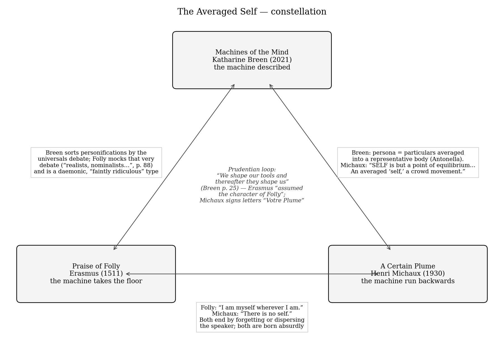
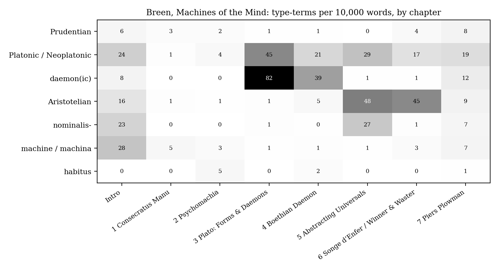
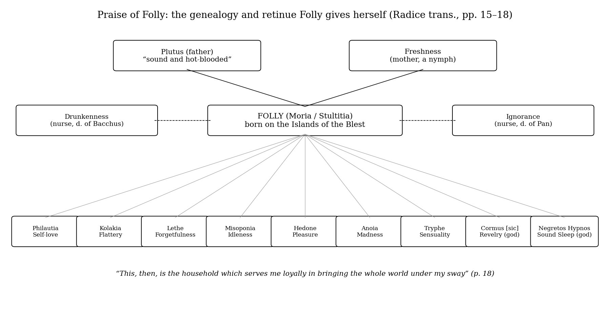
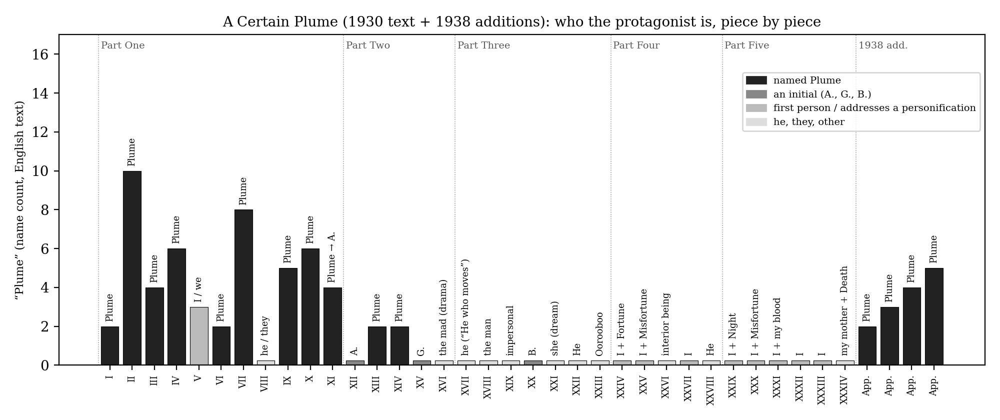

*Triad 4 of 32 · 2026-09-27 · Difficulty 4 · Shared figure or motif, Oblique/structural, Conflict*

## The three books

- [[books/13964-machines-of-the-mind-personification-in-medieval-l|Machines of the Mind: Personification in Medieval Literature]], [[people/katharine-breen|Katharine Breen]]; 2021. *The machine described: the theory of personification as a tool of thought, with a typology keyed to the universals debate that places the other two books.*
- [[books/626-praise-of-folly|Praise of Folly]], [[people/desiderius-erasmus|Desiderius Erasmus]], [[people/betty-radice|Betty Radice]] (translator); 1511. *The machine takes the floor: a personification delivering her own encomium, refusing definition, mocking the universals debate, and finally forgetting who she is.*
- [[books/5489-a-certain-plume|A Certain Plume]], [[people/henri-michaux|Henri Michaux]], [[people/richard-sieburth|Richard Sieburth]] (translator); 1930. *The machine run backwards: a particular who never becomes universal; the name thins into initials and the author declares the self an averaged persona.*

---

## The Thread

A personification is a machine that turns many particulars into one body that can talk. Katharine Breen’s *Machines of the Mind* describes the machine: medieval personifications as working tools, sorted by where they stand in the debate over universals (Platonic, Aristotelian, nominalist) plus a fourth, “Prudentian” kind that people build and then conform themselves to (“We shape our tools and thereafter they shape us”). Erasmus’s *Praise of Folly* is that machine taking the floor. Folly is an abstraction with a face who refuses to be defined (“a sketch which would be a mere shadow of myself when I am here before you”), mocks the realists and nominalists whose quarrel Breen uses to classify her, and ends by “forgetting who I am”. Michaux’s *A Certain Plume* runs the machine backwards. Plume is a particular who never quite reaches the universal. His translator puts it exactly: “not imposing enough or universal enough to assume outright allegorical significance”. His name slides into initials (A., whose earlier name was “Eache”, then G., then B.), and in the 1938 postface Michaux turns Breen’s product-design persona on himself: “SELF is but a point of equilibrium … An averaged ‘self,’ a crowd movement.”

The three books never mention each other. What they share is one structural question: which way does the traffic run between a person and an abstraction? It runs downward in Breen (the abstraction is lent a body), sideways in Erasmus (the abstraction speaks for itself and cannot stay in character), and upward in Michaux (the person turns out to have been an average all along). The Prudentian loop closes on both authors. Erasmus “assumed the character of Folly” and dedicated her to her “namesake”, Thomas More. Michaux signed his letters “Votre Plume”, a pen personified that then took over its author. There is a conflict too: Folly says “I am myself wherever I am”; Michaux says “There is no self.”

**Connection kind:** Shared figure or motif (personification); Oblique/structural; Conflict. **Difficulty:** 4 of 5.

*Figure 1: Constellation*

## 1. Machines of the Mind: Personification in Medieval Literature — Katharine Breen (2021)

EPUB · Calibre ID 13964 · University of Chicago Press → [[books/13964-machines-of-the-mind-personification-in-medieval-l|book page]]

**Selection logic.** This is the theory book of the three, and it names the machine outright. Breen’s typology is useful here because it is metaphysical, not stylistic: a personification’s standing depends on what its maker thought universals were. That gives a precise vocabulary for placing the other two books. Folly fits Breen’s “daemonic” type (“faintly ridiculous”, tutelary, rubbing shoulders with pagan gods). Plume fits the nominalist one (“puzzles or enigmas, engaging readers through their incongruity”). Breen’s opening example, Ford’s persona “Antonella”, assembled from market data, is the exact mechanism Michaux later diagnoses in himself.

**Overview.** Breen argues that medieval personifications are neither failed novel characters nor heavy-handed didactic devices. They are *machinae mentis*, tools for handling hard ideas, and she judges them by use value rather than truth value, following Vaihinger’s idea of useful fictions. Part I (Prudentian) runs from the Roman cult of deified abstractions to Prudentius’s *Psychomachia*. Part II (Neoplatonic) covers Plato’s forms and daemons, then Boethius’s Philosophy read as a daemon rather than a Form. Part III (Aristotelian) covers abstraction from particulars, the *Songe d’Enfer*, *Winner and Waster*, and *Piers Plowman*. The introduction starts from 21st-century product-design “personas” and Gregory the Great’s description of allegory as a *machina*, a builder’s hoist.

**Excerpt: the hoist** (Introduction, pp. 5–6, Breen quoting and glossing Gregory the Great’s preface to the *Commentary on the Song of Songs*):

> Allegory makes, as it were, a kind of machine, whereby a soul placed far from God may be raised up to God. […] The soul, here depicted as possessing earthly weight, is simultaneously she who lifts and that which is lifted. […] In other words, readers must themselves strive to become personifications by distancing themselves from their physical bodies.

The last sentence is the hinge of this set. The reader is supposed to *become* a personification, which is Michaux’s diagnosis with the value reversed.

**Quotes**

- “personification is as personification does” (Introduction, p. 9)

- “Where novels often create an illusion of individuation through an accumulation of non-signifying details, personifications are instead composed of exemplary or characteristic details.” (p. 2)

- “it may be more accurate to think about it as a design engine, or even a form of artificial intelligence” (p. 4)

- “nominalist personifications do not represent universals as much as they prompt readers to conceptualize them. They tend to be puzzles or enigmas, engaging readers through their incongruity rather than through visionary imagery or verisimilar detail.” (p. 24)

- “Daemonic personifications, in contrast, are much less authoritative and can even be faintly ridiculous.” (p. 23)

- “In later texts, it also illuminates the phenomenon of persons turning themselves into personifications.” (p. 25)

**Diagram: where the typology lives in the book.** Counts of Breen’s type-terms per 10,000 words in each chapter of the EPUB (notes and index excluded). Two things show up. The word “daemon” dominates Chapters 3 and 4 (82 and 39 per 10k), where Breen builds the daemonic type and then reclassifies Boethius’s Philosophy as a daemon. And the label “Prudentian” is densest in the Introduction and the Piers Plowman chapter, not in the Prudentius chapters, which speak of Prudentius himself. It is a frame term, applied from outside.

*Figure 2: Breen type-terms by chapter*

**Glossary (Breen’s working terms, with first useful locations)**

- *prosopopoeia*: from *prosopon* (face, mask, person) + *poiein* (to make) (p. 1).

- *machina / machinae mentis*: Gregory’s word for allegory, a hoist or scaffold; “machines for building other machines” (p. 5).

- *representative vs idiosyncratic detail*: moderately realist personifications carry representative detail, novel characters idiosyncratic detail (p. 24).

- *Platonic (formal or daemonic)*: descends from above through illumination; formal ones speak with authority, daemonic ones are tutelary and can be ridiculous (p. 23).

- *Aristotelian (moderate realist or nominalist)*: abstracted from particulars; the nominalist kind is a cognitive act, presented as a puzzle (pp. 23–24).

- *Prudentian*: realist *and* consciously made; “Instead of descending from above, Prudentian personifications are built up from below via religious practice.” (p. 25)

- *habitus*: a disposition built by repeated acts. Prudentius’s Avarice treats it as clothing and changes it, disguising herself as Thrift (pp. 102–103).

## 2. Praise of Folly (Moriae Encomium) — Desiderius Erasmus (1511; written 1509)

EPUB · Calibre ID 626 · Penguin Classics, trans. Betty Radice, intro. and notes A. H. T. Levi, with the Letter to Maarten van Dorp (1515). Page numbers are the print pages embedded in the EPUB. → [[books/626-praise-of-folly|book page]]

**Selection logic.** Breen’s book stops at the end of the fourteenth century, and Folly is what the machine does next: a humanist personification who delivers her own encomium and so makes the device say what it is. She is Breen’s daemonic type almost to the letter. She claims divinity, goes about with a household of lesser personifications, and is funny. But she also has the scholastic universals debate in her sights, the same map Breen uses to locate her. Her ending, “But I’ve long been forgetting who I am”, is a personification losing track of its own abstraction, the reverse of Plume’s slide from name to initial.

**Overview.** Folly, dressed as a jester, gives a declamation in three movements: her birth and her benefits to gods and men; a satire on her followers (grammarians, philosophers, theologians, monks, princes, popes); and a final, nearly serious praise of Christian folly and ecstatic self-loss. The prefatory letter to Thomas More plays on *Moria*/More. In the 1515 letter to Dorp, Erasmus defends himself by pointing to the persona: he spoke “through the mouth of a fictitious and comic character”, and his words were “addressed to everyone and so to no one in particular”.

**Excerpt: the personification refuses definition** (pp. 12–13):

> It wouldn’t bode well for the future either to limit and confine one whose divinity extends so far, or to cut her up when the whole world is united in worshipping her. And what purpose would it serve for a definition to produce a sketch which would be a mere shadow of myself when I am here before you, for you to look at with your own eyes? […]
>
> *(Shortened for the public edition.)*

Here an abstraction argues that she is more real than her definition would be. That is the Platonic-realist claim, made by the one figure who cannot be believed when she makes it.

**Quotes**

- “It’s in praise of myself, namely, Folly.” (p. 11)

- “Who could portray me better than I can myself? Unless, of course, someone knows me better than I know myself.” (p. 11)

- “they still boast that they can see ideas, universals, separate forms, prime matters” (p. 85)

- “so that you’d extricate yourself faster from a labyrinth than from the tortuous obscurities of realists, nominalists, Thomists, Albertists, Ockhamists and Scotists” (p. 88)

- “But I’ve long been forgetting who I am, and I’ve ‘overshot the mark’.” (p. 134)

- “When I wanted to play the fool, I assumed the character of Folly, and just as in Plato Socrates masks his face in order to sing the praises of love, I too have played my comedy in character.” (Letter to Dorp, p. 143)

**Diagram: the household Folly gives herself** (pp. 15–18). This is a Psychomachia turned inside out: her retinue are personified vices, but here they serve as a court rather than an army. (The Penguin text prints “Cormus”; the usual form is Comus.)

**Derived list: the invisible things Folly says the philosophers claim to see** (pp. 85, 88). This is her inventory of scholastic entities, which Breen’s book spends seven chapters taking seriously:

*Figure 3: Folly’s household*

1. ideas

2. universals

3. separate forms

4. prime matters

5. quiddities

6. ecceities

7. concepts, relations, instants, formalities (p. 88; bracketed in this edition as a later addition)

And the sects she names as the labyrinth: realists, nominalists, Thomists, Albertists, Ockhamists, Scotists (p. 88).

## 3. A Certain Plume (Un certain Plume) — Henri Michaux (1930)

EPUB · Calibre ID 5489 · NYRB Poets, bilingual, trans. Richard Sieburth, preface by Lawrence Durrell. Reprints the 1930 Carrefour text with an appendix from Plume, précédé de Lointain intérieur (1938), including its Postface. The EPUB has no page numbers, so locations are given by piece. Quotations are given as extracted; stray spaces before punctuation, left by italic markup, are closed up; in some quotations that contain quotation marks, the inner marks are shown as single quotes. → [[books/5489-a-certain-plume|book page]]

**Selection logic.** Plume is the nominalist personification carried to its limit, and past it. The indefinite title (*un certain*) puts the particular/universal problem into the grammar, and Sieburth reads it that way. The name itself is an object, feather or pen, the tool of writing given a body. Then the book does something neither Breen nor Erasmus can: it lets the name fail. By the Postface the averaging machine has been turned on the author’s own self, which Michaux signs “in the name of the many”.

**Overview.** A cycle of prose poems and short pieces. In Part One, the mild, apologetic Plume suffers the absurd: his house is stolen while he sleeps, a train cuts his wife into eight pieces, he is sentenced, arrested over a chop. Across the later parts the named hero thins out into initials (A., G., B.), a Dada asylum playlet (“The Drama of the Constructors”), nightmare pieces, and finally first-person lyrics that address personified Fortune, Misfortune and Night. Sieburth’s afterword (“A Pen in Search of an Author”) traces Plume through Chaplin, Kafka, Mallarmé’s *plume*, and Poe’s “Dr. Tarr and Professor Fether” (*Professeur Plume* in Baudelaire’s French).

**Quotes**

- “Extending his hands from his bed, Plume was astonished not to feel the wall: “Well, he concluded, the ants must have eaten it away. . .” And he went back to sleep.” (I, “A Peaceable Man”)

- “Of the two it is always the object who’s in charge.” (XIII, “Buddha”)

- “He who is firm is a man. But he who is soft is without limits. He takes on every form, he is born everywhere. Truth be told, he’s the Buddha.” (XIII, “Buddha”; French: “Celui qui est ferme est un homme. Mais celui qui est mou est sans limites.”)

- “Misfortune, my great plowman.” (XXX, “At Rest in Misfortune”; French: “Le Malheur, mon grand laboureur,”. A personification in plowman’s clothes, as in Langland.)

- “There is no single self. There are not ten selves. There is no self. SELF is but a point of equilibrium. (One among a thousand others, always possible, always at the ready). An averaged “self,” a crowd movement. In the name of the many, I sign this book.” (Postface, 1938)

- “A specific, yet not entirely well-defined character, a citizen not wholly above suspicion, a person of interest, to be sure, but not imposing enough or universal enough to assume outright allegorical significance.” (Sieburth, Translator’s Afterword)

**Diagram: the name thinning out.** For each piece in the English text: how often the name “Plume” occurs, and what the piece calls its protagonist (my own classification from reading each piece). “Plume” dominates Part One, breaks into “A.” in the middle of “In Vienna, Second Death of Plume”, and is gone from Part Three onward. The first-person speaker who replaces him in Parts Four and Five addresses personifications (Fortune, Misfortune, Night, Death) instead of being one. The name returns only in the 1938 additions.

**Derived list: every name Plume goes by** (from the text, the notes and the afterword)

1. **Plume**: feather or pen (“which can refer to either a feather or a pen”, Afterword).

2. **A.**: “In the fourth paragraph, ‘Plume’ mysteriously turns into ‘A.’ ” (Notes, “In Vienna, Second Death of Plume”); “Basically they detest foreigners, A. thought”.

3. **Eache**: the earlier name of “The Portrait of A.”, which the notes gloss this way: “ ‘Eache’ (or EH in French) may stand for Henri Eugène, the first and middle names of Michaux.

*Figure 4: Plume designations*

> In addition to the English ‘Each,’ the German pronoun ‘I’ (‘ich’) is also contained in the name Michaux.” A character named after a distributive quantifier.

4. **G.**: “A Singular Thief”, who “has nothing”.

5. **B.**: “Birth”: “B. was born of an egg, then he was born of a cod which he proceeded, once born, to explode, then he was born of a shoe”. Set this beside Folly’s birth on the Islands of the Blest.

6. **Pon**: “In the 1938 version, ‘B.’ is renamed ‘Pon.’ ” (Notes)

7. **Votre Plume**: “Michaux beginning to affix the pen name ‘Votre Plume’ to many of his letters of this period” (Afterword).

8. **Un Certain Plume** as pseudonym: “In 1943, to elude Vichy censorship”, a chapbook “under the nom de guerre ‘Un Certain Plume’ ” (Afterword).

9. **Monsieur Plume**: “Jean Dubuffet consecrated ‘Monsieur Plume’ as the poet’s definitive heteronym” (Afterword).

**A misreading worth attempting.** Read the 1938 Postface as a fourth chapter of Breen’s Part III, “Abstracting the Self from Particulars”. Michaux’s ancestors, contemporaries and “the ideas of others … everywhere telephoned through space” are the market-research data. The “averaged ‘self’ ” is Antonella. “One is born of too many Mothers” is the aggregation step. And “One wants too much to be someone” is the Prudentian error: conforming yourself to a personification you built. The reading is wrong, since Michaux is not doing allegory, but it makes one thing visible: for Breen the persona is a tool the self uses, while for Michaux the self is a persona nobody is using.

## Where This Sends You

## Notebook

1. **Folly’s definition problem, applied to you.** Folly refuses definition because a definition would be “a mere shadow of myself when I am here before you” (pp. 12–13). Pick one of your standing abstractions (gesture, labyrinth, utterance) and let it deliver a onepage encomium of itself in the first person. It must refuse to be defined, then, like Folly, lose track of who it is before the end (p. 134). Where does it forget itself?

2. **Write an “Eache”.** Michaux’s A. was first named “Eache” (Notes), a character named after a quantifier. Write a short prose piece whose protagonist is called Every, Any or Some, and keep Breen’s rule in play: “nominalist personifications do not represent universals as much as they prompt readers to conceptualize them” (p. 24). Which quantifier makes the best Plume?

3. **The persona file.** Breen’s Ford engineers built “Antonella” out of aggregated data (pp. 1–3); Michaux says his self is “an averaged ‘self,’ a crowd movement” (Postface). Build the product-design persona sheet for John Roapes the way a design team would: name, representative details, pain points. Then note which details are representative and which idiosyncratic (p. 24), and what the persona would do if it followed “its own internal logic” (p. 4).

## Rabbit holes

- Gyula Klima, “The Medieval Problem of Universals”, *Stanford Encyclopedia of Philosophy*: the map behind Breen’s typology and Folly’s labyrinth of sects. https://plato.stanford.edu/entries/universals-medieval/

- Prudentius, *Psychomachia*, in *Prudentius*, trans. H. J. Thomson (Loeb, vol. 1), Internet Archive: the first narrative personification allegory, and the model Folly’s household inverts. https://archive.org/details/prudentiuswithen01pruduoft

- Erika Rummel & Eric MacPhail, “Desiderius Erasmus”, *Stanford Encyclopedia of Philosophy*: on Erasmus as philosopher, including the Folly and the anti-scholastic program. https://plato.stanford.edu/entries/erasmus/

- Hans and Ambrosius Holbein, marginal drawings in Oswald Myconius’s copy of the *Praise of Folly* (Kunstmuseum Basel), Wikimedia Commons: Folly given a body, in the margins, including “Folly in the Pulpit” and “Folly Descends from the Pulpit”. https://commons.wikimedia.org/wiki/Category:Praise_of_Folly_(Holbein)

- Edgar Allan Poe, “The System of Doctor Tarr and Professor Fether”, Poe Society of Baltimore text: the source Michaux claimed for Plume’s name, and an asylum satire that pairs with Folly’s praise of madness. https://www.eapoe.org/works/tales/tarrb.htm

- New York Review Books, *A Certain Plume*: the edition’s page. https://www.nyrb.com/products/a-certain-plume

## Also in your library

- *Monsieur Teste* — Paul Valéry (Calibre ID 6690). Sieburth pairs Teste and Plume as the heteronyms their authors became known by; Teste is the opposite experiment, a self made entirely of attention.

- *Poetic Machinations: Allegory, Surrealism, and Postmodern Poetic Form* — Michael Gol-ston (Calibre ID 121). Carries Breen’s allegory-as-machine into the century of Michaux.

- *Fernando Pessoa & Co.* — Fernando Pessoa (Calibre ID 9415). The heteronym system: persons built as fully furnished personas, and Michaux’s “doubled, tripled, quintupled life” taken literally.

## To Carry

> “In the name of the many, I sign this book.” — Henri Michaux, Postface to *Plume* (1938), in *A Certain Plume*, trans. Richard Sieburth

## Themes

[[themes/allegory-as-machine|allegory as machine]] · [[themes/folly|folly]] · [[themes/heteronym|heteronym]] · [[themes/mock-encomium|mock encomium]] · [[themes/names-and-initials|names and initials]] · [[themes/nominalism|nominalism]] · [[themes/persona|persona]] · [[themes/personification|personification]] · [[themes/prosopopoeia|prosopopoeia]] · [[themes/prudentius|Prudentius]] · [[themes/self-as-crowd|self as crowd]] · [[themes/universals|universals]]

---

Previous: [[triads/2026-09-26-certificates-without-originals|Certificates Without Originals]]  
Next: [[triads/2026-09-28-point-pause-chapter|Point, Pause, Chapter]]
