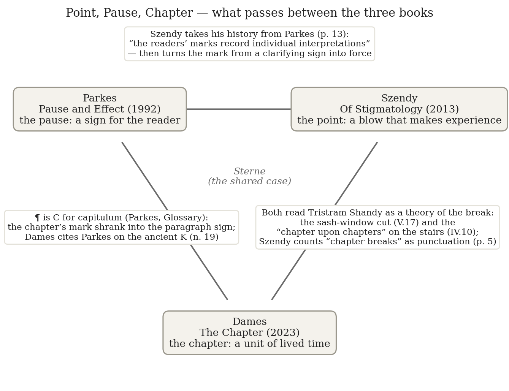
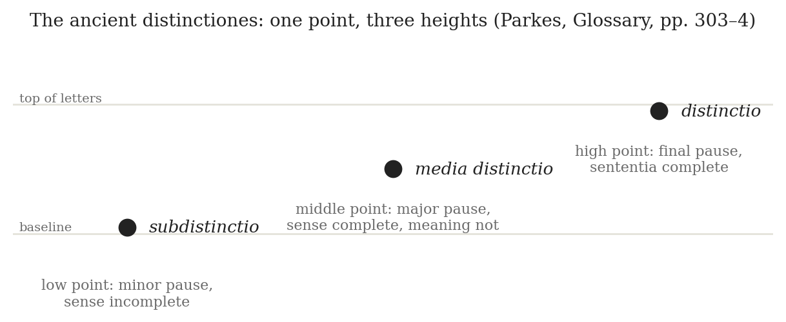
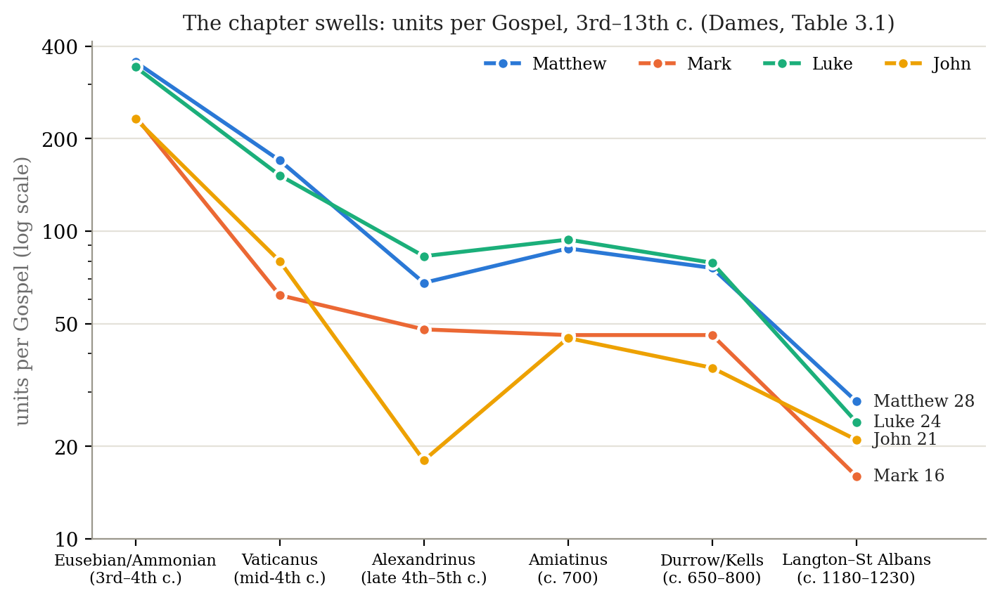

*Triad 5 of 32 · 2026-09-28 · Difficulty 2 · Same subject, Genealogy/influence, Shared figure or motif, Conflict*

## The three books

- [[books/13526-pause-and-effect-an-introduction-to-the-history-of|Pause and Effect: An Introduction to the History of Punctuation in the West]], [[people/m-b-parkes|M. B. Parkes]]; 1992 (UC Press ed. 1993). *The pause: the history, and the baseline claim that punctuation serves the reader. Source of the ¶ = C for capitulum link.*
- [[books/2071-of-stigmatology-punctuation-as-experience|Of Stigmatology: Punctuation as Experience]], [[people/peter-szendy|Peter Szendy]], [[people/jan-plug|Jan Plug]] (translator); 2013 (À coups de points); Eng. 2018. *The point: punctuation as the blow that makes experience and exercises power; the long reading of Tristram's cut.*
- [[books/11289-the-chapter-a-segmented-history-from-antiquity-to|The Chapter: A Segmented History From Antiquity to the Twenty-First Century]], [[people/nicholas-dames|Nicholas Dames]]; 2023. *The chapter: the largest regular cut as a technology of lived time; Sterne's staircase as the image of the break.*

---

## The Thread

Three books about how continuous language gets cut, each at a different scale. Parkes writes the history of the **pause**: punctuation as a set of signs added to help a reader who can no longer lean on a speaker (“Its primary function is to resolve structural uncertainties in a text”). Szendy takes the **point** (Greek *stigmē*, from *stizein*, to prick, tattoo, bruise) and turns it into a theory of experience: nothing is lived until it is marked, and every mark is “force; it is power; it is political decision.” Dames takes the **chapter**, the largest regular cut, and treats it as a technology of time: “Our comprehension of time is continually and inescapably punctuated and divided.” The line runs from sign, to blow, to time signature.

The connection is mostly out in the open: the same subject, a documented line of borrowing (Szendy and Dames both cite Parkes), and one shared case. That case is *Tristram Shandy*. Parkes cites Sterne for “elocutionary” dashes. Szendy reads Tristram’s sash-window accident as a cut that fails to fix the subject to its text (“the button point is unbuttoned”). Dames reads the “chapter upon chapters”, in which Walter and Toby stop on a landing, as the image of what a chapter is: “a continuing motion or gesture caught midway.” The disagreement is real. For Parkes the mark serves comprehension, and “great Exactness is required when it is for public use”; for Szendy the mark makes the subject, and the reader who punctuates holds power; Dames sits between them, treating the break as neither clarity nor violence but a shape of lived time. A fact from Parkes’s glossary joins the two ends: the pilcrow ¶ is a C for *capitulum*. The chapter’s sign shrank into the paragraph mark, while the chapter itself kept growing.

**Connection kinds:** Same subject · Genealogy/influence · Shared figure or motif (Sterne) · Conflict. **Difficulty: 2 of 5.** Easier to see than the last four sets, on purpose; the payoff is in the Sterne triangulation and the change of scale.

*Figure 1: Constellation of the three books*

## 1. Pause and Effect: An Introduction to the History of Punctuation in the West — M. B. Parkes (1992; University of California Press edition 1993)

PDF (Internet Archive scan with OCR text layer) · Calibre ID 13526 → [[books/13526-pause-and-effect-an-introduction-to-the-history-of|book page]]

**Selection logic.** The floor under the other two. Szendy calls it “no doubt … the best overall study of the history of punctuation in the West” (p. 13), and Dames cites it on the ancient K mark. It gives the triad its baseline claim, that punctuation is a service to readers, which the other two books push against. It also supplies the fact that ties the smallest mark to the largest unit: ¶ comes from C for *capitulum*.

**Overview.** Parkes follows punctuation from the *distinctiones* of late antique grammarians (points at three heights) through monastic *positurae* for liturgical reading, humanist marks, and print standardization, to the mimetic uses of novelists. His throughline: marks were added in stages as “new generations of readers in different historical situations imposed new demands on the written medium itself.” A long plate section follows: some seventy manuscript and printed pages, each read mark by mark. *Note on the text:* this copy is an OCR’d scan. The quotations below were checked against the OCR layer, and one run-together word in the excerpt has been silently separated.

**Excerpt: the demonstration.** Parkes opens by deleting all the punctuation from a passage of *Bleak House* and asking the reader to parse what is left:

> out of the question says the coroner you have heard the boy cant exactly say wont do you know we cant take that in a court of justice gentlemen its terrible depravity put the boy aside. (Introduction, p. 1)

Put the marks back and the coroner’s speech, the boy’s reported words inside it, and the scorn in “Court of Justice” come apart again. The point of the book’s method is that you only see what the marks do after they are gone.

**Quotes.**

- “Its primary function is to resolve structural uncertainties in a text, and to signal nuances of semantic significance which might otherwise not be conveyed at all, or would at best be much more difficult for a reader to figure out.” (Introduction, p. 1)

- In speech the same work is done “such as a repertoire of intonations, or gestures and facial expressions” (Introduction, p. 2): punctuation as the written stand-in for gesture.

- “the readers’ marks record individual interpretations of the texts.” (ch. 1, p. 14)

- “the basic unit in a western text has been the paragraph or capitulum.” (ch. 7, p. 65)

- “although every Reader hath a Right to point an ancient Author as he pleases, since the Art of Punctuation, if it may be so called, is of modern Invention, yet great Exactness is required when it is for public use.” (ch. 7, p. 91, quoting an eighteenth-century editor of Horace)

- “Laurence Sterne employs ‘elocutionary’ punctuation to enhance the intimacy between Yorick and the reader” (ch. 7, p. 92)

**Diagram: the three heights.** The oldest system Parkes describes has one mark, the point, and gets three meanings from its height on the line. Place stands in for shape.

**Glossary (from Parkes’s “Glossary of Technical Terms,” pp. 302–7, condensed).**

- *distinctiones*: the ancient system of points at three heights (above).

- *positurae*: medieval marks for liturgical reading (punctus flexus, elevatus, interroga-tivus, versus), which pitch the voice as well as pause it.

- *litterae notabiliores*: “More noticeable letters from a display script,” used to mark beginnings; the ancestor of the sentence capital.

*Figure 2: The distinctiones*

- *per cola et commata*: copying so that “each constituent element of a period begins on a new line”; line breaks used as punctuation.

- *capitulum*: “A division in a text containing a particular topic, or point of focus in an argument … or narrative,” first marked with .K.

- *paraph* (¶): “A symbol developed from the letter C (for capitulum q.v.) with a vertical stroke, which largely replaced the paragraphus (q.v.) to indicate the beginning of a paragraph, proposition, stanza or section” (p. 305).

- *diple* (>): a critical sign in the margin that marked quotations from scripture and became our quotation marks.

- *scriptio continua*: text copied with no word separation; the condition every other term in this glossary responds to.

## 2. Of Stigmatology: Punctuation as Experience — Peter Szendy (French 2013, À coups de points; trans. Jan Plug, Fordham 2018)

PDF · Calibre ID 2071 → [[books/2071-of-stigmatology-punctuation-as-experience|book page]]

**Selection logic.** The theorist of the set, and the one who contradicts Parkes. Szendy draws on Parkes’s history (pp. 12–13) and then drops the premise that punctuation serves understanding. For him the mark is a blow: *stizein* means to prick and to bruise, and the book opens with the punches in *Raging Bull*. His long reading of *Tristram Shandy* (pp. 17–29) is the center of the triad, and his claim that punctuation “ends up including blank spaces as well as chapter breaks” (p. 5) passes the question on to Dames. Lacan and Derrida are in it (the analyst “punctuates”; the *point de capiton*), which puts the book squarely in Johnny’s territory.

**Overview.** Fourteen short chapters, each on one punctuating effect: the history from rubric to emoticon, Tristram’s cut, Lacan against Derrida on whether a point can be divided, musical phrasing, medical auscultation, quotation marks, Hegel’s *punctum saliens*, ekphrasis, politics (the 1905 typesetters’ strike over pay for punctuation marks), and a closing “survey” that turns opinion polling into punctuation. The claim: experience is doubled by the mark that registers it, and that doubling is where power works.

**Excerpt: the dash as cut and call.** On Susannah’s cry after the sash window falls (“Nothing is left,—cried Susannah,— nothing is left—”):

> Here more than ever, punctuation by dashes, points of a sort, stretched out into an inchoative line, is at once an interruption of the flow of writing or reading and a call to follow. … By stretching the sentence like an elastic strained to the point of breaking, each dash is on the point of cutting it as it retraces with its mark the very continuity of the statement. (pp. 20–21)

**Quotes.**

- “For punctuation is never merely a matter of style or rhetoric in the common sense: It is force; it is power; it is political decision.” (p. 2)

- “The sensations, the events, that strike or dot me must be marked, punctuated, for me to have lived them.” (p. 2)

- “Punctuation as the doubling blow, as the singular flash or clap that, remarking what happens, allows us to have and to inscribe an experience of it.” (p. 4)

- “Far from being able to anchor anything or anyone somewhere, the button point is unbuttoned.” (p. 22)

- “A subject that one can thus think, in the image of Perekladin, as at once punctuated and punctuating” (p. 31)

- “opinion itself is not a matter of opinion, far from it: It is a construction that is a matter of a technology of pointing and punctuation.” (p. 101)

**List: the field of stigmatology, as Szendy lays it out (pp. 1–6, with where each returns).**

1. Punctuation proper: marks alone or combined, even with no words (Hugo’s “?” telegram answered by “!”) (p. 5).

2. The punctuation of the page or work: blanks, chapter breaks, illumination, cummings inside the word (p. 5). →Dames.

3. Gardens: Capability Brown talked of landscape in “periods and commas” (p. 5).

4. Medicine: Laënnec’s auscultation as dotted percussion (p. 5; “The Dotted Lines of Auscultation”).

5. Film editing: Walter Murch, “We blink to separate and punctuate” (p. 5).

6. Pictography: emoticons, and Sterne’s pointing hands and black page (pp. 6, 23–29).

7. The ring: *Raging Bull*, *Fight Club*, the blow as the model for any mark (pp. 1–4).

8. The couch: the analyst who punctuates, and the end of the session as scansion (pp. 30– 31).

9. Politics and polling: Trotsky’s typesetters; Gallup (pp. 94, 99–101).

**Annotated contents (selected).**

- *Stigmatology* (1): the blow and the flash; the word’s etymology.

- *From the Rubrica to the Smiley* (10): the history, borrowed from Parkes, with Asterius signing his copy of Virgil “legi et distincxi.”

- *The Point of (No) Monument, or Tristram’s Cut* (17): autobiography looks for a cut that will fix the subject, and doesn’t find one.

- *(Un)pointings* (23): dashes, asterisks, the black page, the pointing hand.

- *P.S.: On Restitching (Lacan vs. Derrida)* (30): whether a point is indivisible; the *point de capiton*.

- *Punctuation and Politics, or The Dot above the i* (94); *Final Survey* (99): the book ends as a questionnaire.

## 3. The Chapter: A Segmented History from Antiquity to the Twenty-First Century — Nicholas Dames (2023)

EPUB (print page numbers from the EPUB’s page-list) · Calibre ID 11289 → [[books/11289-the-chapter-a-segmented-history-from-antiquity-to|book page]]

**Selection logic.** The largest scale and the latest book. Dames makes the chapter a device for experiencing time, which answers Szendy’s claim that experience needs its mark, but without the violence: his breaks are “traversable.” His reading of Sterne’s staircase gives the triad its image, and his early history of *kephalaia* and *capitula* sits on the same ground as Parkes’s paraph. For Johnny it also has gesture at the center: “The break occurs midgesture.”

**Overview.** Part I defines the object. Part II covers two millennia of “capitulation” (classical headings; the Gospel divisions of Eusebius, Codex Alexandrinus and the Paris Bible; Caxton’s Malory). Part III covers the novel (Sterne, Equiano, Goethe, Tolstoy, Gaskell, Dickens, Eliot, Machado, B. S. Johnson) and a “Post Chapter” on the form after 1970. Each chapter is named for a mode of division (the Threshold, the Cut, the Postural, the Circadian …). The thesis: chapters are “a temporal experience … organized into flexible yet regular units, punctuated by breaks” (p. 16).

**Excerpt: the chapter upon chapters.** Dames quotes Sterne (*Tristram Shandy* IV.10), with Walter and Toby stopped on the first landing:

> Is it not a shame to make two chapters of what passed in going down one pair of stairs? … drop the curtain, Shandy —I drop it—Strike a line here across the paper, Tristram —I strike it—and hey for a new chapter! (p. 162)

His gloss: “The chapter is a pause on a step or landing, a continuing motion or gesture caught midway, the awkwardness of stopping somewhere one is meant to keep traversing.” (p. 163)

**Quotes.**

- “This is a book about ruptures. But traversable ones: gaps one crosses, fissures within continuities, the marks within an individual life.” (Ante Chapter, p. 3)

- “Where that unit is not already marked or summarized, it can be summoned into being by the reader’s own gestures.” (ch. 2, p. 63, on Augustine marking his *capitulum* with a finger in *Confessions* VIII)

- “the kephalaia are not unities but instead incitations” (ch. 3, p. 92)

- “For Locke, chapters are the artifacts of communal approaches: citation, proscribed ritual segmentation, numbing serial interruptions.” (ch. 5, p. 149)

- “The break occurs midgesture” (ch. 5, p. 161)

- “Our comprehension of time is continually and inescapably punctuated and divided, not only in retrospect but in the very moments of its formation.” (Post Chapter, p. 290)

**Diagram: the chapter swells.** Dames’s Table 3.1 (p. 100) counts the units into which successive systems cut each Gospel. Charted, it shows the long drift he describes, from hundreds of small citational pieces to about twenty modern chapters.

**List: Dames’s modes of the chapter (from the chapter subtitles).**

1. *the Threshold*: the classical heading (Tabula Bembina, Augustine, Arrian’s Epictetus).

2. *the Abstract Syncopation*: dividing the Gospels (Eusebius, Alexandrinus, the Paris Bible).

3. *the Cut* and *the Fade*: fifteenth-century remediators (Burgundian Chrétien, Caxton’s Malory).

4. *the Postural* and *the Elongated*: the early novel (Locke, Sterne, Equiano, Goethe).

5. *the Tacit*: the repertoire around 1865 (Tolstoy, Gaskell).

6. *the Circadian*: the chapter as a day (Dickens, Eliot, McGregor).

7. *the Antique-Diminutive*: sequence as poignancy (Machado, B. S. Johnson, Varda).

8. After 1970: Uwe Johnson, Egan, Krasznahorkai.

*Figure 3: Dames Table 3.1*

## Where this sends you

## Notebook

1. **Punctuate twice, sign both.** Do Parkes’s *Bleak House* experiment on yourself (p. 1): take a paragraph of your own and strip its punctuation. Re-point it once to “resolve structural uncertainties” (Parkes, p. 1) and once as “political decision” (Szendy, p. 2), and sign each the way Asterius signed his Virgil, *legi et distincxi* (Szendy, p. 13). Parkes says the marks “record individual interpretations” (p. 14). Which version is still your text?

2. **The landing.** Write a gesture that becomes visible only because it is interrupted: a sequence of short chapters, each under five hundred words like Sterne’s chapter upon chapters, each ending midgesture (Dames, pp. 161–63). Then test Szendy’s claim against it: does the break register the gesture (“the doubling blow,” p. 4), or does it make it?

3. **The fossil in the pilcrow.** ¶ is C for *capitulum* (Parkes, p. 305), yet the chapter kept growing while its mark shrank (Dames, Table 3.1). Write on a sign that has forgotten what it stood for, or on Augustine’s finger marking a *capitulum* where the page marked nothing (Dames, p. 63). A unit a reader calls up with a gesture is closer to your gesturalism than any of these books says outright.

## Rabbit holes

- Theodor W. Adorno, “Punctuation Marks,” trans. Shierry Weber Nicholsen, *The Antioch Review* 48.3 (1990), JSTOR: https://www.jstor.org/stable/4612221. Szendy’s model for describing each mark’s character (“index finger raised in warning”).

- Isidore of Seville, *Etymologiae* I (including *De posituris*, I.20), Latin text on LacusCurtius: https://penelope.uchicago.edu/Thayer/L/Roman/Texts/Isidore/1*.html. The source for Parkes’s *distinctiones* and his reader who reads silently.

- Laurence Sterne, *Tristram Shandy*, Project Gutenberg: https://www.gutenberg.org/ebooks/1079. Read IV.10 (the stairs) and V.17 (the sash window) side by side.

- “Alas, Poor YORICK!”: The Death and Life of Laurence Sterne, *The Public Domain Review*: https://publicdomainreview.org/essay/alas-poor-yorick-the-death-and-life-of-laurence-sterne.

- Keith Houston, “The Pilcrow, part 1 of 3,” *Shady Characters*: https://shadycharacters.co.uk/2011/02/the-pilcrow-part-1/. The capitulum-to-¶ story told at length.

- Nicholas Dames interviewed on *The Chapter*, New Books Network: https://newbooksnetwork.com/the-chapter.

## Also in your library

- Theodor W. Adorno, *Notes to Literature* (Calibre ID 102): contains “Punctuation Marks.”

- Viktor Shklovsky, *Theory of Prose* (Calibre ID 2294): the Formalist reading of *Tristram Shandy* that Dames draws on for Sterne’s “posture.”

- Vilém Flusser, *Writings* (Calibre ID 763): includes “On the End of History,” which Dames cites for history as a “chapter” of natural history (p. 5).

## To carry

> “The chapter is a pause on a step or landing, a continuing motion or gesture caught midway, the awkwardness of stopping somewhere one is meant to keep traversing.” — Nicholas Dames, *The Chapter*, ch. 5, p. 163

## Themes

[[themes/capitulum|capitulum]] · [[themes/chapter|chapter]] · [[themes/gesture|gesture]] · [[themes/lacan-point-de-capiton|Lacan point de capiton]] · [[themes/pause|pause]] · [[themes/pilcrow|pilcrow]] · [[themes/point|point]] · [[themes/punctuation|punctuation]] · [[themes/reading|reading]] · [[themes/scriptio-continua|scriptio continua]] · [[themes/segmentation|segmentation]] · [[themes/sterne|Sterne]] · [[themes/stigma|stigma]] · [[themes/time|time]] · [[themes/tristram-shandy|Tristram Shandy]]

---

Previous: [[triads/2026-09-27-the-averaged-self|The Averaged Self]]  
Next: [[triads/2026-09-29-the-flea-under-glass|The Flea Under Glass]]
