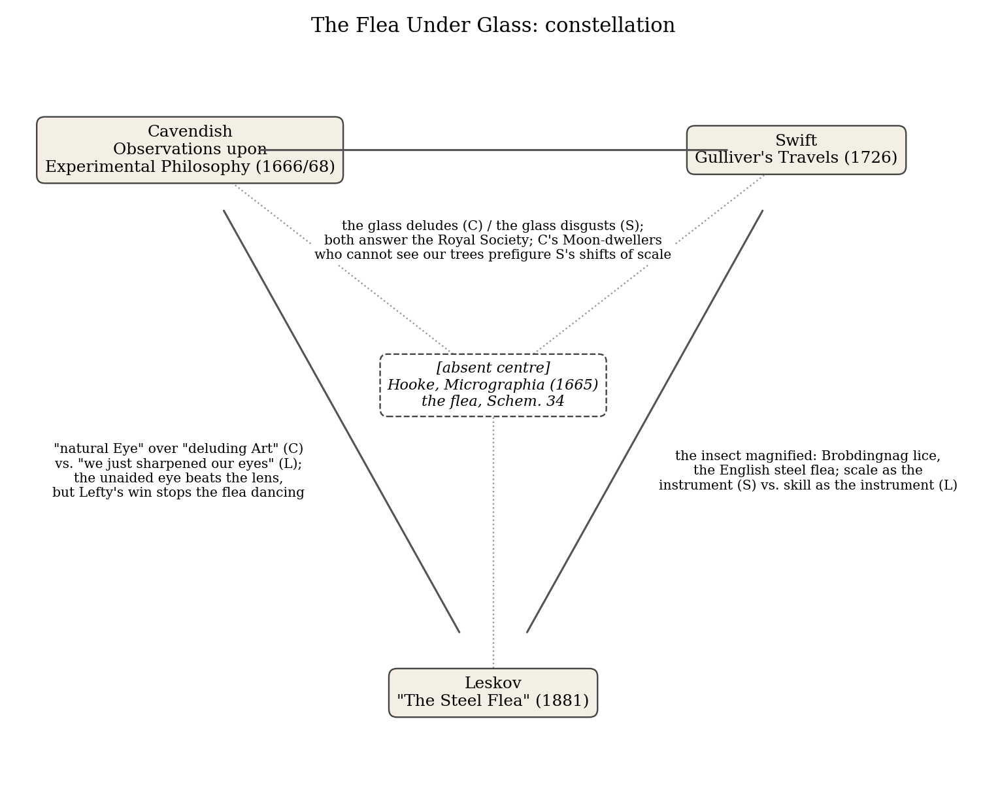
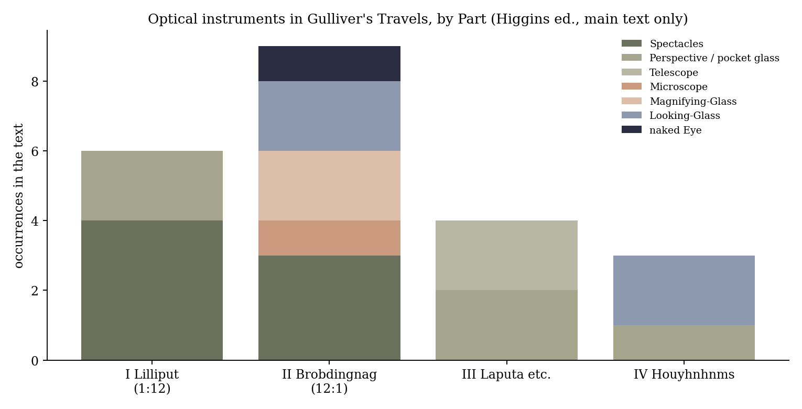
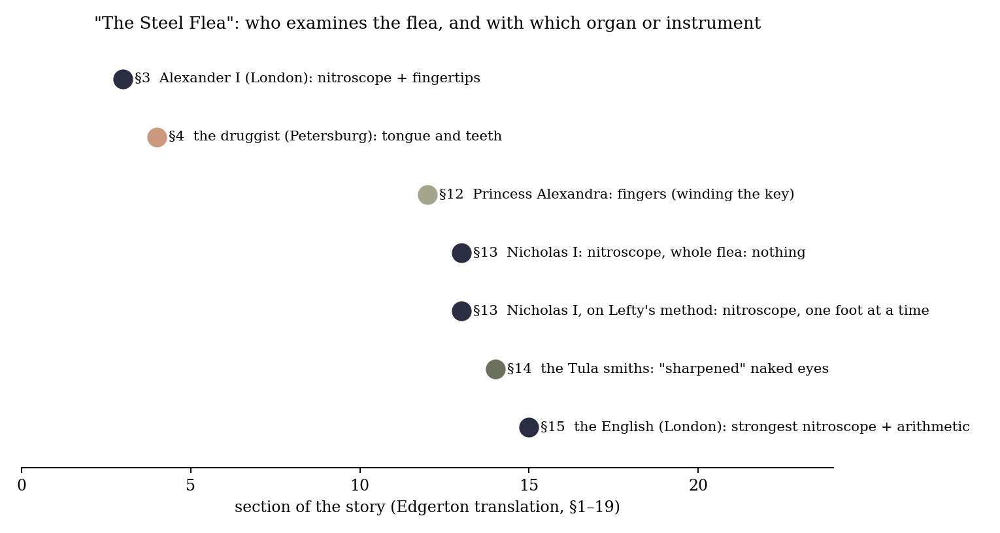

*Triad 6 of 32 · 2026-09-29 · Difficulty 4 · Shared figure or motif, Conflict, Genealogy/influence, Oblique/structural*

## The three books

- [[books/349-observations-upon-experimental-philosophy-extract|Observations upon Experimental Philosophy (extract: 'sky' sections)]], [[people/margaret-cavendish|Margaret Cavendish]]; 1666 (2nd ed. 1668); file is a 15-page bilingual éditions Clinamen extract. *The philosopher's refusal: the glass deludes; natural eye plus regular reason.*
- [[books/7513-gulliver-s-travels|Gulliver's Travels]], [[people/jonathan-swift|Jonathan Swift]], [[people/ian-higgins|Ian Higgins]] (contributor); 1726. *The satirist's answer: abolish the lens by resizing the observer; Gulliver becomes the instrument.*
- [[books/2800-lady-macbeth-of-mtsensk-selected-stories-of-nikola|Lady Macbeth of Mtsensk: Selected Stories of Nikolai Leskov ('The Steel Flea')]], [[people/nikolai-leskov|Nikolai Leskov]], [[people/william-edgerton|William Edgerton]] (translator); 1881 ('The Steel Flea'); Edgerton trans. 1969; NYRB selection. *The craftsman's answer: skill surpasses the instrument, invisibly and unsigned, and the improvement stops the flea dancing.*

---

## The Thread

In 1665 Robert Hooke’s *Micrographia* printed a flea engraved on a fold-out plate. Three books in your library answer that plate, and each refuses the lens in a different way. **Cavendish** (*Observations upon Experimental Philosophy*, 1666) argues that the glass deceives and that “a natural Eye” plus “regular Reason” will do: “no Microscope is able to give us a true information” of how a body works inwardly. **Swift** (1726) gets rid of the instrument by changing the observer’s size. In Brobdingnag Gulliver sees lice “with my naked Eye, much better than those of an European Louse through a Microscope”, and what he gets is nausea rather than knowledge; among the giants he becomes the lens himself, his “Opticks” sharper than theirs. **Leskov** (1881) sets the instrument against the hand. The English steel flea can only be seen in a “nitroscope”; the Tula smiths shoe it without one (“we just sharpened our eyes”), and Lefty’s nails are “too small for any nitroscope”, so the finest work in the story is both invisible and unsigned. It is also the work that stops the flea dancing.

Connection kinds: **Shared figure or motif** (the magnified insect); **Conflict** (three verdicts on the instrument: it deceives, it disgusts, it is surpassed); **Genealogy/influence** (Hooke is the absent centre: Cavendish’s *Observations* was written against the Royal Society’s experimental programme and largely against *Micrographia*, and Swift’s editor reads the Brobdingnag insects as satire on Hooke); **Oblique/structural** (in each book the unaided eye wins its argument and pays for it: Cavendish concedes the stars’ “natural figures” to nobody, Gulliver can no longer stand human skin, and Lefty’s flea no longer dances). **Difficulty: 4.* Micrographia* itself is not in Scribrarium, which is why it sits in the middle of the diagram as a gap.

## 1. Observations upon Experimental Philosophy (extract) — Margaret Cavendish (1666; 2nd ed. 1668)

PDF · Calibre ID 349 · tags include *gesturalist research*, *experimental literature* → [[books/349-observations-upon-experimental-philosophy-extract|book page]]

**A note on the file.** This is not the full treatise. The PDF is a 15-page bilingual extract from éditions Clinamen, “Observations upon Experimental Philosophy (sky)”, with four short sections in English and French: on human flight, on whether the celestial parts are alterable, on the substance of the Sun, and “Of Telescopes”. The Calibre record describes the 2001 Cambridge edition. Page numbers below are the PDF’s own (they match the printed footers).

**Selection logic.** The philosopher’s refusal, and the most argued of the three. “Of Telescopes” states the case the other two books dramatize: sight works only within “a certain proportion of distance betwixt the Eye and the Object”, and past that proportion a glass gives pictures, not natures. The flight section supplies the frame all three share: “Art cannot give new motions to natural parts, which are not proper or natural for them”.

**Overview.** Cavendish published *Observations* in 1666, bound with her prose fiction *The Blazing World*, the year after *Micrographia*. Against mechanism and the experimental method

*Figure 1: Constellation*

she holds that “Nature is self-moving” and perceptive throughout, and that reason, not instruments, is the judge of what the senses report. The extract shows the method at small scale: each question is answered by analogy, proportion and the limits of perception, and she ends her remarks on telescopes by declining to affirm what she does “not certainly know”.

**Excerpt** (“Of Telescopes”, p. 8). The opening of her case against the glass:

> Many Ingenious and Industrious Artists take much labour and pains in studying the natures and figures of Celestial objects, and endeavour to discover the causes of their appearances by Telescopes, and such like Optick Instruments; […]
>
> *(Shortened for the public edition.)*

(“scarch” is the text’s spelling.)

**Quotes**

- “how these actions are performed inwardly, no Microscope is able to give us a true information thereof.” (Of the Celestial Parts, p. 6)

- “put the case, the Moon, or any other of the Planets, were inhabited by animal Creatures, which could see as much of this terrestrial Globe, as we see of the Moon” (Of the Celestial Parts, p. 5)

- “Man is apt to run into extreams, and spoils Nature with doting too much upon Art.” (Of flying, p. 4)

- “whether it be onely a delusion of the glasses, I will not dispute” (Of Telescopes, p. 8)

- “I chose rather to follow the guidance of regular Reason, then of deluding Art.” (Of Telescopes, p. 8)

**Derived list: what the eye can and cannot do, according to “Of Telescopes” (p. 8)**

1. *Can*: see a steeple 20 or 30 miles off, “if it be not defective, nor the medium obstructed”, better from a high place. The telescope adds nothing here.

2. *Can*: follow “exterior progressive motions” (the Sun rising and setting, the progress of the Moon and planets) “as well as through Artificial Tubes”.

3. *Cannot*, with or without a glass: see Paris from the Alps; “he would hardly see the City of Paris from thence, although he looked through a Telescope never so perfect”.

4. *Cannot*, and no glass can: see the planets’ “natural figures, what they are, nor what makes them move”.

5. *Rule*: sight “requires a certain proportion of distance betwixt the Eye and the Object; which being exceeded, it cannot perform its office”.

6. *Warning*: “Multiplying-glasses do present numerous pictures of one object”.

7. *Concession*: “I having no skill, neither in the art of Opticks, nor in Astronomy, may chance to err”.

Items 5 and 6 are the hinge to Swift, whose Part II is a plot built on item 5.

## 2. Gulliver’s Travels — Jonathan Swift (1726)

EPUB · Calibre ID 7513 · edition with explanatory notes by Ian Higgins **Selection logic.** The satirist’s answer: abolish the lens by resizing the observer. Brobding- → [[books/7513-gulliver-s-travels|book page]]

nag turns *Micrographia* into lived experience (skin with “great Holes”, lice with snouts), and Laputa keeps the instruments and loses the world. The edition’s notes make the Hooke link explicit, so the absent centre of the triad is named inside one of its books.

**Overview.** Four voyages narrated by a ship’s surgeon: Lilliput (people one-twelfth his size), Brobdingnag (twelve times), Laputa and its neighbours (a flying island of astronomers and projectors, the Academy of Lagado), and the land of the Houyhnhnms. The first two voyages are an experiment in proportion; the third attacks the new science directly; the fourth turns the magnifying glass on the human species.

**Excerpt** (Part II, ch. 1; editorial note marker omitted). Gulliver, on a table, at the height of his nurse’s breast:

> This made me reflect upon the fair Skins of our English Ladies, who appear so beautiful to us, only because they are of our own Size, and their Defects not to be seen but through a magnifying Glass, where we find by Experiment that the smoothest and whitest Skins look rough and coarse, and ill coloured. […]
>
> *(Shortened for the public edition.)*

**Quotes**

- “I could see distinctly the Limbs of these Vermin with my naked Eye, much better than those of an European Louse through a Microscope; and their Snouts with which they rooted like Swine.” (Part II, ch. 4)

- “I should have been curious enough to dissect one of them, if I had proper Instruments (which I unluckily left behind me in the Ship)” (Part II, ch. 4)

- “whose large Opticks were not so acute as mine in viewing smaller Objects” (Part II, ch. 3, on the flies at the Queen’s table)

- “the Stumps whereof they plainly discovered through a Magnifying-Glass” (Part II, ch. 3: the royal scholars examining Gulliver’s beard)

- “although their largest Telescopes do not exceed three Feet, they magnify much more than those of a Hundred with us, and shew the Stars with greater Clearness.” (Part III, ch. 3)

- Editor’s note to Part II, ch. 3: the “unpleasant picture of enormously magnified insects was possibly intended as a satire on such members of the Royal Society as Robert Hooke, whose Micrographia (1665) contained some striking micrographical illustrations of fleas and flies” (Explanatory Notes)

**Diagram: optical instruments by Part.** Counted across the main text of each voyage (notes excluded). Spectacles and a pocket perspective go to Lilliput; the microscope, the magnifying glass and the only “naked Eye” all fall in Brobdingnag; the telescopes are in Laputa.

**A misreading worth attempting.** Read Part II as an optics treatise in which Gulliver is the instrument, not the observer. He is the microscope the giants lack (his “Opticks” see what theirs cannot); he is the specimen the royal scholars put under their magnifying glass; and in the looking-glass scene he is an image at the wrong scale: “So that I really began to imagine my self dwindled many Degrees below my usual Size.” (Part II, ch. 3). On this reading the book is Cavendish’s rule about “a certain proportion of distance betwixt the Eye and the Object” made into a plot, and its moral is hers: the image changes, the nature does not, and disgust is what a mismatch of proportion feels like from inside.

*Figure 2: Instruments in Gulliver*

## 3. “The Steel Flea” — Nikolai Leskov (1881), in Lady Macbeth of Mtsensk: Selected Stories

EPUB · Calibre ID 2800 · NYRB Classics; “The Steel Flea” trans. William Edgerton (1969); section numbers are the translation’s (§1–19) → [[books/2800-lady-macbeth-of-mtsensk-selected-stories-of-nikola|book page]]

**Selection logic.** The craftsman’s answer. The instrument is real in this story, but it belongs to the English, and it is renamed in folk speech as a “nitroscope”. The Tula smiths outdo the flea without it, and the story then shows what that victory costs. The NYRB description of the volume notes that Leskov prompted Benjamin’s “The Storyteller”, which puts the hand, craft and the decline of skill under machines in the background of the triad.

**Overview.** Alexander I, touring England after Napoleon, is given a clockwork flea of English steel that dances when wound. Years later Nicholas I sends it to Tula to see whether Russians can do better. Three smiths lock themselves away and return the flea looking unchanged; under the nitroscope, one foot at a time, it turns out to be shod, every shoe signed but one. Lefty is sent to London, refuses to stay, learns that the English do not clean their rifle barrels with brick dust, and after his return dies on the floor of a Petersburg hospital corridor, the message undelivered. The narration is skaz, a teller’s voice full of malapropisms, which Edgerton renders with coinages of his own.

**Excerpt** (§13). The Emperor has looked at the whole flea under the glass and seen nothing:

> Lefty answered, “You can’t see nothing that way, Your Majesty, because our work is a lot too secret for that size.” The Emperor asked, “Then how do we manage it?” “You have to put just one of its feet in detail under the whole nitroscope, and look one at a time at each foot it walks on.” “Goodness gracious,” […]
>
> *(Shortened for the public edition.)*

**Quotes**

- “coming down to the hidebound flea, which you can’t see with your eyes but can only feel when he bites you between your hide and your body.” (§3)

- “he took the flea and put it on his tongue and said,”I feel something cold, like strong metal.”” (§4, the court druggist)

- “Because I did smaller work than these flea-shoes,” he said. “I made the nails the shoes were fastened on with, and they are too small for any nitroscope to blow them up.” (§14)

- “We are poor people—too poor to own a nitroscope, so we just sharpened our eyes.” (§14)

- “you didn’t realize that such a little machine as the one in the nymphusoria was calculated for the most accurate exactness, and it can’t carry the flea-shoes.” (§15, the English workmen)

- “machines have evened up the inequalities in gifts and talents, and genius no longer strains itself in a struggle against diligence and exactness.” (§19)

**Diagram: who examines the flea, and with what.** The flea passes from lens to tongue to fingers to naked eye and back to the lens; the only examination that sees the nails is the one that never happens (a nitroscope “that would blow it up five million times”, §14).

*Figure 3: Leskov senses*

**Derived list: the nesting of the flea.** The object is always inside something: a tray “that had nothing on it” (§3) →a case “made … out of a diamond in the shape of a nut” (§3), sold separately →the Emperor’s gold snuffbox →“his little traveling casket, which was all covered with the mother-of-pearl and fish bones” (§3) →in Tula, “the Tsar’s jewel casket wrapped in a green cloth cover” (§9). Five layers of container around a thing too small to see, and a sixth layer, the nitroscope, needed to see it at all.

**Glossary of the teller’s words** (Edgerton’s coinages as found in the text; the glosses are readings, not the translator’s):

Word in the text Probably

nymphusoria infusoria (microscopic animalcules), with a nymph in it nitroscope microscope Apollo Velvet Ear the Apollo Belvedere hobble lists obelisks nautical whether-meters barometers dansez / fairiations / cod drill dance / variations / quadrille Word in the text

> Probably

calumnist on the *Daily Telegraft* columnist on the *Daily Telegraph* impressed air / symphonied compressed (soda) air / siphoned thirst mate first mate grasp port passport depravement pavement apple plexy apoplexy

The two words for the instrument and its object (“nitroscope”, “nymphusoria”) are the story’s whole argument in miniature: the teller cannot say the scientific word correctly, and the smith does not need the thing it names.

## Where this sends you

## Notebook

1. **Proportion of distance.** Cavendish: sight “requires a certain proportion of distance betwixt the Eye and the Object” (p. 8). Swift’s Lilliputian friend finds Gulliver’s face fair from the ground and “a very shocking Sight” in the hand (II.1). Describe one face, or one page of your own handwriting, at three distances, and at each say what reason adds that sight cannot. At which distance does it stop being the same object?

2. **The unsigned nails.** Every flea-shoe carries a smith’s name except Lefty’s, because his work is “too small for any nitroscope” (§14). Write about work below the threshold of attribution: the commonplace entry, the edit, the gesture no one sees made. Set it against Leskov’s last paragraph (“machines have evened up the inequalities in gifts and talents”, §19) and Benjamin’s “The Storyteller” (below).

3. **The shod flea won’t dance.** The English diagnosis: the machine “was calculated for the most accurate exactness, and it can’t carry the flea-shoes” (§15). Cavendish: “Man … spoils Nature with doting too much upon Art” (p. 4). Take a finished text of yours, improve it until it stops moving, then write the workmen’s note on what the improvement cost.

## Rabbit holes

- Robert Hooke, *Micrographia* (1665), full text, Project Gutenberg: https://www.gutenberg.org/ebooks/15491 (the absent centre).

- “Microscopic view of a flea”, Hooke’s Schem. 34, Science History Institute Digital Collections (high-resolution scans): https://digital.sciencehistory.org/works/bk128c17q

- Ian Lawson, “Different concepts of the microscope in the 1660s”, Early Modern Experimental Philosophy blog (Otago), on Cavendish’s objections to Hooke (the louse, the needle, the knife): https://blogs.otago.ac.nz/emxphi/?p=2810

- Peter West, “Otherworldly Science: Margaret Cavendish’s Critique of the Experimental Method”, *The Philosopher* 109.1 (2023): https://thephilosopher1923.org/post/otherworldly-science

- Margaret Cavendish, *The Blazing World* (1666), published with *Observations*, Project Gutenberg: https://www.gutenberg.org/ebooks/51783

- Walter Benjamin, “The Storyteller: Reflections on the Works of Nikolai Leskov” (1936), PDF (Cornell); “The Steel Flea” appears in §IX: https://arl.human.cornell.edu/linked%20docs/Walter%20Benjamin%20Storyteller.pdf

## Also in your library

- *Sublunar* — Harald Voetmann (Calibre ID 3482). A novel of Tycho Brahe’s observatory on Hven: the last great astronomy done without a telescope, at the quadrants of Stjerneborg, by eye.

- *The Storyteller Essays* — Walter Benjamin (Calibre ID 170). Benjamin’s short prose on stories and storytelling; the introduction ties “Experience and Poverty” to the Leskov essay, which this volume cites but does not reprint.

## To carry

> “We are poor people—too poor to own a nitroscope, so we just sharpened our eyes.” — Nikolai Leskov, “The Steel Flea”, §14 (trans. William Edgerton)

## Themes

[[themes/benjamin-s-storyteller|Benjamin's Storyteller]] · [[themes/craft|craft]] · [[themes/experimental-philosophy|experimental philosophy]] · [[themes/flea|flea]] · [[themes/hooke|Hooke]] · [[themes/louse|louse]] · [[themes/magnification|magnification]] · [[themes/malapropism|malapropism]] · [[themes/micrographia|Micrographia]] · [[themes/microscope|microscope]] · [[themes/naked-eye|naked eye]] · [[themes/proportion-of-distance|proportion of distance]] · [[themes/royal-society|Royal Society]] · [[themes/scale|scale]] · [[themes/skaz|skaz]] · [[themes/telescope|telescope]] · [[themes/the-hand|the hand]]

---

Previous: [[triads/2026-09-28-point-pause-chapter|Point, Pause, Chapter]]  
Next: [[triads/2026-09-30-only-the-incipit|Only the Incipit]]
