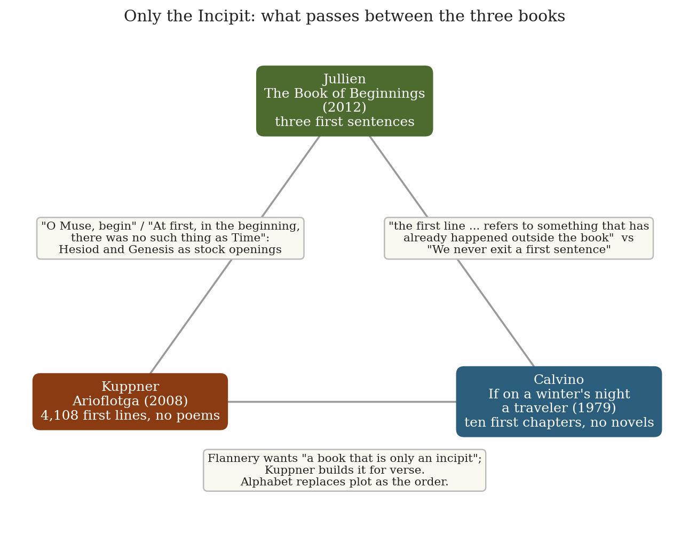
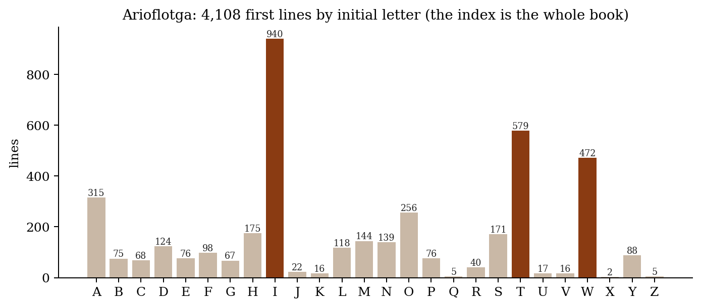
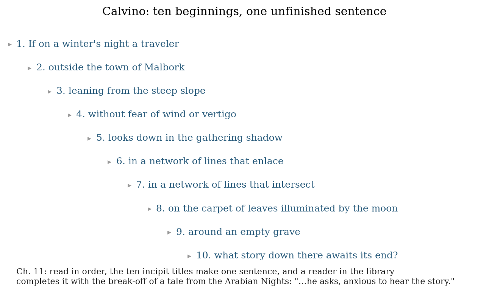
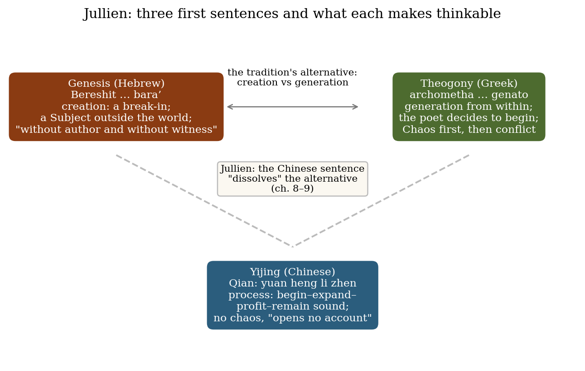

*Triad 7 of 32 · 2026-09-30 · Difficulty 3 · Shared form or method, Conflict, Oblique/structural*

## The three books

- [[books/2912-arioflotga|Arioflotga]], [[people/frank-kuppner|Frank Kuppner]]; 2008. *The incipit as the whole book: 4,108 first lines of a lost anthology, alphabetized, no poems behind them.*
- [[books/7787-if-on-a-winter-s-night-a-traveler|If on a Winter's Night a Traveler]], [[people/italo-calvino|Italo Calvino]], [[people/william-weaver|William Weaver]] (translator); 1979 (Eng. 1981). *The theory of the incipit as narrative promise; ten broken-off first chapters; Flannery's wish for a book that is only a beginning.*
- [[books/6355-the-book-of-beginnings|The Book of Beginnings]], [[people/francois-jullien|François Jullien]], [[people/jody-gladding|Jody Gladding]] (translator); 2012 (Entrer dans une pensée); Eng. 2015. *The first sentence as fate: Genesis (creation), Hesiod (generation), Yijing (process); a beginning that 'opens no account'.*

---

## The Thread

Johnny, today’s three books are made of beginnings and nothing else. In chapter 8 of *If on a winter’s night a traveler*, Calvino’s novelist Silas Flannery writes: “I would like to be able to write a book that is only an incipit, that maintains for its whole duration the potentiality of the beginning, the expectation still not focused on an object.” Calvino’s own book half-grants the wish: ten first chapters, each broken off. Frank Kuppner’s *Arioflotga* goes all the way for verse. It consists of 4,108 first lines of a lost “Great Anthology”, printed in alphabetical order with no poems behind them. François Jullien’s *The Book of Beginnings* does the same for philosophy: a whole book on three first sentences (Genesis, Hesiod’s *Theogony*, the *Yijing*), built on the claim “We never exit a first sentence.”

The three disagree about what a beginning owes the rest. For Calvino the charge of an incipit is narrative: “the promise of a time of reading that extends before us and can comprise all possible developments.” Jullien’s Chinese opening is the counter-case. It “opens no account”, because “No negative means no ‘story.’ ” Kuppner sits between them. His lines promise poems that never existed, and alphabetical order replaces plot as the only sequence (yet a country, Oblivia, keeps turning up in it). Two of his lines are pastiches of the two Western openings Jullien sets against the Chinese one: “Let me, I beg you, O Muse, begin this epic about poetry,” and “At first, in the beginning, there was no such thing as Time.” **Connection:** shared form or method; conflict; oblique/structural. **Difficulty:** 3.

## 1. Arioflotga — Frank Kuppner (2008)

*EPUB · Calibre ID 2912 · Carcanet* → [[books/2912-arioflotga|book page]]

**Selection logic.** This is the purest form in the library of the book Flannery wants: the index of first lines has become the whole book. It supplies the triad’s material case, beginnings with nothing behind them, and a comic counterweight to the other two books’ seriousness about origins.

**Overview.** The title page reads “Being a revised index of first lines of The Great Anthology”. The title is that phrase’s initials: A Revised Index Of First Lines Of The Great Anthology. A bracketed note from a harried compiler to an assistant comes first, then 4,108 lines in strict alphabetical order, running from “A,b,c,d and so on. Where’s the problem?” to “Zzzzz. No, no. Don’t wake me up. In fact,” and then “[END]”. The lines are sacrilegious, bawdy, melancholy, pedantic and often very funny. An invented country, Oblivia (91 lines mention it), gives the lost anthology a phantom national literature.

**Excerpt: the compiler’s note (front matter).** This is the only prose in the book, and it sets up the fiction of a manuscript in transmission.

> [Please note that this is the revised list. Most of the doubtful ones have now been safely removed. Some better translations have been added. Dig out the original page and volume numbers, will you, and have them re-ordered accordingly. … A

*Figure 1: What passes between the three books.*

> life’s work, for what it’s worth. I should be off home soon. Many thanks. More later, if absolutely necessary. Very few remain to be added. Get rid of this. …]

**Diagram: the alphabet as plot.** Every first line in the index, counted by initial letter. I, T and W together take up almost half the book. 619 lines begin with the word “I” and 252 with “The”; Q, X and Z get twelve lines between them.

*Figure 2: Arioflotga: first lines by initial letter.*

**Derived list: the index talking about itself.** These are the lines where a first line comments on openings, which a lost poem could hardly have done:

- “Ah! Here it is at last! You know, I was almost beginning” (under A)

- “I can’t get these bloody openings out of my mind.” (under I)

- “In the end of everything is the beginning of everything, Ben.” (under I)

- “Let me, I beg you, O Muse, begin this epic about poetry,” (under L)

- “No actual poem anywhere would begin like this” (under N)

- “Sing, Muse, of the quite startling amount of underpants” (under S)

- “You know, darling, with an opening like that,” (under Y)

**Quotes.**

- “I have only had glimpses of the life I would like to have had.” (epigraph)

- “At first, in the beginning, there was no such thing as Time.” (under A)

- “All poets fail. That is, perhaps, what poetry is.” (under A)

- “Oblivia! Home of so many ancient civilisations!” (under O)

## 2. If on a winter’s night a traveler — Italo Calvino (1979; trans. William Weaver, 1981)

*EPUB · Calibre ID 7787* → [[books/7787-if-on-a-winter-s-night-a-traveler|book page]]

**Selection logic.** This book states the theory Kuppner carries out and Jullien contests. Flannery’s diary (ch. 8) puts the fascination of the incipit, the fantasy of a book “that is only an incipit”, and the copyist’s vocation all on one page. Chapter 7 gives the opposite view of first lines, which is the hinge to Jullien.

**Overview.** Twelve second-person chapters follow “you”, the Reader, and Ludmilla, the Other Reader, as they chase a novel that keeps turning into another one: misbound copies, forgeries, a translator-counterfeiter (Marana), and a stalled novelist (Flannery). Between these chapters sit ten first chapters of ten different novels, each broken off at its point of maximum suspense. It ends in a library, where the ten titles are read as one sentence, and then in bed: “Just a moment, I’ve almost finished If on a winter’s night a traveler by Italo Calvino.” (ch. 12)

**Derived list: the ten incipits (first sentence of each, abridged where marked).**

1. *If on a winter’s night a traveler*: “The novel begins in a railway station, a locomotive huffs, steam from a piston covers the opening of the chapter, a cloud of smoke hides part of the first paragraph.”

2. *Outside the town of Malbork*: “An odor of frying wafts at the opening of the page, of onion in fact, onion being fried, a bit scorched …”

3. *Leaning from the steep slope*: “I am becoming convinced that the world wants to tell me something, send me messages, signals, warnings.”

4. *Without fear of wind or vertigo*: “At five in the morning, military vehicles crossed the city; …”

5. *Looks down in the gathering shadow*: “It was all very well for me to pull up the mouth of the plastic bag: it barely reached Jojo’s neck, and his head stuck out.”

6. *In a network of lines that enlace*: “The first sensation this book should convey is what I feel when I hear the telephone ring; …”

7. *In a network of lines that intersect*: “Speculate, reflect: every thinking activity implies mirrors for me.”

8. *On the carpet of leaves illuminated by the moon*: “The ginkgo leaves fell like fine rain from the boughs and dotted the lawn with yellow.”

9. *Around an empty grave*: “When the vultures rise it’s a sign the night is about to end, my father had told me.”

10. *What story down there awaits its end?*: “Walking along the great Prospect of our city, I

> mentally erase the elements I have decided not to take into consideration.”

The first two incipits describe their own openings (“the opening of the chapter”, “the opening of the page”). Kuppner’s index does it repeatedly (see the list above).

**Diagram: ten beginnings, one sentence.**

**Quotes.**

- “The romantic fascination produced in the pure state by the first sentences of the first chapter of many novels is soon lost in the continuation of the story: it is the promise of a time of reading that extends before us and can comprise all possible developments.” (ch. 8, Flannery’s diary)

- “Would it break off after the first paragraph? Would the preliminaries be prolonged indefinitely? Would it set the beginning of one tale inside another, as in the Arabian Nights?” (ch. 8)

- “Everything has already begun before, the first line of the first page of every novel refers to something that has already happened outside the book.” (ch. 7)

- “For an instant I seem to understand the meaning and fascination of a now inconceivable vocation: that of the copyist.” (ch. 8)

- “At times a title is enough to kindle in me the desire for a book that perhaps does not exist. At times it is the incipit of the book, the first sentences…. In other words: if you need little to set the imagination going, I require even less: the promise of reading is enough.” (ch. 11, the sixth reader)

*Figure 3: The ten incipit titles as one sentence (ch. 11).*

## 3. The Book of Beginnings — François Jullien (2012, Entrer dans une pensée; trans. Jody Gladding, 2015)

*EPUB · Calibre ID 6355 (a PDF of the same translation is ID 11062)* → [[books/6355-the-book-of-beginnings|book page]]

**Selection logic.** This is the philosophical counterpart. Jullien treats the first sentence as the unit that decides a whole way of thinking, and so gives the other two books their stakes. His Chinese example, a beginning that is neither a creation nor a narrative, disputes Calvino’s equation of incipit with story. His Hebrew and Greek examples are the two stock openings Kuppner parodies.

**Overview.** Jullien asks how one “enters” a way of thought and answers by reading one sentence closely: the opening of the *Yijing*, four sinograms (*yuan heng li zhen*) attached to the first hexagram, *Qian*. He reads it against Genesis (“In the beginning God created…”) and against Hesiod (“Of the Muses of Helicon let us begin to sing”). Genesis gives creation as a break-in by a Subject outside the world. Hesiod gives generation from within, opened by a poet who decides to begin. The Chinese sentence gives a process that needs neither, since it has no chaos to defeat and so no story to tell. Later chapters test the pairing against Egypt, India and Babylon, and then move to translation and “tradition”. (The EPUB drops the Chinese characters, which are probably images in the source; only the romanizations come through.)

**Excerpt: the first sentence as fate (ch. 4, “The First Sentence”).**

> That sentence operates as a curtain raiser. It does not say where it comes from, and advances unjustified, a true “throw of the dice” presenting us retrospectively with this enigma … At the same time as it arises, it folds the thinkable; that inaugural act, because of its scope, already amounts to completion. In some sense, we will do nothing afterward but explain that initial, ventured gesture. … We never exit a

> first sentence.

**Diagram: three first sentences.**

*Figure 4: Genesis, Theogony, Yijing: three first sentences.*

**Glossary of opening words (as Jullien glosses them).**

- ***yuan*** — the “beginning” that comes “at the head” of an unfolding; spring in the seasonal reading (chs. 5–8).

- ***heng*** — “expansion”, which follows the beginning and spreads it (ch. 6).

- ***li*** — “profit / to turn to good account”; the harvest (ch. 5).

- ***zhen*** — “rectitude”, solidity and tenacity; winter, which endures “until renewal” (ch. 5).

- ***bara’*** — Hebrew “create”; the “break-in” of “something new, marvelous, and unprecedented” (ch. 7).

- ***archometha*** — Hesiod’s “let us begin”, a “first person plural imperative” the poet speaks to himself (ch. 8).

- ***genato*** — “became”; even Chaos, “at the very first”, comes about by becoming (ch. 8).

**Quotes.**

- “Such an opening sentence, as we can see, does not construct; it is content with simultaneously unbinding and binding.” (ch. 5)

- “that a course is discreetly begun, brought into development—that the infinitesimal can become infinite.” (ch. 7)

- “The biblical account of the Beginning, which opens the course of Time, announces itself without justifying itself: it does not proclaim where it comes from or what authorizes it; it is uttered without author and without witness.” (ch. 8)

- “No negative means no ‘story.’ This first Chinese sentence, as we can see, opens no account; likewise, in all of the Classic of Change we will not find the least element of narration.” (ch. 8)

- “The same is true of the writing process: Isn’t it when the book is finished that you write the introduction?” (Preface)

- “Maybe you have only this evening free. . . .” (Preface; a second-person aside Calvino’s Reader would recognize)

## Where this sends you

**Notebook**

1. **An index for a book that doesn’t exist.** Write twenty first lines for poems or essays you haven’t written, and alphabetize them. Kuppner’s compiler wants them “re-ordered accordingly”, and Flannery wants “a book that is only an incipit”. Does alphabetical order give you a plot anyway, the way Oblivia keeps coming back? Which line refuses its place?

2. **Two readings of one first sentence.** Take the opening of an essay of yours and read it twice. With Jullien (“it folds the thinkable … We never exit a first sentence”), write what it commits everything after it to. With Calvino (“the first line … refers to something that has already happened outside the book”), write what it presupposes happened before it. Then recast it on the pattern of the *Yijing* opening: four terms, no subject, a sentence that “does not construct” but “develops a coherence”.

3. **The copyist’s hand.** Flannery copies the start of *Crime and Punishment* to see “if the charge of energy contained in that start is communicated to my hand”, and briefly understands “that of the copyist”. Copy ten first sentences by hand from your Gestext shelf (Benjamin, Jabès, Borges) and note where the hand wants to go on. Is the incipit’s charge a gesture, and does it pass into the hand?

**Rabbit holes**

- Tze-Ki Hon, “Chinese Philosophy of Change (Yijing)”, *Stanford Encyclopedia of Philosophy*: https://plato.stanford.edu/entries/chinese-change/

- Edward W. Said, *Beginnings: Intention and Method* (1975), Internet Archive (borrow-able): https://archive.org/details/beginningsintent0000said

- Hesiod, *Theogony*, trans. H. G. Evelyn-White, Theoi Classical Texts Library: https://theoi.com/Text/HesiodTheogony.html (the same translation is Project Gutenberg #348: https://www.gutenberg.org/ebooks/348)

- “Italo Calvino, The Art of Fiction No. 130”, *The Paris Review* 124 (1992; opening free, rest paywalled): https://www.theparisreview.org/interviews/2027/the-art-of-fiction-no-130-italo-calvino

- *Arioflotga* at Books from Scotland: https://booksfromscotland.com/book/arioflotga-2/

- Frank Kuppner, Wikipedia (life and bibliography): https://en.wikipedia.org/wiki/Frank_Kuppner

**Also in your library**

- *Narrative Beginnings: Theories and Practices*, ed. Brian Richardson (2008), Calibre ID

9147. The theory of the incipit that Flannery lacks.

- *The I Ching or Book of Changes*, Wilhelm/Baynes (1967), Calibre ID 5734. Jullien’s sentence in its whole book.

- *The Beginnings*, Antonio Moresco (1998), Calibre ID 13697. A novel that takes the plural title literally.

## To carry

> “We never exit a first sentence.” — François Jullien, *The Book of Beginnings*, ch. 4, trans. Jody Gladding

## Themes

[[themes/alphabetical-order|alphabetical order]] · [[themes/beginnings|beginnings]] · [[themes/commonplace|commonplace]] · [[themes/copyist|copyist]] · [[themes/creation-vs-generation-vs-process|creation vs generation vs process]] · [[themes/first-lines|first lines]] · [[themes/first-sentence|first sentence]] · [[themes/genesis|Genesis]] · [[themes/hesiod|Hesiod]] · [[themes/incipit|incipit]] · [[themes/index|index]] · [[themes/narrative-promise|narrative promise]] · [[themes/oblivia|Oblivia]] · [[themes/second-person|second person]] · [[themes/yijing|Yijing]]

---

Previous: [[triads/2026-09-29-the-flea-under-glass|The Flea Under Glass]]  
Next: [[triads/2026-10-01-the-unrepeatable-gesture|The Unrepeatable Gesture]]
