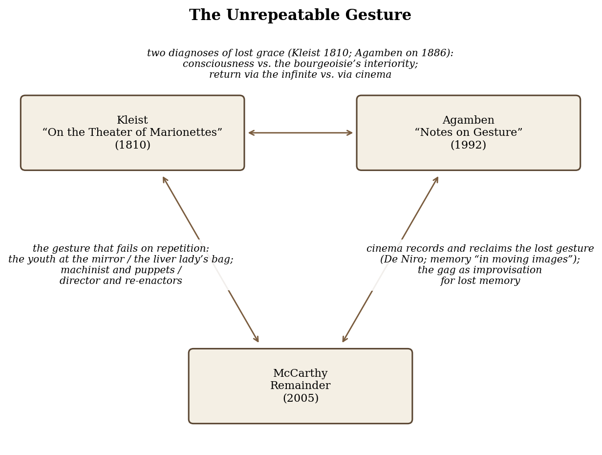
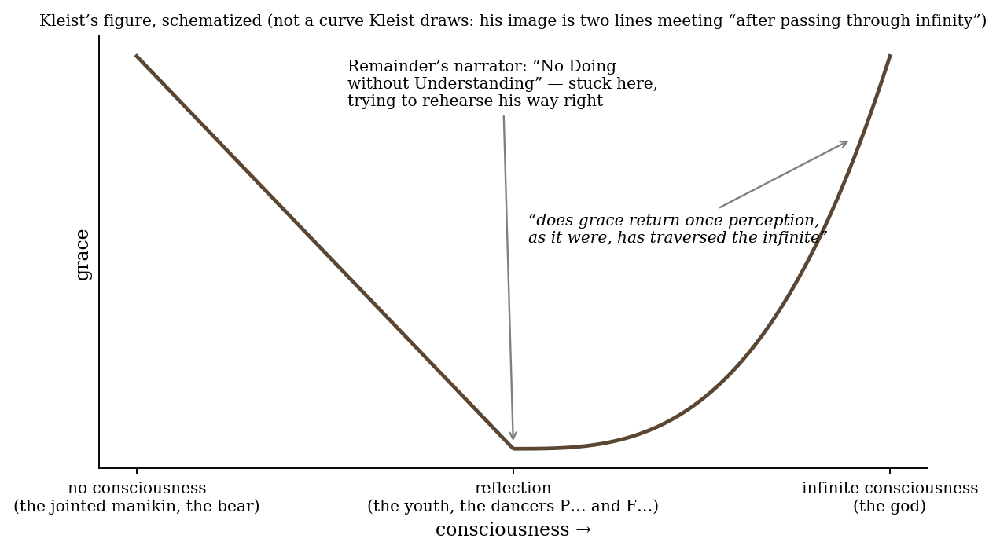
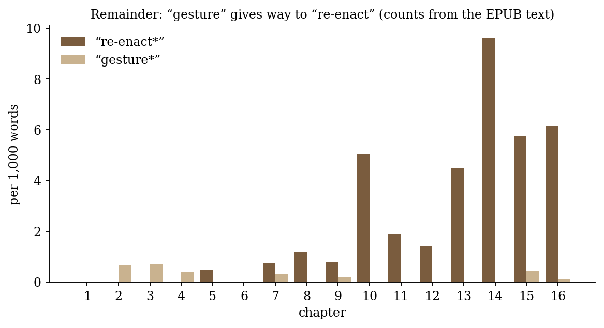

*Triad 8 of 32 · 2026-10-01 · Difficulty 3 · Shared figure or motif, Conflict, Oblique/structural*

## The three books

- [[books/4209-remainder|Remainder]], [[people/tom-mccarthy|Tom McCarthy]]; 2005 (Metronome Press); Vintage ed. 2007. *Anchor: the lost gesture staged. A man who must understand every movement before doing it hires re-enactors to make his gestures feel 'real'.*
- [[books/868-selected-prose-of-heinrich-von-kleist-on-the-theat|Selected Prose of Heinrich von Kleist ('On the Theater of Marionettes')]], [[people/heinrich-von-kleist|Heinrich von Kleist]], [[people/peter-wortsman|Peter Wortsman]] (translator); 1810 (essay); Archipelago ed. 2010. *The source of the figure: grace lost to consciousness, regained only by the puppet or the god; the youth who cannot repeat his pose.*
- [[books/13685-means-without-end-notes-on-politics-notes-on-gestu|Means Without End: Notes on Politics ('Notes on Gesture')]], [[people/giorgio-agamben|Giorgio Agamben]], [[people/vincenzo-binetti|Vincenzo Binetti]] (translator), [[people/cesare-casarino|Cesare Casarino]] (translator); 1992 (essay); Eng. 2000. *The history and the definition: the bourgeoisie lost its gestures; cinema reclaims and records the loss; gesture as gerere, pure means, gag.*

---

## The Thread

Three texts about a gesture that is lost and about what people try in order to get it back. Kleist (1810) puts the loss down to consciousness. A youth at a mirror notices that his pose matches a famous statue, tries to make it again and can’t; only the marionette, which has no consciousness, or the god, which has infinite consciousness, moves with grace. Agamben (1992) makes the loss historical: “By the end of the nineteenth century, the Western bourgeoisie had definitely lost its gestures”, and cinema is the medium that tries “at once to reclaim what it has lost and to record its loss.” McCarthy’s *Remainder* (2005) stages both. A man has to relearn every movement after an accident (“No Doing without Understanding”), watches De Niro light a cigarette in *Mean Streets* and sees a perfection he can’t have, then spends a fortune hiring people to re-enact scenes until his own movements feel natural.

**Connection kinds:** Shared figure or motif (the gesture that fails when repeated); Conflict (three different ways back); Oblique/structural. **Difficulty: 3.** The kinship is clear once the books sit side by side. The conflict takes more work. Kleist’s way back runs only “through infinity”, so for him the question belongs to theology. Agamben refuses to treat gesture as an end at all: it is “the exhibition of a mediality”, a means shown as a means. McCarthy’s narrator wants gesture as an end (“to be real”) but gets something closer to Agamben’s: votive gestures, endlessly rehearsed and never arriving. Agamben never mentions Kleist anywhere in *Means Without End* (checked against the PDF). The bridge between them is built here.

## 1. On the Theater of Marionettes — Heinrich von Kleist (1810)

EPUB · Calibre ID 868 · in *Selected Prose of Heinrich von Kleist*, trans. Peter Wortsman (Archipelago, 2010) → [[books/868-selected-prose-of-heinrich-von-kleist-on-the-theat|book page]]

**Selection logic.** This is the source text for the triad’s figure. It supplies the theory (grace is inversely proportional to reflection until reflection becomes infinite), the case history (the youth who can’t repeat his own pose) and the machinery: the puppeteer who controls only the centre of gravity and lets the limbs follow “mechanically on their own”. Every element of *Remainder*’s method is already here: the machinist directing figures, the repeated attempt that fails, prosthetic movement, the wish to be free of gravity. The same volume holds “On the Gradual Formulation of Thoughts While Speaking”, whose “embarrassed gestures” lead to Agamben’s “gag”.

**Overview.** A short dialogue first published in the *Berliner Abendblätter* in December 1810. The narrator meets Mr. C…, the principal dancer of the opera, at a marketplace puppet show. C… argues that a well-built marionette could out-dance any human: it has no “attitude” (the soul lodged in the wrong place, in the axis of the spine or in the elbows), and it needs the ground only to graze it. The narrator answers with the story of the youth and the Spinario; C… answers with a bear that parries every thrust and ignores every feint. The conclusion is eschatological: grace comes back only at the far side of the infinite, and to regain innocence

*Figure 1: Constellation*

we must eat of the tree of knowledge again, “which will be the last chapter of the history of the world.”

**Excerpt: the youth at the mirror.** The scene that *Remainder* repeats at the scale of a whole building.

> “Some three years ago,” I recounted, “I happened to be bathing beside a young man, blessed at the time with an astounding beauty. He must have been about sixteen years old, and manifested only the faintest first traces of vanity fostered by the favor of women. […]
>
> *(Shortened for the public edition.)*

> — “On the Theater of Marionettes”

**Quotes.**

- “Each movement, he said, had a center of gravity; it would suffice to control this point from the center of the figure; the limbs, which are, after all, nothing but pendulums, would follow mechanically on their own without anything else needing to be done.” (“On the Theater of Marionettes”)

- “have you heard of those mechanical limbs that English artists had fashioned for those poor unfortunates who’d lost their own?” (ibid.)

- “I did, indeed, know all too well what a mess consciousness had made of the natural grace of Man.” (ibid.)

- “An invisible and inconceivable force, like an iron net, seemed to settle over and impinge upon the free play of movements” (ibid., the youth a year later)

- “so too, does grace return once perception, as it were, has traversed the infinite – such that it simultaneously appears the purest in human bodily structures that are either devoid of consciousness or which possess an infinite consciousness, such as in the jointed manikin or the god.” (ibid.)

- “they seem to suggest with embarrassed gestures that they themselves don’t rightly know what they wished to say.” (“On the Gradual Formulation of Thoughts While Speaking”)

**Diagram: Kleist’s figure, schematized.** Kleist offers two geometric images, not a graph: two lines that meet again “after passing through infinity”, and a concave mirror. The curve below only sketches the shape of the claim.

**A misreading worth attempting.** Read C… as a film director, not a puppeteer. He controls only “the center of gravity”, lets the limbs “follow mechanically”, and gets a dance no living dancer can perform. That is very nearly what montage does to an actor. On this reading the “back way” into Paradise, reached by going “around to the other side”, is the camera: an apparatus that sees the body with no consciousness at all. Agamben’s essay supplies the material for this argument (Muybridge, Marey, Lumière) without naming Kleist. The misreading fails at the bear, which no camera explains, and the failure is instructive.

*Figure 2: Kleist’s curve*

## 2. Notes on Gesture — Giorgio Agamben (1992)

PDF · Calibre ID 13685 · in *Means Without End: Notes on Politics*, trans. Vincenzo Binetti and Cesare Casarino (University of Minnesota Press, 2000), pp. 49–60. Page numbers are the printed ones (PDF page = printed page + 10). The PDF’s text layer is OCR with scattered errors; the quotes below are passages the OCR got right, with line-end hyphens joined. → [[books/13685-means-without-end-notes-on-politics-notes-on-gestu|book page]]

**Selection logic.** It moves Kleist’s loss out of the individual soul and into history, names the medium that tries to undo it (cinema), and offers a definition of gesture that neither of the other two texts has: neither making (*facere*) nor acting (*agere*) but carrying, enduring (*gerere*). It explains why De Niro, not a dancer, is the image *Remainder*’s narrator envies, and it gives a name to what the liver lady does when she improvises a line: a “gag”.

**Overview.** Five numbered theses, each followed by commentary. (1) The bourgeoisie lost its gestures by the end of the 19th century, as Gilles de la Tourette’s footprint method (1886) and the tic syndrome he described show. (2) Cinema both reclaims and records that loss; Nietzsche, Isadora Duncan, Diaghilev, Proust, Jugendstil poetry, silent film and Warburg’s Mnemosyne atlas are last attempts to recover gesture. (3) The element of cinema is gesture, not image; every image is “the reification and obliteration of a gesture” or keeps its *dynamis* intact. (4) Following Varro, gesture is neither production nor action but the display of a means as a means, the communication of a communicability, and at bottom a gag. (5) Politics is the sphere of pure means.

**Quotes.**

- “By the end of the nineteenth century, the Western bourgeoisie had definitely lost its gestures.” (p. 49)

- “Patients can neither start nor complete the simplest of gestures.” (p. 51, on Tourette’s patients)

- “In the cinema, a society that has lost its gestures tries at once to reclaim what it has lost and to record its loss.” (p. 53)

- “An age that has lost its gestures is, for this reason, obsessed by them.” (p. 53) … “each single gesture becomes a destiny.” (p. 53)

- “Cinema leads images back to the homeland of gesture.” (p. 56)

- “What characterizes gesture is that in it nothing is being produced or acted, but rather something is being endured and supported.” (p. 57)

- “it is always a gag in the proper meaning of the term, indicating first of all something that could be put in your mouth to hinder speech, as well as in the sense of the actor’s improvisation meant to compensate a loss of memory or an inability to speak.” (p. 59)

**Derived list: Agamben’s roll call of the lost gesture** (pp. 49–56), in order of appearance:

1. Balzac, *Théorie de la démarche*: “fifty rather disappointing pages”; gait as moral character.

2. Gilles de la Tourette, *Études cliniques et physiologiques sur la marche* (1886): the footprint method, iron sesquioxide on the soles, a roll of white wallpaper.

3. Muybridge’s 24-lens sequences: “walking woman sending a kiss”.

4. Tourette’s 1885 study of tics, echolalia and coprolalia: “a generalized catastrophe of the sphere of gestures”.

5. Charcot’s *Leçons du mardi*: the patient who looks like an automaton propelled by a spring.

6. Oliver Sacks, New York, winter 1971: three cases of Tourettism in a few minutes.

7. Marey and Lumière: films in which everyone seems to gesticulate frantically.

8. Nietzsche: *Zarathustra* as the ballet of a humankind that has lost its gestures.

9. Isadora Duncan, Diaghilev, Proust, Jugendstil poetry from Pascoli to Rilke, silent film: the last attempt.

10. Warburg’s Mnemosyne atlas: gesture as “a crystal of historical memory”. 11. Beckett’s *Traum und Nacht*: cinema as “the dream of a gesture”.

**Glossary of the essay’s working terms.**

- *facere* — to make (the poet makes the play). Production with an end outside itself: Aristotle’s *poiesis*.

- *agere* — to act (the actor acts it). Action that is its own end: *praxis*.

- *gerere* — to carry, support, bear; the general who “carries on” affairs. Agamben’s third kind: gesture.

- *res gesta* — a fact that has become an event because it has been borne.

- *mediality* — means displayed as means: “The gesture is the exhibition of a mediality” (p. 58).

- *gag* — both something stuffed in the mouth and the actor’s improvisation over a lapse of memory.

- *coupes mobiles* — Deleuze’s movement-images, which Agamben extends to images in general.

## 3. Remainder — Tom McCarthy (2005)

EPUB · Calibre ID 4209 · Vintage edition, 2007 (first published by Metronome Press, Paris, 2005). Locations are chapters. → [[books/4209-remainder|book page]]

**Selection logic.** The triad’s anchor: a novel built on both other texts’ problem without citing either. The narrator’s injury makes Kleist’s fallen state literal: every movement must be understood before it can be done. His model of an unfallen body is a film actor. His method is Kleist’s puppet theatre scaled up to a building, a tyre shop and a bank, with hired “re-enactors” as marionettes and himself as machinist. Agamben’s distinction then sorts what happens. The narrator wants gesture as an end (“to be real”); he gets an endless series of means. The novel ends in a plane turning back and out “again”, with the narrator “weightless” — Kleist’s puppets, which “only need the ground … to graze it.”

**Overview.** An unnamed narrator in London is hit by “something falling from the sky” and receives £8.5 million in settlement on condition he never discuss the accident. After physiotherapy (“rerouting”) that sends his motor commands through an unused part of the brain, he feels all his movements are “second-hand”. A crack in a bathroom wall triggers a memory of a building where he once felt “real”. With a facilitator named Naz he buys and rebuilds that building, staffs it with performers (a liver-frying neighbour, a pianist, a motorbike enthusiast) and re-enacts the scene, then a tyre-shop spillage, then a street shooting, slowed down, then a bank robbery in a replica bank, then the robbery in a real bank. The last step kills people.

**Excerpt: the carrot** (ch. 2). Physiotherapy as the youth at the mirror, a thousand times over.

> I closed my fingers round the carrot. It felt—well, it felt: that was enough to start

| short-circuiting the operation. | It had texture; it had mass. | The whole week I’d |
|---|---|---|
| been gearing up to lift it, I’d thought of my hand, my fingers, my rerouted brain as |  |  |
| active agents, and the carrot as a no-thing—a hollow, a carved space for me to grasp |  |  |
| and move. This carrot, though, was more active than me: the way it bumped and |  |  |
| wrinkled, how it crawled with grit. It was cold. I grasped it and went into Phase |  |  |
| Two, the hoist, but even as I did I felt the surge of active carrot input scrambling |  |  |
| the communication between brain and arm, firing off false contractions, locking |  |  |
| muscles at the very moment it was vital they relax and expand, twisting fulcral |  |  |
| joints the wrong directions. As the carrot rolled, slipped and plummeted away I |  |  |
| understood how air traffic controllers must feel in the instant when they know a |  |  |
| plane is just about to crash, and that they can do nothing to prevent it. |  |  |
| — ch. 2 |  |  |

**Quotes.**

- “No Doing without Understanding: the accident bequeathed me that for ever, an eternal detour.” (ch. 2)

- “There are twenty-seven separate manoeuvres involved.” (ch. 2) … “lifted more than a thousand imaginary carrots to your mouth, or one imaginary carrot more than a thousand times, which amounts to the same thing.” (ch. 2)

| • “Every move he made, each gesture was perfect, seamless.” | … “Perfect. | Real. | My |
|---|---|---|---|
| movements are all fake. Second-hand.” (ch. 2, on De Niro in *Mean Streets*) |  |  |  |
| • “My body seemed to glide fluently and effortlessly through the atmosphere around it— |  |  |  |
| gracefully, slowly, like a dancer through water.” (ch. 8) |  |  |  |
| • “The liver lady had come up with that fantastic line but then dropped her rubbish bag |  |  |  |
| when she’d tried to re-enact her movements for a third time.” (ch. 8) |  |  |  |
| • “I and the other re-enactors were like a set of devotees to a religion not yet founded: |  |  |  |
| patient, waiting for our deity to appear, to manifest himself to us, redeem us; and our |  |  |  |
| gestures were all votive ones, acts of anticipation.” (ch. 16) |  |  |  |

**Derived list: the re-enactments, in order** (the narrator names the sequence in ch. 13: “from the building re-enactments to the tyre shop ones and then on to the shootings”):

1. *The building* (chs. 7–9): the stairwell, the liver smell, the piano, the cats on the roof. Its line comes from a performer, unscripted: “Harder and harder to lift up.” (ch. 8), an improvised gag in Agamben’s sense.

2. *The tyre shop* (chs. 10–11): a spillage played over and over; a car leaves a figure of eight on the floor.

3. *The shooting* (ch. 12): a street murder restaged at half speed: “Do them normally, but at half the normal speed. Or at the normal speed, but take twice as long doing them.”

4. *The staircase, slowed* (ch. 13): the liver lady held almost still, a single held chord on the piano.

5. *The bank, rehearsed* (chs. 14–15): a robbery “choreography” taught by an ex-robber in a replica bank.

6. *The bank, real* (ch. 16): the re-enactment moved into an actual bank; it goes wrong.

7. *The plane* (ch. 16): a hijacked jet ordered to keep turning out and back: “Go?” I said. “Nowhere. Just keep doing this.” (ch. 16)

**Diagram: “gesture” gives way to “re-enact”.** Counted across the 16 chapters of the EPUB text. “Gesture” belongs to the opening, when the narrator still describes what he lacks; once the method takes over, the word “re-enact” replaces it.

*Figure 3: Remainder frequencies*

## Where this sends you

**Notebook**

1. *Repeat a gesture ten times.* Kleist’s youth “raised it ten more times: but for naught!”; McCarthy’s narrator had the liver lady repeat her exchange “Hundreds of times. More.” Choose one small, unconsidered gesture of your own (capping a pen, turning a page) and write it down ten times, one paragraph each, without reusing a sentence. Where does it turn into an “attitude”, with the soul lodged “in his elbows”? Is the tenth version Kleist’s comedy or McCarthy’s trance?

2. *Facere / agere / gerere in your own practice.* Agamben: “something is being endured and supported” (p. 57). Sort a week of your writing acts (essay, poem, commonplace entry, a note to the Gesturalist) under Varro’s three verbs. Which ones are *gerere*, carried rather than made or performed? Write the manifesto paragraph that the *gerere* column implies.

3. *The gag as method.* The liver lady’s unscripted “Harder and harder to lift up” (ch. 8) is the moment the narrator likes best. Agamben’s gag is “the actor’s improvisation meant to compensate a loss of memory” (p. 59); Kleist’s tongue-tied speakers make “embarrassed gestures” because they “don’t rightly know what they wished to say”. Write a short prose piece in which a scripted scene breaks and someone improvises the best line in it. Who is the director, and does the improvisation count as a re-enactment?

**Rabbit holes**

- Gilles de la Tourette, *Études cliniques et physiologiques sur la marche* (1886), the footprint study Agamben opens with, scanned at the Internet Archive: https://archive.org/details/tudescliniques00dela

- *Ten panels from the Mnemosyne Atlas*, Cornell University Library with the Warburg Institute; Agamben’s “crystal of historical memory”, panel by panel: https://warburg.library.cornell.edu/

- Eadweard Muybridge, *The Science of Animal Locomotion (Zoopraxography)*, Project Gutenberg: https://www.gutenberg.org/ebooks/39998

- Zadie Smith, “Two Paths for the Novel”, *New York Review of Books* (Nov. 20, 2008), on *Remainder* against *Netherland*: https://www.nybooks.com/articles/2008/11/20/two-paths-for-the-novel/

- Henri Bergson, *Laughter: An Essay on the Meaning of the Comic* (1900), Project Gutenberg. It explains why the youth’s failed pose is funny (“a man as a jointed puppet”): https://www.gutenberg.org/ebooks/4352

**Also in your library**

- *Key Writings* — Henri Bergson (Calibre ID 2661, Gestext). It includes *Laughter*, where the comic shows us “a man as a jointed puppet”. That is the third term between Kleist’s grace and McCarthy’s mechanism.

- *Hölderlin, Kleist, and Nietzsche: The Struggle with the Daemon* — Stefan Zweig (Calibre ID 882). It puts Kleist beside Nietzsche, the figure Agamben makes the climax of the lost gesture.

- *The Agamben Dictionary* — ed. Alex Murray and Jessica Whyte (Calibre ID 12582). Its catalogue description names “gesture” as one of Agamben’s terms with a specific meaning.

## To carry

> “He was simply unable to repeat the same movement”

> — Heinrich von Kleist, “On the Theater of Marionettes”, trans. Peter Wortsman

## Themes

[[themes/authenticity|authenticity]] · [[themes/cinema|cinema]] · [[themes/consciousness|consciousness]] · [[themes/facere-agere-gerere|facere/agere/gerere]] · [[themes/gag|gag]] · [[themes/gesture|gesture]] · [[themes/grace|grace]] · [[themes/marionette|marionette]] · [[themes/mediality|mediality]] · [[themes/muybridge|Muybridge]] · [[themes/re-enactment|re-enactment]] · [[themes/repetition|repetition]] · [[themes/second-hand|second-hand]] · [[themes/spinario|Spinario]] · [[themes/tourette|Tourette]] · [[themes/warburg|Warburg]] · [[themes/weightlessness|weightlessness]]

---

Previous: [[triads/2026-09-30-only-the-incipit|Only the Incipit]]  
Next: [[triads/2026-10-02-something-brushed-his-forehead|Something Brushed His Forehead]]
