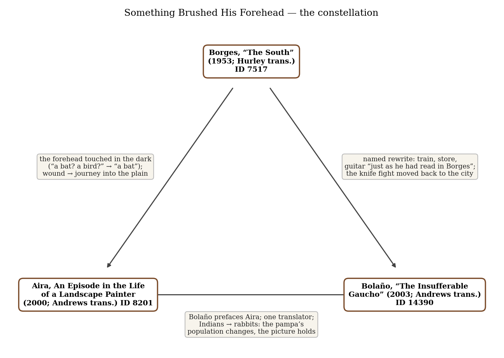
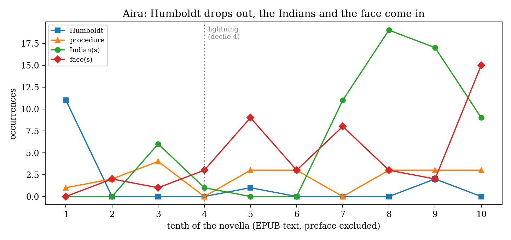
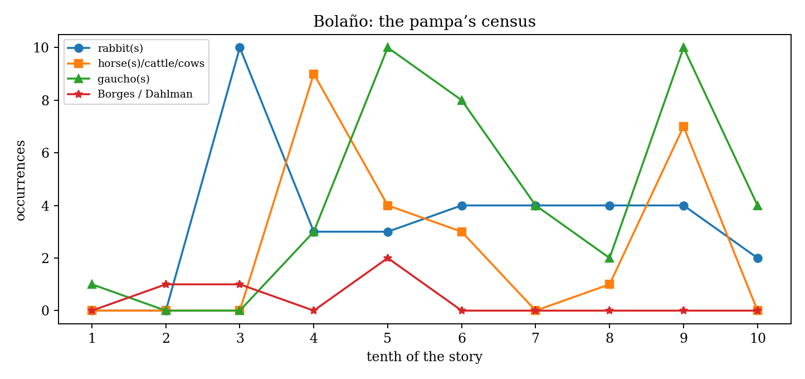

*Triad 9 of 32 · 2026-10-02 · Difficulty 3 · Genealogy/influence, Shared form or method, Shared figure or motif*

## The three books

- [[books/7517-collected-fictions-the-south|Collected Fictions ('The South')]], [[people/jorge-luis-borges|Jorge Luis Borges]], [[people/andrew-hurley|Andrew Hurley]] (translator); 1953 (story); added to Ficciones 1956; Hurley trans. 1998. *The source: forehead brushed in the dark, fever, train south, the store like an engraving, the dagger; two readings (events / dream on the operating table).*
- [[books/8201-an-episode-in-the-life-of-a-landscape-painter|An Episode in the Life of a Landscape Painter]], [[people/cesar-aira|César Aira]], [[people/chris-andrews|Chris Andrews]] (translator), [[people/roberto-bolano|Roberto Bolaño]] (contributor); 2000 (Un episodio en la vida del pintor viajero); Eng. 2006. *The oblique middle term: Borges's literary knowledge becomes Humboldt's procedure; the cut becomes a face ruined by lightning; the bat answers Borges's question; the face-to-face Dahlmann only steps toward.*
- [[books/14390-the-collected-short-stories-of-roberto-bolano-the|The Collected Short Stories of Roberto Bolaño ('The Insufferable Gaucho')]], [[people/roberto-bolano|Roberto Bolaño]], [[people/chris-andrews|Chris Andrews]] (translator); 2003 (El gaucho insufrible); Eng. 2010. *The declared descendant: 'The South' rewritten in the 2001 crisis as farce and entropy; rabbits for horses and cattle; the knife fight moved back to Buenos Aires.*

---

## The Thread

Three stories about a man from the city, or from Europe, who takes a wound to the head and then rides or is carried into the Argentine plain, a plain he already knows as a picture. In Borges’s “The South” (1953) a library secretary cuts his forehead on an open casement (“Something in the dimness brushed his forehead—a bat? a bird?”), nearly dies of septicemia, and takes the train toward a ranch he knows mainly through “nostalgic, literary knowledge”; the plain hands him a dagger. In Aira’s *An Episode in the Life of a Landscape Painter* (2000) the German painter Rugendas, trained in Humboldt’s “physiognomic” procedure, is struck twice by lightning and dragged by his horse; with his face destroyed he goes out under a lace mantilla to draw an Indian raid, and near the end “A bat coming in the opposite direction brushed gently against his forehead.” In Bolaño’s “The Insufferable Gaucho” (2003) a retired judge leaves Buenos Aires during the 2001 collapse, cries on the station bench over “the store mentioned in the final paragraphs” of “The South”, and finds a pampa with no horses, “only rabbits”. Then he brings the knife fight home and stabs a writer outside a Buenos Aires café.

**Connection kinds:** Genealogy/influence (Bolaño’s named rewrite of Borges; Bolaño’s preface to the Aira volume; Chris Andrews translated both), Shared form or method (wound, then a journey into an already-pictured plain, then a face-to-face ending), Shared figure or motif (the touched forehead). **Difficulty: 3.** Bolaño’s debt is declared. Aira’s is not, and the bat is the only signature, a precise one: Borges asks the question, and a forty-seven-year-later novel answers it. What the three share is less the gaucho than the problem of arriving somewhere you have already read. Each man meets the plain’s inhabitants (an old gaucho, a hundred Indians, rabbits) as images before he meets them as people. Each story ends with someone stepping out of the picture: into the plain, into the firelight, back into the city.

## 1. “The South” — Jorge Luis Borges (1953; added to Ficciones, 1956)

In *Collected Fictions*, trans. Andrew Hurley (1998). EPUB · Calibre ID 7517 → [[books/7517-collected-fictions-the-south|book page]]

**Selection logic.** The source text. It supplies the shape the other two inherit: a cut on the forehead, fever, a train south, a country store that looks like an engraving, a challenge, a knife. Borges added a reading instruction that every rewriter has to deal with: the story can be read “as a forthright narration of novelistic events and in quite another way, as well.”

**Overview.** Juan Dahlmann, secretary of a municipal library in Buenos Aires in 1939, has a German grandfather and a creole one killed by Catriel’s Indians, and he has chosen the creole line. Hurrying upstairs with a newly found *Arabian Nights*, he gashes his forehead; septicemia follows, then surgery and a sanatorium. On his release he takes the train south to his family’s ranch, is let off at an unfamiliar station, eats at a country store, is provoked by drunk laborers, receives a dagger from an old gaucho, and steps outside to fight. The ending allows a second reading: he is still on the operating table, and this is the death he would have

*Figure 1: Constellation*

chosen.

**Excerpt: the old gaucho.** The figure who decides the story, drawn as an object worn smooth by time:

> On the floor, curled against the bar, lay an old man, as motionless as an object. The many years had worn him away and polished him, as a stone is worn smooth by running water or a saying is polished by generations of humankind. He was small, dark, and dried up, and he seemed to be outside time, in a sort of eternity.

**Quotes.**

- “Something in the dimness brushed his forehead—a bat? a bird?” (≈12% through the story)

- “Reality is partial to symmetries and slight anachronisms;” (≈27%)

- “it was as though he were two men at once: the man gliding along through the autumn day and the geography of his native land, and the other man, imprisoned in a sanatorium and subjected to methodical attentions.” (≈48%)

- “his direct knowledge of the country was considerably inferior to his nostalgic, literary knowledge.” (≈52%)

- “There was something in its sorry architecture that reminded Dahlmann of a steel engraving, perhaps from an old edition of Paulet Virginie.” (≈65%)

- “It was as though the South itself had decided that Dahlmann should accept the challenge.” (≈92%)

**Derived list: things that happen twice.** The doublings the story plants for its second reading:

1. Something brushes his forehead on the stairs; at the store, a wad of bread brushes his face.

2. A cab takes him to the sanatorium and a cab takes him to the station (“Reality is partial to symmetries”).

3. The storekeeper’s “resemblance to one of the employees at the sanatorium”.

4. The family house “once been scarlet”, now pink; the store “had once been bright red”.

5. The *Arabian Nights* lights his fever dreams, then travels with him, then is opened at the store “as though to block out reality”.

6. Two lineages, the Evangelical minister and the soldier killed by Indians; in the store, the Indian-looking thug and the old gaucho.

7. The sanatorium comes back at the moment of the fight: “They’d never have allowed this sort of thing to happen in the sanatorium, he thought.”

**Other: Borges’s “quite another way”, a two-column reading.**

> Read as the fevered man’s

| Cue in the text | Read as events | dream |
|---|---|---|
| Train stops “at a different | railway logistics | the dream cannot reach the |
| one, a little before it” |  | real ranch |
| Storekeeper resembles a | coincidence | day-residue from the clinic |
| sanatorium employee |  |  |
| “Sr. Dahlmann…”: the | small-town gossip | the dreamer is known to |
| storekeeper knows his |  | his own dream |
| name |  |  |
| “Tomorrow I will wake up | a plan | an irony: he will not wake |
| at my ranch,” |  | Read as the fevered man’s |
| Last sentence shifts into | stylistic close | the moment held open, as a |
| the present tense |  | wish |

Borges’s own note (Postscript, 1956): “Of ‘The South,’ which may be my best story, I shall tell the reader only that it is possible to read it both as a forthright narration of novelistic events and in quite another way, as well.” (*Ficciones*, Prologue, ≈23% of the prologue-and-notes section)

## 2. An Episode in the Life of a Landscape Painter — César Aira (2000)

Trans. Chris Andrews (New Directions, 2006), with a preface by Roberto Bolaño. EPUB · Calibre ID 8201 → [[books/8201-an-episode-in-the-life-of-a-landscape-painter|book page]]

**Selection logic.** The anchor in practice, and the oblique edge. It is the long, strange middle term: Borges’s literary knowledge becomes Humboldt’s scientific procedure, and Dahlmann’s cut becomes a face destroyed by lightning. The bat in its last pages is the triad’s hinge. The edition opens with Bolaño’s “The Incredible César Aira”, so one book of the three contains the author of another.

**Overview.** A short novel based on a real figure: Johann Moritz Rugendas (1802–1858), an Augsburg painter in Humboldt’s circle. In 1837–38 he crosses the Andes from Chile toward the “impossible midpoint” of the pampas, which Humboldt had advised him against. Near San Luis he is struck by lightning twice and dragged by his horse. He survives on morphine, with a face whose muscles move on their own. In Mendoza he writes letters around the proposition “I am a monster”, rethinks the procedure, and finally rides out under a black lace mantilla to sketch an Indian raid, ending by night inside the Indians’ firelight, drawing their faces while they stare at his.

**Excerpt: the first bolt.** The tone throughout: the catastrophe is reported in the language of the treatise.

> The storm broke suddenly with a spectacular lightning bolt that traced a zig-zag arc clear across the sky. It came so close that Rugendas’s upturned face, frozen in an expression of idiotic stupor, was completely bathed in white light. He thought he could feel its sinister heat on his skin, and his pupils contracted to pin-points. The thunder crashing down impossibly enveloped him in millions of vibrations. […]
>
> *(Shortened for the public edition.)*

(≈36% through the novella)

**Quotes.**

- “the secret aim of this long voyage, which consumed his youth, was Argentina: the mysterious emptiness to be found on the endless plains at a point equidistant from the hori-zons.” (≈4%)

- “What mattered to Rugendas, however, was not at the end of the line but at its impossible midpoint.” (≈26%)

- “(why was it called El Monigote: The Puppet?)” (≈35%), the hills where the lightning strikes

- “he felt as if they were removing all the threads that had controlled the puppets of his feelings, or the expressions that manifested them, which came to the same thing.” (≈45%), the stitches coming out

- “how could he communicate the proposition ‘I am a monster’?” (≈52%)

- “Rugendas was so absorbed that his only reaction was to write BANG BANG on his sheet of paper.” (≈76%)

- “Humboldt’s procedure was, in fact, a system of mediations: physiognomic representation came between the artist and nature.” (≈88%)

- “In the beginning was Repetition, and only there.” (≈94%)

- “A bat coming in the opposite direction brushed gently against his forehead.” (≈95%)

- “The procedure went on operating through him. Standing behind him, hidden in the shadows, the faithful Krause kept watch.” (last lines)

**Diagram: the novella’s vocabulary by tenths.** Counts from the EPUB text, preface excluded. “Humboldt” is front-loaded (eleven of fourteen mentions in the first tenth); after the lightning, “face” and “Indian(s)” take over, and “procedure” runs evenly from start to finish.

*Figure 2: Aira deciles*

**Derived list: what Humboldt prescribed and what Rugendas drew.** Humboldt’s letter asks for “snowy mountain peaks, bamboo, tropical jungle flora… feathery-fronded palms… cylindrical cactuses…” (≈7%). What the Argentine episode actually puts on Rugendas’s paper:

1. the Godoy children’s tricycles (“which Rugendas duly sketched in his notebooks”), his first Argentine sketches;

2. the two-wheeled pampas carts, hitched to “ten teams of oxen”;

3. “large hydraulic devices used for irrigation” in Mendoza;

4. the raid from a distance, Indians “in miniature, like lead soldiers”;

5. the “captives” paraded at El Tambo: an Indian in drag, a white calf, a salmon;

6. the dead dairy farmer (“The two Germans respectfully asked permission to draw the corpse.”);

7. the Indians’ faces by firelight, at close range.

Every item is a vehicle, a machine, or a human face, and none of them is a plant. The list traces how the procedure fails south of the tropics.

**Other: a misreading worth attempting.** Read the novella as Dahlmann’s second reading turned outward. Dahlmann may be dreaming on the operating table; Rugendas is on morphine “producing an unprecedented result”, and Aira cuts the chronology loose so far that legend

has him riding to the glaciers. Krause plays the surgeon who watches from behind. The difference is the ending: Borges stops at the threshold (“steps out into the plains”), while Aira goes through and gives his painter the face-to-face that Dahlmann only steps toward.

## 3. “The Insufferable Gaucho” — Roberto Bolaño (2003)

In *The Collected Short Stories of Roberto Bolaño*; *El gaucho insufrible* (2003), trans. Chris Andrews (2010). EPUB · Calibre ID 14390 → [[books/14390-the-collected-short-stories-of-roberto-bolano-the|book page]]

**Selection logic.** The declared descendant. Bolaño writes “The South” in 2001, with Borges cited by name inside the story, and turns every element to farce or entropy: the old gaucho strumming “just as he had read in Borges”, the train that “often … didn’t” pass, horses sold for slaughter, a population of rabbits. It closes the triangle from the other side: Bolaño’s preface opens the New Directions Aira, so the descendant of Borges is also the introducer of Aira.

**Overview.** Manuel Pereda, a widowed lawyer and ex-judge, lives a careful life in Buenos Aires until his son, a successful novelist, takes him to literary gatherings. When the economy collapses and accounts are frozen, Pereda takes the train to his abandoned ranch, Alamo Negro, near the town of Capitán Jourdan. He buys a horse on credit, names it José Bianco, and hires gauchos who trap rabbits for a living and can’t fix a roof. A rabbit bites his son’s publisher on the neck, and Pereda cauterizes the wound with a knife. Called back to the city to sign papers, he stabs a cocaine-taking writer in the groin outside his son’s café, then decides at dawn to go back to the pampa.

**Quotes.**

- “Inevitably, he remembered Borges’s story ‘The South’, and when he thought of the store mentioned in the final paragraphs, tears brimmed in his eyes.” (≈26%)

- “There are no horses left here, he said, only rabbits.” (≈34%)

- “European nights might be pitch-dark or coal-black, but not American nights, which are dark like a void, where there’s nothing to hold on to, no shelter from the elements, just empty, storm-whipped space, above and below.” (≈39%)

- “For a moment he thought that his destiny, his screwed-up American destiny, would be to meet his death like Dahlman in ‘The South’, and it seemed wrong, partly because he now had debts to repay, and partly because he wasn’t ready to die,” (≈41%)

- “Argentina’s like a novel, he said, a lie, or make-believe at best.” (≈55%)

- “Ah, but the cemetery I’m talking about, said Pereda, is an exact copy of eternity.” (≈56%)

- “I believe we are losing our memory, he said. And just as well too.” (≈89%)

- “For a moment their gazes locked, as if, for each of them, the presence of the other were a gash in the ambient reality.” (≈96%)

**Diagram: the pampa’s census.** Word counts by tenths of the story. Rabbits arrive in the third tenth (the train race) and never leave; horses and cattle come and go as purchases; “Borges/Dahlman” is named only in the first half, after which the story stops needing its model.

**Derived list: substitutions.** What Bolaño’s pampa has put in place of Borges’s:

1. Horses →rabbits (“There are no horses left here… only rabbits”).

2. Cattle →rabbits (“That’s why the cattle have been replaced by rabbits”).

3. The gaucho’s trade →trapping (“Rabbit hunting! What sort of job is that for a gaucho?”).

4. Knife fights →“chalked sticks”; Pereda wants “real knives, not chalked sticks”.

5. Conversation in the store →Monopoly with the depressive mayor, till dawn.

6. Gauchos’ mounts →“bicycles”, or hitching rides.

7. The Indian raid →a rabbit leaping at the publisher’s neck.

*Figure 3: Bolaño fauna*

8. Dahlmann’s death on the plain →a shallow stab in a Buenos Aires street: the South’s ending moved north.

**Other: the Borges-to-Bolaño concordance.**

“The South” “The Insufferable Gaucho”

train from Constitución train out of the city; back in at Constitución unfamiliar station, “a little before it” El Apeadero: “a station or a factory?” store like a steel engraving store “like something from a story by di

> Benedetto”

old gaucho, “outside time” old gaucho “strumming the guitar” Indian-looking thug challenges Pereda spits at the young gauchos dagger thrown at his feet Pereda buys a knife; uses it in the city “steps out into the plains” “he decided to go back”

## Where This Sends You

## Notebook

1. **The bat or the bird.** Borges leaves the question open (“a bat? a bird?”); Aira answers it at the ≈95% mark (“A bat coming in the opposite direction brushed gently against his forehead”), on a forehead “in which all the nerves had been torn loose”. Write a scene in which one touch on the forehead is the whole event. Draft it twice, once with the question and once with the answer. Which version keeps the second reading alive?

2. **Literary knowledge, procedure, citation.** Dahlmann’s knowledge of the South is “nostalgic, literary”; Rugendas’s is Humboldt’s “system of mediations”; Pereda’s arrives as citation (“just as he had read in Borges”). Choose a place you know mainly through books (Jabès’s desert, Benjamin’s Paris, a labyrinth) and describe it three ways: as nostalgia, as procedure (a fixed list of types, as with Humboldt’s nineteen), and as quotation. Where the description fails, do what Rugendas did and write BANG BANG.

3. **Non-compensation.** Krause’s theory is that every defect demands a compensation, and “The Indians had no need of compensation”; Rugendas’s face “expressed things he did not mean to express”. Pereda: “I believe we are losing our memory… And just as well too.” Write a short manifesto for a prose that refuses to compensate, with no elegance offered to cover its defects. Then write one paragraph of it.

## Rabbit holes

- Alexander von Humboldt, “Physiognomy of Plants”, in *Aspects of Nature*, vol. 2, trans. Elizabeth J. Sabine (1849), Project Gutenberg: https://www.gutenberg.org/ebooks/68953 — this is the procedure Aira’s Rugendas carries and breaks.

- Ibero-Amerikanisches Institut, Berlin: the Rugendas papers, including 293 letters (1834–1851), among them the correspondence with Carmen Arigada de Gutike

| (Aira’s | “Guttikers”): | https://www.iai.spk-berlin.de/en/collections/about-the-special-collections/papers-and-manuscripts/estate/rugendas-johann-moritz-1802-1858.html |
|---|---|---|
| collections/papers-and-manuscripts/estate/rugendas-johann-moritz-1802-1858.html |  |  |

- Domingo F. Sarmiento, *Facundo* (1845, written in Chilean exile), Spanish text, Project

| Gutenberg: | https://www.gutenberg.org/ebooks/33267 | — | the | civilization/barbarism |
|---|---|---|---|---|
| frame all three stories inherit. |  |  |  |  |

- José Hernández, *El Gaucho Martín Fierro* (1872), Project Gutenberg: https://www.gutenberg.org/ebooks/14765 — these are the “certain verses in Martín Fierro” that Dahlmann has the habit of.

- David Varno, “Travel Journals for Sleepwalkers: The Stories of Roberto Bolaño”, *Words Without Borders* (2010), on the Borges rewrite: https://www.wordswithoutborders.org/dispatches/article/travel-journals-for-sleepwalkers-the-stories-of-roberto-bolano1

## Also in your library

- Juan José Saer, *The Witness* (ID 4565): a sixteenth-century cabin boy who lives ten years among Indians in the Río de la Plata region and tells it as an old man. It works as a counterweight to Aira’s last scene, told from inside the firelight.

- Roberto Bolaño, *Between Parentheses* (ID 48): has “The Incredible César Aira” and “The Vagaries of the Literature of Doom”, where “Argentina is Israel, of course, and Buenos Aires is Jerusalem”. Pereda imagines entering Buenos Aires like Christ entering Jerusalem.

- Witold Gombrowicz, *Trans-Atlantyk* (ID 3812): a Pole stranded in Buenos Aires in 1939, Dahlmann’s year. Bolaño’s preface to Aira reads Aira through Gombrowicz.

## To carry

> “In the beginning was Repetition, and only there.” — César Aira, *An Episode in the Life of a Landscape Painter*, trans. Chris Andrews (≈94%)

## Themes

[[themes/2001-argentine-crisis|2001 Argentine crisis]] · [[themes/bat|bat]] · [[themes/borges-s-the-south|Borges's 'The South']] · [[themes/compensation|compensation]] · [[themes/face|face]] · [[themes/forehead|forehead]] · [[themes/gaucho|gaucho]] · [[themes/humboldt|Humboldt]] · [[themes/indian-raid|Indian raid]] · [[themes/literary-knowledge-vs-direct-knowledge|literary knowledge vs direct knowledge]] · [[themes/mask-mantilla|mask/mantilla]] · [[themes/morphine|morphine]] · [[themes/pampa|pampa]] · [[themes/physiognomy-of-nature|physiognomy of nature]] · [[themes/procedure|procedure]] · [[themes/rabbits|rabbits]] · [[themes/repetition|repetition]] · [[themes/rewriting|rewriting]] · [[themes/rugendas|Rugendas]] · [[themes/wound|wound]]

---

Previous: [[triads/2026-10-01-the-unrepeatable-gesture|The Unrepeatable Gesture]]  
Next: [[triads/2026-10-03-ill-favored-black-unicorns|Ill-Favored Black Unicorns]]
