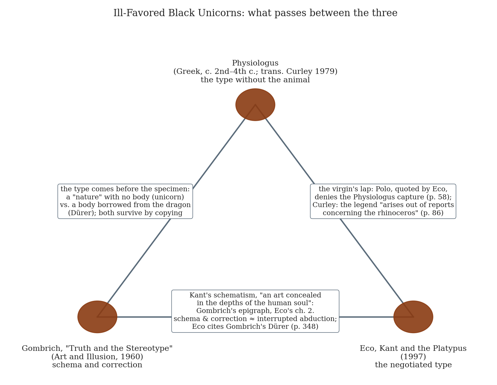
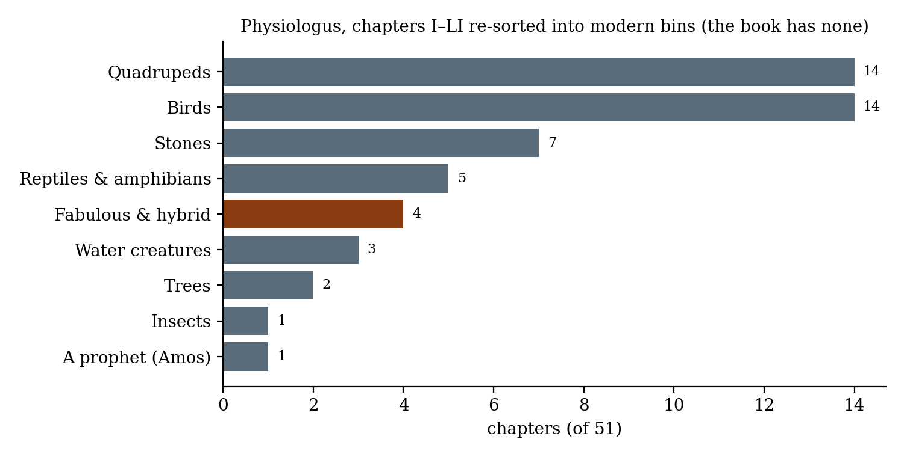
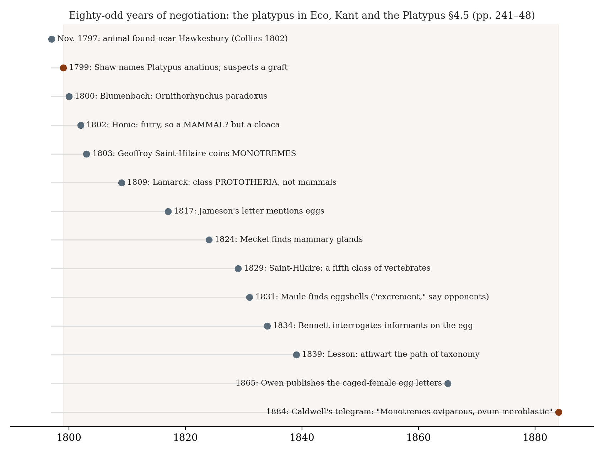

*Triad 10 of 32 · 2026-10-03 · Difficulty 3 · Agreement, Genealogy/influence, Shared figure or motif*

## The three books

- [[books/4597-physiologus-a-medieval-book-of-nature-lore|Physiologus: A Medieval Book of Nature Lore]], [[people/anonymous|Anonymous]], [[people/michael-j-curley|Michael J. Curley]] (translator); c. 2nd c. AD (Greek); trans. 1979. *Source: the type without the animal. The unicorn Polo expected and had to correct.*
- [[books/408-the-essential-gombrich-truth-and-the-stereotype|The Essential Gombrich ('Truth and the Stereotype')]], [[people/e-h-gombrich|E. H. Gombrich]], [[people/richard-woodfield|Richard Woodfield]] (editor); 1960 (Art and Illusion ch. 2); anthology 1996. *Second witness: schema and correction in pictures; Dürer's rhinoceros.*
- [[books/3929-kant-and-the-platypus-essays-on-language-and-cogni|Kant and the Platypus: Essays on Language and Cognition]], [[people/umberto-eco|Umberto Eco]], [[people/alastair-mcewen|Alastair McEwen]] (translator); 1997. *Hinge: quotes Polo against the Physiologus, cites Gombrich, theorizes the negotiated type; supplies the title.*

---

## The Thread

Three books about what a mind does when an animal arrives before its category, or a category arrives without its animal. The *Physiologus* is the category with no animal: its unicorn “is a small animal like the kid,” caught only in a virgin’s lap, and one-horned “because the Savior said, ‘I and the Father are one’.” Curley’s note gives the source plainly: “The legend of the unicorn arises out of reports concerning the rhinoceros.” Eco’s *Kant and the Platypus* opens on the return journey. Marco Polo meets that rhinoceros on Java, calls it a unicorn, and reports that it is “quite the contrary” of the animal in the stories of those “who say that it lets itself be caught in the lap by a virgin girl.” In Eco’s terms, “He has modified the intension and left the extension unchanged.” Eco then follows the platypus through eighty-odd years of naturalists failing to classify it. Gombrich’s “Truth and the Stereotype” runs the same mechanism through pictures: Dürer’s rhinoceros, armoured from “the dragon with its armoured body,” was copied into natural histories until the eighteenth century, because copying “proceeds through the rhythms of schema and correction.”

**Connection kinds:** Agreement (Gombrich and Eco); Genealogy/influence; Shared figure or motif. **Difficulty:** 3 of 5. The agreement is exact, not loose. Both men start from Kant’s schematism, which Kant calls an art hidden in the depths of the human soul: Gombrich makes it his chapter’s epigraph, Eco makes it his second chapter, and Eco cites “the classic example in Gombrich” (Dürer’s rhinoceros) by name. The genealogy runs through the *Physiologus*, which is the book Polo carried to Java in his head. The three disagree about what a type is for. In the *Physiologus* it is for meaning (the horn is the unity of Father and Son). For Gombrich it is for making (you cannot draw without one). For Eco it is for negotiating (the type is a contract, revised under pressure from the animal).

## 1. Physiologus: A Medieval Book of Nature Lore — anonymous, trans. Michael J. Curley (Greek original perhaps 2nd century AD, Lauchert’s dating; Curley’s translation of the Latin y-version, 1979)

PDF · Calibre ID 4597 (duplicate record 7449) → [[books/4597-physiologus-a-medieval-book-of-nature-lore|book page]]

**Selection logic.** This is the book behind the unicorn Polo expected to see. It is also the strongest case of a type that needs no specimen. Curley insists that “Physiologus was never intended to be a treatise on natural history. For that purpose, the Middle Ages had Pliny.” Here the category arrives with its meaning and without its animal. It anchors the triad because its unicorn is the one Polo had to correct, and Eco quotes Polo correcting it.

**Overview.** The book has fifty-one short chapters on beasts, birds, stones and trees, and one on a prophet. Most follow a fixed pattern: a scriptural verse, the creature’s “nature” (often “Physiologus says…”), and then a Christological or moral allegory. It was probably composed

*Figure 1: The three books and what passes between each pair.*

in Alexandria, and it was translated into Ethiopic, Armenian, Syriac and Latin. It became the core of the medieval bestiary. Curley translates the Latin y-version, putting additions from the b-version in square brackets, with an introduction on the word *physiologia* and notes on each chapter’s classical sources (Ctesias, Aelian, Pliny).

**Excerpt: the unicorn (ch. XXXVI, p. 51).** The whole zoology is in the first three sentences. Everything after them is exegesis.

> The monoceras, that is, the unicorn, has this nature: he is a small animal like the kid, is exceedingly shrewd, and has one horn in the middle of his head. The hunter cannot approach him because he is extremely strong. How then do they hunt the beast? Hunters place a chaste virgin before him. […]
>
> *(Shortened for the public edition.)*

**Quotes.**

- “We never stop to ask that animal stories be zoologically accurate, for that would be missing their point.” (Curley, Introduction, p. ix)

- “Physiologus was never intended to be a treatise on natural history. For that purpose, the Middle Ages had Pliny.” (Introduction, p. xv)

- Physiologus was “one who interpreted metaphysically, morally, and, finally, mystically the transcendent significance of the natural world.” (Introduction, p. xv)

- “The elephant has no knee joints enabling him to sleep lying down if he wanted to.” (ch. XX, “On the Elephant,” p. 30). Polo’s rhinoceros has feet “like the feet of an elephant” and wounds “with the tongue and knee.”

- “The legend of the unicorn arises out of reports concerning the rhinoceros.” (Curley, notes to ch. XXXVI, p. 86)

**Derived list: the fifty-one chapters re-sorted into modern bins.** The *Physiologus* has no taxonomy. Its order is closer to association or sermon sequence, so the unicorn (XXXVI) sits between the Weasel and the Beaver, and Amos the Prophet sits between the Elephant and the Roe. Sorted into classes a modern reader would use:

- *Quadrupeds (14):* Lion, Antelope, Wild Ass, Hedgehog, Fox, Elephant, Roe, Wild Ass and Monkey, Panther, Weasel, Beaver, Hyena, Echinemon (ichneumon), Stag

- *Birds (14):* Charadrius, Pelican, Owl, Eagle, Hoopoe, Ibis, Heron, Partridge, Vulture, Little Crow, Ostrich, Turtle-dove, Swallow, Doves

- *Stones (7):* Piroboli Rocks, Agate-stone, Oyster-stone and Pearl, Adamant-stone (twice), Indian-stone, Magnet

- *Reptiles and amphibians (5):* Viper, Serpent, Frog, Salamander, Sun-lizard

- *Fabulous or hybrid (4):* Phoenix, Siren and Ass-Centaur, Ant-lion, Unicorn

- *Water creatures (3):* Swordfish, Whale (Aspidoceleon), Niluus

- *Trees (2):* Peridexion Tree, Fig Tree

- *Insects (1):* Ant

- *A man (1):* Amos the Prophet

Eco says the platypus “seemed similar to a beaver, a duck, and a mole” (p. 250). The *Physiologus* has no duck and no mole, but its Beaver (XXXVII) comes directly after the Unicorn.

*Figure 2: The 51 chapters of the Physiologus, binned by a modern reader.*

## 2. “Truth and the Stereotype” — E. H. Gombrich (Art and Illusion, 1960; read in The Essential Gombrich, ed. Richard Woodfield, 1996)

EPUB · Calibre ID 408 (The Essential Gombrich, Part III, from p. 88) → [[books/408-the-essential-gombrich-truth-and-the-stereotype|book page]]

**Selection logic.** Gombrich is the second witness to Eco’s mechanism, working in pictures. Eco names him. His chapter shows that the *Physiologus* habit (type first, specimen afterwards) survives in observational drawing labelled “from life.” He supplies the rhinoceros Polo saw, drawn by a man who never saw it.

**Overview.* Art and Illusion* (the 1956 Mellon Lectures) asks why art has a history at all, if artists simply copy what they see. Chapter 2 opens with Ludwig Richter’s German students at Tivoli. Each tries to transcribe the same view with the hardest pencil, and their drawings differ anyway. The chapter then moves through a “pathology of representation”: Thutmose’s plants, Villard de Honnecourt’s lion, a locust built on the schema of a horse, whales with ears, Dürer’s rhinoceros, Merian’s churches. Its thesis is that representation starts from a learned schema, which is then corrected against the motif, a slow process of making and matching.

**Quotes.**

- Epigraph, from Kant, on the schematism: it “is a skill so deeply hidden in the human soul that we shall hardly guess the secret trick that Nature here employs” (chapter opening, p. 88).

- “Copying, we learn from these experiments, proceeds through the rhythms of schema and correction.” (p. 97)

- “Both proceed by classifying the unfamiliar with the familiar, or more exactly, to remain in the zoological sphere, by creating a subspecies.” (p. 101, on naming the locust *Heupferd* and drawing it as a horse)

- “The familiar will always remain the likely starting point for the rendering of the unfamiliar; an existing representation will always exert its spell over the artist even while he strives to record the truth.” (p. 103)

- “you cannot create a faithful image out of nothing. You must have learned the trick if only from other pictures you have seen.” (p. 104)

- “It reminds us that the starting point of a visual record is not knowledge but a guess conditioned by habit and tradition.” (p. 107)

**Derived list: Gombrich’s catalogue of creatures drawn “from life” (pp. 100–104).**

1. Thutmose’s Syrian plants, which Pharaoh pronounced “the truth.” Botanists cannot identify them.

2. Villard de Honnecourt’s heraldic lion (13th c.), captioned “ ‘Know well that it is drawn from life.’ ”

3. A 1556 German locust, “the exact counterfeit,” built on a horse, helped along by the word *Heupferd* (“hay horse”).

4. A whale stranded in Holland, 1598 (after Goltzius). It has ears, because a flipper was mistaken for one.

5. A whale at Ancona, 1601, “drawn accurately from nature,” copied from the 1598 print.

6. Dürer’s *Rhinoceros*, 1515, made from secondhand report and “the dragon with its armoured body,” and the model “for all renderings of the rhinoceros, even [in] natural-history books, up to the eighteenth century.”

7. James Bruce’s African rhinoceros, 1790, “designed from the life.” Gombrich finds it still under “the all-pervading memory” of Dürer’s woodcut.

8. The elephants of sixteenth- and seventeenth-century painting, which descend “from a very few archetypes.”

9. Ancient horses painted with lower eyelashes, a human feature.

10. Leonardo’s heart, which shows features “which Galen made him expect but which he

> cannot have seen.”

**A misreading worth attempting.** Read Gombrich’s *schema* as if it were the *Physiologus*’s *nature*. Gombrich treats the schema as a technical starting point, to be corrected toward the visible. The *Physiologus* treats the nature as the point, and the visible is incidental (“for that would be missing their point”). Dürer’s armour plates sit between the two. They are a correctable error, and they are also the beast’s meaning (the rhinoceros as armoured enemy of the elephant, an old legend). On this misreading the schema does more than help someone who cannot yet see. It is the part of the picture that carries what the culture wants the animal to *be*. That is why it outlives every correction for 250 years.

## 3. Kant and the Platypus: Essays on Language and Cognition — Umberto Eco (1997; trans. Alastair McEwen, 1999)

PDF · Calibre ID 3929 → [[books/3929-kant-and-the-platypus-essays-on-language-and-cogni|book page]]

**Selection logic.** Eco is the hinge. He quotes Polo against the *Physiologus* legend, cites Gombrich’s Dürer, and builds a theory (cognitive types, negotiated reference) that covers both the unicorn’s persistence and the platypus’s eighty-six years. He also supplies the triad’s title.

**Overview.** The book has six long essays that return to the problem Eco left behind in *A Theory of Semiotics*: what is there before signs, and how does perception meet the world? He reworks Kant’s schematism through Peirce (perception as abduction) and asks what Kant would have done with a platypus. He separates the *Cognitive Type* (CT) from *Nuclear Content* (NC) and *Molar Content* (MC). He tells the platypus’s taxonomic history (1797–1884) as a lesson in “contractual realism,” the view that meaning is negotiated but under resistance from what is there. Chapter 6 reopens the iconism debate, including Gombrich.

**Diagram: the platypus negotiation, as Eco tells it (§4.5).**

**Quotes.**

*Figure 3: The platypus negotiation, 1797–1884, from Eco §4.5.*

- “It seems to have been conceived to foil all classification, be it scientific or popular.” (p. 58, on the platypus)

- “He has modified the intension and left the extension unchanged.” (p. 58, on Polo)

- “Polo had no ‘Platonic’ intuition of the unknown animal, nor did he try to construct its image and notion ex novo, but cobbled together previous notions, thus creating a new entity starting from some ideas about entities already known.” (p. 59)

- “deciding that the world also contained ill-favored black unicorns?” (p. 60)

- “Taxonomies, he said, are not just ways of ordering, they are guides to action.” (p. 246, paraphrasing Geoffroy Saint-Hilaire)

- “that double-damned beast that, as Lesson observed in 1839, had set itself athwart the path of taxonomy to prove its fallaciousness.” (p. 250)

**Glossary: Eco’s working terms.**

- *Cognitive Type (CT):* the private, often non-verbal schema that lets someone recognize a thing (a horse, a face) as an occurrence of a type. It is Kant’s empirical schema with the transcendental part taken out. The Aztecs’ first CT of the horse was a deer “as high as the roofs of the houses” (pp. 128–29).

- *Nuclear Content (NC):* the public, interpretable side of the CT. These are the instructions one can give someone else for identifying or retrieving the thing. Montezuma’s messengers “must have used their bodies to hint at the movements of the maqatl, imitating its whinnying” (p. 129).

- *Molar Content (MC):* broadened competence, meaning everything a zoologist or a jockey knows about horses beyond what recognition needs (p. 141).

- *Interrupted abduction:* Polo’s two-step move. He guesses “unicorn,” then rewrites the rule (the unicorn’s properties) rather than the case (p. 60).

- *Indelible / cancelable properties:* features without which we would stop using the name (the elephant’s trunk) versus features we would let go (the rhinoceros’s horns) (pp. 239– 40).

- *Negotiation / contractual realism:* reference fixed by agreement, but agreement constrained by the “grain” of what resists. “story of the platypus is the story of a long negotiation” (p. 250).

## Where this sends you

## Notebook

1. **Write the platypus into the *Physiologus*****.** Use the unicorn chapter’s form (verse, “has this nature,” allegory, p. 51) for a fifty-second chapter, “On the Platypus.” Then write the same animal under “Shaw’s decision of 1799: it might be possible to assign the unknown animal to some class, but for the moment let us describe what can be seen” (Eco, p. 250). Which of the two keeps more of the animal? Which one keeps the beak?

2. **Polo or Saint-Hilaire for one of your own terms.** Take a term of yours (gesture, qualia, labyrinth) that has met a case it does not fit. Write two entries. In the first, do what Polo did: keep the word and correct the description (“modified the intension and left the extension unchanged,” p. 58). In the second, do what Saint-Hilaire did: hold the genus open as “a type that must stand as a stimulus to conjecture” and “guides to action” (p. 246). Which of the two tells you where to look next?

3. **Drawing from hearsay, with gestures.** Dürer filled secondhand evidence with the dragon (Gombrich, p. 103). Montezuma’s messengers mimed the horse with their bodies (Eco, p. 129). Ask someone to describe, in words and gestures, an object you have never seen. Write it down, then look at the real thing and list which of your schemata filled each gap. Is a gesture a better Nuclear Content than a word?

## Rabbit holes

- Marco Polo, *The Travels*, vol. 2, trans. Henry Yule, Book 3, “Concerning the Island of Java the Less. The Kingdoms of Ferlec and Basma” (the unicorn passage Eco quotes in Moule–Pelliot’s version), Project Gutenberg: https://www.gutenberg.org/ebooks/12410

- Odell Shepard, *The Lore of the Unicorn* (1930), the history Curley cites, full text at sacred-texts: https://sacred-texts.com/etc/lou/index.htm

- George Shaw, “The Duck-Billed Platypus, *Platypus anatinus*,” *The Naturalist’s Miscellany* 10 (1799), pls. 385–86, Biodiversity Heritage Library: https://biodiversitylibrary.org/part/304567

- Albrecht Dürer, *Rhinoceros* (1515), woodcut, British Museum collection: https://www.britishmuseum.org/collection/object/P_1895-0122-714

- Kant, *Critique of Pure Reason*, trans. Meiklejohn (see “Of the Schematism of the Pure Conceptions of the Understanding”), Project Gutenberg: https://www.gutenberg.org/ebooks/4280

- Igor Douven, “Abduction,” *Stanford Encyclopedia of Philosophy*, with a supplement on Peirce: https://plato.stanford.edu/entries/abduction/

## Also in your library

- *The Bestiary: A Book of Beasts*, trans. T. H. White (Calibre 7595). This is the twelfth-century bestiary that grew out of the *Physiologus*. Curley notes it “is, of course, not Physiologus.”

- *The Travels of Sir John Mandeville* (Calibre 7588), the armchair counterpart to Polo: the East assembled from books.

- Caspar Henderson, *The Book of Barely Imagined Beings: A 21st Century Bestiary* (Calibre 1882), which uses the bestiary form for real animals stranger than the fabulous ones.

## To carry

> “you cannot create a faithful image out of nothing.”

> — E. H. Gombrich, “Truth and the Stereotype,” *The Essential Gombrich*, p. 104

## Themes

[[themes/abduction|abduction]] · [[themes/allegory|allegory]] · [[themes/bestiary|bestiary]] · [[themes/cognitive-type|cognitive type]] · [[themes/contractual-realism|contractual realism]] · [[themes/drawn-from-life|drawn from life]] · [[themes/durer|Dürer]] · [[themes/intension-extension|intension/extension]] · [[themes/kant-s-schematism|Kant's schematism]] · [[themes/marco-polo|Marco Polo]] · [[themes/montezuma-s-horses|Montezuma's horses]] · [[themes/negotiation|negotiation]] · [[themes/peirce|Peirce]] · [[themes/physiologus|Physiologus]] · [[themes/platypus|platypus]] · [[themes/rhinoceros|rhinoceros]] · [[themes/schema-and-correction|schema and correction]] · [[themes/taxonomy|taxonomy]] · [[themes/unicorn|unicorn]]

---

Previous: [[triads/2026-10-02-something-brushed-his-forehead|Something Brushed His Forehead]]  
Next: [[triads/2026-10-04-give-them-nothing-to-watch|Give Them Nothing to Watch]]
