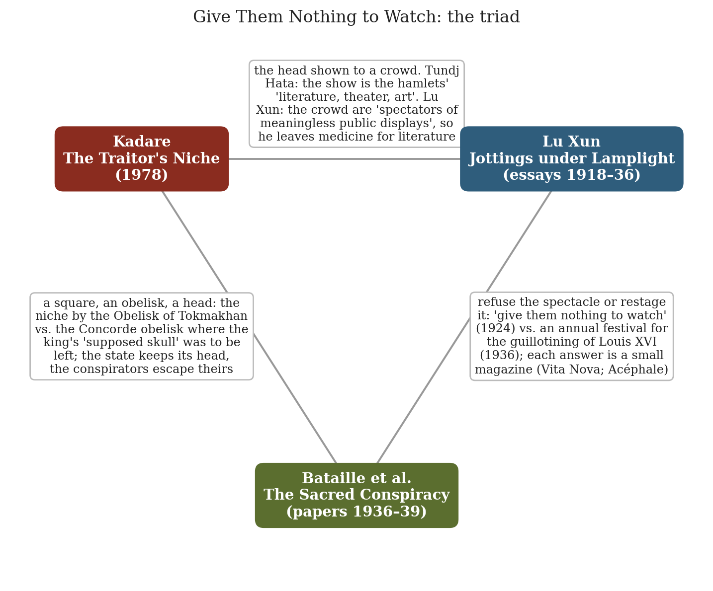
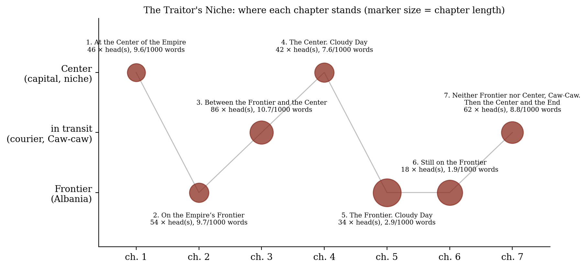
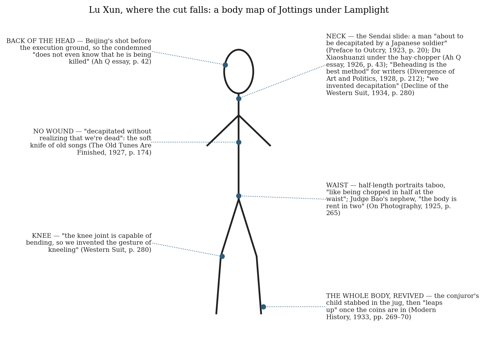
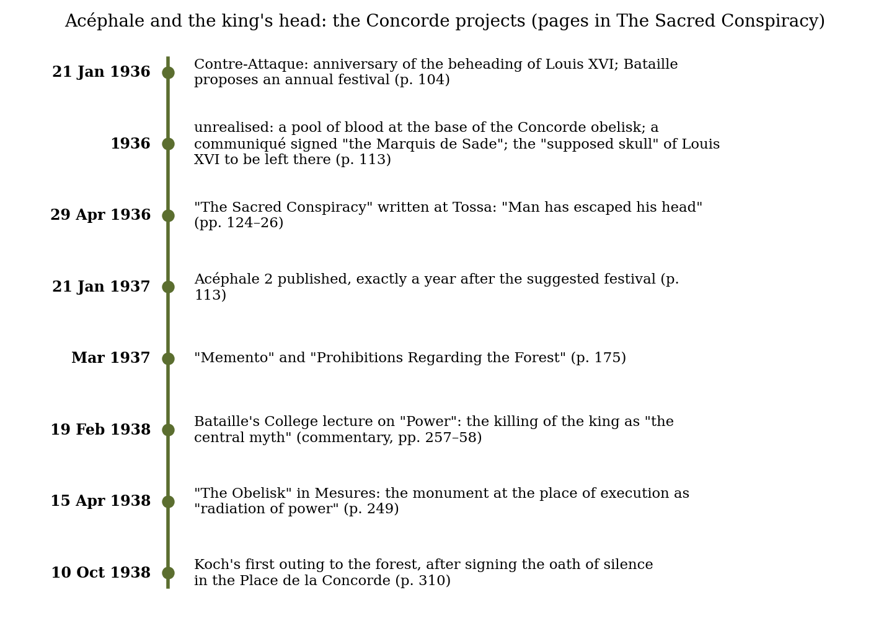

*Triad 11 of 32 · 2026-10-04 · Difficulty 4 · Conflict, Shared figure or motif, Oblique/structural*

## The three books

- [[books/5867-the-traitor-s-niche|The Traitor's Niche]], [[people/ismail-kadare|Ismail Kadare]], [[people/john-hodgson|John Hodgson]] (translator); 1978. *Anchor: the state's head on display, and the courier who sells it to villages as their 'literature, theater, art'.*
- [[books/4214-jottings-under-lamplight|Jottings Under Lamplight]], [[people/lu-xun|Lu Xun]], [[people/eileen-j-cheng|Eileen J. Cheng]] (editor), [[people/kirk-a-denton|Kirk A. Denton]] (editor); 1918–1936 (essays); 2017 (this edition). *Refusal: the spectators' side; the writer who leaves medicine because a beheading was watched as a show, and wants to 'give them nothing to watch'.*
- [[books/7729-the-sacred-conspiracy-the-internal-papers-of-the-s|The Sacred Conspiracy: The Internal Papers of the Secret Society of Acéphale and Lectures to the College of Sociology]], [[people/georges-bataille|Georges Bataille]], [[people/marina-galletti|Marina Galletti]] (editor), [[people/alastair-brotchie|Alastair Brotchie]] (editor), [[people/natasha-lehrer|Natasha Lehrer]] (translator), [[people/john-harman|John Harman]] (translator), [[people/meyer-barash|Meyer Barash]] (translator); 1936–1939 (papers); 2017/2018 (Atlas Press edition). *Restaging: escape the head, and bring the king's head back to the Concorde obelisk as a sacred rite.*

---

## The Thread

Three books about a severed head held up in front of a crowd, and three answers to what the crowd should do with it. In Kadare’s *The Traitor’s Niche* (1978) the Ottoman state puts its rebels’ heads in a niche by an obelisk in the capital, and a royal courier, Tundj Hata, quietly rents Ali Pasha’s head out to frontier villages on the way in, because for those hamlets “this spectacle was at the same time their literature, theater, art, philosophy, and perhaps love.” In Lu Xun (*Jottings under Lamplight*, essays 1918–36) a lantern slide of a Chinese man “about to be decapitated by a Japanese soldier”, with strong, apathetic onlookers round him, is the scene that turns a medical student into a writer; later he says the crowd “have always been spectators at a play” and “the only cure is to give them nothing to watch.” In *The Sacred Conspiracy* (Bataille and the secret society Acéphale, 1936–39) the head is to be restaged: Bataille proposes an annual festival for the guillotining of Louis XVI, plans to leave the king’s “supposed skull” at the base of the Concorde obelisk, and writes that “Man has escaped his head like a condemned man escaping from prison.”

So: the empire sells the spectacle, Lu Xun refuses it, and Bataille wants it back as a sacred rite. All three are about a head as the sign of sovereignty (the empire’s *caput*, the king’s head, the “head and reason for the universe”), and all three are oddly unsure of their head. Ali Pasha’s head goes missing (“A dervish buried it”); Hurshid Pasha’s head spends “forty hours … under the earth” before it is delivered; Lu Xun’s editors note that the slide has never been found and that his other account of it describes a shooting; and Acéphale’s skull of Louis XVI was only ever “supposed”. The link was built for this set: none of the three cites the others.

**Connection kinds:** Conflict; Shared figure or motif; Oblique/structural. **Difficulty:** 4.

## 1. The Traitor’s Niche — Ismail Kadare (1978)

EPUB · Calibre ID 5867 · trans. John Hodgson (Counterpoint, 2018) → [[books/5867-the-traitor-s-niche|book page]]

**Selection logic.** This is the anchor, from the day’s random pool, a Gestext book. It has the most concrete version of the motif (a head on a copper dish, its neck “resting in a layer of honey”, kept under *Regulations for the Care of Heads*). It is also the only one of the three that follows the head’s audience past the capital, into villages where it becomes an entertainment and then a calendar.

**Overview.** It was written under Hoxha (Albanian title *Kamarja e turpit*) and set in the 1820s, during Ali Pasha Tepelena’s rebellion against the Porte. Kadare uses the Ottoman Empire to stand for any state that runs on remembering and forgetting. Abdulla, the sickly keeper of the Traitor’s Niche, watches the square and the head. Hurshid Pasha takes Ali’s head, kisses it (“My guiding star”) and is soon condemned himself. Tundj Hata carries heads to the capital in snow and salt and makes money on the side by showing them. Between these scenes, the frontier chapters follow a special unit from the Central Archive, sent to Albania to erase its national identity by “the old secret doctrine of Caw-caw” (ch. 6). In the last chapter the head

*Figure 1: Constellation of the three books*

shows reach the “Caw-caw” territories, where nations that have lost their language are kept asleep. The head that arrives in the niche at the end is Hurshid’s.

**Excerpt — the show in a mosque porch (ch. 3, ≈31%).** The courier has called out the titles, as a herald would:

> As he uttered the last word, he put his hand in the bag and, gripping the head by the hair, drew it out in a swift movement. It resembled less a head than a packed chunk of snow, through which strands of grizzled hair were intermittently visible. Tundj Hata began to pick off the snow. First he exposed the right eye, and then the nose, the cheeks, the other eye, the eyebrows, and the full face, a wan gray.

> The silence, already total, deepened, as if within this silence a gate to some abyss had opened.

> The head was establishing its rapport with the crowd. Its glassy eyes sought human eyes. Death hung in the air, transparently visible. […]

> This happened at all the shows. Tundj Hata knew that for remote, buried hamlets, this spectacle was at the same time their literature, theater, art, philosophy, and perhaps love.

**Quotes.**

- “Abdulla thought that the absence of a body made the eyes larger and more significant than they really were.” (ch. 1, ≈2%)

- “It was previously thought that states had so many memorials and monuments in order that nothing should be forgotten. But it was discovered later that a major state had as much need to forget as to remember, if not more.” (ch. 2, ≈11%)

- “In his mind, if dimly, the idea had been born that a severed head could fascinate an audience just as much as a work of art.” (ch. 3, ≈25%)

- “The blanket of night was not large enough to cover the whole body of the state. Either its head or its feet would be left outside.” (ch. 3, ≈32%)

- “It took a long time to convince them that a pasha might be without a head.” (ch. 7, ≈90%)

**Derived list — the novel’s heads, and what became of them.**

1. *The vizier of Trebizond*: in the niche during the summer inspection; the doctor blames his yellow face on “rebellion and treason in their blood” (ch. 1).

2. *Nuri Pasha, “the blond pasha”*: the only showing at which Tundj Hata heard a human voice, a girl’s “Oh, how young he is!” (ch. 3).

3. *The governor of Tripoli*: carried through a winter storm, its hair steaming by an inn fire, where the idea of charging for heads was born (ch. 3).

4. *Bugrahan Pasha*: defeated by Ali and sent home as a head; its inscription reads “This is the head of the vizier Bugrahan Pasha, condemned by the Sovereign Sultan, dishonored in war and defeated by Ali Pasha Tepelena, former governor of Albania and traitor to the Empire.” (ch. 1).

5. *Ali Pasha Tepelena, “Black Ali”*: kissed by Hurshid, shown in villages for money, displayed, then “A dervish buried it on the outskirts of the city.” (ch. 7).

6. *Hurshid Pasha*: exhumed after “forty hours” in the ground and delivered at midnight, from door to door (ch. 7).

7. *Unnamed heads that keep time*: in the Caw-caw villages, “the head of the second snowfall, and, finally, the head of the gales.” (ch. 7).

**Diagram — the book’s structure.** The chapter titles swing between Center and Frontier. Counting “head(s)” per thousand words shows the word thinning out in the frontier chapters (ch. 5–6) and coming back as the courier heads for the capital.

*Figure 2: Kadare structure*

## 2. Jottings under Lamplight — Lu Xun (essays 1918–1936)

PDF · Calibre ID 4214 · ed. Eileen J. Cheng and Kirk A. Denton (Harvard UP, 2017); various translators → [[books/4214-jottings-under-lamplight|book page]]

**Selection logic.** I searched the catalogue for “decapitat” and “spectator”. This book gave the crowd’s side: Kadare’s audience, seen by a man who decided it was the patient. It also argues with Kadare head-on. Tundj Hata thinks the head is the villagers’ literature. Lu Xun leaves medicine for literature because people treated an execution as a show.

**Overview.** It is Harvard’s one-volume selection of Lu Xun’s prefaces, memorial essays and *zawen* (short polemical essays) on tradition, literature and modern culture, by more than a dozen translators. Lu Xun (Zhou Shuren, 1881–1936) studied medicine in Sendai, gave it up, and became the central writer of the May Fourth generation. The beheading recurs through the volume as fact, as metaphor and as joke.

**Quotes.**

- “Citizens of an ignorant and weak nation, no matter how healthy and sturdy their bodies, can serve as nothing more than subject matter for or spectators of meaningless public displays.” — “Preface to Outcry” (1923), trans. Eileen J. Cheng, p. 21 (PDF p. 32)

- “The masses (especially in China) have always been spectators at a play. If the sacrificial victim is bold and brave when he takes the stage, they are watching a tragedy; if he cringes and cowers, they are watching a farce.” — “What Happens after Nora Walks Out” (1924), trans. Bonnie S. McDougall, p. 261 (PDF p. 272)

- “There is nothing you can do with people like this; the only cure is to give them nothing to watch.” — ibid., p. 261

- “Beheading is the best method, since they’ll neither speak out nor think anymore.” — “The Divergence of Art and Politics” (1928), p. 212 (PDF p. 223)

- “The neck is the most delicate part of the body, so we invented decapitation; the knee joint is capable of bending, so we invented the gesture of kneeling” — “The Decline of the Western Suit” (1934), trans. Eileen J. Cheng, p. 280 (PDF p. 291)

**Diagram — where the cut falls.** Every cut body in the volume that I found, placed on the body.

**A misreading worth attempting: the slide that may not have shown a beheading.** The editors note that critics have long pointed to “the description of the photographic slide in

*Figure 3: Lu Xun body map*

‘Preface to Outcry’: depicted in the Preface as a beheading, the execution is described in Lu Xun’s memoirs as being carried out by gunfire.” They add that “Efforts to find this slide have come to naught” (Editors’ Introduction, p. 8; and n. 2 to the Preface, citing “Mr. Fujino”). Read the Preface as an act of decapitation, not a report of one: Lu Xun gave the scene a head because he needed the cut, the blade that separates the “healthy and sturdy” bodies from the “spirits” he now meant to treat. In his own later image the execution is a stage (“a play”), and a stage can use a better prop. That puts him beside Tundj Hata, who adds a “story” to his heads “to make his show more attractive”, and beside Acéphale’s “supposed skull” of the king. The ironies line up: the writer who wanted to give the crowd nothing to watch founded his vocation on a picture, possibly altered, of watching.

**Derived list — Lu Xun’s catalogue of spectators.**

1. The Sendai slide: “people who had come to appreciate the grand spectacle” (Preface to Outcry, p. 21).

2. Du Xiaoshuanzi, under the hay-chopper: the murdered man’s two sons “were spectators at the scene” (newspaper excerpt quoted in How “The True Story of Ah Q” Came About, p. 43).

3. The mutton shop: “people standing outside a Beijing mutton shop watching open-mouthed as a sheep is being skinned” (Nora, p. 261).

4. The street conjuror: the child killed in the jug for coins and revived; “The befuddled spectators disperse as if on cue.” (Modern History, 1933, p. 270).

5. The reader as spectator: “Yet after all these years, it’s still the same show, and there will always be those who watch” (ibid.).

## 3. The Sacred Conspiracy — Georges Bataille et al. (papers 1936–1939)

PDF · Calibre ID 7729 · ed. Marina Galletti and Alastair Brotchie; trans. Natasha Lehrer, John Harman, Meyer Barash (Atlas Press; edition dated 2017 on its title page, 2018 by the translator’s site). The library also has a duplicate record, ID 696. → [[books/7729-the-sacred-conspiracy-the-internal-papers-of-the-s|book page]]

**Selection logic.** I found it searching for “Acéphale”, then confirmed the link by finding “obelisk” and “Louis XVI” in its chronology. It provides the third position. Kadare’s state keeps its head and displays the rebels’. Lu Xun wants the head (the spirit) cured. Acéphale wants man rid of his head, and wanted the king’s head shown again at the obelisk where it fell. This is the only one of the three that treats the spectacle as something to be made, ritually, by a community.

**Overview.** This volume collects the internal papers of the secret society Acéphale (1936– 39), texts from the journal *Acéphale*, and lectures to the College of Sociology, connected by a detailed chronology and commentaries. The headless figure on Masson’s cover holds a dagger and a flaming heart and has a labyrinth on its stomach. Beside it run rules, oaths of silence, meetings in the forest of Marly, and debates over sacrifice.

**Excerpt — “The Sacred Conspiracy” (Tossa, 29 April 1936), pp. 124–25 (PDF pp. 131– 32).** The scan’s OCR adds letter-spacing; the text below matches it once spacing is ignored.

> Too long has human life served as head and reason for the universe. In so far as it becomes this head and this reason, and in so far as it becomes necessary to the universe, it accepts servitude. […]

> Man has escaped his head like a condemned man escaping from prison.

> What he has found beyond himself is not God, who is the prohibition of all crime,

> but a being who knows no prohibition. Beyond what I am, I encounter a being who makes me laugh because he has no head, and who fills me with anguish because he is formed of innocence and crime […] his stomach is the labyrinth in which he himself has become lost, and I along with him, and there I rediscover myself as him, in other words the monster.

**Derived list — the rules of a headless society.**

1. “Never utter a single word — not even the slightest allusion — regarding these encounters” (Prohibitions Regarding the Forest of Acéphale, rule 3, March 1937, p. 175).

2. “Obey all the negative instructions specific to each encounter (including not speaking, not straying from the path, not leaving a place during a given period, not opening the envelope until the time stated).” (ibid., rule 5).

3. “REMEMBER THAT IN WAR IS TRUTH” (“Memento”, March 1937, p. 175).

4. The rite actually kept, as opposed to the festival only proposed: “a refusal to shake hands with anti-Semites.” (Introduction, p. 83).

5. With crowds: “it is quite possible to look at them without hearing what they are saying” (“The Sacred Conspiracy”, pp. 124–25). Set this beside the chatter of Kadare’s square and Lu Xun’s “open-mouthed” onlookers.

**Diagram — the king’s head and the obelisk.** These are the Concorde projects as the chronology records them. Most were never carried out.

*Figure 4: Bataille timeline*

**Quotes.**

- “What we are starting is a war.” (“The Sacred Conspiracy”, p. 124)

- “Bataille suggested an annual celebration of the guillotining of Louis XVI at the Place de la Concorde. This was never put into practice” (editors’ introduction, p. 83)

- “A similar project to leave the supposed skull of Louis XVI at the same spot was likewise never carried out.” (Chronology, 1936, p. 113)

- “the guillotining of Louis XVI, embodied all the profane and sacred meanings of the killing of the king, which is why Bataille envisaged an annual rite to celebrate it.” (commentary on the lecture “Power”, 19 February 1938, p. 258)

## Where this sends you

## Notebook

1. **The courier’s patter.** Tundj Hata uncovers the head feature by feature (“First he exposed the right eye, and then the nose, the cheeks…”, ch. 3) and gives the villagers “some sort of story, to make his show more attractive” (ch. 7). Write a short prose piece that reveals one object to a silent audience in that order, part by part. Then rewrite it under Lu Xun’s rule, “give them nothing to watch” (p. 261): how do you write the scene so it cannot be a show?

2. **Escaping the head.** Bataille’s “Man has escaped his head like a condemned man escaping from prison” against Lu Xun’s “The neck is the most delicate part of the body, so we invented decapitation; the knee joint is capable of bending, so we invented the gesture of kneeling” (p. 280). Lu Xun reads gestures (kneeling) as the habits of a political anatomy. Write a page of gestures for the acephalic body. With no head to bow, what does it kneel with? Where does the labyrinth on its stomach send the hand?

3. **The supposed skull.** Lu Xun’s slide may have been a shooting (Editors’ Introduction, p. 8); Ali’s head is buried by a dervish; Acéphale’s skull of Louis XVI is “supposed” (p. 113). Write a provenance file for a relic whose authenticity everyone needs and no one can check: inscription, keeper’s log, the doctor’s note under the *Regulations for the Care of Heads*. Which document makes the head real?

## Rabbit holes

- Lu Xun, “Preface to *Call to Arms*” (1922), from *Selected Stories of Lu Hsun* (Foreign Languages Press, Peking, 1960), Marxists Internet Archive. This translation calls the slide a “film”, so compare it with Cheng’s “slide”: https://www.marxists.org/archive/lu-xun/1922/12/03.htm

- Alexandre Dumas, *Ali Pacha* (Celebrated Crimes), Project Gutenberg: Dumas’s account of Kadare’s rebel, Ali Tepeleni: https://www.gutenberg.org/ebooks/2753

- Georges Bataille, *Visions of Excess: Selected Writings 1927–1939*, Internet Archive, with “The Obelisk” (p. 213), the essay the chronology dates to April 1938: https://ia601808.us.archive.org/3/items/georges-bataille-visions-of-excess-selected-writings-19271939/georges-bataille-visions-of-excess-selected-writings-19271939.pdf

- Julia Kristeva, *The Severed Head: Capital Visions* (Columbia UP), the book from her Louvre exhibition, from Paleolithic skulls to modern art: https://www.degruyterbrill.com/document/doi/10.7312/kris21905/html

| • Shusha Guppy, | “Ismail Kadare, | The Art of Fiction No. 153”, | The Paris Review |
|---|---|---|---|
| 147 (1998), on writing under Hoxha with “allegory, satire, historical distancing”: |  |  |  |
| https://www.theparisreview.org/interviews/1105/ismail-kadare-the-art-of-fiction-no-153-ismail-kadare |  |  |  |
| ismail-kadare |  |  |  |
| • Natasha Lehrer, translator’s page for *The Sacred Conspiracy* (Atlas Press): https://natashalehrer.com/translations/the-sacred-conspiracy-the-internal-papers-of-the-secret-society-of-acephale-and-lectures-to-the-college-of-sociology/ |  |  |  |
| sacred-conspiracy-the-internal-papers-of-the-secret-society-of-acephale-and-lectures-to- |  |  |  |
| the-college-of-sociology/ |  |  |  |

## Also in your library

- *The Three-Arched Bridge*, Ismail Kadare (ID 14263): the bridge with the immured man that Tundj Hata crosses with Ali’s head (ch. 3).

- *The Death Penalty, Volume I*, Jacques Derrida (ID 3731): the seminar on execution as public spectacle, from the guillotine onward.

- *Encyclopaedia Acephalica*, Georges Bataille et al. (ID 302): the Critical Dictionary from *Documents*, the reference book of the headless.

## To carry

> “the only cure is to give them nothing to watch.” — Lu Xun, “What Happens after Nora Walks Out” (1924), trans. Bonnie S. McDougall, *Jottings under Lamplight*, p. 261

## Themes

[[themes/acephale|Acéphale]] · [[themes/ali-pasha-tepelena|Ali Pasha Tepelena]] · [[themes/caput|caput]] · [[themes/caw-caw|Caw-caw]] · [[themes/crowd|crowd]] · [[themes/forgetting|forgetting]] · [[themes/gesture|gesture]] · [[themes/gesture-of-kneeling|gesture of kneeling]] · [[themes/headlessness|headlessness]] · [[themes/labyrinth|labyrinth]] · [[themes/literature-vs-spectacle|literature vs. spectacle]] · [[themes/louis-xvi|Louis XVI]] · [[themes/lu-xun-s-slide|Lu Xun's slide]] · [[themes/oath-of-silence|oath of silence]] · [[themes/obelisk|obelisk]] · [[themes/ottoman-empire|Ottoman Empire]] · [[themes/place-de-la-concorde|Place de la Concorde]] · [[themes/provenance|provenance]] · [[themes/relic|relic]] · [[themes/sacrifice|sacrifice]] · [[themes/secret-society|secret society]] · [[themes/severed-head|severed head]] · [[themes/sovereignty|sovereignty]] · [[themes/spectacle|spectacle]] · [[themes/spectator|spectator]]

---

Previous: [[triads/2026-10-03-ill-favored-black-unicorns|Ill-Favored Black Unicorns]]  
Next: [[triads/2026-10-05-without-aid-or-supervision|Without Aid or Supervision]]
