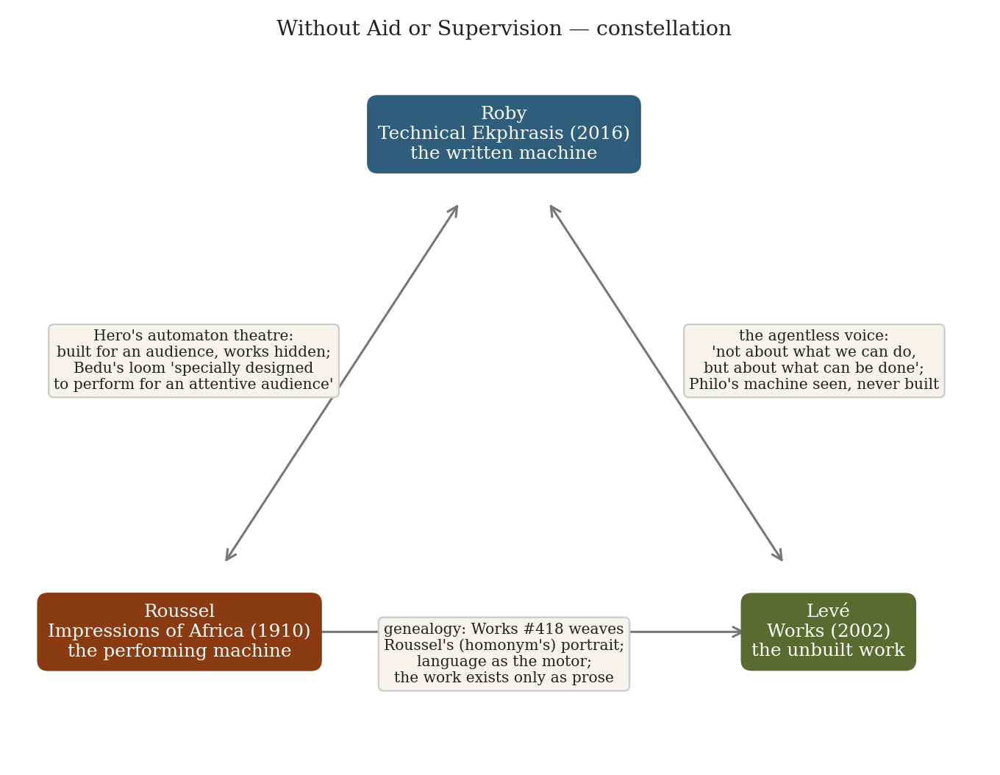
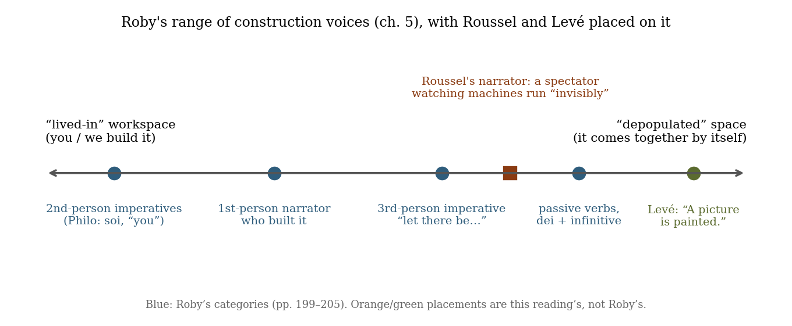
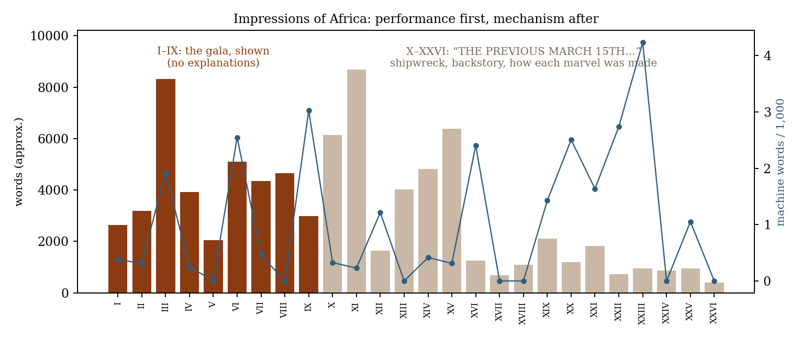
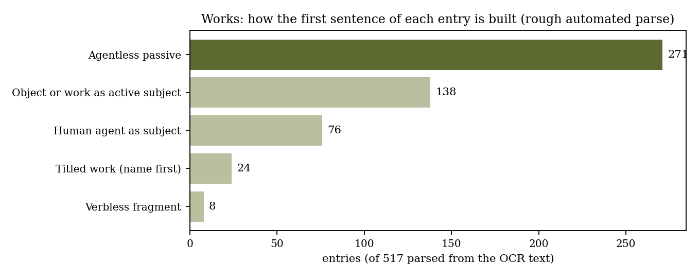

*Triad 12 of 32 · 2026-10-05 · Difficulty 4 · Shared form or method, Genealogy/influence, Oblique/structural*

## The three books

- [[books/4232-technical-ekphrasis-in-greek-and-roman-science-and|Technical Ekphrasis in Greek and Roman Science and Literature]], [[people/courtney-roby|Courtney Roby]]; 2016. *Theory: the written machine*
- [[books/772-impressions-of-africa|Impressions of Africa]], [[people/raymond-roussel|Raymond Roussel]], [[people/mark-polizzotti|Mark Polizzotti]] (translator); 1910. *Practice: the performing machine*
- [[books/252-works|Works]], [[people/edouard-leve|Édouard Levé]], [[people/jan-steyn|Jan Steyn]] (translator); 2002. *Limit case: the unbuilt work*

---

## The Thread

Three books in which a made thing exists because it is described, and in which grammar decides whose hands made it. Courtney Roby’s *Technical Ekphrasis in Greek and Roman Science and Literature* (2016) studies how Hero, Philo, Vitruvius and others put machines into prose: Philo makes the reader see his artillery “even if he never builds the machine that would embody them in the world” (p. 214), and a whole register of Greek construction prose, passives and third‑person imperatives, builds the thing in “a depopulated or impersonal construction space, in which the artifact seems to come together without human intervention” (p. 205). Raymond Roussel’s *Impressions of Africa* (1910) makes that register into a novel. Bedu’s river‑powered loom weaves a picture of the Flood “Invisibly moved by the driving belts” (ch. VI), and the backstory says it could repeat a design “indefinitely, without aid or supervision” (ch. X). Louise Montalescot’s machine paints a landscape with no lens and no hand (ch. IX). Like Hero’s automaton theatre, everything is built to be watched, and the book shows the performance (chs. I–IX) before the mechanism (chs. X–XXVI). Édouard Levé’s *Works* (2002) takes the last step: 533 artworks “conceived but not brought into being” (#1), most of them stated in the agentless present passive (“A picture is painted,” #29), the Helping Hand of Greek geometry put to work on conceptual art.

Kinds of connection: **shared form or method** (description as fabrication), **genealogy** (Levé names Roussel twice and, in #418, weaves a tapestry of a man who shares Roussel’s name; Roussel’s machines are run by “a highly regulated process in which language itself is the sole motor and guide,” as Polizzotti puts it), and **oblique/structural** (the passive voice as an ethics of agency: Roby’s “not about what we can do, but about what can be done,” p. 205, quoting Fowler and Taisbak). The three disagree about what a description owes the world. Roby’s authors want the reader able, at least in principle, to build. Roussel wanted “nothing real” (Janet, quoted in the Introduction). Levé leaves the building to whoever wants it. **Difficulty: 4.** No book cites another, apart from Levé’s two Roussel references; the Roby link is made here.

## Constellation

## 1. Technical Ekphrasis in Greek and Roman Science and Literature — Courtney Roby (2016)

*PDF · Calibre ID 4232 · Cambridge University Press. Page numbers are printed pages (PDF page = printed + 12).* → [[books/4232-technical-ekphrasis-in-greek-and-roman-science-and|book page]]

**Selection logic.** This is the theory book of the three. It supplies the vocabulary (*enargeia*, generativity, the “Helping Hand”) and the ancient precedent: machine prose that may never be built and is often written to impress an audience. Without it, Roussel and Levé look like two eccentrics. With it, they look like the late end of a very old genre.

**Overview.** Roby reads technical descriptions of mechanical artifacts across genres: Hero of Alexandria’s automata and artillery, Philo of Byzantium’s *Belopoeica*, Vitruvius, Frontinus on the aqueducts, along with poets and historians. The book has three pairs of chapters: the corpus and its contexts (1–2); rhetorical and visual tools, including lettered diagrams (3–4); and description versus instruction, and machines as embodiments of knowledge (5–6). Its central claim is that technical ekphrasis is “a verbal encoding of the attributes of an object so the reader can recreate it in his imagination” (p. 14), and that how much the text lets the reader *build* (“generativity”) depends on voice as much as on detail.

**Quotes**

- “ekphrastic descriptions carry the power of enargeia, the clarity of imaginary vision sparked in the reader” (Introduction, p. 2)

- “The object may be real, theoretical, or imaginary; contemporary or historical; it may be familiar or something neither author nor reader has ever experienced.” (p. 14)

- “Because automata are designed to mystify an audience, Hero takes into account the perspective of the audience as well as the designer.” (p. 5)

- “once that part of the text is done, so is the machine.” (ch. 5, p. 199, on purely descriptive texts)

- “The alternative to this “lived-in” space is a depopulated or impersonal construction space, in which the artifact seems to come together without human intervention.” (ch. 5, p. 205)

**Glossary of Roby’s working terms** (as she uses them)

- *Ekphrasis*: per Aelius Theon, “descriptive speech vividly (ἐναργῶς) bringing into view the thing shown” (p. 2).

- *Enargeia*: the vividness that makes the absent object feel present.

- *Generativity*: “a variable quality of descriptive texts” (p. 199). It is high when “the artifact is described through instructions that show it coming together before the reader’s eyes” (p. 199), whether or not anyone builds it.

- *Lived-in vs. depopulated workspace*: second‑person address (“you”, Philo’s *soi*) puts reader and author at the bench. Passives and *dei* + infinitive empty the bench (p. 205).

- *Helping Hand*: Fowler and Taisbak’s name for the unseen agent of the third‑person imperative (“let there be…”). Roby, quoting Creese: “while there is indeed a Helping Hand in Greek mathematics, there seems not to be a Helping Imagination.” (p. 205)

- *Emphainein / theōrein*: Philo’s verbs for making the reader see and consider the device while learning to build it (p. 214).

**Diagram: the range of construction voices**

## 2. Impressions of Africa — Raymond Roussel (1910)

*EPUB · Calibre ID 772 · trans. Mark Polizzotti (Dalkey Archive, 2011). Locations by chapter.* → [[books/772-impressions-of-africa|book page]]

**Selection logic.** This is the machine book. Roussel writes technical ekphrasis at full Hero-nian density (warp, heddles, battens, shuttle‑box, paddles) for machines that work only in prose and were generated by puns. His machines run themselves before an audience, and the novel is built like Hero’s automaton theatre: the show first, the mechanism and backstory after.

**Overview.** Passengers of the *Lynceus*, bound for Buenos Aires, are wrecked on the coast of the fictive African kingdom of Ponukele and held by the emperor Talou until a ransom arrives. To pass the time they call themselves the Incomparables and stage a gala. Chapters I–IX describe the gala’s performances without explaining them. Chapter X begins “THE PREVIOUS MARCH 15TH” and the rest of the book tells who these people are and how each marvel came to be. Polizzotti’s introduction sets out Roussel’s *procédé*, published after his death in *How I Wrote Certain of My Books*: episodes generated from pairs of near‑homophonic phrases.

**Excerpt: Bedu’s loom starts (ch. VI).** The narrator watches. Note how much happens with nobody doing it.

> Paddles, chest, ceiling, panel, shuttles, posts, and the ancillary parts—all, without exception, were made of fine steel of light gray hue. […] Invisibly moved by the driving belts, the upper portions of which disappeared into the shadows of the chest, the box of shuttles slid horizontally in the axis of the current.

The first sentence is the inventory; the second comes just after Bedu presses the switch. What the loom then weaves is a scene of drowning people: “The tableau depicted a vast waterway, at the surface of which men, women, and children, eyes bulging in terror, clung desperately to bits of flotsam in a sea of wreckage” (ch. VI). The machine of a shipwrecked man weaves a shipwreck and calls it the Flood.

**Quotes**

- “Manufactured in situ by an anomaly of this extraordinary machine, which was specially designed to perform for an attentive audience” (ch. VI)

- “the machine could reproduce the same design indefinitely, without aid or supervision.” (ch. X, passenger list no. 10)

- “Despite the absence of an actual lens, the polished surface, owing to its extreme sensitivity, received extremely powerful impressions of light” (ch. IX, Louise’s painting machine)

- “Louise watched joyfully over the operation of her machine, which so far had functioned without accident or error.” (ch. IX)

- Janet on Roussel: “The work must contain nothing real, no observations on the world or the mind, nothing but completely imaginary combinations.” (Introduction)

**Derived list: the self‑running marvels, and what drives them** (from chs. III–X)

1. Bedu’s loom: river current turning paddles, with an electromagnet driving the heddles; no punch cards (ch. VI).

2. Louise Montalescot’s painting machine: a light‑sensitive brown plate with no lens, wires, a sphere, and an articulated arm with a wheel of brushes; it paints in vertical strips, then draws (ch. IX).

3. Bex’s automated orchestra in a glass cage, its parts made of “bexium,” a metal with “phenomenal thermal sensitivity,” so it plays by temperature (ch. III).

4. Fuxier’s lozenges: red ones bloom into smoke images in a flame, blue ones into bas‑reliefs in water, and grapes ripen with tableaux inside (ch. X, no. 11).

5. La Billaudière‑Maisonnial’s mechanical foil “capable of multiple transcendent feints” (ch. X, no. 5).

6. Darriand’s hallucinogenic plants, which make a subject “take for reality what were merely projections of finely colored film” (ch. X, no. 8).

**Diagram: performance first, mechanism after** *Words per chapter from the EPUB spine. The blue line counts “machine,” “apparatus,” “mech-*

*anism,” “device,” “contraption” per 1,000 words. In raw counts the gala chapters lead (III: 16, VI: 13, IX: 9); the per‑1,000 spikes late in the book are short chapters where a few mentions weigh heavily.*

## 3. Works — Édouard Levé (2002)

*PDF (OCR scan) · Calibre ID 252 · trans. Jan Steyn (Dalkey Archive, 2014). Cited by entry number. The PDF is an archive.org OCR scan: the text is readable, but 16 of 533 entries didn’t parse cleanly, and every quote below was checked against the OCR text.* → [[books/252-works|book page]]

**Selection logic.** This is the unbuilt book: the end point of Roby’s “once that part of the text is done, so is the machine.” Levé writes the depopulated register as a style. The work exists in a sentence with no subject, and anyone may be the Helping Hand. He also points back to Roussel himself.

**Overview.** A numbered catalogue of 533 projects (photographs, installations, films, books, performances) in flat, present‑tense prose, with an index of names and themes at the end. A few were later realized by Levé, a photographer as well as a writer. The book frames itself: entry 1 is the book, and entries 531–533 imagine what the author does after publishing it.

**Excerpt: #418, the Roussel tapestry.** Six links of copying, set out like a mechanism.

> A two-by-two-meter tapestry is woven to resemble a photograph of Raymond Roussel taken in 1996. Raymond Roussel died in 1933. The man whose face we see is an architect—he lives in Paris. His is a homonym of the writer’s name. The tapestry and the photograph duplicate a pre-existing image: […]
>
> *(Shortened for the public edition.)*

Set this next to Bedu’s loom. One machine‑woven picture shows a disaster the weaver survived. The other shows a man who isn’t Roussel, made by a process that is all intermediaries.

**Quotes**

- “A book describes works that the author has conceived but not brought into being.” (#1)

- “Despite a compulsive desire to make a drawing, a man settles for describing the project. The drawing is realized later, following his notes.” (#240)

- “Visualizing what they hear, the listeners perform the inverse operation to the man: translating words into images.” (#283), which is Roby’s ekphrasis in one sentence.

- “Villard de Honnecourt, a medieval architect, is not known for his buildings as much as for his writings on those of his contemporaries.” (#316)

- “A voice describes an unrealized work as if it had been completed: a pile of pipettes in the Sahel desert.” (#325)

**Diagram: the grammar of the first sentence** *271 of 517 parsed entries open with a passive (“The world is drawn from memory,” #2). Across*

*all 1,900 sentences, 614 are passive and only 61 of those name an agent with “by.” The category boundaries are a regex heuristic and misfile some entries; the passive count is the reliable figure.*

**Derived list: Works that are about description** (entries that make a work out of describing one)

- #1: the book itself.

- #11: an artist draws a work from a press review’s description; the triptych has “four authors.”

- #48: proposals for artworks mailed to artists “who could have had the idea for them”; the work is the description plus the signed receipt.

- #53: a book describes a silent film in minute present‑tense detail, especially the gestures.

- #240: *Cooling Down*, a drawing described instead of drawn, and realized later from the notes.

- #283: *Visualization*, listeners turn a recorded voice’s images back into images.

- #316: drawings of fake contemporary works, made from a text about Villard de Honnecourt.

- #325: an unrealized work described as completed.

- #521: an art periodical reduced to its descriptions of artworks.

- #531–533: the author redraws, publishes the drawings, and finally gives readings on request.

## Where this sends you

**Notebook**

1. *Three voices, one work.* Write three unrealized works of your own: a gesture, an installation, a book. Do each three ways: Levé’s agentless present passive (“A picture is painted,” #29); Philo’s second person (“you will see…”, Roby p. 214); and Roussel’s spectator in the past tense, who watches it run “Invisibly moved” (ch. VI). Roby says a generative text shows the thing “coming together before the reader’s eyes” (p. 199). Which voice makes yours come together? Which one makes it yours?

2. *The plank and the pediment.* Hero hides his mechanism behind a plank and puts a pediment on the plank so it won’t look purposeless (Roby p. 5). Roussel shows nine chapters of performance and then seventeen of mechanism. Take one of your essays and write its gala and its backstage as two separate texts. Is your *procédé* something you’d publish only posthumously, as Roussel did? Write the paragraph that begins “It seems to me that it is my duty to reveal this method…” (quoted in Polizzotti’s Introduction).

3. *A double of a double.* Using #418 as a template, write the provenance chain of one image in your commonplace book (a photo, a quotation, a Benjamin fragment), each link “a double (x) of a double (y)”, until you reach something that isn’t a copy, or admit you can’t. Then write it as #316 does, as someone known less for his buildings than for his writings on other people’s.

**Rabbit holes**

- Hero of Alexandria, *The Pneumatics*, trans. J. G. Greenwood, ed. Bennet Woodcroft (1851), with temple automata and self‑acting devices. Project Gutenberg: https://www.gutenberg.org/ebooks/77400

- *Album de Villard de Honnecourt* (BnF MS fr. 19093), facsimile ed. H. Omont (1906). Internet Archive: https://archive.org/details/albumdevillardde00vill

- Mark Ford, “Raymond Roussel: How He Wrote Certain of His Books,” *PN Review* 138 (2001): https://pnreview.co.uk/archive/raymond-roussel-how-he-wrote-certain-of-his-books/803

- Monoskop’s Roussel page, with French texts of *La Vue*, *Impressions d’Afrique*, *Locus Solus* and *Comment j’ai écrit certains de mes livres*: https://monoskop.org/Roussel

- Maria Gerolemou, review of Roby, *Bryn Mawr Classical Review* 2016.12.17: https://bmcr.brynmawr.edu/?p=31491

- Daniel Levin Becker on Levé’s *Works*, *Music & Literature* (2014), which finds “Roussel-lian pointlessness” in #348: https://www.musicandliterature.org/features/2014/8/7/beaux-absents

**Also in your library**

- Michel Foucault, *Death and the Labyrinth: The World of Raymond Roussel* (1963), Calibre ID 774: the procédé as a labyrinth.

- Stanisław Lem, *A Perfect Vacuum* (1971), Calibre ID 7480: reviews of books that don’t exist, thirty years before Levé did the same for artworks.

- Vitruvius, *Complete Works*, Calibre ID 12093: one of Roby’s main sources; Book X is the book of machines.

## To carry

> “The reading ends when no one asks him to continue.”

> — Édouard Levé, *Works*, #533, trans. Jan Steyn

## Themes

[[themes/agency|agency]] · [[themes/audience-and-mechanism|audience and mechanism]] · [[themes/automata|automata]] · [[themes/conceptual-art|conceptual art]] · [[themes/copy-double|copy/double]] · [[themes/description-vs-instruction|description vs instruction]] · [[themes/ekphrasis|ekphrasis]] · [[themes/enargeia|enargeia]] · [[themes/generativity|generativity]] · [[themes/helping-hand|Helping Hand]] · [[themes/hero-of-alexandria|Hero of Alexandria]] · [[themes/instructions|instructions]] · [[themes/loom|loom]] · [[themes/machine|machine]] · [[themes/painting-machine|painting machine]] · [[themes/passive-voice|passive voice]] · [[themes/philo-of-byzantium|Philo of Byzantium]] · [[themes/procede|procédé]] · [[themes/roussel|Roussel]] · [[themes/technical-ekphrasis|technical ekphrasis]] · [[themes/unrealized-works|unrealized works]] · [[themes/villard-de-honnecourt|Villard de Honnecourt]]

---

Previous: [[triads/2026-10-04-give-them-nothing-to-watch|Give Them Nothing to Watch]]  
Next: [[triads/2026-10-06-wish-books|Wish Books]]
