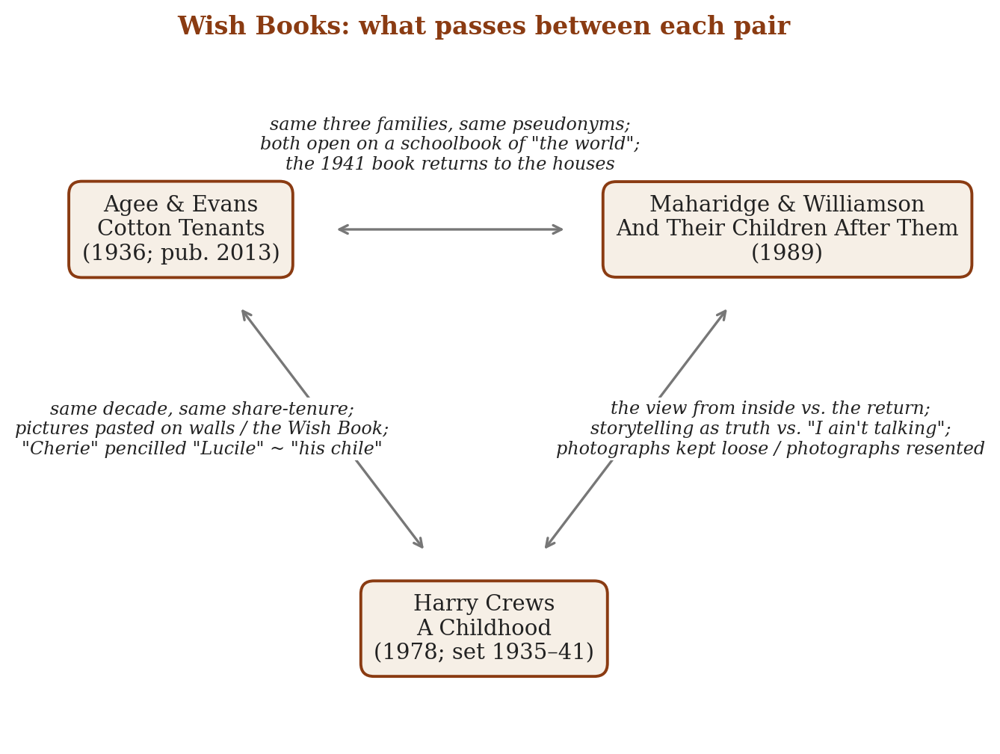
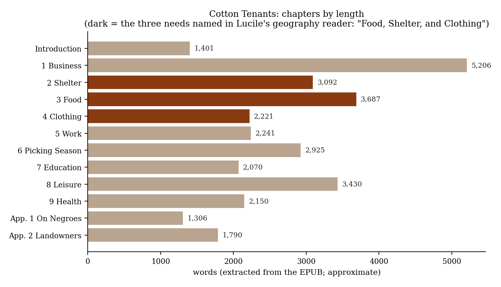
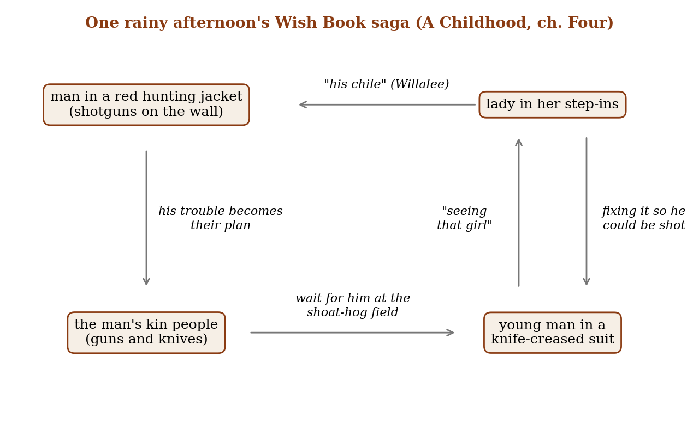
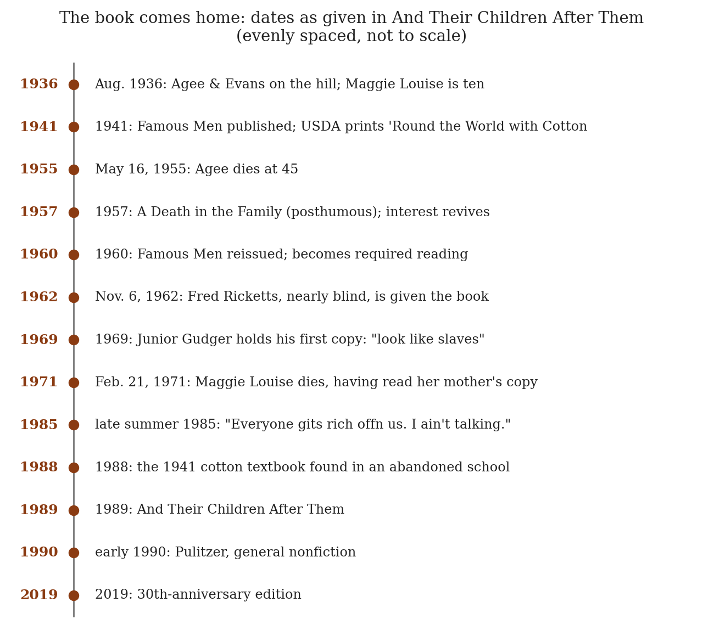

*Triad 13 of 32 · 2026-10-06 · Difficulty 3 · Same subject, Same period, Shared figure or motif, Oblique/structural*

## The three books

- [[books/889-cotton-tenants-three-families|Cotton Tenants: Three Families]], [[people/james-agee|James Agee]], [[people/walker-evans|Walker Evans]] (contributor); 1936 (written); 2013 (first published). *Anchor: the visitor's inventory of the wish-images on the tenant walls*
- [[books/10998-a-childhood-the-biography-of-a-place|A Childhood: The Biography of a Place]], [[people/harry-crews|Harry Crews]]; 1978. *The view from inside: the child who rewrites the wish-image*
- [[books/10207-and-their-children-after-them|And Their Children After Them]], [[people/dale-maharidge|Dale Maharidge]], [[people/michael-williamson|Michael Williamson]] (contributor); 1989 (30th-anniversary ed. 2019). *The return: the subjects read their own picture*

---

## The Thread

Three books about the cotton and tobacco tenancy of the 1930s South, and about the printed pictures of a better life that came into those houses, and the printed book that later came back into them. In James Agee’s *Cotton Tenants* (written in 1936 for *Fortune*, killed, first published 2013), the opening sentences are lifted from a third-grade geography reader, *Around the World With the Children*, which belonged to Lucile Burroughs, aged ten. On the Burroughs wall hangs a Peters Shoes calendar girl titled “Cherie,” with “Lucile” pencilled under it twice. In Harry Crews’s *A Childhood* (1978), a boy born in 1935 in Bacon County, Georgia, sits on a porch with Willalee Bookatee, son of the Black tenant family on the Crews place, and turns the Sears, Roebuck “Wish Book” into a saga of feuds and maimings, because “all the people in its pages were perfect” and he knew “under those fancy clothes there had to be scars.” In Dale Maharidge and Michael Williamson’s *And Their Children After Them* (1989), the book made from Agee’s visit comes home to the families. Junior “fumed that it made them look like slaves.” Fred Ricketts, nearly blind, “kept looking at Evans’s pictures.” Maggie Louise, Agee’s Lucile under her *Famous Men* pseudonym, read her mother’s copy before her death in 1971. Maharidge also opens a section on a schoolbook: a 1941 USDA reader, *’Round the World with Cotton*, dug out of the debris of an abandoned school.

The connection is one subject, one period and one motif seen from three positions. The motif is the wish-image in the poor house. Agee is the visitor who inventories the pictures. Crews is the child inside who rewrites them. Maharidge is the return, recording what happened when the subjects became the picture. The triad repays the effort because Crews’s children do to the catalogue what documentary does to its subjects, in reverse: they add the scars the image leaves out. Agee records the opposite gesture: a girl’s name, pencilled twice under the perfect one. He does not say whose hand did it, and he doesn’t need to. Agee to Maharidge is plain genealogy. Crews never mentions Agee, and Maharidge never mentions Crews, so that bridge is built here. **Connection kinds:** Same subject; Same period; Shared figure or motif; Oblique/structural. **Difficulty:** 3.

## Constellation

## Cotton Tenants: Three Families — James Agee, photographs by Walker Evans (written 1936; first published 2013)

EPUB · Calibre ID 889 · flagged Gestext → [[books/889-cotton-tenants-three-families|book page]]

**Selection logic.** This is the anchor, and one of your Gestext books. It is the first, rejected form of *Let Us Now Praise Famous Men*, written to *Fortune*’s brief, and under its real names (Burroughs, Fields, Tingle) rather than the book’s pseudonyms. It supplies the triad’s first scene: the printed outside world inside a tenant house, catalogued by a visitor who knows his readers will be holding a glossy magazine.

**Overview.** A 30,000-word report on three white tenant families on Mills Hill, Hale County, Alabama, in the summer of 1936. *Fortune* held it for a year and killed it; the typescript was found among Agee’s papers and published in *The Baffler* (2012) and by Melville House (2013), with an editor’s note by John Summers and an essay by Adam Haslett. Unlike *Famous Men*, it is organized like a survey: Business, Shelter, Food, Clothing, Work, Picking Season, Education, Leisure, Health, with appendices on Black tenants and on landowners. Its prose is mostly flat, factual and furious, and now and then it rises into poetry.

**Excerpt** (ch. 2, “Shelter”). The inventory of the Burroughs walls, where a pencil answers a calendar:

> On the walls are pasted or tacked such items as these: a calendar advertising Peters Shoes, depicting a pretty girl in a red hat, cuddling red flowers. Title: Cherie. Subtitle (written twice, in pencil): Lucile. A tinted photograph of a neat, new-overalled, clean country boy fishing. Title: Fishin’. […]
>
> *(Shortened for the public edition.)*

**Quotes**

- “a third grade geography textbook belonging to Lucile Burroughs, aged ten, daughter of a cotton tenant.” (Introduction)

- “Human life, we must assume in the first place, is somewhat more important than anything else in human life, except, possibly, what happens to it.” (Introduction)

- “his features just a little exaggerated beyond that square-chiseled head which the commercial artist Leyendecker sets up as Goodlooking” (ch. 1, “Business”; on Floyd Burroughs. The documentary measures its subject against an advertisement.)

| • “Real Life Readers—New Stories and Old. | A Third Reader. | (With color photographs |
|---|---|---|
| about as real-life as color photographs get.)” (ch. 7, “Education”) |  |  |
| • “There are very, very few newspapers or magazines. What there are, are saved. The |  |  |
| covers and pretty pictures are pasted on the walls; the children save and look at the |  |  |
| comic sections over and over.” (ch. 8, “Leisure”) |  |  |

**Diagram: the report borrows the schoolbook’s skeleton.** Lucile’s reader asks what every person needs (“Food, Shelter, and Clothing”), and ch. 5 opens by quoting it back: “Food: Clothing: Shelter”. Three of the nine chapters are those needs. The longest is “Business”, the arithmetic of debt the reader leaves out.

**Derived list: printed matter in the Burroughs house, as Agee records it**

1. *Around the World With the Children*, third-grade geography (Introduction)

2. Peters Shoes calendar, “Cherie”, subtitled in pencil “Lucile” twice (ch. 2)

3. Tinted photograph, “Fishin”’ (ch. 2)

4. Plates torn from a child’s book: “The Harper Was Happier Than a King…”, “She Took the Little Prince in Her Arms and Kissed Him” (ch. 2)

5. Salomar Extra Quality Mackerel label, torn from a tin (ch. 2)

6. Schoolbooks: *Open Door Language Series*, *Trips to Take*, *Outdoor Visits*, *Real Life Readers*, the Trabue-Stevens Speller, *Champion Arithmetic* (ch. 7). Floyd sold a hog, “badly needed for winter meat,” to afford them.

7. Saved magazine covers and comic sections; Frank Tingle’s pulps and the *Progressive Farmer* (ch. 8)

## A Childhood: The Biography of a Place — Harry Crews (1978)

EPUB · Calibre ID 10998 → [[books/10998-a-childhood-the-biography-of-a-place|book page]]

**Selection logic.** This is the inside view of the same economy. Crews was born in 1935 into share-farming in South Georgia, the same age as the Burroughs children, and his memoir covers the years Agee saw for eight weeks. It contributes the triad’s counter-gesture: a child who reads the national image of the good life and supplies the missing wounds. It also widens what Agee’s report deliberately leaves out (“But this is not their story”, Introduction, on Black tenants). Crews’s co-authors on the porch are Willalee Bookatee and Lottie Mae, children of the Black tenant family on his family’s farm.

**Overview.** A memoir of Crews’s first six years in Bacon County: the father he never knew, assembled from other people’s stories; the stepfather; an illness that left him paralyzed for weeks; being scalded over two-thirds of his body at hog-killing time; the curse-stories of Auntie, the old woman in the tenant house; tobacco and mules. The book grew out of his “Grits” column in *Esquire* (per the New Georgia Encyclopedia), and he insists from the first chapter that told memory is true memory: “Nothing is allowed to die in a society of storytelling people.”

**Excerpt** (ch. Four). Why the catalogue had to be corrected:

> I first became fascinated with the Sears catalogue because all the people in its pages were perfect. Nearly everybody I knew had something missing, a finger cut off, a toe split, an ear half-chewed away, an eye clouded with blindness from a glancing fence staple. And if they didn’t have something missing, they were carrying scars from barbed wire, or knives, or fishhooks. […]
>
> *(Shortened for the public edition.)*

**Quotes**

- “The Sears, Roebuck catalogue was much better used as a Wish Book, which it was called by the people out in the country, who would never be able to order anything out of it, but could at their leisure spend hours dreaming over.” (ch. Four)

- “forcing the beautiful people to give up the secrets of their lives: how they felt about one another, what kind of sicknesses they may have had, what kind of scars they carried in their flesh under all those bright and fancy clothes.” (ch. Four)

- “Making up stories, it seems to me now, was not only a way for us to understand the way we lived but also a defense against it.” (ch. Four)

- “I did not like to look at them caught in the stiff, protected pages.” (ch. One; on his father’s photographs, which he took back out of the album and returned to a shoebox)

- “Some natural mimic in me picks up whatever verbal tics or mannerisms it gets close to.” (ch. One; Crews on his own journalism interviews)

**Diagram: one afternoon’s Wish Book saga.** The plot Crews and Willalee built from three catalogue pages, opened at random. Willalee supplies the kinship (“This lady here in her step-ins is his chile.”). Harry supplies the moral, from his daddy, about what a white shirt and a suit reveal.

**Derived list: the catalogue’s absences, as Crews lists them** (ch. Four)

- a finger cut off · a toe split · an ear half-chewed away · an eye clouded with blindness from a glancing fence staple

- scars from barbed wire, or knives, or fishhooks

- (and, in the catalogue’s place) “straight” legs, heads “never bald,” “looks of happiness, even joy”

## And Their Children After Them — Dale Maharidge, photographs by Michael Williamson (1989; 30th-anniversary edition 2019)

EPUB · Calibre ID 10207 → [[books/10207-and-their-children-after-them|book page]]

**Selection logic.** This is the return, and the book that closes the circuit. Maharidge and Williamson went back to Agee’s three families in the mid-1980s. Their book records the moment the printed page reached the people printed in it, and they take on Agee’s guilt knowingly (“not just to inquire of the deed but to repeat it”). It answers Crews from the other side: here the subjects get to say what they think of their picture.

**Overview.** A history of the 22 people Agee and Evans met in 1936 and their 128 survivors and offspring, set against the collapse of King Cotton: the mechanical picker, the boll weevil, migration. It runs in four parts (1936–1940, 1940–1960, 1960–1986, 1986–2019), each moving through the Gudger, Ricketts and Woods families and two that Agee passed over: the Bridgeses, white owners of the yellow house at the foot of the hill, and the Gaineses, Black

tenants farther south. Maharidge notes that *Fortune*’s editors “made clear that they didn’t want it to include blacks” (Part I, “Gaines”). Williamson’s photographs are set beside Evans’s from the same angles. It kept Agee’s pseudonyms and won the 1990 Pulitzer Prize in General Nonfiction.

**Excerpt** (Part III, “Gudger”, 1960–1986). How the book came back:

> Word slowly drifted back to Alabama that some of their own had made up the cast of characters in a famous book. It was with some shock that many of them first viewed its pages. Mostly, they were upset with the photographs, which had a startling impact. But the text was brutal in its portrayal of some of them.

**Quotes**

- “He was holding a copy of Let Us Now Praise Famous Men, the first he had ever seen, it is said. He fumed that it made them look like slaves.” (Part III, “Gudger”; Junior, 1969)

- “Everyone gits rich offn us. I ain’t talking.” (Part III, “Gudger”; Junior, 1985)

- “He was nearly blind, but kept looking at Evans’s pictures. He was so happy that he was a famous man, Margaret recalls.” (Part III, “Ricketts”; Fred Ricketts, 1962)

- “My goodness, I could turn around and write a book on him.” (Part III, “Gudger”; Emma Woods on Agee)

- “And now we were returning to the scene of the crime, so to speak, coconspirators in the eyes of some, not just to inquire of the deed but to repeat it.” (Preface)

**Diagram: the book comes home.** Dates as Maharidge gives them.

**Other: a name concordance.* Cotton Tenants* uses the families’ real names; *Famous Men* and Maharidge use Agee’s pseudonyms (“We used the same pseudonyms he gave the families

and small towns,” Preface). The mapping, with its basis:

| Cotton Tenants (1936) | Famous Men / Maharidge | Basis |
|---|---|---|
| Floyd Burroughs | George Gudger | Encyclopedia of Alabama |
| Lucile (Maggie Lucile) | Maggie Louise Gudger | the same third-grade |
| Burroughs |  | geography reader in both books; Wikipedia’s table |
| Bud Fields | Bud Woods | Wikipedia’s table (Fields = Woods) |
| Frank Tingle | Fred Ricketts | Wikipedia’s table (Ricketts = Tengle, its spelling) |
| Floyd Junior Burroughs | Junior Gudger | inferred from family position; not separately confirmed |
| Mills Hill | Hobe’s Hill | each book’s name for the hill where the three families lived |

## Where this sends you

## Notebook

1. **Subtitle, in pencil.** Agee: “Title: Cherie. Subtitle (written twice, in pencil): Lucile.” (ch. 2). Crews’s Willalee: “This lady here in her step-ins is his chile.” (ch. Four). Take one commercial image you have kept (a postcard, a jacket photo, an ad) and write your name under it twice. Then write the paragraph in which the image and the name speak to each other. Is the pencil a claim, a wish, or a correction?

2. **Give the perfect people their scars, then reverse it.** Crews: “forcing the beautiful people to give up the secrets of their lives” (ch. Four). Do it to a page of glossy faces: an author photo spread, a faculty page, a catalogue. Then write one documentary paragraph about someone poor in the opposite direction, supplying the Wish Book the documentary leaves out (Lucile “likes school, especially all about the history of our country,” ch. 7). Which hurts its subject more?

3. **The book comes home.** Write the scene in which someone you have written about reads it. Maharidge gives you four reactions: Junior’s “made them look like slaves,” Fred Ricketts “so happy that he was a famous man,” Maggie Louise’s silence, Emma’s “I could turn around and write a book on him.” Set them against Agee’s “The infiltration of all that has to do with the outside world is slow, verbal, and distorted in transit” (ch. 8). Then ask what that sentence says about the traffic going the other way.

## Rabbit holes

- Library of Congress, “Let Us Now Praise Famous Photo Albums: Walker Evans’ Albums for *Let Us Now Praise Famous Men*”, Picture This blog: https://blogs.loc.gov/picturethis/2011/10/let-us-now-praise-famous-photo-albums-walker-evans%E2%80%99-albums-for-let-us-now-praise-famous-men/

- *The Baffler*, “Cotton Tenants” (the 2012 excerpt that brought the typescript to light): https://thebaffler.com/ancestors/cotton-tenants

- *Fortune*, “The Most Famous Story We Never Told” (2005 retrospective, Hale County 69 years later): https://www.fortune.com/2005/09/19/fortune-walker-evans-james-agee-sharecroppers

- Encyclopedia of Alabama, “Tenant Farmer Floyd Burroughs” (Evans portrait; Burroughs = George Gudger): https://encyclopediaofalabama.org/media/tenant-farmer-floyd-burroughs/

- New Georgia Encyclopedia, “Harry Crews (1935–2012)” (on the *Esquire* “Grits” column behind *A Childhood*): https://www.georgiaencyclopedia.org/articles/arts-culture/harry-crews-1935-2012

- Pulitzer Prizes, 1990 General Nonfiction, Dale Maharidge and Michael Williamson: https://www.pulitzer.org/winners/dale-maharidge-and-michael-williamson

## Also in your library

- *Let Us Now Praise Famous Men / A Death in the Family / Shorter Fiction*, James Agee (Library of America), Calibre ID 9790: the book the families held.

- *American Silences: The Realism of James Agee, Walker Evans, and Edward Hopper*, J. A. Ward (1985), Calibre ID 13374: on the silences in *Famous Men*.

- *A Space on the Side of the Road*, Kathleen Stewart (1996), Calibre ID 10431: Appalachian “just talk” as a cultural poetics, which carries Crews’s claim about storytelling into ethnography.

## To carry

> “The infiltration of all that has to do with the outside world is slow, verbal, and distorted in transit.” — James Agee, *Cotton Tenants*, ch. 8, “Leisure”

## Themes

[[themes/agee|Agee]] · [[themes/bacon-county|Bacon County]] · [[themes/catalogue|catalogue]] · [[themes/documentary|documentary]] · [[themes/exclusion-of-black-tenants|exclusion of Black tenants]] · [[themes/fortune|Fortune]] · [[themes/hale-county|Hale County]] · [[themes/king-cotton|King Cotton]] · [[themes/let-us-now-praise-famous-men|Let Us Now Praise Famous Men]] · [[themes/photography|photography]] · [[themes/pseudonyms|pseudonyms]] · [[themes/return-revisit|return/revisit]] · [[themes/scars|scars]] · [[themes/schoolbooks|schoolbooks]] · [[themes/sears-wish-book|Sears Wish Book]] · [[themes/sharecropping|sharecropping]] · [[themes/storytelling-as-truth|storytelling as truth]] · [[themes/subjects-reading-their-portrayal|subjects reading their portrayal]] · [[themes/tenant-farming|tenant farming]] · [[themes/walker-evans|Walker Evans]] · [[themes/wish-image|wish-image]]

---

Previous: [[triads/2026-10-05-without-aid-or-supervision|Without Aid or Supervision]]  
Next: [[triads/2026-10-07-the-log-breaks-off-at-the-morai|The Log Breaks Off at the Morai]]
