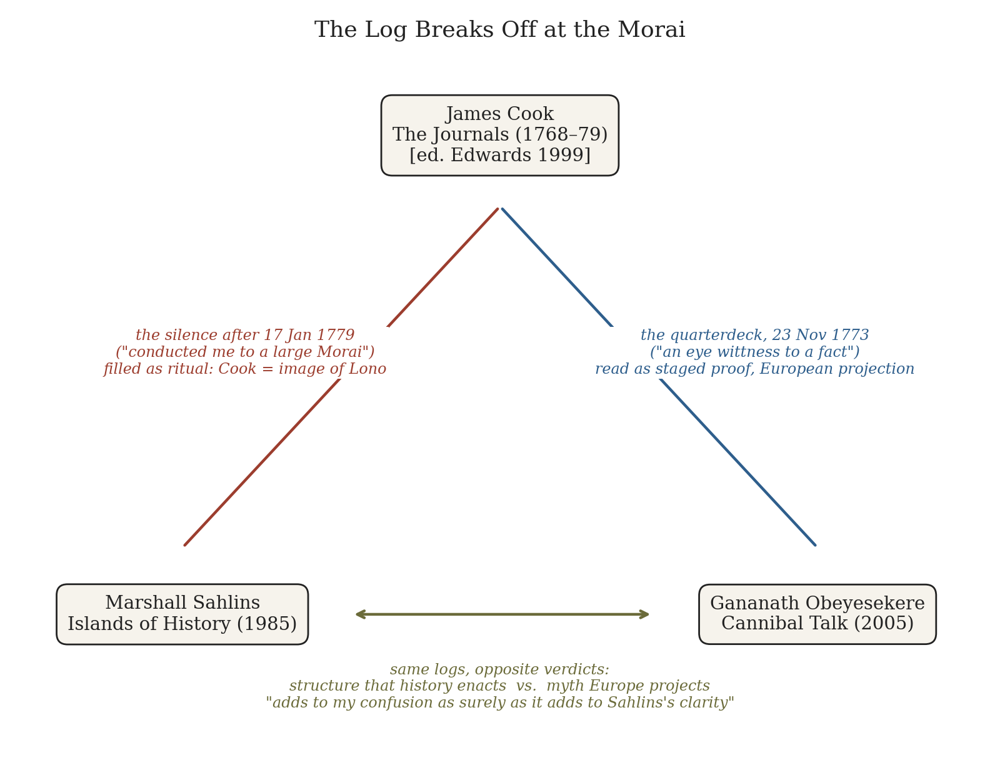
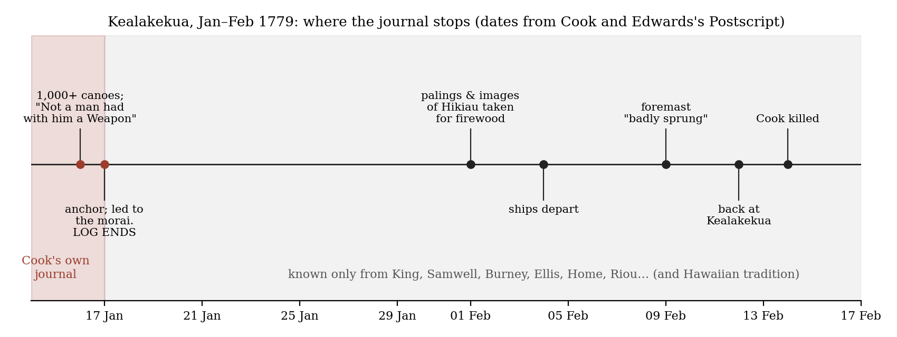
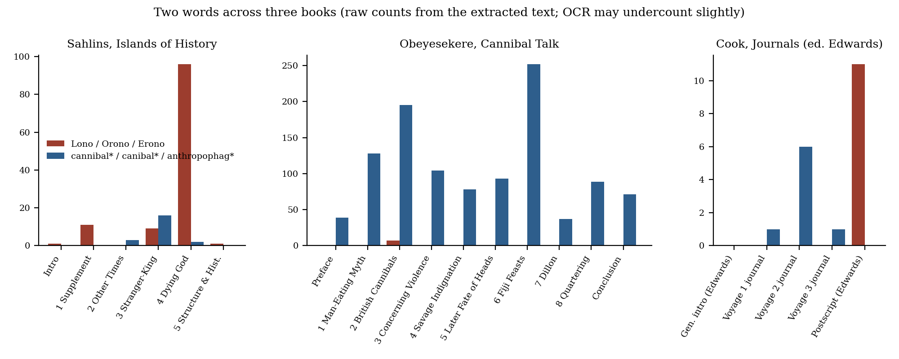

*Triad 14 of 32 · 2026-10-07 · Difficulty 3 · Conflict, Same subject, Genealogy/influence, Oblique/structural*

## The three books

- [[books/4840-the-journals-of-captain-cook|The Journals of Captain Cook]], [[people/james-cook|James Cook]], [[people/philip-edwards|Philip Edwards]] (editor), [[people/j-c-beaglehole|J. C. Beaglehole]] (editor); 1768–1779 (written); Penguin selection 1999/2003. *Primary source / shared ground: the text that stops at the morai and stages the quarterdeck proof*
- [[books/8405-islands-of-history|Islands of History]], [[people/marshall-sahlins|Marshall Sahlins]]; 1985. *Thesis: structure fills the silence; Cook as image of Lono, death as ritual transformation*
- [[books/8381-cannibal-talk-the-man-eating-myth-and-human-sacrif|Cannibal Talk: The Man-Eating Myth and Human Sacrifice in the South Seas]], [[people/gananath-obeyesekere|Gananath Obeyesekere]]; 2005. *Antithesis: god and cannibal as European projections; the quarterdeck proof as dialogical performance*

---

## Cook · Sahlins · Obeyesekere

## The Thread

Three books, one archive. James Cook’s own journal of the third voyage ends on 17 January 1779 in the middle of a scene: *“as soon as we landed Touahah took me by the hand and conducted me to a large Morai, the other gentlemen with Parea and four or five more of the Natives followed.”* That is the last thing he wrote that survives. The word *Lono* (or *Orono*, *Erono*) does not occur once in his journal text in this edition; it appears eleven times in the editor’s Postscript, which has to reconstruct everything after the morai (the rite at Hikiau, the departure, the sprung foremast, the return, the death on 14 February) from King, Samwell, Burney and the rest. Marshall Sahlins’s *Islands of History* (1985) fills that silence with structure: at the temple “Cook indeed became the image of Lono,” and his death has “the properties of a ritual transformation.” Gananath Obeyesekere’s *Cannibal Talk* (2005), extending the attack he began in *The Apotheosis of Captain Cook* (1992), says the god and the cannibal are twin European projections: the Lono myth “was not constructed in Hawai‘i but in London.” His test case is a scene Cook *did* write, on the *Resolution*’s quarterdeck at Queen Charlotte Sound in November 1773, where Cook had a piece of a dead boy broiled because he wanted to be “an eye wittness to a fact which many people had their doubts about.”

So each anthropologist settles at a different spot in Cook’s text: Sahlins where Cook stops writing, Obeyesekere where Cook stages proof. That is the oblique part. The rest is open conflict, and both men name it. Sahlins’s Cook chapter opens with an epigraph from Alexander Home’s log: the accounts were “so Exceedingly perplexed … that it was a hard matter to Colect Certainty.” Twenty years later Obeyesekere, reading a different sailor’s papers in Salem, writes that what he read “adds to my confusion as surely as it adds to Sahlins’s clarity.” Neither of these two books is the famous exchange itself (*Apotheosis*, 1992; Sahlins’s *How “Natives” Think*, 1995). One comes before it, one after, and Cook’s journal is the shared ground under both. **Connection kinds:** Conflict; Same subject; Genealogy/influence (both are built on Beaglehole’s Hakluyt edition of the journals, which is also the source of the Penguin selection used here); Oblique/structural (silence vs. staging). **Difficulty: 3.** The debate is well known. What you have to look for is the gap in the primary text and the zero.

## Constellation

## 1. The Journals of Captain Cook — James Cook (written 1768–1779; Penguin selection ed. Philip Edwards, 1999/2003)

*EPUB · Calibre ID 4840 · selected from J. C. Beaglehole’s Hakluyt Society edition (1955–67)* → [[books/4840-the-journals-of-captain-cook|book page]]

**Selection logic.** This is the primary source both anthropologists are arguing over. Read in the original spelling, it also refuses both of them in small ways. Here Cook is neither a god nor a projector of gods. He is a commander who writes weather first and wonder second, and who stops mid-sentence, or near enough.

**Overview.** Edwards cuts Beaglehole’s four volumes down to one: the *Endeavour* voyage (1768–71: Tahiti, the transit of Venus, New Zealand, the east coast of Australia), the *Resolution* voyage (1772–75: the Antarctic circle, the disproof of a great southern continent, New Zealand again, Tonga, Easter Island), and the third voyage (1776–79: the search for a northwest passage, the first European landfall on Hawai‘i, Nootka, the Bering Strait, the return to Hawai‘i). The journal is kept in ship’s time, noon to noon. Edwards adds a Postscript, “The Death of Cook,” because the journal stops before it.

**Excerpt: the last entry (Journal of the Third Voyage, Sunday 17 January 1779, Kealakekua Bay).** This is the end of Cook’s surviving text. Note the “shoals of fish” simile, which Sahlins quotes on p. 105.

> I have no where in this Sea seen such a number of people assembled at one place, besides those in the Canoes all the Shore of the bay was covered with people and

> hundreds were swiming about the Ships like shoals of fish. … In the after noon I went a shore to view the place, accompaned by Touahah, Parea, Mr King and others; as soon as we landed Touahah took me by the hand and conducted me to a large Morai, the other gentlemen with Parea and four or five more of the Natives followed.

Edwards, opening the Postscript: “Whatever else Cook wrote has not survived. His log breaks off at a moment of considerable importance”.

**Excerpt: the quarterdeck (Journal of the Second Voyage, Tuesday 23 [November] 1773, Queen Charlotte Sound).** Obeyesekere quotes this same passage from Beaglehole (*Cannibal Talk*, p. 31). The two texts agree word for word.

> The sight of the head and the relation of the circumstances just mentioned struck me with horor and filled my mind with indignation against these Canibals, but when I considered that any resentment I could shew would avail but little and being desire-ous of being an eye wittness to a fact which many people had their doubts about, I concealed […]
>
> *(Shortened for the public edition.)*

The same entry goes on, and this is the part neither anthropologist dwells on. Cook doubts his informants’ number (“they counted to me fifty a number which exceeded all probabillity by reason of the smallness of their own number”), and he says why he staged the scene: “I have often been asked, after relateing all the circumstance, if I had actualy seen them eat human flesh my self, such a queston was sufficient to convence me that they either disbelieved all I had said or formed a very different opinion from it”.

**Concordance (derived from the EPUB text, by section).**

Section *Lono / Orono / Erono cannibal / canibal / anthropophag-*

General Introduction (Edwards) 0 0 Journal, first voyage 0 1 Journal, second voyage 0 6 Journal, third voyage 0 1 Postscript: the Death of Cook (Edwards) 11 0

In his own hand Cook never names the god he is supposed to have become. The only one who names Lono is the editor, writing after the log ends. (These counts are for this selection, not the full Beaglehole edition.)

**Timeline: where the journal stops.** Edwards’s own answer comes at the very end of the book, and it is neither Sahlins’s nor

Obeyesekere’s. It is a plain, practical account: “They had given him everything, and he had gone away. Their foodstuff and livestock were seriously depleted. They did not want him back.” And: “He brought them iron, and they used it to kill him.”

## 2. Islands of History — Marshall Sahlins (1985)

*PDF (scanned, with an OCR text layer; occasional OCR noise, quotations checked against it) · Calibre ID 8405* → [[books/8405-islands-of-history|book page]]

**Selection logic.** This is the structuralist reading at full strength, before anyone attacked it. Chapter 4, “Captain James Cook; or, The Dying God” (the Frazer Lecture, Liverpool, 1982), is the text Obeyesekere’s *Apotheosis* was written against. Its first page is about uncertainty, and it sets the terms of this whole set.

**Overview.** Five lectures on Hawai‘i, Fiji and New Zealand, held together by one claim: what anthropologists call “structure” is an historical object. Cultures order history, and history revalues culture as people act. Chapter 1 reads Cook’s first Hawaiian landfalls through Hawaiian categories of sex and sacred chiefs. Chapter 2 sets “heroic” history against other kinds. Chapter 3, on the stranger-king, uses Dumézil in Fiji. Chapter 4 argues that Cook arrived during the Makahiki, the New Year festival of the returning god Lono, was ritually installed as Lono’s image at the temple Hikiau, and was killed when he came back out of ritual season and confronted the king. Chapter 5 generalizes this into a theory of the “structure of the conjuncture.”

**Quotes.**

- “But indeed they were so Exceedingly perplexed in their Accounts that it was a hard matter to Colect Certainty, in particular cases, or indeed to write any Account at all.” (Alexander Home’s log, the epigraph to ch. 4, p. 104)

- “They were singing!” (ch. 4, p. 105, on the welcome at Kealakekua)

- “Cook indeed became the image of Lono, a duplicate of the crosspiece icon” (ch. 4, p. 105)

- “Permit me thus an anthropological reading of the historical texts. For in all the confused Tolstoian narratives of the affray … the one recurrent certainty is a dramatic structure with the properties of a ritual transformation.” (ch. 4, p. 106)

- “Every actual use of cultural ideas is some reproduction of them, but every such reference is also a difference.” (ch. 5, p. 153)

**Glossary of his working terms** (in my words, with page references to where each is defined or used):

- **Makahiki**: the Hawaiian New Year festival, during which the image of Lono makes a circuit of the island and the king finally defeats him in a ritual combat. Sahlins takes it from Frazer, *The Golden Bough*, part 3, *The Dying God* (p. 105).

- **Structure of the conjuncture**: “a set of historical relationships that at once reproduce the traditional cultural categories and give them new values out of the pragmatic context” (p. 125). He says plainly that he does not mean Braudel’s sense of the phrase (p. 125 n.).

- **Risks of reference**: what happens when a category is applied to a new thing and gets changed in the process. Cook “fell victim to the play of Hawaiian categories, or more precisely to their interplay with his own” (Introduction, p. xiii).

- **Stranger-king**: the ruler who comes from outside (Kahiki) and takes power by marrying into the land (ch. 3; applied to Cook on p. 139).

- ***Kino lau***: the “myriad bodies” of the gods. Food plants are forms of the divine ancestors, so cooking them “destroy[s] what is divine in them” (p. 113). This is the one place in Sahlins’s book where Obeyesekere’s subject, eating, comes up in theory.

**Diagram: two words across all three books.** Sahlins’s book is almost all Lono and hardly any cannibalism. Obeyesekere’s is the reverse.

Cook’s own journal has neither in any quantity.

## 3. Cannibal Talk: The Man-Eating Myth and Human Sacrifice in the South Seas — Gananath Obeyesekere (2005)

*PDF · Calibre ID 8381* → [[books/8381-cannibal-talk-the-man-eating-myth-and-human-sacrif|book page]]

**Selection logic.** This is the *Apotheosis* argument turned from the god to the cannibal. Obeyesekere treats both as figures that the European civilizer needs. Part of the book is a second round with Sahlins, this time over Fiji and the sailor William Endicott. Its method is the opposite of Sahlins’s: where Sahlins finds a structure in the confusion of the logs, Obeyesekere finds talk, meaning a dialogue of performance, parody and fear between sailors and islanders, which the logs then wrote down as fact.

**Overview.** Following Peter Hulme, Obeyesekere separates *anthropophagy* (the actual eating of human flesh, which he grants did happen, mostly as sacrament tied to sacrifice) from *cannibalism* (the fantasy that the Other is going to eat us). He argues that Polynesian “conspicuous anthropophagy” grew partly in response to the European discourse on cannibalism. That discourse began with Cook’s officers’ “experiments,” and the islanders sometimes answered it with feigned admission, mime and satire. He calls his method “deconstructive-restorative.”

**Quotes.**

- “I point out that this myth was not constructed in Hawai‘i but in London” (ch. 1, p. 18, on Cook as Lono)

- “They could easily change into their white coats, for let it not be forgotten they were representatives of the Royal Society.” (ch. 2, p. 25)

- “when Pickersgill brought the head on board, the ship’s officers wanted to produce empirical proof of cannibalism among the Maori.” (ch. 2, p. 31)

- “For Cook and his crew the admission of cannibalism naturally proved its existence because, then and now, admission, like eyewitnessing, is an indicator of truth.” (ch. 2, p. 55)

- “what I read adds to my confusion as surely as it adds to Sahlins’s clarity.” (ch. 6, p. 168, on the Fowler manuscripts in the Peabody Essex Museum)

**Annotated table of contents** (chapter titles from the book; notes mine):

1. *Anthropology and the Man-Eating Myth* (p. 1). Arens, Hulme, the cannibalism/anthropophagy distinction, and Sahlins’s Holocaust-denial analogy, which Obeyesekere calls “astonishing” (p. 2).

2. *“British Cannibals”: Dialogical Misunderstandings in the South Seas* (p. 24). Cook’s voyages; the quarterdeck experiment of 1773; the bundle of Cook’s flesh brought back at Kealakekua in 1779. This is the chapter that meets the journal.

3. *Concerning Violence: A Backward Journey into Maori Anthropophagy* (p. 57). Grass Cove and the “hidden” Maori discourse that has to be “gleaned from the British ones” (p. 106).

4. *Savage Indignation: Cannibalism and the Parodic* (p. 88). Islanders performing the cannibal for Europeans, and Europeans missing the joke.

5. *The Later Fate of Heads: Cannibalism, Decapitation, and Capitalism* (p. 117). The trade in tattooed heads. Pickersgill’s boy’s head ends in spirits, making “the ladies sick” in England (p. 43).

6. *Cannibal Feasts in Nineteenth-Century Fiji: Seamen’s Yarns and the Ethnographic Imagination* (p. 151). Endicott, Fowler and the *Glide*, with Sahlins as opponent again.

7. *Narratives of the Self: Chevalier Peter Dillon’s Fijian Cannibal Adventures* (p. 193).

8. *On Quartering and Cannibalism and the Discourses of Savagism* (p. 223). Europe’s own dismemberments.

9. *Conclusion* (p. 255).

**A misreading worth attempting.** Read Obeyesekere’s p. 111 (“in respect of cannibalism, an eyewitness account is particularly suspect since it taps fantasy, fascination, and latent desire”) as a description of Sahlins’s chapter 4 epigraph rather than of sailors. Home said the accounts were too “perplexed” to “write any Account at all.” Sahlins wrote one anyway, and found “the one recurrent certainty.” Is the structuralist an eyewitness of a kind, whose desire is for form instead of flesh? Then turn it around. The confusion Obeyesekere reports at Salem is also a desire, a desire that the archive not cohere, and it does the work for him that structure does for Sahlins.

## Where this sends you

**Notebook**

1. **Write the entry Cook didn’t.** Begin from his last words, “the other gentlemen with Parea and four or five more of the Natives followed,” and continue in his idiom: ship’s time, weather first, numbers before wonder. Write it twice more, as Sahlins (“Permit me thus an anthropological reading of the historical texts,” p. 106) and as Obeyesekere’s officer in a “white coat” (p. 25). Which of the three has to use the word *Lono*? Which can get through the whole ceremony without it?

2. **Proof on the quarterdeck.** Cook staged an act so he could be “an eye wittness to a fact which many people had their doubts about”; Obeyesekere answers that “admission, like eyewitnessing, is an indicator of truth” only for those who need it to be (p. 55). Take a demonstration from your own work (a reading performed to prove a reading, a gesture made so it could be recorded) and describe it as a gesture done in front of an audience. Who was the “whole ships Company”? Who wept and scolded, as Oediddee did?

3. **A ledger of confusion and clarity.** Head two columns with Home’s “a hard matter to Colect Certainty” (Sahlins, p. 104) and Obeyesekere’s “adds to my confusion as surely as it adds to Sahlins’s clarity” (p. 168). Take one document from your archive and sort its details into the two columns. Then write the paragraph that Sahlins’s p. 153 line would head: “every such reference is also a difference.” Does the heading decide between the columns, or refuse to?

**Rabbit holes**

- Clifford Geertz, “Culture War,” *New York Review of Books* (30 Nov 1995), reviewing *The Apotheosis of Captain Cook* and *How “Natives” Think* together: https://www.nybooks.com/articles/1995/11/30/culture-war/ war/

- Gananath Obeyesekere, *The Apotheosis of Captain Cook: European Mythmaking in the Pacific* (Princeton UP): https://press.princeton.edu/books/paperback/9780691057521/the-apotheosis-of-captain-cook

- “Sahlins–Obeyesekere debate,” Wikipedia, as an index to the exchange, including Robert Borofsky, “Cook, Lono, Obeyesekere, and Sahlins,” *Current Anthropology* 38.2 (1997): https://en.wikipedia.org/wiki/Sahlins%E2%80%93Obeyesekere_debate

- James George Frazer, *The Golden Bough* (abridged), Project Gutenberg. This is the Frazer of Sahlins’s Frazer Lecture and of “The Dying God”: https://www.gutenberg.org/ebooks/3623

- *Captain Cook’s Journal During His First Voyage Round the World*, ed. W. J. L. Wharton (1893), Project Gutenberg. It is the older, pre-Beaglehole transcription, worth setting beside the Penguin text for spelling and omissions: https://www.gutenberg.org/ebooks/8106

- Bethe Hagens, review of *Cannibal Talk*, *World History Connected* 4.3: https://worldhistoryconnected.press.uillinois.edu/4.3/br_hagens.html

**Also in your library**

- *Sea People: In Search of the Ancient Navigators of the Pacific*, Christina Thompson (2019), Calibre ID 8777. It covers how Europeans, from Cook’s officers onward, tried to explain how Polynesians got there. This is the same question of who gets to read whom, asked about navigation.

- *Madness, Betrayal and the Lash: The Epic Voyage of Captain George Vancouver*, Stephen R. Bown (2008), Calibre ID 9096. Vancouver sailed on Cook’s second and third voyages and was at Kealakekua.

- *Waiting for Foucault, Still*, Marshall Sahlins (2002), Calibre ID 8383. These are Sahlins’s aphorisms, the polemical register of the man who wrote *How “Natives” Think*.

## To carry

> “Every actual use of cultural ideas is some reproduction of them, but every such reference is also a difference.” — Marshall Sahlins, *Islands of History*, ch. 5, “Structure and History,” p. 153

## Themes

[[themes/apotheosis|apotheosis]] · [[themes/archive-silence|archive silence]] · [[themes/cannibalism-vs-anthropophagy|cannibalism vs anthropophagy]] · [[themes/captain-cook|Captain Cook]] · [[themes/confusion-vs-clarity|confusion vs clarity]] · [[themes/editor-s-postscript|editor's postscript]] · [[themes/experiment|experiment]] · [[themes/eyewitness|eyewitness]] · [[themes/fiji|Fiji]] · [[themes/hawaii|Hawai‘i]] · [[themes/hikiau|Hikiau]] · [[themes/kealakekua|Kealakekua]] · [[themes/lono|Lono]] · [[themes/makahiki|Makahiki]] · [[themes/maori|Maori]] · [[themes/myth-and-history|myth and history]] · [[themes/projection|projection]] · [[themes/royal-society|Royal Society]] · [[themes/sahlinsobeyesekere-debate|Sahlins–Obeyesekere debate]] · [[themes/ship-s-log|ship's log]] · [[themes/staged-proof|staged proof]] · [[themes/structure-of-the-conjuncture|structure of the conjuncture]]

---

Previous: [[triads/2026-10-06-wish-books|Wish Books]]  
Next: [[triads/2026-10-08-wrote-nothing-today|Wrote Nothing Today]]
