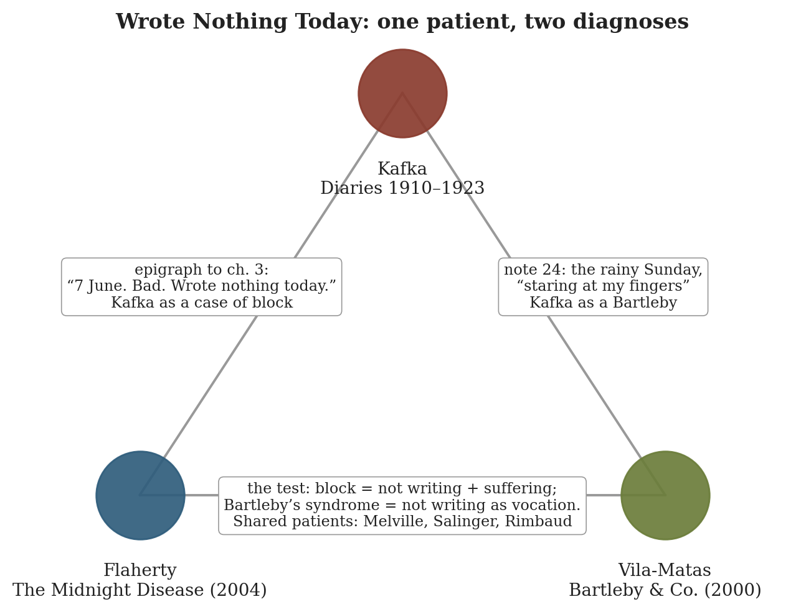
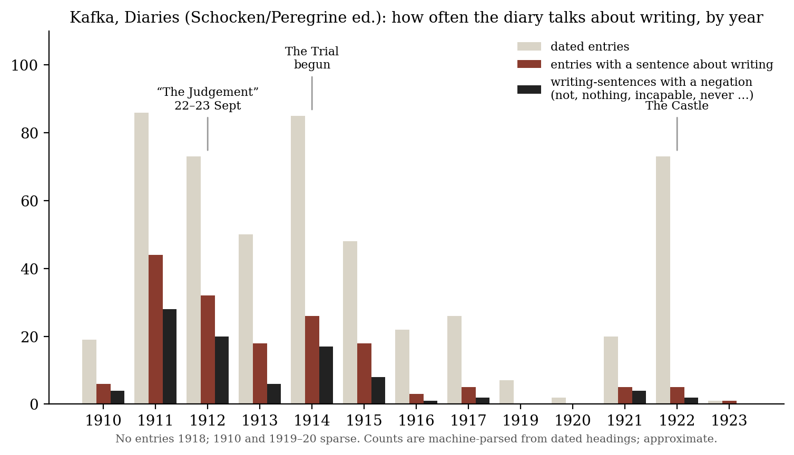
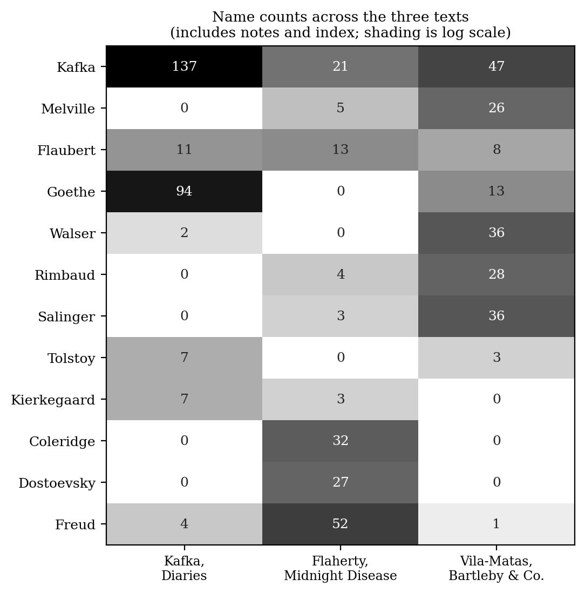

*Triad 15 of 32 · 2026-10-08 · Difficulty 3 · Shared figure or motif, Genealogy/influence, Shared form or method, Conflict*

## The three books

- [[books/3169-diaries-1910-1923|Diaries, 1910-1923]], [[people/franz-kafka|Franz Kafka]], [[people/max-brod|Max Brod]] (editor), [[people/joseph-kresh|Joseph Kresh]] (translator), [[people/martin-greenberg|Martin Greenberg]] (translator), [[people/hannah-arendt|Hannah Arendt]] (translator); 1910–23 (pub. 1948–49). *Primary source: the blank days both later books diagnose*
- [[books/9808-the-midnight-disease-the-drive-to-write-writer-s-b|The Midnight Disease: The Drive to Write, Writer's Block, and the Creative Brain]], [[people/alice-w-flaherty|Alice W. Flaherty]]; 2004. *Clinical diagnosis: block as disease, defined by the suffering clause*
- [[books/864-bartleby-co|Bartleby & Co.]], [[people/enrique-vila-matas|Enrique Vila-Matas]], [[people/jonathan-dunne|Jonathan Dunne]] (translator); 2000 (Eng. 2004). *Counter-diagnosis: not-writing as vocation and canon*

---

## The Thread

On 7 June 1912 Kafka’s whole diary entry was this: “7 June. Bad. Wrote nothing today. Tomorrow no time.” Two later books put that entry, or one like it, on the stand. Alice Flaherty, a neurologist, uses it as the epigraph to her chapter on writer’s block and reads Kafka as a *case*: block, by her definition, is not writing while being able to, *and suffering for it*. Enrique Vila-Matas’s narrator quotes another empty diary day (the rainy Sunday of January 1912, “staring at my fingers”) and reads Kafka as a *member*: a carrier of “Bartleby’s syndrome”, the not-writing that comes with a demanding literary conscience. It is the same symptom with two diagnoses, one a disease to be treated and one a vocation to be catalogued. Both books are diaries, or pretend to be. Flaherty’s opens with her own postpartum hypergraphia and Vila-Matas’s opens “on this day 8 July 1999”, so the clinical book and the novel both borrow the form whose most famous blank days they are diagnosing.

Two things make the triad worth your time beyond the shared epigraph. The first is philological: each of the later books quotes Kafka through a different channel, and the channels show. Flaherty’s Kafka is a composite (the *Diaries*, the Felice letters via Zachary Leader, and a line that matches Janouch’s reported conversation more closely than anything in the *Diaries*), and Vila-Matas’s Kafka comes into English by way of Spanish. The second is structural. The diary’s own counts (figure below) show Kafka writing most *about* writing in 1911–12 and almost not at all in 1922, the year of *The Castle*. The diary records block. It hardly records flow, because on the good nights the writing went somewhere else.

**Connection kinds:** Shared figure or motif (Kafka’s blank day as the case both later books need); Genealogy/influence (both quote the *Diaries*); Shared form or method (diary and case history); Conflict (pathology against vocation). **Difficulty: 3.**

## 1. Diaries 1910–1923 — Franz Kafka (written 1910–23; first published by Max Brod, 1948–49 in this English translation)

EPUB · Calibre ID 3169 · Schocken/Peregrine one-volume ed.; 1910–13 trans. Joseph Kresh, 1914–23 trans. Martin Greenberg with Hannah Arendt → [[books/3169-diaries-1910-1923|book page]]

**Selection logic.** This is the primary source the other two books mine. Putting the diary at the centre lets you check each borrowing against its original, and the original is stranger than what either borrower takes from it.

**Overview.** These are Kafka’s notebooks, kept from 1910 to 1923. Dated entries sit beside story openings, dreams, notes on the Yiddish theatre, drafts of letters, and the record of his engagements to Felice Bauer. Brod’s edition (the one in your library) cuts and smooths. Ross Benjamin’s 2022 translation restores what was cut (see Rabbit holes).

*Figure 1: The triad: what passes between each pair*

**Diagram: the diary talking about writing, by year.** Entries were split on their dated headings, and years were inferred from month rollovers and checked against bracketed years in the text. A “writing-sentence” is any sentence containing *write/writes/writing/written/wrote*.

*Figure 2: Entries mentioning writing, per diary year*

The diary talks about writing most in 1911 (44 of 86 entries) and 1912 (32 of 73). In 1922, the year of *The Castle*, only 5 of 73 entries do. The counts can’t settle whether the novel crowded out the notebook. They do show the diary speaking about writing most in the years when the writing went worst.

**Quotes.**

- “7 June. Bad. Wrote nothing today. Tomorrow no time.” (7 June 1912)

- “This story, ‘The Judgement’, I wrote at one sitting during the night of the 22nd–23rd, from ten o’clock at night to six o’clock in the morning. I was hardly able to pull my legs out from under the desk, they had got so stiff from sitting. The fearful strain and joy, how the story developed before me, as if I were advancing over water.” (23 September 1912)

- “Everything that is not literature bores me and I hate it, for it disturbs me or delays me, if only because I think it does.” (21 August 1913, draft letter to Felice’s father)

- “Yesterday incapable of writing even one word. Today no better. Who will save me?” (8 April 1914)

- “The strange, mysterious, perhaps dangerous, perhaps saving comfort that there is in writing: it is a leap out of murderers’ row; it is a seeing of what is really taking place.” (27 January 1922, Spindelmühle)

**Annotated pair: the two nights.** The travel diary of January–February 1911 opens: “I SHOULD write the whole night through, so many things occur to me, but all of it rough.” Twenty months later the night of 22–23 September 1912 produced “The Judgement”. Flaherty’s title, “the midnight disease”, is a name for the second night. The first night, the one that is wished for and fails to happen, is the one Vila-Matas collects.

## 2. The Midnight Disease: The Drive to Write, Writer’s Block, and the Creative Brain — Alice W. Flaherty (2004)

EPUB · Calibre ID 9808 · Gestext → [[books/9808-the-midnight-disease-the-drive-to-write-writer-s-b|book page]]

**Selection logic.** This is the clinical reading. Flaherty gives the triad its one sharp instrument, a definition of block with a suffering clause. That clause decides whether Vila-Matas’s Bartlebys are patients at all. She also wrote the book out of her own episode of hypergraphia, so it is a case history whose author is also its patient.

**Overview.** Flaherty, a Harvard neurologist, builds a neurology of literary drive from its disorders: hypergraphia in temporal-lobe epilepsy and mania (ch. 1), creativity and drive (ch. 2), block as a state of mind (ch. 3) and a brain state (ch. 4), the cortex (ch. 5), the limbic system (ch. 6), and metaphor, the inner voice and the muse (ch. 7). She says plainly that the book “sneaks up on creativity from behind, by considering its disorders” (Introduction). It began after she lost premature twin sons: “Then suddenly, as if someone had thrown a switch, I was wildly agitated, full of ideas, all of them pressing to be written down.” (Introduction)

**Quotes.**

- “Hypergraphia is neither painful nor common. Writer’s block is both.” (Introduction; repeated with a parenthesis at the start of ch. 3)

- “all blocked writers share two traits: they do not write despite being intellectually capable of doing so, and they suffer because they are not writing.” (ch. 3)

- “Writers can even be hypergraphic and blocked at the same time” (ch. 3, introducing Conrad’s letters)

- “Melville’s hypergraphia is only a fragment of his literary inspiration, reflecting his drive but not his talent.” (ch. 2)

- “Could we get the long-awaited sequel to The Catcher in the Rye if J. D. Salinger were on Paxil?” (ch. 4)

**Derived list: the Geschwind syndrome (ch. 1).** Flaherty lists the five interictal traits seen in some temporal-lobe epileptics:

1. hypergraphia;

2. a deepened emotional life (“hyperphilosophical or hyperreligious”);

3. emotional volatility, including aggressive outbursts;

4. altered sexuality (usually decreased);

5. overinclusiveness, meaning extreme talkativeness from excessive attention to detail.

Her worked example is Dostoevsky. Kafka appears nowhere in her hypergraphia chapter; she files him only under block.

**Other: Kafka in the clinic, a source audit.** These are Flaherty’s Kafka citations, checked against your copies.

> Check against your

| Where in Flaherty | What she quotes | Her source | library |
|---|---|---|---|
| ch. 3, epigraph | “June 7. Bad. Wrote nothing today. Tomorrow no time.” | *Diaries* (no year given) | Matches Kresh’s text word for word; the entry is 7 June **1912**. |
| ch. 3 | “to see the pages being covered endlessly with things one hates…” | Letter to Felice, 29 Nov 1912, quoted *via* Leader, *Writer’s Block* | Second-hand by her own note; not in the *Diaries*. Check against your |
| ch. 4 | “This inescapable duty to observe oneself…” | *Diaries*, 7 Nov 1921 | Matches except one word: hers has “if none observe me”, while Greenberg’s has “if none observes me”. |
| ch. 4 | Wieseltier: “what sort of dejection is this, that leaves one the strength to write, and write, and write?” | Wieseltier, *Kaddish* (1998) | Kafka used as the counterexample to total depression. |
| ch. 6 | “I write in order to shut my eyes.” | No Kafka source given | Not in the *Diaries*. The closest match is in Janouch, *Conversations with Kafka* (Calibre 1148): “My stories are a kind of closing one’s eyes.” That is a reported remark, and its reliability is disputed. |

There is also one joke worth keeping. Flaherty’s friend, the novelist Paul Kafka-Gibbons, “a distant relative of Kafka, plans to avoid this sort of controversy by making sure his epitaph reads “Publish all I’d burn.”” (ch. 3)

## 3. Bartleby & Co. — Enrique Vila-Matas (2000; trans. Jonathan Dunne, 2004)

EPUB · Calibre ID 864 → [[books/864-bartleby-co|book page]]

**Selection logic.** This is the literary reading, and the counter-diagnosis. Vila-Matas takes the condition Flaherty would treat and turns it into a canon: eighty-six footnotes to a text that doesn’t exist. Kafka is one of its patron saints, and Melville, Flaherty’s example of hypergraphic drive, is its founder.

**Overview.** A hunchbacked clerk who published one novel twenty-five years earlier and has written nothing since starts a diary, 8 July 1999, that is “also going to be a book of footnotes commenting on an invisible text.” In 86 numbered notes he tracks “writers of the No”: Rimbaud, Walser, Salinger, Rulfo, Hofmannsthal’s Lord Chandos, Robert Derain’s invented authors, Pynchon, B. Traven. He fakes letters to himself, and he keeps putting off writing about Salinger.

**Excerpt: the opening (before note 1).**

> I never had much luck with women. I have a pitiful hump, which I am resigned to. All my closest relatives are dead. I am a poor recluse working in a ghastly office. Apart from that, I am happy. Today most of all because, on this day 8 July 1999, I

> have begun this diary that is also going to be a book of footnotes commenting on an invisible text, which I hope will prove my reliability as a tracker of Bartlebys.

The office, the diary, the “Apart from that, I am happy”: the narrator is drawn as a Kafka who has kept the clerkship and dropped the fiction. A few lines later he defines his subject as “the illness, the disease, endemic to contemporary letters, the negative impulse or attraction towards nothingness that means that certain creators, while possessing a very demanding literary conscience (or perhaps precisely because of this), never manage to write”. He uses Flaherty’s word, *disease*, with the suffering clause left out.

**Other: one Sunday, twice.** Vila-Matas’s note 24 quotes Kafka’s diary for 7 January 1912 (a Sunday). His English reaches Kafka through Spanish, so you can lay it beside Kresh’s version from the German:

> Vila-Matas, note 24 (Dunne, from

Kafka, *Diaries* (Kresh, from the German) Vila-Matas’s Spanish)

“I have been staring at my fingers for quite “for a while now I’ve been staring at my a while. This week I think I have been fingers. I think this week I’ve been totally completely influenced by Goethe, have under the influence of Goethe, I think I really exhausted the strength of this have exhausted the energy of this influence influence and have therefore become and that is why I’ve become useless.” useless.”

> “the uninterrupted enthusiasm with which I 4 Feb 1912: “The zeal, permeating every read things about Goethe (conversadons part of me, with which I read about Goethe [*sic*] with Goethe, years as a student, hours (Goethe’s conversations, student days, with Goethe, a visit by Goethe to Frankfurt) hours with Goethe, a visit of Goethe’s to and which prevents me from doing any Frankfort) and which keeps me from all writing” writing.”

His conclusion: “There is the proof, if anyone was in doubt, that Kafka suffered from Bartleby’s syndrome.” The proof is a day on which Kafka *read* intensely. Flaherty would ask whether he suffered. The entry says he felt “useless”, which by her definition makes this block and not Bartleby.

**Diagram: who each book claims.**

Vila-Matas shares Melville, Rimbaud and Salinger with Flaherty, and Goethe and Walser with Kafka. Apart from Kafka himself, Flaubert is the only figure all three use often. Coleridge and Dostoevsky, Flaherty’s hypergraphics, never appear in the novel.

**Derived list: the Salinger deferral.**

1. Note 29: “I was going to write about the day I saw Salinger in New York, when my attention veered towards the nightmare I had yesterday”.

2. Note 30: “I thought that finally I was going to be able to write about Salinger when”, and the news of Pepín Bello intervenes.

3. Note 31: he finally tells it (Salinger at a garbage bin, a lost key) and ends: “The problem with Salinger is that he had a certain tendency to repeat himself.”

4. Notes 79 and 84: Salinger turns into a yardstick (“Much more secretive than either Gracq or Salinger…”).

The book performs a two-note block on its way to its most famous not-writer.

**Last note (86).** Tolstoy’s final diary sentence, “Fais ce que dois, adv …”, and the claim that “He had renounced writing for good and, with the strange gesture of his escape, announced the modern belief that all literature is the denial of itself.” That was October 1910, the year Kafka’s diary begins.

*Figure 3: Shared figures: name counts in each text*

## Where this sends you

## Notebook

1. **Apply the suffering clause.** Take Flaherty’s two-trait definition (ch. 3) and run it over Vila-Matas’s roster: Rimbaud, Salinger, Walser, Tolstoy in note 86, and the narrator (“Apart from that, I am happy”). Who is blocked, who is a Bartleby, and who falls through both? Then take your own longest silence and ask which one it was.

2. **The diary as the blocked genre.** Using the Kafka counts (1911–12 high, 1922 near zero) and the two nights (Jan 1911, Sept 1912), write a page on whether a diary is mainly an instrument for recording *not* writing. Does the commonplace book work differently, since it records reading and not production?

3. **Translation drift as evidence.** “keeps me from all writing” / “prevents me from doing any writing”; “if none observes me” / “if none observe me”; “I write in order to shut my eyes” / “My stories are a kind of closing one’s eyes.” Each later book’s Kafka differs slightly from the source. Write about what each variant does to the claim it is used for.

## Rabbit holes

- Herman Melville, *Bartleby, the Scrivener: A Story of Wall-Street* (1853), Project Gutenberg: https://www.gutenberg.org/ebooks/11231

- Giorgio Agamben, “Bartleby, or On Contingency”, in *Potentialities* (Stanford, 1999/2000), PhilPapers record: https://philpapers.org/rec/AGABOO. This is the philosophical form of Vila-Matas’s “No”: potentiality not to.

- Frances Wilson, “Descriptions of a Struggle”, *NYRB*, 6 April 2023, on Ross Benjamin’s uncensored translation of the *Diaries* (what Brod smoothed away): https://www.nybooks.com/articles/2023/04/06/descriptions-of-a-struggle-the-diaries-franz-kafka/

- Hugo von Hofmannsthal, “A Letter” (the Chandos letter), trans. Michael Hofmann, *PN Review* 43 (1985). Opening free, rest for subscribers: https://www.pnreview.co.uk/archive/a-letter-translated-by-michael-hofmann/5898

- Juvenal, *Satire* VII, Latin text (lines 51–52, “insanabile multos / scribendi cacoethes”, Flaherty’s ch. 1 epigraph): https://www.thelatinlibrary.com/juvenal/7.shtml

- Sachdev & Waxman, “Frequency of hypergraphia in temporal lobe epilepsy: an index of interictal behaviour syndrome”, *JNNP* 44:4 (1981): https://jnnp.bmj.com/content/44/4/358

## Also in your library

- Gustav Janouch, *Conversations with Kafka* (Calibre 1148). The probable source of Flaherty’s “shut my eyes”, and a lesson in how a Kafka quote gets made.

- Jeff Fort, *The Imperative to Write: Destitutions of the Sublime in Kafka, Blanchot, and Beckett* (Calibre 11463). The compulsion side, treated as philosophy and not neurology.

- Robert Walser, *Microscripts* (Calibre 431). The pencil-sized writing of a man Vila-Matas counts as a Bartleby, who in fact wrote constantly.

## To carry

> “The strange, mysterious, perhaps dangerous, perhaps saving comfort that there is in writing: it is a leap out of murderers’ row; it is a seeing of what is really taking place.” — Kafka, *Diaries*, 27 January 1922

## Themes

[[themes/bartleby-s-syndrome|Bartleby's syndrome]] · [[themes/diary-form|diary form]] · [[themes/geschwind-syndrome|Geschwind syndrome]] · [[themes/goethe|Goethe]] · [[themes/hypergraphia|hypergraphia]] · [[themes/janouch|Janouch]] · [[themes/kafka-s-diaries|Kafka's Diaries]] · [[themes/literature-of-the-no|literature of the No]] · [[themes/melville|Melville]] · [[themes/night-writing|night writing]] · [[themes/salinger|Salinger]] · [[themes/suffering-clause|suffering clause]] · [[themes/the-judgement|The Judgement]] · [[themes/tolstoy-s-last-diary-sentence|Tolstoy's last diary sentence]] · [[themes/translation-drift|translation drift]] · [[themes/writer-s-block|writer's block]]

---

Previous: [[triads/2026-10-07-the-log-breaks-off-at-the-morai|The Log Breaks Off at the Morai]]  
Next: [[triads/2026-10-09-the-probe-and-the-kestrel|The Probe and the Kestrel]]
