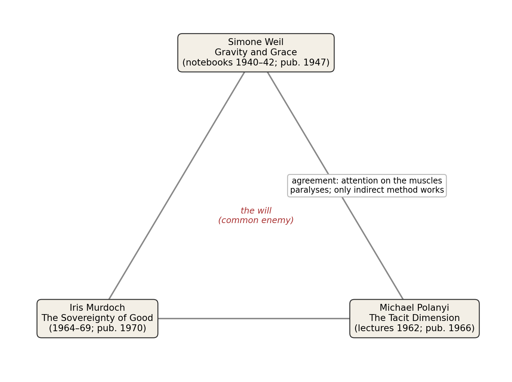
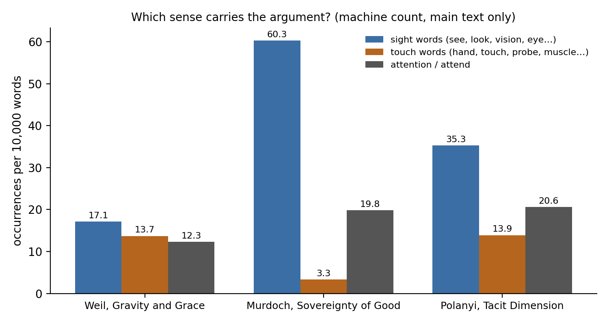
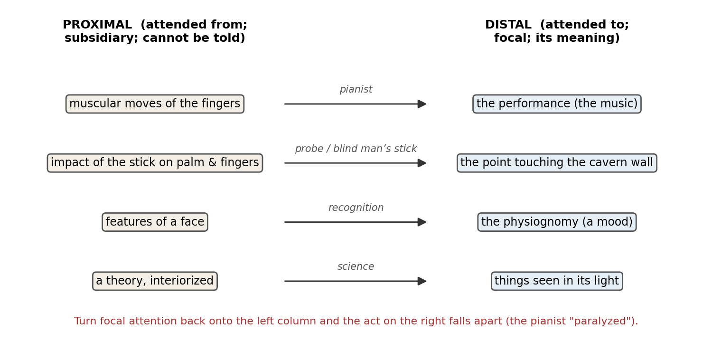

*Triad 16 of 32 · 2026-10-09 · Difficulty 3 · Genealogy/influence, Agreement, Conflict, Shared figure or motif*

## The three books

- [[books/995-gravity-and-grace|Gravity and Grace]], [[people/simone-weil|Simone Weil]], [[people/gustave-thibon|Gustave Thibon]] (editor), [[people/emma-crawford|Emma Crawford]] (translator), [[people/mario-von-der-ruhr|Mario von der Ruhr]] (translator); 1947. *Anchor / source of the word: attention defined against the will, the will confined to the muscles*
- [[books/2455-the-sovereignty-of-good|The Sovereignty of Good]], [[people/iris-murdoch|Iris Murdoch]]; 1970. *Inheritor: carries Weil's attention into moral philosophy; names the shared enemy (the choosing will); sides with vision against touch*
- [[books/6096-the-tacit-dimension|The Tacit Dimension]], [[people/michael-polanyi|Michael Polanyi]], [[people/amartya-sen|Amartya Sen]] (contributor); 1966. *Dissenter from outside: attention as from-to integration that runs through the body; agrees with Weil on indirection, contradicts Murdoch on the senses*

---

## The Thread

Three books, one word, and one common enemy. Simone Weil’s notebooks (*Gravity and Grace*, ch. 26, “Attention and Will”) set attention against the will and confine the will to “a few movements of a few muscles.” Iris Murdoch takes the word over openly (“I have used the word ‘attention’, which I borrow from Simone Weil”) and builds a moral philosophy on it, against what she calls the existentialist picture: “the empty choosing will” and “movement rather than vision.” Michael Polanyi, in Yale lectures given the same decade, arrives at attention from the other side, from chemistry, perception and skill, and his introduction ends by calling “the existentialist claim of choosing our beliefs from zero” absurd. All three demote the will. They part company over where the self goes when attention works.

That is the edge worth your time. Weil and Murdoch want attention to empty the self (decreation; “unselfing”; the kestrel that leaves “nothing now but kestrel”). Polanyi makes attention run *through* the self: we attend *from* our body, our tools and our theories *to* the world, and “Our body is the ultimate instrument of all our external knowledge.” Murdoch prefers sight to touch on principle; she quotes Hampshire’s “Touching, handling and the manipulation of things are misrepresented if we follow the analogy of vision” in order to reject it. Polanyi’s model case is the blind man’s stick, and he argues that seeing itself is assembled from bodily efforts we cannot feel. Oddly, Weil and Polanyi agree on the mechanics: Weil says tightening the muscles about virtue is stupid, and Polanyi says a pianist who attends to his fingers paralyzes himself. **Connection kinds:** Genealogy/influence (Weil →Murdoch), Agreement (Weil ↔Polanyi on indirection), Conflict (Murdoch ↔Polanyi on vision vs. touch), Shared figure (attention vs. will). **Difficulty: 3.**

A note on the count: Polanyi uses more sight words than touch words, mostly because his examples are faces and perception. His argument still runs through the hand. Murdoch’s ratio (60 to 3) is the starkest result in the chart, and it is deliberate.

## 1. Gravity and Grace — Simone Weil (notebooks c. 1940– 42; first published 1947)

EPUB · Calibre ID 995 · Routledge Classics 2002, trans. Emma Crawford and Mario von der Ruhr, introduction by Gustave Thibon → [[books/995-gravity-and-grace|book page]]

**Selection logic.** The source of the word. Weil defines attention by subtraction: it is what the will is not. She also puts the will in the body, which is exactly the region where Polanyi will later find attention working. She is the anchor because both of the other books are, in different ways, answers to this chapter.

**Overview.** Not a book Weil wrote. Gustave Thibon selected these aphorisms from the notebooks she left with him in 1942, arranged them under thematic headings (“Decreation,” “The

*Figure 1: Constellation*

*Figure 2: Sight and touch vocabulary per 10,000 words in each book’s main text (crude regex*

count that also catches idioms; all 12 of Murdoch’s touch words are idioms such as “on the other hand” or Hampshire’s words, quoted in order to be refuted).

Self,” “Attention and Will,” “Metaxu”) and published them in 1947. The fragments run from mystical theology to remarks on Latin prose and geometry homework. Attention appears in many chapters, but 31 of the book’s machine-counted uses of *attent-* fall in the one chapter, “Attention and Will.”

**Excerpt** (ch. 26, “Attention and Will”). The will is sent back to the hand:

> We have to try to cure our faults by attention and not by will. The will only controls a few movements of a few muscles, and these movements are associated with the idea of the change of position of near-by objects. I can will to put my hand flat on the table. […]
>
> *(Shortened for the public edition.)*

**Weil’s working rules for attention** (a derived list, all from ch. 26):

1. Cure faults by attention, not by will.

2. Do not tense the body: “What could be more stupid than to tighten up our muscles and set our jaws about virtue, or poetry, or the solution of a problem.”

3. Do not want to find: “We must not want to find.”

4. Go indirectly: “Only an indirect method is effective. We do nothing if we have not first drawn back.”

5. Treat schoolwork as training: “studies being a form of gymnastics of the attention.”

6. With images and symbols, look rather than interpret: “Not to try to interpret them, but to look at them till the light suddenly dawns.”

7. Keep the gaze steady through time: “This is on condition that the attention be a looking and not an attachment.”

**Quotes** (all ch. 26, “Attention and Will”):

- “Attention, taken to its highest degree, is the same thing as prayer.”

- “By pulling at the bunch, we make all the grapes fall to the ground.”

- “Attention alone—that attention which is so full that the ‘I’ disappears—is required of me.”

- “The poet produces the beautiful by fixing his attention on something real.”

A small finding: Murdoch quotes Weil as saying “will is obedience not resolution.” The line does not appear anywhere in this edition of *Gravity and Grace*; her source lies elsewhere in Weil.

## 2. The Sovereignty of Good — Iris Murdoch (1970; papers of 1964–69)

EPUB · Calibre ID 2455 · Routledge Classics edition with a foreword by Mary Midgley → [[books/2455-the-sovereignty-of-good|book page]]

**Selection logic.** The inheritor. Murdoch carries Weil’s attention into Oxford moral philosophy, without the theology and without the asceticism, and makes it a theory of freedom. She also names the opponent the triad shares (the “choosing will”) and, in passing, takes the side against touch that Polanyi will dispute.

**Overview.** Three papers: “The Idea of Perfection,” “On ‘God’ and ‘Good’,” and “The Sovereignty of Good over Other Concepts.” The first attacks the picture of the person shared by Sartre and by Hampshire, Hare and Ayer, and introduces M, a mother-in-law who revises her view of D by looking again. The second and third argue that the enemy is the ego, that “true vision occasions right conduct,” and that beauty in nature and art is the easiest school of “unselfing.”

**Excerpt** (ch. 3, “The Sovereignty of Good over Other Concepts”). The kestrel, which carries the whole book:

> I am looking out of my window in an anxious and resentful state of mind, oblivious of my surroundings, brooding perhaps on some damage done to my prestige. Then

| suddenly I observe a hovering kestrel. | In a moment everything is altered. | The |
|---|---|---|
| brooding self with its hurt vanity has disappeared. There is nothing now but kestrel. |  |  |
| And when I return to thinking of the other matter it seems less important. |  |  |

**A short glossary of her terms** (with verbatim anchors):

- *Attention*: “a just and loving gaze directed upon an individual reality” (ch. 1).

- *The choosing will*: the existentialist self, “The agent, thin as a needle, appears in the quick flash of the choosing will” (ch. 2).

- *Fantasy*: “the proliferation of blinding self-centred aims and images” (ch. 2).

- *Unselfing*: what beauty occasions; “the most obvious thing in our surroundings which is an occasion for ‘unselfing’ ” (ch. 3).

- *The ego*: “In the moral life the enemy is the fat relentless ego” (ch. 2).

- *The siege of the individual by concepts*: how value words (“vulgar,” “spontaneous”) are learned “in the context of particular acts of attention” (ch. 1).

**Quotes:**

- “I can only choose within the world I can see” (ch. 1, “The Idea of Perfection”).

- “Freedom is not strictly the exercise of the will, but rather the experience of accurate vision which, when this becomes appropriate, occasions action” (ch. 2).

- “By the time the moment of choice has arrived the quality of attention has probably determined the nature of the act” (ch. 2).

- “Prayer is properly not petition, but simply an attention to God which is a form of love” (ch. 2). Set it beside Weil’s “Attention, taken to its highest degree, is the same thing as prayer.”

- On Hampshire’s existentialist: “the identification of the true person with the empty choosing will, and the corresponding emphasis upon the idea of movement rather than vision” (ch. 1).

## 3. The Tacit Dimension — Michael Polanyi (1966; Terry Lectures, Yale, 1962)

EPUB · Calibre ID 6096 · University of Chicago Press edition with a foreword by Amartya Sen → [[books/6096-the-tacit-dimension|book page]]

**Selection logic.** The dissenter from outside. A physical chemist turned philosopher, Polanyi has no stake in Weil’s theology or in Murdoch’s Plato, yet his account of attention agrees with Weil on indirection and contradicts Murdoch on the senses. He also gives the triad its mechanism: a precise grammar of *attending from* and *attending to*.

**Overview.** Three lectures: “Tacit Knowing,” “Emergence,” “A Society of Explorers.” The first starts from “the fact that we can know more than we can tell” (face recognition, subception experiments, skills, probes) and derives a from-to structure: we rely on a proximal term in order to attend to a distal one. The second builds a layered ontology on that structure; the third turns to science as a community of commitment. Polanyi’s 1966 introduction sets the result against existentialism.

**The from-to structure, drawn from his examples** (ch. 1):

**Ways to destroy a meaning by attending to its parts** (a derived list; ch. 1, a single passage):

*Figure 3: Polanyi’s proximal →distal pairs, as he gives them in “Tacit Knowing.”*

1. Repeat a word while watching your tongue and lips: it “will sound hollow and eventually lose its meaning.”

2. A pianist concentrating on his fingers: “can temporarily paralyze his movement.”

3. Magnify a pattern or a face part by part until you “lose sight” of it.

4. Motion studies, “which tend to paralyze a skill.”

5. “The meticulous dismembering of a text, which can kill its appreciation.”

He adds the remedy, and a warning: integration can be restored, but “this recovery never brings back the original meaning. It may improve on it.”

**Quotes** (ch. 1, “Tacit Knowing,” unless noted):

- “I shall reconsider human knowledge by starting from the fact that we can know more than we can tell.”

- “in an act of tacit knowing we attend from something for attending to something else.”

- “Anyone using a probe for the first time will feel its impact against his fingers and palm. But as we learn to use a probe, or to use a stick for feeling our way, our awareness of its impact on our hand is transformed into a sense of its point touching the objects we are exploring.”

- “Our own body is the only thing in the world which we normally never experience as an object, but experience always in terms of the world to which we are attending from our body.”

- Introduction: “Thought can live only on grounds which we adopt in the service of a reality to which we submit.”

## Where this sends you

## Notebook

1. **The kestrel, retold in Polanyi’s grammar.** In Murdoch’s window scene, what is proximal once “There is nothing now but kestrel”? Try the hypothesis that unselfing is not the self’s disappearance but its becoming entirely subsidiary: the body as “ultimate instrument” that is never experienced as an object. If that holds, does Weil’s “attention which is so full that the ‘I’ disappears” describe a mystical state or simply a skilled one?

2. **The hand flat on the table.** Weil’s one example of willing is a gesture (“I can will to put my hand flat on the table”); Polanyi’s pianist shows that even gestures fail when attended to. Write a page on a gesture of your own that can be willed and one that cannot, and find where the boundary falls. Is utterance on the willed side?

3. **D’s side of the story.** Murdoch’s M revises D through words like “vulgar” and “spontaneous,” “the siege of the individual by concepts.” Polanyi says that to accept a teaching is to interiorize it, so that we look *from* it. Write D’s account of being attended to. Is just and loving attention ever free of a vocabulary that the looker inhabits and cannot see?

## Rabbit holes

- [Simone Weil — Stanford Encyclopedia of Philosophy,](https://plato.stanford.edu/entries/simone-weil/) with sections on attention and decreation.

- [Iris Murdoch — Stanford Encyclopedia of Philosophy,](https://plato.stanford.edu/entries/murdoch/) covering attention, the M and D example, and her running argument with Hampshire.

- [Weil, “Reflections on the Right Use of School Studies with a View to the Love of God” (Matheson Trust; links to PDF and French original),](https://themathesontrust.org/library/weil-reflections-on-the-right-use) the full version of the “gymnastics of the attention” that the notebook only sketches.

- [Martin E. Turkis II, “Post-Critical Platonism: Preliminary Meditations on Ethics and Aesthetics in Iris Murdoch and Michael Polanyi,” *Tradition & Discovery* 45:1 (PDF), in which](https://www.polanyisociety.org/TAD%20WEB%20ARCHIVE/TAD45-1/Turkis-TAD45-1-pg30-41.pdf) someone has already put two of these three in a room together. Weil is absent.

- [Silvia Panizza, *The Importance of Attention in Morality: An Exploration of Iris Murdoch’s Philosophy* (UEA PhD thesis, 2015, open access)](https://ueaeprints.uea.ac.uk/id/eprint/58491/)

- [Mark K. Smith, “Michael Polanyi and tacit knowledge” (infed),](https://infed.org/dir/michael-polanyi-and-tacit-knowledge/) a plain introduction with a bibliography. The [Polanyi Society](https://polanyisociety.org/journal-tradition-and-discovery-faqs) keeps the whole *Tradition & Discovery* run open access.

## Also in your library

- *Personal Knowledge: Towards a Post-Critical Philosophy*, Michael Polanyi (Calibre ID 7151): the long version, where “subsidiary” and “focal” awareness are first worked out.

- *Existentialists and Mystics*, Iris Murdoch (Calibre ID 998), including the essays around *Sovereignty*, such as “The Sublime and the Good.”

- *First and Last Notebooks*, Simone Weil (Calibre ID 836): Weil’s pre-war notebook and her New York and London notebooks (1942–43), written after she left Thibon’s orbit; a place to start looking for “will is obedience not resolution.”

## To carry

> “We have to try to cure our faults by attention and not by will.” — Simone Weil, *Gravity and Grace*, ch. 26, “Attention and Will”

## Themes

[[themes/attention|attention]] · [[themes/blind-man-s-stick|blind man's stick]] · [[themes/decreation|decreation]] · [[themes/existentialism|existentialism]] · [[themes/gesture|gesture]] · [[themes/gymnastics-of-the-attention|gymnastics of the attention]] · [[themes/hampshire|Hampshire]] · [[themes/indwelling|indwelling]] · [[themes/interiorization|interiorization]] · [[themes/kestrel|kestrel]] · [[themes/m-and-d|M and D]] · [[themes/pianist|pianist]] · [[themes/prayer|prayer]] · [[themes/probe|probe]] · [[themes/proximal-distal|proximal/distal]] · [[themes/sartre|Sartre]] · [[themes/tacit-knowing|tacit knowing]] · [[themes/the-hand|the hand]] · [[themes/unselfing|unselfing]] · [[themes/vision-vs-touch|vision vs. touch]] · [[themes/will|will]]

---

Previous: [[triads/2026-10-08-wrote-nothing-today|Wrote Nothing Today]]  
Next: [[triads/2026-10-10-the-dated-slip|The Dated Slip]]
