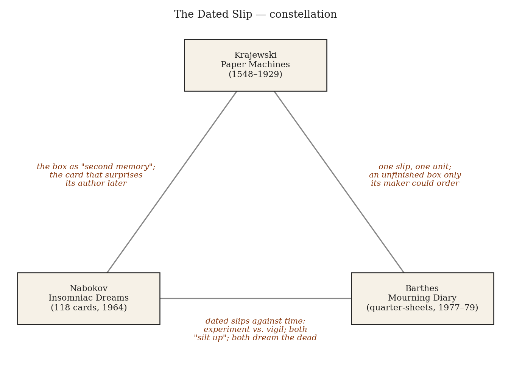
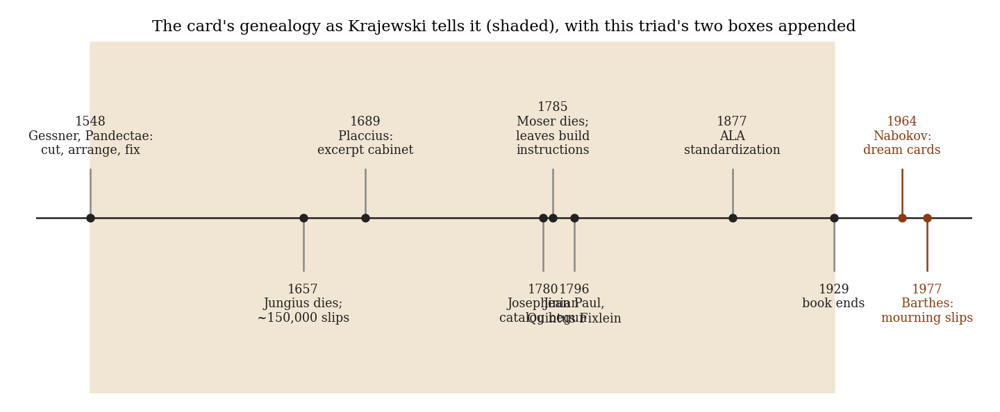
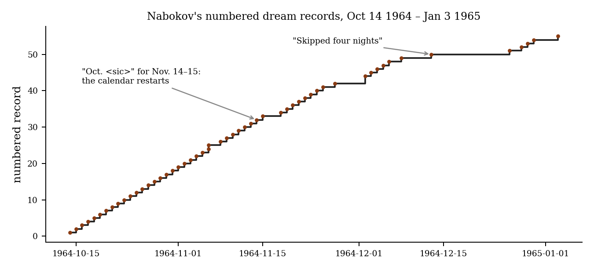
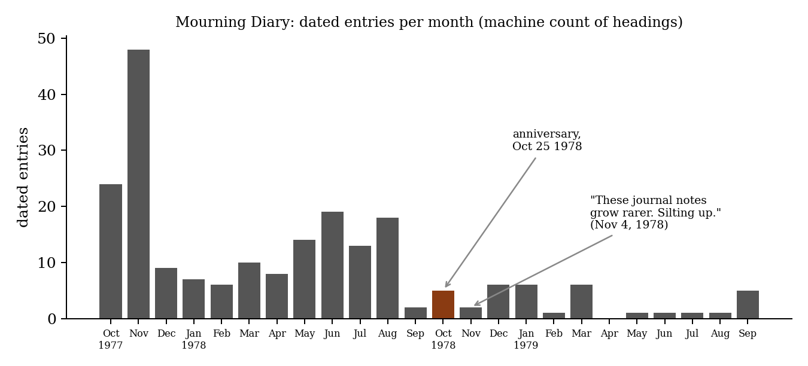

*Triad 17 of 32 · 2026-10-10 · Difficulty 4 · Shared form or method, Genealogy/influence, Oblique/structural*

## The three books

- [[books/8480-paper-machines-about-cards-catalogs-1548-1929|Paper Machines: About Cards & Catalogs, 1548-1929]], [[people/markus-krajewski|Markus Krajewski]], [[people/peter-krapp|Peter Krapp]] (translator); 2002. *Theory and genealogy: the card box as machine and 'second memory'; supplies the vocabulary that lets the other two be read as instruments.*
- [[books/2515-insomniac-dreams-experiments-with-time-by-vladimir|Insomniac Dreams: Experiments With Time by Vladimir Nabokov]], [[people/vladimir-nabokov|Vladimir Nabokov]], [[people/gennady-barabtarlo|Gennady Barabtarlo]] (editor); 1964-65 (cards); 2017 (book). *The experiment: dated cards as lab equipment to test Dunne's 'reverse memory'; the second memory surprising its author (1968 note on a 1964 card).*
- [[books/182-mourning-diary|Mourning Diary]], [[people/roland-barthes|Roland Barthes]], [[people/nathalie-leger|Nathalie Léger]] (editor), [[people/richard-howard|Richard Howard]] (translator); 1977-79 (written); 2009 (Journal de deuil). *The vigil: dated slips with no hypothesis; the same instrument as Nabokov's turned to grief, with time's discontinuity suffered rather than sought.*

---

## The Thread

Three boxes of cards. Krajewski’s *Paper Machines* is the history of the slip as an apparatus: Gessner cutting his notes apart with scissors in 1548, Moser’s boxes holding a thousand slips each, Luhmann’s wooden “communication partner.” His claim is that a box of cards is a machine because its parts move, and that over time it becomes a “second memory” that hands its user back things he had forgotten he thought. Nabokov’s *Insomniac Dreams* and Barthes’s *Mourning Diary* are two such boxes, written thirteen years apart and both begun in October. Nabokov’s 118 Oxford cards (Oct 14, 1964 to Jan 3, 1965) were an experiment: write the dream down before waking life can contaminate it, then watch the next days for evidence that time runs backwards. Barthes’s quartered typing paper (from Oct 26, 1977) was a vigil, with no hypothesis to test. Both use the dated slip as an instrument for catching time when it misbehaves. Both stacks thin out (“Silting up,” Barthes writes). Both reached print only after their authors died, put in order by editors, and one of those editors had to repair the order of the slips.

Two sentences: *Krajewski explains why the card, unlike the book, can surprise the person who wrote it. Nabokov’s 1968 note on a 1964 card (“Had quite forgotten this”) and Barthes’s discovery that mourning is “discontinuous” and made of “Units” are that surprise, met in practice, by a man testing whether time runs backwards and by a man finding that grief does not run forward.* Connection kinds: **Shared form or method**, **Genealogy/influence**, **Oblique/structural**. Difficulty: **4**. The link is the medium, not the subject. Krajewski mentions Nabokov exactly once, in passing, as the end point of the novelist’s card box: the line of development “leads directly to Arno Schmidt or Vladimir Nabokov as an apotheosis of literary word-processing with index cards and boxes of paper slips” (ch. 4). He never gets to the dream cards, and Barthes doesn’t appear in the book at all. Neither of the other two books mentions Krajewski. The triad continues his genealogy past the point where he stops.

## 1. Paper Machines: About Cards & Catalogs, 1548–1929 — Markus Krajewski (German original 2002; trans. Peter Krapp, MIT Press 2011)

EPUB · Calibre ID 8480 → [[books/8480-paper-machines-about-cards-catalogs-1548-1929|book page]]

**Selection logic.** The theory book: it supplies the vocabulary (address, cross-reference, second memory, the box an outsider can’t finish) that lets the other two be read as instruments rather than as diaries.

**Overview.** A media-archaeological history of the card index, built on the premise that the card catalog is a “universal paper machine” that anticipates the computer. Part I (“Around 1800”) runs from Gessner’s slip technique through the Josephinian catalog in Vienna (begun 1780) to the scholar’s private box (Moser, Jean Paul, Hegel); Part II (“Around 1900”) follows the card

*Figure 1: Constellation*

from library into office through Dewey’s Library Bureau and the Bridge’s “World Brain.” The book’s own method is card-like: short sections, deliberate digressions, cross-references.

**Quotes**

- “The force taking effect is the user’s hand. A book lacks this property of free motion, and owing to its rigid form it is not a paper machine.” (ch. 1, Introduction)

- “Finally, cut out everything you have copied with a pair of scissors; arrange the slips as you desire, first into larger clusters which can then be subdivided again as often as necessary.” (Gessner’s third rule, ch. 2, “Temporary Indexing”)

- “In isolation, every index card is in peril of becoming a data corpse; to live, it must enter into relations with the remaining content.” (ch. 4, “Thinking in Boxes,” §In Praise of the Cross-Reference)

- “What surprises is not only the difference in understanding between this time and that time—ah, so that’s how I took this at that time—but also the potential path that was not developed the first time the author noticed it, but looks promising when accessed again.” (ch. 4, same section)

- “Storing states of knowledge and (via their contacts with the interface) helping to catalyze future thoughts, index cards know more than their author.” (ch. 4, §On the Gradual Manufacturing of Thoughts in Storage)

**Derived list: Moser’s case for the box (ch. 4, “Genealogy: Johann Jacob Moser and Jean Paul”), as Krajewski summarizes it.** Eight advantages, one disadvantage:

1. Topics stay together without being forced into a notebook’s sequence or page count.

2. Disorder is avoided by insertion, which a bound book doesn’t allow.

3. Whole texts can be rearranged, with chapters added or removed.

4. Little space is needed: one small box instead of many notebooks.

5. Excerpts go into the new text as they stand, with no recopying.

6. New writing comes more easily from slips than from books.

7. Selection or concealment: single slips can be handed to a copyist without exposing the rest.

8. A flexible order takes supplements in an orderly way. — The one disadvantage: slips are more easily lost than notebooks. (Moser’s answer: his people know not to touch them.)

Moser adds a warning that matters for the two other books: “Indeed, a work compiled in this way looks a bit like chaos or a game of cards, since everything lies atop everything else, and if such a work were to remain unfinished, no one who does not understand this manner of working could finish it” (ch. 4). Krajewski’s notes supply the extreme case, Joachim Jungius: “Three days after his death, one of his students begins a careful autopsy of his index cards.” (Notes, ch. 4, n. 5)

**Diagram: the genealogy, with this triad’s two boxes appended.** Dates are from Krajewski’s text. Nabokov and Barthes fall outside his range (shaded) and are added from the other two books.

## 2. Insomniac Dreams: Experiments with Time by Vladimir Nabokov — Vladimir Nabokov, ed. Gennady Barabtarlo (cards written 1964–65; book 2017)

EPUB · Calibre ID 2515 → [[books/2515-insomniac-dreams-experiments-with-time-by-vladimir|book page]]

*Figure 2: Timeline*

**Selection logic.** The experiment. Nabokov uses the card as laboratory equipment, a times-tamped record made before interpretation can touch it, in order to test J. W. Dunne’s claim that dreams draw on the future as much as on the past. It is also the triad’s clearest case of Krajewski’s “second memory”: in 1968 Nabokov rereads a 1964 card and finds in it a seed of *Ada* he had forgotten planting.

**Overview.** Part 1 lays out Dunne’s theory of “serial Time” (with a comparison to Floren-sky) and the conditions of the experiment. Part 2, “Dreamer’s Log,” transcribes the cards with Barabtarlo’s annotations, marking each recto, verso and new card. Parts 3–4 collect Nabokov’s other recorded dreams and the invented dreams in his fiction, sorted under his own typology. Part 5 is on Nabokov’s view of time. “One hundred and eighteen handwritten Oxford cards, now held in the Berg Collection of the New York Public Library, bear sixty-four such records, many with relevant daytime episodes.” (Part 1, “Chronic Condition”)

**Excerpt: the second card, with its 1968 annotation (Part 2, “Dreamer’s Log,” record 2).** Framing: a clock in a dream, then the same clock in Dunne’s book that morning, then four years later a bracketed note from the novelist who had meanwhile named the estate in *Ada* “Ardis” (Greek for arrow-tip).

> Clock, yellowish, half-past ten. […] Reading Dunne’s An experiment with Tıme came to the passage at the bottom of p. 100 (third edition) : . . . “the first image I saw and noted was a clock pointing to half-past-ten” […] Evidence of “reverse memory”? * Mason’s House of the Arrow . [This is nice! Had quite forgotten this when inventing Ardis. March 4, 1968].

**Derived list: Nabokov’s own taxonomy (Part 2, “Types of dreams” and “Curious features of my dreams”).** According to Barabtarlo’s note 3, both lists are on “an undated card inserted toward the end of the experiment, between records of December 6 and 7 in the extant batch, thus likely a postfactum summation.” So the classification sits at the front of the log but was written near its end.

*Types:* 1. Professional & vocational (literature, teaching, lepidoptera). 2. Dim-doom dreams (“fatidic-sign nightmares”). 3. Obvious influences of immediate occupations & impressions. 4. Memories of the remote past. 5. “Precognitive.” 6. Erotic tenderness and heart-rending enchantment.

*Curious features:* 1. “Very exact clock time awareness but hazy passing-of-time feeling.” 2.

Many perfect strangers. 3. Verbal details. 4. Fairly sustained, clear, logical cogitation. 5. Great difficulty in recalling a complete dream. 6. Recurrent types and themes.

**Diagram: the stack thinning.** Numbered records against date (the numbering printed in this edition runs to 55; Barabtarlo’s “sixty-four records” includes material I couldn’t map to numbers). The curve flattens after mid-November. Barabtarlo: “For three days Nabokov marked his November records as “October,” as if restarting the experiment from day one.” (Part 2, Fig. 9 caption.) In December the card reads “Skipped four nights”.

*Figure 3: Nabokov’s records*

**Quotes**

- “time’s progress is not unidirectional but recursive: the reason we do not notice the backflow is that we are not paying attention.” (Barabtarlo, Part 1, “Chronic Condition”)

- “Nabokov jotted down his dreams the way he did his novels—on small, lined Oxford cards whose growing stack he rubber-banded” (Part 1, “Nabokov’s Experiment”)

- “This is my first incontestable success in the Dunne experiment.” (Nabokov, card of Oct. 20, 1964, Part 2)

- “Dreamt of Cyr. first time since his death in April.” (card of Dec. 29, 1964, Part 2)

## 3. Mourning Diary — Roland Barthes, ed. Nathalie Léger, trans. Richard Howard (written 1977–79; Journal de deuil 2009; English 2010)

EPUB · Calibre ID 182 → [[books/182-mourning-diary|book page]]

**Selection logic.** The vigil. Here the slip has no hypothesis behind it. It is a unit of grief, dated and set down without plan. Barthes says what Krajewski’s machine implies, from the inside: mourning comes in discrete layers, “each layer: a totality. Units.” It is the triad’s counterweight to Nabokov, the same instrument used for the opposite purpose: Nabokov hunts for time’s backflow, and Barthes is subjected to it.

**Overview.** “He wrote in ink, sometimes in pencil, on slips of paper (regular typing-paper cut into quarters) of which he kept a constant supply on his desk.” (Léger, Foreword.) The cards run from the day after Henriette Barthes’s death to September 1979, in three sequences, followed by undated fragments and “Some Notes on Maman.” They feed directly into *Camera Lucida* (the Winter Garden photograph appears here first) and the Collège de France courses. Léger’s two editorial statements are the Krajewskian part: “We have corrected the chronological order of the notes as it had evidently been distorted,” and “The reader is presented not with a book completed by its author, but the hypothesis of a book desired by him” (Foreword).

**Quotes**

- “Who knows? Maybe something valuable in these notes?” (October 27, 1977)

- “In taking these notes, I’m trusting myself to the banality that is in me.” (October 29, 1977)

- “What affects me most powerfully: mourning in layers—a kind of sclerosis. / [Which means: no depth. Layers of surface—or rather, each layer: a totality. Units]” (November 1, 1977)

- “What I find utterly terrifying is mourning’s discontinuous character.” (November 26, 1977)

- “Each time I dream about her (and I dream only of her), it is in order to see her, believe her to be alive, but other, separate.” (March 18, 1979)

**Diagram: dated entries per month.** This is a machine count of date headings in the extracted text (213 headings), so a heading that covers several notes counts once. The peak is the first five weeks (72 headings for October 26 to November 30, 1977). There is a second swell in summer 1978. After the first anniversary the count falls close to zero. On October 20, 1978, five days before that date: “I fear, increasingly, as if on this day (October 25) she will have to die a second time.” Two weeks later: “These journal notes grow rarer. Silting up. So forgetting is inexorable?” (November 4, 1978)

*Figure 4: Barthes per month*

**A misreading worth attempting.** Krajewski (ch. 8, “Universal / Card / Machine”) cites interwar office theory that splits card indexes into a *reading* index, which accumulates and is kept as “read-only memory,” and a *writing* index, where information “is stored briefly and disappears just as quickly.” Read *Mourning Diary* as a writing index that its editors turned into a reading index. Barthes’s slips were working memory: “I transform “Work” in its analytic meaning (the Work of Mourning, the Dream-Work) into the real “Work”—of writing.” (May

31, 1978). Their output went into *Camera Lucida*, and the slips were meant to be used up in it. Publication preserved what the machine was built to discard. If the reading is wrong, the place it breaks is worth finding: the October 27 note (“Maybe something valuable in these notes?”) suggests Barthes already half-suspected the cards would outlast their use.

## Where this sends you

## Notebook

1. Put Krajewski’s sentence “ah, so that’s how I took this at that time” (ch. 4) next to Nabokov’s bracket “[This is nice! Had quite forgotten this when inventing Ardis. March 4, 1968].” Is a precognitive dream structurally the same thing as a well-kept card box, a record that later turns out to have known more than its writer? If so, Dunne’s “reverse memory” is a description of rereading, not of time. Write the case for and against in the form of cards: one claim per slip, then shuffle them.

2. Barthes: “mourning in layers… each layer: a totality. Units” (Nov 1, 1977). Nabokov’s curious feature no. 1: “Very exact clock time awareness but hazy passing-of-time feeling.” Both describe time as a stack of exactly dated units with no felt duration between them, which is how a card box stores time. Write about a period of your own life you know only as a stack: dated, discontinuous, with no flow.

3. Moser’s warning that an unfinished box can’t be finished by anyone who doesn’t know the method, against Léger’s “the hypothesis of a book desired by him.” Draft the instructions you would leave for whoever opens your own notebooks (the commonplace books, the Gesturalist files). What can’t be reconstructed from the slips alone, and should you write it down, or leave it as the gap?

## Rabbit holes

- Niklas Luhmann, “Communications with Zettelkastens” (1981), an English translation of the essay Krajewski is paraphrasing on the box as communication partner: https://zettelkasten.de/communications-with-zettelkastens/

- Niklas Luhmann-Archiv, Bielefeld University. Edition project for the roughly 90,000-note Zettelkasten, the box Krajewski ends on: https://www.uni-bielefeld.de/fakultaeten/soziologie/forschung/luhmann-archiv/

- Ann Blair, “Conrad Gessner’s Paratexts” (2016), on Gessner’s indexing apparatus, by the leading historian of early-modern note-taking (open access, Harvard DASH): https://dash.harvard.edu/entities/publication/73120379-2b76-6bd4-e053-0100007fdf3b

- J. W. Dunne, *An Experiment with Time*, full text at archive.org. Read the instructions Nabokov followed against his cards: https://archive.org/details/in.ernet.dli.2015.524576

- *An Experiment with Time* (Wikipedia), mainly as a pointer to its reception: Borges’s 1940 essay “El tiempo y J. W. Dunne,” Joyce, and the Nabokov experiment itself: https://en.wikipedia.org/wiki/An_Experiment_with_Time

- Jennifer Rushworth, “Mourning and Intermittence between Proust and Barthes” (author’s accepted manuscript, UCL Discovery). Barthes’s “discontinuous character” read through Proust’s *intermittences du cœur*: https://discovery-pp.ucl.ac.uk/id/eprint/10047894/1/Rushworth_Mourning_Intermittence_Proust_AAM.pdf

## Also in your library

- **J. W. Dunne, *An Experiment With Time*** (Calibre ID 2559): the instruction manual behind Nabokov’s cards.

- **Roland Barthes, *The Preparation of the Novel*** (trans. Kate Briggs; Calibre ID 14173): the lecture course the mourning slips fed, where Barthes theorizes the note (*notatio*) itself.

- **Moyra Davey, *Index Cards*** (Calibre ID 4725): essays built by linking a photograph or a passage to another, with Barthes among her interlocutors. A living practitioner’s box.

## To carry

> “In taking these notes, I’m trusting myself to the banality that is in me.” — Roland Barthes, *Mourning Diary*, October 29, 1977

## Themes

[[themes/ada|Ada]] · [[themes/anniversary|anniversary]] · [[themes/ardis|Ardis]] · [[themes/camera-lucida|Camera Lucida]] · [[themes/chronology|chronology]] · [[themes/commonplace-practice|commonplace practice]] · [[themes/cross-reference|cross-reference]] · [[themes/discontinuity|discontinuity]] · [[themes/dream-log|dream log]] · [[themes/dunne|Dunne]] · [[themes/gessner|Gessner]] · [[themes/index-card|index card]] · [[themes/jean-paul|Jean Paul]] · [[themes/jungius|Jungius]] · [[themes/luhmann|Luhmann]] · [[themes/moser|Moser]] · [[themes/mourning|mourning]] · [[themes/notatio|notatio]] · [[themes/paper-machine|paper machine]] · [[themes/posthumous-edition|posthumous edition]] · [[themes/precognitive-dreams|precognitive dreams]] · [[themes/reverse-memory|reverse memory]] · [[themes/second-memory|second memory]] · [[themes/serial-time|serial time]] · [[themes/silting-up|silting up]] · [[themes/slip-box|slip box]] · [[themes/units|units]] · [[themes/zettelkasten|Zettelkasten]]

---

Previous: [[triads/2026-10-09-the-probe-and-the-kestrel|The Probe and the Kestrel]]  
Next: [[triads/2026-10-11-only-that-which-is-said|Only That Which Is Said]]
