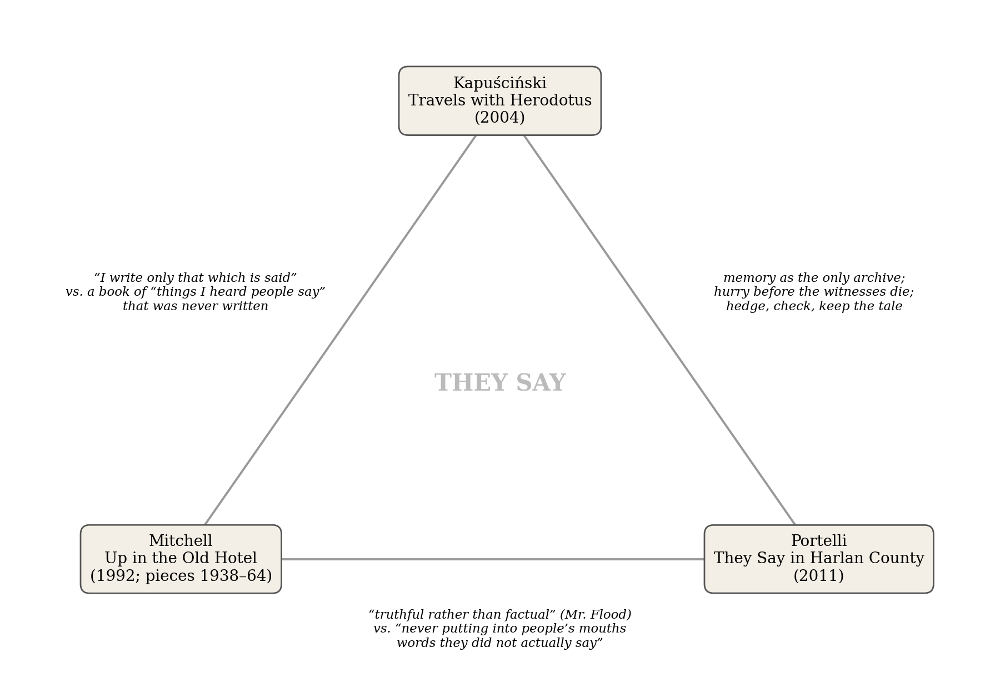
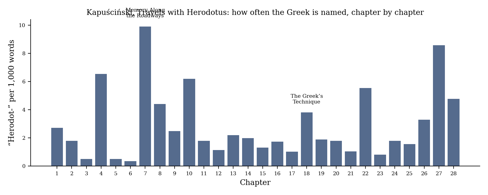
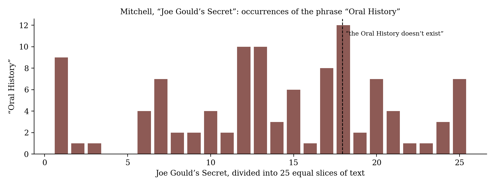

*Triad 18 of 32 · 2026-10-11 · Difficulty 3 · Same subject, Conflict, Genealogy/influence*

## The three books

- [[books/4197-travels-with-herodotus|Travels With Herodotus]], [[people/ryszard-kapuscinski|Ryszard Kapuściński]], [[people/klara-glowczewska|Klara Glowczewska]] (translator); 2004 (Podróże z Herodotem); trans. 2007. *The anchor: the founding scene of reportage and the hedge as method*
- [[books/2627-they-say-in-harlan-county-an-oral-history|They Say in Harlan County: An Oral History]], [[people/alessandro-portelli|Alessandro Portelli]]; 2011. *The rulebook: the oral historian's ethics, and error as evidence*
- [[books/4670-up-in-the-old-hotel|Up in the Old Hotel]], [[people/joseph-mitchell|Joseph Mitchell]]; 1992 (collection; pieces 1938–1964). *The negative case: the hearsay archive as bare claim, and the composite*

---

## The Thread

Three books by people whose only archive was other people’s mouths. Kapuściński, a Polish reporter, carries Herodotus from his first foreign assignment in 1956 onward and treats him as the first reporter: a man who travelled to sit down with whoever remembered, and who hedged every line (“If this is true, I don’t know. I write only that which is said”). Portelli, an Italian oral historian, returns to Harlan County, Kentucky every year from 1986 on, records two hundred tapes, and sets out the rules of the trade: never put words in a speaker’s mouth, and treat what people believe and forget as evidence alongside what they remember correctly. Mitchell, the *New Yorker*’s connoisseur of talk, profiles Joe Gould, a Village derelict who claims to be writing an “Oral History of Our Time” out of “things I heard people say”, and finds, years later, that the book seems not to exist. Mitchell then admits in the same piece that he too carried an unwritten book in his head.

The connection is **the same subject** (hearsay as historical evidence) seen from three positions, with real **conflict** between them: Portelli’s rule against invented speech runs straight into Mitchell’s admission that Mr. Flood “is not one man” and that he wanted those stories “truthful rather than factual.” There is also a **genealogy**: Kapuściński claims Herodotus as the father of reportage, and Gould dates his project to a sentence of Yeats’s about “what the people say to each other on fair days.” The tension is worth time because each book puts a different gap between *said* and *so*: the hedge, the rule, the bare claim. The question then lands on Kapuściński himself, since Artur Domosławski’s biography (Polish 2010, English 2012) raised the same doubts about him. **Difficulty: 3.**

## 1. Travels with Herodotus — Ryszard Kapuściński (2004, as Podróże z Herodotem; trans. Klara Glowczewska, 2007)

EPUB · Calibre ID 4197 → [[books/4197-travels-with-herodotus|book page]]

**Selection logic.** The anchor. It supplies the founding scene of the trade (a man goes far to sit with someone who remembers) and the oldest working method for handling what can’t be checked: say who said it, say whether you believe it, and keep it anyway.

**Overview.** A memoir of Kapuściński’s first foreign assignments (India 1956, China 1957, then Africa) interleaved with a slow reading of the *Histories*. His editor, Irena Tarłowska, sends him to India and hands him the book: “Here, a present, for the road.” (ch. 1, “Crossing the Border”). The book alternates between the reporter in Benares, Peking, Khartoum or Dar es Salaam and the Greek at Delphi, Babylon or Thurii, until in ch. 18, “The Greek’s Technique”, Kapuściński turns from what Herodotus reports to how he gets it.

**Quotes**

*Figure 1: Constellation: what passes between the three books*

- “In the world of Herodotus, the only real repository of memory is the individual.” (ch. 7, “Memory Along the Roadways of the World”)

- “And after finally encountering him, one must sit down and listen to what he has to say—to listen, remember, perhaps write it down. That is how reportage begins; of such circumstances it is born.” (ch. 7)

- “Later, these will be called legends and myths, but in the instant when they are first being related and heard, the tellers and the listeners believe in them as the holiest of truths, absolute reality.” (ch. 7)

- “not only listening to what they say, but also watching how they say it, how they act as they speak.” (ch. 18, “The Greek’s Technique”)

- “I was quite consciously trying to learn the art of reportage and Herodotus struck me as a valuable teacher.” (ch. 18)

**Derived list: Herodotus’s hedges, as Kapuściński assembles them (ch. 18).** Kapuś- ciński strings these together from the *Histories* as a catalogue of distancing formulas. Each is verbatim from the chapter:

1. “As far as we know, Gyges was the first non-Greek to dedicate offerings at Delphi …”

2. “He wished, so they say, to reach Ithaca …”

3. “As far as I know, the following customs exist among the Persians …”

4. “And thus, so I assume, drawing conclusions from the known about the unknown …”

5. “And as I learned from what they say …”

6. “This is my account of what is said about the most distant countries …”

7. “If this is true, I don’t know. I write only that which is said …”

8. “I cannot accurately state which of the Ionians proved to be cowards in this battle, and which courageous, because they all accuse one another …”

9. “I can find out nothing from anyone who can say that he saw it with his own eyes …”

Read as a set, they grade evidence: received knowledge (1, 3), report (2, 5, 6), inference (4), suspended judgment (7, 8), absence of an eyewitness (9). It works as a scale of confidence, written in prose.

**Diagram: how often Herodotus is named, chapter by chapter.** Counted from the EPUB text (“Herodot-” per 1,000 words). The peaks fall in the chapters about memory and method (7, 27 “Herodotus’s Discovery”) and in ch. 4, where he reads Herodotus in Calcutta. The valleys are China (ch. 5–6) and Khartoum (ch. 12), where the reporter’s own material takes over.

*Figure 2: Herodotus per chapter*

## 2. They Say in Harlan County: An Oral History — Alessandro Portelli (2011)

PDF · Calibre ID 2627 · page references give PDF page / printed page → [[books/2627-they-say-in-harlan-county-an-oral-history|book page]]

**Selection logic.** The theorist of the three, though he works here as a practitioner. His introduction states the rules that the other two books bend or break, and he is the one who says plainly that error is evidence. His title comes from Florence Reece’s song, written during the 1931–32 miners’ strike: “They say in Harlan County / There are no neutrals there”, so the Herodotean formula *they say* sits on the cover.

**Overview.** A history of Harlan County, Kentucky, from settlement to the 2000s, told through about two hundred recorded interviews collected from 1973 to 2009. Portelli arranges it like an oratorio (“arias”, “chorales”, and his own “recitative” of narration; PDF 20 / p. 11): mine wars, company towns, religion, race, strip mining, out-migration, drugs, survival. The introduction, “Harlan County, 1964–2009: A Love Story”, is a short manual of method.

**Excerpt (PDF 19–20 / pp. 10–11).** On turning speech into a book:

> In oral history much of the meaning is couched in how things are told as much as in what is told. Yet a passive mechanical transcript systematically betrays the form by turning eloquent oral performances into unreadable texts. There is no such thing as a neutral transcript: each comma is an act of interpretation […]

Framing: this is Kapuściński’s “watching how they say it” turned into an editorial ethic. It also concedes in advance what Mitchell’s composites do on a larger scale.

**Derived list: Portelli’s working rules, from the introduction.**

1. Only two hard rules: “never putting into people’s mouths words they did not actually say (insertions are in brackets)”, and keep the force of the spoken performance on the page (PDF 19 / p. 10).

2. Cut freely, taking “cutting-room” liberties “just as if I were making a film” (PDF 19 / p. 10).

3. Translate, don’t transcribe: “Ultimately, I am aiming not to reproduce orality in writing but to translate (or transmediate) it” (PDF 19 / p. 10).

4. Don’t fake dialect spelling, because it “others” the speaker (PDF 19 / p. 10).

5. Archive the originals for verification (University of Kentucky’s Nunn Center; Circolo Gi-anni Bosio, Rome) (PDF 19 / p. 10).

6. Use your ignorance: “the most important things I had to offer were my ignorance and my desire to learn.” (PDF 16 / p. 7)

7. Treat error as data: “What people believe and what they forget is as significant as what people recall accurately.” (PDF 20 / p. 11)

8. Use the archive both ways: “I have used archives and secondary literature, therefore, both as fact checks and as clues to the meaning of imagination.” (PDF 20 / p. 11)

**Quotes**

- “Much of the meaning is in the gaps and in the silences, to be extracted or filled in by the readers’ cooperation and imagination.” (PDF 20 / p. 11)

- Mildred Shackleford, explaining why Harlan talked to him: “All you’re doing is trying to gather a little knowledge or get people to tell you stories, and they don’t resent that.” (PDF 16 / p. 7)

- Annie Napier, on a rocking chair that rocks by itself: “They say sometimes something favorite of somebody’s, their spirit will attach to it, but, now, I don’t know if that’s true or not.” (PDF 35 / p. 26). The structure of Herodotus’s hedge, from a woman in Harlan County: she reports what is said and suspends belief.

## 3. Up in the Old Hotel — Joseph Mitchell (1992; pieces first published 1938–1964)

EPUB · Calibre ID 4670 · sections cited by title within the omnibus → [[books/4670-up-in-the-old-hotel|book page]]

**Selection logic.** The negative case, and the most uncomfortable. Gould’s “Oral History” is the hearsay archive as pure claim. Mitchell, a famously patient listener, builds his fish-market patriarch out of several men and calls the result “truthful rather than factual.” Both break Portelli’s first rule, in opposite directions.

**Overview.** Mitchell’s collected *New Yorker* work: *McSorley’s Wonderful Saloon*, *Old Mr. Flood*, *The Bottom of the Harbor*, and *Joe Gould’s Secret*. The first Gould profile, “Professor Sea Gull”, ran in *The New Yorker* on December 12, 1942 (as stated in “Joe Gould’s Secret”). The long sequel tells how Mitchell came to doubt the Oral History, confronted Gould, and kept the secret until after Gould’s death. In 2016 Jill Lepore argued from archival scraps that some of the manuscript did exist (see Rabbit holes), so the revelation scene now reads less as proof than as Mitchell’s conviction.

**Excerpt (“Joe Gould’s Secret”).** The moment the book stops existing:

> This remark came from my unconscious, and I was barely aware of the meaning of what I was saying—I was simply getting rid of my anger—but the next moment, glancing at Gould’s face, I knew as well as I knew anything that I had blundered upon the truth about the Oral History.

and then, for the record:

> “The woman who owns the duck-and-chicken farm doesn’t exist,” I said. “And her brother who had the stroke doesn’t exist. And her niece doesn’t exist. And the Polish farmer and his wife who look after the ducks and chickens don’t exist. And the ducks and chickens don’t exist. And the cellar that the Oral History is stored in doesn’t exist. And the Oral History doesn’t exist.”

Framing: note what Mitchell’s certainty rests on. It comes from reading a face, Kapuściński’s “how they act as they speak”, and not from any document.

**Quotes Derived list: what Gould was, by other people’s account.** Mitchell, waiting for Gould

- Gould’s theory of talk: “Some talk has an obvious meaning and nothing more, he said, and some, often unbeknownst to the talker, has at least one other meaning and sometimes several other meanings lurking around inside its obvious meaning.” (“Joe Gould’s Secret”)

- Gould to a detractor: “It’s only things I heard people say, but maybe I have a peculiar ability—maybe I can understand the significance of what people say, maybe I can read its inner meaning.” (“Joe Gould’s Secret”)

- The Yeats sentence Gould says started it: “ ‘The history of a nation is not in parliaments and battlefields, but in what the people say to each other on fair days and high days, and in how they farm, and quarrel, and go on pilgrimage.’ ” (“Joe Gould’s Secret”)

- On the composition books Gould did produce: “There was no talk or conversation in them, and unless they were looked upon as monologues by Gould himself there was nothing oral about them.” (“Joe Gould’s Secret”)

- Mitchell on his own imagined novel: “But the truth is, I never actually wrote a word of it.” (“Joe Gould’s Secret”)

- “Mr. Flood is not one man; combined in him are aspects of several old men who work or hang out in Fulton Fish Market, or who did in the past. I wanted these stories to be truthful rather than factual, but they are solidly based on facts.” (Author’s Note to *Old Mr. Flood*)

to come back to the office, lists “the variety of ways others had seen him”. It is a small oral history of one man, assembled from hearsay (verbatim, in order): the catarrhal child · the son who knows that he has disappointed his father · the runt, the shrimp, the peanut, the half-pint, the tadpole · Joe Gould the poet · Joe Gould the historian · Joe Gould the wild Chippewa Indian dancer · Joe Gould the greatest authority in the world on the language of the sea gull · the banished man · the perfect example of the solitary nocturnal wanderer · the little rat · the one and only member of the Joe Gould Party · the house bohemian of the Minetta Tavern · the Professor · the Sea Gull · Professor Sea Gull · the Mongoose · Professor Mongoose · the Bellevue Boy.

**Diagram: the phrase “Oral History” across “Joe Gould’s Secret”.** 107 occurrences, counted in 25 equal slices of the text. The dashed line marks the confrontation (about 70% of the way through). The phrase doesn’t stop there: the book that doesn’t exist goes on being talked about until the end.

*Figure 3: Oral History in Joe Gould’s Secret*

## Where this sends you

## Notebook

1. **Composite vs. bracket.** Put Mitchell’s Author’s Note (“Mr. Flood is not one man … truthful rather than factual”) beside Portelli’s rule (“never putting into people’s mouths words they did not actually say”). Mitchell’s interviews were real; the speaker was assembled. Portelli’s speakers are real; their sentences are cut and spliced (“cutting-room liberties”). Write down the rule Mitchell *was* following. Then say whether it differs from Portelli’s in kind or only in degree.

2. **Write in hedges.** Take an event in your own family that people tell differently. Write it using only Herodotus’s formulas from Kapuściński’s ch. 18 list (“so they say”, “as far as I know”, “If this is true, I don’t know”). Then reread Portelli’s “What people believe and what they forget is as significant as what people recall accurately.” What did the hedges let you keep that a flat narrative would have had to throw out?

3. **The unwritten book as a genre.** In the same piece Mitchell exposes Gould’s nonexistent Oral History and confesses a novel of his own of which he “never actually wrote a word”. Gould’s book has a theory (talk with “several other meanings lurking around inside its obvious meaning”) and no text. Write the entry, theory first, for a book you have described aloud but not written, and say what keeps it more useful unwritten.

## Rabbit holes

- **Herodotus, *Histories*****, trans. G. C. Macaulay (Standard Ebooks, full text):** https://standardebooks.org/ebooks/herodotus/histories/g-c-macaulay/text/single-page. Read 7.152, the best-known of his “I report what is said” disclaimers, against Kapuściński’s ch. 18 list.

- **François Hartog, *The Mirror of Herodotus: The Representation of the Other in the Writing of History* (trans. Janet Lloyd, UC Press):** https://www.ucpress.edu/books/the-mirror-of-herodotus/paper. The structuralist reading of how Herodotus builds “the other”. It covers Kapuściński’s ground with more rigour.

- **Neal Ascherson on Domosławski’s *Ryszard Kapuściński: A Life* (LRB review, reproduced on the Verso blog):** https://www.versobooks.com/blogs/news/1079-how-it-felt-to-be-there-artur-domoslawski-s-ryszard-kapuscinski-a-life-reviewed. Whether Kapuściński invented quotations and scenes, and what “how it felt to be there” is worth.

- **Jill Lepore, *Joe Gould’s Teeth* (Knopf, 2016):** https://jlepore.scholars.harvard.edu/publications/joe-goulds-teeth. Lepore argues the Oral History did exist, in part, and that Mitchell’s “secret” was itself a story.

- **LRB review of *Joe Gould’s Secret* (vol. 20 no. 8):** https://www.lrb.co.uk/v20/n08/william-fiennes/jobs-and-sprees-and-sorrows. On how Mitchell’s sympathy for Gould turned into self-recognition.

- **Columbia OHMA, “Oral History in the ‘Post-Fact’ Era” (Rachel Unkovic, 2016):** https://oralhistory.columbia.edu/blog-posts/People/nrggqv9xow97knqnmpbemn5scfezfb. Applies Portelli’s line that “the discrepancies and the errors are themselves events” (from *The Order Has Been Carried Out*) to rumour online. Then go to Portelli’s essay “The Death of Luigi Trastulli” (in *The Death of Luigi Trastulli and Other Stories*, SUNY Press, 1991), the classic statement of the argument.

## Also in your library

- **The London Underworld in the Victorian Period: Authentic First-Person Accounts by Beggars, Thieves and Prostitutes** — Henry Mayhew (Calibre ID 14642). The journalist who, by the catalogue’s own account, “invented the genre of oral history a century” before it had the name. Compare his “authentic” first person with Portelli’s brackets.

- **A Guide to Reading Herodotus’ Histories** — Sean Sheehan (Calibre ID 4396). A scholarly check on Kapuściński’s Herodotus.

- **Gulag Voices: Oral Histories of Soviet Incarceration and Exile** — Jehanne M. Gheith & Katherine R. Jolluck (Calibre ID 7039). Oral history where memory is the only archive *because* the state kept the other one. Kapuściński’s own memory of this sits in ch. 3: a man sobbing on the Moscow–Warsaw plane in December 1956 (“People were still coming out of the gulags.”).

## From the Lexicon — Hypomnēmata

**Your sense:** An intentional external memory apparatus and spiritual technology used to gather, curate, and digest disparate fragments of established wisdom to fortify character.

**Received:** Classical Greek administrative copybooks, public account ledgers, and notebooks used to record business and daily affairs.

**Etymology.** From *hypomnēmatika* (“reminders”, “memoranda”), first in Athenian bureaucratic registries; it moved from accounting into Stoic spiritual exercise and Foucault’s self-writing.

**WordNet.** No WordNet entry; the term lives only in the technical literature (classics, and late Foucault). The absence says the word never crossed from scholarship into ordinary English.

**Relations.** genealogy_of: Architextuality.

> The self is not discovered through internal excavation, but constructed through the active curation and digestion of external truths.

**Why today.** Gould’s Oral History was meant to be hypomnēmata on a city’s scale, a note-book of things heard. By Mitchell’s account it existed mostly as a claim, while Herodotus’s and Portelli’s collections of things already said got written down. Whether a commonplace practice is real depends on the notebook, not the theory.

## To carry

> “There is no such thing as a neutral transcript: each comma is an act of interpretation” — Alessandro Portelli, *They Say in Harlan County*, p. 10

## Themes

[[themes/annie-napier|Annie Napier]] · [[themes/composite-character|composite character]] · [[themes/domosawski|Domosławski]] · [[themes/error-as-evidence|error as evidence]] · [[themes/florence-reece|Florence Reece]] · [[themes/harlan-county|Harlan County]] · [[themes/hearsay|hearsay]] · [[themes/hedging|hedging]] · [[themes/herodotus|Herodotus]] · [[themes/hypomnemata|hypomnēmata]] · [[themes/joe-gould|Joe Gould]] · [[themes/legein-ta-legomena|legein ta legomena]] · [[themes/lepore|Lepore]] · [[themes/memory-as-archive|memory as archive]] · [[themes/mr-flood|Mr. Flood]] · [[themes/oral-history|oral history]] · [[themes/oral-history-of-our-time|Oral History of Our Time]] · [[themes/reportage|reportage]] · [[themes/transcript|transcript]] · [[themes/truthful-vs-factual|truthful vs factual]] · [[themes/unwritten-book|unwritten book]] · [[themes/yeats|Yeats]]

---

Previous: [[triads/2026-10-10-the-dated-slip|The Dated Slip]]  
Next: [[triads/2026-10-12-rewarded-for-the-relics|Rewarded for the Relics]]
