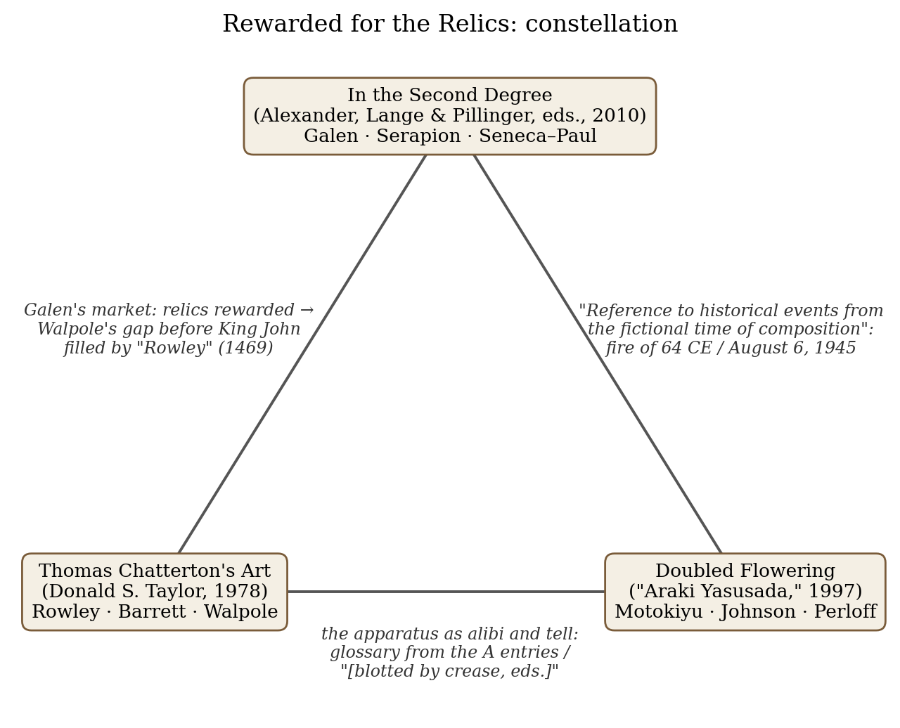
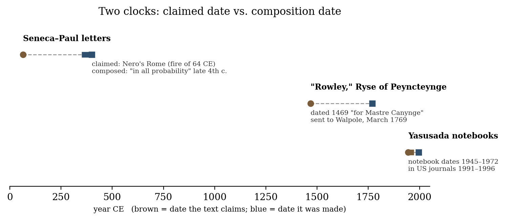
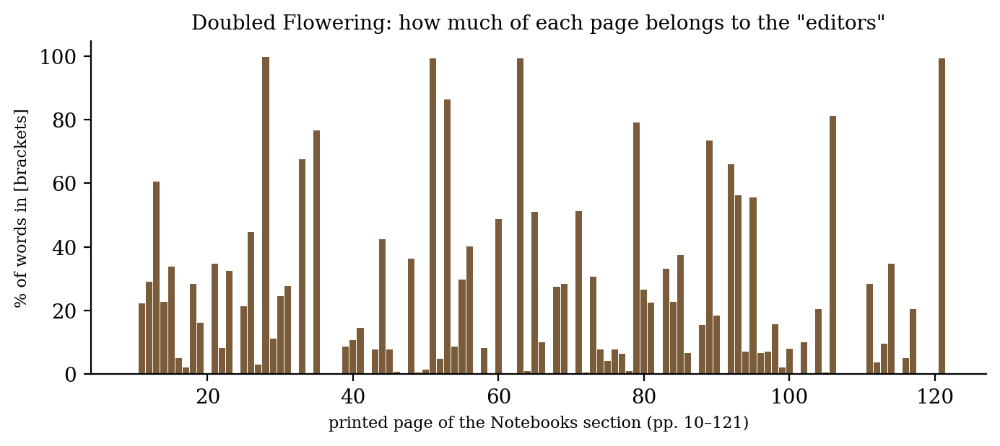

*Triad 19 of 32 · 2026-10-12 · Difficulty 4 · Shared form or method, Oblique/structural, Conflict*

## The three books

- [[books/6896-in-the-second-degree-paratextual-literature-in-anc|In the Second Degree: Paratextual Literature in Ancient Near Eastern and Ancient Mediterranean Culture and Its Reflections in Medieval Literature]], [[people/philip-s-alexander|Philip S. Alexander]] (editor), [[people/armin-lange|Armin Lange]] (editor), [[people/renate-j-pillinger|Renate J. Pillinger]] (editor); 2010. *Deep-time anchor and theory: Galen's market, Serapion's pseudepigrapha, Genette's second degree; Smolak's Seneca–Paul chapter as test case*
- [[books/3327-thomas-chatterton-s-art-experiments-in-imagined-hi|Thomas Chatterton's Art: Experiments in Imagined History]], [[people/donald-s-taylor|Donald S. Taylor]]; 1978 (Princeton UP; catalogue gives 1979). *The eighteenth-century hinge: the market made visible document by document (Barrett, Burgum, Walpole)*
- [[books/11327-doubled-flowering-from-the-notebooks-of-araki-yasu|Doubled Flowering: From the Notebooks of Araki Yasusada]], [[people/araki-yasusada|Araki Yasusada]], [[people/kent-johnson|Kent Johnson]] (contributor), [[people/tosa-motokiyu|Tosa Motokiyu]] (translator), [[people/ojiu-norinaga|Ojiu Norinaga]] (translator), [[people/okura-kyojin|Okura Kyojin]] (translator); 1997. *The modern case where the buyer is named: Perloff's afterword on the American appetite for an 'authentic other'*

---

## The Thread

Galen, in a sentence Armin Lange puts at the head of *In the Second Degree*, gives a market theory of forgery: before the kings of Alexandria and Pergamon competed for old books, no work carried a false title; once people “who offered the relics of some old writer, were rewarded,” false titles multiplied. Today’s three books test that theory across two thousand years. Thomas Chatterton (1768–69) wrote the fifteenth-century monk “Rowley” into precisely the gaps his patrons had described: early documents for William Barrett’s history of Bristol, early painters for Horace Walpole, whose *Anecdotes of Painting* could name no English artist before King John. “Araki Yasusada” (in American journals 1991–96) supplied the voice an American poetry readership wanted and did not have, a Hiroshima survivor who had read Spicer and Barthes. Marjorie Perloff’s afterword is in effect a description of the buyer.

The second link is structural. Each forgery travels with an apparatus: a translator, a glossary, editors’ brackets. The apparatus is both alibi and tell. The fourth-century Seneca–Paul forger lets Paul’s poor Latin “be blamed on the translator”; Chatterton glosses his Anglo-Saxon for Walpole from the A entries of one dictionary; Yasusada’s editors footnote that he “could only have had the original French version” of Barthes’s *Empire of Signs*, in a letter dated 1967, three years before the French edition existed. **Connection kinds:** shared form or method (the authenticating apparatus), oblique/structural (demand creates the author), with a conflict running through all three over whether “forgery” is the right word (Lange, Taylor and Kent Johnson all resist it). **Difficulty: 4.**

## 1. In the Second Degree: Paratextual Literature in Ancient Near Eastern and Ancient Mediterranean Culture and Its Reflections in Medieval Literature — Philip S. Alexander, Armin Lange and Renate J. Pillinger, eds. (Brill, 2010)

PDF · Calibre ID 6896 · page locators give the printed page (PDF page in brackets) → [[books/6896-in-the-second-degree-paratextual-literature-in-anc|book page]]

**Selection logic.** This is the deep-time anchor. It supplies the theory (Galen’s market, Serapion’s coinage of *pseudepigrapha*, Genette’s “second degree”) and a test case, Kurt Smolak’s chapter on the forged letters between Seneca and Saint Paul, which anticipates both modern cases: anachronism as the tell, the translator as the alibi.

**Overview.** A Vienna conference volume applying Genette’s *Palimpsests* to rewritten and misattributed texts: the “parabiblical” Dead Sea Scrolls, *Jubilees*, Greek tragedy’s use of Homer, Ludlul Bēl Nēmeqi, late Egyptian priestly recensions, Midrash Lamentations Rabba, Enoch/Metatron, three Latin paratexts (pseudo-Sulpicia, Seneca–Paul, the *Carmen navale*), the *Acts of Paul and Thecla* in art, and Byzantine/Old Bulgarian apocalypses under the names of Daniel and Isaiah. Lange’s introduction argues that ancient pseudepigraphy was usually not deception for profit but a way for a culture to rewrite its memory, by replacing texts or

*Figure 1: Constellation*

*Figure 2: Claimed date vs. composition date for the three forgeries discussed*

by reaffirming them.

**Excerpt (the epigraph Lange builds on).** Galen, *In Hipp. Nat. hom.* 1.127, in Platthy’s translation as quoted by Lange, p. 3 [PDF 18]:

> Before the inauguration of kings in Alexandria and in Pergamon, who competed with each other in gathering old books, there was not a work with a faked title (οὐδέπο ψευδῶς ἐπεγέγράπτο σύνγραμμα). But when those, who offered the relics of some old writer, were rewarded, many works appeared with false titles (ψευδῶς ἐπιγράφοντες)

Lange then asks what this volume exists to ask: “Is Galen correct?” (p. 5). His answer is mostly no. The Egyptian and Mesopotamian cases predate the libraries and were not written for gain.

**Derived list: Lange’s witnesses that the ancients knew forgery when they saw it (pp. 3–4).**

1. Galen (129–216 CE): forgery begins with royal library acquisitions.

2. Serapion of Antioch (191–211 CE), rejecting the Gospel of Peter: “the writings which falsely bear their names (ψευδεπίγραφα)”, “widely regarded as the first use of the term *pseudepigraphon*.”

3. Aristotle, *De anima* 1.5, 410b27: doubts that Orpheus wrote some of the Orphic tracts.

4. An inscription from Priene (early 2nd c. BCE) on a border dispute with Samos, calling historians ψευδεπιγράφους.

5. Dionysius of Halicarnassus (late 1st c. BCE), using the word for speeches wrongly ascribed to Demosthenes and Dinarchus.

**Quotes.**

- “In contemporary scholarship, pseudepigraphy is regarded as the ascription of a literary work to another author by way of title, content, or tradition.” (Lange, p. 4)

- Loprieno, quoted by Lange on Egyptian wisdom literature: “the tendency for authors not to “assert” their composition, but rather to attribute it to a prestigious antecedent.” (p. 7)

- “Another trait of the corpus is the reference to historical events from the fictional time of composition, a well known phenomenon in literary forgery” (Smolak, on Seneca–Paul and the fire of 64 CE, p. 226)

- “It was not considered that the latter wrote in Greek, so that the linguistic flaws could be blamed on the translator.” (Smolak, p. 228)

- “literature in the second degree does not effect cultural forgetting by way of replacement but rather gives them a new function, a new lease of life.” (Lange, p. 40)

## 2. Thomas Chatterton’s Art: Experiments in Imagined History — Donald S. Taylor (Princeton University Press, 1978; the catalogue record gives 1979)

PDF · Calibre ID 3327 · printed page (PDF page in brackets) → [[books/3327-thomas-chatterton-s-art-experiments-in-imagined-hi|book page]]

**Selection logic.** The eighteenth-century hinge, and the one book of the three that makes the market visible document by document. Taylor shows Chatterton’s “Rowleyan documents” shifting in late 1768 from free invention to pieces “designed to exploit the particular needs and interests of actual or potential patrons.” He also refuses the word *forger*, which puts him on Lange’s side of the argument and against Perloff’s.

**Overview.** A critical study, not a biography. It sets aside the “Marvelous Boy” myth (and questions the suicide) and reads the Rowley poems, the satires and the “African eclogues” as solutions to literary problems Chatterton set himself. Chapter II, “The Imaginative Matrix,” is the core for this thread: the invented city of ancient Bristol, the invented language and the authenticating documents, which “considerably outnumber the Rowleyan literary works” (p. 45).

**Quotes.**

- “Yet the righting of historical error is often not the end of a story, for error itself can be a particularly eloquent sort of evidence if we put the right questions to it.” (Introduction, p. 4 [PDF 15])

- “When we wish to persuade ourselves of the reality of imagined worlds, of fantasies, or dreams, we thicken the imagining, persuading ourselves, as it were, by sheer weight of detail.” (ch. II, p. 49 [PDF 60])

- “In the earlier group, literature seems to be a byproduct of fantasy; in the later group, fantasy is used to promote literature.” (ch. II, “Free Fantasy and Exploitative Invention,” p. 52 [PDF 63])

- “Walter Skeat noticed that the Anglo-Saxon words in these arms, thoughtfully glossed for Walpole, were all taken from the A entries in an Anglo-Saxon dictionary.” (ch. II, p. 67 [PDF 78])

- Blake, pencilled in Wordsworth’s 1815 “Essay Supplementary to the Preface,” as quoted by Taylor: “I believe both Macpherson & Chatterton, that what they say is ancient is so,” (Introduction, p. 5 [PDF 16])

**Derived list: how Chatterton authenticated Rowley, and for whom (ch. II).**

- *Three methods* (p. 49): “inventing its special language, imagining the ancient physical city, and writing the Rowleyan documents.” The language runs to about 1,800 words, nearly all traceable to sources Chatterton took as authentic. Taylor’s verdict on it: “The language, then, was as authentic as Chatterton’s detailed, though unsophisticated researches could make it.”

- *Format as evidence* (p. 63): in “The Rolle of Seyncte Bartlemeweis Priorie” Chatterton plays the annotating antiquary to Rowley’s text, and “the physical manuscript … has been ruled before composition so that the notes will clearly dominate the text.” The page was laid out for its apparatus before a word was written.

- *Patrons served* (p. 52): William Barrett (surgeon and historian of Bristol), Henry Burgum, Horace Walpole, with George Catcott among the local antiquaries.

- *The fitted gap* (p. 67): “The Ryse of Peyncteynge, yn Englande, wroten bie T. Rowleie, 1469 for Mastre Canynge,” sent to Walpole in late March 1769, extends his *Anecdotes* back past King John. Taylor’s comment: “Chatterton had studied the tastes of this potential patron to very good effect.”

**A misreading worth attempting.** Taylor borrows Collingwood’s three rules for the historian (locate in space and time, be self-consistent, answer to evidence; pp. 47–48) to argue that Chatterton obeyed them while inventing the evidence. Read the scene from the other side: Barrett’s history of Bristol, which used Rowley material, is the work of second degree, and the forger is its source. What would it mean to call a real history a paratext to a fiction?

## 3. Doubled Flowering: From the Notebooks of Araki Yasusada — “Araki Yasusada,” ed. and trans. “Tosa Motokiyu, Ojiu Norinaga, and Okura Kyojin” (Roof Books, 1997; copyright Kent Johnson)

PDF · Calibre ID 11327 · printed page (PDF page in brackets) → [[books/11327-doubled-flowering-from-the-notebooks-of-araki-yasu|book page]]

**Selection logic.** The modern case, and the one where the buyer is named. The book collects the notebooks, the appendices in which Johnson and “Javier Alvarez” defend the work, Mikhail Epstein’s theory of “hyperauthorship,” and Perloff’s afterword, “In Search of the Authentic Other,” which lists the clues and identifies the American appetite the poems satisfied. With a Hiroshima survivor as the invented author, the ethics of the market are hard to look away from.

**Overview.** The fiction runs as follows. Fourteen spiral notebooks were found by the poet’s son in 1980, eight years after his death, containing poems, renga, English-class assignments, Zen dokusan records, letters and carbons, all sequenced and annotated by three Hiroshima translators. After APR’s July/August 1996 supplement, the work was exposed. APR and *Stand* asked for their author’s payments back, and Wesleyan dropped a planned book. Johnson has never claimed authorship and attributes the work to the (dead, pseudonymous) Motokiyu.

**Diagram: the editors’ share of the page.** Counting words inside square brackets on each page of the Notebooks section (editors’ notes, “[undated]” tags, “[blotted by crease, eds.]”), 85 of 112 pages carry apparatus. Brackets account for about 23% of all words in the section (4,304 of 18,684 by my count from the PDF text layer; the count is approximate, since bracketed matter includes a few labels such as “[Yasusada note]”).

*Figure 3: Bracketed apparatus per page*

**Derived list: the tells.** From Perloff’s afterword (pp. 156ff.) and the editors’ own notes:

1. Name order: the “translators” call the poet *Yasusada* (his given name). His wife’s name, *Nomura*, is a family name; “Motokiyu” should be *Motokiyo* and “Ojiu” *Ogyu* (p. 156).

2. “His attendance must have been sporadic indeed since Hiroshima University was not founded until 1949.” (p. 156)

3. “Western Literature” as a 1920s Japanese course of study (p. 156).

4. A Japanese postal clerk in his late fifties discovering Jack Spicer, then an unknown coterie poet (pp. 156–57).

5. The Barthes footnote. In a letter dated November 7, 1967, Yasusada mentions *Empire of Signs*, and the editors’ note answers: “Given the date of this letter, Yasusada could only have had the original French version.” (p. 79). *L’Empire des signes* was published by Skira in 1970. The alibi fixes the English-translation anachronism and leaves the French one standing.

**Quotes.**

- “Squatting, I pulled the / turnip up by the root.” (final lines of “Mad Daughter and Big- Bang,” December 25, 1945, p. 11)

- “Bear yourself with a serious air through the labyrinth of the market.” (undated shopping list, p. 26; editors’ note: “Despite the curious interjection, this appears to be a shopping list.”)

- “Yes, we sent to magazines that we thought reached important audiences in the poetry community, both here and in England.” (Appendices, interview, p. 128)

- “we would like to propose that if the Yasusada materials are merely “fakes,” then so are the pseudonymous works of Pessoa, Pushkin, and Kierkegaard” (Appendices, p. 128)

- “What we need are not more “authentic” and “sensitive” witnesses to what we take to be exotic cultural and ethnic practices” (Perloff, p. 175)

## Where this sends you

**Notebook**

1. **Galen against Lange.** Galen says forgeries follow the money. Lange (p. 9) says Egyptian and Mesopotamian attributions “root the origins of the cultural heritage in question in the mythical beginnings of culture.” Put Chatterton’s “Ryse of Peyncteynge” (Taylor p. 67) and the APR supplement (Perloff p. 154) on that scale. Which motive does each serve, and can one text serve both?

2. **Write the apparatus first.** Chatterton ruled his manuscript so the notes would dominate (Taylor p. 63). Yasusada’s editors take about a quarter of the words. Draft three footnotes for a text that doesn’t exist yet, then write the text they require. Note what the notes forced into it.

3. **The translator as alibi.** Smolak: Paul’s bad Latin “could be blamed on the translator” (p. 228). Yasusada’s errors fall to three translators; Chatterton’s glosses are the translator’s role played by the author. Write a paragraph on what the translator figure licenses that an author cannot claim for himself. Benjamin’s “The Task of the Translator” may be the wrong ally, or the right one.

**Rabbit holes**

- Thomas Chatterton, *The Rowley Poems* (Project Gutenberg): https://www.gutenberg.org/ebooks/13037

- Edmond Malone, *Cursory Observations on the Poems Attributed to Thomas Rowley* (1782), the exposure, with James M. Kuist’s introduction (Project Gutenberg): https://gutenberg.org/cache/epub/29116/pg29116-images.html

- The Correspondence of Paul and Seneca, with links to full English texts (Early Christian Writings): https://earlychristianwritings.com/paulseneca.html

- Anthony Grafton, *Forgers and Critics: Creativity and Duplicity in Western Scholarship*, new ed. 2019. Forgery as “the criminal sibling” of criticism (Princeton): https://history.princeton.edu/about/publications/forgers-and-critics-new-edition-creativity-and-duplicity-western-scholarship

- Bart D. Ehrman, *Forgery and Counterforgery: The Use of Literary Deceit in Early Christian Polemics* (OUP, 2012): https://www.bartehrman.com/forgery-and-counterforgery/

- Kent Johnson, “Araki Yasusada: Authorship and Aesthetic Expression,” *PMLA* 120.3 (2005): https://www.cambridge.org/core/journals/pmla/article/araki-yasusada-authorship-and-aesthetic-expression/BC17D1ADA80E310926909D1F9E5D186B

For the search after these: Wolfgang Speyer, *Die literarische Fälschung im heidnischen und christlichen Altertum* (1971), cited by Lange; Nick Groom, *The Forger’s Shadow*; the Ern Malley affair, which A. J. Carruthers’s book in your library touches.

**Also in your library**

- *Fernando Pessoa & Co.*, Fernando Pessoa, trans. Richard Zenith (ID 9415). The Yasusada defence names Pessoa first; test whether heteronymy is a defence against the word “fake” or a different practice.

- *Black Village*, “Lutz Bassmann” (Antoine Volodine) (ID 4527). A heteronym that announces itself, with no market to fool.

- *The Cambridge Handbook of Literary Authorship*, Ingo Berensmeyer et al., eds. (ID 9138), for the theory side of all three.

## From the Lexicon — Nothos (νόθος)

**Your sense:** The foundational archetype of exilic identity and unsanctioned existence; an entity stripped of lineage whose structural displacement illuminates systemic boundaries.

**Received:** Homeric: child of concubine acknowledged in household. Classical Athens: child of unformalized union or non-citizen parent, legally excluded from citizenship, phratry, and inheritance.

**Etymology.** First attested in Homer, from an opaque pre-Greek source. Its use moved from domestic status to civic gatekeeping, and from there into epistemic critique.

**WordNet.** No WordNet entry; the term exists only in the technical literature. English kept the concept anyway under a Latin name: *spurious* entered English in the 1590s meaning “born out of wedlock” (Latin *spurius*, illegitimate child) and was applied to writings falsely claiming a source by the 1620s (Etymonline: https://www.etymonline.com/word/spurious). The language moved the bastard into textual criticism in about thirty years.

**Relation.** dialectical_opposite: Gnesios, the “true-born” word whose sense migrated into “genuine, authentic.” Perloff’s title, “In Search of the Authentic Other,” is a sentence about *gnesios*.

> The bastard is not an error within the system, but the structural revelation of the system’s boundary.

**Why today.** Each of the three books is about a text whose paternity was denied, and each shows the denial revealing the boundary of the buyer (Galen’s libraries, Walpole’s *Anecdotes*, APR’s idea of a Japanese witness) more than the defect of the child.

**Verified occurrence.** The term does not appear in any of the three books (whole-word search for *nothos* and νόθ returned nothing).

**New in the Lexicon**

- Sophrosyne: soundness of mind; moderation and self-knowledge holding the soul’s parts in harmony (Plato’s *Charmides*, Aristotle *NE* III).

- Phronesis: practical wisdom, deliberating well about particulars, irreducible to rules (Aristotle *NE* VI).

- Modality: how a proposition stands to truth (necessary, possible, obligatory), in logic and in grammar (Kratzer).

- Subject: the knowing and acting self, inverted from Aristotle’s *hypokeimenon* and treated as constituted rather than given from Heidegger to Foucault.

## To carry

> “But when those, who offered the relics of some old writer, were rewarded, many works appeared with false titles” — Galen, *In Hipp. Nat. hom.* 1.127, as quoted in Armin Lange, *In the Second Degree*, p. 3

## Themes

[[themes/anachronism|anachronism]] · [[themes/apparatus|apparatus]] · [[themes/authentic-other|authentic other]] · [[themes/barrett|Barrett]] · [[themes/chatterton|Chatterton]] · [[themes/forgery|forgery]] · [[themes/galen|Galen]] · [[themes/genette|Genette]] · [[themes/gnesios|gnesios]] · [[themes/heteronym|heteronym]] · [[themes/hyperauthorship|hyperauthorship]] · [[themes/kent-johnson|Kent Johnson]] · [[themes/literature-in-the-second-degree|literature in the second degree]] · [[themes/market-for-relics|market for relics]] · [[themes/nothos|nothos]] · [[themes/paratext|paratext]] · [[themes/patronage|patronage]] · [[themes/perloff|Perloff]] · [[themes/pseudepigraphy|pseudepigraphy]] · [[themes/rowley|Rowley]] · [[themes/senecapaul-correspondence|Seneca–Paul correspondence]] · [[themes/serapion|Serapion]] · [[themes/skeat|Skeat]] · [[themes/spurious|spurious]] · [[themes/tosa-motokiyu|Tosa Motokiyu]] · [[themes/translator-as-alibi|translator as alibi]] · [[themes/walpole|Walpole]] · [[themes/yasusada|Yasusada]]

---

Previous: [[triads/2026-10-11-only-that-which-is-said|Only That Which Is Said]]  
Next: [[triads/2026-10-13-a-crowd-still-to-come|A Crowd Still to Come]]
