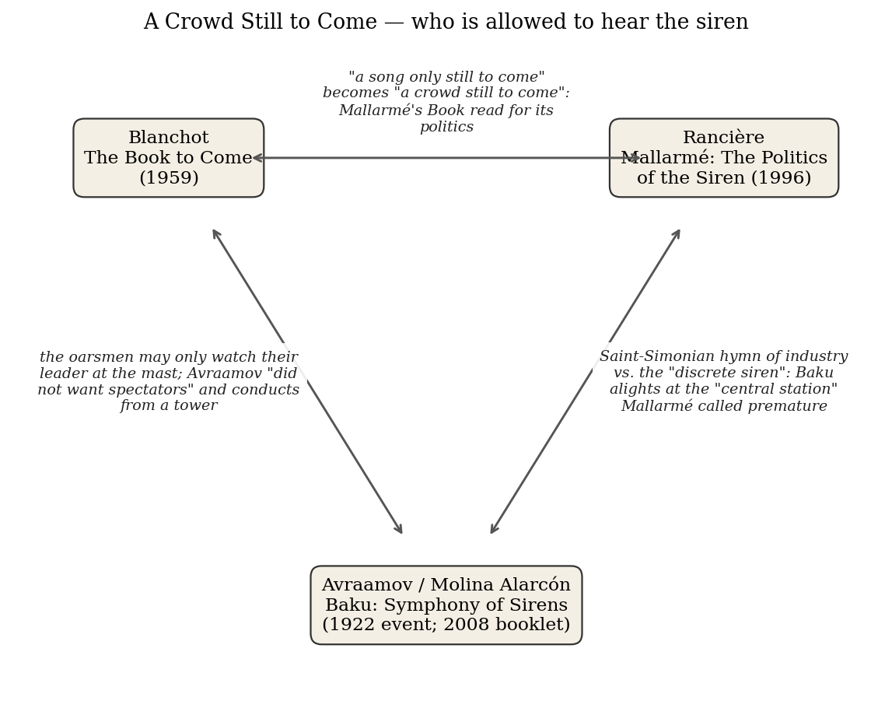
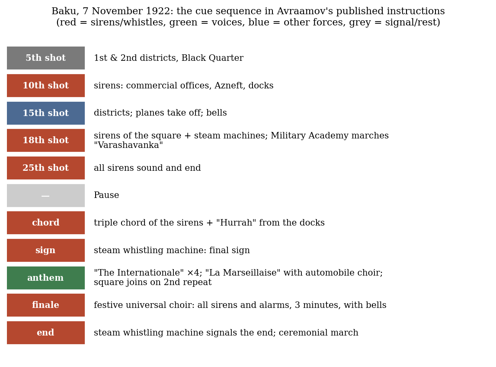

*Triad 20 of 32 · 2026-10-13 · Difficulty 4 · Shared figure or motif, Conflict, Genealogy/influence*

## The three books

- [[books/10984-baku-symphony-of-sirens-sound-experiments-in-the-s|Baku: Symphony of Sirens. Sound Experiments in the Soviet Avant-Garde]], [[people/miguel-molina-alarcon|Miguel Molina Alarcón]] (editor), [[people/arseny-avraamov|Arseny Avraamov]]; 1922 (event); 2008 (ReR booklet). *Anchor: the industrial hymn carried out — sirens as signal and collective song*
- [[books/8698-mallarme-the-politics-of-the-siren|Mallarmé: The Politics of the Siren]], [[people/jacques-ranciere|Jacques Rancière]], [[people/steven-corcoran|Steven Corcoran]] (translator); 1996. *The refusal: the discrete siren and the crowd still to come*
- [[books/3315-the-book-to-come|The Book to Come]], [[people/maurice-blanchot|Maurice Blanchot]], [[people/charlotte-mandell|Charlotte Mandell]] (translator); 1959. *The myth and its class structure: Ulysses at the mast, the oarsmen who watch*

---

## The Thread

Three sirens, one question: who is allowed to hear the song? Blanchot’s “The Song of the Sirens” (the opening chapter of *The Book to Come*, 1959) describes a song that is “only still to come”, and a Ulysses who enjoys it safely, tied to the mast, while his oarsmen, ears stopped with wax, have “only a right to the pleasure of watching their leader writhe ridiculously”. Rancière’s *Mallarmé: The Politics of the Siren* (1996) takes Mallarmé’s “discrete siren” as the emblem of a poem that must wait for “a crowd still to come”, and sets Mallarmé against the Saint-Simonian dream of “Industry made religious; religion made industrial”, the new hymn sung by the workers themselves. The Baku booklet documents the moment that dream was carried out with steam: on 7 November 1922 Arseny Avraamov conducted a whole city’s factory whistles, the foghorns of the Caspian flotilla, artillery and choirs from a tower, and “did not want spectators”.

The connection is a **shared figure** (the siren: lure, poem, factory whistle) carrying a **conflict** about the relation of the one to the many: Ulysses at the mast, Mallarmé’s conductor who “warns the crowd about adoring itself”, Avraamov on his tower with signal flags. There is also a **genealogy**: Blanchot’s Mallarmé (the “book to come”) is the one Rancière politicizes, and the Saint-Simonian hymn Rancière describes is the ancestor of the *Sinfoniya Gudkov*. One last twist keeps it honest: the editor of the Baku booklet notes that Avraamov’s main instrument was an array of tuned steam whistles, not sirens; “Avraamov himself refers to the work as Sinfonia Gudki.” The siren survives in this story partly as a translator’s choice, which is close to Rancière’s point that “sirens do not exist, except in the writings of poets.” **Difficulty: 4.**

## 1. Baku: Symphony of Sirens. Sound Experiments in the Soviet Avant-Garde — Miguel Molina Alarcón, ed. (Avraamov’s event 1922; booklet ReR Megacorp, 2008)

PDF booklet (77 pp., OCR text layer) · Calibre ID 10984 → [[books/10984-baku-symphony-of-sirens-sound-experiments-in-the-s|book page]]

**Selection logic.** The anchor. Avraamov’s *Symphony of Sirens* is the literal case of the industrial hymn: a song meant to be heard and sung by everyone, scored as written orders to a city. It is a document collection rather than an argument, so it supplies the primary sources (Avraamov’s 1922 instructions, his 1924 article, the reconstructors’ interview) against which the two theorists can be tested.

**Overview.** The booklet accompanies a double CD of reconstructions of Russian avant-garde sound works, 1910–1930: Avraamov, Khlebnikov’s “Radio of the Future”, *Victory over the Sun*, Vertov’s “Laboratory of Hearing”, Kruchenykh’s zaum poem “Dyr bul shchyl”, and early recordings of Mayakovsky, Esenin and Lenin, and more. Its core is the *Symphony of Sirens*: Avraamov’s biography (he proposed burning all pianos as emblems of equal temperament), the Baku instructions printed in local newspapers on 6 November 1922, the first English trans-

*Figure 1: Constellation*

lation of his 1924 article from *Khudozhnik i Zritel’*, and an interview with Leopoldo Amigo and Miguel Molina on how they rebuilt the piece from instructions rather than a score. The text layer is OCR and somewhat noisy (Cyrillic is garbled; “Dur.” often reads “Our.”); quotations below were checked against it and are clean.

**Quotes** (PDF page numbers; the booklet’s printed numbering doesn’t survive extraction)

- “Avraamov did not want spectators, but intended the active participation of everybody in the development of the work through their exclamations and singing, all united with the same revolutionary will.” (CD1 notes, PDF p. 22)

- “Music has, among all the arts, the highest power of social organisation.” (Avraamov, quoted in the CD1 notes, PDF p. 22)

- “Every morning, a chaotic industrial roar gags the people.” (same, PDF p. 23)

- “-The midday cannon has been cancelled.” (Baku instructions, PDF p. 23)

- “This would be a way to oust the church bells of the old culture and to replace them with the working roar of the sirens, the very timbre of which is so close to the proletarian heart.” (Avraamov, “Symphony of Sirens”, 1924, PDF p. 74)

- “in order to give the impression of an old film, of the sound-memory of a recording that was never made.” (Amigo & Molina interview, PDF p. 62)

**Diagram: the Baku cue sequence.** Built from the instructions as printed (PDF pp. 23–24). The piece is cued by numbered cannon shots and flag colours, not bars: “The red and white flag, is used for the batteries; the blue and yellow, for the sirens”.

*Figure 2: Baku cue sequence*

**Derived list: the instrumentarium.** Taken from the CD1 notes (PDF p. 22) and the footnote to Avraamov’s 1924 article (PDF p. 74):

1. “choirs thousands strong”

2. “foghorns from the entire Caspian flotilla”

3. “two artillery batteries”

4. “several full infantry regiments” (the 1924 footnote says “several rifle companies, a machine gun company”)

5. “hydroplanes”

6. “twenty-five steam locomotives and whistles”

7. “all the factory sirens in the city”

8. “Steam Whistle Machines”: “an ensemble of 20 to 25 sirens tuned to the notes of The Internationale”

9. automobiles (the “choir of automobiles”)

10. a “200-piece joint military orchestra” 11. the conductor: “a specially built tower, using signalling flags”

**A note against the grain.** Avraamov’s own report on the 1923 Moscow repeat admits two failures: an over-elaborate harmonization that left “the melodies becoming completely unrecognizable to the masses”, and sirens placed in a courtyard instead of on the roof, so “there was simply not enough sound for the entire ‘audience’ of Moscow.” (PDF p. 73). Note his scare quotes around *audience*: the word he had abolished is back.

## 2. Mallarmé: The Politics of the Siren — Jacques Rancière (1996; trans. Steven Corcoran, 2011)

PDF · Calibre ID 8698 → [[books/8698-mallarme-the-politics-of-the-siren|book page]]

**Selection logic.** Rancière gives the siren a politics. His Mallarmé is not the aesthete of the ivory tower; he waits for a crowd that does not exist yet and refuses the shortcut of the industrial hymn. That refusal is the exact negative of Baku, and the book reads Mallarmé’s “Salut” and “A la nue accablante tu” as sea fables about the same question Blanchot asks of Ulysses.

**Overview.** A short book in four parts (“The foam of the poem”, “The poetics of mystery”, “The hymn of spiritual hearts”, “The duty of the book”). It opens with a close reading of “A la nue accablante tu”, where the foam might mark a great shipwreck or only the play of a siren, and reads the alternative as Mallarmé’s wager about the poem’s chances in an era “not yet ready to welcome it”. It then places Mallarmé within the nineteenth century’s search for a new civic religion (Hegel, Hölderlin and Schelling’s “systematic programme”, Feuerbach, the Saint-Simonians, Wagner) and shows him taking the converse position: a “religion of artifice” rather than of industry, an orchestra rather than a chorus, “restricted action” rather than the festival of the people now.

**Excerpt** (p. 6, PDF p. 23). Read this beside Blanchot’s “ignoble effort” to call the Sirens liars:

> There are two reasons why the siren was not drowned in the abyss, each of which is sufficient: first, because sirens, in contrast to boats, do not drown in water. On the contrary, they dive down in its depths to escape danger. Second, and more radically, because sirens do not exist, except in the writings of poets. […]
>
> *(Shortened for the public edition.)*

**Quotes**

- “the poet is unable to make himself heard to a crowd still to come” (p. 5, PDF p. 22)

- “it is the act, the suspension itself of fiction. It is the transformation of the narrative into a vanishing hypothesis.” (p. 7, PDF p. 24)

- “Industry made religious; religion made industrial – in order to establish the new hymn and theatre and replace the representative political machine.” (p. 28, PDF p. 45)

- “the conditions do not yet exist for the union of poet and crowd in ‘the hymn of spiritual hearts’.” (p. 33, PDF p. 50)

- “So it is pointless to try to cut short the ‘tunnel of the times’ and alight, today already, at some ‘central station’ ” (p. 34, PDF p. 51)

- “the musical ceremony is not a choral ceremony.” / “The orchestra conductor’s movement retains the mystery in its place and warns the crowd about adoring itself in the new temple.” (p. 38, PDF p. 55)

**Glossary: Rancière’s Mallarmé in five terms**

- *Arabesque.* The single, slipping line of the phrase that keeps the poem from being taken as description: “The arabesque works to dispel the illusion that the poem is about describing” (p. 2).

- *Hypothesis.* What the poem offers in place of a story: “Hypothesis is the name of that which replaces narrative in Mallarmé.” (p. 2)

- *Restricted action.* From Mallarmé’s essay “L’Action restreinte”: the poem’s limited, deliberate act in an “interregnum”. Rancière: “It would be much fairer to compare Mallar-méan ‘restricted action’ with the Marxist notion of a necessary maturation of revolutionary conditions” (p. 33).

- *Religion of artifice.* Mallarmé’s answer to the century’s demand for a civic religion: “It is not the religion of the nourishing earth or of industrial groups that must succeed Christianity. Instead, it is the ‘religion’ of artifice” (p. 30).

- *Hymn of spiritual hearts.* From Mallarmé’s “Prose (pour des Esseintes)”, cited at p. 27 in Henry Weinfield’s translation (“For I inaugurate through science / The hymn of all hearts spiritual”): the community-song that is promised but deferred.

## 3. The Book to Come — Maurice Blanchot (1959; trans. Charlotte Mandell, 2003)

PDF (scanned, OCR text layer) · Calibre ID 3315 → [[books/3315-the-book-to-come|book page]]

**Selection logic.** Blanchot supplies the myth and the problem of class inside it. His Ulysses hears “without risks”, by privilege, while the crew rows deaf; and he names the means by which the Sirens were beaten: “the power of the technique”. Avraamov turns that technique into the singer; Rancière’s Mallarmé, whom Blanchot made the poet of “the book to come”, defers the song. The book also closes on Mallarmé’s *Livre*, where the reader is an “operator”, a useful word to set beside Avraamov’s orders to a city.

**Overview.** A collection of essays from the 1950s in four parts: “The Song of the Sirens” (the encounter with the imaginary; Proust), “The Literary Question” (Artaud, Rousseau, Joubert, Claudel, the Golem, Borges’s Aleph), “On an Art Without Future” (Broch, James, Musil, the diary) and “Where Is Literature Going?” (Beckett, Mallarmé’s *Un coup de dés* and the posthumous *Livre*). The opening chapter argues that the novel is born from Ulysses’ struggle with the Sirens: “ode becomes episode”, and narrative is the movement toward an event that is always still to come. The scan’s OCR has errors (“caU”, “aIl”); quotations below were chosen from clean passages and checked.

**Quotes**

- “The Sirens: it seems they did indeed sing, but in an unfulfilling way, one that only gave a sign of where the real sources and real happiness of song opened.” (p. 3, PDF p. 17)

- “it was also a means of navigation” (p. 4, PDF p. 18). The song as a navigational signal, which is what a foghorn is.

- “His is a fortunate and secure cowardliness, based on privilege, which places him outside of the common condition” (p. 4, PDF p. 18)

- “After the Sirens had been conquered by the power of the technique that always tries to play safely with unreal (inspired) powers” (p. 5, PDF p. 19)

- “We cannot deny that Ulysses heard a little of what Ahab saw, but he held firm in the midst of hearing” (p. 8, PDF p. 22)

- “Mallarmé calls the reader ‘the operator.’ ” (p. 242, PDF p. 256)

**Annotated contents: §1 “Encountering the Imaginary” (pp. 3–10)**

- *Opening (pp. 3–5).* What the song was: an inhuman noise, or the human song made strange. The charge that the Sirens lied is “a rather ignoble effort”. Ulysses’ victory is technical and class-based; the crew watches.

- *“The Secret Law of the Narrative” (pp. 5–7).* The novel is born from the struggle with the Sirens; its rule is that the destination may not be named.

- *“When Ulysses Becomes Homer” (pp. 7–8).* To hear the song one must become its narrator; Ahab and Moby-Dick as the pair who refuse Ulysses’ limit.

- *“The Metamorphosis” (pp. 8–10).* The time of narrative: the encounter is a song present only as “The presence of a song only still to come.” (p. 9), and then: “Always still to come, always already past” (p. 10).

**A misreading worth attempting.** Read Baku 1922 as the oarsmen’s version of Book XII. Blanchot’s crew has wax in its ears and only the right to watch; Avraamov removes the wax, moves the mast to a signal tower, and makes the crew the instrument. Then ask whether anything has changed: the flags still come from one man on a tower, the orders are for “irrevocable execution”, and in Moscow the crowd could not recognize the tune. Blanchot’s “secure cowardliness, based on privilege” may describe the conductor as well as the hero.

## Where this sends you

## Notebook

1. **The tower and the mast.** Blanchot’s Ulysses, tied to the mast, “held firm in the midst of hearing”; Avraamov conducts from “a specially built tower, using signalling flags”; Rancière’s conductor “warns the crowd about adoring itself”. Write a page on the conductor as the figure who hears for the others. Which of the three is the honest one?

2. **The cancelled midday cannon.** Avraamov’s instructions cancel the city’s ordinary time signal (“-The midday cannon has been cancelled.”) and his 1924 article proposes sirens to mark “midday and midnight” in place of church bells. Rancière’s Mallarmé refuses to “alight, today already, at some ‘central station’ ”. Write about time-signals as politics: who owns the city’s noon?

3. **A siren that does not exist.** Rancière: “sirens do not exist, except in the writings of poets.” The Baku editor: “Avraamov himself refers to the work as Sinfonia Gudki.” The reconstructors aim at “the sound-memory of a recording that was never made.” Write a short prose piece in which the siren exists only in translation, in reconstruction, and in the poem.

## Rabbit holes

- Horkheimer & Adorno, the Sirens passage from *Dialectic of Enlightenment* (Excursus I), the oarsmen and the mast read as the division of labour. [PEPC excerpt, U. Penn](https://writing.upenn.edu/bernstein/syllabi/readings/Adorno-Horkheimer_Sirens-passage.html)

- Homer, *The Odyssey*, Book XII, in Samuel Butler’s prose translation. [Project Gutenberg](https://www.gutenberg.org/ebooks/1727)

- Mallarmé, *Divagations*, trans. Barbara Johnson, which contains “Restricted Action”, “Conflict” and “Confrontation”, the prose pieces Rancière sets against the Saint- Simonians. [Harvard University Press](https://www.hup.harvard.edu/books/9780674032408)

- Jean-François Chevrier’s exhibition *Art and Utopia: Restricted Action* (MACBA, 2004), which reads a century of art through Mallarmé’s essay. [MACBA](https://www.macba.cat/en/node/23400)

- Andrey Smirnov and Matt Price, *Sound in Z*: the Theremin Centre archive on Avraamov, drawn sound and “Topographical Acoustics”. asmir.info

- Joseph Kuzma, “Maurice Blanchot”, for the place of *The Book to Come* in Blanchot’s work. [Internet Encyclopedia of Philosophy](https://iep.utm.edu/blanchot/)

## Also in your library

- *Dialectic of Enlightenment* — Horkheimer & Adorno (Calibre ID 3405). Excursus I, “Odysseus or Myth and Enlightenment”, is the fourth reading of the oarsmen.

- *The Complete Stories* — Franz Kafka (Calibre ID 3250). Contains “The Silence of the Sirens”: the Sirens’ more dangerous weapon is silence.

- *Sound* (Documents of Contemporary Art) — Caleb Kelly, ed. (Calibre ID 7265). Russolo and the noise tradition Avraamov extends.

## From the Lexicon — Techne

**Your sense:** Applied mechanical construction of the eco-cognitive workspace (coding, architectural scaffolding, note systems) as an epistemological disclosure.

**Received:** A guided, rational capacity (poietike episteme) to bring forth into being that which does not bring itself forth naturally; craft and art opposed to chance (tyche).

**Etymology.** From PIE *teks- (“to weave, to fabricate”), through Homeric and classical Greek (Aristotle, *Nicomachean Ethics* VI), later shifted toward Heidegger’s *aletheia* and Stiegler’s technics.

**WordNet.** No WordNet entry (checked today): the term exists only in the philosophical literature, and the absence says English kept the Latinate “technique” and let the Greek word stay a citation.

**Relations.** precursor_to: Operative images.

> Craft is not mechanical routine, but an active epistemological mode of disclosure.

**Why today.** Blanchot says the Sirens were “conquered by the power of the technique”, and Avraamov frames music’s social problem as “the modernization of its hitherto archaic material technology (the electrification of music)”; the Baku whistle array is a test of your entry’s boundary tension between techne as disclosure and Gestell as enframing.

**Verified occurrence.** None: “techne” does not occur in the extracted text of any of the three books.

## New in the Lexicon

- **Modality** — the way a proposition stands to truth or reality (necessary, possible, obligatory, likely), in logic and in grammar.

- **Subject** — the being that knows, experiences and acts, set against its object; from Aristotle’s *hypokeimenon* to Lacan’s split subject.

## To carry

> “The presence of a song only still to come.” — Maurice Blanchot, *The Book to Come*, trans. Charlotte Mandell, p. 9

## Themes

[[themes/avraamov|Avraamov]] · [[themes/baku-1922|Baku 1922]] · [[themes/conductor|conductor]] · [[themes/crowd-still-to-come|crowd still to come]] · [[themes/discrete-siren|discrete siren]] · [[themes/gastev|Gastev]] · [[themes/hymn-of-spiritual-hearts|hymn of spiritual hearts]] · [[themes/industrial-hymn|industrial hymn]] · [[themes/livre|Livre]] · [[themes/mallarme|Mallarmé]] · [[themes/mast|mast]] · [[themes/midday-cannon|midday cannon]] · [[themes/oarsmen|oarsmen]] · [[themes/operator|operator]] · [[themes/proletkult|Proletkult]] · [[themes/reconstruction|reconstruction]] · [[themes/religion-of-artifice|religion of artifice]] · [[themes/restricted-action|restricted action]] · [[themes/saint-simonians|Saint-Simonians]] · [[themes/signal-flags|signal flags]] · [[themes/sinfonia-gudki|Sinfonia Gudki]] · [[themes/siren|siren]] · [[themes/song-still-to-come|song still to come]] · [[themes/spectators-vs-participants|spectators vs participants]] · [[themes/steam-whistles|steam whistles]] · [[themes/symphony-of-sirens|Symphony of Sirens]] · [[themes/technique|technique]] · [[themes/time-signal|time signal]] · [[themes/translation|translation]] · [[themes/ulysses|Ulysses]]

---

Previous: [[triads/2026-10-12-rewarded-for-the-relics|Rewarded for the Relics]]  
Next: [[triads/2026-10-14-egypt-china-jerusalem|Egypt, China, Jerusalem]]
