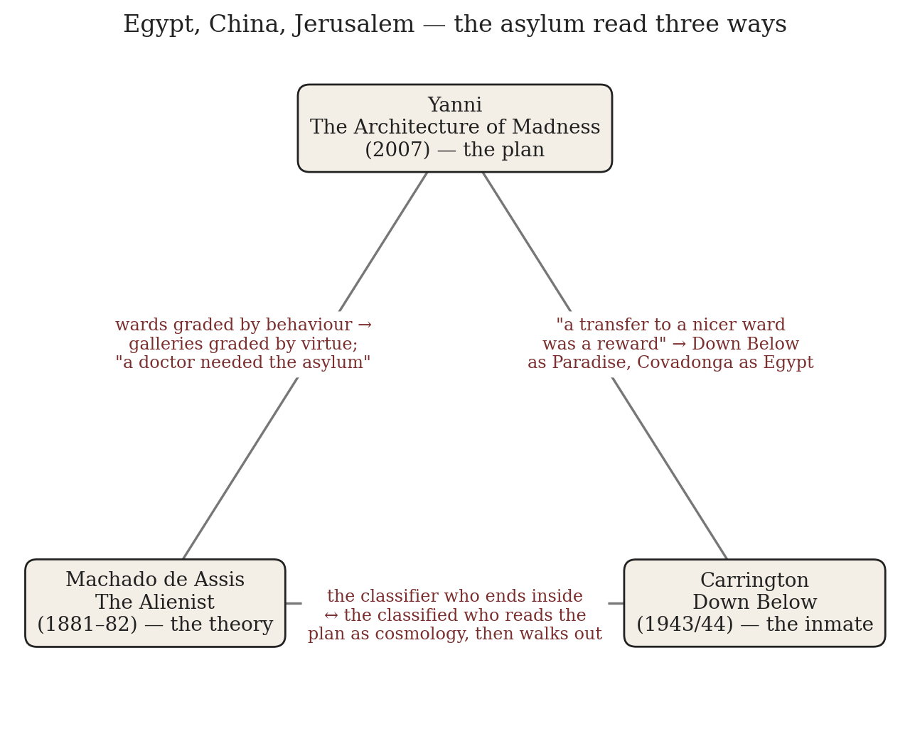
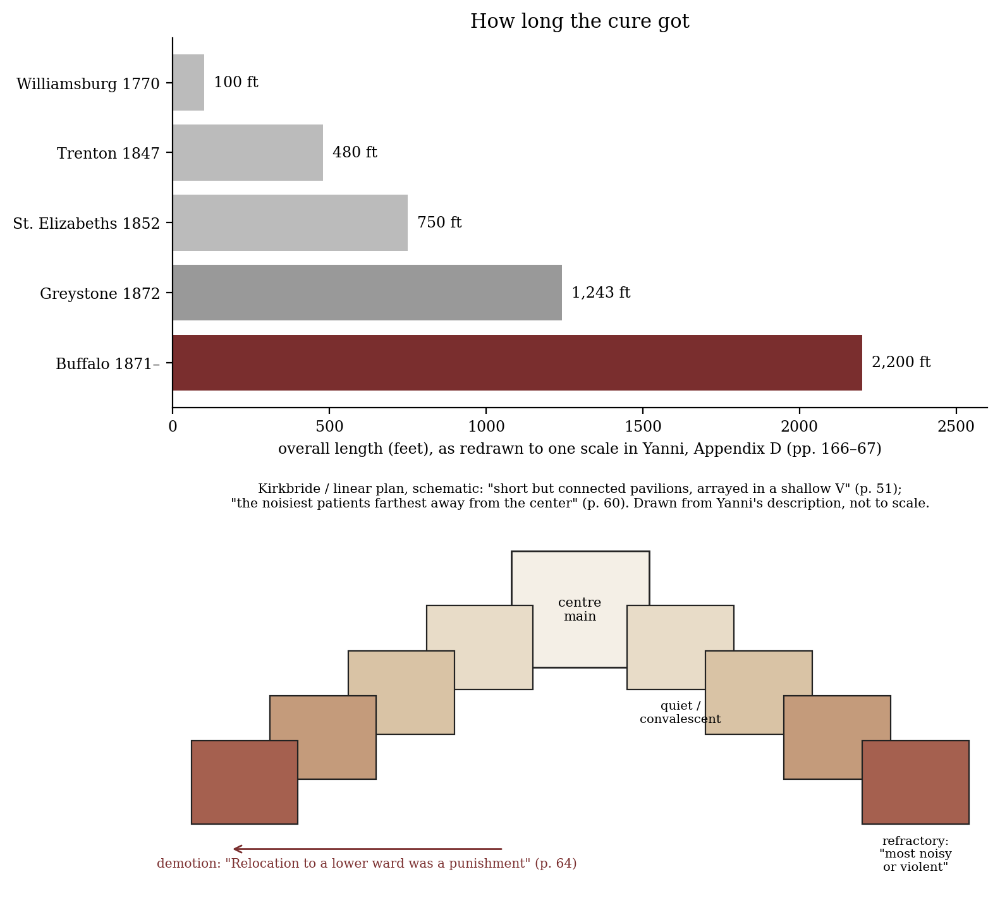
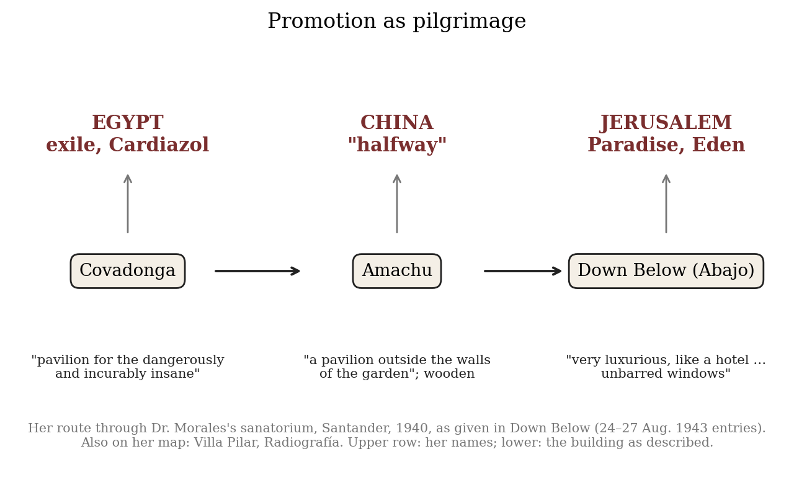

*Triad 21 of 32 · 2026-10-14 · Difficulty 4 · Same subject, Oblique/structural, Conflict*

## The three books

- [[books/9911-the-architecture-of-madness-insane-asylums-in-the|The Architecture of Madness: Insane Asylums in the United States]], [[people/carla-yanni|Carla Yanni]]; 2007. *Anchor — the plan*
- [[books/1138-the-alienist|The Alienist]], [[people/joaquim-maria-machado-de-assis|Joaquim Maria Machado de Assis]], [[people/william-l-grossman|William L. Grossman]] (translator); 1882. *The theory — the classifier who ends inside*
- [[books/2343-down-below|Down Below]], [[people/leonora-carrington|Leonora Carrington]], [[people/marina-warner|Marina Warner]] (contributor); 1944. *The inmate — the plan read as cosmology*

---

## The Thread

Three books, one building type, three positions inside it. Carla Yanni’s *The Architecture of Madness* is the plan: the nineteenth-century American belief that a correctly drawn asylum was itself a treatment, and the Kirkbride “linear plan” that graded patients ward by ward from the quiet centre to the noisy extremities. Machado de Assis’s *The Alienist* is the theory that drives such a plan to its end: Simão Bacamarte’s Green House keeps redrawing the line between inside and outside until four-fifths of the town is committed, then the balanced, then the doctor himself. Leonora Carrington’s *Down Below* is the inmate: in Dr. Morales’s sanatorium at Santander in 1940 she reads the pavilions as Egypt, China and Jerusalem, and her pilgrimage toward the best of them is, in the plan’s own terms, promotion to a nicer ward.

The link worth the trouble is this. Yanni shows that classification by ward “was also a management device—a transfer to a nicer ward was a reward” (p. 64). Carrington, at her most deluded, gets that structure right in the wrong vocabulary: Down Below, “very luxurious, like a hotel,” is the reward ward, and the gypsy who comes from it tells her “you’re not well enough to go there.” Machado writes the satire of the same machine from the doctor’s side, where the classifier’s need for the building (Yanni: “a doctor needed the asylum to be a psychiatrist”) ends with the classifier locked in it. **Connection kinds:** Same subject; Oblique/structural; Conflict (plan against patient, theory against town). **Difficulty: 4.**

*Figure 1: Constellation: what passes between each pair*

## 1. The Architecture of Madness: Insane Asylums in the United States — Carla Yanni (2007)

PDF · Calibre ID 9911 · University of Minnesota Press, series “Architecture, Landscape, and American Culture” → [[books/9911-the-architecture-of-madness-insane-asylums-in-the|book page]]

**Selection logic.** The anchor, and deliberately outside the literary-theory orbit of recent days: an architectural historian on a building type. It supplies the plan the other two books distort, and it names the mechanism (ward as reward and punishment) that makes the triad cohere.

**Overview.** Yanni follows American asylum architecture over a little more than a century: the eighteenth-century precedents (Bethlem, St. Luke’s, Tuke’s York Retreat), the Kirkbride or linear plan codified by the Association of Medical Superintendents in 1851 and by Thomas Kirkbride’s 1854 book, the cottage plan of the 1870s, and the enormous post–Civil War hospitals such as H. H. Richardson’s Buffalo State Hospital. Her argument is that superintendents treated planning as therapy, and that the buildings carried the tensions of the project: home and institution, benevolence and surveillance. A short interlude reads three patients’ accounts (Ebenezer Haskell, Elizabeth Packard, Francis Delilez) for what they say about space. Two-column PDF; quotations were checked against the extracted text, page numbers are the printed ones.

**Quotes.**

- “For most of the nineteenth century, doctors believed that between 70 and 90 percent of insanity cases were curable, but only if patients were treated in specially designed buildings.” (Introduction, p. 1)

- “(A patient did not need the asylum to be a lunatic, but a doctor needed the asylum to be a psychiatrist.)” (Introduction, p. 7)

- “The Kirkbride plan, also known as the linear plan, was a type of congregate plan, made up of short but connected pavilions, arrayed in a shallow V.” (ch. 2, p. 51)

- “These wards would be used to categorize patients by severity of disease, with the noisiest patients farthest away from the center.” (ch. 2, p. 60)

- “But the classification system was also a management device—a transfer to a nicer ward was a reward for a well-behaved patient. Relocation to a lower ward was a punishment.” (ch. 2, p. 64)

- “The interior space of the asylum was strictly hierarchical, and patients were constantly aware of their place within the numerical wards.” (ch. 2, p. 65)

**Diagram.** Top: the five asylums Yanni redraws to one scale in Appendix D, by overall length. Bottom: a schematic of the shallow-V plan and its gradient, drawn from her description, not from a measured plan.

*Figure 2: Yanni, Appendix D lengths; schematic of the linear plan*

**Derived list: the ladder of a Kirkbride hospital, centre to end (from ch. 2).**

1. Centre main: offices, reception rooms, chapel on the third story, superintendent’s family; “two dining rooms for the use of recovering or well-behaved patients” (p. 60).

2. Near wards: “better cleaned and furnished” than the rest (p. 64).

3. Intermediate wards, double-loaded corridors.

4. Outer refractory wards, for the “most noisy or violent or those whom, for any reason, it is desirable to have secluded” (p. 60); single-loaded corridors so “the attendant never had to turn his or her back on a patient.”

5. Below ground: at the Alabama Insane Hospital, Black patients “assigned to the extreme lower wards”, that is, the basement (p. 64).

## 2. The Alienist — Joaquim Maria Machado de Assis (serialized 1881– 82; Papéis avulsos, 1882)

EPUB · Calibre ID 1138 · Melville House, 2012; the EPUB names no translator, the publisher credits W. L. Grossman → [[books/1138-the-alienist|book page]]

**Selection logic.** Yanni’s doctors believed in the building; Machado imagines one who believes in it completely. The novella gives the triad its theory of classification and its ending, and it is written thirty years after the AMSAII propositions, in the same decades Yanni covers.

**Overview.** Simão Bacamarte, trained at Padua and Coimbra, returns to the small town of Itaguai and founds its first madhouse, the Green House. His definition of madness widens chapter by chapter; a barber’s revolt against him turns into a dictatorship and then into more patients; at last he inverts his doctrine, releases everyone, and commits the well balanced. The narrator is a dry chronicler citing “the chroniclers”. The Melville House edition adds “Illuminations”: a historical sketch of Rio, period engravings of asylums, other Machado texts.

**Excerpt (ch. XI, “Release and Joy”).** The communiqué that turns the building inside out, in Bacamarte’s own bureaucratic order:

> The alienist informed the Council, first, that he had checked the statistics and had found that four-fifths of the population of Itaguai was in the Green House; second, that this disproportionately large number of patients had led him to reëxamine his fundamental theory of mental illness, a theory that classified as sick all people who were mentally unbalanced; […]
>
> *(Shortened for the public edition.)*

**Quotes.**

- “Science,” he told His Majesty, “is my only office; Itaguai, my universe.” (ch. I)

- “The building had a courtyard in the center and two hundred cubicles, each with one window.” (ch. I)

- “At the end of four months the Green House was a little community in itself. A gallery with thirty-seven more cubicles had to be added.” (ch. II)

- “Till now, madness has been thought a small island in an ocean of sanity. I am beginning to suspect that it is not an island at all but a continent.” (ch. IV)

- “In one gallery lived only those whose outstanding moral quality was modesty.” (ch. XII)

- “He entered the Green House, shut the door behind him, and set about the business of curing himself.” (ch. XIII)

**Derived list: the four regimes of the Green House.**

1. *The unbalanced* (chs. I–III): “the violent, the depressed, the monomaniacal”; two hundred cubicles, then a gallery of thirty-seven more.

2. *The continent* (chs. IV–X): madness widened to any lack of equilibrium (a vain householder, a florid speaker, the barber’s partisans) until “four-fifths of the population of Itaguai was in the Green House” (ch. XI).

3. *The balanced* (chs. XI–XII): “it took Bacamarte almost half a year to find eighteen patients”; galleries sorted by virtue (the modest, the tolerant, the truthful, the loyal), and for a man of special rectitude “one of the choicest cubicles.”

4. *The one* (ch. XIII): virtues cured by inducing their opposites; “By the end of five months all the patients had been cured. The Green House was empty.” Then Bacamarte commits himself and “died seventeen months later as insane as ever.”

Set beside Yanni’s ward ladder, regime 3 is the Kirkbride gradient with the moral signs reversed: still graded, still a gallery per class, the best cubicle still a reward, now given for being too good.

## 3. Down Below — Leonora Carrington (dictated 1943; published in VVV, 1944)

EPUB · Calibre ID 2343 · New York Review Books, 2017, introduction by Marina Warner → [[books/2343-down-below|book page]]

**Selection logic.** The view from a ward. Carrington supplies what Yanni says she could barely find, a patient’s account of how the plan was lived, and she supplies it as cosmology. Her text keeps pointing at the map of the grounds.

**Overview.** In 1940, after Max Ernst was interned, Carrington broke down in the Ardèche, was taken across the border, and was committed to Dr. Mariano Morales’s sanatorium in Santander, where she was treated with Cardiazol (a convulsant). Three years later in New York she dictated an account of it in five dated entries, 23–27 August 1943, plus a postscript. Per the edition’s note on the text, it was dictated in French to Jeanne Megnen in 1943, translated by Victor Llona for *VVV* no. 4 (February 1944), and reviewed by Carrington in 1987.

**Quotes.**

- “Exactly three years ago, I was interned in Dr. Morales’s sanatorium in Santander, Spain, Dr. Pardo, of Madrid, and the British Consul having pronounced me incurably insane.” (Monday, 23 August 1943)

- “(By looking at the map, you will see the respective positions of Villa Pilar, Radiografia, Covadonga, Amachu, and Abajo (Down Below); that will enable you to get your bearings.)” (Tuesday, 24 August 1943)

- “The pavilion with this name was for me the Earth, the Real World, Paradise, Eden, Jerusalem.” (Thursday, 26 August 1943)

- “I realized that I had to find my place in the circle, and sat at 45 degrees to the left of the door” (Friday, 27 August 1943)

- “that Covadonga and Amachu and Down Below were not Egypt, China, and Jerusalem, but pavilions for the insane and that I should get out as quickly as possible.” (Friday, 27 August 1943)

**Excerpt (Wednesday, 25 August 1943).** The ward ladder, stated by a nurse in a single sentence:

> “Is Down Below nice?” “Delightful. Everyone is happy there.” “Take me with you.” “I can’t.” “Why not?” “Because you’re not well enough to go there.”

**Diagram.** Her names for the pavilions over what the text says the buildings were, in the order she moved through them.

*Figure 3: Carrington’s pavilions and their names*

**Glossary of her private terms (each from the text).**

- *Down Below / Abajo*: the largest pavilion, “very luxurious, like a hotel, with telephones and unbarred windows”; for her Paradise and Jerusalem.

- *Covadonga*: “a pavilion for the dangerously and incurably insane named after Don Mariano’s daughter who died”; for her Egypt.

- *Amachu*: “a pavilion outside the walls of the garden”, wooden, hence China, “halfway.”

- *The Sun Room*: in Covadonga, “one of its sides was made of opaque glass that gave out a dazzling light”; “Here in the Sun Room I felt I was manipulating the firmament”.

- *Stick of Philosophy*: the stick Don Luis gave her, “a companion on all my walks.”

- *Don Luis and Don Mariano*: the doctor’s son and the doctor, whom she took for “God and His Son.”

**A misreading worth attempting.** Read *Down Below* as a work of architectural criticism, not a case history. Her delusion assigns spiritual value to buildings in exactly the order the institution assigned privileges. The demystification comes, notably, from a man who “sat down in the dining room at a table next to mine”. That’s the good neighbour, not the plan.

## Where this sends you

**Notebook.**

1. Carrington’s “45 degrees to the left of the door” and Yanni’s patients “constantly aware of their place within the numerical wards” (p. 65): write a page in which a seat is a diagnosis. Who assigned it, and what does the sitter believe it means?

2. Bacamarte’s galleries of the modest and the tolerant (ch. XII) against Kirkbride’s gradient from centre to refractory (p. 60): draw the plan of an institution that confines by virtue. Where does the choicest cubicle go, and who is in the basement?

3. Yanni’s parenthesis (p. 7) and “Itaguai, my universe” (ch. I): rewrite the parenthesis for your own trade, the critic and the canon, the collector and the library. Does the practitioner need the building more than the inmate does? Bacamarte’s ending is one answer.

**Rabbit holes.**

- Thomas Story Kirkbride, *On the Construction, Organization, and General Arrangements of Hospitals for the Insane* (Philadelphia, 1854), the manual behind Yanni’s ch. 2. Internet Archive: https://archive.org/details/onconstructionor00kirk

- Elizabeth Packard, *The Prisoners’ Hidden Life, or Insane Asylums Unveiled* (1868), one of Yanni’s three inside accounts. Digitised via the Medical Heritage Library, Wellcome Collection: https://wellcomecollection.org/works/c8jzskyu

- Nellie Bly, *Ten Days in a Mad-House* (1887), the undercover account Yanni cites in her introduction (p. 14). Project Gutenberg: https://gutenberg.org/ebooks/21162

- Machado de Assis, *Papéis avulsos* (1882), the Portuguese original, with “O alienista” second in the contents. Project Gutenberg: https://gutenberg.org/ebooks/57001

- Carla Yanni on the book, New Books Network podcast (28 Jan 2022, host Bryan Toepfer): https://newbooksnetwork.com/the-architecture-of-madness

- Aby Warburg’s years at Ludwig Binswanger’s clinic in Kreuzlingen, from Cornell’s Mnemosyne site (see the Lexicon below): https://warburg.library.cornell.edu/about/aby-warburg

**Also in your library.**

- *Asylum: Inside the Closed World of State Mental Hospitals* (catalogued under Oliver Sacks; Christopher Payne’s photographs of Kirkbride buildings), ID 2553: the plans as ruins.

- Nellie Bly, *Around the World in Seventy-Two Days and Other Writings*, ID 6744: the catalogue description says it includes her asylum exposé.

- Anna Kavan, *Asylum Piece* (1940), ID 2244: linked stories ending in a Swiss clinic. Carrington’s contemporary, also writing from inside.

## From the Lexicon — The Law of the Good Neighbor

**Your sense:** Meaning and abductive friction generated through the unsanctioned proximity and collision of adjacent, displaced concepts.

**Received:** Aby Warburg’s library arrangement rule: the book you are looking for is rarely the one you need; the essential insight sits beside it on the shelf.

**Etymology.** Warburg’s shelving rule for the Kulturwissenschaftliche Bibliothek Warburg in Hamburg, later transposed to digital knowledge graphs.

**WordNet.** WordNet carries the base term (“neighbor”: a person who lives, or is located, near another) but not the sense in play. The compound is yours.

**Relations.** exemplifies: Bilderatlas Mnemosyne.

> Insight is not indexed by hierarchy, but ignited by unsanctioned proximity.

**Why today.** The asylum plan is the law’s sanctioned opposite, adjacency assigned by rank, yet Carrington’s way out starts with the stranger at “a table next to mine,” and the law’s author spent 1921–24 as a patient in Binswanger’s clinic at Kreuzlingen.

**Verified occurrence.** None; the phrase doesn’t occur in any of the three texts.

**New in the Lexicon.**

- cimaruta — a Neapolitan silver amulet shaped as a sprig of rue, its branches ending in small charms against the evil eye.

- vervain — *Verbena officinalis*, a medicinal herb held sacred since antiquity, and one of the charms on the cimaruta.

- Siren — in Greek myth one of the singing sisters whose song lures sailors to destruction; the warning-device sense dates from 1879.

- Livre — the French money of account from c. 781 to 1794, from Latin *libra*, “pound; balance.”

## To carry

> “(A patient did not need the asylum to be a lunatic, but a doctor needed the asylum to be a psychiatrist.)” — Carla Yanni, *The Architecture of Madness*, Introduction, p. 7

## Themes

[[themes/adjacency|adjacency]] · [[themes/amachu|Amachu]] · [[themes/amsaii|AMSAII]] · [[themes/asylum-architecture|asylum architecture]] · [[themes/bacamarte|Bacamarte]] · [[themes/cardiazol|Cardiazol]] · [[themes/carrington|Carrington]] · [[themes/classification|classification]] · [[themes/cosmology-of-pavilions|cosmology of pavilions]] · [[themes/covadonga|Covadonga]] · [[themes/down-below-abajo|Down Below/Abajo]] · [[themes/dr-morales|Dr. Morales]] · [[themes/echelon|echelon]] · [[themes/equilibrium|equilibrium]] · [[themes/galleries-of-virtue|galleries of virtue]] · [[themes/green-house|Green House]] · [[themes/haskell|Haskell]] · [[themes/itaguai|Itaguai]] · [[themes/kirkbride-plan|Kirkbride plan]] · [[themes/kreuzlingen|Kreuzlingen]] · [[themes/law-of-the-good-neighbor|Law of the Good Neighbor]] · [[themes/linear-plan|linear plan]] · [[themes/moral-treatment|moral treatment]] · [[themes/nellie-bly|Nellie Bly]] · [[themes/packard|Packard]] · [[themes/patient-s-view-of-space|patient's view of space]] · [[themes/refractory-wards|refractory wards]] · [[themes/santander|Santander]] · [[themes/self-commitment|self-commitment]] · [[themes/warburg|Warburg]] · [[themes/ward-as-reward|ward as reward]]

---

Previous: [[triads/2026-10-13-a-crowd-still-to-come|A Crowd Still to Come]]  
Next: [[triads/2026-10-15-the-ignorant-master|The Ignorant Master]]
