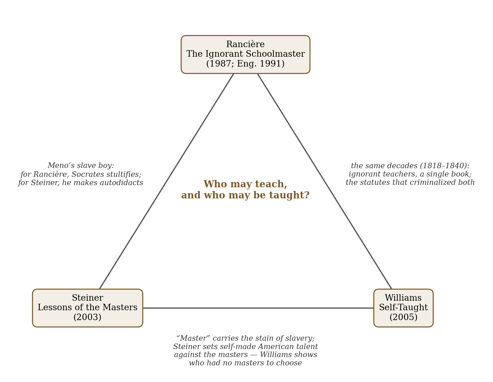
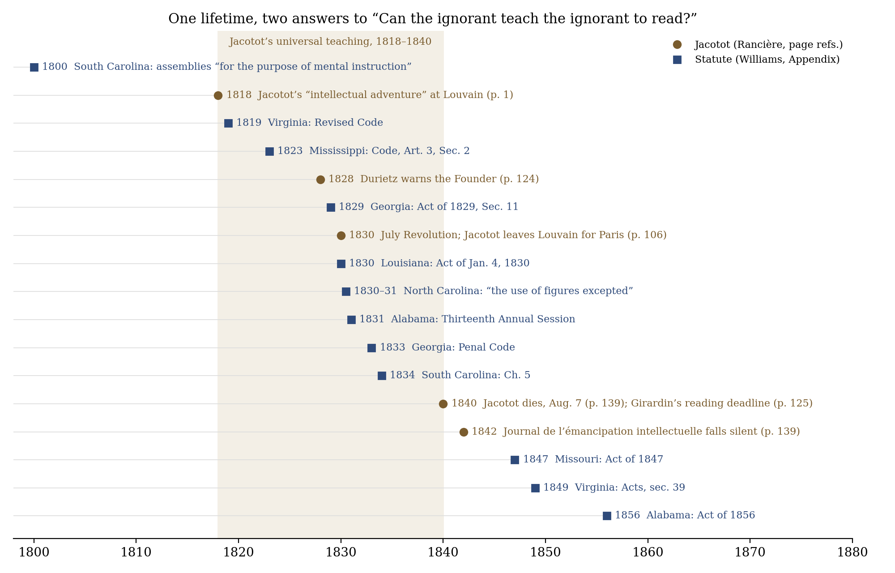
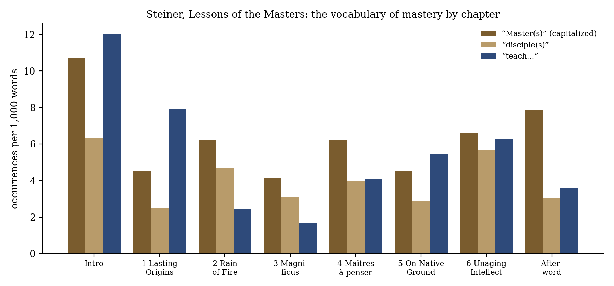

*Triad 22 of 32 · 2026-10-15 · Difficulty 4 · Conflict, Same period, Oblique/structural*

## The three books

- [[books/8939-the-ignorant-schoolmaster-five-lessons-in-intellec|The Ignorant Schoolmaster: Five Lessons in Intellectual Emancipation]], [[people/jacques-ranciere|Jacques Rancière]], [[people/kristin-ross|Kristin Ross]] (translator); 1987. *Anchor: the case for the ignorant master and the equality of intelligences.*
- [[books/3587-lessons-of-the-masters|Lessons of the Masters]], [[people/george-steiner|George Steiner]]; 2003. *Opponent: the eloquent defense of mastery and discipleship.*
- [[books/12076-self-taught-african-american-education-in-slavery|Self-Taught: African American Education in Slavery and Freedom]], [[people/heather-andrea-williams|Heather Andrea Williams]]; 2005. *Ground: learning and teaching without masters, under law that forbade both.*

---

## The Thread

Three books on one question: who may teach, and who may be taught? Rancière recovers Joseph Jacotot, who in 1818 had Flemish students learn French from a bilingual *Télémaque* without explaining anything, and drew the conclusion that “one could teach what one didn’t know,” because “the same intelligence is at work in all the productions of the human mind” (*The Ignorant Schoolmaster*, p. 18). Steiner’s Norton Lectures argue the opposite case. For him the asymmetry of Master and disciple is the substance of teaching, eros and betrayal included. Williams documents people for whom Jacotot’s thesis was a practice they could be punished for rather than a philosophy. Enslaved people learned to read in pits and woods, from torn spelling books and from each other. The statutes against it were passed in the same decades (Virginia 1819 through South Carolina 1834) in which Jacotot’s news, Rancière writes, “was proclaimed in Saint Petersburg and New Orleans” (p. 18).

The books meet most sharply over one scene, Socrates questioning Meno’s slave boy. Rancière calls it “a perfected form of stultification”: Socrates “interrogates a slave who is destined to remain one” (p. 29). Steiner says that “whoever grasps Socrates’s intention is made an autodidact,” and also notes that the geometry Socrates draws out of the slave boy “is unsound” (ch. 1). In his chapter on America he grants that “the very word ‘Master’ carries the stain of slavery,” then sets America’s “self-made” talent against Europe’s magisterium (ch. 5). Williams’s book shows what “self-made” meant in practice for people who had no masters to choose. **Connection: Conflict + Same period + Oblique/structural. Difficulty: 4.**

## 1. The Ignorant Schoolmaster: Five Lessons in Intellectual Emancipation — Jacques Rancière (1987; Kristin Ross’s English translation, 1991)

*PDF · Calibre ID 8939 · page references are to the printed pages (printed p. = PDF p. −26)* → [[books/8939-the-ignorant-schoolmaster-five-lessons-in-intellec|book page]]

**Selection logic.** This is the anchor. It is the strongest modern case that a teacher who knows nothing can teach, and its main target, the “explicator,” is the Master that Steiner praises. Rancière’s own examples are the illiterate father, the Lord’s Prayer as a primer, and a pupil teaching the teacher. Williams documents the same practices in the American South, at the same time, where they were against the law.

**Overview.** Rancière tells the story of Jacotot, a revolutionary veteran in exile at Louvain, and his “universal teaching”: learn one thing thoroughly and relate everything else to it. The method rests on one axiom, the equality of intelligences. The book is not an educational manual. It attacks the “explicative order,” in which every explanation confirms the distance between the one who knows and the one who doesn’t. Kristin Ross’s introduction places it

*Figure 1: Constellation: what passes between the three books*

*Figure 2:*

> Timeline: Jacotot’s career set against the antiliteracy statutes reproduced in

Williams as an intervention against Bourdieu and post-1968 French school reform. The last chapter

follows the method’s absorption and burial by the progressives of the July Monarchy.

**Excerpt: the Meno, read from below** (pp. 29–30). This is the passage that sets Rancière against Steiner.

> Through his interrogations, Socrates leads Meno’s slave to recognize the mathematical truths that lie within himself. This may be the path to learning, but it is in no way a path to emancipation. On the contrary, Socrates must take the slave by his hand so that the latter can find what is inside himself. […]
>
> *(Shortened for the public edition.)*

**Quotes.**

- “There is stultification whenever one intelligence is subordinated to another.” (p. 13)

- “There is no one on earth who hasn’t learned something by himself and without a master explicator.” (p. 16)

- “Whoever teaches without emancipating stultifies.” (p. 18)

- “To teach what one doesn’t know is simply to ask questions about what one doesn’t know.” (p. 30)

- “Universal teaching is the poor’s method. But it isn’t a method of the poor.” (p. 106)

**Derived list: Jacotot’s axioms, as Rancière records them.**

1. All men have equal intelligence; “the same intelligence is at work in all the productions of the human mind.” (p. 18)

2. One must learn something and relate everything else to it. (p. 20)

3. Everything is in everything. “And everything is in *Télémaque*,” add the critics. (p. 19)

4. It’s the disciple that makes the master. (p. 19)

5. One can teach what one doesn’t know. (p. 18)

6. Socrates sleeps in every explicator. (p. 29)

7. Universal teaching won’t take, and it will not perish. (p. 139)

**Diagram.** See the timeline above. The brown markers trace Jacotot’s career with Rancière’s page references: the Louvain “adventure” (1818), the July Revolution and the move to Paris (1830, p. 106), Girardin’s scheme to declare any twenty-year-old who could not read by 1840 “an incapable civilian” (p. 125), Jacotot’s death on August 7, 1840, and the end of the *Journal de l’émancipation intellectuelle* in 1842 (p. 139).

## 2. Lessons of the Masters — George Steiner (2003; Charles Eliot Norton Lectures, 2001–02)

*EPUB · Calibre ID 3587 · locations by chapter (the EPUB has no page numbers)* → [[books/3587-lessons-of-the-masters|book page]]

**Selection logic.** This is the opponent. Steiner gives the most eloquent recent defense of mastery: teaching as vocation, as eros, as an unequal and dangerous relation. He reads the Meno with nearly the opposite emphasis from Rancière. His chapter on America (“On Native Ground”) is where the word “Master” meets slavery, and he names that meeting in a single

sentence before moving on.

**Overview.** Six lectures and an afterword run from the Presocratics, Socrates and Jesus, through Virgil and Dante, Abelard and Heloise, Tycho and Kepler, to Husserl and Heidegger, Nadia Boulanger, the Baal Shem Tov and the Go master. The introduction sets out three structures of relation: Masters who destroy disciples, disciples who betray Masters, and exchange (eros, reciprocal trust). The afterword ends with Nietzsche’s midnight song and Mahler’s setting of it, “Master to Master.”

**Quotes.**

- “Masters have destroyed their disciples both psychologically and, in rarer cases, physically.” (Introduction)

- “The Master learns from the disciple and is modified by this interrelation in what becomes, ideally, a process of exchange.” (Introduction)

- “Exemplary teaching is enactment and can be mute. Perhaps it ought to be.” (Introduction)

- “One might say that whoever grasps Socrates’s intention is made an autodidact, especially in ethics.” (ch. 1, “Lasting Origins”)

- “And it has been shown that the geometrical proof that Socrates elicits by his midwifery from the slave boy in Meno is unsound.” (ch. 1)

- “The very word ‘Master’ carries the stain of slavery.” (ch. 5, “On Native Ground”)

**Derived list: Steiner’s three scenarios and the figures he hangs on them** (Introduction).

- *Destruction.* “The domain of the soul has its vampires.” Ionesco’s *La Leçon* is cited as satire of “teaching as brute power.”

- *Betrayal.* “disciples, pupils, apprentices have subverted, betrayed, and ruined their Masters.” The newly elected Rector Wagner spurns the dying Faust.

| • Exchange. | “an eros of reciprocal trust and, indeed, love.” | Alcibiades and Socrates, |
|---|---|---|
| Heloise and Abelard, Arendt and Heidegger; Dante’s farewell to Virgil; Kawabata’s *Mas-* |  |  |
| *ter of Go*. |  |  |
| • *Refusal.* The category Steiner says has been “virtually unexamined”: “refusals to teach, |  |  |
| denials of transmission” (Moses breaking the first Tables; the fermata Paganini refused |  |  |
| to teach). |  |  |

**Diagram: the vocabulary of mastery, chapter by chapter.** Counted from the EPUB text, per 1,000 words.

“Master(s)” is densest in the Introduction (10.7) and the Afterword (7.8). Words beginning “teach…” peak in the Introduction (12.0) and “Lasting Origins” (7.9), then fall to 2.4 and 1.7 in “Rain of Fire” and “Magnificus,” while “Master” holds at 6.2 and 4.2. In the middle of the book, mastery outlasts teaching. Steiner’s subjects there are figures of mastery (Plotinus, Dante’s Brunetto, Marlowe’s Faustus) more than the act of instruction.

**A misreading worth attempting.** Read Steiner’s fourth category, “refusals to teach,” as an unwitting description of Jacotot. Jacotot also refuses to teach: he explains nothing, and his students learn anyway. Steiner treats the refusal as a Master’s loss, with no worthy disciple to inherit. Rancière treats it as the student’s emancipation. Run the same act through both books and see which loss each one is mourning.

*Figure 3: Steiner word frequencies*

## 3. Self-Taught: African American Education in Slavery and Freedom — Heather Andrea Williams (2005)

*EPUB · Calibre ID 12076 · locations by chapter* → [[books/12076-self-taught-african-american-education-in-slavery|book page]]

**Selection logic.** This is the ground. Rancière’s illiterate father and Steiner’s “self-made” American are both abstractions. Williams shows what happened when learning without a master was the only option and teaching was a criminal act. The teachers in John Alvord’s “native schools” are Jacotot’s ignorant masters in fact: people who had only just learned to read, teaching 150 students.

**Overview.** Williams follows literacy from slave communities (pit schools, spelling books carried into the woods, letters copied into the dirt) through Black regiments in the Civil War to the freedpeople’s schools of Reconstruction. There she gives as much attention to Black teachers, Black school organizing and Black advocacy as to northern missionaries. An appendix reproduces the southern antiliteracy statutes. Her argument is that freedpeople did not wait to be taught. They organized schools themselves and then called on the North for help.

**Excerpt: the pit schools** (ch. 1, “In Secret Places”).

> Enslaved people put the resources they could garner to maximum use. Mandy Jones knew of a young man who learned to read and write in a cave. She also recalled that there were “pit schools” near her Mississippi plantation. Slaves would dig a pit in the ground way out in the woods, covering the spot with bushes and vines. Runaways sometimes inhabited the pits, but they also housed schools. […]
>
> *(Shortened for the public edition.)*

**Quotes.**

- “What learning dey would get in dem days, dey been get it at night. Taught demselves.” (Louisa Gause, epigraph to ch. 1)

- “Some slaves copied letters and words whose meanings they could not yet decipher onto fences and in the dirt.” (ch. 1)

- “Some young man, some woman, or old preacher, in cellar, or shed, or corner of a Negro meeting-house, with the alphabet in hand, or a torn spelling-book, is their teacher.” (John Alvord, quoted in ch. 6)

- “Teaching amounted to a political act for African Americans in the emancipation period. And it was an act of courage.” (ch. 6)

- “But why have a Freedman’s Primer any more than a Dutchman’s Primer or an Irishman’s Primer?” (American Freedmen’s Union Commission, epigraph to ch. 7)

**Derived list: the antiliteracy and assembly statutes in Williams’s Appendix** (first section, “State Antiliteracy Statutes”).

| Year | State | Instrument | Note |
|---|---|---|---|
| 1800 | South Carolina | Acts and Resolutions, Dec. 1800 | assemblies of slaves and free people of color |
| 1819 | Virginia | Revised Code of 1819 | any school “for teaching them reading or writing” an unlawful assembly |
| 1823 | Mississippi Georgia | Code, Art. 3, Sec. 2 | same formula as Virginia |
| 1829 |  | Act of 1829, Sec. 11 | fine and whipping for Black teachers; fine and jail for white |
| 1830 | Louisiana | Act of Jan. 4, 1830 | teaching a slave to read or write punishable by imprisonment |
| 1830–31 | North Carolina | Ch. VI | “the use of figures excepted” |
| 1831 | Alabama Georgia | Thirteenth Annual Session, Sec. 10 | fine of $250–500 extends to |
| 1833 |  | Penal Code, Secs. 18–19 | typesetting |
| 1834 | South Carolina | Ch. 5 | fine and imprisonment |
| 1847 | Missouri | Act of 1847 | “No person shall keep or teach any school…” |
| 1849 | Virginia | Acts, sec. 39 | any assembly “for the purpose of instruction in reading or writing” |
| 1856 | Alabama | Act of 1856 | fine and at least three months in jail |

North Carolina’s exception deserves attention: arithmetic stayed legal and letters did not. Alabama’s 1831 act, in the sections that follow, also forbids any slave or free person of color to write a “pass or free paper.” Figures could keep the master’s accounts. Letters could forge a road out.

**Diagram.** See the timeline above, blue markers. Eight of the twelve fall within Jacotot’s career of universal teaching (1818–1840). Rancière gives no date for the news reaching New Orleans, but Louisiana’s act of January 4, 1830 falls inside the years of controversy he describes.

## Where this sends you

## Notebook

1. **The boy who has to walk by himself.** Rancière (p. 29) says Meno’s slave “will never walk by himself, unless it is to illustrate the master’s lesson.” Steiner (ch. 1) says the proof Socrates draws from him “is unsound.” Write the scene again from the boy’s side, the day after: he knows the geometry is wrong and has nobody to ask.

2. **Letters before meaning.** Williams (ch. 1): slaves “copied letters and words whose meanings they could not yet decipher onto fences and in the dirt.” Rancière (p. 27): the castaway who sees a figure in the sand and says “A human hand is there.” Write a page on the letterform as gesture, a mark that announces an intelligence before it carries a meaning, and on what it meant to leave such a mark where an overseer could find it.

3. **The special book against the common book.** The Freedmen’s Union Commission asked “why have a Freedman’s Primer” (Williams, ch. 7). Jacotot chose *Télémaque* because it was “the thing in common” (Rancière, p. 13). Steiner’s Masters hand down a canon. Who chooses the first book a newly literate person reads, and what does that choice assume about the reader?

## Rabbit holes

- Plato, *Meno*, trans. Benjamin Jowett (Project Gutenberg). Read 82b–85b, the slave-boy passage, against both Rancière and Steiner: https://gutenberg.org/ebooks/1643

- Library of Congress, *Born in Slavery: Slave Narratives from the Federal Writers’ Project, 1936–1938*. Williams cites these interviews through George P. Rawick’s printed edition, *The American Slave*; this is the scanned original collection: https://www.loc.gov/collections/slave-narratives-from-the-federal-writers-project-1936-to-1938/articles-and-essays/

- Elijah P. Marrs, *Life and History of the Rev. Elijah P. Marrs* (1885), summary and full text at Documenting the American South. Williams calls Marrs “an important guide”: https://www.docsouth.unc.edu/neh/marrs/summary.html

- *The Story of Mattie J. Jackson* (1866), the narrative Williams turns to first in ch. 1: https://www.docsouth.unc.edu/neh/jacksonm/menu.html

- Rockhill and Watts, eds., *Jacques Rancière: History, Politics, Aesthetics* (Duke, 2009), OAPEN record: https://library.oapen.org/handle/20.500.12657/25780

- Nicolas Tredell, “On George Steiner,” *PN Review* 156 (2004), a review of *Lessons of the Masters*: https://pnreview.co.uk/archive/on-george-steiner/1842

Keep searching: Jacotot’s own *Enseignement universel: Langue maternelle* (cited by Rancière from the 1836 6th edition) is the primary text; check Gallica for it. Frederick Douglass’s *Narrative*, ch. VII, is the canonical scene of a slave learning to read from boys in the street.

## Also in your library

- *Slave Narratives*, ed. William L. Andrews and Henry Louis Gates Jr. (Library of America, 2000). Includes Douglass’s *Narrative*. Calibre ID 2124.

- Lucy O’Meara, *Roland Barthes at the Collège de France* (2012), on Barthes’s “wilfully un-magisterial teaching,” a third position between Jacotot and Steiner. Calibre ID 743.

- Gregory L. Ulmer, *Applied Grammatology: Post(e)-Pedagogy from Jacques Derrida to Joseph Beuys* (Johns Hopkins, 1985), which proposes a pedagogy built on grammatology. Calibre ID 378.

## From the Lexicon — Gnesios

**Your sense:** The sanctioned standard of institutional authenticity against which bastardization is defined.

**Received:** Legitimate child born of formal marriage, eligible for full civic inheritance and political inclusion. Adjectivally: genuine, authentic, true.

**Etymology.** From the root *gen-* / *gignomai*, “to be born”: the true-born child of Attic law, later shifted from legal legitimacy to moral and epistemic authenticity.

**WordNet.** No WordNet entry. English absorbed the sense into “genuine” and “legitimate” and dropped the Greek word, so the institutional origin of authenticity is not visible in the English lexicon.

**Relations.** dialectical_opposite: Nothos.

> Legitimacy claims universality by disguising its institutional boundaries as natural essence.

**Why today.** All three books ask who counts as a legitimate teacher. For Steiner, the disciple is the Master’s true-born heir. Jacotot’s method shook “the Republic of knowledge … at its very foundations” (Rancière, p. 18). The statutes in Williams’s appendix put the literacy of Black teachers and learners outside the law altogether.

*Verified occurrence:* the term does not occur in today’s three books.

## New in the Lexicon

- cimaruta — a Neapolitan silver amulet shaped as a sprig of rue, its branches ending in charms against the evil eye.

- vervain — *Verbena officinalis*, the ritual “sacred foliage” of Roman rites and one of the charms on the cimaruta.

- Siren — one of the singing sisters of the *Odyssey* whose song draws sailors to destruction; perhaps “binder,” from *seira*, “cord.”

- Livre — the French money of account from c. 781 to 1794, from Latin *libra*, “pound”; unrelated to *livre*, “book.”

- Taciturn — habitually silent: a settled disposition, not a single episode of silence.

- Agnatic — related through the male line only; originally the Roman civil-law category of *agnatio*.

## To carry

> “It’s the disciple that makes the master.” — a speaker at the Louvain École Normale Militaire, in Rancière, *The Ignorant Schoolmaster*, p. 19

## Themes

[[themes/antiliteracy-laws|antiliteracy laws]] · [[themes/autodidact|autodidact]] · [[themes/betrayal|betrayal]] · [[themes/discipleship|discipleship]] · [[themes/equality-of-intelligence|equality of intelligence]] · [[themes/eros-of-teaching|eros of teaching]] · [[themes/explication|explication]] · [[themes/figures-excepted|figures excepted]] · [[themes/freedman-s-primer|Freedman's Primer]] · [[themes/freedpeople-s-schools|freedpeople's schools]] · [[themes/gnesios|gnesios]] · [[themes/ignorant-master|ignorant master]] · [[themes/jacotot|Jacotot]] · [[themes/legitimacy|legitimacy]] · [[themes/mastery|mastery]] · [[themes/meno|Meno]] · [[themes/native-schools|native schools]] · [[themes/norton-lectures|Norton Lectures]] · [[themes/pedagogy|pedagogy]] · [[themes/pit-schools|pit schools]] · [[themes/refusal-to-teach|refusal to teach]] · [[themes/slave-boy|slave boy]] · [[themes/socrates|Socrates]] · [[themes/spelling-book|spelling book]] · [[themes/stultification|stultification]] · [[themes/telemaque|Télémaque]] · [[themes/universal-teaching|universal teaching]]

---

Previous: [[triads/2026-10-14-egypt-china-jerusalem|Egypt, China, Jerusalem]]  
Next: [[triads/2026-10-16-the-sheen-of-antiquity|The Sheen of Antiquity]]
