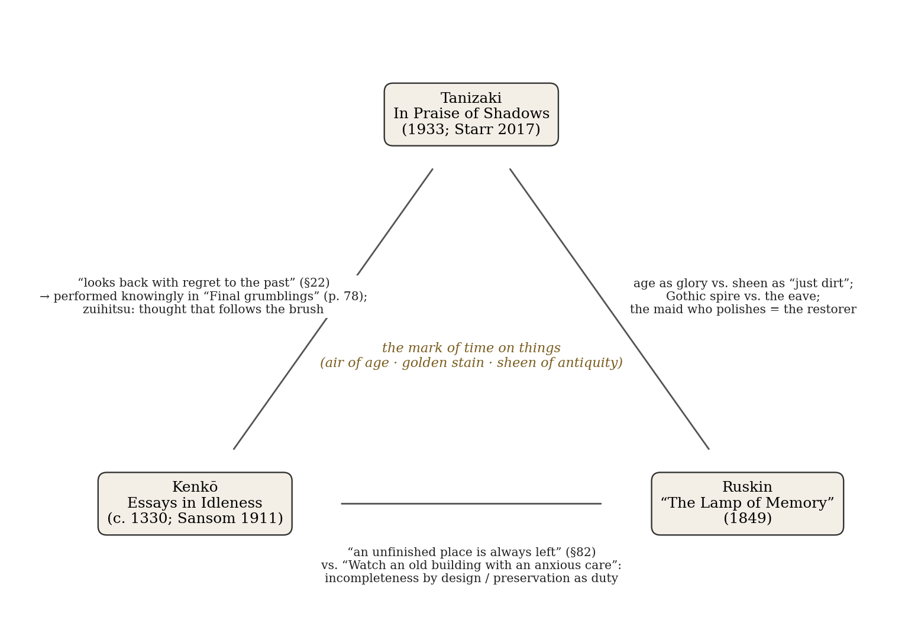
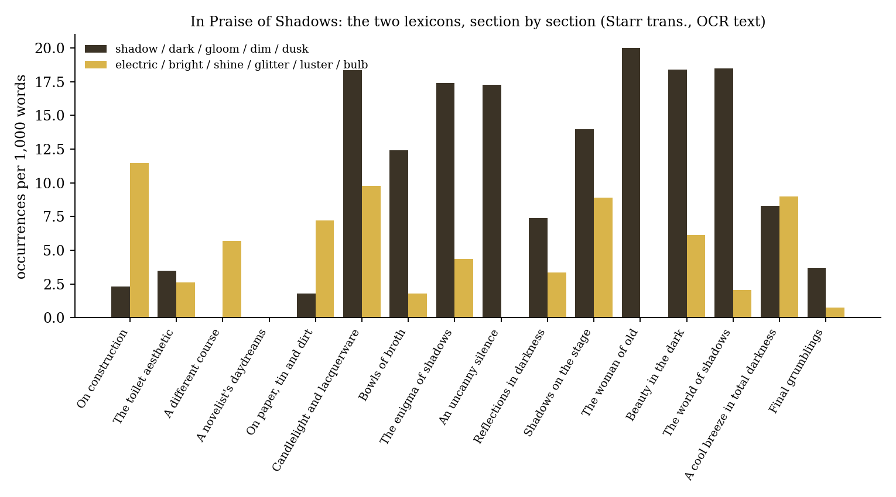

*Triad 23 of 32 · 2026-10-16 · Difficulty 3 · Agreement, Conflict, Shared figure or motif*

## The three books

- [[books/1155-in-praise-of-shadows|In Praise of Shadows]], [[people/jun-ichiro-tanizaki|Jun'ichirō Tanizaki]], [[people/gregory-starr|Gregory Starr]] (translator); 1933. *Anchor: makes the value of time's mark concrete, then undercuts it ('just dirt'); the only one of the three for whom the mark comes from use and touch.*
- [[books/2833-essays-in-idleness|Essays in Idleness]], [[people/yoshida-kenko|Yoshida Kenkō]], [[people/g-b-sansom|G. B. Sansom]] (translator); c. 1330–32. *Ancestor and hinge: the native source of Tanizaki's taste for the worn and incomplete, and the Buddhist position from which Ruskin's anxious preservation looks like attachment.*
- [[books/4017-the-lamp-of-memory|The Lamp of Memory]], [[people/john-ruskin|John Ruskin]]; 1849. *Western, moral counterpart: age as the glory of a building and the 'golden stain of time'; the sharpest opposite to Tanizaki's handled sheen, a prohibition on touching.*

---

## The Thread

Three arguments, six centuries apart, against the polished, the bright and the complete. Kenkō, a fourteenth-century recluse, wants “things with an air of age” and says “It is incompleteness that is desirable.” Ruskin in 1849 says the glory of a building “is in its Age” and calls restoration “a Lie from beginning to end.” Tanizaki in 1933 defends the clouded silver bowl and the soot-darkened room, then admits that the prized “sheen of antiquity” is “in reality, just dirt.” They agree on the value of time’s mark on things, and that agreement is the obvious link.

The less obvious link is where they part, over touch. For Tanizaki the sheen is produced by touch: “the caress of a hand in the same place” works oil into the glaze. For Ruskin the mark is sacred because it must not be touched: “They are not ours.” For Kenkō the mark is a matter of design, not of keeping: “even in building the palace an unfinished place is always left.” The figure who gathers all three is Tanizaki’s maid, scolded for polishing a silver bowl just as it gained its patina. Ruskin would call her a restorer, Tanizaki a vandal, and Kenkō would note that the bowl was going to tarnish again anyway. **Connection kinds:** Agreement; Conflict; Shared figure or motif (the mark of time; the lamp). **Difficulty: 3.**

## Essays in Idleness (Tsurezuregusa) — Yoshida Kenkō (c. 1330–32; trans. G. B. Sansom, 1911)

EPUB · Calibre ID 2833 · Cosimo Classics reprint of Sansom’s 1911 translation → [[books/2833-essays-in-idleness|book page]]

**Selection logic.** Kenkō is the oldest voice and the hinge. His preference for the worn, the incomplete and the lamplit is the native ancestor of Tanizaki’s essay. His Buddhist account of decay (“where there is no room for advance decay is at hand”) is also the position from which Ruskin’s “anxious care” for old stones looks like attachment.

**Overview.** A sequence of 243 numbered pieces written by a court poet turned Buddhist priest. They range over etiquette, impermanence, anecdotes of court officials, drinking, women, the moon, and how to own things. It is the founding text of the *zuihitsu* (“following the brush”) in Japan. Its preface declares the method: to write “without order or purpose.” Sansom’s 1911 version is archaic in diction (“verily,” “forsooth”) but complete.

**Excerpt — §82, the doctrine of the incomplete.** In the space of a few lines Kenkō moves from book covers to imperial architecture to the corpus of scripture.

> Some people dislike to see a complete set of writings—sketches and so on—of which all the volumes are not alike. But Bishop Kōyu said (it seems to me very admirably), ‘It is only a person of poor understanding who wishes to arrange things in complete sets. It is incompleteness that is desirable.’ In everything regularity is bad. To leave a thing unfinished gives interest, and makes for lengthened life. They say

*Figure 1: Constellation: what passes between the three books*

> that even in building the palace an unfinished place is always left. In the writings of the ancients, inner and outer [i.e. Buddhist and non-Buddhist], there are many missing chapters and parts.

**Quotes.**

- “To while away the idle hours, seated the livelong day before the ink-slab, by jotting down without order or purpose whatever trifling thoughts pass through my mind, verily this is a queer and crazy thing to do!” (preface)

- “Truly the beauty of life is its uncertainty.” (§7)

- “In all things one looks back with regret to the past. Modern fashions appear to be growing from bad to worse.” (§22)

- “What one wants are things with an air of age, not showy and expensive, but of good quality.” (§81)

- “Are we only to look at flowers in full bloom, at the moon when clear?” (§137)

**Concordance — “lamp” across the triad** (every occurrence in the three files):

| Book | Location | Use |
|---|---|---|
| Kenkō | §13 | “To sit alone in the lamplight with a book spread out before you…”: reading as converse with the dead |
| Kenkō | §22 | Complains that people now say ‘Get up and light the lamps’ instead of ‘Turn up the lamps’: the complaint is about vocabulary, not illumination |
| Kenkō | §23 | The cry ‘Hasten to light the lamps in his Majesty’s Bedchamber’ |
| Kenkō | §191 | “Good-looking people look even better at night by lamplight” |
| Ruskin | ¶3 | “Memory may truly be said to be the Sixth Lamp of Architecture”: a metaphor only; no physical lamp appears |
| Tanizaki | pp. 17, 23 | Electric fixtures disguised as old oil lamps |
| Tanizaki | p. 33 | “the grime of lamp soot” as part of the beauty of use |
| Tanizaki | p. 37 | Gold lacquer under “reflected lamplight” |
| Tanizaki | p. 59 | Bunraku lit by lamps before Meiji |
| Tanizaki | p. 66 | “From candles to lamps, from lamps to gaslight, from gaslight to electricity, the Westerner is on a constant quest for brightness” |
| Tanizaki | p. 82 | Country villages putting up electric lamps |

The lamp travels from object (Kenkō) to metaphor (Ruskin) to obsolete technology (Tanizaki). Ruskin’s title is the only “lamp” in his chapter.

## “The Lamp of Memory” — John Ruskin (1849; Penguin Great Ideas, 2008)

EPUB · Calibre ID 4017 · chapter VI of *The Seven Lamps of Architecture*; the volume also contains “Cambridge School of Art” (1858), “Of Kings’ Treasuries” (1865) and “Traffic” (1866). Paragraph locations (¶) below are counted within this edition’s 13-paragraph chapter, because it strips Ruskin’s § numbers. → [[books/4017-the-lamp-of-memory|book page]]

**Selection logic.** Ruskin supplies the moral and Western version of what Tanizaki presents as an Eastern taste: the mark of time as the very substance of value (“that golden stain of time”). He also supplies the sharpest opposite to Tanizaki’s handled sheen, a prohibition on touching.

**Overview.** The sixth of Ruskin’s “lamps” (Sacrifice, Truth, Power, Beauty, Life, Memory, Obedience). Architecture is the memory of nations. Domestic buildings should be built to last and inscribed. Public buildings should be storied in their sculpture. A building’s glory is its age. Restoration destroys more totally than ruin. The dead keep their rights in what they built. In 1880 Ruskin added a footnote to the last paragraph calling it “the best, I think, in the book, – and the vainest.”

**Excerpt — ¶12, against restoration.** This is the passage the 1877 SPAB manifesto would turn into an institution.

> Do not let us talk then of restoration. The thing is a Lie from beginning to end. You may make a model of a building as you may of a corpse, and your model may have the shell of the old walls within it as your cast might have the skeleton, with what advantage I neither see nor care: […]
>
> *(Shortened for the public edition.)*

**Quotes.**

- “For, indeed, the greatest glory of a building is not in its stones, nor in its gold. Its glory is in its Age” (¶11)

- “it is in that golden stain of time, that we are to look for the real light, and colour, and preciousness of architecture” (¶11)

- “Watch an old building with an anxious care; guard it as best you may, and at any cost, from every influence of dilapidation.” (¶12)

- “do not care about the unsightliness of the aid: better a crutch than a lost limb” (¶12)

- “They are not ours. They belong partly to those who built them, and partly to all the generations of mankind who are to follow us.” (¶13)

- “along the iron veins that traverse the frame of our country, beat and flow the fiery pulses of its exertion, hotter and faster every hour.” (¶13: the railway, Ruskin’s electric light)

**A misreading worth attempting — and a cut in your edition.** Read the chapter as an essay about *light*. Ruskin does not locate “the real light, and colour” of architecture in the sun or the window but in the *stain*. That is very close to Tanizaki’s claim that beauty lies in

the grime of lamp soot. Now note what your copy leaves out. In ¶11 the Penguin text runs “…of language and of life …” and an ellipsis takes it straight to “Do not let us talk then of restoration.” The pages cut are Ruskin’s account of the *picturesque*, the beauty that decay adds to a building as a by-product, which he names “Parasitical Sublimity” (Library Edition, vol. 8, §12). The passage in Ruskin closest to Tanizaki is exactly the one this edition removed. An edition that silently drops its author’s theory of accidental beauty is a small restoration, in Ruskin’s own sense.

## In Praise of Shadows (In’ei raisan) — Jun’ichirō Tanizaki (1933; trans. Gregory Starr, 2017)

PDF (OCR’d scan, 99 pp.; Sopra Books 2021 edition with foreword by Kengo Kuma and afterword by Eve Zimmerman) · Calibre ID 1155 · page numbers are the printed numbers, which match the PDF page numbers in this file. The section titles are this edition’s. → [[books/1155-in-praise-of-shadows|book page]]

**Selection logic.** Tanizaki is the anchor. He makes the triad’s shared value concrete (silver, tin, jade, lacquer, soy sauce) and then undercuts it: the sheen is dirt, the lament is a reflex of every generation, and the essay ends with a recipe and a shrug. He is also the only one of the three who says the mark of time comes from use, and that comes close to arguing with Ruskin outright.

**Overview.** An essay in sixteen movements on the Japanese house, the toilet, paper, lacquer, food, the eave, the alcove, Nō and Bunraku, women “of old,” and the arrival of electric light. It argues that a whole aesthetics grew from living under deep eaves and that Western illumination is erasing it. Tanizaki’s own last word on it is that the old world can survive “at least in literature’s domain.” The essay also contains a racialized passage on skin colour (pp. 66 ff.), and it objectifies women in the Bunraku section. Zimmerman’s afterword criticises the second. Both belong to the book as written.

**Quotes.**

- “Every household has experienced a time when the master has had to scold a maid who unwittingly polished a silver bowl just as it finally gained an elegant patina.” (p. 29)

- “This ‘sheen of antiquity’ that we hear so much about is, in reality, just dirt.” (p. 32)

- “the caress of a hand in the same place smooths the surface as the oil from the skin permeates the ceramics. It is this that creates the sheen—so in other words, yes, it’s just dirt.” (p. 32)

- “Indeed, to build a Japanese home, we first open an umbrella to create shade over the location, and in the dim light of that shadow we construct our house.” (p. 43)

- “The elders of the last century yearned for the era of two centuries ago; those of two centuries ago longed for that of three centuries ago—the conclusion being that those of any era will not be satisfied with the present.” (p. 78)

- “I would deepen the eaves of the temple of literature, darken its walls and push all things ostentatious into the darkness, stripping all unnecessary decorations from the interior.” (p. 83)

**Derived list — Tanizaki’s catalogue of things improved by age, dirt or darkness** (pp. 29– 41):

1. Silver kettles, sake decanters and cups, left unpolished to tarnish (p. 29)

2. Chinese tin tableware, whose engraved poetry “becomes perfectly fitting as it tarnishes” (p. 31)

3. Jade, for its “strange diluted murkiness” (p. 31)

4. Koshu crystal, preferred over the “far too transparent” Chilean kind (pp. 31–32)

5. Qianlong-period glass, “closer in feel to jade or agate” (p. 32)

6. Ceramics with *nare*, the sheen of long handling (p. 32)

7. Hospital walls and dental surgeries, proposed: earth walls and tatami rather than white and steel (p. 33)

8. Gold lacquer, “never meant to be viewed all at once,” only by candle (p. 37)

9. Miso soup in a black lacquer bowl by candlelight (p. 41)

10. Kansai *tamari* soy sauce, “a superb harmony in its darkness” (p. 41) 11. White rice lifted from a black-lacquered box (p. 41)

**Diagram — the two lexicons across the essay.** Occurrences per 1,000 words of a “shadow” word-family against a “brightness” word-family, for each of the edition’s sixteen sections. Each section is binned from the page on which it begins, and the running heads were removed. The counts come from OCR text and are approximate.

*Figure 2: The two lexicons, section by section*

The essay opens in the vocabulary of what it opposes: wiring, bulbs and fans dominate “On construction.” It turns dark at “Candlelight and lacquerware” and stays dark through “The world of shadows.” Brightness comes back once, in “A cool breeze in total darkness,” with the lit lampposts of Paris at midday. In “Final grumblings” both lexicons nearly vanish, and the essay ends on traffic signals and a sushi recipe. Even the argument is left unfinished.

## Where this sends you

**Notebook**

1. Tanizaki’s sheen is made by “the caress of a hand in the same place” (p. 32). Ruskin’s stones are sacred because “They are not ours” (¶13). Take one object you own that carries the marks of your hands, such as a notebook’s spine, a pen or a carried book. Write which of the two regimes it lives under, and who besides you would be entitled to polish it.

2. Kenkō’s palace keeps “an unfinished place” by design (§82). Ruskin calls a restoration that fakes the old “a Lie” (¶12). Is a ruin built in at the start a lie in Ruskin’s sense, or the only honest building? Try the question on a text: the deliberate lacuna, the fragment published as fragment.

3. Tanizaki’s regress of elders (p. 78) is Kenkō’s §22 restated by someone who has read Kenkō. Write the lament your successor in 2126 will write about 2026: name the thing they will miss that you currently find too bright.

**Rabbit holes**

- Adam Loughnane (and Graham Parkes), “Japanese Aesthetics,” *Stanford Encyclopedia of Philosophy*: treats both Kenkō and Tanizaki — https://plato.stanford.edu/entries/japanese-aesthetics/

- Ruskin, *Works*, Library Edition vol. 8, p. 236: the picturesque passage (“Parasitical Sublimity,” §12) missing from your Penguin — https://lancaster.ac.uk/fass/ruskin/eSoV/texts/vol08/vol08p236.html

- *The Seven Lamps of Architecture*, complete, at Project Gutenberg — https://www.gutenberg.org/ebooks/35898

- William Morris, Manifesto of the Society for the Protection of Ancient Buildings (1877): “put Protection in the place of Restoration” — https://www.marxists.org/archive/morris/works/1877/spabman.htm

- Sebastiano Barassi, “The Modern Cult of Replicas: A Rieglian Analysis of Values in Replication,” *Tate Papers* 8 (2007): Riegl’s age-value, “somewhat Ruskinian” — https://www.tate.org.uk/documents/378/tate_papers_8_sebastiano_barassi_the_modern_cult_of_replicas.pdf

- Gabrielle Ruddick, “Character’s Origin and Accretion in Ruskin’s *Lamp of Memory*” — https://cotjournal.com/characters-origin-and-accretion-in-ruskins-lamp-of-memory-gabrielle-ruddick/

Keep searching: Alois Riegl, *Der moderne Denkmalkultus* (1903), and its *Alterswert*; Viollet-le-Duc’s entry “Restauration” in the *Dictionnaire raisonné* (the position Ruskin is answering); Donald Keene’s 1967 Kenkō for comparison with Sansom; Kamo no Chōmei’s *Hōjōki*, Kenkō’s elder in the genre.

**Also in your library**

- *Hōjōki: A Buddhist Reflection on Solitude* — Kamo no Chōmei (Calibre ID 2834): the other medieval recluse, with the hut that is built to be taken down.

- *John Ruskin* — Andrew Ballantyne (Calibre ID 7188): for the architecture beyond the Lamps.

- *Goethe’s Theory of Colours* — trans. Eastlake (Calibre ID 7041): colour as the meeting of light and darkness, a Western precedent for Tanizaki’s physics.

## From the Lexicon — Architextuality

**Your sense:** Architecture of displacement: how a text structurally signals its deliberate refusal of orthodox generic containment from within. **Received:** The silent, transcendent relationship binding an individual text to a taxonomy of discourse (genre, mode, narrative perspective) that conditions reader expectations.

**Etymology.** Coined by Gérard Genette (*The Architext*, 1979; *Palimpsests*, 1982); it has since moved from descriptive taxonomy to a field of generic subversion.

**WordNet.** No WordNet entry; the term exists only in the technical literature. The absence fits a word for a relation that, in Genette’s own account, is mostly left unsaid.

**Relation.** genealogy_of (incoming): Hypomnēmata →Architextuality.

> Genre is not a container, but an active horizon of expectation staged for subversion.

**Why today.** Kenkō’s preface announces writing “without order or purpose,” and Zimmerman places Tanizaki’s essay in “the genre of the zuihitsu or ‘following the brush,’ ” (afterword, p. 89). That is a genre whose generic signal is the refusal of generic containment, which is close to your sense of the word. Ruskin’s numbered chapter inside a treatise serves as the control case.

**Verified occurrence.** None. The word does not appear in any of the three books.

**New in the Lexicon**

- **Taciturn** — habitually silent or reserved in speech; a settled disposition, not a single silence.

- **Agnatic** — related through the male line only; originally a category of Roman civil law (*agnatio*).

- **Hypostasis** — the underlying reality that “stands under” appearances; in Trinitarian theology, a person of the Trinity.

## To carry

> “To leave a thing unfinished gives interest, and makes for lengthened life.” — Kenkō, *Essays in Idleness*, §82 (trans. Sansom)

## Themes

[[themes/age-value|age-value]] · [[themes/alterswert|Alterswert]] · [[themes/candle|candle]] · [[themes/eaves|eaves]] · [[themes/edition-cuts|edition cuts]] · [[themes/electric-light|electric light]] · [[themes/following-the-brush|following the brush]] · [[themes/golden-stain-of-time|golden stain of time]] · [[themes/gothic-spire|Gothic spire]] · [[themes/incompleteness|incompleteness]] · [[themes/kenko|Kenkō]] · [[themes/lamp|lamp]] · [[themes/lamplight|lamplight]] · [[themes/laudator-temporis-acti|laudator temporis acti]] · [[themes/nare|nare]] · [[themes/parasitical-sublimity|parasitical sublimity]] · [[themes/patina|patina]] · [[themes/picturesque|picturesque]] · [[themes/polish|polish]] · [[themes/restoration-as-lie|restoration as lie]] · [[themes/riegl|Riegl]] · [[themes/ruskin|Ruskin]] · [[themes/shadow|shadow]] · [[themes/sheen-of-antiquity|sheen of antiquity]] · [[themes/spab|SPAB]] · [[themes/tanizaki|Tanizaki]] · [[themes/tarnish|tarnish]] · [[themes/touch-vs-untouchability|touch vs. untouchability]] · [[themes/unfinished-place|unfinished place]] · [[themes/zuihitsu|zuihitsu]]

---

Previous: [[triads/2026-10-15-the-ignorant-master|The Ignorant Master]]  
Next: [[triads/2026-10-17-nothing-reviewed|Nothing, Reviewed]]
